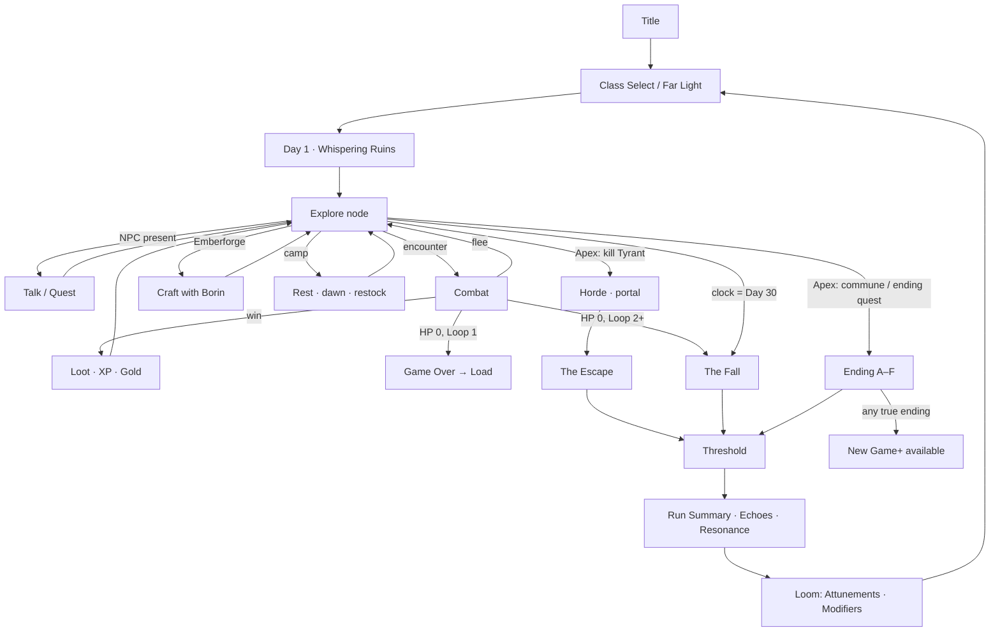

# DESIGN.md — Systems Design for *Echoes of Aethelgard: The Unraveling*

Status: implementable systems design. Canon is `docs/DECISIONS.md` (D-001..D-040); this document elaborates it and never overrides it. Where DECISIONS gives a number, that number is used. Where it does not, a number is chosen here and justified in one sentence. Every named game object has a stable `snake_case` id; downstream engineers turn these tables into `src/content/` data files validated by zod.

Conventions used throughout:

- `ATK` = Strength + weapon power. `SP` (Spell Power) = Magic + weapon spell power. `AGI` = Agility.
- "Turn" = one combatant's action. "Round" = every living combatant has acted once.
- All rounding is round-half-up to an integer, applied once at the end of a calculation unless a step says otherwise.
- Percent chances are integers 0–100 rolled against `rng.next()` (D-032).
- Legacy names (items, enemies, locations, spells, quests, NPCs) are spelled exactly as in `aethelgard_data.py` / `echoes_of_aethelgard.py`. Legacy `D-###` references point to DECISIONS.
- DECISIONS writes Echo ids as `echo.crystal_location`; the data id form is `echo_crystal_location` (one namespace, no dots). The mapping is one-to-one.

---

## 1. Design pillars

### P1 · Knowledge is the only thing you keep
Everything that resets at the Threshold (level, gold, gear, reputation) is a means; what the Wayfinder *knows* is the end. Echoes (D-010), the codex, the bestiary and map memory persist, and every one of them has a mechanical hook: a dialogue line, a skipped fetch step, an open door, an ending flag. The design test for any new feature is "does this give the player something to remember?" — if yes, it should produce an Echo or a codex entry; if no, it is set dressing.

### P2 · Loop 1 is the original game, intact and better
Loop 1 is the legacy game with the legacy names, quests, factions, locations and the "ESCAPE" closer (D-001, D-002). Nothing is renamed. The Breach Clock is subtle, death is classic game-over, the twist lands only when the portal throws you back. Every improvement (intents, trees, statuses, bands) must make Loop 1 better on its own terms, because ≥60% of first-time players must finish it (D-037).

### P3 · Legible combat: every number has a reason
Enemies telegraph intents with type, target and number (D-009). Damage is a nine-step pipeline that the UI can show step by step. Variance is a bounded ±10% roll, never a hidden die. Resistances are four values. Status interplay is a small fixed table. The player should always be able to answer "why did that hit for 17?" from what is on the screen.

### P4 · Regions are levels, not treadmills
No enemy scales with the player (D-009). Each region has a fixed band; the Silverwood Ruins are a level 1–4 place forever. Levelling is felt as regions becoming easy, and new regions as dangerous, in a predictable order. The loop counter adds *variety* (anomaly encounters) and a tiny nudge (+3%/loop, capped +15%), never a treadmill.

### P5 · Every class has three answers and no best button
Five classes × three branches × five tiers (D-008). The legacy "Echo Bolt problem" (one spell that outclasses everything at 2–3 casts per fight) is designed out: damage-per-MP is budgeted per tier, every strong attack carries a condition or a cost, resource generation differs per class so basic attacks remain part of every rotation, and the simulation harness (D-037) rejects any ability over 35% of a class's total damage.

### P6 · Choices cost time, trust or blood — and the game remembers
The Breach Clock (D-005) makes time a resource; faction reputation (D-014) makes trust one; Corruption and Blood price make the body one. Every legacy choice now moves at least two of these (D-017), and the consequence is visible in the Loop Timeline so the player can compare loops.

### P7 · Brisk loops, honest resets
Loop 3+ should take 20–30 minutes (D-011). The reset is real (level 1, 30 gold) so choices keep weight, but Echoes skip solved problems, mastery halves re-unlock costs, Attunements are conveniences, and the UI remembers the map. "Grinding again" is a bug; "deciding again, faster, knowing more" is the game.

---

## 2. Core loop

### 2.1 Moment-to-moment
`explore → talk → fight → loot → craft → rest`, repeated per region:

1. **Explore.** Pick an adjacent node on the illustrated map (1 watch). Arriving fires location events, reveals items, may start an encounter (fixed encounters, 20% return-encounter from the region's wandering pool, anomaly encounters from Loop 2).
2. **Talk.** NPC dialogue is a node graph with conditioned choices (§13). Quests advance here; Echoes unlock lines.
3. **Fight.** Initiative-ordered turns vs 1–3 enemies with telegraphed intents (§4). Win → XP, gold, loot. Lose → Loop 1 game over / Loop 2+ The Fall.
4. **Loot.** Gear with rarity and affixes, consumables, crafting materials by creature family, quest items.
5. **Craft.** Only at the Emberforge, only with Borin (§8): recipes, rarity upgrades, salvage.
6. **Rest.** Short rest (1 watch, +30% HP/MP) or full rest (advance to dawn, full heal, companion swap, merchant restock, camp conversation).

### 2.2 Per loop
Day 1, Dawn, Whispering Ruins, Amulet of Echoes at your feet → explore the eleven regions under the Breach Clock (base 30 days) → one of four loop-closers/endings:

| Exit | Loop | Where it leads |
|---|---|---|
| **The Escape** (kill the Tyrant, flee through Ilyra's portal) | 1+ | Threshold; Loop 1's canonical exit |
| **The Fall** (Breach Clock expires, or death from Loop 2) | 1+ | Threshold |
| **True ending A–F** (D-018) | 2+ | Ending sequence → epilogues → Threshold (New Game+ offered) |
| Death in Loop 1 | 1 | Game over screen → load/restart (no Threshold) |

### 2.3 Meta
Threshold (D-012): run summary → Echoes gained → Resonance tally → Gallery (history, achievements) → the Loom (Attunements, modifiers) → Far Light (class choice, mastery) → Day 1. New Game+ (D-021) starts a fresh save with the profile's Echoes/codex and continues the loop counter.

### 2.4 Flowchart



---

## 3. Stats and derived values

### 3.1 Primaries
Three primaries, as in the legacy game and as DECISIONS keeps them: **Strength (STR)**, **Magic (MAG)**, **Agility (AGI)**. No Vitality: max HP derives from class and STR instead (every class then has a reason to touch STR, and the Warden's identity stays "big"). The player gets **+1 primary of choice per level** (legacy rule kept).

### 3.2 Derived values

| Derived | Formula | Notes |
|---|---|---|
| `max_hp` | `class.base_hp + class.hp_growth·(level−1) + 2·STR + gear_hp` | Legacy was flat 100 + 10/level. |
| `max_mp` | `class.base_mp + class.mp_growth·(level−1) + 2·MAG + gear_mp` | Legacy 50 + 5/level. |
| `ATK` | `STR + weapon.power` | Legacy `attack_power()` unchanged in shape. |
| `SP` | `MAG + weapon.spell_power` | Legacy used `magic + weapon.magic`. |
| `accuracy` | `85 + floor(AGI/2) + gear + status`; abilities tagged `spell` +10 | |
| `evasion` | `floor(AGI/2) + gear + status` | |
| `hit%` | `clamp(attacker.accuracy − defender.evasion, 50, 100)` | Floor 50 so intents are never pointless to read. |
| `crit%` | `5 + floor(AGI/2) + gear + status`, cap 60 | Legacy had no crits. |
| `crit_mult` | `1.5 + gear` | Hunter's Eye raises to 1.75. |
| `initiative` | `AGI + status + d4 (rolled once per fight)` | Order re-sorted every round. Ties: player, companion, enemies by slot. |
| `guard_value` | 50% reduction (D-009); Warden Iron Guard 65%; `affix_of_the_warden` 60% | Multiplicative, applied after flat armor. |
| `armor` | sum of gear `armor`; flat reduction vs Physical | |
| `ward` | sum of gear `ward`; flat reduction vs Fire/Storm/Ley/Void/Chrono | May be negative (Ironclad Plate Armor). |
| `flee%` | `clamp(40 + 3·AGI − 2·max_enemy_AGI, 10, 90) + 15·failed_attempts_this_fight` | Bosses: 0. Slowed: cannot flee. |
| `travel_regen` | +5% max HP, +10% max MP per watch travelled | Legacy regen was 2% HP per move. |

### 3.3 Class base stats (level 1) and growth

| class id | base HP | base MP | STR | MAG | AGI | HP/lvl | MP/lvl | L1 max HP | L1 max MP |
|---|---|---|---|---|---|---|---|---|---|
| `ranger` | 100 | 36 | 10 | 6 | 8 | +8 | +3 | 120 | 48 |
| `wizard` | 84 | 50 | 6 | 11 | 7 | +6 | +5 | 96 | 72 |
| `elf` | 90 | 44 | 7 | 7 | 10 | +7 | +4 | 104 | 58 |
| `ironclad_warden` | 116 | 30 | 12 | 5 | 7 | +11 | +2 | 140 | 40 |
| `shadow_weaver` | 90 | 48 | 6 | 10 | 8 | +7 | +4 | 102 | 68 |

Every class sums to 24 primary points at level 1 (legacy: 21 + 2 class bonus = 23; the extra point funds the wider spread). Reference values before stat points and gear:

| class | L4 HP/MP | L8 | L12 | L16 | L20 |
|---|---|---|---|---|---|
| ranger | 144/57 | 176/69 | 208/81 | 240/93 | 272/105 |
| wizard | 114/87 | 138/107 | 162/127 | 186/147 | 210/167 |
| elf | 125/70 | 153/86 | 181/102 | 209/118 | 237/134 |
| ironclad_warden | 173/46 | 217/54 | 261/62 | 305/70 | 349/78 |
| shadow_weaver | 123/80 | 151/96 | 179/112 | 207/128 | 235/144 |

### 3.4 What changes from legacy, and why

| Legacy | New | Why |
|---|---|---|
| Player hit `70 + 2·AGI − 3·enemyAGI` (5–95) | `85 + ⌊AGI/2⌋ − ⌊enemyAGI/2⌋` (50–100) | Misses were ~25% and felt random; with intents the tension moves to *choices*, so base accuracy rises and the floor is 50. |
| Enemy hit `70 + 2·enemyAGI − 1·AGI` | same single formula for everyone | One rule for all combatants is legible and testable. |
| Damage `ATK + randint(0,4) − def` | `(base + coef·stat) × U(0.90,1.10) …` (§4.3) | Flat +0..4 was 40% of a level-1 hit and 5% of a level-15 hit; a proportional ±10% keeps variance meaningful at every band. |
| Spell `base + 2·(MAG+weapon)`, ×(1−res), staff halves res | `base + coef·SP`, four-step resistance (weak/neutral/resist/immune) | The 2× MAG multiplier was the Echo Bolt problem. Coefficients are 0.8–1.7 by tier and MP cost. |
| Enemies scale ±1 level with the player; Tyrant = level+1 | No scaling; fixed bands; hand-tuned bosses | D-009. Levels must feel like progress. |
| Flee `50 + 2·AGI − 4·enemyAGI` | `40 + 3·AGI − 2·maxEnemyAGI`, +15 per failed try, bosses 0 | Legacy flee vs AGI-7 enemies was ~34% for the average character; new keeps it ~45–60% and ramps so a player is never stuck failing forever. |
| +10 HP, +5 MP per level, flat | class-specific growth + 2·STR / 2·MAG | Class identity (D-008). |
| No crit, no initiative | crit from AGI, initiative from AGI | AGI needed a combat role beyond hit chance. |

---

## 4. Combat

### 4.1 Turn structure

- **Setup.** Combatants: player, active companion (if any, D-013), 1–3 enemies in slots `left/center/right`. Each rolls `initiative = AGI + d4` (the d4 is rolled once and kept). Every enemy generates its first intent (§4.2). Boss fights may open with a dialogue node.
- **Round.** Sort all living combatants by initiative (desc; ties player → companion → enemies by slot). Each acts in order. Order is re-sorted at the start of every round so Haste/Slow matter.
- **A combatant's turn.** (1) Start-of-turn ticks: DoTs (Bleed, Burn, Poison, Curse) deal damage, Regen heals, Rewind checks its timer, Doom Sigil checks its timer. A combatant killed by ticks does not act. (2) Action (exactly one). (3) End-of-turn: durations of statuses *on this combatant* decrement by 1; expired statuses are removed; cooldowns of this combatant's abilities decrement.
- **Enemy turn.** Execute the telegraphed intent (retargeting if the target died or is Taunting/Phased per §4.2), then generate the next intent from `pattern`.
- **End of round.** Boss phase triggers are also checked here (HP-threshold triggers are additionally checked immediately after any damage).
- **Combat ends** when all enemies are dead/spared/fled, when the player's HP is 0, or on a successful flee. Combat costs **0 watches** (D-005).

**Player actions (one per turn):**

| Action | Key | Cost | Notes |
|---|---|---|---|
| Basic attack | `1` | 0 MP | Weapon-type dependent (§5.7). Generates resource for Ranger/Warden. |
| Ability | `2`–`9` | MP (and HP for Blood price) | Tier/cooldown gated. |
| Guard | `G` | 0 | 50% reduction until your next turn; generates class resource (Ranger +5, Wizard +5, Elf +5, Warden +8, Weaver +5 MP). Does not reduce DoT ticks. |
| Item | `I` | 0 MP, consumes item | Consumables only (§7.9). |
| Companion command | `C` | 0 MP | Triggers the companion's signature ability now (if off cooldown). Uses the player's action. |
| Flee | `F` | 0 | Roll `flee%`; success ends combat and moves you to the previous node (§4.8). Fail: turn wasted, +15% next try. |

**Free actions** (no turn cost, unlimited): change companion stance (once per turn), inspect an enemy (bestiary card with known resistances), scroll the log, open the ability tooltip, swap ability-bar page.

### 4.2 Enemy intents

Every creature has a `pattern`: an ordered list of steps with conditional branches. A step is one of:

```ts
type Step =
  | { act: AbilityId; target: TargetRule; hidden?: boolean }
  | { if: Condition; then: Step[]; else?: Step[] }
  | { weighted: { w: number; step: Step }[] }
  | { repeat: Step[]; times: number }
  | { phase_hold: true }   // bosses: hold here until phase changes
```

- `TargetRule` ∈ `player | companion | lowest_hp | highest_mag | random | all | self | marked_first | taunter`.
- `Condition` is the §13 condition language plus combat-only predicates: `{ hp_below: 0.5 }`, `{ turn_gte: 4 }`, `{ ally_count_lt: 2 }`, `{ target_has: "status_soaked" }`, `{ self_has: "status_shield" }`.
- The pattern **pointer** advances one step per turn and wraps. Conditions are evaluated **when the intent is generated** (immediately after the creature acts), never silently re-evaluated later, so what the player sees is what will happen. A `then`/`else` block runs to completion before the pointer continues.
- **Generation = commitment.** The intent stores `{ abilityId, targetId, projected: [min,max], hidden }`. Projected damage is the full pipeline (§4.3) with variance bounds, against the target's *current* statuses and armor, **not** assuming Guard. Hovering/focusing the Guard button shows the halved projection ("14–17 → 7–9").

**Display (intent chip on the enemy card):**
- Icon = damage type glyph (§17.5) or effect glyph (shield, heal, eye for buffs/debuffs).
- Text = ability name ("Maul") plus an effect tag ("may Weaken", "Shield", "heals itself").
- Number = projected damage range ("14–17"), or "—" for non-damaging actions.
- Target arrow → player card or companion card; "ALL" for AoE.

**Hidden vs revealed:**
- Default: type, name, target and number are shown.
- `hidden: true` steps show a "?" chip with the type glyph only (Temporal Aberration's flickering strike; boss specials). A hidden intent resolves (becomes fully visible) at the start of the player's turn immediately preceding it.
- Status chances are shown as text ("may Weaken"); exact percentages are in the bestiary once the creature has been killed 3 times.
- Resistances are shown in the inspect card only after the first kill of that family (or at once with `att_echo_sense`, or via family Echoes like `echo_golem_slate`).
- `rng_hunters_eye`, `comp_dask_glimpse`, `att_foresight`: show the *next-next* intent as a dimmed second chip.

**Interrupts and stuns:**
- **Stun** cancels the stored intent; the creature loses its action; next turn it generates a fresh intent from the *next* pattern step (the stunned step is skipped, not replayed).
- **Interrupt** (Pinning Shot, Stutter, Spellbreaker, Mountainfall on bosses) cancels the stored intent but the creature still acts next turn (new intent from the next step). On bosses this is called **Stagger** and is the only way a boss "loses" an action.
- **Taunt** retargets any single-target intent to the taunter at generation *and* at execution.
- **Phase** on the intended target: single-target intent executes and misses (consuming Phase); AoE unaffected; Chrono ignores Phase.
- **Target death:** single-target intents retarget to the rule's next valid pick (default: player).
- **Slow/Haste** do not alter the intent, only when it fires (initiative re-sort).

### 4.3 Damage pipeline

Each damaging hit runs these steps in order, in floating point, with one rounding at the end:

| # | Step | Rule |
|---|---|---|
| 1 | **Base** | `ability.base` (0 for basic attacks). |
| 2 | **Stat scaling** | `+ coef · stat` where stat is `ATK` or `SP` as the ability declares. Basic attack: `1.0·ATK` (melee). |
| 3 | **Variance** | `× U(0.90, 1.10)` — one `rng.next()` draw mapped linearly. Replaces legacy `randint(0,4)`: proportional, bounded, never hides a kill. DoT ticks have **no variance**. |
| 4 | **Crit** | if `roll < crit%`: `× crit_mult`. Statuses/abilities may force a crit (`guaranteed_crit`). |
| 5 | **Resistance / weakness** | `× 1.5` weak, `× 1.0` neutral, `× 0.5` resist, `× 0` immune (immune short-circuits to 0 and prints "Immune"). |
| 6 | **Interplay** | multipliers from the §4.6 table (e.g., Storm on Soaked ×1.5; Fire on Soaked ×0.5). Stack multiplicatively. |
| 7 | **Status modifiers** | attacker Weaken ×0.75; target Mark ×1.15; target Armor Break vs Physical ×1.15; Glass modifier ×2; Collapse's missing-HP bonus etc. Multiplicative. |
| 8 | **Flat reduction** | Physical: `− target.armor`; other types: `− target.ward`. Skipped if the attack `ignores_armor` or the target has Armor Break. |
| 9 | **Guard** | `× (1 − guard_value)` if the target Guarded this round. Not applied to DoT ticks. |
| 10 | **Shield** | Subtract from the target's Shield pool first; the remainder goes to HP. Void damage destroys the Shield before this step (no absorption). |
| 11 | **Clamp & round** | round half-up; minimum **1** for any non-immune hit that connected (legacy enemy rule `max(1, …)` made universal); maximum `target.max_hp` per hit. |

Ordering note: the brief's sketch lists Guard and Shield before status modifiers; here the percentage modifiers (7) are applied before the flat reduction (8) because applying a percentage after a flat subtraction makes armor stronger against weakened attackers, which players cannot predict from the chips. Everything else follows the sketch.

Healing pipeline: `base + coef·stat` → variance ±10% → target Curse ×0.5 → clamp to missing HP. Overheal from abilities that say so becomes Shield.

### 4.4 Damage types

| id | Name | Fiction | Typical sources |
|---|---|---|---|
| `dmg_physical` | Physical | Steel, claw, stone — what the Nomads trust. | Weapons, beasts, golems, Steel/Bladesong/Breaker. |
| `dmg_fire` | Fire | Pyre and forge-heat; the fire that lit the Conflux. | Pyre branch, Emberforge gear, `affix_of_embers`. |
| `dmg_storm` | Storm | Lightning and the plateau's cutting gales. | Storm branch, Sky-Whisper Sentinels. |
| `dmg_ley` | Ley | The world's own current, drawn clean. Remnant magic. | Echo Bolt, Leyweave, Wisps, Weavers, Ilyra. |
| `dmg_void` | Void | Tears from the Breach; unmaking. | Hex/Drain/Unmaking, Stalkers, Nyx, void-forged gear. |
| `dmg_chrono` | Chrono | Time-shear; the Tyrant's agony made edge. | Chronomancy, Phantoms, Aberrations, Dask, Caelum, the Tyrant. |

Resistance scale per creature per type: `weak` ×1.5 · `neutral` ×1.0 · `resist` ×0.5 · `immune` ×0 (D-009). Players have no innate resistances; gear and `wrd_null_plate`/`wrd_iron_silence` grant steps (a "step" moves one notch toward immune, never past it).

### 4.5 Status effects

Durations are in **turns of the afflicted** (decrement at the end of its turn). "Refresh" = reapplying resets duration to the default and keeps the stronger tick. All ticks are computed at application time from the *source's* stats and stored on the status instance.

| id | Name | Default duration | Stacking | Tick timing | Numeric effect | Cleansed by | Cue |
|---|---|---|---|---|---|---|---|
| `status_bleed` | Bleed | 3 | up to 3 stacks; each application +1 stack and refresh | start of afflicted's turn | Physical `round(1 + 0.2·source.ATK)` per stack; ignores armor; no variance | Regen tick (−1 stack), Field Dressing, Oathbound, Silverwood Bloom, Steady Breath | red drip chip "Bleed ×n" |
| `status_burn` | Burn | 3 | no; refresh | start of turn | Fire `round(2 + 0.3·source.SP)`; cannot be applied to Soaked | Soaked application, cleanses | orange flame chip |
| `status_shock` | Shock | 2 | no; refresh | — | −15 accuracy; takes +25% Storm; Storm crit on Shocked → Stun 1 | Steady Breath, Oathbound, Bloom | yellow jag chip |
| `status_soaked` | Soaked | 3 | no; refresh | — | takes +50% Storm; takes −50% Fire; removes Burn on application | Fire hit (removes it), cleanses | blue droplet chip |
| `status_slow` | Slow | 2 | no; refresh | — | −5 initiative, −10 evasion, cannot flee; removes Haste | Haste application, Steady Breath, Oathbound | grey hourglass chip |
| `status_haste` | Haste | 2 | no; refresh | — | +5 initiative, +10 evasion; removes Slow | Chrono hit (removes it), Unravel, Iron Silence | bright hourglass chip |
| `status_stun` | Stun | 1 | no; a target that just recovered is immune for 2 of its turns (internal cooldown) | — | loses its next action; intent cancelled | Oathbound (pre-emptive immunity only) | starburst chip |
| `status_weaken` | Weaken | 2 | no; refresh | — | deals −25% damage (all types) | Steady Breath, Oathbound, Bloom | drooping arrow chip |
| `status_armor_break` | Armor Break | 3 | no; refresh | — | armor and ward treated as 0; takes +15% Physical | Oathbound, Bloom; Golem "Harden" reapplies armor | cracked plate chip |
| `status_mark` | Mark | 3 | no; refresh | — | takes +15% damage; attacks against it cannot miss; Aggressive companions prefer it | Veilwalk (on allies), Phase consumption | crosshair chip |
| `status_curse` | Curse | 3 | no; refresh | start of turn | Void `round(2 + 0.2·source.SP)`; healing received ×0.5 | Ley hit (removes it), Steady Breath, Bloom, Lanternreed | purple sigil chip |
| `status_shield` | Shield | 3 or until depleted | no; keeps the higher pool, refreshes duration | — | absorbs damage before HP; Void destroys it outright | Unravel, Iron Silence, Nyx's Unmaking | cyan hex chip with number |
| `status_regen` | Regen | 3 | no; refresh | start of turn | heals stored amount; removes 1 Bleed stack per tick; halved while Poisoned | Void hit (removes it), Unravel | green leaf chip |
| `status_taunt` | Taunt | 2 | no; refresh | — | taunted creatures' single-target intents target the taunter | Stun on the taunter ends it | red horn chip on the enemy, shield-arrow on the taunter |
| `status_phase` | Phase | 1 (or until consumed) | no | — | next single-target attack against the holder misses; AoE unaffected; Chrono ignores it | consumption | translucent outline on the card |
| `status_rewind` | Rewind | 2 | one per target | checked at start of turn when duration hits 0 | snapshot HP at application; on expiry HP = max(current, snapshot); also cleanses Bleed/Burn/Poison then | Void hit consumes it (and deals +25%), Unravel, Iron Silence | spiral chip with countdown |
| `status_poison` | Poison | 4 | no; refresh | start of turn | untyped `round(1 + 0.15·source.ATK)`; ignores armor and resistances; halves Regen; constructs and breach-born are immune | Field Dressing, Steady Breath, Bloom, Lanternreed | green skull chip |
| `status_blind` | Blind | 2 | no; refresh | — | −30 accuracy | Steady Breath, Oathbound, Bloom | closed-eye chip |

Rules common to all: statuses on a dead combatant are discarded; statuses never carry out of combat except **Poison, Bleed and Curse**, which continue to tick once per watch travelled (they are cleared by any rest); a status with chance `c` is rolled once per application; bosses declare per-status immunity in their definition (the Tyrant: Stun, Slow, Poison, Bleed immune; Taunt ignored). One buff outside the D-009 set exists, `status_rested` (inn rest: +2 initiative, +5 accuracy for the first fight of the day, §9.5); it is out-of-combat-granted, never applied by abilities, and does not interact with the table above.

### 4.6 Interplay table

| # | Trigger | Result |
|---|---|---|
| 1 | Storm damage on Soaked target | ×1.5 and apply Shock (2) to every *other* enemy (D-009) |
| 2 | Fire damage on Soaked target | ×0.5 and remove Soaked (D-009) |
| 3 | Chrono damage on Hasted target | remove Haste (D-009) |
| 4 | Void damage on Shielded target | destroy the Shield; no absorption (D-009) |
| 5 | Soaked applied to Burning target | remove Burn; Burn cannot be applied while Soaked |
| 6 | Slow applied to Hasted target (or vice versa) | the existing one is removed; the new one is not applied (they cancel) |
| 7 | Regen tick on Bleeding target | remove 1 Bleed stack |
| 8 | Poison on target with Regen | Regen heals 50% |
| 9 | Void damage on Rewound target | consume Rewind (snapshot lost), ×1.25 |
| 10 | Chrono attack vs Phased target | ignores Phase (hits normally) |
| 11 | Stun on a Taunting combatant | Taunt ends |
| 12 | Storm **crit** on Shocked target | apply Stun (1) if not stun-immune |
| 13 | Ley damage on Cursed target | remove Curse, ×1.25 |
| 14 | Void damage on target with Regen | remove Regen |
| 15 | Physical crit on Bleeding target | +1 Bleed stack (max 3) |
| 16 | Fire damage on Burning target by `wiz_immolate` | consume Burn: deal 3× its remaining ticks instantly |
| 17 | Armor Break + Physical | ×1.15 and ignore armor (status definition) |
| 18 | Mark + any attack | cannot miss; ×1.15 (status definition) |

### 4.7 Guard, flee, death, retreat

- **Guard.** Lasts until the guarder's next turn begins. Halves (50%) all direct damage after flat reduction; does nothing to ticks. Generates class resource (§4.1). Guarding while Taunting keeps Taunt. The Guard button shows the projected post-guard numbers for every incoming intent.
- **Flee.** `flee%` as §3.2. Success: combat ends; the party is placed at the **previous node** (legacy behaviour kept); the encounter remains at the node with its current HP and no statuses until the next dawn, after which it heals fully. The flee costs 1 watch (you still walked the road). Bosses and scripted encounters (quest fights, Horde) cannot be fled. `rng_smoke_bomb`/`elf_veilwalk` make the next flee automatic vs non-bosses.
- **Death — Loop 1.** HP 0 → Game Over screen ("FALLEN", legacy art) → Load autosave / Load slot / Title. Classic rule preserved (D-002).
- **Death — Loop 2+.** HP 0 → **The Fall** (short scripted sequence: the Breach reclaims you) → Threshold. The run summary records `closer: "fall_death"`. `att_second_wind` once per loop leaves you at 1 HP instead.
- **Companion KO** does not end combat.
- **Retreat to previous node** (out of combat): from any node, the "Retreat" action in the travel panel returns you along the edge you arrived by for 1 watch, with no encounter roll on arrival. It exists so a player who sees a locked door or a tough fixed encounter card ("Elite · Lv 6") can leave without a wandering roll.

### 4.8 Groups and targeting

- 1–3 enemies in slots. Encounter definitions list slot contents; wandering encounters pick 1 (70%) or 2 (30%) from the region's pool; Horde Rising adds +1.
- Player single-target abilities: default target = last targeted enemy if alive, else leftmost. AoE hits all enemies. Ally-targeted abilities default to the companion if alive else self.
- Enemy targeting without a Taunt: `player` rule picks the player; `random` picks 60/40 player/companion; `lowest_hp` by HP%; `highest_mag` for anti-caster creatures.
- AoE ("all") enemy intents damage player and companion; each defender applies its own Guard/armor/Shield.

### 4.9 Companions in combat

One active companion (D-013). It acts on its own initiative turn by **stance**; the player may trigger its **signature** by spending the player's action.

```ts
function companionAct(c, state): Action {
  const foes = aliveEnemies(state), me = c, pl = state.player;
  switch (c.stance) {
    case "aggressive":
      if (c.auto.find(a => a.kind==="debuff") && !foes.some(f => f.has(a.status)) && mp(c,a)) return use(a, foes.find(f=>!f.has(a.status)));
      if (foes.length >= 2 && c.auto.find(a => a.kind==="aoe") && mp) return use(aoe, "all");
      return use(c.auto.find(a=>a.kind==="attack") ?? basic(c), foes.sort(byMarkedThenLowestHp)[0]);
    case "guarded":
      if (pl.hp/pl.maxHp < 0.4 && c.auto.find(a=>a.kind==="heal") && mp) return use(heal, pl);
      if (c.hp/c.maxHp < 0.35) return guard(c);
      if (nextIntentDamage(pl) >= 0.3*pl.maxHp && c.auto.find(a=>a.kind==="shield") && !pl.has("status_shield") && mp) return use(shield, pl);
      return use(c.auto.find(a=>a.kind==="attack") ?? basic(c), foes.sort(byLowestHp)[0]);
    case "support":
      const low = [pl, c].sort(byHpPct)[0];
      if (low.hp/low.maxHp < 0.6 && c.auto.find(a=>a.kind==="heal") && mp) return use(heal, low);
      if (hasCleansable(pl) && c.auto.find(a=>a.kind==="cleanse") && mp) return use(cleanse, pl);
      if (c.auto.find(a=>a.kind==="shield") && !pl.has("status_shield") && mp) return use(shield, pl);
      if (c.auto.find(a=>a.kind==="debuff") && mp) return use(debuff, foes[0]);
      return basic(c);   // support never spends its last 20% MP on attacks
  }
}
```

- Companion MP regenerates 10% per turn; companions never use items.
- **Signature**: cooldown in the companion's turns (4–5); the player's action triggers it immediately on the player's turn; the companion still takes its own stance action that round.
- **HP/KO**: HP 0 → KO: removed from the fight, no further actions; revived at the next **full rest** at 50% HP, by `wrd_last_bastion`, or by `item_lanternreed_salts`. No permadeath except story (Brak at the Apex, D-013/D-017).
- Companions use the same pipeline and statuses. Their level equals the player's.

### 4.10 Boss framework

A boss definition adds to a creature:

```ts
boss: {
  phases: [{ id, enterWhen: Trigger[], pattern: Step[], adds?: { creatureId, count, hpPct }[], onEnter?: Effect[], barColor }],
  immune: StatusId[],           // e.g. stun, slow
  interruptible: boolean,       // Stagger allowed
  communion?: CommunionSpec,    // §4.11
  fleeable: false
}
type Trigger = { hpBelow: number } | { turn: number } | { playerAction: string } | { addsDead: true } | { resolveAtLeast: number };
```

Rules: phase triggers are evaluated after every damage event and at end of round; entering a phase replaces the pattern pointer, fires `onEnter` (dialogue line, AoE, adds spawn into empty slots, up to 3 total combatants on the enemy side), and resets the intent. Phases never go backwards. HP bars are segmented by phase thresholds so the player can see the next trigger. Adds killed before the next phase do not respawn; adds alive at a phase change stay.

**Legacy bosses re-expressed:** Stone-Hide Golem pair at the Blighted Outpost is an **elite encounter**, not a boss (no phases). The Chronos Tyrant has two definitions:

| id | Loop | HP / ATK / SP / armor / ward / AGI | Phases | Notes |
|---|---|---|---|---|
| `chronos_tyrant_contained` | 1 | 540 / 24 / 26 / 6 / 8 / 4 | P1 100–66%: `tyr_shear` (Chrono 1.0·SP all), `tyr_time_lash` (Chrono 1.3·SP single), `tyr_grasp` (Physical 1.2·ATK, Slow 100%). P2 <66%: `onEnter` spawn 2× `temporal_aberration` at 60% HP; adds `tyr_remember` (self Rewind) every 3rd step and `tyr_chrono_strike` (hidden 2-turn wind-up; Chrono 2.0·SP; Stun 1 unless target Guarded — "the strike that scattered Dask"). P3 <33% or turn 14: `tyr_unraveling` (Chrono 1.1·SP all + Armor Break) every turn; `tyr_remember` every 3rd. | Immune Stun/Slow/Poison/Bleed; Taunt ignored. Resist Chrono, Void; weak Ley. XP 900. Cannot speak (D-004). Tuned for level 12–13 (see §6.6). |
| `chronos_tyrant_unveiled` | 2+ | 900 / 32 / 36 / 8 / 10 / 4 | P1 100–75% "Lament": speaks; `tyr_time_lash`, `tyr_grasp`, `tyr_shear`. P2 <75% "The Nine Surface": spawn 2× `nine_shard` (each casts one dead mage's spell; 90 HP); Rewind cycle. P3 <50% "Chrono-Strike": `tyr_chrono_strike` every 3rd turn, otherwise P1 steps. P4 <25% or turn 20 "The Hold Fails": `tyr_unraveling` every turn, damage +10% per turn (uncapped); communion Resolve gains ×1.5. | Same immunities. XP 1600. Communion available (§4.11). Killing it in any loop triggers the Horde and The Escape, never a true ending (D-004, D-018). |

### 4.11 Communion (non-combat resolution for the Tyrant)

Available at the Apex from Loop 2 when the player holds `echo_tyrant_jailer`. The encounter screen is the combat screen; the ability bar gains a seventh toggle **Commune** (free action) that swaps the bar for four **dialogue actions**, each costing the player's turn while the Tyrant's intents continue:

| Action | Effect on `resolve` (0–100) | Risk |
|---|---|---|
| **Speak** (choose a line; lines require Echoes) | generic line +5; `echo_wayfinder_lineage` +10; `echo_tyrant_name` +15; each Litany verse Echo +25 (each line usable once per encounter) | the Tyrant's next intent is unchanged |
| **Listen** | +10; the Tyrant speaks a codex fragment (unlocks `codex_*` entries) | its next intent becomes a full-strength `tyr_time_lash` (it lashes while it remembers) |
| **Offer** (present an item) | Chronos Lens +15; Stabilized Heartstone +20; Breach-anchor +25 (also sets `flag_anchor_offered`); Heartstone Core **−20** (it recoils) | the item is not consumed |
| **Resist** | +5 and acts as Guard | none |

- Companion in Support stance adds +5 resolve per round (Dask +10, Caelum +8). `echo_tyrant_communion` makes every gain ×1.25.
- The Tyrant's outgoing damage is multiplied by `(1 − resolve/200)` (at 60 resolve it hits for 70%).
- If Tyrant HP < 30% while communing, gains ×1.5 ("it is tired") — players may fight it down first.
- `resolve ≥ 100` → `Trigger {resolveAtLeast:100}` enters a terminal phase `tyr_stillness`: combat ends with the Tyrant spared; the Resolution dialogue follows (STORY owns the lines) with ending choices gated by §10 flags (A: `echo_litany_complete`; B: anchor + flags; F: refuse all).
- Attacking during communion is allowed; a kill ends in the Horde as usual. Fleeing is impossible. Resolve is per encounter (not saved across loops) but `echo_tyrant_communion` is granted the first time resolve reaches 50.

### 4.12 Worked example — Ranger level 4 vs Wildling Brute + Corrupted Shade

Setting: Mistwood Path, Loop 1, a return encounter from the legacy wandering pool. No companion.

**Ranger L4** (`ranger`): STR 12 (10 + 2 points), MAG 6, AGI 9 (8 + 1). Weapon Traveler's Sword, Uncommon (power 5 × 1.1 = 5.5 → 6) → **ATK 18**. Armor Wildling Hide Armor, Common → armor 2, ward 1. max HP = 100 + 8·3 + 2·12 = **148**; max MP = 36 + 3·3 + 2·6 = **57**. accuracy 89, evasion 4, crit 9%, crit ×1.5. Abilities (4 AP): `rng_venom_coat`, `rng_marked_shot`, `rng_rend`, `rng_piercing_arrow`. Focus: +8 MP per basic hit (+12 on crit), +5 on Guard.

**Wildling Brute** (`wildling_brute`, L4): HP 64, ATK 11, armor 3, ward 0, AGI 3 → accuracy 86, evasion 1. Pattern: `strike(1.0·ATK) → strike → maul(1.6·ATK) → {hp<50%: root_knit(Regen 3×2) | strike}`. **Corrupted Shade** (`corrupted_shade`, L2): HP 36, ATK 7, SP 7, armor 1, ward 2, AGI 5 → accuracy 87 (Wail is a spell: 97), evasion 2. Immune Poison (breach-born). Pattern: `rake(1.0·ATK) → wail(Void 0.9·SP, Weaken 50%, 2) → {hp<70%: fade(Phase self) | rake}`.

Initiative: Ranger 9+2 = 11, Shade 5+3 = 8, Brute 3+1 = 4. Order every round: Ranger → Shade → Brute. Opening intents: Shade **Rake → Ranger 4–6** (7×0.9−2 = 4.3→4; 7×1.1−2 = 5.7→6); Brute **Strike → Ranger 8–10**.

| Rd | Actor | Action and pipeline | Result | New intents |
|---|---|---|---|---|
| 1 | Ranger | `rng_venom_coat` (6 MP → 51). Self buff, 3 turns: attacks apply Poison. | — | — |
| 1 | Shade | Rake: hit roll needs ≤ 87−4 = 83; rolls 90 → **miss**. | — | **Wail → Ranger 5–6, may Weaken** (6.3×0.9−1 = 4.67→5; 6.3×1.1−1 = 5.93→6) |
| 1 | Brute | Strike: needs ≤ 82; rolls 37 hit. 11 × 1.07 = 11.77; no crit (80 > 6); neutral; −2 armor = 9.77 → **10**. | Ranger 148 → 138 | **Strike → Ranger 8–10** |
| 2 | Ranger | `rng_marked_shot` → Shade (8 MP → 43). Needs ≤ 87; hit. 1.1×18 = 19.8 × 1.03 = 20.39; no crit; neutral; −1 armor = 19.39 → **19**. Mark (3) applied. Venom Coat tries Poison → **Immune** (chip flashes "Immune"). | Shade 36 → 17 (47%) | — |
| 2 | Shade | Wail: spell accuracy 97−4 = 93; hit. Void 6.3 × 1.02 = 6.43 − ward 1 = 5.43 → **5**. Weaken roll 32 ≤ 50 → Ranger **Weakened (2)**. | Ranger 138 → 133 | pointer → branch: hp 47% < 70% → **Fade (Phase self)**, chip "shrouds itself" |
| 2 | Brute | Strike: hit. 11 × 0.98 = 10.78 − 2 = 8.78 → **9**. | Ranger 133 → 124 | **Maul → Ranger 14–17** (heavy glyph) |
| 3 | Ranger | **Guard** (+5 Focus → 48). Reasoning the UI supports: Weakened this turn (−25% damage dealt) and a 14–17 heavy incoming; Guard preview shows "7–9". | — | — |
| 3 | Shade | Fade → gains **Phase (1)**. | — | **Rake → Ranger 4–6** |
| 3 | Brute | Maul: hit. 17.6 × 1.05 = 18.48 − 2 = 16.48; Guard ×0.5 = 8.24 → **8**. | Ranger 124 → 116 | pointer → branch: hp 100% → **Strike → Ranger 8–10** |
| 4 | Ranger | `rng_rend` → Brute (8 MP → 40). Weaken still active (expires end of this turn). Needs ≤ 88; hit. 18 × 0.98 = 17.64 × 0.75 = 13.23 − 3 armor = 10.23 → **10**. Bleed ×1 (3 turns, tick `round(1+0.2·18)` = **5**). Venom Coat → **Poison (4 turns, tick `round(1+0.15·18)` = 4)**. | Brute 64 → 54 | — |
| 4 | Shade | Rake: hit. 7 × 0.90 = 6.3 − 2 = 4.3 → **4**. (Its Phase is unused; expires end of its turn.) | Ranger 116 → 112 | **Rake → Ranger 4–6** |
| 4 | Brute | Start of turn: Bleed 5 + Poison 4 = **9**. Strike: needs ≤ 82; rolls 88 → **miss**. | Brute 54 → 45 | **Strike → Ranger 8–10** |
| 5 | Ranger | Basic attack (sword) → Shade (Marked: cannot miss). 18 × 1.02 = 18.36; crit roll 07 ≤ 9 → **crit** ×1.5 = 27.54; Mark ×1.15 = 31.67; −1 armor = 30.67 → **31**. Focus +12 → 52. | Shade 17 → **0, dies**; intent removed | — |
| 5 | Brute | Ticks 9. Strike: hit. 11 × 0.91 = 10.01 − 2 = 8.01 → **8**. | Brute 45 → 36; Ranger 112 → 104 | **Maul → Ranger 14–17** |
| 6 | Ranger | `rng_piercing_arrow` → Brute (12 MP → 40). Hit. 1.5×18 = 27 × 1.04 = 28.08; no crit; ignores armor → **28**. | Brute 36 → 8 | — |
| 6 | Brute | Start of turn: Bleed 5 (3rd and last tick) + Poison 4 = 9 ≥ 8 → **dies before acting**. Log: "The Brute bleeds out before it can swing." | Brute 8 → 0 | — |

Outcome after 6 rounds: Ranger 104/148 HP, 40/57 MP. Rewards: XP 71 (Brute, L4) + 41 (Shade, L2) = **112**; gold 14 + 9 = **23**; loot rolls: Shade → Dark Spellbook (50%: yes), `mat_shadow_ash` (80%: yes); Brute → Ley-Touched Tonic (60%: yes), Wildling Hide Armor (25%: no), `mat_wildling_hide` (80%: yes). Bestiary: Corrupted Shade kills 1 (resistances now shown), Wildling Brute kills 1. Autosave fires (§14).

What the example demonstrates: intents with ranges and effect tags; a conditional branch flipping an intent (Fade); Guard against a telegraphed heavy; a resistance surprise (Poison immune) that costs nothing but teaches; Weaken's visible −25%; DoTs killing at start-of-turn; Mark making a finishing blow certain; Focus economy (two basic-attack-equivalents fund the abilities).

---

## 5. Classes and ability trees

### 5.1 Shared rules

- **Tiers and level gates.** Tier 1 = level 1, Tier 2 = level 4, Tier 3 = level 8, Tier 4 = level 12, Tier 5 (capstone) = level 16. In addition, Tier 3 requires ≥2 abilities already unlocked in that branch, Tier 4 ≥3, and the capstone all four. Capstones therefore cost 6 AP per branch in total (4 + 2).
- **Ability points.** 1 AP per level including level 1 (so a level-1 character unlocks one Tier-1 ability before the first fight); capstones cost 2. AP is stored internally in **half-points** so that mastery (§6.4) can halve costs exactly.
- **Power budget (the anti-Echo-Bolt rule).** Let U = the class's basic-attack damage at that level. Single-target damage abilities are budgeted at T1 ≈ 1.2–1.3U for 8 MP, T2 ≈ 1.5–1.7U for 12–14 MP, T3 ≈ 1.8–2.0U, T4 ≈ 2.2–2.4U (or ≈1.0U to all), T5 ≈ 2.6–3.2U for 24–30 MP with a cooldown. Every ability above 1.3U carries at least one of: a cooldown, a self-cost, a setup condition (status on target), or a damage type that 25%+ of creatures in its band resist. The harness (§19) flags any ability over 35% of a class's aggregate damage.
- **Cooldowns** are counted in the caster's turns and shown as a numeric overlay; they persist within a fight only (reset at combat end).
- **MP cost modifiers.** Staff `mp_cost_reduction` (Apprentice 10%, Necromancer 20%) applies to every ability, rounded down, minimum 1. Heartstone Destroy: Ley abilities +25% MP (D-017). Corruption does not reduce costs (its bonus is to SP, §6.7).
- **Out-of-combat use.** Abilities tagged `field` (heals, cleanses, Rewind) can be used outside combat at their MP cost.
- All ability ids are stable. Columns: Branch · Tier · MP · Target · Type · Power (base + coef·stat) · Status (id, chance, duration) · CD · Description.

### 5.2 Ranger (`ranger`)

*Fantasy.* Hunter of the wilds between settlements. You read the ground before the sky, carry three kinds of knife and a bow you made yourself, and you have never once asked a ley line for help. The Ranger is the game's baseline body: good HP, honest Physical damage, and tools for every situation if you spent the points.

*Resource.* Mana as **Focus**: +8 MP per basic-attack hit (+12 on crit), +5 per Guard; small pool. Rotation is basic-attack-then-ability by design.

*Base stats.* HP 100 (+8), MP 36 (+3), STR 10, MAG 6, AGI 8. *Starting kit.* Rusty Dagger, Ley-Touched Tonic ×2, 30 gold.

| id | Name | Branch | Tier | MP | Target | Type | Power | Status | CD | Description |
|---|---|---|---|---|---|---|---|---|---|---|
| `rng_marked_shot` | Marked Shot | Hunt | 1 | 8 | single | Physical | `1.1·ATK` | `status_mark` 100%, 3 | — | Every hunt begins with a choice of prey. |
| `rng_piercing_arrow` | Piercing Arrow | Hunt | 2 | 12 | single | Physical | `1.5·ATK`, ignores armor; ×1.25 vs Marked | — | — | Hide, plate, bark. It does not care. |
| `rng_hunters_eye` | Hunter's Eye | Hunt | 3 | 10 | self | — | — | self: +20 crit, crit ×1.75, see next-next intents; 3 turns | 4 | You stop blinking. The forest slows down. (utility) |
| `rng_pinning_shot` | Pinning Shot | Hunt | 4 | 14 | single | Physical | `1.0·ATK` | interrupts the target's intent; `status_slow` 100%, 2 | 3 | Through the foot, into the root. It isn't going anywhere. (defensive) |
| `rng_killing_shot` | Killing Shot | Hunt | 5 | 24 | single | Physical | `2.2·ATK`; guaranteed crit vs Marked; refunds 24 MP if it kills | — | 4 | One arrow. You have been saving it since the Ruins. (capstone) |
| `rng_rend` | Rend | Steel | 1 | 8 | single | Physical | `1.0·ATK` | `status_bleed` 100%, 3 (+1 stack) | — | A wound that keeps working after you stop. |
| `rng_riposte_stance` | Riposte Stance | Steel | 2 | 8 | self | — | — | Guard (50%) this round; each melee attacker takes `0.8·ATK` Physical and you gain 8 Focus | 3 | Let them come. (defensive) |
| `rng_hamstring` | Hamstring | Steel | 3 | 10 | single | Physical | `0.9·ATK` | `status_slow` 100%, 2; +1 Bleed stack if already bleeding | — | Behind the knee, where the Nomads taught you. (utility) |
| `rng_whirling_steel` | Whirling Steel | Steel | 4 | 16 | all | Physical | `0.85·ATK` | +1 Bleed stack on each already-bleeding target | — | Three blades, one breath. |
| `rng_exsanguinate` | Exsanguinate | Steel | 5 | 20 | single | Physical | `1.4·ATK` + consume all Bleed: deal 2× the remaining tick total instantly | — | 4 | Finish what the first cut started. (capstone) |
| `rng_venom_coat` | Venom Coat | Wildcraft | 1 | 6 | self | — | — | for 3 turns your attacks and Hunt/Steel abilities apply `status_poison` 100%, 4 | — | Mistwood sap, nightshade, patience. (utility) |
| `rng_field_dressing` | Field Dressing | Wildcraft | 2 | 10 | self/ally | heal | `18 + 0.8·max(STR,AGI)`; removes Bleed and Poison | — | — | Boiled moss and a steady hand. Works on the road too. (defensive, `field`) |
| `rng_snare_trap` | Snare Trap | Wildcraft | 3 | 12 | single | Physical | `0.5·ATK` | `status_stun` 100%, 1 (non-boss); bosses: `status_slow` 2 | 3 | They never look down. (utility) |
| `rng_smoke_bomb` | Smoke Bomb | Wildcraft | 4 | 12 | all | — | — | `status_blind` 100%, 2 on all enemies; your next flee auto-succeeds (non-boss) | 3 | Rootbone ash and glow gland. Nobody sees what you do next. (defensive/utility) |
| `rng_apex_predator` | Apex Predator | Wildcraft | 5 | 20 | self | — | — | 4 turns: all DoTs you applied tick twice per turn; Focus generation ×2 | 5 | The wilds have a new top of the chain. (capstone) |

*Why no single best button:* Marked Shot and Rend are both 1.0–1.1U at 8 MP with different payoffs (certainty vs. attrition); Piercing Arrow's 1.5U needs 12 MP that only basic attacks replenish; Killing Shot refunds only on a kill. In the sim the Ranger's damage splits roughly 35% basic / 25% Bleed+Poison ticks / 40% abilities.

### 5.3 Wizard (`wizard`)

*Fantasy.* Self-taught ley-caster. Nobody trained you; the Dark Spellbooks did, and they are not kind teachers. Big pool, steady regeneration, fragile body. Pyre burns, Storm chains, Chronomancy bends the order of things.

*Resource.* Mana regenerates **10% of max MP (rounded up) at the start of each of your turns**; large pool. The staff cantrip (§5.7) also restores 3 MP. No generation from Guard beyond the universal +5.

*Base stats.* HP 84 (+6), MP 50 (+5), STR 6, MAG 11, AGI 7. *Starting kit.* Apprentice Staff, Mana Bloom ×1, Ley-Touched Tonic ×1, 30 gold.

| id | Name | Branch | Tier | MP | Target | Type | Power | Status | CD | Description |
|---|---|---|---|---|---|---|---|---|---|---|
| `fireball` | Fireball | Pyre | 1 | 12 | single | Fire | `1.5·SP + 4` | `status_burn` 100%, 3 | — | The first spell Maelis wrote down. It still works. |
| `wiz_cinder_shield` | Cinder Shield | Pyre | 2 | 10 | self | — | Shield `1.5·SP + 10`, 3 turns | melee attackers take `0.5·SP` Fire and Burn 50%, 3 | 3 | Heat the air until steel flinches. (defensive) |
| `wiz_flame_wave` | Flame Wave | Pyre | 3 | 18 | all | Fire | `1.0·SP + 3` | `status_burn` 60%, 3 | — | The Spires' light, borrowed and angry. |
| `wiz_immolate` | Immolate | Pyre | 4 | 16 | single | Fire | `1.2·SP`; consumes Burn for 3× its remaining ticks (interplay 16) | — | — | Everything that is burning, burns now. (utility) |
| `wiz_pyre_of_the_nine` | Pyre of the Nine | Pyre | 5 | 30 | all | Fire | `2.0·SP + 10` | `status_burn` 100%, 3; `status_armor_break` 100%, 2; costs 10% of your max HP | 4 | The fire that lit the Conflux. You pay what they paid. (capstone) |
| `wiz_static_lash` | Static Lash | Storm | 1 | 8 | single | Storm | `1.1·SP + 2` | `status_shock` 50%, 2 | — | A crack of blue across the gap. |
| `lightning_bolt` | Lightning Bolt | Storm | 2 | 14 | single | Storm | `1.7·SP + 4`; chains to one other enemy at 50% if the target is Soaked or Shocked | `status_shock` 100%, 2 | — | The sky's own argument. |
| `wiz_gale_step` | Gale Step | Storm | 3 | 10 | self | — | — | `status_haste` 3; `status_phase` 1 | 3 | Be where the blow is not. (defensive/utility) |
| `wiz_chain_tempest` | Chain Tempest | Storm | 4 | 20 | all | Storm | `1.1·SP` | Shocked targets take ×1.25 and spread Shock (interplay 1/12) | — | One bolt is weather. Three is a verdict. |
| `wiz_skyfall` | Skyfall | Storm | 5 | 30 | single | Storm | `2.6·SP + 8`; if the target is Soaked: Stun 1 and forks to all enemies at 50% | — | 4 | Call the plateau's storm down the ley line. (capstone) |
| `echo_bolt` | Echo Bolt | Chronomancy | 1 | 8 | single | Ley | `1.2·SP + 3` | — | — | A moment's residue, thrown. Cheap, clean, reliable — and no more than that. |
| `wiz_temporal_drag` | Temporal Drag | Chronomancy | 2 | 10 | single | Chrono | `0.8·SP` | `status_slow` 100%, 2; removes Haste | — | Make a second last. (utility) |
| `wiz_rewind` | Rewind | Chronomancy | 3 | 14 | self/ally | — | — | `status_rewind` 2 (HP returns to the higher of now/then; cleanses Bleed/Burn/Poison on trigger) | 4 | Remember being whole. (defensive, `field`) |
| `wiz_stutter` | Stutter | Chronomancy | 4 | 16 | single | Chrono | `0.6·SP` | interrupt; `status_stun` 100%, 1 (non-boss) or `status_slow` 2 (boss) | 3 | Their next moment never arrives. (utility) |
| `wiz_unmoment` | Unmoment | Chronomancy | 5 | 30 | all | Chrono | `1.8·SP + 6` | `status_slow` 100%, 2 on all; self `status_haste` 2 | 5 | For one breath, you are the only thing that moves. (capstone) |

*Why Echo Bolt is no longer the answer:* it is the cheapest spell and does 1.2·SP+3 — about 1.3× the cantrip — with no status; Fireball at 12 MP adds Burn (≈+0.9·SP over three turns) and Static Lash sets up Storm combos. Against the Ruins' Shades (weak Fire) and Wisps (resist Ley), Fireball is the better Tier-1 and Echo Bolt is the filler. The legacy Dark Spellbook unlock chain is gone: Fireball and Lightning Bolt are ordinary tree abilities; spellbooks now grant Corruption and SP (§6.7, D-017).

### 5.4 Elf (`elf`)

*Fantasy.* A Silverwood-blooded ley-duelist (D-008): the old bloodlines of the capital, long-lived, ley-sensitive, trained to fight the way the city's fountains moved. Fast, evasive, and the only class that heals as naturally as it cuts.

*Resource.* Mana generated **+10 when an attack against you misses or is Phased, +6 on each of your crits**; small pool; the universal +5 on Guard.

*Base stats.* HP 90 (+7), MP 44 (+4), STR 7, MAG 7, AGI 10. *Starting kit.* Primitive Bow, Glow Moss ×2, 30 gold.

| id | Name | Branch | Tier | MP | Target | Type | Power | Status | CD | Description |
|---|---|---|---|---|---|---|---|---|---|---|
| `elf_twin_strike` | Twin Strike | Bladesong | 1 | 8 | single | Physical | 2 hits × `0.65·ATK` (each rolls hit and crit) | — | — | Two notes, one breath. |
| `elf_dancers_guard` | Dancer's Guard | Bladesong | 2 | 8 | self | — | — | 2 turns: +25 evasion; each dodge grants +5 extra MP | 3 | Never be where the blade expects. (defensive) |
| `elf_flurry` | Flurry | Bladesong | 3 | 14 | single | Physical | 3 hits × `0.55·ATK`; a crit adds a 4th hit (max one) | — | — | The fountain-step, the arch-step, the fall. |
| `elf_crescendo` | Crescendo | Bladesong | 4 | 16 | all | Physical | `0.8·ATK`, +15% per Bladesong ability used earlier this fight (cap +60%) | — | — | The song remembers its own verses. |
| `elf_final_verse` | Final Verse | Bladesong | 5 | 24 | single | Physical | 5 hits × `0.5·ATK`; last hit guaranteed crit | self `status_haste` 2 | 4 | Silverwood's last dance, performed once. (capstone) |
| `elf_ley_mend` | Ley Mend | Leyweave | 1 | 8 | self/ally | heal | `14 + 1.2·SP` | — | — | The current wants things whole. Ask it. (defensive, `field`) |
| `elf_barkskin` | Barkskin | Leyweave | 2 | 10 | self/ally | — | Shield `12 + 1.4·SP`, 3 | `status_regen` `4 + 0.4·SP`/turn, 3 | 3 | Wear the forest for a while. (defensive) |
| `elf_thornlash` | Thornlash | Leyweave | 3 | 12 | single | Ley | `1.3·SP + 4` | `status_bleed` 100%, 3 | — | Green has teeth. |
| `elf_silverwood_bloom` | Silverwood Bloom | Leyweave | 4 | 16 | party | — | — | cleanse all negative statuses on player and companion; `status_regen` 3 on both; `status_soaked` 100%, 3 on all enemies | 4 | Dew falls on everything. Your enemies notice later. (utility) |
| `elf_heart_of_the_grove` | Heart of the Grove | Leyweave | 5 | 26 | party | — | 3 turns: `status_regen` `8 + 0.8·SP`, Shield `20 + 1.5·SP`, Ley damage dealt +30% | — | 5 | Stand where the capital's trees once stood. (capstone) |
| `elf_shadowstep` | Shadowstep | Shadowstep | 1 | 6 | self | — | — | `status_phase` 1; your next attack is a guaranteed crit | 2 | Between one shadow and the next. (defensive/utility) |
| `elf_ambush` | Ambush | Shadowstep | 2 | 12 | single | Physical | `1.6·ATK`; ×1.5 if you are Phased or it is round 1 | — | — | The fight is decided before it is noticed. |
| `elf_blink_strike` | Blink Strike | Shadowstep | 3 | 12 | single | Physical | `1.1·ATK` | `status_weaken` 100%, 2; you act first next round | — | Cut the tendon, be gone. |
| `elf_veilwalk` | Veilwalk | Shadowstep | 4 | 14 | party | — | — | player and companion gain `status_phase` 1; removes Mark/Taunt from both; next flee auto-succeeds (non-boss) | 4 | Take someone with you into the between. (utility) |
| `elf_moment_between` | The Moment Between | Shadowstep | 5 | 24 | self | — | — | take a second full action immediately (cannot chain itself) | 5 | Two heartbeats in the space of one. (capstone) |

*Balance note:* multi-hit abilities roll each hit, so armor applies per hit; Bladesong is weak against high-armor Golems and strong against Phantoms/Wisps — the Leyweave branch covers the gap with Ley damage.

### 5.5 Ironclad Warden (`ironclad_warden`)

*Fantasy.* The Nomads' wall. Steel and stubbornness (Brak's words). You win by being the last one standing and making sure everything is hitting you. Slow, heavy, nearly immune to being rushed.

*Resource.* Mana as **Grit**: +6 MP each time you are hit by an enemy action, +8 per Guard (replaces the universal +5), +4 per enemy Taunted by Challenge. Small pool, low growth.

*Base stats.* HP 116 (+11), MP 30 (+2), STR 12, MAG 5, AGI 7. *Starting kit.* Nomad's Maul (`item_nomads_maul`, heavy, power 5, accuracy −5), Scrap Harness (`item_scrap_harness`, armor 2, ward 0), Ley-Touched Tonic ×1, 30 gold.

| id | Name | Branch | Tier | MP | Target | Type | Power | Status | CD | Description |
|---|---|---|---|---|---|---|---|---|---|---|
| `wrd_iron_guard` | Iron Guard | Bulwark | 1 | 6 | self | — | Guard at 65% this round; +12 Grit; companion takes −25% this round | — | — | Set your feet. Let the hill come to you. (defensive) |
| `wrd_challenge` | Challenge | Bulwark | 2 | 8 | all | — | — | `status_taunt` 100%, 2 on all enemies | 2 | Here. Me. Now. (utility) |
| `wrd_shield_wall` | Shield Wall | Bulwark | 3 | 12 | party | — | Shield `18 + 1.2·ATK` on self and companion, 3 turns | — | 3 | Two is a wall. One is a wall that remembers two. (defensive) |
| `wrd_unbroken` | Unbroken | Bulwark | 4 | 14 | self | — | 2 turns: no single hit may exceed 25% of your max HP | immune to Stun and Slow for the duration | 4 | They will have to do it the slow way. (defensive) |
| `wrd_last_bastion` | Last Bastion | Bulwark | 5 | 20 | party | — | revive a KO'd companion at 40% HP (or heal 30%); Shield `30 + 1.5·ATK` on both; reflect 25% of damage taken as Physical, 2 turns | `status_taunt` 100%, 2 on all | 5 | The line holds because you are the line. (capstone) |
| `wrd_crushing_blow` | Crushing Blow | Breaker | 1 | 8 | single | Physical | `1.3·ATK`, accuracy −5 | `status_armor_break` 100%, 3 | — | Hit the plate until it stops being plate. |
| `wrd_concussive_slam` | Concussive Slam | Breaker | 2 | 12 | single | Physical | `1.0·ATK` | `status_stun` 75%, 1 (non-boss); bosses: `status_weaken` 2 | 3 | A bell rung inside a skull. (defensive/utility) |
| `wrd_earthbreaker` | Earthbreaker | Breaker | 3 | 16 | all | Physical | `0.9·ATK` | `status_slow` 100%, 2 | — | The ground is also a weapon. |
| `wrd_executioners_arc` | Executioner's Arc | Breaker | 4 | 16 | single | Physical | `1.6·ATK`; ×1.5 vs Armor Broken or Stunned | — | — | When the opening comes, take all of it. |
| `wrd_mountainfall` | Mountainfall | Breaker | 5 | 26 | single | Physical | `2.6·ATK` | `status_armor_break` 3; `status_stun` 1 (bosses: Stagger instead); you cannot Guard next turn | 4 | The Peaks falling on one head. (capstone) |
| `wrd_steady_breath` | Steady Breath | Iron Will | 1 | 6 | self | heal | `10 + 0.6·ATK`; removes one negative status (Burn, Bleed, Poison, Curse, Blind, Weaken, Slow, Shock — first found in that order) | — | — | Count to four. Spit. Continue. (utility, `field`) |
| `wrd_null_plate` | Null Plate | Iron Will | 2 | 10 | self | — | 3 turns: one resistance step against Fire, Storm, Ley, Void, Chrono | — | 4 | Magic skitters off. Borin says it's the rivets. (defensive) |
| `wrd_spellbreaker` | Spellbreaker | Iron Will | 3 | 12 | single | Physical | `1.1·ATK`; if the target's intent is non-Physical, interrupt it and gain 10 Grit | — | — | Interrupt the sentence. (utility) |
| `wrd_oathbound` | Oathbound | Iron Will | 4 | 12 | party | — | — | remove all negative statuses from player and companion; both immune to new statuses for 1 turn | 4 | An oath is a thing that does not bend. (utility) |
| `wrd_iron_silence` | Iron Silence | Iron Will | 5 | 24 | all | — | dispel Shield, Regen, Haste, Rewind, Phase from all enemies | `status_weaken` 100%, 3 on all; self immune to Fire/Storm/Ley/Void/Chrono for 2 turns | 5 | A world without magic, two turns at a time. (capstone) |

*Balance note:* the Warden deals ~20% less damage than the Ranger in aggregate and takes ~40% less; its damage share leans on Crushing Blow + Executioner's Arc (a two-step combo capped by the Breaker branch's 1.6U/16 MP).

### 5.6 Shadow Weaver (`shadow_weaver`)

*Fantasy.* Void-touched. You have heard the Chasm's murmur and answered. Your spells unmake; your body is the purse you pay from. Hex to control, Drain to endure, Unmaking to end things quickly or die trying.

*Resource.* Mana, normal pool; **Blood price**: any ability may be cast with insufficient MP by paying `2 HP per missing MP` (cannot reduce you below 1 HP; shown as a red cost preview). Drain abilities return HP.

*Base stats.* HP 90 (+7), MP 48 (+4), STR 6, MAG 10, AGI 8. *Starting kit.* Cracked Void Focus (`item_cracked_void_focus`, `void_focus`, power 2, spell power 2), Dark Spellbook ×1 (the lure), Ley-Touched Tonic ×1, 30 gold.

| id | Name | Branch | Tier | MP | Target | Type | Power | Status | CD | Description |
|---|---|---|---|---|---|---|---|---|---|---|
| `wvr_hex_of_frailty` | Hex of Frailty | Hex | 1 | 8 | single | Void | `0.9·SP + 2` | `status_weaken` 100%, 2 | — | Take the strength out of the arm before it swings. (defensive via Weaken) |
| `wvr_mark_of_the_void` | Mark of the Void | Hex | 2 | 10 | single | Void | `0.8·SP` | `status_curse` 100%, 3 | — | A small, patient hunger. |
| `wvr_wither` | Wither | Hex | 3 | 16 | all | Void | `0.8·SP` | `status_weaken` 60%, 2 on all; Cursed targets also `status_slow` 2 | — | Everything in the room grows old at once. |
| `wvr_doom_sigil` | Doom Sigil | Hex | 4 | 14 | single | Void | after 3 of the target's turns: `3.0·SP`; Stun 1 if Cursed when it fires | — | 4 | Written now. Read later. (utility) |
| `wvr_ninefold_hex` | Ninefold Hex | Hex | 5 | 26 | all | Void | each already-Cursed enemy deals `0.5·SP` Void to every other enemy | `status_curse` 3, `status_weaken` 3, `status_armor_break` 3, `status_blind` 2 on all; costs 15% max HP | 5 | Nine names, spoken backwards. (capstone) |
| `wvr_siphon` | Siphon | Drain | 1 | 8 | single | Void | `1.0·SP + 2`; heal self 50% of damage dealt | — | — | What leaves them arrives in you. |
| `wvr_blood_pact` | Blood Pact | Drain | 2 | 0 | self | — | pay 15% max HP → gain 30% max MP | — | 2 | The price, paid forward. (utility) |
| `wvr_leech_veil` | Leech Veil | Drain | 3 | 12 | self | — | Shield `1.2·SP + 8`, 3 turns; 30% of damage the Shield absorbs heals you | — | 3 | Let the blow feed you. (defensive) |
| `wvr_soul_tether` | Soul Tether | Drain | 4 | 14 | single | Void | `0.6·SP` | 3 turns: 40% of all damage the target takes heals your party (split evenly) | — | Tie their hurt to your health. |
| `wvr_feast_of_moments` | Feast of Moments | Drain | 5 | 24 | all | Void | `1.4·SP + 4`; heal self 60% of total damage; overheal becomes Shield (3) | — | 4 | Eat the room. (capstone) |
| `wvr_void_lance` | Void Lance | Unmaking | 1 | 10 | single | Void | `1.6·SP + 4`; costs 8% max HP | — | — | Reach into the Breach and pull out something sharp. |
| `wvr_unravel` | Unravel | Unmaking | 2 | 12 | single | Void | `1.1·SP`; removes Shield/Regen/Rewind/Haste; ×1.5 if something was removed | — | — | Pull the thread. Watch it all go. (utility) |
| `wvr_breach_echo` | Breach Echo | Unmaking | 3 | 10 | self | — | — | `status_phase` 1; your next Unmaking ability costs 0 MP; costs 5% max HP | 3 | Step into the instant between instants. (defensive) |
| `wvr_collapse` | Collapse | Unmaking | 4 | 20 | all | Void | `1.3·SP + 2`, +1% per 1% of your HP missing (cap +50%); costs 12% max HP | — | — | The closer you are to nothing, the more nothing you can hold. |
| `wvr_unmaking_word` | The Unmaking Word | Unmaking | 5 | 30 | single | Void | `3.2·SP + 10`; costs 40% of **current** HP; if the target dies, refund all HP spent and 20 MP | — | 5 | The word Veyran should never have learned. (capstone) |

*Balance note:* Void Lance is the strongest Tier-1 attack in the game (1.6·SP+4) and costs 8% HP per cast; against Void-resistant creatures (Shades, Stalkers, the Tyrant) the Weaver must switch branches. The sim target is Void Lance ≤ 30% of Weaver damage.

### 5.7 Basic attacks by weapon type

| weapon_type | Users | Damage | Accuracy | Extra |
|---|---|---|---|---|
| `melee` | any | Physical `1.0·ATK` | +0 | Ranger: +8 Focus on hit (+12 crit). Interplay 15 (crit on Bleeding → +1 stack). |
| `ranged_bow` | any | Physical `0.9·ATK` | +5 | +5 crit chance; Ranger Focus as melee. |
| `magic_staff` | any | Ley `4 + 0.8·SP` ("cantrip", legacy name kept) | +10 (`spell`) | restores 3 MP on hit. |
| `shield_heavy` | any (Warden kit) | Physical `1.1·ATK` | −5 | +5 Grit on hit (Warden only); 10% chance to Stun non-bosses. |
| `void_focus` | any (Weaver kit) | Void `3 + 0.7·SP` | +10 (`spell`) | costs 2 HP; restores 4 MP on hit. |

Any class may wield any weapon; the class fantasy is carried by the trees and resource rules, not by weapon locks. Abilities scale off `ATK` or `SP` as written and are weapon-agnostic.

---

## 6. Progression

### 6.1 XP curve (levels 1–20)

Shape: gently super-linear (`xp_to_next` grows ~1.3× per level early and ~1.1× late), chosen so that a thorough Loop 1 through the five legacy regions ends at level 12–13 and a focused Loop 3+ through new regions reaches level 15–17 by its ending. Level 20 needs 26,900 total XP — reachable only in New Game+ or a very thorough loop.

| Level | XP to next | Total XP to reach | Level | XP to next | Total XP to reach |
|---|---|---|---|---|---|
| 1 | 100 | 0 | 11 | 1,340 | 5,240 |
| 2 | 150 | 100 | 12 | 1,560 | 6,580 |
| 3 | 220 | 250 | 13 | 1,800 | 8,140 |
| 4 | 300 | 470 | 14 | 2,060 | 9,940 |
| 5 | 400 | 770 | 15 | 2,340 | 12,000 |
| 6 | 520 | 1,170 | 16 | 2,640 | 14,340 |
| 7 | 650 | 1,690 | 17 | 2,960 | 16,980 |
| 8 | 800 | 2,340 | 18 | 3,300 | 19,940 |
| 9 | 960 | 3,140 | 19 | 3,660 | 23,240 |
| 10 | 1,140 | 4,100 | 20 | — | 26,900 |

Legacy was `level × 100` per level (cumulative 100, 300, 600, …, 19,000 at 20); the new curve is slightly steeper late and flatter early so that levels 2–6 arrive in the Ruins and Mistwood at a satisfying clip.

### 6.2 XP sources

| Source | Formula / value | Notes |
|---|---|---|
| Fodder kill | `xp = round(20 + 8·L + 1.2·L²)` where L = creature level | L1 29 · L2 41 · L4 71 · L6 111 · L8 161 · L10 220 · L12 289 · L14 367 · L16 455 · L18 553 |
| Elite kill | fodder × 1.8 | Stone-Hide Golem (L6) = 200 |
| Boss kill | hand-set | Contained Tyrant 900; Unveiled 1,600; regional bosses 400–1,200 (WORLD) |
| Loop variety nudge | creature XP × (1 + 0.03·min(loop−1, 5)) | mirrors the stat nudge |
| Quest completion | 60–600 by tier | Legacy re-rated: `echo_crystal` 120 (60 if kept — legacy halving kept), `lost_scroll` 150, `clear_path` 120, `blighted_outpost` 220, `void_shards` 260, `echoing_heartbeat` 400; faction chain 150/250/400; companion arc 150/250/400; regional 200–350; loop-only 300; ending quests 600 |
| Discovery | first visit **this loop** to a location: `10 + 5·bandMin` | Ruins 15, Mistwood 20, Voidscar 35, Highlands 40, Glowlands 55, Apex 85 … |
| First-time codex | +25 XP the first time any codex entry unlocks in the profile | one-time; later loops get Resonance only |
| Pacifist's Vow | kill XP 0; quest and discovery XP ×2 | D-021 |

### 6.3 Stat points, ability points, respec

- **+1 primary of choice per level** (legacy). Chosen on the level-up toast or later from the character panel; unspent points persist.
- **1 AP per level** (level 1 included); capstones cost 2; stored as half-points (§5.1).
- **Respec.** AP: at any camp fire, `50 × level` gold, once per day, refunds all AP (cooldowns and bar layout reset). Stat points: not respeccable inside a loop (they are too cheap to be a trap); the Threshold resets everything anyway.
- **Level-up** restores HP and MP to full (legacy behaviour kept) — it is one of the few free heals and the sim counts on it.

### 6.4 Class mastery

Per class, the profile records `mastered: AbilityId[]` — every ability ever unlocked in any loop. Re-unlocking a mastered ability costs **half**: Tier 1–4 = ½ AP (1 half-point), capstone = 1 AP (2 half-points). Level gates still apply, so a mastered Wizard at level 9 can hold 12 abilities but no capstone. Mastery also tracks `loopsPlayed`, `endingsReached`, `bestLevel` per class for the Far Light screen badges. Mastery is never lost; New Game+ copies it.

### 6.5 Level bands per region

| Region (D-015) | id | Band | Fodder HP range | Fodder ATK range |
|---|---|---|---|---|
| Silverwood Ruins | `region_silverwood_ruins` | 1–4 | 24–54 | 4–8 |
| Mistwood & the Ironclad Reach | `region_mistwood_ironclad` | 2–6 | 40–80 (elite 130) | 8–14 |
| The Drowned Reach | `region_drowned_reach` | 4–8 | 60–95 | 10–15 |
| The Voidscar | `region_voidscar` | 5–8 | 70–95 | 12–15 |
| Aether-Kissed Highlands | `region_highlands` | 6–10 | 72–110 | 13–17 |
| The Ashen Steppe | `region_ashen_steppe` | 7–11 | 85–120 | 14–19 |
| The Glowfen | `region_glowfen` | 8–12 | 95–140 | 15–20 |
| Glowlands & Nexus (excl. Apex) | `region_glowlands_nexus` | 9–13 | 105–160 | 17–22 |
| The Veil | `region_the_veil` | 10–14 | 120–180 | 18–24 |
| The Skyreach | `region_skyreach` | 12–15 | 150–210 | 21–27 |
| Silverwood Before | `region_silverwood_before` | 13–17 | 170–250 | 23–31 |
| The Temporal Breach Apex | `loc_temporal_breach_apex` | 15–18 | adds 200–280 | 28–36 |
| The Threshold | `region_threshold` | — | no combat | — |

Fodder HP rule of thumb: `hp ≈ 22 + 9·L` ± 20%; ATK `≈ 5 + 1.5·L`; armor `≈ L/3`; gold `[3 + 2L, 6 + 3L]`. Regional bosses sit 2 levels above their band's top.

### 6.6 The no-scaling rule and loop variety

- **No enemy scales with the player** (D-009). The legacy `apply_level` multipliers (HP ×1.15, damage ×1.10, defence ×1.07 per level, Tyrant = level+1) are removed. A level-9 Wayfinder in the Ruins one-shots Wisps; that is the point.
- **Loop 1 and the Apex band.** The Apex band (15–18) describes the Unveiled Tyrant and its anomaly adds from Loop 2. In Loop 1 a thorough player arrives at level 12–13, and the Contained Tyrant is hand-tuned for exactly that (§4.10): 540 HP vs. a level-13 party dealing ~45/turn ≈ 12–18 turns with phases, Rewind and adds, winnable without luck for every class with the melee or caster bot. (The legacy Tyrant at level 2 was 126 HP ×1.15 vs 100 HP / 50 MP and was not.)
- **Loop variety instead of scaling.** From Loop 2 each region gets a pool of **anomaly encounters** (`anomaly_*`): variants with one twist (an Echoed Shade that repeats its last intent; a Frayed Brute with permanent Haste; a Doubled Phantom that fights beside its past self; an Aberration pair sharing one Rewind). Spawn chance on entering a node with no fixed encounter: `10% + 5%·(loop−1)`, cap 30%. Anomalies give XP ×1.3 and a guaranteed material drop. WORLD.md defines two per legacy region and one per new region (minimum 16).
- **Tiny stat nudge.** All creatures: HP and ATK/SP × `(1 + 0.03·min(loop−1, 5))` — +3% per loop, capped at +15% from Loop 6. Shown in the bestiary as "Frayed +9%". Never more.

### 6.7 Corruption (0–6)

Reading a Dark Spellbook: −15 HP (legacy), +1 Corruption; the seventh book cannot be read (legacy line kept: "I've already seen too much"). Effects, cumulative:

| Corruption | Effect |
|---|---|
| each point | Wizard and Shadow Weaver: +1 SP. Other classes: Void damage dealt +5%. All: Ley damage dealt −3%. |
| 1 | Nyx dialogue branch "You have read Maelis." Codex `codex_maelis_korr` unlocks. |
| 3 | "Veil-touched": Weaver vendor in the Veil sells to you; `wvr_*` abilities cost −1 MP; Ilyra remarks (legacy spellbook lore line moves here). |
| 6 | "Marked for the Weavers": Remnants −10 (D-017); max HP −10%; Breach Clock −1 day; ending E locked unless cleansed at Lanternreed (Mireya: one full rest + Glow Moss ×3; sets Corruption 0 and removes all bonuses; sets `flag_cleansed_lanternreed`). |

Corruption resets with the loop. `echo_maelis_hand` lets the player read the first spellbook without the HP cost (they know which pages to skip).

---

## 7. Items and equipment

### 7.1 Slots and types

Equipment slots: `weapon`, `armor`, `trinket_1`, `trinket_2`. Item types: `weapon`, `armor`, `trinket`, `consumable`, `material`, `quest`, `key`, `recipe`, `tome`.

- `quest` items are bound (cannot be sold, dropped or salvaged) and live in the Satchel tab; those with passive stats (Amulet of Echoes) apply without a slot.
- `key` items open exits/routes (Chronos Lens is both `trinket` and `key` via `tags`).
- `recipe` items unlock a Borin recipe when read (consumed).
- `tome` items are read (consumed) for Corruption/codex (Dark Spellbook; three new codex tomes).

### 7.2 Rarity

Five tiers kept with legacy multipliers and base weights: Common 50% ×1.0 · Uncommon 30% ×1.1 · Rare 15% ×1.25 · Epic 4% ×1.5 · Legendary 1% ×1.75. Weights shift with band: bands ≥9 use 35/35/20/8/2; bands ≥13 use 25/35/25/12/3. Rarity scales: weapon `power` and `spell_power`, armor `armor` and `ward` (negative ward is not scaled), trinket primary stat bonuses, `gold_value`. Scaled values round half-up with a minimum of +1 over the previous tier. Consumables, materials, quest, key, recipe and tome items have no rarity (legacy rule kept).

### 7.3 Affixes

Uncommon gear has a 50% chance of one affix; Rare always one; Epic 1–2; Legendary 2 (never duplicates). Affixes append their suffix to the display name ("Warrior's Sword of Embers").

| id | Suffix | On weapon | On armor | On trinket |
|---|---|---|---|---|
| `affix_of_embers` | of Embers | basic attacks add 15% of damage as Fire | one resistance step vs Fire | +10% Fire damage dealt |
| `affix_of_the_gale` | of the Gale | +2 initiative | +5 evasion | both |
| `affix_of_ley` | of the Ley | +10% Ley damage dealt | +5 max MP | +5 max MP |
| `affix_of_the_void` | of the Void | 15% chance on hit to apply Curse (3) | one step vs Void | +10% Void damage dealt |
| `affix_of_moments` | of Moments | 10% chance on hit to apply Slow (2) | one step vs Chrono | +1 initiative |
| `affix_of_iron` | of Iron | +10% damage vs Armor Broken | +2 armor | +1 armor |
| `affix_of_the_hunt` | of the Hunt | +5 crit chance | — | +3 crit chance |
| `affix_of_vigor` | of Vigor | — | +8% max HP | +5% max HP |
| `affix_of_the_wellspring` | of the Wellspring | class resource generation +25% | +2 MP regen per turn | +2 MP regen per turn |
| `affix_of_thorns` | of Thorns | 10% chance on hit to Bleed (3) | reflect 10% of melee damage taken as Physical | — |
| `affix_of_the_warden` | of the Warden | — | Guard reduces 60% instead of 50% | Guard reduces 55% |
| `affix_of_echoes` | of Echoes | — | — | +10% XP from kills (not stackable) |

### 7.4 Item tiers (level bands)

| Item tier | Band | Weapon power | Staff/focus power / spell power | Armor (armor / ward) | Trinket stat bonus | Base value |
|---|---|---|---|---|---|---|
| T1 | 1–4 | 4–6 | 2 / 1–2 | 2–3 / 0–1 | +1 | 8–40 |
| T2 | 5–8 | 7–10 | 3–4 / 3–4 | 4–6 / 1–2 | +1–2 | 40–110 |
| T3 | 9–13 | 11–14 | 5–6 / 5–7 | 7–9 / 2–3 | +2 | 110–220 |
| T4 | 14–18 | 15–20 | 7–8 / 8–10 | 10–12 / 3–4 | +2–3 | 220–400 |

### 7.5 Prices
Sell price = `floor(0.75 × gold_value)` (legacy 75% kept), where `gold_value` already includes the rarity multiplier. Buy price per §9.2. Quest items cannot be sold (legacy "I don't buy quest relics").

### 7.6 Item budget (target ≥120)

| Type | Count | Of which legacy | Notes |
|---|---|---|---|
| weapon | 30 | 8 | 6 melee, 6 ranged_bow, 6 magic_staff, 6 shield_heavy, 6 void_focus across T1–T4 |
| armor | 18 | 3 | light/medium/heavy × T1–T4, plus Ironclad set and void-forged mail |
| trinket | 20 | 5 | the Heartstone pair, Chronos Lens, Sky-Whisper Talisman, Glyphbound Lantern + 15 new |
| consumable | 16 | 4 | Ley-Touched Tonic, Mana Bloom, Chronal Dust (also a material), Glow Moss; new: antidotes, ward salts, throwables, Lanternreed Salts |
| material | 21 | 2 | Void Shard, Aetherium Shard + 19 `mat_*` (§8.2; Chronal Dust is a consumable that also serves as a material and is counted under consumable) |
| quest | 14 | 3 | Amulet of Echoes, Echo Crystal, Scholar's Lost Scroll + anchors, fragments, ending items |
| key | 6 | 0 | region gates (Drowned sluice key, Veil sigil, Skyreach chain…) |
| recipe | 10 | 0 | one per Borin advanced recipe |
| tome | 4 | 1 | Dark Spellbook + 3 codex tomes |
| **Total** | **139** | **26** | |

### 7.7 Legacy items — new ids and rebalanced numbers

| Legacy name (kept exactly) | id | Type | Tier | New numbers | Value |
|---|---|---|---|---|---|
| Rusty Dagger | `item_rusty_dagger` | weapon `melee` | T1 | power 4 | 8 |
| Amulet of Echoes | `item_amulet_of_echoes` | quest (bound, slotless) | — | +1 MAG passive; the loop's memory vessel | 60 (unsellable) |
| Ley-Touched Tonic | `item_ley_touched_tonic` | consumable | T1 | +25 HP, +15 MP (unchanged) | 12 |
| Ironclad Mail | `item_ironclad_mail` | armor | T1/T2 | armor 4, ward 1 | 40 |
| Echo Crystal | `item_echo_crystal` | quest | — | — | 70 |
| Dark Spellbook | `item_dark_spellbook` | tome | — | read: −15 HP, +1 Corruption | 8 |
| Mana Bloom | `item_mana_bloom` | consumable | T1 | +10 HP, +30 MP (unchanged) | 25 |
| Scholar's Lost Scroll | `item_scholars_lost_scroll` | quest | — | — | 45 |
| Void Shard | `item_void_shard` | material (stack 99) | — | crafting + Nyx's quest | 20 |
| Shadow-Kissed Dagger | `item_shadow_kissed_dagger` | weapon `melee` | T2 | power 7; 20% on hit: Curse (3) on target; each hit costs the wielder 2 HP ("hungers for its wielder") | 75 |
| Ironclad Plate Armor | `item_ironclad_plate_armor` | armor | T2 | armor 6, ward −2 ("weak to magic") | 65 |
| Stabilized Heartstone | `item_stabilized_heartstone` | trinket (bound) | — | +1 MAG, +15 max MP; grants `echo_heartstone_resonance` | 90 |
| Heartstone Core | `item_heartstone_core` | trinket (bound) | — | +2 MAG, +25 max MP, −15 max HP | 100 |
| Chronal Dust | `item_chronal_dust` | consumable | T2 | +25 MP (unchanged) | 18 |
| Glow Moss | `item_glow_moss` | consumable | T1 | +20 HP, +5 MP (unchanged); Lanternreed cleanse ingredient | 10 |
| Aetherium Shard | `item_aetherium_shard` | material (stack 99) | — | Breach-anchor ingredient | 28 |
| Sky-Whisper Talisman | `item_sky_whisper_talisman` | trinket + key | T2 | +1 AGI; permits the Skyreach ascent | 32 |
| Chronos Lens | `item_chronos_lens` | trinket + key | T3 | +2 MAG, +10 max MP; Breach-door key with `echo_litany_verse_1` | 120 |
| Traveler's Sword | `item_travelers_sword` | weapon `melee` | T1 | power 5 | 20 |
| Primitive Bow | `item_primitive_bow` | weapon `ranged_bow` | T1 | power 4 | 15 |
| Elven Bow | `item_elven_bow` | weapon `ranged_bow` | T2 | power 8, +1 AGI | 70 |
| Apprentice Staff | `item_apprentice_staff` | weapon `magic_staff` | T1 | power 2, spell power 1, MP costs −10% | 30 |
| Necromancer Staff | `item_necromancer_staff` | weapon `magic_staff` | T2 | power 4, spell power 3, MP costs −20%, lifesteal 5% | 100 |
| Warrior's Sword | `item_warriors_sword` | weapon `melee` | T2 | power 7 | 40 |
| Wildling Hide Armor | `item_wildling_hide_armor` | armor | T1 | armor 2, ward 1 | 25 |
| Glyphbound Lantern | `item_glyphbound_lantern` | trinket | T1 | +1 MAG | 30 |

The legacy "Stabilized Heartstone +1 MAG +15 mana" and "Heartstone Core" passive-once rule (`passive_bonus_*` flags) becomes ordinary trinket equipping; the Core's −15 HP becomes −15 max HP so it is a real trade.

### 7.8 Stacking and inventory limits

- No weight. **40 stack slots** for weapon/armor/trinket/consumable/material/recipe/tome; quest and key items live in the Satchel and do not count.
- Gear never stacks (each piece has rarity/affixes). Consumables stack to **10**; materials to **99**; tomes to 5.
- Equipped items occupy no slots. A full inventory blocks pickup with a prompt to drop/sell; loot left on the ground persists at the node until the next dawn.

### 7.9 Consumable use rules

- In combat: using an item is the turn's action; only `consumable` items; Dark Spellbooks cannot be read in combat.
- Out of combat: free; healing items cannot exceed max; Dark Spellbook reading is confirmed with the Corruption preview.
- Throwable consumables (`item_ember_flask` Fire 25 + Burn, `item_storm_jar` Storm 20 + Shock, `item_ward_salts` Shield 20, `item_antidote_root` cleanse Poison/Bleed, `item_lanternreed_salts` revive companion 30%) exist so non-casters can touch the interplay table.

---

## 8. Crafting at the Emberforge

Borin Stonefist is the only crafter (D-015/legacy). The Emberforge is the only forge node. No crafting helpers exist (not in DECISIONS).

### 8.1 Recipe format

```ts
type Recipe = {
  id: string;                        // "recipe_voidforged_edge"
  name: string;
  output: { item: ItemId; rarity?: Rarity; count?: number };
  inputs: { item: ItemId; count: number }[];
  gold: number;                      // Borin's fee, before Attunement discount
  repTier: "neutral" | "trusted" | "sworn";   // Ironclad Nomads tier required
  requiresEcho?: EchoId[];
  requiresFlag?: string[];
  requiresItemRead?: ItemId;         // a recipe item that must have been read this loop (or known via Echo)
  timeCost: 0 | 1;                   // watches; the first craft per visit costs 1, later ones 0
};
```

### 8.2 Materials (22 entries: 21 material-typed items plus Chronal Dust) and sources by creature family

| id | Name | Stack | Source |
|---|---|---|---|
| `mat_shadow_ash` | Shadow Ash | 99 | family `shade` (Corrupted Shade) 80% |
| `mat_wildling_hide` | Wildling Hide | 99 | family `wildling` (Wildling Brute) 80% |
| `mat_rootbone` | Rootbone | 99 | `wildling` 40%; Mistwood gathering |
| `mat_ley_spark` | Ley Spark | 99 | family `wisp` (Arcane Wisp) 80% |
| `mat_sodden_vellum` | Sodden Vellum | 99 | family `drowned` (Drowned Archivist) 80% |
| `item_void_shard` | Void Shard (legacy) | 99 | family `void_touched` (Void-Touched Stalker) 100% |
| `mat_slate_core` | Slate Core | 99 | family `golem` (Stone-Hide Golem) 100% |
| `mat_iron_rivet` | Iron Rivet | 99 | `golem` 60%; Ironclad Camp vendor |
| `item_chronal_dust` | Chronal Dust (legacy, also consumable) | 10 | family `phantom`, `aberration` 100% |
| `mat_frayed_moment` | Frayed Moment | 99 | `aberration` 80%, `phantom` 30% |
| `item_aetherium_shard` | Aetherium Shard (legacy) | 99 | family `aetherial` (Aetherial Weaver) 100%; Spires gathering |
| `mat_spire_thread` | Spire Thread | 99 | `aetherial` 70% |
| `mat_gale_feather` | Gale Feather | 99 | family `sentinel` (Sky-Whisper Sentinel) 80% |
| `mat_glow_gland` | Glow Gland | 99 | family `mireling` (Glowfen Mireling) 70% |
| `mat_tyrant_shard` | Tyrant Shard | 9 | `chronos_tyrant_*` on kill (Loop 2+), 1 per phase cleared |
| `mat_ember_ore` | Ember Ore | 99 | Emberforge vein (3/loop; 8 with `echo_emberforge_vein`), Ashen Steppe gathering |
| `mat_silverwood_heartwood` | Silverwood Heartwood | 99 | Silverwood Before gathering |
| `mat_breach_glass` | Breach Glass | 99 | The Veil gathering; `nine_shard` adds |
| `mat_drowned_pearl` | Drowned Pearl | 99 | Drowned Reach gathering |
| `mat_skyreach_crystal` | Skyreach Crystal | 99 | Skyreach gathering |
| `mat_steppe_salt` | Steppe Salt | 99 | Ashen Steppe gathering; Nomad vendor |
| `mat_ley_resin` | Ley Resin | 99 | Mistwood gathering; Wayfarer's Respite vendor |

Gathering nodes yield 1–2 units per visit per day (reset at dawn).

### 8.3 Upgrades (rarity tier-up)

Legacy cost multipliers kept and materials added from Rare:

| From → To | Gold fee | Materials | Rep |
|---|---|---|---|
| Common → Uncommon | 0.50 × gold_value | none (gold-only, so poverty never blocks a first upgrade) | neutral |
| Uncommon → Rare | 1.00 × | `mat_ember_ore` ×2 | neutral |
| Rare → Epic | 1.50 × | `mat_ember_ore` ×3 + 2 of the item's tier material (T1 `mat_wildling_hide`/`mat_ley_spark`, T2 `mat_slate_core`, T3 `mat_spire_thread`/`mat_glow_gland`, T4 `mat_skyreach_crystal`) | trusted |
| Epic → Legendary | 2.00 × | `mat_ember_ore` ×5 + `mat_frayed_moment` ×2 + 1 regional rare (`mat_breach_glass`, `mat_drowned_pearl`, `mat_silverwood_heartwood`, or `mat_tyrant_shard`) | trusted |

Upgrading re-rolls nothing: existing affixes stay; reaching Rare/Epic/Legendary adds affix slots to the tier's count, filled by player choice from three offered. Legendary cannot be upgraded (legacy).

### 8.4 Salvage
Destroy a non-quest item: Common 1 material of its tier, Uncommon 2, Rare 2 + 1 ember ore, Epic/Legendary 3 + 2 ember ore (+ the item's affix material: an "of the Void" piece returns a Void Shard). No gold. Takes 0 watches.

### 8.5 Special recipes

| id | Output | Inputs | Gold | Rep | Requires |
|---|---|---|---|---|---|
| `recipe_breach_anchor` | `item_breach_anchor` (quest; "Breach-anchor") | `item_aetherium_shard` ×3, **one Heartstone fragment** (`item_heartstone_fragment_stable` from Stabilize **or** `item_heartstone_fragment_dead` from Destroy), `item_void_shard` ×3 (its "void resonance"), `mat_ember_ore` ×5, `mat_silverwood_heartwood` ×1 | 300 | trusted | `echo_anchor_schema`, `echo_void_resonance` |
| `recipe_voidforged_edge` | `item_voidforged_edge` (melee, T3, power 12, 20% Curse on hit, no self-cost) | `item_void_shard` ×3, `mat_ember_ore` ×3, `mat_iron_rivet` ×2 | 120 | trusted (or `echo_borin_oath`) | Void Shards refused to Nyx this loop (`flag_shards_refused`) |
| `recipe_voidforged_mail` | `item_voidforged_mail` (armor T3, armor 8, ward 3, one step vs Void) | `item_void_shard` ×4, `mat_slate_core` ×2, `mat_ember_ore` ×3 | 150 | trusted | as above |
| `recipe_voidforged_band` | `item_voidforged_band` (trinket, +2 MAG, Void damage +10%) | `item_void_shard` ×2, `mat_breach_glass` ×1 | 90 | trusted | as above |
| `recipe_ley_tuned_*` (4) | Ley-tuned weapon/armor/trinket/consumable line | `mat_ley_spark`, `item_aetherium_shard`, `mat_ley_resin` | 80–200 | neutral | Heartstone Stabilized this loop (D-017 "Ley-tuned crafting") |
| `recipe_stormjar`, `recipe_ember_flask`, `recipe_antidote_root`, `recipe_ward_salts` | throwables ×3 | T1–T2 materials | 15–30 | neutral | — |

The Breach-anchor's behaviour at the Apex depends on the fragment used: a stable fragment seals (ending B route); a dead fragment cuts (ending D route). Exploiting the Heartstone yields no fragment, so no anchor can be forged in that loop — consistent with ending C needing none.

---

## 9. Economy

### 9.1 Sources and sinks (expected per loop)

| Band | Kills/loop (explorer) | Gold per kill | Kill gold | Quest gold | Loot sales | Caches | Band total earned |
|---|---|---|---|---|---|---|---|
| 1–4 (Ruins) | 8 | 5–12 | ~70 | 60 | 40 | 30 | ~200 |
| 2–6 (Mistwood) | 7 | 9–18 | ~95 | 80 | 60 | 40 | ~275 |
| 5–8 (Voidscar, Drowned) | 7 | 13–27 | ~140 | 120 | 90 | 50 | ~400 |
| 6–11 (Highlands, Steppe) | 8 | 15–39 | ~215 | 160 | 120 | 60 | ~555 |
| 8–13 (Glowfen, Glowlands, Nexus) | 7 | 19–45 | ~225 | 200 | 150 | 80 | ~655 |
| 10–18 (Veil, Skyreach, Before, Apex) | 8 | 23–60 | ~330 | 300 | 200 | 100 | ~930 |

Loop 1 (legacy regions only): ≈1,250 gold earned; focused Loop 3+: ≈1,600–2,200. Sinks and expected spend per loop: consumables 250–400; gear 300–600; upgrades 250–500; inns 60–120; Borin special recipes 300–600; bribes/tolls (Steppe ferry 20, Veil tithe 30) ~50. Expected end-of-loop balance: 50–200 (gold resets anyway).

### 9.2 Price formula

`buy = round(gold_value × region_markup × tier_mod × (1 − ledger_discount))`

- `gold_value` includes rarity (§7.2).
- `region_markup`: Wayfarer's Respite 1.0 · Ironclad Camp 1.0 · Lanternreed 1.1 · Veil sanctum 1.2 · Skyreach outpost 1.3 · Remnant archive stall 1.0.
- `tier_mod` by the merchant's faction tier (D-014): Hostile — **refuses to trade** (dialogue line, no shop); Wary ×1.15; Neutral ×1.0; Trusted ×0.90 (−10%); Sworn ×0.80 (−20%). Kaelen (neutral ground) uses the *best* of the player's three tiers but never refuses.
- `ledger_discount`: 5% from `att_kaelens_ledger`, plus 5% at Kaelen only from `echo_kaelen_ledger` (additive, max 10%).
- Selling is always `floor(0.75 × gold_value)` regardless of tier (a Hostile vendor still refuses).

### 9.3 Restock
Merchant stock regenerates **on every dawn** (full rest), not every 5 moves (legacy). Each merchant has a fixed core list (always present) plus `3–4` random gear picks from its theme pool, re-rolled at dawn. Items sold by the player stay in that merchant's stock until the next dawn (buy-back).

### 9.4 Regional merchant stock themes

| Merchant | Node | Core | Theme pool |
|---|---|---|---|
| Kaelen Stonehand (`npc_kaelen`) | The Wayfarer's Respite | Ley-Touched Tonic ×3, Mana Bloom ×1, Antidote Root ×2 | any T1–T2 weapon/armor not quest-locked (legacy exclusions kept: no Warrior's Sword, no Shadow-Kissed Dagger) |
| Ironclad quartermaster (`npc_ironclad_quartermaster`) | Ironclad Camp | Iron Rivet ×5, Steppe Salt ×3, Ward Salts ×2 | heavy weapons, medium/heavy armor T1–T3, `affix_of_iron`/`affix_of_the_warden` bias |
| Remnant archivist (`npc_remnant_archivist`) | Shattered Library (after `lost_scroll`) | Chronal Dust ×2, codex tomes | staves, trinkets of the Ley, recipes |
| Weaver vendor (`npc_veil_vendor`) | The Veil sanctum | Dark Spellbook ×1, Void Shard ×2 (expensive) | void focuses, `affix_of_the_void` gear; requires Weavers ≥ Neutral or Corruption ≥3 |
| Mireya's stall (`npc_mireya_stall`) | Lanternreed (Glowfen) | Glow Moss ×5, Antidote Root ×3, Lanternreed Salts ×1 | light armor, bows, herbs |
| Skyreach outpost (`npc_skyreach_trader`) | The Skyreach | Storm Jar ×2, Skyreach Crystal ×1 | T3–T4 gear, `affix_of_the_gale` bias |

### 9.5 Inn and camp costs
- **Camp** (designated nodes, ≥1 per region): short rest free (1 watch, +30% HP/MP); full rest free (to dawn).
- **Inn** (Respite, Ironclad Camp, Lanternreed, Veil, Skyreach): full rest costs 10 gold (20 in Skyreach) and grants `status_rested` for the first fight of the day (+2 initiative, +5 accuracy). `att_old_road`: one free inn rest per loop.
- Resting at the Whispering Ruins (Ilyra's fire) is free and always available — the Day-1 anchor.

### 9.6 Never soft-locked by poverty
1. Every kill drops at least `3 + 2L` gold. 2. Kaelen buys anything non-quest at 75% and never refuses. 3. Camps are free; the Ruins camp is always reachable. 4. Common → Uncommon upgrades are gold-only; every story recipe accepts materials the player necessarily holds by then. 5. No quest, exit, ending or Echo requires gold. 6. The bot harness asserts `gold ≥ 0` and that `the cheapest healing consumable (Glow Moss, 10g) is affordable within two kills` at every band.

---

## 10. The Loop system

### 10.1 The Breach Clock

- A loop starts **Day 1, Dawn**. Four watches per day: `dawn → day → dusk → night`. The clock is a pair `(day, watch)` stored as `clock.ticks` (0 = Day 1 Dawn; 4 ticks per day).
- **Travel** between adjacent nodes = 1 watch. **Combat** = 0. **Short rest** = 1 watch (+30% HP/MP). **Full rest** = advance to the next dawn (full HP/MP, companion swap, restock, camp conversation). Resting at Dawn still advances to the *next* dawn (a whole day) — the UI warns.
- Night travel: +10% anomaly/wandering chance; Kaelen and the quartermaster are closed (Borin works through the night).
- **Events that cost time** (data field `timeCost` on effects): Heartstone ritual 1 watch; first forge action per visit 1 watch; Drowned Reach sluice draining 1 watch; Skyreach ascent 2 watches per climb; Ashen Steppe crossing 4 watches (2 with `echo_steppe_waystones`); Nyx's rite at the Veil sanctum 1 watch; Dask's "walk between" at the Nexus 1 watch; Lanternreed cleansing = one full rest. **Silverwood Before is time-locked: no watch passes there** (D-016).
- Legacy pacing check: ~60 travels + ~15 full rests ≈ 22–26 days for a thorough Loop 1 (D-005).

**Limit and modifiers.** Base limit: containment collapses at **Day 30 Dawn** (`clock.limit_ticks = 116`).

| Source | Clock change |
|---|---|
| Base (D-005) | 30 days |
| Heartstone — Stabilize (D-017) | +6 days |
| Heartstone — Exploit (D-017) | −5 days |
| Heartstone — Destroy (D-017) | −10 days |
| Anchor the Conflux (`quest_anchor_the_conflux`, Silverwood Before) | +3 days |
| Corruption 6 ("Marked") | −1 day |
| Tyrant communion reaching resolve ≥ 50 and leaving the Apex | +2 days this loop ("it steadies when heard") |
| `att_steady_hours` | +1 day |
| `mod_frayed_clock` (D-021) | base 20 days; all other modifiers halved toward zero |

**Warnings** (text + HUD state; Loop 1 lines are delivered by NPCs/ambient so the counter stays subtle, Loop 2+ as explicit Breach Clock callouts):

| Day | Loop 1 | Loop 2+ | HUD |
|---|---|---|---|
| 20 | Ilyra: "The whispers have changed key." | "Ten dawns remain." | clock turns amber |
| 25 | Brak: "The east is bleeding light." Map: violet hatch appears on the Apex node. | "Five dawns." Infection forecast drawn on the map | amber, pulsing (static in reduced motion) |
| 28 | Nexus and Glowlands nodes show infection | "Two dawns." | red |
| 29 | All eastern regions hatched; ambient audio detunes | "One dawn." | red, bold |
| 30 Dawn | **The Fall** | **The Fall** | — |

### 10.2 The Fall (clock expiry)

Scripted, no fight, ~40 seconds: the sky tears above the current node (art layer `breach_overlay` at 100%), the companion gets one line, the Amulet pulls, the screen whites out → Threshold with `closer: "fall_clock"`. In Loop 1 this is the alternate route to Loop 2 (D-005); the Still Shore text differs (`echo_fall_witnessed` granted). The Fall also grants `echo_the_loop` and `echo_breach_clock` if missing.

### 10.3 The reset procedure

At any loop end the engine runs `endLoop(reason)`:

1. Compute the run summary (§15.3) and append it to `profile.runHistory`.
2. **Copy to the profile layer** (persists, D-011): new `echoes` (set union), `codex` unlocks, `bestiary` (seen/killed counts, revealed resistances, pattern knowledge level), `mapMemory` (every node visited in any loop + known exits + known camps/merchants), `achievements`, `classMastery[class]` (abilities unlocked this loop → mastered; `loopsPlayed++`; `bestLevel`; endings), `resonance` (+ this loop's tally), `attunements` (unchanged), `loopCounter++`, `lifetimeStats`, `settings`, `modifiers` (as set at the Loom), `lastClass`, `seedBase`.
3. **Discard** (resets): level, XP, stat points, AP, abilities, HP/MP, inventory (including the Amulet — it is re-collected on Day 1), equipment, gold, Corruption, quests and stages, flags (`flag_*`), world state (items on ground, enemies, unlocked exits, infection, Heartstone state), companions (recruited, active, loyalty, KO), faction reputation, merchant stock, clock, combat state, `rng` (reseeded as `hash(seedBase, loopCounter)`).
4. Enter the Threshold with `threshold.pending = { closer|ending, echoesGained[], resonanceGained }`.

Nothing in the run layer survives except through an Echo, a codex entry, a bestiary entry, map memory, mastery, Resonance, an Attunement, an achievement, or run history. That list is exhaustive and is asserted by a unit test (`resetInvariant.test.ts`).

### 10.4 Echo data model

```ts
type Echo = {
  id: `echo_${string}`;
  title: string;                   // ≤ 40 chars, shown in Timeline/Codex
  codex: string;                   // ≤ 220 words, Wayfinder's Notes voice unless tagged
  voice: "wayfinder" | "remnant" | "ironclad" | "weaver";
  sources: EchoSource[];           // how it can be earned (any one suffices)
  effects: {
    dialogueUnlock?: { npc: string; node: string }[];
    shortcut?: { quest: QuestId; skipToStage: string }[] | { flagOnLoopStart: string }[];
    route?: { from: LocationId; to: LocationId; alsoRequires?: Condition }[];
    endingFlag?: EndingId[];       // which endings consult this Echo
    repStart?: { faction: FactionId; value: number }[];
    bestiary?: { family: string; reveal: "resist" | "pattern" | "all" }[];
    misc?: Effect[];               // any §13 effect applied at loop start
  };
  exclusiveWith?: EchoId[];        // cannot be earned in the same loop
};
type EchoSource = { kind: "story"; beat: string } | { kind: "quest"; quest: QuestId; stage?: string }
  | { kind: "dialogue"; npc: string; node: string } | { kind: "discovery"; location: LocationId }
  | { kind: "kill"; enemy: string; count: number } | { kind: "closer"; closer: string } | { kind: "ending"; ending: EndingId };
```

### 10.5 Echo catalog (≥ 66 ids; the Litany verse family expands to STORY's count)

Effect kinds: **D** dialogue unlock · **S** shortcut · **R** route · **E** ending flag · **Rep** reputation start · **B** bestiary.

| id | Title | How earned | Effect |
|---|---|---|---|
| `echo_the_loop` | The Breach Throws You Back | first loop closer of any kind | Breach Clock becomes explicit; Threshold unlocked (D-002) |
| `echo_ilyra_watchword` | Ilyra's Watchword | Loop 1 portal scene: Ilyra gives you a phrase only she knows | D: Ilyra believes you about the loop on first meeting; Rep: Remnants start 20 (Trusted) |
| `echo_crystal_location` | The Alcove Behind the Shelves | complete `echo_crystal` once | S: `echo_crystal` opens at stage `retrieve`; the Crystal is at the alcove on arrival |
| `echo_litany_verse_1` | Litany, First Verse | give Crystal → Ilyra's next conversation; keep Crystal → Loop 2+ immediate (D-017) | R: Nexus Breach-door with Chronos Lens (D-010); E: A, B |
| `echo_litany_verse_2` … `echo_litany_verse_n` | Litany, further verses | one per station of the ritual; STORY fixes the count (nine, one per mage, at the time of writing) and the earning beats (Oriel's record in the Drowned Reach, the rehearsal in Silverwood Before, the Tyrant's communion, Nyx when loyal) | E: A, B; each held verse is a +25 communion Speak line |
| `echo_litany_complete` | The Litany of the Conflux | auto when every `echo_litany_verse_*` defined in the content pack and `echo_tyrant_name` are held | E: A, B (D-018); communion Speak lines |
| `echo_nine_voices` | Nine Voices in the Crystal | keep the Crystal, Loop 2+ (D-017) | D: Nyx "I heard nine voices" |
| `echo_nyx_is_nyxaria` | Nyx Is Nyxaria Vell | confront Nyx with `echo_nine_voices` + codex `codex_the_nine`; or meet young Nyxaria in Silverwood Before | D: "I know what you are, Nyx." (D-010); Nyx arc stage 2 opens at once |
| `echo_nyx_motive` | She Wants to Go Back | Nyx arc stage 2 | D; E: C |
| `echo_tyrant_name` | Veyran Thal | Tyrant speaks (Loop 2+ Apex) or Dask's second camp talk | D; communion +15 line; E: A |
| `echo_tyrant_jailer` | The Jailer, Not the Master | Loop 2 start (you saw the Escape) or Dask's first talk | unlocks Commune at the Apex; E: A, B, F |
| `echo_tyrant_communion` | It Listens | reach resolve 50 once | communion gains ×1.25 |
| `echo_tyrant_phases` | How the Hold Breaks | survive to P3 of either Tyrant | B: Tyrant hidden intents shown |
| `echo_brak_death` | Brak Stonehand Falls | witness the Escape (D-017) | D: tell Brak the truth → he stays away from the Apex |
| `echo_brak_saved` | Brak Lives | end a loop with Brak alive after the Apex | E: D helper; Brak starts loyalty 25 |
| `echo_kaelen_brother` | The Brothers Stonehand | `quest_two_brothers` stage 2 | S: that quest starts at stage 2; D with both |
| `echo_kaelen_ledger` | Kaelen's Ledger | finish `quest_two_brothers` | Kaelen prices −5% permanently (stacks with Attunement) |
| `echo_heartstone_resonance` | The Heartstone Steadied | Stabilize (D-017) | E: B, E |
| `echo_heartstone_hunger` | The Heartstone Taken | Exploit | D: Nyx; Depths anomalies known |
| `echo_heartstone_silence` | The Heartstone Broken | Destroy | D: Brak/Borin; E: D |
| `echo_void_resonance` | Void Resonance | Nyx teaches it at the Veil sanctum when Weavers ≥ Trusted and (Heartstone exploited this loop or Weavers Sworn) | E: B (D-018); recipe `recipe_breach_anchor`. `exclusiveWith: echo_heartstone_resonance` in the same loop unless Sworn |
| `echo_breach_clock` | The Thirtieth Dawn | The Fall, or Dask | exact-day warnings; `att_steady_hours` purchasable |
| `echo_fall_witnessed` | The Fall | The Fall | Still Shore variant; codex |
| `echo_wayfinder_lineage` | Seven Before You | Dask's first camp talk or `codex_wayfinders` complete | communion +10 line; D with Tyrant |
| `echo_dask_name` | The Flickering Man | recruit Dask once | S: Dask joins on first meeting at the Shimmering Pass |
| `echo_breach_door` | The Door in the Nexus | inspect the Nexus dome with the Lens | R: shows the door; with verse 1 opens it |
| `echo_oriel_lineage` | Ilyra of Oriel's Line | Ilyra arc stage 2 | D; Ilyra arc opens at stage 2 |
| `echo_maelis_hand` | Maelis Korr's Hand | Corruption ≥3 + Ilyra's spellbook lore line, or codex `codex_maelis_korr` | first spellbook read per loop costs no HP; D with Nyx |
| `echo_golem_warder` | The Warder's Golems | `quest_blighted_outpost` + read `item_warder_plate` (Outpost) | S: a word stills the Outpost Golems (encounter becomes optional); B: golem all |
| `echo_spire_builder` | The Spire-Builder | Spires codex + Aetherial Weaver kill ×3 | S: Weavers at the Spires passive on first visit; B: aetherial all |
| `echo_glowlands_leak` | The Glow Is the Breach | Mireya arc stage 1 | D; `quest_lanternreed_light` starts at stage 2 |
| `echo_lanternreed_cleanse` | Lanternreed Can Cleanse | Mireya cleansing done once | S: cleansing available on first visit |
| `echo_veil_password` | The Sanctum's Word | Weaver chain quest 2 | R: Veil deep gate opens without escort |
| `echo_steppe_waystones` | The Waystone Order | Ashen Steppe regional quest | R: Steppe crossing 2 watches |
| `echo_drowned_sluice` | The Sluice Lever | Drowned Reach discovery | R: Sunken Archives → Drowned Reach without `key_sluice` |
| `echo_skyreach_song` | The Sentinels' Song | Sky-Whisper Sentinel kill ×3 + Plateau event | S: Sentinels passive; R: Skyreach stair opens without the Talisman |
| `echo_anchor_principle` | What Survives the Sundering | Caelum first talk | `quest_anchor_the_conflux` available |
| `echo_anchor_schema` | The Anchor's Design | `quest_anchor_the_conflux` stage 2 (Caelum + Borin) | recipe `recipe_breach_anchor` unlocked |
| `echo_conflux_ritual_fails` | It Was Always Going to Fail | `quest_stop_the_ritual` (tragic failure, D-016) | E: A, B (the Tyrant respects it); communion +25 line |
| `echo_caelum_unanchored` | Caelum Can Come Forward | Caelum arc stage 2 | S: Caelum recruitable on first meeting |
| `echo_ilyra_keeper` | The Keeper Who Remembers | Remnant chain quest 3 | E: E |
| `echo_iron_silence_cost` | What Cutting the Ley Costs | Ironclad chain quest 3 + Dask | E: D |
| `echo_unbound_door` | A Door That Is Not Aethelgard | Tyrant communion ≥ 75 | E: F |
| `echo_phantom_moments` | Phantoms Flicker on a Beat | Shimmering Phantom kill ×3 | B: phantom all; their Phase intent shown a turn earlier |
| `echo_aberration_rewind` | Void Breaks the Rewind | Temporal Aberration kill ×2 | B: aberration all; hidden strike revealed |
| `echo_mireling_glow` | Soaked Through | Glowfen Mireling kill ×3 | B: mireling all |
| `echo_golem_slate` | Stone Remembers Time | Stone-Hide Golem kill ×2 | B: golem resist |
| `echo_stalker_eyes` | Cold Stars Fear the Current | Void-Touched Stalker kill ×3 | B: void_touched all |
| `echo_horde_path` | How the Unraveling Spreads | witness the Horde | map infection forecast during Horde and Fall |
| `echo_borin_oath` | Borin's Oath | Ironclad chain quest 2 | void-forged recipes without the Trusted requirement |
| `echo_emberforge_vein` | The Ember Vein | Emberforge discovery event (3rd visit) | ember ore 8/loop |
| `echo_respite_spring` | The Respite's Spring | Respite event + Kaelen talk | one free inn rest per loop at the Respite |
| `echo_archway_whisper` | The Archway Speaks in Oriel's Voice | Archway event + `echo_oriel_lineage` | codex; Ilyra line |
| `echo_plaza_bells` | The Bells Mark the Hour | Plaza event + Silverwood Before visit | S: the Before's clock puzzle solved |
| `echo_nexus_future_voice` | A Choice Already Made | Nexus event in two different loops | Loop Timeline shows ending-eligibility hints |
| `echo_amulet_memory` | The Amulet Remembers | Loop 2 Day 1 | codex; Dask line |
| `echo_first_wayfinder` | The First Grave | Ashen Steppe discovery | codex; +10 Resonance once |
| `echo_weaver_sanctum` | Where the Weavers Pray | discover the sanctum | map node pre-revealed |
| `echo_glowfen_lanternreed` | Lanternreed | discover Lanternreed | map node pre-revealed |
| `echo_drowned_archivist_truth` | Oriel's Apprentice | Drowned Archivist kill + Oriel's record | D: calm the Archivist (fight becomes optional) |
| `echo_weaver_sign` | The Weavers' Hand-Sign | Weavers ≥ Trusted at any loop end | Rep: Weavers start 20 |
| `echo_ironclad_oath` | Oath-Brother | Ironclad ≥ Trusted at any loop end + tell Brak the oath on first meeting | Rep: Ironclad start 20 |
| `echo_nyx_trusted` | Nyx Trusted You Once | Nyx loyalty ≥ 50 at any loop end | Nyx starts loyalty 25 |
| `echo_ilyra_bond` / `echo_dask_bond` / `echo_mireya_bond` / `echo_caelum_bond` | A Bond Remembered (one per companion) | that companion's loyalty ≥ 50 at any loop end | that companion starts loyalty 25 (Brak's equivalent is `echo_brak_saved`) |
| `echo_vigil_kept` / `echo_mending_done` / `echo_weavers_dawn` / `echo_iron_silence` / `echo_long_archive` / `echo_unbound` | ending records A–F | reach the ending | Gallery entry; New Game+; epilogue variants in later loops |

The three faction-start Echoes make Loop 3+ reputations fast to recover without making Sworn free (Sworn still needs ~40 points of that loop's work).

### 10.6 Resonance

Earned into the profile at the moment of the event (shown as a small "+n ◇" toast), **first time ever** per id:

| Event | Resonance |
|---|---|
| first discovery of a location | +2 |
| first bestiary entry (first kill or spare of a creature id) | +3 |
| first codex entry | +1 |
| first completion of a quest id | +5 |
| reaching an ending | +50 |
| loop closer (Escape or Fall), each | +10 |
| challenge modifiers | multiply the loop's total (§15.1) |

Expected income: Loop 1 ≈ 140; each later loop ≈ 120–180 plus +50 per new ending. Spent only at the Loom (§10.8).

### 10.7 Attunements (15)

Permanent conveniences bought with Resonance at the Loom; owned forever; **at most 5 equipped** at once (the cap that keeps them a convenience, D-011). A loop's equipped set is fixed at the Far Light.

| id | Name | Cost | Effect |
|---|---|---|---|
| `att_steady_hand` | Steady Hand | 20 | +5% max HP |
| `att_deep_well` | Deep Well | 20 | +5% max MP |
| `att_full_purse` | Full Purse | 15 | start each loop with +60 gold |
| `att_old_road` | Old Road | 15 | one free inn rest per loop |
| `att_foresight` | Foresight | 40 | enemy intents revealed one turn earlier (next-next shown dimmed) |
| `att_quick_study` | Quick Study | 30 | +10% XP |
| `att_keen_eye` | Keen Eye | 25 | +3 crit chance |
| `att_light_step` | Light Step | 20 | travel regen +5% HP, +10% MP per watch |
| `att_steady_hours` | Steady Hours | 50 | Breach Clock +1 day (requires `echo_breach_clock`) |
| `att_borins_favor` | Borin's Favor | 25 | Emberforge fees −15% |
| `att_kaelens_ledger` | Kaelen's Ledger | 25 | merchant prices −5% |
| `att_remembered_steps` | Remembered Steps | 40 | once per day, the first travel along a remembered edge costs no watch |
| `att_echo_sense` | Echo-Sense | 20 | creature resistances shown on first sight |
| `att_companions_trust` | Companion's Trust | 25 | loyalty gains +25% |
| `att_second_wind` | Second Wind | 60 | once per loop (Loop 2+), a killing blow leaves you at 1 HP instead |

Total cost of all fifteen: 440 Resonance (≈3 loops). Hard caps: HP/MP bonuses +5% each (no stacking source exists); XP bonuses from all sources ≤ +20%.

### 10.8 The Threshold — screen by screen

1. **Still Shore** (`screen_threshold_shore`). Arrival text by closer/ending (STORY), Dask present from the loop after he is met, "glimpses" line when `echo_tyrant_*` grows. Buttons: Run Summary · Echoes Gained · Continue.
2. **Run Summary** (modal, §15.3) → **Echoes Gained** (list with codex line and effect icons; Resonance tally animates per line).
3. **Gallery of Loops** (`screen_gallery`): one card per loop (number, class, days, closer/ending, level, key choices as glyphs); tab Achievements (§15.2); tab Timeline (§16, Loop Timeline across loops).
4. **The Loom** (`screen_loom`): Resonance balance; Attunement grid (owned / equipped / cost; 5 equip slots); Challenge modifiers toggles with their Resonance multiplier; New Game+ button if any ending has been reached.
5. **The Far Light** (`screen_far_light`): class choice with mastery badges (abilities mastered n/15, loops played, best level, endings), starting kit preview, equipped Attunements summary, active modifiers, "Step into the light" → transition → Day 1.

Keyboard: `←/→` between the four places, `Enter` select, `Esc` back; on mobile the four places are bottom tabs.

### 10.9 Class change between loops
Free at the Far Light (D-008). The Wayfinder re-manifests: new class base stats, kit, 1 AP, 30 gold (+`att_full_purse`). Mastery is per class. Echoes are class-agnostic; the five class mini-quests (`quest_class_ranger`, `quest_class_wizard`, `quest_class_elf`, `quest_class_warden`, `quest_class_weaver`) are available only while playing that class and grant the class's badge. A handful of dialogue lines check `{ class: id }` (D-008).

---

## 11. Factions and reputation

### 11.1 Math
Three tracks, `rep[faction] ∈ [−100, 100]`, start 0 (or an Echo's `repStart`). Tiers (D-014): Hostile ≤ −40 · Wary −39..−10 · Neutral −9..19 · Trusted 20..59 · Sworn ≥ 60. Deltas apply immediately with a toast; tier changes fire `onTierChange` effects (vendor refusal, companion remarks). Rep resets per loop (D-011).

### 11.2 Exact deltas for every legacy choice (D-017) and legacy quests

| Choice / quest | Remnants | Weavers | Ironclad | Other |
|---|---|---|---|---|
| Heartstone — Stabilize | +15 | — | — | Clock +6; `echo_heartstone_resonance`; Ley-tuned recipes |
| Heartstone — Exploit | −15 | +15 | — | Clock −5; Heartstone Core; Depths unstable |
| Heartstone — Destroy | −25 | −10 | +20 | Clock −10; Breach-born −25% HP this loop; Ley abilities +25% MP; Depths dark |
| Echo Crystal — give | +15 | — | — | `echo_litany_verse_1` next talk |
| Echo Crystal — keep | −10 | +10 | — | Loop 2+: verse 1 + `echo_nine_voices` |
| Void Shards — give | — | +20 | — | Shadow-Kissed Dagger |
| Void Shards — refuse | — | −20 (Nyx turns Wary) | +5 | shards kept; void-forged recipes |
| Dark Spellbooks → Corruption 6 | −10 | — | — | ending E locked unless cleansed |
| `lost_scroll` complete | +10 | −3 | — | +1 MAG (legacy), Mana Bloom |
| `clear_path` complete | — | — | +10 | Ironclad Mail |
| `blighted_outpost` complete | — | −3 | +15 | Ironclad Plate Armor, +15 max HP (legacy) |
| Brak's quests skipped | — | — | 0 | Brak not at the Apex (lives) |
| Telling Brak the truth with `echo_brak_death` | — | — | +10 | Brak survives the Apex |

### 11.3 Rep budget per faction per loop

| Faction | Legacy choices (max) | Faction chain (3 quests) | Companion arc | Regional/other | Max positive | Typical Loop 1 |
|---|---|---|---|---|---|---|
| Remnants | +40 (crystal, scroll, stabilize) | +10 / +15 / +20 | Ilyra 3 × +5 | +10 | ~110 | 25–45 |
| Shadow Weavers | +45 (keep, shards, exploit) | +10 / +15 / +20 | Nyx 3 × +5 | +10 | ~115 | 10–30 |
| Ironclad Nomads | +50 (peaks, outpost, destroy, refuse) | +10 / +15 / +20 | Brak 3 × +5 | +10 | ~120 | 25–45 |

Sworn (60) in one loop requires the faction chain plus most legacy choices in its favour — a deliberate commitment that costs the others (§11.5).

### 11.4 Tier effects

| Tier | Prices (§9.2) | Gear | Scenes | Endings / other |
|---|---|---|---|---|
| Hostile | vendor refuses | — | faction guards attack on sight at faction nodes (fixed encounters re-enabled); faction companion refuses to join | — |
| Wary | ×1.15 | core stock only | faction NPCs curt; chain quest 1 unavailable | — |
| Neutral | ×1.0 | core + theme pool | chain quest 1 | — |
| Trusted | ×0.90 | faction-unique Rare gear unlocked (Remnant Ley trinkets; Weaver focuses; Ironclad plate) | chain quests 2–3; companion loyalty scene 2; `echo_void_resonance` possible | B requires Trusted with two factions |
| Sworn | ×0.80 | faction Epic signature item (`item_archivists_circlet`, `item_nyxs_shardglass`, `item_oathplate`) | companion loyalty scene 3; faction leader confides | C (Weavers), D (Ironclad), E (Remnants) require Sworn |

### 11.5 Cross-faction penalties
Every faction chain quest completion costs the two other factions −3 (quest 1), −5 (quest 2), −8 (quest 3). Siding in the three exclusive moments (Heartstone; Crystal; Shards) applies the D-017 numbers above. Being Sworn with two factions at once is possible only with the faction-start Echoes and a near-perfect loop — intended as an achievement (`ach_two_oaths`).

### 11.6 Echoes restore rep on later loops
`echo_ilyra_watchword` → Remnants start 20; `echo_weaver_sign` → Weavers start 20; `echo_ironclad_oath` → Ironclad start 20 (after the oath line to Brak). `echo_kaelen_brother` makes `quest_two_brothers` (+10 Ironclad) available on Day 1. With all three a Loop 3+ Wayfinder reaches Trusted everywhere immediately and can push one faction to Sworn by ~Day 12.

---

## 12. Companions

### 12.1 Recruitment conditions (summary; STORY owns the scenes)

| id | Name | Where | Condition (Loop 1 unless noted) | Role |
|---|---|---|---|---|
| `comp_ilyra` | Ilyra | Whispering Ruins | after `echo_crystal` resolved (either way) and `lost_scroll` accepted; Remnants ≥ Neutral | support / Ley caster |
| `comp_brak` | Brak | Ironclad Camp | after `clear_path`; Ironclad ≥ Neutral | bruiser / tank |
| `comp_nyx` | Nyx | Chasm of Whispers | after `void_shards` (given) or Loop 2+ with `echo_nyx_is_nyxaria`; Weavers ≥ Neutral | Void caster |
| `comp_dask` | Dask | Shimmering Pass | Loop 2+, or Loop 1 with Chronos Lens equipped; `echo_dask_name` makes it immediate | Chrono phantom; **location-restricted** (D-013): may only be active in Aether-Kissed Highlands, Glowlands & Nexus, the Apex, the Threshold, Silverwood Before, the Skyreach; elsewhere he "flickers out" (auto-dismissed to the roster, rejoins when you re-enter) |
| `comp_mireya` | Mireya of Lanternreed | Lanternreed (Glowfen) | `quest_lanternreed_light` stage 1; not Hostile with Remnants | nature/glow healer |
| `comp_caelum` | Caelum Vesper | Silverwood Before | `echo_anchor_principle` + `echo_caelum_unanchored` (so: Loop 3+ typically) | Chrono caster |

Only one is active (D-013); swapping happens at a full rest or at a node where the companion is present. Dismissed companions wait at their home node.

### 12.2 Stance rules (pseudocode)
See §4.9 `companionAct`. Stances are set per companion and remembered per loop; default Guarded. Loyalty ≥ 75 adds the **Trusted** rider: +10% to the companion's damage and healing.

### 12.3 Stats

| id | HP (L1 / per level) | ATK (L1 / per lvl) | SP | AGI | armor/ward | Note |
|---|---|---|---|---|---|---|
| `comp_ilyra` | 80 / +6 | 6 / +0.5 | 10 / +1 | 7 | 1/3 | |
| `comp_brak` | 130 / +10 | 12 / +1 | 0 | 5 | 4/0 | |
| `comp_nyx` | 90 / +6 | 5 / +0.5 | 11 / +1 | 8 | 1/2 | |
| `comp_dask` | 70 / +5 | 6 / +0.5 | 10 / +1 | 12 | 0/2 | innate +20 evasion ("flickering") |
| `comp_mireya` | 95 / +7 | 6 / +0.5 | 9 / +1 | 6 | 2/2 | immune Poison |
| `comp_caelum` | 75 / +5 | 5 / +0.5 | 11 / +1 | 8 | 1/3 | |

### 12.4 Abilities (3 auto + 1 signature each)

| id | Owner | Kind | Effect |
|---|---|---|---|
| `comp_ilyra_ley_dart` | Ilyra | attack | Ley `1.0·SP` single |
| `comp_ilyra_ward` | Ilyra | shield | Shield `10 + 1.2·SP` on lowest-HP ally, 3 |
| `comp_ilyra_mend` | Ilyra | heal | `12 + 1.1·SP` |
| `comp_ilyra_archive_light` | Ilyra | **signature**, CD 4 | cleanse party; Shield `1.5·SP + 10` on both; all hidden intents revealed for 2 turns |
| `comp_brak_axe` | Brak | attack | Physical `1.1·ATK` |
| `comp_brak_cleave` | Brak | aoe | Physical `0.8·ATK` all |
| `comp_brak_shieldbreak` | Brak | debuff | Physical `0.7·ATK`, Armor Break 100%, 3 |
| `comp_brak_hold_the_line` | Brak | **signature**, CD 4 | Taunt all 2; Guard self; Shield `1.0·ATK + 15` |
| `comp_nyx_void_needle` | Nyx | attack | Void `1.1·SP` |
| `comp_nyx_hex` | Nyx | debuff | Void `0.6·SP`, Weaken 100%, 2 |
| `comp_nyx_drink` | Nyx | heal (self) | Void `0.8·SP` single, heals Nyx 60% of damage |
| `comp_nyx_unmaking` | Nyx | **signature**, CD 4 | Void `1.6·SP` all; destroys Shield/Rewind; costs 10% of Nyx's HP |
| `comp_dask_flicker_strike` | Dask | attack | Chrono `1.0·SP`, ignores Phase |
| `comp_dask_stall` | Dask | debuff | Chrono `0.5·SP`, Slow 100%, 2 |
| `comp_dask_glimpse` | Dask | utility | party sees next-next intents this round (counts as his action when no better option) |
| `comp_dask_between_instants` | Dask | **signature**, CD 5 | Rewind (2) on the player; Haste (2) on both |
| `comp_mireya_glowsalve` | Mireya | heal | `10 + 1.0·SP` + Regen `3 + 0.3·SP`, 3 |
| `comp_mireya_spore_cloud` | Mireya | debuff | Blind 100%, 2 on all enemies |
| `comp_mireya_lantern_light` | Mireya | attack | Ley `0.9·SP`, Soaked 100%, 3 |
| `comp_mireya_lanternreed_bloom` | Mireya | **signature**, CD 5 | party heal 30% max HP; cleanse; Regen `4 + 0.4·SP`, 3 |
| `comp_caelum_chrono_shard` | Caelum | attack | Chrono `1.1·SP`, Slow 30%, 2 |
| `comp_caelum_haste` | Caelum | buff | Haste 2 on the player |
| `comp_caelum_foresight` | Caelum | shield | Shield `1.0·SP + 8` on the ally targeted by the largest incoming intent |
| `comp_caelum_stutter` | Caelum | **signature**, CD 4 | interrupt + Stun 1 (non-boss) or Stagger + Slow 2 (boss) |

### 12.5 Loyalty (0–100)

| Change | Amount |
|---|---|
| personal quest stage completed | +5 |
| camp conversation (max one per full rest, needs new content) | +2 |
| choice aligned with their value (Ilyra: stabilize/give crystal; Brak: Ironclad quests, destroy; Nyx: keep crystal, give shards, exploit; Dask: spare the Tyrant; Mireya: cleanse, protect the Glowfen; Caelum: attempt the anchor) | +3 |
| choice against their value | −10 (Dask: killing the Tyrant −30; Nyx: refusing shards −15) |
| companion KO'd in a fight | −2 |
| `att_companions_trust` | gains ×1.25 |

Thresholds: 25 → camp conversation 2 and `comp_*` arc stage 2 available; 50 → arc stage 3, signature cooldown −1; 75 → **Trusted** rider; 100 → `ach_bond_any`. Loyalty resets per loop; `echo_brak_saved`, `echo_nyx_trusted`, `echo_ilyra_bond`, `echo_dask_bond`, `echo_mireya_bond` and `echo_caelum_bond` (granted at loyalty ≥ 50 at loop end, §10.5) start that companion at 25.

### 12.6 KO and revive
HP 0 → KO (§4.9). Revive: full rest (50% HP), `wrd_last_bastion` (40%), `item_lanternreed_salts` (30%, in or out of combat). A KO'd companion cannot be swapped out until revived (you carry them). Permadeath only via story (Brak at the Apex when the Tyrant falls and he was not kept away).

### 12.7 Camp conversations
Each full rest with an active companion offers at most one conversation node, gated by `{ companion: id, loyalty ≥ n }`, quest stage, Echoes and loop count. Conversations are where arc quests are offered and where Echo-triggered truths ("I know what you are, Nyx") can be spoken outside combat.

### 12.8 Dask's restriction in data
`comp_dask.allowedRegions = ["region_highlands", "region_glowlands_nexus", "loc_temporal_breach_apex", "region_threshold", "region_silverwood_before", "region_skyreach"]`. Travelling out of them auto-dismisses him with a one-line flicker; re-entering offers him back if he is the chosen active companion. He cannot be at the Emberforge or any camp outside those regions, so his conversations happen at the Pass, the Nexus and the Threshold.

---

## 13. Quests and dialogue data model

### 13.1 Quest schema

```ts
type Quest = {
  id: string;                         // legacy ids kept (see list below)
  name: string;                       // legacy names kept exactly (see list below)
  giver: NpcId | "world";
  category: "legacy" | "faction" | "companion" | "regional" | "loop" | "ending" | "class";
  faction?: FactionId;
  availableWhen?: Condition;          // offered only if true
  stages: Stage[];                    // linear by default; branches jump by id
  failWhen?: Condition;               // e.g. { flag: "brak_dead" } for Brak's arc stage 3
  onFail?: Effect[];
  journalTitle?: string;
  botHint: "melee" | "caster" | "explorer" | "speedrunner" | "pacifist";   // which bot must be able to complete it (D-019)
};
type Stage = {
  id: string;
  journal: string;                    // ≤ 60 words
  objectives: Objective[];            // all must be satisfied unless `anyOf: true`
  anyOf?: boolean;
  onEnter?: Effect[];
  onComplete?: Effect[];
  next?: string | Branch[];           // default: following stage; last stage completes the quest
  optional?: boolean;
};
type Objective = { id: string; text: string; when: Condition; hidden?: boolean };
type Branch = { when: Condition; next: string };
```

The six legacy quests keep their ids and names exactly: `echo_crystal` "Echoes in the Library" (giver Ilyra; rewards 120 XP + 20 gold, or 60 XP if the Crystal is kept), `lost_scroll` "The Scholar's Lost Scroll" (Ilyra; +1 MAG, Mana Bloom, Remnants +10; spawns the Drowned Archivist and the scroll in the Sunken Archives on accept), `clear_path` "Clear the Barren Peaks" (Brak; 120 XP, Ironclad Mail; unlocks the Barren Peaks exit on accept), `blighted_outpost` "The Blighted Outpost" (Brak; 220 XP, Ironclad Plate Armor, +15 max HP), `void_shards` "Whispers of the Void" (Nyx; 260 XP, Shadow-Kissed Dagger on give; unlocks the Voidscar Hollow exit on accept), `echoing_heartbeat` "The Echoing Heartbeat" (world; offered after 2 completed quests, legacy rule; unlocks the Heartstone Depths exit; three-way choice stage). The legacy Apex gate (6 completed quests) applies in Loop 1 only (§13.3 example 7).

Rules: a quest completes when its final stage's `onComplete` runs; `questAdvance` effects may jump stages explicitly (used by Echo shortcuts: `echo_crystal_location` sets `skipToStage: "retrieve"`). Objectives are evaluated after every engine step (cheap: conditions are pure functions over `GameState`). Journal shows current-stage text plus completed stages collapsed.

### 13.2 Dialogue schema

```ts
type Dialogue = { id: string; npc: NpcId; entry: NodeRule[]; nodes: Record<string, DNode> };
type NodeRule = { when: Condition; node: string };            // first match wins; last rule is unconditional
type DNode = {
  speaker: NpcId | "player" | "narrator";
  text: string | { when: Condition; text: string }[];          // conditional text variants
  onEnter?: Effect[];
  choices?: Choice[];                                           // none → "Continue" to `next`
  next?: string | "end";
};
type Choice = {
  text: string;
  when?: Condition;                   // hidden if false
  disabledWhen?: Condition;           // shown greyed with reason (used for Echo-locked lines: "(You do not yet know this)")
  effects?: Effect[];
  next: string | "end";
  tags?: ("echo" | "class" | "faction" | "companion")[];        // UI glyph on the choice
};
```

Choices tagged `echo` render with the Echo glyph so the player sees which lines are loop knowledge. Legacy yes/no prompts become two-choice nodes with identical outcomes.

### 13.3 Condition/effect language (D-033) — worked examples

Conditions: `all`, `any`, `not`, `flag`, `echo`, `quest`, `item`, `rep`, `loop`, `day`, `class`, `companion`, `stat`, `corruption`, `location`, `killed`. Effects: `setFlag`, `clearFlag`, `grantEcho`, `questAdvance`, `questStart`, `giveItem`, `takeItem`, `rep`, `gold`, `xp`, `heal`, `damage`, `clock`, `spawn`, `teleport`, `recruit`, `dismiss`, `unlockExit`, `startCombat`, `startDialogue`, `endLoop`, `ending`, `loyalty`, `corruption`, `unlockRecipe`, `codex`, `resonance`.

1. **Heartstone Destroy** (choice effects): `[{ setFlag: "heartstone_destroyed" }, { clock: -40 }, { rep: { faction: "ironclad", delta: 20 } }, { rep: { faction: "remnants", delta: -25 } }, { rep: { faction: "weavers", delta: -10 } }, { grantEcho: "echo_heartstone_silence" }, { giveItem: { item: "item_heartstone_fragment_dead", count: 1 } }, { setFlag: "ley_cost_up" }, { setFlag: "breach_born_weakened" }, { questAdvance: { quest: "echoing_heartbeat", stage: "done_destroy" } }]` — `clock` is in watches (−10 days = −40).
2. **Ilyra believes you** (entry rule): `{ when: { all: [{ echo: "echo_ilyra_watchword" }, { loop: { min: 2 } }, { not: { flag: "ilyra_told" } }] }, node: "watchword_greeting" }`.
3. **Breach-door exit** (location exit condition): `{ all: [{ echo: "echo_litany_verse_1" }, { item: { id: "item_chronos_lens", count: 1 } }, { loop: { min: 2 } }] }`.
4. **Nyx teaches void resonance** (choice `when`): `{ all: [{ rep: { faction: "weavers", min: 20 } }, { any: [{ flag: "heartstone_exploited" }, { rep: { faction: "weavers", min: 60 } }] }, { location: "loc_veil_sanctum" }] }` → effects `[{ grantEcho: "echo_void_resonance" }, { codex: "codex_void_resonance" }]`.
5. **Brak stays away** (choice): `when: { all: [{ echo: "echo_brak_death" }, { quest: { id: "blighted_outpost", status: "completed" } }] }` → `[{ setFlag: "brak_kept_away" }, { loyalty: { companion: "comp_brak", delta: 5 } }, { rep: { faction: "ironclad", delta: 10 } }]`.
6. **Corruption dialogue**: `{ corruption: { min: 3 } }` on Nyx's "You have read Maelis" node; `{ corruption: { min: 6 } }` locks E: ending E's `availableWhen` includes `{ not: { corruption: { min: 6 } } }` unless `{ flag: "cleansed_lanternreed" }`.
7. **Apex gate (Loop 1 legacy rule)**: exit Nexus → Apex `when: { any: [{ loop: { min: 2 } }, { stat: { name: "questsCompleted", min: 6 } }] }` — the legacy "6 completed quests" rule stands in Loop 1 only.
8. **Golem shortcut**: Blighted Outpost encounter `optionalWhen: { echo: "echo_golem_warder" }` and a dialogue action `speak_warder_word` with effects `[{ setFlag: "outpost_golems_stilled" }, { questAdvance: { quest: "blighted_outpost", stage: "cleared" } }]` — Pacifist's Vow relies on it.
9. **Kill objective**: `{ killed: { enemy: "wildling_brute", count: 1, sinceStage: true } }` for `clear_path`; the legacy flag `defeated_wildling` becomes this condition.
10. **Companion-gated camp talk**: `{ all: [{ companion: { id: "comp_mireya", state: "active" } }, { stat: { name: "loyalty.comp_mireya", min: 25 } }, { day: { min: 5 } }] }`.
11. **Ending B eligibility** (`ending_mending.availableWhen`): `{ all: [{ echo: "echo_heartstone_resonance" }, { echo: "echo_litany_complete" }, { echo: "echo_void_resonance" }, { item: { id: "item_breach_anchor", count: 1 } }, { flag: "tyrant_spared" }, { stat: { name: "factionsTrusted", min: 2 } }, { flag: "conflux_anchored" }] }` (D-018).

Effects are applied atomically within one `step`; every effect emits an `events[]` entry the UI renders (toasts, log lines, Echo fanfare).

### 13.4 Completability rule
Every quest in the content pack (the 44 of D-019, the 6 legacy quests and the 5 class mini-quests) declares a `botHint`, and the harness proves the named bot completes it in ≥1 of 200 seeded runs (ending quests: ≥1 of 500 three-loop runs). A quest without a passing proof fails `validateContent()`. Soft-lock detection (no progress-making legal action for 60 steps) is a CI failure.

---

## 14. Saves and profile

### 14.1 Shapes

```jsonc
// Run save — key "aethelgard.run.slot1" | slot2 | slot3 | "aethelgard.run.auto"
{
  "kind": "run", "version": 3, "seed": "a1b2c3d4", "createdAt": "2026-10-09T12:00:00Z", "updatedAt": "…",
  "summary": { "class": "ranger", "level": 7, "loop": 2, "day": 11, "watch": "dusk", "location": "loc_ironclad_camp", "playtimeSec": 5400, "title": "Loop 2 · Day 11 · Ironclad Camp" },
  "state": {
    "rng": [1,2,3,4], "loop": 2, "clock": { "ticks": 42, "limitTicks": 116, "modifiers": [{ "source": "heartstone_stabilize", "ticks": 24 }] },
    "player": { "class": "ranger", "level": 7, "xp": 1820, "stats": { "str": 13, "mag": 6, "agi": 11 }, "hp": 150, "mp": 44, "statPoints": 0, "apHalf": 2,
      "abilities": ["rng_marked_shot","rng_rend","rng_venom_coat","rng_piercing_arrow","rng_riposte_stance","rng_field_dressing"], "cooldowns": {},
      "inventory": [{ "id": "item_ley_touched_tonic", "count": 3 }, { "uid": "w_17", "id": "item_warriors_sword", "rarity": "rare", "affixes": ["affix_of_embers"] }],
      "equipment": { "weapon": "w_17", "armor": "a_03", "trinket_1": null, "trinket_2": null }, "satchel": ["item_amulet_of_echoes"], "gold": 212, "corruption": 1, "statuses": [] },
    "companions": { "active": "comp_brak", "roster": { "comp_brak": { "hp": 190, "mp": 30, "loyalty": 31, "stance": "guarded", "ko": false, "home": "loc_ironclad_camp" } } },
    "reputation": { "remnants": 25, "weavers": -5, "ironclad": 30 },
    "quests": { "clear_path": { "status": "completed" }, "blighted_outpost": { "status": "active", "stage": "cleared", "objectives": { "kill_golems": true } } },
    "flags": { "heartstone_stabilized": true }, "killed": { "wildling_brute": 2 },
    "world": { "location": "loc_ironclad_camp", "previous": "loc_mistwood_path", "visited": ["…"], "ground": { "loc_barren_peaks": [] }, "encounters": { "loc_blighted_outpost": "cleared" }, "exits": { "loc_sunken_archives->loc_heartstone_depths": true }, "infection": [], "merchants": { "npc_kaelen": { "stock": ["…"], "restockDay": 11 } }, "gather": {} },
    "combat": null, "ui": { "lastTarget": null }
  }
}
// Profile — key "aethelgard.profile"
{
  "kind": "profile", "version": 3, "seedBase": "a1b2c3d4", "loopCounter": 2,
  "echoes": ["echo_the_loop", "echo_ilyra_watchword"], "codex": ["codex_sundering"], "bestiary": { "wildling_brute": { "seen": 3, "killed": 2, "revealed": "all" } },
  "mapMemory": { "nodes": ["loc_whispering_ruins"], "edges": ["loc_whispering_ruins->loc_mistwood_path"], "camps": ["…"], "merchants": ["…"] },
  "achievements": { "ach_first_loop": "2026-10-09T13:10:00Z" },
  "classMastery": { "ranger": { "mastered": ["rng_rend"], "loopsPlayed": 1, "bestLevel": 13, "endings": [] } },
  "resonance": { "balance": 95, "earned": 145, "spent": 50 }, "attunements": { "owned": ["att_full_purse","att_old_road"], "equipped": ["att_full_purse","att_old_road"] },
  "modifiers": [], "runHistory": [ { "loop": 1, "class": "ranger", "closer": "escape", "days": 24, "level": 13, "choices": { "heartstone": "stabilize", "crystal": "give", "shards": "give" }, "echoesGained": ["…"], "resonance": 145 } ],
  "lifetime": { "kills": 41, "damage": 9120, "deaths": 1, "playtimeSec": 6100 }, "settings": { "textScale": 1.0, "highContrast": false, "reducedMotion": "system", "volumes": { "master": 0.8, "ambient": 0.6, "sfx": 0.8, "music": 0.5 }, "muted": false }
}
```

### 14.2 Slots, autosave, timing
Three manual slots + one autosave (D-034). **Autosave** writes after every location change, after every combat (win or flee), at every loop transition, and on entering the Threshold; it never writes mid-combat (a reload resumes at the pre-combat node with the encounter intact). Manual save is allowed anywhere outside combat/dialogue. Each slot shows the `summary`. Deleting a run never touches the profile; deleting the profile asks twice and exports first.

### 14.3 Export / import
Export: `Blob` download `aethelgard-<kind>-<slot>-<yyyymmdd-hhmm>.json` (pretty-printed). Import: file picker → `JSON.parse` → zod `SaveSchema` (strict) → migrate → preview card → confirm overwrite of the chosen slot. A profile import merges by default (set-union of Echoes/codex/achievements, max of mastery, sum of Resonance capped at the sum of observable sources) and offers "replace" as a second option.

### 14.4 Migrations and corruption handling
`migrations: Record<number, (save) => save>` keyed by `version`, applied in order, each a pure function with a unit test fixture. Unknown higher versions are refused with a message. Writes are two-phase: write to `<key>.tmp`, verify by re-reading and parsing, then rename (copy to `<key>`, delete `.tmp`), keeping the previous value in `<key>.bak`. On load failure (parse or schema), the slot is marked **Corrupted** in the slot list with actions: Restore `.bak` (if it validates), Export raw text, Delete. Content references to unknown ids (an item removed in a later build) are dropped with a warning event, mirroring the legacy `safe_clone_item` behaviour.

---

## 15. Difficulty, modifiers, achievements

### 15.1 Challenge modifiers (D-021), toggled at the Loom, fixed for the loop

| id | Name | Exact effect | Resonance multiplier |
|---|---|---|---|
| `mod_iron_loop` | Iron Loop | equipped Attunements inactive this loop | ×1.25 |
| `mod_frayed_clock` | Frayed Clock | base clock 20 days; all clock modifiers halved toward zero | ×1.25 |
| `mod_mute_ley` | Mute Ley | Echo **shortcuts** disabled (`effects.shortcut`, `bestiary`, `repStart`); dialogue unlocks, routes and ending flags still work (endings must stay reachable) | ×1.25 |
| `mod_horde_rising` | Horde Rising | every non-boss encounter gains +1 enemy (max 3) drawn from the region pool; 30% of fodder spawn as elite variants (+40% HP, +20% ATK, ×1.8 XP) | ×1.25 |
| `mod_glass` | Glass | pipeline step 7 multiplies all damage (both directions, including DoT ticks) ×2 | ×1.5 |
| `mod_pacifist` | Pacifist's Vow | kill XP = 0; quest and discovery XP ×2; gold from kills unchanged | ×1.5 |

Multipliers stack multiplicatively, capped at ×3.0. Modifiers are recorded in the run summary and on achievements that require them.

### 15.2 Achievements (40)

| id | Name | Condition | Hidden |
|---|---|---|---|
| `ach_first_steps` | First Steps | leave the Whispering Ruins | no |
| `ach_echo_in_the_library` | Echoes in the Library | complete `echo_crystal` | no |
| `ach_six_quests` | The Apex Opens | complete 6 quests in Loop 1 | no |
| `ach_the_escape` | The Escape | reach the Threshold by the portal | no |
| `ach_the_fall` | The Thirtieth Dawn | reach the Threshold by clock expiry | no |
| `ach_loop_two` | Day One, Again | begin Loop 2 | yes |
| `ach_i_know_what_you_are` | I Know What You Are | speak the `echo_nyx_is_nyxaria` line to Nyx | yes |
| `ach_brak_lives` | Stonehand Lives | end a loop with Brak alive after the Tyrant falls | no |
| `ach_two_brothers` | The Brothers Stonehand | complete `quest_two_brothers` | no |
| `ach_vigil` | The Warden's Vigil | ending A | no |
| `ach_mending` | The Mending | ending B | no |
| `ach_weavers_dawn` | The Weaver's Dawn | ending C | no |
| `ach_iron_silence` | The Iron Silence | ending D | no |
| `ach_long_archive` | The Long Archive | ending E | no |
| `ach_unbound` | The Unbound | ending F | no |
| `ach_all_endings` | Every Door | all six endings | no |
| `ach_commune` | It Listens | reach resolve 100 | yes |
| `ach_speedrun` | Before the Tenth Dawn | reach any ending by Day 10 | no |
| `ach_untouched` | Untouched | win a boss fight without taking damage | yes |
| `ach_sworn_remnant` / `ach_sworn_weaver` / `ach_sworn_ironclad` | Sworn to … | reach Sworn with that faction | no |
| `ach_two_oaths` | Two Oaths | Sworn with two factions in one loop | yes |
| `ach_mastery_any` | Mastered | 15/15 abilities mastered in one class | no |
| `ach_five_classes` | Every Life | finish a loop with each class | no |
| `ach_capstone_trio` | Three Capstones | hold all three capstones of a class in one loop | no |
| `ach_bestiary_full` | The Whole Horde | every creature id in the bestiary | no |
| `ach_codex_full` | The Long Reading | all codex entries | no |
| `ach_all_echoes` | Nothing Forgotten | every Echo | no |
| `ach_cartographer` | Cartographer | all 73 locations in map memory | no |
| `ach_legendary` | Legend-Forged | own a Legendary item | no |
| `ach_breach_anchor` | The Anchor | forge the Breach-anchor | no |
| `ach_voidforged` | Void-Forged | craft any void-forged item | no |
| `ach_corrupted` | Marked | reach Corruption 6 | yes |
| `ach_cleansed` | Lanternreed Light | cleanse Corruption | yes |
| `ach_pacifist_loop` | The Vow Kept | finish a loop with Pacifist's Vow and zero kills | no |
| `ach_glass_boss` | Glass Cannon | beat the Unveiled Tyrant with Glass active | no |
| `ach_iron_frayed` | Bare and Hurried | reach an ending with Iron Loop + Frayed Clock | no |
| `ach_bond_any` | A Bond Kept | any companion at loyalty 100 | no |
| `ach_ng_plus` | The Ring Turns | start New Game+ | no |

(Three "Sworn" ids share a row; the table defines 40 distinct ids.)

### 15.3 Run summary contents
Loop number · class · closer or ending · days used and watch of ending · level reached and total XP · gold earned/spent · kills by family (and spared) · damage dealt by source (top 5 abilities with share %, basic attack, DoTs, companion) · damage taken by type · deaths (Loop 1 count; Loop 2+ "Fell on Day n") · quests completed/total available · locations discovered (new to profile marked ◇) · Echoes gained (with codex line) · Resonance earned (breakdown) and multiplier · companions used, final loyalty · faction standings and tiers · key choices (Heartstone, Crystal, Shards, Brak told, Corruption, Tyrant fate) · achievements unlocked · modifiers active · seed and action count (for repro) · "a game by Tim Dibert" (D-027). Legacy score formula (`gold·5 + damage/2 + XP`, halved on loss) is kept as a vanity "Legacy Score" line.

---

## 16. UI/UX specification

### 16.1 Layout model
- **Desktop (≥1024px):** three columns. Left (280px): HUD + context panel (location card, quest tracker, companion card). Center (fluid): the active screen. Right (320px): log (ARIA live) + secondary panel (map thumbnail, intents detail, item detail). Panels (Inventory, Quest Log, Codex, Bestiary, Map, Timeline) open as the center screen with the previous one dimmed behind.
- **Tablet (640–1023px):** two columns (center + right); left panel collapses into the HUD bar.
- **Mobile (<640px):** single column; **bottom tab bar** with five tabs: Explore · Journal (quests/codex/bestiary/timeline) · Pack (inventory/equipment/character) · Map · Menu. Combat and Dialogue take over the screen. Touch targets ≥ 44px (D-035). Swipe left/right between Journal tabs; long-press any item/ability for its tooltip.

### 16.2 HUD
Always visible (top bar on mobile, left column on desktop): name/class/level with XP bar; HP bar (red) and MP bar (blue, labelled by class resource name: Focus/Mana/Mana/Grit/Mana); gold; **clock chip** — Loop 1: small "Day 7 · Dusk"; Loop 2+: "Breach Clock · Day 7 · 23 dawns left" with amber/red states (§10.1); Corruption pips (0–6) appear after the first spellbook; active statuses out of combat (Poison/Bleed/Curse). Companion mini-card with HP and stance.

### 16.3 Screen inventory

| id | Screen | Purpose | Desktop layout | Mobile | Key elements | Keys | Gestures |
|---|---|---|---|---|---|---|---|
| `screen_title` | Title | start/continue; credits "a game by Tim Dibert" | centered card over the Ruins scene | same | Continue (autosave), New Loop, Load, Settings, Achievements, Lore | ↑↓ Enter | tap |
| `screen_class_select` | Class Select | pick class; shows trees | 5 cards center; tree preview right | carousel | fantasy text, base stats, kit, 15-ability tree map, mastery badges (Loop 2+) | ←→ Enter | swipe |
| `screen_explore` | Explore/Map | the main screen | scene art top-center; node map below; actions bar; exits list | scene, actions, map tab | scene SVG, description, NPC/item chips, exits with watch cost, Rest/Retreat/Talk/Take | WASD/arrows select exit, Enter travel, T talk, R rest, E take all | tap node to select, tap again to go |
| `screen_combat` | Combat | fights | §16.5 | §16.5 | enemy cards, intents, ability bar, companion, log | 1–9, G, F, I, C, Tab target, Space log | tap target, long-press ability |
| `screen_dialogue` | Dialogue | NPC conversations | portrait left, text center, choices stacked | full-screen sheet | speaker, text, choices with glyphs (Echo/class/faction), disabled reasons | 1–9 choose, Enter continue, Esc (if allowed) | tap |
| `screen_inventory` | Inventory & Equipment | manage items | grid 8×5 left, equipment doll right, detail panel | list + detail sheet | slot counter 40, filters by type, compare tooltips (legacy ± diff kept), Use/Equip/Drop/Salvage | I toggle, arrows, Enter, D drop | long-press detail |
| `screen_quest_log` | Quest Log | track quests | list left, detail right | list → detail | active/completed/failed tabs, stage journal, objectives checklist, "tracked" star | Q | swipe tabs |
| `screen_codex` | Codex | lore in four voices | categories left, entry right | list → entry | voice tag filter, unlock source, Echo cross-links | C | swipe |
| `screen_bestiary` | Bestiary | creature knowledge | family list left, card right | list → card | sigil, stats known, resistances (revealed or "?"), pattern knowledge level, drops, kills | B | swipe |
| `screen_loop_timeline` | Loop Timeline | compare loops | horizontal rows per loop | vertical, one loop per card | day axis, choice glyphs, Echo pins, ending/closer marker, hints from `echo_nexus_future_voice` | L | pinch-zoom |
| `screen_threshold_*` | Threshold (4 places) | between loops | one place per screen, nav strip bottom | bottom tabs | §10.8 | ←→ Enter | tabs |
| `screen_merchant` | Merchant | buy/sell | stock left, inventory right, gold center | tabs Buy/Sell | prices with tier modifier shown, compare tooltips, buy-back | B/S switch, Enter | tap |
| `screen_forge` | Forge | Borin | tabs Upgrade/Craft/Salvage | tabs | recipe list with missing inputs highlighted, upgrade preview (legacy "Damage 5 -> 6" kept), fee, time cost | U/C/V | tap |
| `screen_camp` | Camp | rest and company | fire scene, companion roster, rest options | sheet | Short rest / Full rest (with clock preview "→ Day 8 Dawn"), swap companion, conversation, respec | R short, Shift+R full | tap |
| `screen_settings` | Settings | accessibility, audio | form | form | text scale 100–150, high contrast, reduced motion (system/on/off), volumes, mute, keybinds, screen-reader verbosity | — | — |
| `screen_saves` | Save Slots | 3 + auto | cards | cards | summary, Save/Load/Export/Import/Delete, corrupted state | 1–4 | tap |
| `screen_achievements` | Achievements | 40 badges | grid | grid | hidden shown as "?" until earned | — | — |
| `screen_run_summary` | Run Summary | after each loop | two columns | single | §15.3 | Enter | scroll |
| `screen_ending` | Ending | ending sequence | full-bleed scene, text, epilogue slides | same | per-ending art, epilogue cards per companion/faction, credit | Enter/Space advance | tap |

### 16.4 Global keyboard map (D-035)
`1–9` actions/choices · `WASD`/arrows navigate map and lists · `Enter` confirm · `Esc` back/close · `I` inventory · `Q` quests · `C` codex · `B` bestiary · `M` map · `L` timeline · `T` talk · `R` rest · `G` guard · `F` flee · `Tab` cycle focus groups · `Space` advance log/dialogue · `?` keybind overlay · `H` toggle HUD detail. All rebindable in Settings; conflicts are rejected with a message.

### 16.5 Combat screen anatomy
- **Top:** 1–3 **enemy cards** (slot order): sigil (SVG, animated unless reduced motion), name + level + elite/boss tag, segmented HP bar (boss: phase segments), **status chips** row (icon + stacks/turns), **intent chip** (type glyph, name, projected range, target arrow; "?" when hidden; dimmed second chip for next-next when revealed). Click/tap a card to target; inspect button opens the bestiary card.
- **Center:** **log**, `aria-live="polite"`, last 8 lines visible (legacy `COMBAT_LOG_LIMIT`), expandable; each damage line can be expanded to show the pipeline steps.
- **Bottom left:** **player panel**: HP/MP bars, status chips, Guard (shows post-guard projections on hover/focus), Flee (shows %), Item (opens consumables sheet).
- **Bottom center:** **ability bar**: tiles grouped by branch colour, tier dots (●●○○○), MP cost (red if Blood price), cooldown overlay, hotkey number; disabled tiles explain why on hover/focus ("Needs 12 MP", "Cooldown 2", "Level 8").
- **Bottom right:** **companion card**: portrait, HP, stance toggle (free), signature button with cooldown (costs the action — label says "Command").
- **Mobile:** enemy cards horizontally scrollable; log collapsed to the last line (tap to expand); ability bar in a bottom sheet with two rows; Guard/Flee/Item/Command as a fixed row above it.
- **Communion** (§4.11): toggle swaps the ability bar for Speak/Listen/Offer/Resist and adds the resolve meter under the Tyrant's HP bar.

### 16.6 Illustrated node map
- Nodes are rounded sigils tinted by region palette with the location's glyph; the current node pulses (static ring in reduced motion). Edges are curved strokes; locked/conditional exits draw dashed with a lock glyph and tooltip reason (legacy lines kept: "I should talk to Brak before going this way.").
- **Fog:** unknown nodes are not drawn; nodes adjacent to a visited node appear as "?" ghosts (legacy minimap discovery rule). **Remembered** nodes (in `mapMemory` but not visited this loop) are drawn in desaturated grey with name and known camps/merchants (D-011). Visited-this-loop nodes are full colour; cleared encounters show a small check; fixed encounters show a danger pip with level band.
- **Travel:** select an adjacent node (click/tap/arrow keys) → tooltip shows watch cost and the resulting time ("Dusk → Night"), encounter risk ("Lv 2–6 · wandering") and whether a companion restriction applies (Dask) → confirm with Enter/second tap/Go.
- **Breach infection:** a violet-black hatched overlay creeps along edges: Fall forecast from Day 25 (one node per day from the Apex); Horde (post-Tyrant) spreads per move per legacy rules (`infection_delay` edge data; Mistwood Path → Silverwood Plaza = 2). Infected node entry shows "⚠ −33% HP".
- Region labels float over clusters; a legend toggles. Desktop shows the full map in `screen_explore`; mobile has a Map tab with pinch-zoom and a "center on me" button.

### 16.7 Accessibility checklist
- Contrast ≥ 4.5:1 for all text and ≥ 3:1 for UI glyphs in both themes; a **high-contrast theme** swaps the palette for solid fills and thick outlines.
- Visible focus ring (2px outline + 2px offset) on every interactive element; logical tab order; focus trapped in modals; `Esc` closes.
- `prefers-reduced-motion` (or setting): no pulses, no particle drift, no screen shake; transitions ≤ 150ms fades; the audio "pulse" disabled (D-035).
- Text scale 100–150% via root `font-size`; layouts reflow, no truncation of numbers.
- Screen-reader labels: every chip has `aria-label` ("Intent: Maul, physical, 14 to 17 damage, targeting you"); HP bars are `role="meter"`; the log is a live region; map nodes are buttons with names and states ("Barren Peaks, remembered, 1 watch").
- Colour is never the only carrier: damage types have glyphs, statuses have icons + text, infection has hatching, rarity has a border pattern.
- Touch targets ≥ 44px; no hover-only information (long-press equivalents).
- Playwright a11y smoke: axe-core on every screen with zero serious violations.

### 16.8 Onboarding (Loop 1)
- **First fight** (Darkened Corridor, Corrupted Shade — legacy placement): the Shade's first intent is forced to **Wail** with a callout "An intent shows what the enemy will do next: type, target, number." After the player's first action, callout "Guard halves the number and builds your resource" with the Guard button highlighted; the Shade's second intent is forced to Rake so Guard visibly halves it. No forced choice; callouts dismiss on action.
- **Abilities:** the level-1 AP toast explains tiers ("More open at levels 4, 8, 12, 16").
- **First camp** (Whispering Ruins fire, prompted after the first fight by Ilyra's line): callout "Resting carries you to the next dawn" with the day counter ticking Day 1 → Day 2; the clock chip is pointed out once ("Days pass. Nothing more — for now."). Short rest is introduced at the second camp.
- **Statuses:** the first time any status appears, its chip tooltip opens automatically once.
- **Intent branching:** the first creature with a conditional (Wildling Brute at Barren Peaks) shows "Some creatures change plans below half health."
- **Loop 2 Day 1:** a single callout introduces the Breach Clock and the Loop Timeline; Echo glyph callout on the first Echo-tagged dialogue choice.
- All callouts are skippable in Settings ("Tutorials: off") and never appear in Loop 2+ except the Breach Clock one.

---

## 17. Art direction

### 17.1 Palettes (hex) — 11 regions + Threshold
Each palette: sky top · sky bottom · far silhouettes · mid elements · near elements · accent/particles.

| Region | sky top | sky bottom | far | mid | near | accent |
|---|---|---|---|---|---|---|
| Silverwood Ruins | `#1B1F3B` | `#4A3F6B` | `#2E2A4D` | `#5B5380` | `#1A1826` | `#9FD8FF` (crystal glow) |
| Mistwood & the Ironclad Reach | `#2B3A3A` | `#6E8C7A` | `#3F5A4E` | `#5E7A68` | `#1F2A24` | `#D98B3A` (forge ember) |
| The Voidscar | `#0B0A14` | `#2A1B3D` | `#1C1230` | `#3B2A57` | `#070610` | `#7B3FE4` (void violet) |
| Aether-Kissed Highlands | `#1E2A4A` | `#7FA8D9` | `#3C5A8A` | `#6E8FC4` | `#1A2238` | `#E8F3FF` (aether white) |
| Glowlands & Nexus | `#0F2A22` | `#1F5C44` | `#15382C` | `#2F7A5A` | `#071A14` | `#7CFF9E` (bioluminescent green) |
| The Drowned Reach | `#0D1B2A` | `#1F4E6E` | `#153A52` | `#2C6A8A` | `#081219` | `#8FD3E8` (ley through water) |
| The Ashen Steppe | `#3A2E2A` | `#B08A6A` | `#6B4F40` | `#9C7A5F` | `#2A1F1A` | `#E05A3A` (ash fire) |
| The Veil | `#120A1E` | `#3A1F52` | `#24143A` | `#4B2C6E` | `#0A0612` | `#C86BFF` (sanctum light) |
| The Glowfen | `#14261A` | `#3E6E3A` | `#244A2A` | `#4F8A44` | `#0C1A10` | `#D9FF66` (lantern yellow-green) |
| The Skyreach | `#0E1C3A` | `#9FC0E8` | `#2F4F80` | `#7F9FD0` | `#1A2A4A` | `#FFE9A8` (sun on stone) |
| Silverwood Before | `#2B2E5A` | `#E0C27A` | `#5A5E9A` | `#C9B47A` | `#2A2440` | `#FFF4D0` (pre-Sundering gold) |
| The Threshold | `#05060C` | `#1A2140` | `#0F1428` | `#283055` | `#030408` | `#B8C7FF` (far light) |

UI neutrals: background `#0E0F14`, surface `#171922`, text `#ECEFF4`, muted text `#A7ADBD`, HP `#E24B4B`, MP `#4B8BE2`, gold `#E2B14B`, Echo `#9FD8FF`, Corruption `#7B3FE4`. High-contrast theme: text `#FFFFFF` on `#000000`, borders `#FFFFFF`, status fills solid.

### 17.2 Parametric SVG scene system
One `<Scene>` component composes six layers from a `SceneSpec` per location:

```ts
type SceneSpec = {
  palette: RegionId; timeOfDay: "dawn"|"day"|"dusk"|"night";       // tints sky and particles
  horizon: { y: number; curve: "flat"|"hills"|"jagged"|"flooded" };
  far: { kind: "spires"|"ruins"|"trees"|"peaks"|"dome"|"none"; density: 0..1; seed: number };
  mid: { elements: ("arch"|"fountain"|"tent"|"palisade"|"shelves"|"crystal"|"heartstone"|"forge"|"reeds"|"chasm"|"lantern")[]; seed: number };
  near: { elements: ("rubble"|"roots"|"water"|"scree"|"grass"|"ice")[]; seed: number };
  particles: { kind: "dust"|"motes"|"embers"|"mist"|"glow"|"ash"|"snow"|"void_flecks"|"none"; rate: 0..1 };
  focal?: FocalId;                                                   // hand-authored piece (Heartstone, Apex tear, Emberforge, Tyrant)
  breachOverlay?: 0..1;                                              // infection/Fall intensity
};
```

Layers: (1) sky linear gradient top→bottom, dawn/dusk add a horizon band of the accent at 30%; (2) horizon path; (3) far silhouettes at 35% opacity, seeded placement; (4) mid elements at 70%; (5) near elements at 100% with the "near" palette; (6) particles (CSS animation, disabled under reduced motion; count ≤ 24). Scenes render at a 16:7 viewBox, scale with the column, and are deterministic from `seed` (visual seed, not game RNG, D-032). Legacy ASCII art is retired but each legacy location's spec is written to echo its ASCII silhouette (the Archway's arch, the Library's shelf rows, the Emberforge's flame).

### 17.3 Creature sigils
Each creature is a 96×96 SVG sigil: a bold outer shape (circle for breach-born, hexagon for constructs, teardrop for void, triangle for beasts, rhombus for aetherial, spiral for chrono) in the region's mid colour, an inner glyph in the accent, and one animated detail (flicker opacity for Phantoms, slow rotation for Aberrations, ember drift for Golem seams, drip for Drowned). Elite variants add a thin double outline; bosses a segmented ring that doubles as the phase bar. Companions and NPCs get portrait sigils in the same grammar with a warm backing.

### 17.4 Item icons
48×48 single-stroke glyphs with a rarity-patterned border (Common plain, Uncommon dotted, Rare dashed, Epic double, Legendary double with corner marks) and a type badge. Affixes add a small suffix glyph at the lower right. Numbers never live inside icons.

### 17.5 Iconography — damage types and statuses
Damage types: Physical = diagonal blade; Fire = three-tongue flame; Storm = jagged bolt; Ley = flowing double wave; Void = ring with a missing arc; Chrono = hourglass-spiral. Statuses: Bleed drop, Burn flame-with-base, Shock small bolt in a circle, Soaked droplet with ripple, Slow hourglass bottom-heavy, Haste hourglass top-heavy with motion lines, Stun starburst, Weaken down-arrow, Armor Break cracked plate, Mark crosshair, Curse sigil-eye, Shield hexagon with number, Regen leaf, Taunt horn, Phase dashed outline figure, Rewind counter-clockwise spiral with countdown, Poison skull-dot, Blind closed eye. Each is a 16×16 glyph and a text label; glyph + colour + label always appear together.

### 17.6 Typography
System fonts only (no external assets, D-036). Titles: `Georgia, "Iowan Old Style", "Palatino Linotype", "Book Antiqua", "Times New Roman", serif`. Body: `"Segoe UI", Roboto, "Helvetica Neue", "Noto Sans", Arial, system-ui, sans-serif`. Numbers in tables and bars use `font-variant-numeric: tabular-nums`. Minimum body size 16px at 100% scale; line-height 1.5; max text measure 68ch.

### 17.7 Motion rules
Durations: micro 120ms, panel 200ms, scene crossfade 400ms; easing `cubic-bezier(.2,.8,.2,1)`. One ambient motion per scene at most (particles), one per creature card (its detail). Damage numbers float 600ms; crits scale 1.2× once. No screen shake above 2px and never under reduced motion. The Breach overlay animates only on day change. All motion respects `prefers-reduced-motion` and the Settings override.

---

## 18. Audio direction

### 18.1 Web Audio architecture
A single `AudioEngine` (D-036): `AudioContext` created lazily and `resume()`d on the first user gesture (pointer/keydown); until then the UI shows a muted glyph. Graph: `master (GainNode, with DynamicsCompressor) ← { ambient, sfx, music } (GainNodes)`. Volumes 0–1 per bus + mute, persisted in profile settings. Ambient and music use a `crossfade(toRecipe, 1.5s)` with two voice slots. SFX are fire-and-forget nodes scheduled at `ctx.currentTime` with ≤ 8 concurrent voices (oldest stolen). Everything is synthesised: oscillators, noise buffers (generated once), biquad filters, LFOs, convolution-free reverb via feedback delay lines. Audio never affects game state and uses its own RNG seed.

### 18.2 Per-region ambient recipes

| Region | Oscillators | Filter | LFO | Noise | Character |
|---|---|---|---|---|---|
| Silverwood Ruins | 2× sine (55, 82.5 Hz) + triangle (220) at −18 dB | lowpass 600 Hz | 0.08 Hz on filter ±200 | pink, −30 dB, band 200–800 | hum of whispering stone |
| Mistwood & Ironclad Reach | sawtooth 110 Hz through lowpass 300 at −20 | highpass 80 | 0.2 Hz amp wobble | brown (wind), −26 dB | wind, distant hammer tick every 3–5 s (sfx bus) |
| The Voidscar | sine 41 Hz + detuned sine 41.7 (beating) | lowpass 250 | 0.05 Hz detune drift | white, bandpass 3 kHz, −36 dB sparse bursts | cold void beat |
| Aether-Kissed Highlands | 3× sine (330, 440, 660) at −24 with slow random pan | bandpass 800 Q 2 | 0.3 Hz pan | pink −34 | shimmer chord |
| Glowlands & Nexus | triangle 73 Hz + square 146 at −26 | lowpass 400 | 0.5 Hz amp (breathing) | water drips: filtered clicks every 2–4 s | breathing glow; Nexus adds a 7 kHz tick every 1 s (clock) |
| The Drowned Reach | sine 49 Hz | lowpass 200 | 0.1 Hz | underwater brown noise −24 with resonant 180 Hz | submerged |
| The Ashen Steppe | sawtooth 98 Hz −22 | highpass 120 | 0.15 Hz filter sweep | wind brown −20, gusts | dry wind, ash |
| The Veil | sine 36 Hz + sine 54 (fifth) −20 | lowpass 180 | 0.04 Hz | whispered formant noise (bandpass 1.2 kHz sweeping) −36 | hushed sanctum |
| The Glowfen | triangle 65 Hz −24 | lowpass 500 | 0.4 Hz | insect chirps: short sine bursts 2.5–4 kHz random | humid night |
| The Skyreach | sine 220 + 330 −26 | highpass 300 | 0.25 Hz pan | wind white −18 with 2 kHz whistle resonance | thin air |
| Silverwood Before | triangle 131, 165, 196 (major triad) −22 | lowpass 1.2 kHz | 0.1 Hz | crowd murmur (filtered pink) −30, bells every 20 s | the living city |
| The Threshold | sine 32.7 Hz −16 + sine 65.4 −22 | lowpass 150 | 0.03 Hz | none | the still shore |

### 18.3 SFX list (synthesis sketches)

| id | Sketch |
|---|---|
| `sfx_ui_tick` | 2 ms click: square 2 kHz, decay 20 ms |
| `sfx_ui_confirm` | sine 660→880 Hz glide 60 ms |
| `sfx_ui_back` | sine 440→330 Hz 60 ms |
| `sfx_ui_error` | square 220 Hz, 2 pulses × 40 ms |
| `sfx_travel` | footsteps: 3× filtered noise taps 80 ms apart, lowpass 400 |
| `sfx_rest_dawn` | rising sine 110→440 over 1.2 s + pink wash |
| `sfx_hit_physical` | noise burst 30 ms + sine 150 Hz thump 80 ms |
| `sfx_hit_fire` | noise bandpass 1.5 kHz 200 ms + sine 90 Hz sweep down |
| `sfx_hit_storm` | white noise 15 ms crack + sine 4 kHz→200 Hz 120 ms |
| `sfx_hit_ley` | triangle 523 Hz + 784 Hz, 300 ms, slow release |
| `sfx_hit_void` | sine 60 Hz + reversed envelope noise 250 ms, lowpass 300 |
| `sfx_hit_chrono` | three stuttered sine 880 Hz blips 40 ms each, descending |
| `sfx_crit` | layered `sfx_hit_*` + sine 1.2 kHz ping 150 ms |
| `sfx_miss` | noise whoosh bandpass 2 kHz 120 ms, pan across |
| `sfx_guard` | metallic: square 330 + 495 Hz 60 ms through highpass 500 |
| `sfx_shield_up` | triangle 440 Hz arpeggio 3 notes 50 ms each |
| `sfx_shield_break` | glass: noise bandpass 5 kHz 90 ms + descending sine |
| `sfx_status_apply` | short sine 660 Hz 40 ms + status-specific tail (Burn crackle, Bleed drip 2 kHz tick, Shock buzz) |
| `sfx_heal` | sine 523→659→784 Hz 200 ms |
| `sfx_level_up` | triad chord sine (262, 330, 392) 800 ms + sparkle noise |
| `sfx_echo_gain` | bell: sine 1047 Hz with 3 partials, decay 2 s, slight reverb |
| `sfx_resonance` | soft sine 880 Hz 80 ms ×n per unit |
| `sfx_intent_flip` | two-note square 440→523 Hz 40 ms (when a creature changes plan) |
| `sfx_clock_warning` | low bell sine 220 Hz with 110 Hz sub, 1.5 s; Day 28+ adds detune |
| `sfx_breach_tear` | long noise sweep 2 s lowpass 200→4 kHz + sine 30 Hz |
| `sfx_forge_hammer` | noise 20 ms + sine 200 Hz 60 ms, ring sine 1.8 kHz 300 ms |
| `sfx_coin` | two sine clicks 2.2 kHz / 3.1 kHz 30 ms |
| `sfx_combat_start` | low drum: sine 55 Hz 200 ms + noise snap |
| `sfx_victory` | ascending triangle 330-440-550 Hz 500 ms |
| `sfx_ko` | descending sine 330→110 Hz 400 ms |

Combat percussion: a `music` bus pattern during fights — kick (sine 50 Hz, 120 ms) on each round start, a filtered noise hat on each turn, tempo fixed at 84 BPM-equivalent spacing but triggered by events, not a clock, so it never desyncs from turn flow.

### 18.4 The Tyrant theme
`music` bus, built from the Threshold drone: fundamental 32.7 Hz (C1) sine with a second sine at 34.6 Hz (beating ~2 Hz = the Tyrant's "held moment"); above it a triad that is *almost* in tune (C3, E♭3 at +25 cents, G3 at −25 cents) on triangle waves at −20 dB; a 7 kHz clock-tick every 0.75 s that desyncs by 30 ms per phase; a reversed-envelope noise swell every 8 s. Phase changes add a voice (P2: sawtooth 65 Hz filtered 300 Hz; P3: the tick doubles; P4: all detune drifts to ±50 cents). Communion progress pulls the triad back toward just intonation as resolve rises (resolve 100 = pure C minor, tick silent). Length: infinite loop by construction; no samples.

### 18.5 Mute, volume, reduced motion
Mute toggles `master.gain = 0` instantly and persists. Volume sliders 0–100 map to perceptual gain (`gain = v²`). Reduced motion (system or setting) disables the audio "pulse" (LFO amplitude modulation on ambient) and the combat hat ticks, leaving static drones and event SFX (D-035). Tab hidden → `ctx.suspend()`; shown → `resume()`. Audio errors never throw into the engine or UI.

---

## 19. Balance targets

D-037 restated as measurable assertions produced by `src/sim/` and written to `BALANCE.md`:

| # | Target | Measure |
|---|---|---|
| 1 | Every class finishes Loop 1 ≥ 60% | share of seeded runs reaching the Threshold (Escape or Fall) with the `melee` or `caster` bot, N ≥ 200 per class |
| 2 | No single ability > 35% of a class's total damage | aggregate over all runs per class, `damageBySource` |
| 3 | Difficulty monotone across regions | median fight length (turns) and death rate per region band are non-decreasing in band order |
| 4 | Every ending reached | each of A–F reached ≥ 1 in the three-loop `explorer` + scripted-choice suites |
| 5 | Every quest completed | §13.4 |
| 6 | Every location reached | 73/73 in the union of `explorer` runs |
| 7 | Zero soft-locks in 2,000+ runs | no state with no legal progress-making action for 60 steps |
| 8 | Fight length by band | fodder single: 3–5 turns; fodder pair/triple: 5–8; elite: 6–9; regional boss: 10–14; Contained Tyrant: 12–18; Unveiled Tyrant (fight path): 14–20 |
| 9 | Deaths per loop by bot | Loop 1 `melee`/`caster`: mean ≤ 1.0, ≥ 55% zero-death; `explorer`: ≤ 1.5; `random`: ≥ 3 (sanity: the game must punish randomness) |
| 10 | Loop duration | Loop 1 human 60–90 min (bot proxy 350–600 engine actions, 22–26 days for `explorer`, 12–16 for `speedrunner`); Loop 3+ focused 20–30 min (120–220 actions) |
| 11 | Level at the Loop 1 Apex | `explorer` median 12–13; `speedrunner` ≥ 10 |
| 12 | Ability usage | abilities are 40–60% of combat actions for every class (no class reduced to basic-attack spam, none to pure spam); Blood price used in 10–30% of Weaver casts |
| 13 | Resource health | fights ending with 0 MP ≤ 15% for every class |
| 14 | Economy | gold never negative; healing consumable affordable within two kills at every band; end-of-loop balance 50–200 median |
| 15 | Clock | `explorer` Loop 1 expiry rate 10–20% (The Fall must be reachable but not common); `speedrunner` 0% |
| 16 | Resistance relevance | each damage type is the best choice in ≥ 15% and ≤ 35% of fodder encounters by band |
| 17 | Companion value | fights with a companion end 20–35% faster than without at equal level |
| 18 | Variance sanity | the ±10% roll changes a fight's outcome (win/lose) in < 3% of replays with fixed decisions |

---

## 20. Open questions for the lead

1. **Apex band vs. Loop 1 level.** The brief assigns the Apex band 15–18 while a thorough Loop 1 lands at level 12–13. This document resolves it with a hand-tuned Contained Tyrant for Loop 1 and the 15–18 band applying from Loop 2 (§4.10, §6.6). Confirm, or raise Loop 1 XP ~35% so the Contained/Unveiled split is unnecessary.
2. **Quest count.** D-019 reads either as 44 total or 44 new (+6 legacy = 50, +5 class mini-quests = 55). The completability rule here covers every quest in the pack regardless.
3. **Breach-anchor for ending D.** D-018 needs the anchor with a *destroyed* Heartstone while B's recipe names a *stabilized* fragment. Resolved with two fragments (`item_heartstone_fragment_stable` / `_dead`) feeding one recipe (§8.5). Confirm with STORY.
4. **Companion command costs the player's action.** Chosen for simplicity of the one-action turn (D-009). Alternative: make the signature a free action with a longer cooldown — stronger companions, busier turns.
5. **Guard generates resource for all classes** (universal +5) rather than only the Warden's Grit — a reading of D-009's "generates class resource". Confirm.
6. **Echo id spelling.** DECISIONS uses `echo.crystal_location`; data uses `echo_crystal_location`. Suggest recording the underscore form in Part E.
7. **Dark Spellbook drop rate.** Legacy Shades always drop one; here 50% to keep Corruption 6 a deliberate act. Raise to 100% if the writing team wants Corruption to be the Wizard's default temptation.
8. **Resonance for loop closers (+10)** is an addition beyond D-011's "first-time discoveries"; drop it if meta-currency should come only from discovery.
9. **Id reconciliation with STORY.md / WORLD.md.** The eight DECISIONS-named Echo ids (`echo_crystal_location`, `echo_ilyra_watchword`, `echo_litany_verse_1`, `echo_brak_death`, `echo_heartstone_resonance`, `echo_litany_complete`, `echo_void_resonance`, `echo_nine_voices`) match across all three documents. Beyond those, the parallel drafts coined their own ids for overlapping facts (STORY: `echo_tyrant_speaks`, `echo_nyx_is_of_the_nine`, `echo_seven_wayfinders`, `echo_thirtieth_dawn`, `echo_flickering_man`; WORLD: `echo_tyrant_true_name`, `echo_nyx_true_name`, `echo_breach_failing`; DESIGN: `echo_tyrant_name`, `echo_nyx_is_nyxaria`, `echo_wayfinder_lineage`, `echo_breach_clock`, `echo_dask_name`). A single merge pass should pick one id per fact, keep DESIGN's `effects` block as the mechanical spec and STORY's earning beats as the source list. STORY also writes the Litany as nine verses (adopted above) and scores communion Resolve on a 0–6+ scale; DESIGN's 0–100 meter (§4.11) should map STORY's thresholds ("Resolve ≥ 6" ≈ 100) rather than both surviving.
10. **Combat-screen Resolve meter and companion stances** are UI-visible numbers; if STORY's Movement I–III structure for the Tyrant encounter is kept, the §4.10 phase ids should be renamed to match (`tyr_movement_1..3`) before content is written.
