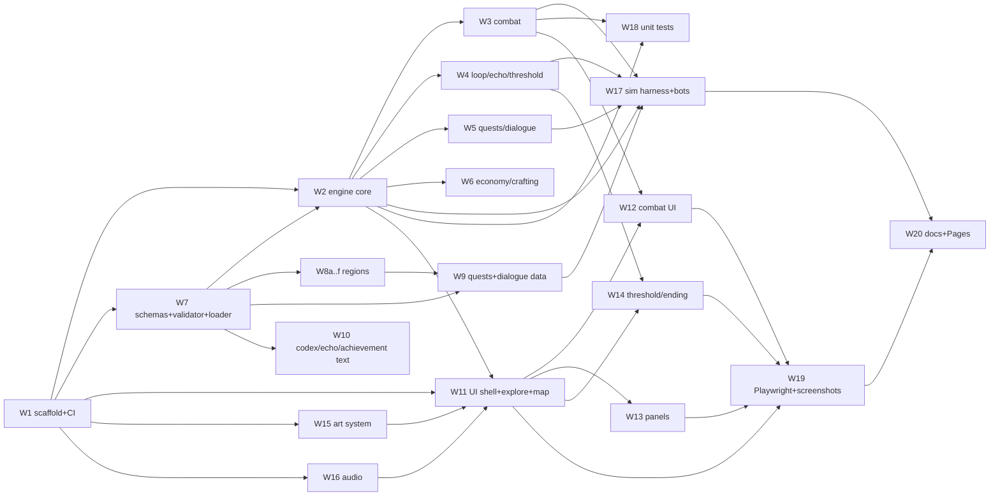

# PLAN.md — Engineering Plan for *Echoes of Aethelgard: The Unraveling*

Status: v1.0 (lead draft). Owner: technical lead. Branch: `unraveling`.
Canon: `docs/DECISIONS.md` (D-001..D-040). This plan elaborates Part D and must not contradict it.
Siblings being written in parallel: `docs/DESIGN.md` (systems), `docs/STORY.md` (narrative), `docs/WORLD.md` (content). Where this plan anticipates their content it does so with optional fields, open unions and free-form `tags`, so content can be expressed without schema changes.

How to use this document: each workstream (W1–W20, section 9) is a self-contained brief an agent can execute from a fresh context. Sections 2–8 are the shared contracts those briefs refer to. Code blocks "compile in spirit": they are the authoritative shape, to be adapted (imports, file splitting), not pasted blindly. When a contract here and a sibling doc disagree, the lead resolves it by appending a decision to `DECISIONS.md` Part E and updating this file; nobody edits a contract silently.

---

## 1. Goals and quality bars

The rebuild is done when every box below is checked. Each item names the command that proves it and the number that passes.

### 1.1 Correctness gates (CI-blocking)

- [ ] **Typecheck** — `npm run typecheck` exits 0 with `strict` + `noUncheckedIndexedAccess` (see 3.4). Zero `// @ts-ignore`; `// @ts-expect-error` allowed only in tests with a reason.
- [ ] **Lint** — `npm run lint` exits 0: ESLint (typescript-eslint strict-type-checked + react-hooks) and dependency-cruiser layer rules (2.3) report zero errors. Warnings are allowed only for `TODO(W##)` markers tied to an open workstream.
- [ ] **Format** — `npm run format:check` exits 0 (Prettier).
- [ ] **Unit tests** — `npm run test` exits 0.
- [ ] **Coverage** — `src/engine/**` ≥ 85 % lines, ≥ 80 % functions, ≥ 75 % branches (v8 provider; thresholds enforced by `vitest.config.ts`, so a drop fails CI). `src/content/schema/**` and `src/sim/**` ≥ 70 % lines. UI has no coverage threshold (behavior is covered by Playwright).
- [ ] **Content validation** — `npm run validate:content` exits 0: every content file parses against its zod schema; every cross-reference resolves (5.19); every location reachable from `whispering_ruins`; every quest has a completable path (proved by sim, 7.8); every ending is referenced by at least one `ending` effect and reached by a scripted bot.
- [ ] **Build** — `npm run build` produces `dist/` with `base` = `/Aethelgard/` (env-overridable), total JS ≤ 600 kB gzipped, no external runtime asset requests (verified by a Playwright test that fails on any network request not to the page origin).
- [ ] **E2E smoke** — `npm run test:e2e -- --grep @smoke` passes on `desktop-chromium` (1280×800) and `mobile-chromium` (390×844).

### 1.2 Simulation gates (release-blocking, run by `npm run sim:balance`)

- [ ] **Bots complete runs** — every bot in {melee, caster, explorer, speedrunner, pacifist, random} finishes ≥ 2,000 steps or a loop without engine errors for every class (30 seeds × 5 classes × 6 bots = 900 runs minimum per batch; the release batch is ≥ 2,000 runs).
- [ ] **Loop 1 completion** — every class finishes Loop 1 (reaches the Threshold by portal) in ≥ 60 % of seeds with the melee *or* caster bot (D-037).
- [ ] **Zero soft-locks** in ≥ 2,000 runs (detector in 7.6: no progress signature change for K = 50 steps; or `legalActions` returns an empty array outside `ending`; or a day counter that does not advance over 400 non-combat steps while no quest stage changes).
- [ ] **Coverage of content by sims** — 100 % of quests completed, 100 % of locations visited, 100 % of endings reached (6 true + 2 closers), ≥ 95 % of creatures killed, ≥ 90 % of items obtained, across the union of all runs including scripted `pathBot` runs.
- [ ] **Balance targets** (`docs/BALANCE.md`, regenerated per batch): no single ability > 35 % of a class's aggregate damage; difficulty curve monotone across regions (median fight length in rounds and death rate per fight both non-decreasing with region level band, within a 1-round / 2-percentage-point tolerance); Loop 1 thorough playthrough by the explorer bot uses 22–26 days median (D-005); a focused Loop 3+ by the speedrunner uses ≤ 12 days median; Tyrant kill rate for a level-8+ party with melee/caster bots between 40 % and 75 %.
- [ ] **Determinism** — replaying a recorded (seed, action list) reproduces the identical final state hash in 100 % of 200 sampled runs (7.4), on both Node and in the browser (Playwright replay test).

### 1.3 Experience gates (manual, recorded in `docs/REPORT.md`)

- [ ] **Playwright flows** on both viewports: title → class select → first fight → rest → save/load → Heartstone choice → Tyrant → portal → Threshold → spend Resonance → new loop → one true ending (scripted via the `pathBot` action list driven through the UI).
- [ ] **Screenshots** — every screen and panel captured on both viewports into `docs/screenshots/{desktop,mobile}/NN-name.png` and committed.
- [ ] **Accessibility** — axe-core (`@axe-core/playwright`) reports zero `serious`/`critical` violations on every screen; all D-035 criteria in 6.7 pass.
- [ ] **Three fun-review rounds** — each a full human (or lead-agent) playthrough of Loop 1 and one true ending, producing a dated list of findings in `docs/REPORT.md` and a balance/content patch; round 3 has zero "blocker" findings.
- [ ] **Final audit** — the lead re-runs `npm run check` from a clean clone, re-reads D-001..D-040 against the shipped content (checklist in 10.7), and signs `docs/REPORT.md`.

---

## 2. Repository layout

The repo root is the existing `Aethelgard` repository; the Python game moves to `legacy/` (D-039). Everything below is new unless marked *(exists)*.

```
Aethelgard/
├── .github/
│   └── workflows/
│       ├── ci.yml                     # typecheck, lint, test, validate, build, e2e smoke
│       └── pages.yml                  # deploy dist/ to GitHub Pages (main + dispatch)
├── .editorconfig
├── .gitignore                         # (exists) + node_modules, dist, coverage, playwright-report, test-results
├── .nvmrc                             # 22
├── .prettierrc.json
├── .prettierignore
├── .dependency-cruiser.cjs            # layer rules (2.3)
├── eslint.config.js                   # flat config (3.3)
├── index.html                         # Vite entry
├── package.json
├── package-lock.json
├── playwright.config.ts
├── tsconfig.json                      # app + tests (strict)
├── tsconfig.node.json                 # vite/vitest/playwright config files, tools/
├── vite.config.ts
├── vitest.config.ts
├── README.md                          # (exists; rewritten by W20) play, develop, deploy
├── docs/
│   ├── DECISIONS.md                   # (exists) canon
│   ├── DESIGN.md  STORY.md  WORLD.md  # being written in parallel
│   ├── PLAN.md                        # this file
│   ├── BIBLE.md  BALANCE.md  REPORT.md  CONTENT.md
│   └── screenshots/{desktop,mobile}/
├── legacy/
│   ├── README.md                      # how to run the original (D-039)
│   ├── echoes_of_aethelgard.py        # moved, unchanged
│   ├── aethelgard_data.py             # moved, unchanged
│   └── web_ui/                        # moved, unchanged
├── public/
│   ├── favicon.svg
│   ├── manifest.webmanifest
│   └── 404.html                       # copy of index.html for deep-link refresh on Pages (no router; harmless)
├── src/
│   ├── main.tsx                       # React root, store bootstrap, audio unlock listener
│   ├── App.tsx                        # mode switch (6.2)
│   ├── vite-env.d.ts
│   ├── engine/                        # LAYER 1 — pure, deterministic, no DOM
│   │   ├── index.ts                   # public surface: step, legalActions, newRun, Rng, types
│   │   ├── types/
│   │   │   ├── state.ts               # GameState and sub-types (4.2)
│   │   │   ├── profile.ts             # Profile (4.3)
│   │   │   ├── actions.ts             # Action union (4.4)
│   │   │   ├── events.ts              # GameEvent union (4.5)
│   │   │   └── ids.ts                 # branded id aliases
│   │   ├── rng.ts                     # xoshiro128**, seedFromString (4.1)
│   │   ├── step.ts                    # step(): dispatch by action.type to reducers (4.6)
│   │   ├── legalActions.ts            # (4.7)
│   │   ├── newRun.ts                  # initial GameState from (seed, classId, profile, content)
│   │   ├── ctx.ts                     # StepCtx: draft, profile draft, rng, events, content
│   │   ├── conditions.ts              # evaluate(cond, state, profile, content) (4.9)
│   │   ├── effects.ts                 # apply(effect, ctx) (4.9)
│   │   ├── reducers/
│   │   │   ├── explore.ts             # move, take, examine, rest, talk, enterPortal
│   │   │   ├── inventory.ts           # use, equip, unequip, drop, allocateStat, unlockAbility
│   │   │   ├── economy.ts             # buy, sell, restock, pricing by rep tier
│   │   │   ├── crafting.ts            # craft, upgrade
│   │   │   ├── dialogue.ts            # talk → scene selection, choose, continue
│   │   │   ├── quests.ts              # stage machine, objectives, journal, shortcuts
│   │   │   ├── combat.ts              # attack/ability/guard/item/flee/companionCommand/setStance
│   │   │   ├── loop.ts                # clock, day/watch advance, horde, loop end, Threshold
│   │   │   ├── threshold.ts           # thresholdSpend, chooseClass, toggleModifier, newLoop
│   │   │   └── meta.ts                # newGame, save (event), load (replace), chooseClass at title
│   │   ├── combat/
│   │   │   ├── damage.ts              # pipeline: power → variance → resist → statuses → guard → shield
│   │   │   ├── statuses.ts            # 18 statuses, tick, interplay table (D-009)
│   │   │   ├── intents.ts             # intent selection, telegraph, resolution
│   │   │   ├── phases.ts              # boss phase triggers and transitions
│   │   │   ├── turnOrder.ts           # initiative from AGI, ties by rng
│   │   │   ├── companionAi.ts         # stance policies
│   │   │   ├── flee.ts
│   │   │   └── rewards.ts             # xp, loot, bestiary, counters
│   │   ├── progression.ts             # xp curve, level-up, derived stats, resource generation per class
│   │   ├── saves/
│   │   │   ├── saveFile.ts            # SaveFile schema (zod), serialize/deserialize
│   │   │   ├── migrations.ts          # version → migration fn
│   │   │   └── profileFile.ts
│   │   └── util/
│   │       ├── produce.ts             # immer re-export with autoFreeze toggle (4.6)
│   │       ├── hash.ts                # stateHash for determinism tests
│   │       └── math.ts                # clamp, round, pct
│   ├── content/                       # LAYER 2 — data + schemas; never imports engine
│   │   ├── index.ts                   # buildContentPack(): assembles + validates all tables
│   │   ├── validate.ts                # validateContent(pack) → { errors, warnings } (5.19)
│   │   ├── schema/                    # zod schemas + inferred types (section 5)
│   │   │   ├── index.ts  primitives.ts  condition.ts  effect.ts
│   │   │   ├── location.ts  region.ts  creature.ts  item.ts  recipe.ts
│   │   │   ├── ability.ts  class.ts  status.ts  quest.ts  dialogue.ts
│   │   │   ├── npc.ts  companion.ts  echo.ts  codex.ts  achievement.ts
│   │   │   ├── attunement.ts  modifier.ts  ending.ts  merchant.ts  faction.ts
│   │   │   └── contentPack.ts         # ContentPack type + table list
│   │   ├── shared/                    # cross-region tables
│   │   │   ├── classes.ts  abilities/{ranger,wizard,elf,warden,weaver}.ts
│   │   │   ├── statuses.ts  factions.ts  recipes.ts  merchants.ts
│   │   │   ├── companions.ts  echoes.ts  codex/*.ts  achievements.ts
│   │   │   ├── attunements.ts  modifiers.ts  endings.ts
│   │   │   └── quests/{legacy,factions,companions,loop,endings}.ts
│   │   └── regions/                   # file-per-region (10.3)
│   │       ├── silverwood_ruins/{region,locations,creatures,items,npcs,dialogues,quests}.ts
│   │       ├── mistwood_reach/…  voidscar/…  highlands/…  glowlands_nexus/…
│   │       ├── silverwood_before/…  drowned_reach/…  ashen_steppe/…  veil/…
│   │       ├── glowfen/…  skyreach/…  threshold/…
│   │       └── index.ts               # concatenates region tables
│   ├── ui/                            # LAYER 3 — React
│   │   ├── store/
│   │   │   ├── gameStore.ts           # createGameStore(content) (6.1)
│   │   │   ├── useGame.ts             # useSyncExternalStore hooks
│   │   │   ├── persistence.ts         # localStorage slots, export/import, quota handling
│   │   │   └── eventBus.ts
│   │   ├── screens/
│   │   │   ├── TitleScreen.tsx  ClassSelectScreen.tsx  ExploreScreen.tsx
│   │   │   ├── CombatScreen.tsx  DialogueScreen.tsx  ThresholdScreen.tsx
│   │   │   ├── EndingScreen.tsx  RunSummary.tsx
│   │   │   └── threshold/{StillShore,GalleryOfLoops,Loom,FarLight}.tsx
│   │   ├── panels/
│   │   │   ├── InventoryPanel.tsx  EquipmentPanel.tsx  AbilitiesPanel.tsx
│   │   │   ├── QuestJournalPanel.tsx  CodexPanel.tsx  BestiaryPanel.tsx
│   │   │   ├── TimelinePanel.tsx  SettingsPanel.tsx  SavesPanel.tsx
│   │   │   ├── MerchantPanel.tsx  CraftingPanel.tsx  CompanionPanel.tsx
│   │   │   ├── MapPanel.tsx  HelpPanel.tsx
│   │   │   └── PanelHost.tsx          # focus trap, Esc, aria-modal
│   │   ├── components/                # StatusBar, LogPanel, ActionBar, ExitBar, EnemyCard, PartyCard,
│   │   │                              # AbilityBar, IntentBadge, StatusBadge, ClockWidget, Button, Tabs, Dialog…
│   │   ├── art/
│   │   │   ├── Scene.tsx  CreatureSigil.tsx  Icon.tsx  RegionPalette.tsx
│   │   │   ├── layers/{Sky,Horizon,Silhouettes,Particles,Weather}.tsx
│   │   │   ├── shapes/                # silhouette library keyed by string
│   │   │   ├── focal/                 # hand-authored pieces: HeartstoneFocal, TyrantFocal, PortalFocal, …
│   │   │   ├── sigils/                # per-family sigil generators + boss overrides
│   │   │   └── uiRng.ts               # UI-only seeded rng for flourishes (D-032)
│   │   ├── hooks/{useHotkeys,useMediaQuery,useReducedMotion,useFocusTrap,useAnnouncer}.ts
│   │   ├── a11y/{LiveRegion.tsx,SkipLink.tsx,focus.ts}
│   │   └── styles/{tokens.css,base.css,layout.css,components.css,themes.css}
│   ├── audio/
│   │   ├── engine.ts                  # AudioEngine (6.5)
│   │   ├── map.ts                     # GameEvent → SfxId
│   │   ├── synth/{voices,envelopes,noise,sequencer}.ts
│   │   ├── sfx/*.ts                   # ui_tick, hit_physical, hit_fire, …
│   │   └── ambient/*.ts               # per-region drones, tyrant theme, threshold theme
│   └── sim/                           # headless; imports engine + content only
│       ├── cli.ts                     # tsx entry: run | batch | endings | replay
│       ├── bots/{types,melee,caster,explorer,speedrunner,pacifist,random,pathBot,shared}.ts
│       ├── runner.ts  batch.ts  worker.ts
│       ├── metrics.ts  softlock.ts  coverage.ts  report.ts
│       └── scripts/endings/{escape,a_vigil,b_mending,c_dawn,d_silence,e_archive,f_unbound}.ts
├── tests/
│   ├── setup.ts                       # jest-dom matchers for UI tests
│   ├── fixtures/                      # mini ContentPack for engine tests, recorded action traces
│   ├── unit/
│   │   ├── engine/**                  # mirrors src/engine
│   │   ├── content/**                 # schema, crossrefs, reachability, completability
│   │   └── ui/**                      # @testing-library/react
│   └── e2e/
│       ├── smoke.spec.ts  flows.spec.ts  mobile.spec.ts  a11y.spec.ts
│       ├── screenshots.spec.ts  replay.spec.ts  noNetwork.spec.ts
│       └── helpers/{driver.ts,selectors.ts}
└── tools/
    ├── validate-content.ts            # npm run validate:content
    ├── gen-balance.ts                 # batch → docs/BALANCE.md
    ├── content-stats.ts               # counts per table/region for REPORT.md
    ├── new-content.ts                 # scaffolds a location/creature/item/quest file section
    ├── check-ids.ts                   # duplicate/invalid id scan across all tables
    └── move-legacy.sh                 # one-shot git mv of python files (W1)
```

### 2.1 Layer dependency rules (D-031)

| From ↓ may import → | engine | content/schema | content (data) | ui | audio | sim |
|---|---|---|---|---|---|---|
| **engine** | yes | **yes (types & zod only)** | no | no | no | no |
| **content/schema** | no | yes | no | no | no | no |
| **content (data)** | no | yes | yes | no | no | no |
| **ui** | yes | yes | yes (via `buildContentPack`) | yes | yes | no |
| **audio** | types only (`GameEvent`) | no | no | no | yes | no |
| **sim** | yes | yes | yes | no | no | yes |
| **tests** | anything | | | | | |

Clarification of D-031 "the engine never imports concrete content": the engine imports *schemas and inferred types* from `src/content/schema/` (that is the contract, not content) and receives the data as a `ContentPack` argument. Nothing under `src/content/regions/**` or `src/content/shared/**` may be imported by the engine. The engine is also forbidden from `react`, `react-dom`, any DOM global, `Math.random`, `Date.now`, `performance.now`, `crypto` and `localStorage` (3.3).

### 2.2 Path aliases

`@engine/*`, `@content/*`, `@schema/*` (= `src/content/schema/*`), `@ui/*`, `@audio/*`, `@sim/*`, `@tests/*`. Cross-layer imports must use aliases; relative imports only within a layer. This is a convention (enforced by review); the hard enforcement is dependency-cruiser on resolved paths, which catches relative and alias forms alike.

### 2.3 Enforcement: dependency-cruiser (chosen over `no-restricted-imports`)

Why dependency-cruiser: it validates *resolved file paths*, so a rule such as "engine → content data forbidden" holds for `../content/regions/x`, `@content/regions/x`, and re-exports alike. ESLint `no-restricted-imports` matches import *strings*, so a dozen agents writing relative imports would produce holes; it also cannot express "allowed except subfolder" cleanly. Cost: one devDependency, a 2–5 s step inside `npm run lint`, and a graph we can render into `docs/REPORT.md`. ESLint still bans DOM globals and nondeterministic APIs in the engine (3.3) because those are not import edges.

```js
// .dependency-cruiser.cjs
/** @type {import('dependency-cruiser').IConfiguration} */
module.exports = {
  forbidden: [
    { name: 'engine-no-ui', severity: 'error', from: { path: '^src/engine' }, to: { path: '^src/(ui|audio|sim)' } },
    { name: 'engine-no-content-data', severity: 'error',
      from: { path: '^src/engine' }, to: { path: '^src/content', pathNot: '^src/content/schema' } },
    { name: 'engine-no-react', severity: 'error', from: { path: '^src/engine' }, to: { path: 'node_modules/(react|react-dom)' } },
    { name: 'schema-is-leaf', severity: 'error', from: { path: '^src/content/schema' }, to: { path: '^src/(engine|ui|audio|sim|content/(regions|shared))' } },
    { name: 'content-no-engine', severity: 'error', from: { path: '^src/content' }, to: { path: '^src/(engine|ui|audio|sim)' } },
    { name: 'audio-no-ui', severity: 'error', from: { path: '^src/audio' }, to: { path: '^src/(ui|sim|content)' } },
    { name: 'audio-engine-types-only', severity: 'error',
      from: { path: '^src/audio' }, to: { path: '^src/engine', pathNot: '^src/engine/types' } },
    { name: 'sim-no-ui', severity: 'error', from: { path: '^src/sim' }, to: { path: '^src/(ui|audio)' } },
    { name: 'no-circular', severity: 'error', from: {}, to: { circular: true } },
    { name: 'no-orphans', severity: 'warn', from: { orphan: true, pathNot: ['\\.d\\.ts$', '^src/content/regions/.*/index\\.ts$'] }, to: {} },
  ],
  options: {
    doNotFollow: { path: 'node_modules' },
    tsPreCompilationDeps: true,
    tsConfig: { fileName: 'tsconfig.json' },
    enhancedResolveOptions: { exportsFields: ['exports'], conditionNames: ['import', 'require', 'node', 'default'] },
    reporterOptions: { dot: { collapsePattern: 'node_modules/[^/]+' } },
  },
};
```

`npm run lint:deps` = `depcruise src --config .dependency-cruiser.cjs`. It runs inside `npm run lint` and in CI.

---

## 3. Toolchain and config

Node 22 (`.nvmrc` = `22`; `engines.node >= 22`). npm (lockfile committed; `npm ci` in CI). Package versions below are pinned at the major the brief fixes; the registry was unreachable while writing this plan, so W1 verifies minors/patches with `npm view <pkg> version` and records the exact resolved versions in `docs/REPORT.md`. Majors are not negotiable without a Part E decision.

### 3.1 `package.json`

```jsonc
{
  "name": "echoes-of-aethelgard",
  "version": "2.0.0",
  "private": true,
  "type": "module",
  "engines": { "node": ">=22" },
  "scripts": {
    "dev": "vite",
    "prebuild": "npm run validate:content",
    "build": "tsc -p tsconfig.json --noEmit && vite build",
    "preview": "vite preview --port 4173 --strictPort",
    "typecheck": "tsc -p tsconfig.json --noEmit && tsc -p tsconfig.node.json --noEmit",
    "lint": "eslint . --max-warnings=0 && npm run lint:deps",
    "lint:deps": "depcruise src --config .dependency-cruiser.cjs",
    "lint:fix": "eslint . --fix",
    "format": "prettier --write .",
    "format:check": "prettier --check .",
    "test": "vitest run --coverage",
    "test:watch": "vitest",
    "test:ui": "vitest run --project ui",
    "test:e2e": "playwright test",
    "test:e2e:smoke": "playwright test --grep @smoke",
    "test:e2e:screens": "playwright test --grep @screens",
    "sim": "tsx src/sim/cli.ts run --seeds 20 --bots melee,caster --classes all",
    "sim:balance": "tsx src/sim/cli.ts batch --seeds 100 --bots all --classes all --out docs/BALANCE.md",
    "sim:endings": "tsx src/sim/cli.ts endings",
    "sim:replay": "tsx src/sim/cli.ts replay",
    "validate:content": "tsx tools/validate-content.ts",
    "content:stats": "tsx tools/content-stats.ts",
    "check": "npm run typecheck && npm run lint && npm run format:check && npm run validate:content && npm run test && npm run build && npm run test:e2e:smoke"
  },
  "dependencies": {
    "immer": "^10.1.1",
    "react": "^18.3.1",
    "react-dom": "^18.3.1",
    "zod": "^3.23.8"
  },
  "devDependencies": {
    "@axe-core/playwright": "^4.10.1",
    "@eslint/js": "^9.15.0",
    "@playwright/test": "^1.49.1",
    "@testing-library/dom": "^10.4.0",
    "@testing-library/jest-dom": "^6.6.3",
    "@testing-library/react": "^16.1.0",
    "@testing-library/user-event": "^14.5.2",
    "@types/node": "^22.9.0",
    "@types/react": "^18.3.12",
    "@types/react-dom": "^18.3.1",
    "@vitejs/plugin-react": "^4.3.4",
    "@vitest/coverage-v8": "^2.1.8",
    "dependency-cruiser": "^16.6.0",
    "eslint": "^9.15.0",
    "eslint-config-prettier": "^9.1.0",
    "eslint-plugin-react-hooks": "^5.0.0",
    "eslint-plugin-react-refresh": "^0.4.14",
    "globals": "^15.12.0",
    "jsdom": "^25.0.1",
    "prettier": "^3.3.3",
    "tsx": "^4.19.2",
    "typescript": "~5.6.3",
    "typescript-eslint": "^8.15.0",
    "vite": "^5.4.11",
    "vitest": "^2.1.8"
  }
}
```

Justifications:

- **No UI kit, no CSS framework.** The game needs one bespoke look (D-036); a kit would fight it and add bundle weight. We use plain CSS with design tokens in `src/ui/styles/tokens.css` (CSS custom properties for color, spacing, type scale, motion) and per-component class names following a `block__element--modifier` convention. CSS Modules are *not* used: a dozen agents produce a dozen module files with duplicated tokens; a single `styles/` folder with tokens plus `components.css` keeps theming (high contrast, text scale, region palettes) in one place and lets Playwright screenshots stay stable. Region palettes are CSS variables set by `<RegionPalette/>`.
- **immer** (added beyond the minimum list): `GameState` nests five levels deep (`world.locationStates[id].items[i]`, `combat.enemies[i].statuses[j]`). Hand-written spread copies at that depth, written by many agents, are the single most likely source of "shared state got mutated" bugs. immer gives structural sharing, auto-freeze in development (mutations throw in tests), and ~6 kB gzipped with no transitive dependencies. Cost: Proxy overhead in simulations; mitigated by `setAutoFreeze(false)` in batch mode and measured in 7.4 (budget: ≤ 60 µs per step).
- **@testing-library/react** (+ dom, jest-dom, user-event): component tests for the panels and hotkeys without a browser; cheap and fast under jsdom.
- **tsx**: runs `tools/*.ts` and `src/sim/cli.ts` directly with the same `tsconfig` paths; no build step for scripts.
- **dependency-cruiser**: see 2.3.
- Everything else is the stack from D-030.

### 3.2 `tsconfig.json`

```jsonc
{
  "compilerOptions": {
    "target": "ES2022",
    "lib": ["ES2022", "DOM", "DOM.Iterable"],
    "module": "ESNext",
    "moduleResolution": "bundler",
    "jsx": "react-jsx",
    "strict": true,
    "noUncheckedIndexedAccess": true,
    "noImplicitOverride": true,
    "noFallthroughCasesInSwitch": true,
    "noUnusedLocals": true,
    "noUnusedParameters": true,
    "noPropertyAccessFromIndexSignature": false,
    "exactOptionalPropertyTypes": false,
    "useUnknownInCatchVariables": true,
    "forceConsistentCasingInFileNames": true,
    "isolatedModules": true,
    "verbatimModuleSyntax": true,
    "resolveJsonModule": true,
    "skipLibCheck": true,
    "noEmit": true,
    "types": ["vite/client", "vitest/globals"],
    "baseUrl": ".",
    "paths": {
      "@engine/*": ["src/engine/*"],
      "@content/*": ["src/content/*"],
      "@schema/*": ["src/content/schema/*"],
      "@ui/*": ["src/ui/*"],
      "@audio/*": ["src/audio/*"],
      "@sim/*": ["src/sim/*"],
      "@tests/*": ["tests/*"]
    }
  },
  "include": ["src", "tests", "vite-env.d.ts"]
}
```

`noUncheckedIndexedAccess` is on because almost every engine lookup is `content.items[id]` or `state.quests[id]`; the compiler forcing a `?? fail(...)` at each site is exactly the discipline that prevents "undefined is not an object" in sims. `exactOptionalPropertyTypes` is off: zod-inferred types and immer drafts generate false positives that would cost agents hours for little safety. `tsconfig.node.json` covers `vite.config.ts`, `vitest.config.ts`, `playwright.config.ts`, `tools/**`, `src/sim/**` with `"types": ["node"]` and `module: NodeNext`.

### 3.3 `eslint.config.js` (flat)

```js
import js from '@eslint/js';
import tseslint from 'typescript-eslint';
import reactHooks from 'eslint-plugin-react-hooks';
import reactRefresh from 'eslint-plugin-react-refresh';
import prettier from 'eslint-config-prettier';
import globals from 'globals';

const nondeterministic = [
  { object: 'Math', property: 'random', message: 'Use Rng from @engine/rng (D-032).' },
  { object: 'Date', property: 'now', message: 'Engine time comes from GameState.meta.' },
  { object: 'performance', property: 'now', message: 'Not in the engine.' },
  { object: 'crypto', property: 'randomUUID', message: 'Use meta.nextUid.' },
];

export default tseslint.config(
  { ignores: ['dist', 'coverage', 'playwright-report', 'test-results', 'legacy', 'node_modules'] },
  js.configs.recommended,
  ...tseslint.configs.strictTypeChecked,
  ...tseslint.configs.stylisticTypeChecked,
  {
    languageOptions: {
      parserOptions: { projectService: true, tsconfigRootDir: import.meta.dirname },
      globals: { ...globals.browser, ...globals.es2022 },
    },
    rules: {
      '@typescript-eslint/consistent-type-imports': ['error', { fixStyle: 'inline-type-imports' }],
      '@typescript-eslint/switch-exhaustiveness-check': 'error',
      '@typescript-eslint/no-unnecessary-condition': 'warn',
      '@typescript-eslint/restrict-template-expressions': ['error', { allowNumber: true }],
      'no-console': ['error', { allow: ['warn', 'error'] }],
      eqeqeq: ['error', 'always'],
    },
  },
  {
    // LAYER 1 + 2 + sim: deterministic, DOM-free
    files: ['src/engine/**/*.ts', 'src/content/**/*.ts', 'src/sim/**/*.ts'],
    rules: {
      'no-restricted-properties': ['error', ...nondeterministic],
      'no-restricted-globals': ['error', 'window', 'document', 'localStorage', 'sessionStorage', 'navigator', 'fetch', 'setTimeout', 'setInterval', 'requestAnimationFrame'],
      'no-restricted-syntax': ['error', { selector: 'NewExpression[callee.name="Date"]', message: 'No wall-clock in the engine.' }],
    },
  },
  {
    files: ['src/sim/**/*.ts', 'tools/**/*.ts'],
    languageOptions: { globals: globals.node },
    rules: { 'no-console': 'off', 'no-restricted-globals': 'off' }, // sim may use setTimeout for worker orchestration
  },
  {
    files: ['src/ui/**/*.{ts,tsx}', 'src/main.tsx', 'src/App.tsx'],
    plugins: { 'react-hooks': reactHooks, 'react-refresh': reactRefresh },
    rules: { ...reactHooks.configs.recommended.rules, 'react-refresh/only-export-components': 'warn' },
  },
  {
    files: ['src/content/**/*.ts'],
    rules: { '@typescript-eslint/no-unnecessary-condition': 'off', 'max-lines': 'off' },
  },
  { files: ['tests/**/*.{ts,tsx}'], rules: { '@typescript-eslint/no-non-null-assertion': 'off', '@typescript-eslint/unbound-method': 'off' } },
  prettier,
);
```

`.prettierrc.json`: `{ "singleQuote": true, "semi": true, "printWidth": 110, "trailingComma": "all", "arrowParens": "always" }`. `printWidth` 110 keeps content tables readable (long description strings).

### 3.4 `vite.config.ts`

```ts
import { defineConfig } from 'vite';
import react from '@vitejs/plugin-react';
import { fileURLToPath, URL } from 'node:url';
import { readFileSync } from 'node:fs';

const pkg = JSON.parse(readFileSync(new URL('./package.json', import.meta.url), 'utf8')) as { version: string };
const alias = (p: string) => fileURLToPath(new URL(p, import.meta.url));

export default defineConfig(({ mode }) => ({
  // GitHub Pages serves at https://dubbltninja.github.io/Aethelgard/ — the path matches the repo name as created.
  // Override for other hosts: VITE_BASE=/ npm run build
  base: process.env.VITE_BASE ?? '/Aethelgard/',
  plugins: [react()],
  resolve: {
    alias: {
      '@engine': alias('./src/engine'), '@content': alias('./src/content'), '@schema': alias('./src/content/schema'),
      '@ui': alias('./src/ui'), '@audio': alias('./src/audio'), '@sim': alias('./src/sim'),
    },
  },
  define: {
    __APP_VERSION__: JSON.stringify(pkg.version),
    __BUILD_SHA__: JSON.stringify(process.env.GITHUB_SHA?.slice(0, 7) ?? 'dev'),
  },
  build: {
    target: 'es2022',
    sourcemap: mode !== 'production',
    chunkSizeWarningLimit: 700,
    rollupOptions: {
      output: {
        manualChunks: { react: ['react', 'react-dom'], content: ['./src/content/index.ts'], engine: ['./src/engine/index.ts'] },
      },
    },
  },
  server: { port: 5173, strictPort: true },
  preview: { port: 4173, strictPort: true },
}));
```

Build-time content validation is the **`prebuild` script** (`npm run validate:content`), not a Vite plugin: a prebuild step runs identically locally and in CI, needs no Vite internals, and fails with a readable report. In development the app additionally calls `validateContent()` once at boot when `import.meta.env.DEV` and renders a blocking error overlay listing the problems, so content authors see schema errors in the browser within seconds of saving.

### 3.5 `vitest.config.ts`

```ts
import { defineConfig, mergeConfig } from 'vitest/config';
import viteConfig from './vite.config';

export default mergeConfig(viteConfig({ mode: 'test', command: 'serve' }), defineConfig({
  test: {
    globals: true,
    include: ['tests/unit/**/*.test.{ts,tsx}'],
    environment: 'node',
    environmentMatchGlobs: [['tests/unit/ui/**', 'jsdom']],
    setupFiles: ['tests/setup.ts'],
    testTimeout: 20_000,
    pool: 'threads',
    coverage: {
      provider: 'v8',
      include: ['src/engine/**', 'src/content/schema/**', 'src/content/validate.ts', 'src/sim/**'],
      exclude: ['**/*.d.ts', 'src/sim/cli.ts', 'src/sim/worker.ts'],
      reporter: ['text', 'html', 'lcov'],
      thresholds: {
        'src/engine/**': { lines: 85, functions: 80, branches: 75 },
        'src/content/schema/**': { lines: 70 },
        'src/sim/**': { lines: 70 },
      },
    },
  },
}));
```

### 3.6 `playwright.config.ts`

```ts
import { defineConfig, devices } from '@playwright/test';

const BASE = process.env.VITE_BASE ?? '/Aethelgard/';
export default defineConfig({
  testDir: 'tests/e2e',
  timeout: 60_000,
  expect: { timeout: 10_000 },
  fullyParallel: true,
  retries: process.env.CI ? 1 : 0,
  reporter: process.env.CI ? [['github'], ['html', { open: 'never' }]] : [['list']],
  use: { baseURL: `http://localhost:4173${BASE}`, trace: 'retain-on-failure', screenshot: 'only-on-failure' },
  webServer: { command: 'npm run preview', url: `http://localhost:4173${BASE}`, reuseExistingServer: !process.env.CI, timeout: 60_000 },
  projects: [
    { name: 'desktop-chromium', use: { ...devices['Desktop Chrome'], viewport: { width: 1280, height: 800 } } },
    { name: 'mobile-chromium', use: { ...devices['Desktop Chrome'], viewport: { width: 390, height: 844 }, isMobile: true, hasTouch: true, deviceScaleFactor: 3 } },
  ],
});
```

Only Chromium is installed in CI (one browser keeps the cache small; the game has no browser-specific code paths). `npm run build` must precede `test:e2e` (CI does this; locally `npm run check` orders it).

### 3.7 Other root files

- `.editorconfig`: LF, UTF-8, 2 spaces, final newline.
- `.gitignore` additions: `node_modules/`, `dist/`, `coverage/`, `playwright-report/`, `test-results/`, `.vite/`, `*.local`.
- `index.html`: `<html lang="en">`, viewport meta with `viewport-fit=cover`, `<title>Echoes of Aethelgard: The Unraveling</title>`, theme-color, a `<noscript>` message, root `<div id="root">`, and a `<div id="a11y-live" aria-live="polite">` sibling for announcements that must survive React remounts.
- `public/404.html`: identical to the built `index.html` is not possible pre-build; instead `tools/postbuild.ts` (run by `build` via `&&`) copies `dist/index.html` to `dist/404.html` so a hard refresh on Pages never 404s. There is no client router; this is only for hosts that resolve `/Aethelgard/anything`.

---

## 4. Engine contracts (TypeScript)

All types live in `src/engine/types/*` and are re-exported from `src/engine/index.ts`. Ids are plain `string` aliases (not branded) so content literals need no casts; the validator (5.19) and `noUncheckedIndexedAccess` provide the safety. Everything in `GameState` and `Profile` is JSON-serializable: no `Map`, `Set`, `Date`, `undefined`-bearing arrays, functions or class instances.

### 4.0 Decisions made here (to be appended to DECISIONS.md Part E by the lead)

- **D-041 (proposed) — `step` takes and returns the Profile.** D-031 writes `step(state, action, rng)`; D-032 moves `rng` into `GameState`; D-010/D-011 require Echo grants, codex unlocks, bestiary and achievement writes *during* engine transitions. The profile therefore must be an input and output of `step`, but it stays a separate object (D-034: survives deleting a run). Signature: `step(state, action, content, profile) → { state, profile, events }`.
- **D-042 (proposed) — immer for state transitions** (3.1 justification). Rule: `step` is the only place `produce` is called on `GameState`; reducers receive a `Draft<GameState>`.
- **D-043 (proposed) — illegal actions never throw.** `step` returns the same `state` and `profile` references with a single `actionRejected` event. Throwing is reserved for programmer errors (missing content id after validation, corrupted state), which fail loudly in sims and tests.
- **D-044 (proposed) — ids are lowercase `snake_case`**, unique within their table; Echo ids are written *without* the `echo.` prefix in data (`{ echo: 'litany_verse_1' }`); `echo.x` in prose means Echo `x`. A canonical mapping for every legacy name is in Appendix A.

### 4.1 `Rng` — xoshiro128** (`src/engine/rng.ts`)

```ts
/** Four unsigned 32-bit words. Stored in GameState.rng; never all zero. */
export type RngState = readonly [number, number, number, number];

const rotl = (x: number, k: number): number => ((x << k) | (x >>> (32 - k))) >>> 0;

/**
 * Mutable cursor over an immutable RngState. A reducer creates one from the draft at the start of `step`,
 * draws from it freely, and writes `rng.state()` back at the end. Nothing else may hold an Rng.
 */
export class Rng {
  private s0: number; private s1: number; private s2: number; private s3: number;

  constructor(state: RngState) {
    [this.s0, this.s1, this.s2, this.s3] = state;
    if ((this.s0 | this.s1 | this.s2 | this.s3) === 0) this.s0 = 1;
  }
  static fromSeed(seed: string | number): Rng { return new Rng(seedFromString(String(seed))); }

  state(): RngState { return [this.s0 >>> 0, this.s1 >>> 0, this.s2 >>> 0, this.s3 >>> 0]; }

  /** Uniform uint32 — the one primitive; everything else derives from it. */
  nextU32(): number {
    const result = Math.imul(rotl(Math.imul(this.s1, 5) >>> 0, 7), 9) >>> 0;
    const t = (this.s1 << 9) >>> 0;
    this.s2 ^= this.s0; this.s3 ^= this.s1; this.s1 ^= this.s2; this.s0 ^= this.s3;
    this.s2 ^= t;
    this.s3 = rotl(this.s3, 11);
    return result;
  }
  /** Float in [0, 1). */
  next(): number { return this.nextU32() / 4294967296; }
  /** Integer in [min, max], inclusive. Throws RangeError if max < min. */
  int(min: number, max: number): number {
    if (!Number.isInteger(min) || !Number.isInteger(max) || max < min) throw new RangeError(`int(${min}, ${max})`);
    return min + Math.floor(this.next() * (max - min + 1));
  }
  /** True with probability p (clamped to [0,1]). p >= 1 never draws, p <= 0 never draws — keeps traces stable. */
  chance(p: number): boolean { return p >= 1 ? true : p <= 0 ? false : this.next() < p; }
  pick<T>(arr: readonly T[]): T {
    if (arr.length === 0) throw new RangeError('pick([])');
    return arr[this.int(0, arr.length - 1)] as T;
  }
  /** Fisher–Yates on a copy. */
  shuffle<T>(arr: readonly T[]): T[] {
    const out = arr.slice();
    for (let i = out.length - 1; i > 0; i--) { const j = this.int(0, i); const t = out[i] as T; out[i] = out[j] as T; out[j] = t; }
    return out;
  }
  weighted<T>(entries: readonly { weight: number; value: T }[]): T {
    const total = entries.reduce((s, e) => s + Math.max(0, e.weight), 0);
    if (total <= 0) throw new RangeError('weighted(): total weight 0');
    let r = this.next() * total;
    for (const e of entries) { r -= Math.max(0, e.weight); if (r < 0) return e.value; }
    return (entries[entries.length - 1] as { value: T }).value;
  }
  /** Independent stream for a sub-system (e.g., merchant restock) without disturbing the main sequence order. */
  fork(label: string): Rng { return new Rng(seedFromString(`${this.nextU32()}:${label}`)); }
}

/** cyrb128-style string hash → 4 words. Deterministic across platforms (uses only imul/xor/shift). */
export function seedFromString(seed: string): RngState {
  let h1 = 1779033703, h2 = 3144134277, h3 = 1013904242, h4 = 2773480762;
  for (let i = 0; i < seed.length; i++) {
    const k = seed.charCodeAt(i);
    h1 = h2 ^ Math.imul(h1 ^ k, 597399067);
    h2 = h3 ^ Math.imul(h2 ^ k, 2869860233);
    h3 = h4 ^ Math.imul(h3 ^ k, 951274213);
    h4 = h1 ^ Math.imul(h4 ^ k, 2716044179);
  }
  h1 = Math.imul(h3 ^ (h1 >>> 18), 597399067);
  h2 = Math.imul(h4 ^ (h2 >>> 22), 2869860233);
  h3 = Math.imul(h1 ^ (h3 >>> 17), 951274213);
  h4 = Math.imul(h2 ^ (h4 >>> 19), 2716044179);
  const s: [number, number, number, number] = [(h1 ^ h2 ^ h3 ^ h4) >>> 0, h2 >>> 0, h3 >>> 0, h4 >>> 0];
  if ((s[0] | s[1] | s[2] | s[3]) === 0) s[0] = 0x9e3779b9;
  return s;
}
```

Reference vectors for the unit test: `seedFromString('aethelgard')` must produce a fixed tuple recorded in `tests/unit/engine/rng.test.ts` on first run (golden), and `new Rng([1,2,3,4]).nextU32()` must equal the C reference implementation's first output for that state (`0x00000B40`... computed once by the test author with the C code and pinned).

### 4.2 `GameState` (`src/engine/types/state.ts`)

```ts
import type { RngState } from '../rng';

export type Mode = 'title' | 'explore' | 'combat' | 'dialogue' | 'threshold' | 'ending';
export type Watch = 0 | 1 | 2 | 3;                       // dawn, midday, dusk, night — travel costs one (D-005)
export type StatName = 'str' | 'mag' | 'agi';
export type DamageType = 'physical' | 'fire' | 'storm' | 'ley' | 'void' | 'chrono';
export type Rarity = 'common' | 'uncommon' | 'rare' | 'epic' | 'legendary';
export type FactionId = 'remnants' | 'weavers' | 'ironclad';
export type Stance = 'aggressive' | 'guarded' | 'support';
export type EquipSlot = 'weapon' | 'armor' | 'trinket1' | 'trinket2';
export type FlagValue = boolean | number | string;

export interface GameMeta {
  seed: string;              // the run seed string (shown in run summary; replay key)
  loop: number;              // 1-based
  day: number;               // 1-based; Breach Clock expires when day > clockLimitDays at dawn
  watch: Watch;
  clockLimitDays: number;    // 30 base; modified by Heartstone choice (D-017), modifiers (D-021), attunements
  version: number;           // GameState schema version (saves migrate on this)
  stepCount: number;         // actions accepted so far (sim metrics, autosave cadence)
  nextUid: number;           // monotonically increasing; source of all instance ids (no randomness, no clock)
  runId: string;             // `${seed}:${loop}` at loop start; used by achievements/runHistory
  modifiers: string[];       // ModifierIds active for this run (copied from profile at newLoop; immutable mid-run)
  playerName: string;
}

export interface Stats { str: number; mag: number; agi: number }

export interface ItemInstance {
  uid: string;               // `i${nextUid}`
  itemId: string;
  qty: number;               // stackables only; equipment always 1
  rarity: Rarity;            // 'common' for items whose rarityRule is 'fixed' unless fixedRarity set
  upgrade: number;           // Emberforge upgrade level (0..)
  boundQuest?: string;       // set when granted by a quest; cannot be sold/dropped while that quest is active
}

export interface PlayerState {
  name: string;
  classId: string;
  level: number;
  xp: number;                // xp toward next level (curve in progression.ts; legacy: level*100)
  stats: Stats;
  hp: number; hpMax: number;
  mp: number; mpMax: number;
  gold: number;
  corruption: number;        // 0..6 (D-017)
  inventory: ItemInstance[];
  equipment: { weapon: ItemInstance | null; armor: ItemInstance | null; trinket1: ItemInstance | null; trinket2: ItemInstance | null };
  abilitiesUnlocked: string[];
  abilityPoints: number;
  statPoints: number;
  stance: Stance;            // the player's stance only affects companion AI defaults; stored here for UI
  passiveBonuses: Partial<Record<StatName | 'hpMax' | 'mpMax', number>>; // from quest-item passives (legacy Amulet +1 MAG etc.)
}

export interface CompanionRunState {
  id: string;
  recruited: boolean;
  loyalty: number;           // 0..100
  hp: number; hpMax: number;
  ko: boolean;               // knocked out this fight/day; recovers on rest
  dead: boolean;             // permadeath only where content says so (Brak at the Apex)
  stance: Stance;
  signatureCooldown: number; // turns remaining
  waitingAt: string | null;  // LocationId where a non-active companion waits (camps); null = travels with party but inactive
  arcFlags: Record<string, FlagValue>;
}

export interface CompanionsState {
  recruited: Record<string, CompanionRunState>;  // keyed by CompanionId; only recruited ones present
  activeId: string | null;
}

export interface LocationState {
  visited: boolean;
  visitCount: number;
  items: ItemInstance[];              // items currently lying here (initial from content on first entry + drops)
  itemsSpawned: boolean;              // content items have been instantiated
  encountersCleared: string[];        // encounter ids beaten with once=true, or respawn pending
  encounterClearedDay: Record<string, number>;   // for respawn: 'daily'
  eventsFired: string[];
  flags: Record<string, FlagValue>;
  unlockedExits: string[];            // LocationIds unlocked by `unlockExit`
  lockedExits: string[];              // LocationIds locked by `lockExit`
}

export interface SpawnedEncounter { id: string; groups: { creatureId: string; count: number }[]; once: boolean; canFlee: boolean; label?: string }

export interface WorldState {
  currentLocationId: string;
  previousLocationId: string | null;
  locationStates: Record<string, LocationState>;    // sparse: created on first touch
  discovered: string[];                              // LocationIds known this run (map)
  pendingEncounters: Record<string, SpawnedEncounter[]>; // from `spawn` effects, keyed by LocationId
  npcOverrides: Record<string, { location: string | null }>; // moved/hidden NPCs (Ilyra → portal)
  hordeActive: boolean;
  hordeDelay: number;
  infected: string[];                                // LocationIds (legacy horde spread)
  hordePending: Record<string, number>;
  heartstone: 'intact' | 'stabilized' | 'exploited' | 'destroyed';
  tyrant: 'waiting' | 'defeated' | 'spared' | 'communing';
  weather?: string;                                  // free-form, content-driven flavor
}

export type QuestStatus = 'inactive' | 'active' | 'completed' | 'failed';
export interface QuestState { status: QuestStatus; stage: string; startedDay: number | null; endedDay: number | null; counters: Record<string, number>; objectivesDone: string[] }

export interface StatusInstance { statusId: string; stacks: number; duration: number; sourceUid: string | null; power?: number }

export interface Combatant {
  uid: string;                       // `c${nextUid}`
  kind: 'player' | 'companion' | 'enemy';
  refId: string;                     // classId / companionId / creatureId
  name: string;
  level: number;
  hp: number; hpMax: number;
  mp: number; mpMax: number;         // enemies: 0/0 unless a creature defines mp
  stats: Stats;
  def: number;
  statuses: StatusInstance[];
  guarding: boolean;
  initiative: number;
  resistances: Partial<Record<DamageType, 'weak' | 'normal' | 'resist' | 'immune'>>;
  phase: number;                     // boss phase index (0 = first)
  intentCooldowns: Record<string, number>;
  alive: boolean;
  fledOrGone: boolean;
  isAdd: boolean;                    // summoned by a phase
}

export interface Intent {
  intentId: string;
  text: string;                      // telegraph line shown to the player
  targetUid: string | null;
  summary: { kind: string; damageType?: DamageType; power?: number; hits?: number; statuses?: string[] };
}

export type CombatPhase = 'start' | 'playerTurn' | 'companionTurn' | 'enemyTurn' | 'roundEnd' | 'victory' | 'defeat' | 'fled';

export interface CombatLogEntry { round: number; text: string; kind: 'info' | 'damage' | 'heal' | 'status' | 'intent' | 'phase' | 'system' }

export interface CombatState {
  encounterId: string;
  locationId: string;
  enemies: Combatant[];
  party: Combatant[];                // [player, companion?] — snapshots synced back to player/companion on exit
  turnOrder: string[];               // uids
  turnIndex: number;
  round: number;
  phase: CombatPhase;
  intents: Record<string, Intent>;   // by enemy uid, for the *next* enemy action
  log: CombatLogEntry[];             // capped at 200 entries
  cooldowns: Record<string, number>; // player ability id → turns remaining
  canFlee: boolean;
  fleeAttempts: number;
  resourceGainedThisTurn: number;
  onVictory: unknown[];              // Effect[] copied from the encounter (typed as Effect in effects.ts)
  onDefeat: unknown[];
  onFlee: unknown[];
  pendingSelection: { abilityId?: string; itemUid?: string } | null;  // UI-only hint: awaiting target pick
}

export interface DialogueState {
  sceneId: string;
  nodeId: string;
  npcId: string | null;
  visitedNodes: string[];
  choicesTaken: string[];            // choice ids taken this scene (for once=true choices)
  returnMode: 'explore' | 'combat' | 'threshold';
}

export interface MerchantState { stock: ItemInstance[]; lastRestockDay: number; purchasesThisLoop: number }

export interface RunCounters {
  kills: Record<string, number>;
  seen: Record<string, number>;
  damageDealt: number; damageTaken: number;
  damageBySource: Record<string, number>;           // 'basic' | abilityId | 'companion:<id>' | 'status:<id>' | 'item:<id>'
  abilitiesUsed: Record<string, number>;
  itemsCrafted: number; itemsUpgraded: number;
  goldEarned: number; goldSpent: number;
  fights: number; fightsWon: number; fled: number; rests: number; travels: number;
  questsCompleted: number; questsFailed: number;
  echoesGainedThisLoop: number;
  deathsThisLoop: number;                           // 0/1; Loop 1 game over is recorded as a closer
  custom: Record<string, number>;                   // content `counter` effects
}

export interface LogEntry { step: number; text: string; kind: 'narration' | 'event' | 'system' | 'dialogue' | 'combat' }

export interface EndingPending { endingId: string; reason: 'portal' | 'death' | 'clock' | 'ending' | 'loop1_death'; slideIndex: number }

export interface GameState {
  meta: GameMeta;
  player: PlayerState;
  companions: CompanionsState;
  world: WorldState;
  quests: Record<string, QuestState>;              // sparse; absent = inactive & never started
  flags: Record<string, FlagValue>;
  reputation: Record<FactionId, number>;            // −100..100 (D-014)
  echoesThisLoop: string[];                        // Echo ids granted this loop (also written to profile)
  combat: CombatState | null;
  dialogue: DialogueState | null;
  merchants: Record<string, MerchantState>;
  rng: RngState;
  counters: RunCounters;
  pendingEnding: EndingPending | null;
  mode: Mode;
  recentLog: LogEntry[];                           // last 100 narration/system lines; UI log beyond this comes from events
  threshold: { visited: ('still_shore' | 'gallery' | 'loom' | 'far_light')[]; spentThisVisit: number; pendingClassId: string | null } | null;
}
```

Derived values (never stored): attack power, defense, hit/crit/dodge chances, resource per turn, reputation *tier*, Breach Clock days remaining. They are computed by pure selectors in `src/engine/progression.ts` and `src/engine/reducers/loop.ts` (`selectors.ts` re-exports them for UI/sim). Storing only primary values keeps saves small and migrations simple.

### 4.3 `Profile` (`src/engine/types/profile.ts`)

```ts
export interface Settings {
  textScale: 1 | 1.25 | 1.5;
  highContrast: boolean;
  reducedMotion: 'system' | 'on' | 'off';
  volumes: { master: number; ambient: number; sfx: number };   // 0..1
  muted: boolean;
  autosave: boolean;
  showIntentNumbers: boolean;       // show exact telegraphed damage
  confirmFlee: boolean;
  logLength: 50 | 100 | 200;
}

export interface RunRecord {
  runId: string; seed: string; loop: number; classId: string;
  outcome: string;                  // EndingId or closer id ('escape' | 'fall' | 'loop1_death')
  daysUsed: number; level: number; echoesGained: string[]; questsCompleted: string[];
  tyrant: 'defeated' | 'spared' | 'untouched'; heartstone: string; modifiers: string[];
  summary: string;                  // one-line Threshold text
}

export interface Profile {
  version: number;
  profileId: string;                // set by the shell from meta.nextUid-like counter persisted in profile; not a clock
  echoes: string[];
  codexUnlocked: string[];
  bestiary: Record<string, { seen: number; killed: number; intentsSeen: string[]; weaknessesKnown: DamageType[] }>;
  achievements: Record<string, { loop: number; day: number; runId: string }>;
  resonance: number;
  resonanceEarnedTotal: number;
  attunements: Record<string, number>;     // AttunementId → rank
  classMastery: Record<string, { loopsPlayed: number; abilitiesEverUnlocked: string[]; endings: string[]; bestDays: number | null }>;
  runHistory: RunRecord[];                 // capped at 200
  settings: Settings;
  modifiers: Record<string, boolean>;      // toggles for the *next* loop (D-021)
  mapKnowledge: string[];                  // LocationIds ever discovered (greyed "remembered" nodes, D-011)
  discoveries: string[];                   // first-time discovery keys that already paid Resonance ('loc:x', 'kill:y', 'item:z', 'echo:e', 'quest:q')
  endingsReached: string[];
  loopsTotal: number;
  newGamePlus: number;                     // how many NG+ starts
  lastClassId: string | null;
}
```

### 4.4 `Action` union (`src/engine/types/actions.ts`)

Every player input is an `Action`. Actions carry *ids*, never indices, so a recorded trace stays valid when the UI reorders lists.

```ts
export type Action =
  // meta / shell-facing
  | { type: 'newGame'; name: string; classId: string; seed?: string }
  | { type: 'chooseClass'; classId: string }              // title (before first explore) and Threshold Far Light
  | { type: 'save'; slot: 1 | 2 | 3 | 'auto' }            // engine emits saveRequested; shell performs IO
  | { type: 'load'; save: unknown }                       // parsed SaveFile supplied by shell; engine validates+migrates
  | { type: 'returnToTitle' }
  // explore
  | { type: 'move'; to: string }                          // adjacent LocationId (UI maps arrow keys via exit.dir)
  | { type: 'examine'; target: { kind: 'item'; uid: string } | { kind: 'npc'; id: string } | { kind: 'exit'; to: string } | { kind: 'location' } }
  | { type: 'take'; uid: string }
  | { type: 'takeAll' }
  | { type: 'rest' }
  | { type: 'talk'; npcId: string }
  | { type: 'enterPortal' }
  | { type: 'communeChoice'; choiceId: string }           // Tyrant communion at the Apex (Loop 2+)
  | { type: 'interact'; eventId: string }                 // content-defined interactable (altar, Heartstone, anchor)
  | { type: 'wait' }                                      // advance one watch in place (only where location.rest or tags has 'waitable')
  // inventory / character
  | { type: 'use'; uid: string; targetUid?: string }
  | { type: 'equip'; uid: string; slot?: EquipSlot }
  | { type: 'unequip'; slot: EquipSlot }
  | { type: 'drop'; uid: string; qty?: number }
  | { type: 'allocateStat'; stat: StatName }
  | { type: 'unlockAbility'; abilityId: string }
  | { type: 'readBook'; uid: string }                     // Dark Spellbooks: corruption + unlocks (D-017)
  // economy / crafting
  | { type: 'buy'; merchantId: string; uid: string; qty?: number }
  | { type: 'sell'; merchantId: string; uid: string; qty?: number }
  | { type: 'craft'; recipeId: string }
  | { type: 'upgrade'; uid: string }
  // dialogue
  | { type: 'choose'; choiceId: string }
  | { type: 'continue' }                                  // advance a node that has no choices
  | { type: 'acceptQuest'; questId: string }              // used by UI "Accept" buttons when a scene offers a quest without a choice node
  // combat
  | { type: 'attack'; targetUid: string }
  | { type: 'ability'; abilityId: string; targetUid?: string }
  | { type: 'guard' }
  | { type: 'item'; uid: string; targetUid?: string }
  | { type: 'flee' }
  | { type: 'companionCommand'; command: 'signature' | 'focus' | 'hold'; targetUid?: string }
  | { type: 'setStance'; stance: Stance }
  | { type: 'swapCompanion'; companionId: string | null } // at rest locations only
  // loop / threshold
  | { type: 'acknowledgeEnding' }                         // advance ending slides; last slide → threshold or title
  | { type: 'thresholdGo'; to: 'still_shore' | 'gallery' | 'loom' | 'far_light' }
  | { type: 'thresholdSpend'; attunementId: string }
  | { type: 'thresholdRefund'; attunementId: string }     // only within the same visit (spentThisVisit)
  | { type: 'toggleModifier'; modifierId: string }
  | { type: 'newLoop' }                                   // Far Light → Day 1
  | { type: 'newGamePlus' };                              // from ending screen after a true ending (D-021)
```

### 4.5 `GameEvent` union (`src/engine/types/events.ts`)

Events are the engine's only channel to UI, audio and logs. They are *descriptive* (what happened), never *imperative* (no "play sound X"). The audio map (6.5) and log formatter translate them. Every event has `t: string` (type) so UI switch statements are exhaustive.

```ts
export type GameEvent =
  | { t: 'actionRejected'; action: Action; reason: string }
  | { t: 'log'; text: string; kind: LogEntry['kind'] }
  | { t: 'modeChanged'; from: Mode; to: Mode }
  // world & time
  | { t: 'locationEntered'; locationId: string; firstVisit: boolean; regionId: string }
  | { t: 'locationDiscovered'; locationId: string }
  | { t: 'watchAdvanced'; day: number; watch: Watch }
  | { t: 'dayAdvanced'; day: number; daysLeft: number }
  | { t: 'clockWarning'; daysLeft: number }               // emitted at 10, 5, 3, 1
  | { t: 'clockChanged'; delta: number; limit: number }
  | { t: 'rested'; locationId: string; hpRestored: number; mpRestored: number }
  | { t: 'eventFired'; locationId: string; eventId: string; text: string }
  | { t: 'exitUnlocked'; from: string; to: string }
  | { t: 'hordeSpread'; infected: string[] }
  | { t: 'npcMoved'; npcId: string; to: string | null }
  // items & economy
  | { t: 'itemTaken'; item: ItemInstance } | { t: 'itemGiven'; item: ItemInstance; source: string }
  | { t: 'itemLost'; itemId: string; qty: number; reason: 'used' | 'sold' | 'dropped' | 'taken' | 'crafted' }
  | { t: 'itemEquipped'; slot: EquipSlot; item: ItemInstance } | { t: 'itemUnequipped'; slot: EquipSlot }
  | { t: 'goldChanged'; delta: number; total: number }
  | { t: 'purchased'; itemId: string; price: number } | { t: 'sold'; itemId: string; price: number }
  | { t: 'crafted'; recipeId: string; item: ItemInstance } | { t: 'upgraded'; item: ItemInstance }
  | { t: 'merchantRestocked'; merchantId: string }
  // character
  | { t: 'xpGained'; amount: number } | { t: 'levelUp'; level: number; statPoints: number; abilityPoints: number }
  | { t: 'statAllocated'; stat: StatName; value: number }
  | { t: 'abilityUnlocked'; abilityId: string }
  | { t: 'corruptionChanged'; value: number; delta: number }
  | { t: 'reputationChanged'; faction: FactionId; delta: number; value: number; tierBefore: string; tierAfter: string }
  // companions
  | { t: 'companionRecruited'; companionId: string } | { t: 'companionDismissed'; companionId: string }
  | { t: 'companionSwapped'; activeId: string | null }
  | { t: 'loyaltyChanged'; companionId: string; delta: number; value: number }
  | { t: 'companionKo'; companionId: string } | { t: 'companionDied'; companionId: string }
  // combat
  | { t: 'combatStarted'; encounterId: string; enemies: { uid: string; creatureId: string }[]; ambush: boolean }
  | { t: 'turnStarted'; uid: string; round: number }
  | { t: 'intentRevealed'; uid: string; intent: Intent }
  | { t: 'attackResolved'; sourceUid: string; targetUid: string; hit: boolean; crit: boolean }
  | { t: 'damageDealt'; sourceUid: string; targetUid: string; amount: number; damageType: DamageType; mitigated: number; absorbed: number; kind: 'basic' | 'ability' | 'status' | 'item' | 'intent'; refId: string | null }
  | { t: 'healed'; targetUid: string; amount: number; source: string }
  | { t: 'statusApplied'; targetUid: string; statusId: string; stacks: number; duration: number }
  | { t: 'statusExpired'; targetUid: string; statusId: string } | { t: 'statusTicked'; targetUid: string; statusId: string; amount: number }
  | { t: 'interplay'; rule: string; targetUid: string }   // 'storm_on_soaked', 'fire_on_soaked', 'chrono_on_haste', 'void_on_shield'
  | { t: 'guarded'; uid: string } | { t: 'resourceGained'; uid: string; amount: number; reason: string }
  | { t: 'abilityUsed'; uid: string; abilityId: string }
  | { t: 'fleeAttempt'; success: boolean; chance: number }
  | { t: 'combatantDefeated'; uid: string; refId: string } | { t: 'bossPhase'; uid: string; phase: number; text: string }
  | { t: 'addsSummoned'; uids: string[] }
  | { t: 'combatEnded'; result: 'victory' | 'defeat' | 'fled'; rounds: number; xp: number; gold: number; loot: ItemInstance[] }
  | { t: 'playerDied'; loop: number }
  // dialogue & quests
  | { t: 'dialogueStarted'; sceneId: string; npcId: string | null } | { t: 'dialogueNode'; nodeId: string; speaker: string; text: string }
  | { t: 'dialogueEnded'; sceneId: string }
  | { t: 'questStarted'; questId: string } | { t: 'questAdvanced'; questId: string; stage: string; journal: string }
  | { t: 'questObjective'; questId: string; objectiveId: string; done: boolean }
  | { t: 'questCompleted'; questId: string } | { t: 'questFailed'; questId: string }
  | { t: 'heartstoneResolved'; outcome: WorldState['heartstone'] }
  | { t: 'tyrantResolved'; outcome: WorldState['tyrant'] }
  // persistence layer (profile)
  | { t: 'echoGained'; echoId: string; firstEver: boolean } | { t: 'codexUnlocked'; codexId: string }
  | { t: 'bestiaryUpdated'; creatureId: string; field: 'seen' | 'killed' | 'intent' | 'weakness' }
  | { t: 'achievementUnlocked'; achievementId: string } | { t: 'resonanceGained'; amount: number; reason: string; total: number }
  | { t: 'attunementBought'; attunementId: string; rank: number } | { t: 'modifierToggled'; modifierId: string; on: boolean }
  // loop
  | { t: 'portalEntered' } | { t: 'loopEnded'; loop: number; reason: EndingPending['reason']; record: RunRecord }
  | { t: 'endingReached'; endingId: string } | { t: 'endingSlide'; endingId: string; index: number; text: string }
  | { t: 'loopStarted'; loop: number; classId: string }
  | { t: 'thresholdEntered'; area: NonNullable<GameState['threshold']>['visited'][number] }
  // shell requests
  | { t: 'saveRequested'; slot: 1 | 2 | 3 | 'auto' } | { t: 'saveLoaded'; version: number; migratedFrom: number | null }
  | { t: 'autosaveCheckpoint'; reason: 'locationEntered' | 'combatEnded' | 'dayAdvanced' | 'questCompleted' | 'rest' };
```

### 4.6 `step` — the only transition (`src/engine/step.ts`)

```ts
import { produce, setAutoFreeze, type Draft } from 'immer';
import type { ContentPack } from '@schema/contentPack';

export interface StepResult { state: GameState; profile: Profile; events: GameEvent[] }

export interface StepCtx {
  s: Draft<GameState>;
  p: Draft<Profile>;
  content: ContentPack;
  rng: Rng;
  events: GameEvent[];
  log(text: string, kind?: LogEntry['kind']): void;   // pushes to s.recentLog (capped) and events
  reject(reason: string): never;                        // throws RejectSignal, caught by step → actionRejected
  uid(prefix: string): string;                          // `${prefix}${s.meta.nextUid++}`
}

/**
 * Pure: same (state, action, content, profile) → same result. Never mutates inputs.
 * Illegal actions return the *same* state/profile references and one `actionRejected` event (D-043).
 */
export function step(state: GameState, action: Action, content: ContentPack, profile: Profile): StepResult {
  const events: GameEvent[] = [];
  let rejected: string | null = null;
  let nextProfile: Profile = profile;

  const nextState = produce(state, (s) => {
    nextProfile = produce(profile, (p) => {
      const rng = new Rng(s.rng);
      const ctx = makeCtx(s, p, content, rng, events);
      try {
        dispatch(ctx, action);                 // switch (action.type) → reducers/*.ts
        runPostStepHooks(ctx);                 // quest objective sweep, achievements('step'), clock warnings, mode transitions
        s.rng = rng.state();
        s.meta.stepCount += 1;
      } catch (e) {
        if (e instanceof RejectSignal) { rejected = e.reason; return; }
        throw e;                                // programmer error: surface loudly
      }
    });
  });

  if (rejected !== null) return { state, profile, events: [{ t: 'actionRejected', action, reason: rejected }] };
  return { state: nextState, profile: nextProfile, events };
}

/** Sim batch mode: skip deep-freeze for speed. Tests and UI keep it on to catch mutation bugs. */
export function configureEngine(opts: { autoFreeze: boolean }): void { setAutoFreeze(opts.autoFreeze); }
```

Rules for reducers:

1. A reducer receives `ctx` and the narrowed action; it mutates `ctx.s`/`ctx.p` (drafts) and pushes events via helpers in `events.ts` (`emit(ctx, ev)`). It must call `ctx.reject(reason)` before any mutation if the action is illegal, and it must agree with `legalActions` (tested in 8.1).
2. Every random draw goes through `ctx.rng`. No reducer constructs an `Rng`.
3. Quest objectives are not checked inside reducers; `runPostStepHooks` sweeps active quests once per step (cheap: ≤ 44 quests × few objectives) and applies stage transitions, so content never depends on which action advanced a quest.
4. Mode transitions are centralized: reducers set `s.mode` only through `enterMode(ctx, mode)` which emits `modeChanged` and validates the transition table (title→explore, explore↔combat, explore↔dialogue, combat→dialogue (boss talk), explore→ending, combat→ending, ending→threshold|title, threshold→explore, threshold↔dialogue (Dask)).
5. Loop end (`endLoop`) writes the `RunRecord` to the profile, grants Resonance for first-time discoveries, moves `echoesThisLoop` into `profile.echoes`, and sets `pendingEnding`; the next `acknowledgeEnding` on the last slide calls `newRun` for the Threshold (`mode: 'threshold'`) with a fresh loop state derived from the profile (D-011).

### 4.7 `legalActions` (`src/engine/legalActions.ts`)

```ts
/**
 * Enumerates every action `step` would accept from this state. Required by bots (policy domain) and by the UI
 * (button enabling / hotkey maps). Must be complete and exact: tests assert that (a) every listed action is accepted,
 * (b) a corpus of generated non-listed actions is rejected. Shell actions `save`/`load`/`newGame` are listed only
 * where the mode allows them (save: explore/threshold; load/newGame: title; returnToTitle: ending/threshold/explore).
 * Parameterized actions are enumerated over concrete ids (every exit, item uid, choice id, affordable ability × target).
 * The list is deterministic in order (stable sort by type then id) so bots that pick "first" are reproducible.
 */
export function legalActions(state: GameState, content: ContentPack, profile: Profile): Action[];

/** Cheap predicate used by the UI for a single button; delegates to the same rules as legalActions. */
export function isLegal(state: GameState, action: Action, content: ContentPack, profile: Profile): boolean;
```

Enumeration limits (so bots and tests stay fast): `drop`/`sell` enumerate one action per distinct `itemId` (not per uid); `examine` enumerates only when the UI asks (`legalActions(..., { includeExamine: true })`); `allocateStat`/`unlockAbility` are listed only when points are available; combat `ability` actions are listed only if affordable and off cooldown, with one entry per valid target.

### 4.8 `ContentPack` (`src/content/schema/contentPack.ts`)

```ts
export interface ContentPack {
  version: string;                                        // content semver, embedded in saves for diagnostics
  regions: Record<string, Region>;
  locations: Record<string, Location>;
  creatures: Record<string, Creature>;
  items: Record<string, Item>;
  recipes: Record<string, Recipe>;
  abilities: Record<string, Ability>;
  classes: Record<string, ClassDef>;
  statuses: Record<string, StatusDef>;
  quests: Record<string, Quest>;
  dialogues: Record<string, DialogueScene>;
  npcs: Record<string, Npc>;
  companions: Record<string, Companion>;
  echoes: Record<string, Echo>;
  codex: Record<string, CodexEntry>;
  achievements: Record<string, Achievement>;
  attunements: Record<string, Attunement>;
  modifiers: Record<string, Modifier>;
  endings: Record<string, Ending>;
  merchants: Record<string, Merchant>;
  factions: Record<FactionId, Faction>;
  config: GameConfig;                                      // tunables (5.19)
  index: ContentIndex;                                     // derived, built by buildContentPack()
}

export interface ContentIndex {
  exitsFrom: Record<string, Location['exits']>;
  locationsByRegion: Record<string, string[]>;
  scenesByNpc: Record<string, string[]>;                   // sorted by priority desc
  questsByGiver: Record<string, string[]>;
  abilitiesByClass: Record<string, string[]>;
  recipesByStation: Record<string, string[]>;
  creatureIds: string[]; itemIds: string[]; questIds: string[]; locationIds: string[]; endingIds: string[];
  startLocationId: string;                                 // config.startLocationId ('whispering_ruins')
}
```

`buildContentPack()` in `src/content/index.ts` parses every table with its zod schema (applying defaults), builds the index, runs `validateContent()` and throws on errors (dev) or returns `{ pack, report }` for tools. The engine never sees unparsed input types.

### 4.9 Conditions and Effects — zod schemas, types, evaluator, applier

D-033 is implemented exactly; the entries marked *ext* are extensions permitted by "extensible unions". Unknown keys fail validation (`.strict()`), so typos in content are caught.

```ts
// src/content/schema/condition.ts
import { z } from 'zod';
import { Id, Range, StatName, FactionId } from './primitives';

export type Condition =
  | { all: Condition[] } | { any: Condition[] } | { not: Condition }
  | { flag: string; value?: boolean | number | string }             // absent value → truthy check
  | { echo: string }
  | { quest: string; stage?: string; status?: 'inactive' | 'active' | 'completed' | 'failed' }
  | { item: string; count?: number }
  | { rep: { faction: 'remnants' | 'weavers' | 'ironclad'; min?: number; max?: number; tier?: 'hostile' | 'wary' | 'neutral' | 'trusted' | 'sworn' } }
  | { loop: { min?: number; max?: number } }
  | { day: { min?: number; max?: number } }
  | { class: string }
  | { companion: string; state: 'recruited' | 'active' | 'absent' | 'ko' | 'dead' | 'alive' | 'loyal' }
  | { stat: { name: 'str' | 'mag' | 'agi'; min?: number; max?: number } }
  | { corruption: { min?: number; max?: number } }
  | { location: string }
  | { killed: string; count?: number }
  // ext
  | { visited: string } | { level: { min?: number; max?: number } } | { gold: { min?: number; max?: number } }
  | { loyalty: { companion: string; min?: number; max?: number } }
  | { counter: { name: string; min?: number; max?: number } }
  | { eventFired: string } | { exitUnlocked: { from: string; to: string } }
  | { equipped: string } | { ability: string } | { modifier: string }
  | { attunement: { id: string; min?: number } } | { endingReached: string }
  | { hordeActive: boolean } | { watch: { min?: number; max?: number } }
  | { heartstone: 'intact' | 'stabilized' | 'exploited' | 'destroyed' } | { tyrant: 'waiting' | 'defeated' | 'spared' | 'communing' }
  | { hpPct: { min?: number; max?: number } } | { locationFlag: { location?: string; flag: string; value?: boolean | number | string } }
  | { codex: string } | { achievement: string }
  | { always: true } | { never: true };

const Lit = z.union([z.boolean(), z.number(), z.string()]);
export const ConditionSchema: z.ZodType<Condition> = z.lazy(() =>
  z.union([
    z.object({ all: z.array(ConditionSchema) }).strict(),
    z.object({ any: z.array(ConditionSchema) }).strict(),
    z.object({ not: ConditionSchema }).strict(),
    z.object({ flag: Id, value: Lit.optional() }).strict(),
    z.object({ echo: Id }).strict(),
    z.object({ quest: Id, stage: Id.optional(), status: z.enum(['inactive', 'active', 'completed', 'failed']).optional() }).strict(),
    z.object({ item: Id, count: z.number().int().min(1).optional() }).strict(),
    z.object({ rep: z.object({ faction: FactionId, min: z.number().optional(), max: z.number().optional(), tier: z.enum(['hostile', 'wary', 'neutral', 'trusted', 'sworn']).optional() }).strict() }).strict(),
    z.object({ loop: Range }).strict(), z.object({ day: Range }).strict(),
    z.object({ class: Id }).strict(),
    z.object({ companion: Id, state: z.enum(['recruited', 'active', 'absent', 'ko', 'dead', 'alive', 'loyal']) }).strict(),
    z.object({ stat: z.object({ name: StatName, min: z.number().optional(), max: z.number().optional() }).strict() }).strict(),
    z.object({ corruption: Range }).strict(),
    z.object({ location: Id }).strict(),
    z.object({ killed: Id, count: z.number().int().min(1).optional() }).strict(),
    z.object({ visited: Id }).strict(), z.object({ level: Range }).strict(), z.object({ gold: Range }).strict(),
    z.object({ loyalty: z.object({ companion: Id, min: z.number().optional(), max: z.number().optional() }).strict() }).strict(),
    z.object({ counter: z.object({ name: z.string(), min: z.number().optional(), max: z.number().optional() }).strict() }).strict(),
    z.object({ eventFired: Id }).strict(), z.object({ exitUnlocked: z.object({ from: Id, to: Id }).strict() }).strict(),
    z.object({ equipped: Id }).strict(), z.object({ ability: Id }).strict(), z.object({ modifier: Id }).strict(),
    z.object({ attunement: z.object({ id: Id, min: z.number().int().optional() }).strict() }).strict(),
    z.object({ endingReached: Id }).strict(), z.object({ hordeActive: z.boolean() }).strict(), z.object({ watch: Range }).strict(),
    z.object({ heartstone: z.enum(['intact', 'stabilized', 'exploited', 'destroyed']) }).strict(),
    z.object({ tyrant: z.enum(['waiting', 'defeated', 'spared', 'communing']) }).strict(),
    z.object({ hpPct: Range }).strict(),
    z.object({ locationFlag: z.object({ location: Id.optional(), flag: Id, value: Lit.optional() }).strict() }).strict(),
    z.object({ codex: Id }).strict(), z.object({ achievement: Id }).strict(),
    z.object({ always: z.literal(true) }).strict(), z.object({ never: z.literal(true) }).strict(),
  ]),
);
```

```ts
// src/content/schema/effect.ts
export type Effect =
  | { setFlag: string; value?: boolean | number | string } | { clearFlag: string }
  | { grantEcho: string }
  | { questStart: string } | { questAdvance: string; stage: string } | { questComplete: string } | { questFail: string }
  | { giveItem: string; count?: number; rarity?: Rarity } | { takeItem: string; count?: number }
  | { rep: { faction: FactionId; delta: number } }
  | { gold: number } | { xp: number }
  | { heal: { hp?: number | 'full'; mp?: number | 'full'; target?: 'player' | 'companion' | 'party' } }
  | { damage: { amount: number; type?: DamageType; target?: 'player' | 'companion' | 'party'; lethal?: boolean } }   // lethal default false: leaves 1 hp
  | { clock: number }                                                        // ± days to clockLimitDays (D-017)
  | { spawn: { location?: string; groups: { creatureId: string; count?: number }[]; once?: boolean; canFlee?: boolean; label?: string } }
  | { teleport: string }
  | { recruit: string } | { dismiss: string }
  | { unlockExit: { from: string; to: string } } | { lockExit: { from: string; to: string } }
  | { startCombat: { groups: { creatureId: string; count?: number }[]; canFlee?: boolean; encounterId?: string; ambush?: boolean } }
  | { startDialogue: { scene: string; node?: string } }
  | { endLoop: 'portal' | 'death' | 'clock' | 'ending' }
  | { ending: string }
  // ext
  | { corruption: number } | { unlockCodex: string } | { achievement: string } | { resonance: number }
  | { loyalty: { companion: string; delta: number } } | { stat: { name: StatName | 'hpMax' | 'mpMax'; delta: number } }
  | { learnAbility: string } | { abilityPoints: number } | { statPoints: number }
  | { applyStatus: { status: string; target: 'player' | 'companion' | 'enemies' | 'enemy'; stacks?: number; duration?: number } }
  | { setLocationFlag: { location?: string; flag: string; value?: boolean | number | string } }
  | { npc: { id: string; moveTo?: string | null } }                          // null hides the NPC
  | { reveal: string[] }                                                     // discover locations on the map
  | { counter: { name: string; delta: number } }
  | { horde: { active: boolean; origin?: string } }
  | { heartstone: 'stabilized' | 'exploited' | 'destroyed' } | { tyrant: 'defeated' | 'spared' | 'communing' }
  | { restock: string } | { swapCompanion: string | null }
  | { log: string }                                                          // narration; supports {player}, {class}, {companion}
  | { all: Effect[] } | { if: { when: Condition; then: Effect[]; else?: Effect[] } }
  | { random: { weight: number; effects: Effect[] }[] };

export const EffectSchema: z.ZodType<Effect> = z.lazy(() => z.union([ /* one strict object per variant, same pattern as ConditionSchema */ ]));
export const Effects = z.array(EffectSchema).default([]);
```

```ts
// src/engine/conditions.ts
/** Pure, side-effect free, no rng. Reads state + profile + content (for rep tiers, item lookups). */
export function evaluate(cond: Condition, state: GameState, profile: Profile, content: ContentPack): boolean;
/** For UI "why can't I" tooltips and the Threshold eligibility panel. */
export function explain(cond: Condition, state: GameState, profile: Profile, content: ContentPack): { ok: boolean; parts: { text: string; ok: boolean }[] };

// src/engine/effects.ts
/** Applies effects in order. May call into reducers (startCombat, startDialogue, endLoop). Uses ctx.rng for `random` and `spawn`. */
export function apply(effect: Effect, ctx: StepCtx): void;
export function applyAll(effects: readonly Effect[], ctx: StepCtx): void;
```

Semantics the evaluator must honor: `{ item }` counts inventory **plus equipped**; `{ killed }` reads `counters.kills` (this loop) — use `{ counter }` with profile-side bestiary via `{ achievement }` for cross-loop kills; `{ companion, state: 'alive' }` = recruited and not dead; `{ rep.tier }` uses D-014 thresholds; `{ quest: id }` with neither `stage` nor `status` means *active or completed* (the common "has this quest" check); `{ loop: { min: 2 } }` is the standard Loop 2+ gate.

### 4.10 Combat formulas (contract for W3; numbers may be tuned by W17/BALANCE)

- **Initiative** = `agi + rng.int(0, 3)`; ties by uid order. Player/companion/enemies all roll; `haste` +4, `slow` −4; `stun` skips the turn.
- **Hit chance** (basic/physical abilities) = clamp(70 + 2·atkAgi − 1.5·defAgi, 25, 97) %; `blind` −30, `mark` on target +20 and crits ignore `def`. Spells of type ley/void/chrono/fire/storm always hit unless target `phase`.
- **Crit** = clamp(5 + 0.5·agi + weaponCrit, 5, 50) % × 1.5 damage.
- **Power** = `base + scaleStat · scale` (ability) or `str + weaponAtk` (basic); variance `rng.int(−v, +v)` with `v = round(power·0.1)`.
- **Mitigation**: physical → `max(1, power − def)`; others → `power · (1 − magicResist/100)` where `magicResist` comes from armor passives. Then **resistance** multiplier: weak ×1.5, normal ×1, resist ×0.5, immune ×0 (emits `damageDealt` with amount 0 and `mitigated` = power).
- **Statuses** modify outgoing (`weaken` ×0.75, `curse` ×0.85 and heals ×0.5) and incoming (`armor_break` def = 0 and ×1.25 physical, `shield` absorbs flat then breaks, `guard` ×0.5 after shield).
- **Interplay table** (D-009), evaluated in `damage.ts` before applying: storm on `soaked` → ×1.5 and apply `shock` to all enemies with `soaked`; fire on `soaked` → remove soaked, ×0.5; chrono on `haste` → remove haste; void on `shield` → remove shield, no absorb; fire on `bleed` → +1 burn stack ("cauterize" flavor, −bleed); physical on `shock` → +10 hit chance (twitching). Fixed in code, documented in DESIGN.md.
- **Resource generation** by class (D-008): Ranger +6 MP on basic attack hit; Wizard +5 MP per turn start; Elf +8 MP on dodge or crit; Warden +6 MP when hit, +8 when guarding at turn end; Weaver: abilities may cost HP (`cost.hp`) in place of MP (`bloodPrice` flag on ability).
- **Flee**: not allowed vs `canFlee=false` encounters (bosses); chance = clamp(50 + 2·agi − 4·maxEnemyAgi − 15·fleeAttempts, 5, 95) %; success moves the party to `previousLocationId` and the encounter stays uncleared.
- **Boss phases**: evaluated at round end and after each hit: triggers `hpPct ≤ x`, `round ≥ n`, `addsDead`; a phase transition emits `bossPhase`, may summon adds, heal, apply statuses, change resistances, and swaps the active intent set.
- **Enemy fixed level bands**: creature `level` is authored; region `levelBand` only documents expectations and is validated against creature levels (warning if a location hosts a creature > band.max + 2).
- **XP curve**: `xpToNext(level) = 100 + 25·(level−1)` (legacy was `level·100`; flattened so levels 6–10 are reachable in Loop 1 with ~22–26 days). Level up: +10 hpMax, +5 mpMax, +1 statPoint, +1 abilityPoint; HP/MP refill. Mastery: abilities in `profile.classMastery[class].abilitiesEverUnlocked` cost `ceil(pointCost/2)` (D-011).

### 4.11 Loop and clock contract (for W4)

- Travel: `move` advances one watch (exit `travelWatches` may override); watch 3 → next day's watch 0 emits `dayAdvanced`; `rest` sets watch 0 of the next day and restores per `location.rest` (`healPct`), clears `ko`, applies `dawn` events.
- At `dayAdvanced` with `day > clockLimitDays`: if `mode` is `combat`, the loop ends after the fight; otherwise immediately `endLoop('clock')` → closer `fall` (Loop 2+) or, in Loop 1, the same `fall` sequence but framed as the first loop reveal (D-005 "second loop-closer").
- `clockWarning` events at 10/5/3/1 days left; Loop 1 shows the day subtly (UI decides), Loop 2+ shows the Breach Clock (profile knows `loopsTotal ≥ 1`).
- Death: Loop 1 → `pendingEnding.reason = 'loop1_death'` (classic game over → title, run recorded, Echoes gained are *still kept*); Loop 2+ → `endLoop('death')` → `fall`.
- `enterPortal` legal only when `world.hordeActive && currentLocationId === 'shattered_library'` → `endLoop('portal')` → closer `escape` → Threshold.
- Threshold → `newLoop`: `newRun({ seed: `${profile.profileId}:${loopsTotal+1}` , classId, profile, content })` applies attunements, modifiers, mastery, mapKnowledge (greyed), starts at `whispering_ruins`, Day 1 watch 0, with Amulet of Echoes in inventory from Loop 2 on (D-003).

### 4.12 Saves (for W2)

```ts
export const SAVE_VERSION = 1;
export interface SaveFile { kind: 'aethelgard-save'; version: number; seed: string; contentVersion: string; savedStep: number; summary: SaveSummary; state: GameState }
export interface SaveSummary { name: string; classId: string; level: number; loop: number; day: number; locationName: string; playtimeSteps: number }
export const SaveFileSchema: z.ZodType<SaveFile>;          // zod; `state` validated structurally (GameStateSchema in saves/saveFile.ts)
export function serialize(state: GameState, content: ContentPack): SaveFile;
export function deserialize(json: unknown, content: ContentPack): { state: GameState; migratedFrom: number | null } | { error: string };
export const migrations: Record<number, (old: unknown) => unknown>;   // v→v+1, applied in order until SAVE_VERSION
export interface ProfileFile { kind: 'aethelgard-profile'; version: number; profile: Profile }
```

Storage keys (shell): `aethelgard.v1.slot.{1,2,3}`, `aethelgard.v1.autosave`, `aethelgard.v1.profile`, `aethelgard.v1.settings.mirror` (settings duplicated so a corrupt profile still restores accessibility settings). Autosave at `autosaveCheckpoint` events when `settings.autosave`. Export = `Blob` download of the `SaveFile` JSON; import = file input → `deserialize` → `load` action. The state must round-trip: `deserialize(serialize(s)).state` deep-equals `s` (tested with sim snapshots).

---

## 5. Content schemas (zod)

All schemas live in `src/content/schema/*.ts`, one file per table, each exporting `XSchema`, `type X = z.output<typeof XSchema>` and `type XInput = z.input<typeof XSchema>`. Content files are authored as `export const locations = [ ... ] satisfies LocationInput[]` so authors get completion and errors in the editor while defaults stay in the schema. Every table entry has `id`, `tags: string[]` (free-form; the validator only warns on tags not in `docs/CONTENT.md`'s registry) and an optional `notes?: string` for author commentary that never reaches the UI.

### 5.1 Primitives (`primitives.ts`)

```ts
import { z } from 'zod';
export const Id = z.string().regex(/^[a-z][a-z0-9_]*$/, 'lowercase snake_case id');
export const Text = z.string().min(1);
export const Tags = z.array(z.string()).default([]);
export const Range = z.object({ min: z.number().optional(), max: z.number().optional() }).strict();
export const StatName = z.enum(['str', 'mag', 'agi']);
export const DamageType = z.enum(['physical', 'fire', 'storm', 'ley', 'void', 'chrono']);
export const Resistance = z.enum(['weak', 'normal', 'resist', 'immune']);
export const Rarity = z.enum(['common', 'uncommon', 'rare', 'epic', 'legendary']);
export const FactionId = z.enum(['remnants', 'weavers', 'ironclad']);
export const Voice = z.enum(['remnant_archive', 'ironclad_telling', 'weaver_fragment', 'wayfinder_notes']);
export const Stance = z.enum(['aggressive', 'guarded', 'support']);
export const Pct = z.number().min(0).max(1);
export const Base = z.object({ id: Id, tags: Tags, notes: z.string().optional() });
/** Text with conditional variants; the first matching variant wins, else `text`. */
export const VariantText = z.object({ text: Text, variants: z.array(z.object({ when: ConditionSchema, text: Text }).strict()).default([]) });
```

### 5.2 `RegionSchema`

```ts
export const RegionSchema = Base.extend({
  name: Text,
  description: Text,
  order: z.number().int(),                               // map/codex ordering
  levelBand: z.object({ min: z.number().int().min(1), max: z.number().int().min(1) }).strict(),
  legacy: z.boolean().default(false),                    // one of the five legacy regions (D-015)
  factionId: FactionId.optional(),
  palette: z.object({                                    // CSS colors; applied by <RegionPalette/>
    bg: z.string(), bgAlt: z.string(), fg: z.string(), accent: z.string(), glow: z.string(), danger: z.string().optional(),
  }).strict(),
  ambient: Id,                                           // ambient preset id in src/audio/ambient (validated against a registry list)
  wanderingPool: z.array(z.object({ creatureId: Id, weight: z.number().positive().default(1) }).strict()).default([]),
  returnEncounterChance: Pct.default(0.2),
  temporalInstability: z.boolean().default(false),        // Dask may remain (D-013)
  codexId: Id.optional(),
  unlockWhen: ConditionSchema.optional(),                // e.g. Silverwood Before: { loop: { min: 2 } }
});
```

### 5.3 `LocationSchema`

```ts
export const Dir = z.enum(['north', 'south', 'east', 'west', 'up', 'down', 'in', 'out', 'portal', 'path']);

export const ExitSchema = z.object({
  dir: Dir,
  to: Id,
  label: z.string().optional(),                 // "a hard climb north" (falls back to destination name)
  when: ConditionSchema.optional(),             // unmet → locked (shown with lockedText) unless hidden
  lockedText: z.string().optional(),            // legacy: "I should talk to Brak before going this way."
  hidden: z.boolean().default(false),           // not displayed until `when` is true (Echo routes, D-010)
  travelWatches: z.number().int().min(0).max(8).default(1),
  oneWay: z.boolean().default(false),
  dangerText: z.string().optional(),            // shown when the destination is horde-infected
}).strict();

export const EncounterGroupSchema = z.object({ creatureId: Id, count: z.number().int().min(1).max(3).default(1) }).strict();

export const EncounterSchema = Base.extend({
  groups: z.array(EncounterGroupSchema).min(1),
  chance: Pct.default(1),
  when: ConditionSchema.optional(),
  once: z.boolean().default(true),              // cleared for the loop after victory
  respawn: z.enum(['never', 'daily', 'on_return']).default('never'),
  canFlee: z.boolean().default(true),
  ambush: z.boolean().default(false),
  intro: z.string().optional(),
  onVictory: Effects, onDefeat: Effects, onFlee: Effects,
  elite: z.boolean().default(false),            // Horde Rising modifier upgrades non-elites
});

export const LocationItemSchema = z.object({
  itemId: Id, count: z.number().int().min(1).default(1), when: ConditionSchema.optional(),
  rarity: Rarity.optional(), hidden: z.boolean().default(false), once: z.boolean().default(true),   // once=false respawns each loop day? no: respawns on `rest` here
}).strict();

export const LocationEventSchema = Base.extend({
  text: Text,
  once: z.boolean().default(true),
  when: ConditionSchema.optional(),
  trigger: z.enum(['enter', 'rest', 'dawn', 'leave', 'interact']).default('enter'),
  label: z.string().optional(),                 // for trigger 'interact': the button text ("Touch the Heartstone")
  effects: Effects,
});

export const LocationArtSchema = z.object({
  template: z.enum(['ruins', 'forest', 'cavern', 'swamp', 'peaks', 'spires', 'void', 'observatory', 'breach', 'camp', 'forge', 'shore', 'city', 'archive', 'steppe', 'sky', 'threshold', 'undercity', 'sanctum', 'custom']),
  horizon: Pct.default(0.6),
  silhouettes: z.array(z.string()).default([]),  // keys from src/ui/art/shapes registry; validator warns on unknown
  particles: z.enum(['none', 'motes', 'embers', 'spores', 'ash', 'static', 'shards', 'rain', 'fireflies', 'snow', 'pollen']).default('none'),
  focal: z.string().optional(),                  // key in src/ui/art/focal registry (hand-authored piece)
  timeOfDay: z.enum(['dawn', 'day', 'dusk', 'night', 'timeless']).default('dusk'),
  variants: z.array(z.object({ when: ConditionSchema, patch: z.record(z.unknown()) }).strict()).default([]),  // e.g. Depths go dark
}).strict();

export const LocationSchema = Base.extend({
  regionId: Id,
  name: Text,
  description: Text,
  descriptionVariants: z.array(z.object({ when: ConditionSchema, text: Text }).strict()).default([]),
  exits: z.array(ExitSchema).default([]),
  items: z.array(LocationItemSchema).default([]),
  encounters: z.array(EncounterSchema).default([]),
  npcs: z.array(Id).default([]),
  events: z.array(LocationEventSchema).default([]),
  art: LocationArtSchema,
  ambient: Id.optional(),                        // overrides region ambient
  rest: z.object({
    kind: z.enum(['camp', 'inn', 'sanctum', 'wild']),
    cost: z.number().int().min(0).default(0),
    healPct: Pct.default(1),
    companionSwap: z.boolean().default(true),
    when: ConditionSchema.optional(),
    text: z.string().optional(),
    ambushChance: Pct.default(0),                // wild camps
  }).strict().optional(),
  merchantId: Id.optional(),
  craftingStation: z.enum(['forge', 'alchemy', 'loom', 'anchor']).optional(),
  levelBand: z.object({ min: z.number().int(), max: z.number().int() }).strict().optional(),   // overrides region
  map: z.object({ x: z.number(), y: z.number() }).strict(),
  safe: z.boolean().default(false),              // no wandering encounters
  temporalInstability: z.boolean().optional(),   // overrides region (Dask rule)
  waitable: z.boolean().default(false),          // `wait` action allowed
  legacyName: z.string().optional(),             // original Python name, for Appendix A / BIBLE cross-check
});
```

### 5.4 `CreatureSchema`

```ts
export const StatusApplySchema = z.object({
  status: Id, chance: Pct.default(1), stacks: z.number().int().min(1).default(1), duration: z.number().int().min(1).default(2),
  target: z.enum(['target', 'self', 'all_enemies', 'all_allies']).default('target'),
}).strict();

export const CombatWhenSchema = z.object({          // combat-local conditions for intents/phases (no game-state access)
  selfHpPct: Range.optional(), round: Range.optional(), phase: z.number().int().optional(),
  targetHasStatus: Id.optional(), selfHasStatus: Id.optional(), selfLacksStatus: Id.optional(),
  alliesAlive: Range.optional(), playerGuarding: z.boolean().optional(),
}).strict();

export const IntentMoveSchema = z.discriminatedUnion('kind', [
  z.object({ kind: z.literal('attack'), damageType: DamageType.default('physical'), power: z.number().min(0), hits: z.number().int().min(1).default(1),
             target: z.enum(['player', 'companion', 'lowest_hp', 'random', 'all', 'marked']).default('player'), statuses: z.array(StatusApplySchema).default([]),
             accuracyBonus: z.number().default(0), text: z.string().optional() }).strict(),
  z.object({ kind: z.literal('status'), statuses: z.array(StatusApplySchema).min(1), text: z.string().optional() }).strict(),
  z.object({ kind: z.literal('guard'), reduce: Pct.default(0.5) }).strict(),
  z.object({ kind: z.literal('heal'), amount: z.number().min(0), pctMax: Pct.optional(), target: z.enum(['self', 'allies', 'lowest_ally']).default('self') }).strict(),
  z.object({ kind: z.literal('summon'), groups: z.array(EncounterGroupSchema).min(1), max: z.number().int().min(1).default(2) }).strict(),
  z.object({ kind: z.literal('charge'), turns: z.number().int().min(1).max(3), then: z.lazy(() => IntentMoveSchema), text: z.string().optional() }).strict(),
  z.object({ kind: z.literal('wait'), text: z.string().optional() }).strict(),
  z.object({ kind: z.literal('flee') }).strict(),
  z.object({ kind: z.literal('effects'), effects: z.array(EffectSchema).min(1) }).strict(),   // narrative beats (Tyrant speaks)
  z.object({ kind: z.literal('special'), scriptId: Id, params: z.record(z.unknown()).default({}) }).strict(), // engine-coded (validated against SPECIALS registry)
]);

export const IntentSchema = Base.extend({
  text: Text,                                   // the telegraph line: "The Tyrant draws a moment taut — a chrono-strike at you (18)."
  weight: z.number().positive().default(1),
  when: CombatWhenSchema.optional(),
  cooldown: z.number().int().min(0).default(0),
  moves: z.array(IntentMoveSchema).min(1),
  telegraphNumbers: z.boolean().default(true),   // show computed damage in UI
});

export const PhaseSchema = Base.extend({
  name: z.string().optional(),
  trigger: z.union([
    z.object({ hpPct: z.number().min(0).max(100) }).strict(),
    z.object({ round: z.number().int().min(1) }).strict(),
    z.object({ addsDead: z.literal(true) }).strict(),
    z.object({ custom: Id }).strict(),
  ]),
  intents: z.array(Id).min(1),                  // intent ids active in this phase
  onEnter: z.object({
    text: z.string().optional(), adds: z.array(EncounterGroupSchema).default([]), healPct: Pct.optional(),
    statuses: z.array(StatusApplySchema).default([]), resistances: z.record(DamageType, Resistance).optional(),
    effects: Effects,
  }).strict().default({}),
});

export const CreatureSchema = Base.extend({
  name: Text,
  description: Text,
  family: z.enum(['breachborn', 'wildling', 'construct', 'spirit', 'beast', 'human', 'void', 'chrono', 'glow', 'drowned', 'aetherial', 'other']),
  role: z.enum(['minion', 'soldier', 'brute', 'caster', 'support', 'elite', 'boss']),
  level: z.number().int().min(1).max(20),
  stats: z.object({ hp: z.number().int().min(1), atk: z.number().min(0), def: z.number().min(0), mag: z.number().min(0).default(0), agi: z.number().min(0), mp: z.number().int().min(0).default(0) }).strict(),
  resistances: z.record(DamageType, Resistance).default({}),
  statusImmunities: z.array(Id).default([]),
  intents: z.array(IntentSchema).min(1),
  phases: z.array(PhaseSchema).default([]),     // bosses: 2–4 (validator enforces for role 'boss')
  canFlee: z.boolean().default(true),           // false for bosses (validator enforces)
  loot: z.array(z.object({ itemId: Id, chance: Pct.default(1), count: z.number().int().min(1).default(1), rarity: Rarity.optional(), when: ConditionSchema.optional() }).strict()).default([]),
  gold: z.object({ min: z.number().int().min(0), max: z.number().int().min(0) }).strict().default({ min: 4, max: 8 }),
  xp: z.number().int().min(0),
  bestiary: z.object({ voice: Voice, summary: Text, hint: z.string().optional(), codexId: Id.optional() }).strict(),
  sigil: z.object({ base: z.enum(['shade', 'brute', 'wisp', 'archivist', 'stalker', 'golem', 'phantom', 'weaver', 'sentinel', 'mireling', 'aberration', 'tyrant', 'custom']), accent: z.string().optional(), details: z.array(z.string()).default([]), custom: z.string().optional() }).strict(),
  onDefeat: Effects,                            // story hooks (Tyrant → horde) — prefer encounter.onVictory; this is for the creature wherever it appears
  legacyName: z.string().optional(),
});
```

### 5.5 `ItemSchema`

```ts
export const PassiveSchema = z.discriminatedUnion('kind', [
  z.object({ kind: z.literal('resist'), damageType: DamageType, level: Resistance }).strict(),
  z.object({ kind: z.literal('magic_resist_pct'), pct: z.number() }).strict(),
  z.object({ kind: z.literal('status_on_hit'), status: Id, chance: Pct, duration: z.number().int().default(2) }).strict(),
  z.object({ kind: z.literal('mana_cost_pct'), pct: z.number() }).strict(),          // legacy staffs: −10 %, −20 %
  z.object({ kind: z.literal('life_steal_pct'), pct: z.number() }).strict(),
  z.object({ kind: z.literal('curse'), chance: Pct, damage: z.number() }).strict(),  // Shadow-Kissed Dagger
  z.object({ kind: z.literal('regen'), hp: z.number().default(0), mp: z.number().default(0) }).strict(),
  z.object({ kind: z.literal('crit_pct'), pct: z.number() }).strict(),
  z.object({ kind: z.literal('resource_gain'), amount: z.number() }).strict(),
  z.object({ kind: z.literal('status_immunity'), status: Id }).strict(),
  z.object({ kind: z.literal('damage_pct'), damageType: DamageType.optional(), pct: z.number() }).strict(),
  z.object({ kind: z.literal('clock_days'), days: z.number() }).strict(),            // Chronos Lens-like oddities
  z.object({ kind: z.literal('corruption_bonus'), perPoint: z.record(z.string(), z.number()) }).strict(),
  z.object({ kind: z.literal('custom'), scriptId: Id, params: z.record(z.unknown()).default({}) }).strict(),
]);

export const ItemSchema = Base.extend({
  name: Text,
  description: Text,
  type: z.enum(['weapon', 'armor', 'trinket', 'consumable', 'material', 'quest', 'key', 'book']),
  slot: z.enum(['weapon', 'armor', 'trinket']).optional(),            // required for weapon/armor/trinket (validator)
  weaponType: z.enum(['melee', 'ranged', 'staff', 'focus']).optional(),
  tier: z.number().int().min(0).max(5).default(1),
  rarityRule: z.enum(['rolled', 'fixed']).default('rolled'),           // consumables/quest/material/key/book are forced 'fixed'
  fixedRarity: Rarity.default('common'),
  stats: z.object({ atk: z.number().default(0), def: z.number().default(0), str: z.number().default(0), mag: z.number().default(0), agi: z.number().default(0), hpMax: z.number().default(0), mpMax: z.number().default(0) }).strict().default({}),
  passives: z.array(PassiveSchema).default([]),
  onUse: Effects,                                                       // consumables; `heal`, `applyStatus`, `corruption`…
  usableInCombat: z.boolean().default(true),
  usableOutOfCombat: z.boolean().default(true),
  consumeOnUse: z.boolean().default(true),
  stackable: z.boolean().optional(),                                    // default: type ∈ consumable|material
  maxStack: z.number().int().min(1).default(99),
  value: z.number().int().min(0),
  sellable: z.boolean().default(true),
  droppable: z.boolean().default(true),
  upgradeable: z.boolean().optional(),                                  // default: weapon|armor
  requirements: z.object({ classIds: z.array(Id).optional(), level: z.number().int().optional(), when: ConditionSchema.optional() }).strict().optional(),
  sources: z.array(z.string()).default([]),                             // 'drop:corrupted_shade' | 'merchant:kaelen' | 'craft:void_forged_blade' | 'quest:lost_scroll' | 'loc:shattered_library' — validated against existing ids by prefix
  art: z.object({ icon: z.string(), major: z.boolean().default(false), accent: z.string().optional() }).strict(),
  codexId: Id.optional(),
  legacyName: z.string().optional(),
});
```

### 5.6 `RecipeSchema`

```ts
export const RecipeSchema = Base.extend({
  name: Text,
  station: z.enum(['forge', 'alchemy', 'loom', 'anchor']),
  inputs: z.array(z.object({ itemId: Id, count: z.number().int().min(1).default(1) }).strict()).min(1),
  output: z.object({ itemId: Id, count: z.number().int().min(1).default(1), rarity: Rarity.optional() }).strict(),
  cost: z.number().int().min(0).default(0),
  when: ConditionSchema.optional(),              // e.g. Ley-tuned crafting: { heartstone: 'stabilized' }
  knownByDefault: z.boolean().default(true),     // false → requires `learnRecipe`-style flag `recipe_known:<id>`
  description: z.string().optional(),
  category: z.enum(['weapon', 'armor', 'consumable', 'material', 'key', 'anchor']),
});
```

### 5.7 `AbilitySchema` and `ClassSchema`

```ts
export const AbilitySchema = Base.extend({
  ownerId: Id,                                    // classId or companionId
  branch: Id,                                     // one of the owner's branch ids (validator)
  tier: z.number().int().min(1).max(5),
  name: Text,
  description: Text,
  cost: z.object({ mp: z.number().int().min(0).default(0), hp: z.number().int().min(0).default(0), bloodPrice: z.boolean().default(false) }).strict().default({}),
  target: z.enum(['enemy', 'all_enemies', 'random_enemy', 'self', 'ally', 'party', 'none']),
  damageType: DamageType.optional(),
  power: z.object({ base: z.number(), scaleStat: StatName, scale: z.number(), hits: z.number().int().min(1).default(1), variancePct: Pct.default(0.1) }).strict().optional(),
  heal: z.object({ base: z.number(), scaleStat: StatName, scale: z.number(), target: z.enum(['self', 'ally', 'party']).default('self') }).strict().optional(),
  statuses: z.array(StatusApplySchema).default([]),
  cooldown: z.number().int().min(0).default(0),
  resourceGain: z.number().int().default(0),
  pointCost: z.number().int().min(1).default(1),
  prerequisites: z.array(Id).default([]),         // ability ids in the same branch
  levelReq: z.number().int().min(1).default(1),
  special: Id.optional(),                         // engine hook from SPECIALS registry: 'rewind', 'phase', 'taunt', 'cleanse', 'trap', 'mark_execute', 'chain', 'counter_stance', 'drain', 'unmaking'
  outOfCombat: Effects,                           // usable outside combat (field medicine, trap setting) — if non-empty, legal in explore
  flavor: z.string().optional(),
  corruptionReq: z.number().int().min(0).max(6).optional(),   // Weaver/Wizard corruption-gated abilities (D-017)
});

export const ClassSchema = Base.extend({
  name: Text,
  title: Text,                                    // "hunter of the wilds between settlements"
  description: Text,
  intro: Text,                                    // class-select blurb (legacy intros preserved for Ranger/Wizard/Elf)
  baseStats: z.object({ hp: z.number().int(), mp: z.number().int(), str: z.number().int(), mag: z.number().int(), agi: z.number().int() }).strict(),
  perLevel: z.object({ hp: z.number().int().default(10), mp: z.number().int().default(5), statPoints: z.number().int().default(1), abilityPoints: z.number().int().default(1) }).strict().default({}),
  resource: z.object({ name: Text, generation: z.enum(['on_basic_hit', 'per_turn', 'on_dodge_or_crit', 'on_hit_or_guard', 'blood_price']), amount: z.number().int().default(6) }).strict(),
  branches: z.array(z.object({ id: Id, name: Text, description: Text }).strict()).length(3),
  starterItems: z.array(z.object({ itemId: Id, equip: z.boolean().default(false), count: z.number().int().default(1) }).strict()),
  startingAbilities: z.array(Id).default([]),
  startingGold: z.number().int().default(30),
  uniqueQuestId: Id.optional(),                   // D-008: one class mini-quest
  dialogueTag: Id,                                // used by `{ class: id }` conditions and text tokens
  sigil: z.string(),
  legacy: z.boolean().default(false),
});
```

### 5.8 `StatusSchema`

```ts
export const CANONICAL_STATUSES = ['bleed', 'burn', 'shock', 'soaked', 'slow', 'haste', 'stun', 'weaken', 'armor_break', 'mark', 'curse', 'shield', 'regen', 'taunt', 'phase', 'rewind', 'poison', 'blind'] as const;

export const StatusSchema = Base.extend({
  name: Text,
  description: Text,
  kind: z.enum(['buff', 'debuff', 'neutral']),
  stackable: z.boolean().default(false),
  maxStacks: z.number().int().min(1).default(1),
  defaultDuration: z.number().int().min(1).default(2),
  tick: z.object({
    timing: z.enum(['turn_start', 'turn_end']).default('turn_start'),
    damage: z.object({ flat: z.number().default(0), pctMaxHp: z.number().default(0), perStack: z.number().default(0), type: DamageType }).strict().optional(),
    heal: z.object({ flat: z.number().default(0), pctMaxHp: z.number().default(0) }).strict().optional(),
  }).strict().optional(),
  modifiers: z.object({
    outgoingPct: z.number().default(0), incomingPct: z.number().default(0), healingPct: z.number().default(0),
    defFlat: z.number().default(0), defZero: z.boolean().default(false), agiFlat: z.number().default(0), initiativeFlat: z.number().default(0),
    accuracyFlat: z.number().default(0), evasionFlat: z.number().default(0), critFlat: z.number().default(0),
    skipTurn: z.boolean().default(false), untargetable: z.boolean().default(false), forcedTargetUidFromSource: z.boolean().default(false),
    absorbFlat: z.number().default(0),         // shield: uses StatusInstance.power when set
    blockActions: z.array(z.enum(['ability', 'item', 'flee', 'guard'])).default([]),
  }).strict().default({}),
  expiresOn: z.array(z.enum(['hit_taken', 'turn', 'ability_used'])).default(['turn']),
  color: z.string(),
  icon: z.string(),
  special: Id.optional(),                        // 'rewind' (restore hp to value at application), 'phase', 'taunt' logic in statuses.ts
});
```

### 5.9 `QuestSchema`

```ts
export const ObjectiveSchema = Base.extend({
  text: Text,                                    // journal line: "Recover the Echo Crystal from the Shattered Library"
  when: ConditionSchema,                         // satisfied when true
  optional: z.boolean().default(false),
  hidden: z.boolean().default(false),            // revealed when done
  hintLocationId: Id.optional(),                 // map marker
});

export const QuestStageSchema = Base.extend({
  journal: Text,                                 // current-stage journal text
  objectives: z.array(ObjectiveSchema).default([]),
  advanceWhen: ConditionSchema.optional(),       // default: all non-optional objectives done
  next: z.union([Id, z.array(z.object({ when: ConditionSchema, to: Id }).strict())]).optional(),  // absent → terminal unless outcome set
  outcome: z.enum(['complete', 'fail']).optional(),   // reaching this stage ends the quest
  onEnter: Effects,
  onExit: Effects,
  timeLimitDays: z.number().int().optional(),    // auto-fail (or `onTimeout` stage) after N days in this stage
  onTimeoutTo: Id.optional(),
});

export const QuestSchema = Base.extend({
  name: Text,
  description: Text,                             // journal header blurb
  category: z.enum(['legacy', 'main', 'faction', 'companion', 'regional', 'loop', 'ending', 'class']),
  giverNpcId: Id.optional(),
  factionId: FactionId.optional(),
  companionId: Id.optional(),
  classId: Id.optional(),
  startWhen: ConditionSchema.optional(),         // auto-start sweep (e.g. legacy echoing_heartbeat: 2 quests completed)
  availableWhen: ConditionSchema.optional(),     // can be offered (dialogue uses `questStart` effect)
  stages: z.array(QuestStageSchema).min(1),
  firstStage: Id.optional(),                     // default stages[0].id
  rewards: z.object({ xp: z.number().int().default(0), gold: z.number().int().default(0), items: z.array(z.object({ itemId: Id, count: z.number().int().default(1) }).strict()).default([]), rep: z.array(z.object({ faction: FactionId, delta: z.number() }).strict()).default([]), echoes: z.array(Id).default([]), resonance: z.number().int().default(0) }).strict().default({}),
  shortcuts: z.array(z.object({ echo: Id, skipTo: Id, text: Text }).strict()).default([]),   // D-010 Echo shortcuts
  repeatablePerLoop: z.boolean().default(true),  // all quests reset per loop (D-011); false = once per profile (loop-only reveals)
  hiddenUntilStarted: z.boolean().default(true),
  requiredForApex: z.boolean().default(false),   // legacy: Apex unlocks at 6 completed; replaced by config.apexUnlock condition but kept for journal grouping
  legacyId: z.string().optional(),
});
```

### 5.10 `DialogueSchema`

```ts
export const DialogueChoiceSchema = Base.extend({
  text: Text,
  when: ConditionSchema.optional(),              // hidden when false (use `disabledText` to show greyed instead)
  disabledText: z.string().optional(),
  effects: Effects,
  next: z.union([Id, z.literal('end')]),
  echoHint: Id.optional(),                       // UI marks the choice with the Echo sigil (D-010 "I know what you are, Nyx")
  once: z.boolean().default(false),              // per scene visit
  oncePerLoop: z.boolean().default(false),       // writes flag `choice_taken:<sceneId>:<choiceId>`
  hotkey: z.string().regex(/^[1-9]$/).optional(),
});

export const DialogueNodeSchema = Base.extend({
  speaker: z.union([Id, z.literal('narrator'), z.literal('player'), z.literal('companion')]),
  text: Text,
  textVariants: z.array(z.object({ when: ConditionSchema, text: Text }).strict()).default([]),
  choices: z.array(DialogueChoiceSchema).default([]),
  next: z.union([Id, z.literal('end')]).optional(),   // required when choices is empty (validator)
  onEnter: Effects,
  mood: z.enum(['neutral', 'warm', 'grim', 'urgent', 'afraid', 'wry', 'cold']).default('neutral'),
  art: z.string().optional(),                    // optional focal art key for the dialogue backdrop
});

export const DialogueSceneSchema = Base.extend({
  npcId: Id.optional(),                          // scene is offered by `talk` to this NPC (if absent: started only via startDialogue)
  title: z.string().optional(),
  when: ConditionSchema.optional(),              // availability
  priority: z.number().int().default(0),         // highest available wins on `talk`
  repeatable: z.boolean().default(true),         // false → flag `scene_done:<id>` set at end
  entry: z.union([Id, z.array(z.object({ when: ConditionSchema, node: Id }).strict())]),   // first match, else first node
  nodes: z.array(DialogueNodeSchema).min(1),
  onEnd: Effects,
  companionReactions: z.array(z.object({ companionId: Id, when: ConditionSchema.optional(), text: Text, loyalty: z.number().default(0) }).strict()).default([]),
});
```

### 5.11 `NpcSchema`, `CompanionSchema`

```ts
export const NpcSchema = Base.extend({
  name: Text,
  description: Text,
  factionId: z.union([FactionId, z.literal('neutral')]).default('neutral'),   // Kaelen = neutral (D-014)
  homeLocationId: Id,
  portrait: z.object({ sigil: z.string(), accent: z.string().optional() }).strict(),
  roles: z.array(z.enum(['questgiver', 'merchant', 'smith', 'healer', 'companion', 'lore', 'keeper'])).default([]),
  merchantId: Id.optional(),
  companionId: Id.optional(),
  barks: z.array(z.object({ when: ConditionSchema.optional(), text: Text }).strict()).default([]),   // one random bark shown on `examine`/idle
  legacyName: z.string().optional(),
  age: z.number().int().optional(),              // BIBLE cross-check (D-025)
});

export const CompanionSchema = Base.extend({
  npcId: Id,
  name: Text,
  role: z.enum(['bruiser', 'caster', 'support', 'skirmisher']),
  damageType: DamageType.default('physical'),
  stats: z.object({ hp: z.number().int(), atk: z.number(), def: z.number(), mag: z.number(), agi: z.number() }).strict(),
  perPlayerLevel: z.object({ hp: z.number().default(8), atk: z.number().default(1), def: z.number().default(0.5), mag: z.number().default(1), agi: z.number().default(0.3) }).strict().default({}),
  abilities: z.array(Id).min(1),                 // abilities with ownerId = companion id; used by stance AI
  signature: z.object({ abilityId: Id, cooldown: z.number().int().min(1) }).strict(),
  stances: z.record(Stance, z.object({
    guardBelowHpPct: Pct.default(0.3), healAllyBelowPct: Pct.default(0.4), preferStatuses: z.boolean().default(false),
    targetRule: z.enum(['lowest_hp', 'highest_threat', 'player_target', 'random']).default('lowest_hp'), abilityWeight: Pct.default(0.6),
  }).strict()).default({}),
  loyaltyThresholds: z.object({ wary: z.number().default(20), trusted: z.number().default(50), devoted: z.number().default(80) }).strict().default({}),
  startingLoyalty: z.number().int().default(30),
  locationConstraint: ConditionSchema.optional(),  // Dask: { any: [{ locationFlag… }] } — evaluated on move; unmet → companion waits
  constraintText: z.string().optional(),           // "Dask flickers and cannot follow."
  deathRule: z.enum(['ko', 'permadeath_scripted']).default('ko'),
  arcQuestIds: z.array(Id).min(1),                 // ≥ 3 after content lands (validator warns < 3)
  banter: z.array(z.object({ when: ConditionSchema.optional(), locationId: Id.optional(), regionId: Id.optional(), text: Text, loyalty: z.number().default(0) }).strict()).default([]),
  campScenes: z.array(Id).default([]),             // dialogue scene ids offered at rest
  portrait: z.object({ sigil: z.string(), accent: z.string().optional() }).strict(),
});
```

### 5.12 `EchoSchema`, `CodexSchema`

```ts
export const EchoSchema = Base.extend({
  name: Text,
  codexLine: Text,                                 // ≤ 40 words, Wayfinder's Notes voice
  description: z.string().optional(),
  category: z.enum(['lore', 'route', 'shortcut', 'dialogue', 'ending', 'character', 'secret']),
  exclusiveWith: z.array(Id).default([]),          // cannot both be gained in one loop (D-010)
  onGrant: Effects,                                // e.g. unlockCodex, reveal
  resonance: z.number().int().default(5),          // first-time Resonance
  obtainedBy: z.array(z.string()).min(1),          // documentation: 'dialogue:nyx_truth:choice_know' | 'quest:…' | 'event:…' — validator cross-checks that some content grants it
  timelineGroup: z.string().optional(),            // Loop Timeline grouping label
  requiredForEndings: z.array(Id).default([]),     // documentation + validator (ending requirements reference this echo)
});

export const CodexSchema = Base.extend({
  title: Text,
  voice: Voice,
  category: z.enum(['history', 'the_nine', 'wayfinders', 'factions', 'people', 'places', 'creatures', 'magic', 'items', 'loops']),
  body: Text,                                      // validator: ≤ 220 words (D-020)
  unlockWhen: ConditionSchema.optional(),          // absent → unlocked by explicit `unlockCodex` effect only
  unlockedAtStart: z.boolean().default(false),
  related: z.array(Id).default([]),
  order: z.number().int().default(0),
  date: z.string().optional(),                     // Remnant Archive dating ("Year 412 of the Sundering")
});
```

### 5.13 `AchievementSchema`, `AttunementSchema`, `ModifierSchema`

```ts
export const AchievementSchema = Base.extend({
  name: Text,
  description: Text,
  hidden: z.boolean().default(false),
  when: ConditionSchema,
  checkpoints: z.array(z.enum(['step', 'combat_end', 'day_end', 'loop_end', 'ending'])).default(['loop_end', 'ending']),
  resonance: z.number().int().default(10),
  icon: z.string(),
});

export const AttunementEffectSchema = z.discriminatedUnion('kind', [
  z.object({ kind: z.literal('start_gold'), amount: z.number().int() }).strict(),
  z.object({ kind: z.literal('start_item'), itemId: Id, count: z.number().int().default(1) }).strict(),
  z.object({ kind: z.literal('stat'), stat: StatName, amount: z.number().int() }).strict(),
  z.object({ kind: z.literal('hp_max_pct'), pct: z.number() }).strict(),
  z.object({ kind: z.literal('clock_days'), days: z.number().int() }).strict(),
  z.object({ kind: z.literal('xp_pct'), pct: z.number() }).strict(),
  z.object({ kind: z.literal('shop_discount_pct'), pct: z.number() }).strict(),
  z.object({ kind: z.literal('ability_points'), amount: z.number().int() }).strict(),
  z.object({ kind: z.literal('reveal_region'), regionId: Id }).strict(),
  z.object({ kind: z.literal('loyalty_start'), amount: z.number().int() }).strict(),
  z.object({ kind: z.literal('rest_heal_pct'), pct: z.number() }).strict(),
  z.object({ kind: z.literal('flee_pct'), pct: z.number() }).strict(),
]);

export const AttunementSchema = Base.extend({
  name: Text,
  description: Text,
  maxRank: z.number().int().min(1).max(3).default(1),
  costPerRank: z.array(z.number().int().min(1)).min(1),    // length = maxRank
  effectsPerRank: z.array(z.array(AttunementEffectSchema)).min(1),
  powerBudget: z.number().int().min(0).default(1),          // validator: sum over all attunements at max rank ≤ config.attunementPowerCap (D-011 "capped")
  requires: ConditionSchema.optional(),
  icon: z.string(),
});

export const ModifierRuleSchema = z.discriminatedUnion('kind', [
  z.object({ kind: z.literal('disable_attunements') }).strict(),
  z.object({ kind: z.literal('clock_limit_days'), days: z.number().int().min(5) }).strict(),
  z.object({ kind: z.literal('disable_echo_shortcuts') }).strict(),
  z.object({ kind: z.literal('elite_chance'), pct: Pct }).strict(),
  z.object({ kind: z.literal('damage_multiplier'), outgoing: z.number(), incoming: z.number() }).strict(),
  z.object({ kind: z.literal('xp_sources'), allow: z.array(z.enum(['combat', 'quest', 'discovery'])) }).strict(),
  z.object({ kind: z.literal('custom'), scriptId: Id }).strict(),
]);

export const ModifierSchema = Base.extend({ name: Text, description: Text, rules: z.array(ModifierRuleSchema).min(1), achievementId: Id.optional(), icon: z.string() });
export const REQUIRED_MODIFIERS = ['iron_loop', 'frayed_clock', 'mute_ley', 'horde_rising', 'glass', 'pacifists_vow'] as const;   // D-021
```

### 5.14 `EndingSchema`

```ts
export const EndingSchema = Base.extend({
  code: z.enum(['A', 'B', 'C', 'D', 'E', 'F', 'escape', 'fall', 'loop1_death']),
  kind: z.enum(['true', 'closer']),
  name: Text,                                      // "The Warden's Vigil"
  tagline: Text,
  requirements: ConditionSchema,                   // documentation + Threshold eligibility panel + validator (must be satisfiable per pathBot)
  requirementTexts: z.array(z.object({ when: ConditionSchema, text: Text }).strict()).default([]),   // human-readable "what you still need"
  sequence: z.array(z.object({ text: Text, art: z.string().optional(), sfx: z.string().optional(), mood: z.string().optional() }).strict()).min(1),
  epilogues: z.array(z.object({ subject: Id, when: ConditionSchema.optional(), text: Text }).strict()).default([]),   // per companion / faction / place
  achievementId: Id.optional(),
  resonance: z.number().int().default(0),
  continuesToThreshold: z.boolean(),               // closers: true; true endings: false (→ credits → title / NG+)
  credits: z.boolean().default(false),             // show "a game by Tim Dibert" roll (D-027)
});
```

### 5.15 `MerchantSchema`, `FactionSchema`

```ts
export const MerchantSchema = Base.extend({
  npcId: Id,
  name: Text,
  stock: z.array(z.object({ itemId: Id, count: z.union([z.number().int().min(1), z.literal('unlimited')]).default(1), when: ConditionSchema.optional(), priceMult: z.number().positive().default(1), rarity: Rarity.optional(), rollRarity: z.boolean().default(true) }).strict()).min(1),
  rollStock: z.object({ pool: z.array(Id), pick: z.object({ min: z.number().int(), max: z.number().int() }).strict() }).strict().optional(),   // legacy Kaelen: 3–4 random gear
  restockEveryDays: z.number().int().min(1).default(3),   // replaces legacy "every 5 moves" (D-005 time model)
  buyMult: z.number().positive().default(1),
  sellMult: z.number().positive().default(0.5),
  repFaction: FactionId.optional(),                        // tier pricing: hostile ×1.5 / wary ×1.2 / neutral ×1 / trusted ×0.9 / sworn ×0.8 (config)
  refusesWhen: ConditionSchema.optional(),
  services: z.array(z.enum(['buy', 'sell', 'upgrade', 'cleanse', 'identify'])).default(['buy', 'sell']),
});

export const FactionSchema = z.object({
  id: FactionId, name: Text, shortName: Text, description: Text, color: z.string(),
  tierTexts: z.record(z.enum(['hostile', 'wary', 'neutral', 'trusted', 'sworn']), Text),
}).strict();
```

### 5.16 `GameConfig` (tunables, `config.ts`)

```ts
export const GameConfigSchema = z.object({
  startLocationId: Id, startItems: z.array(z.object({ itemId: Id, fromLoop: z.number().int().default(1) }).strict()),
  clockLimitDays: z.number().int().default(30),
  clockWarnings: z.array(z.number().int()).default([10, 5, 3, 1]),
  apexUnlock: ConditionSchema,                               // legacy: 6 quests completed → { counter: { name: 'quests_completed', min: 6 } } or `{ any: [...] }` for Echo routes
  repTiers: z.object({ hostile: z.number(), wary: z.number(), neutral: z.number(), trusted: z.number(), sworn: z.number() }).strict(),  // −40, −10, 20, 60 (D-014)
  repPriceMult: z.record(z.string(), z.number()),
  rarityWeights: z.record(Rarity, z.number()),                // 0.50/0.30/0.15/0.04/0.01 (legacy)
  rarityStatMult: z.record(Rarity, z.number()),               // 1.0/1.1/1.25/1.5/1.75
  upgradeCostMult: z.record(Rarity, z.number()),              // common 0.5, uncommon 1.0, rare 1.5, epic 2.0
  xpCurve: z.object({ base: z.number().int().default(100), perLevel: z.number().int().default(25) }).strict(),
  levelUp: z.object({ hp: z.number().int().default(10), mp: z.number().int().default(5) }).strict(),
  restRegenPctWild: Pct.default(0.5),
  returnEncounterChance: Pct.default(0.2),
  hordeDamagePctMaxHp: Pct.default(1 / 3),
  attunementPowerCap: z.number().int().default(12),
  corruptionMax: z.number().int().default(6),
  firstDiscoveryResonance: z.object({ location: z.number().int().default(1), creature: z.number().int().default(2), item: z.number().int().default(1), quest: z.number().int().default(3), echo: z.number().int().default(5) }).strict(),
}).strict();
```

### 5.17 Authoring example (one legacy location, to fix the style)

```ts
// src/content/regions/silverwood_ruins/locations.ts
import type { LocationInput } from '@schema/location';
export const locations = [
  {
    id: 'whispering_ruins', regionId: 'silverwood_ruins', name: 'Whispering Ruins', legacyName: 'Whispering Ruins',
    description: 'The air smells of ozone and decay, and a chill wind carries faint whispers. Twisted trees reach into a twilight sky, their branches dotted with glowing crystals. Broken stone tablets litter the ground, etched with worn sigils.',
    descriptionVariants: [{ when: { loop: { min: 2 } }, text: 'The whispers are the same. The sky is the same. You have stood here before, and the stones know it.' }],
    exits: [
      { dir: 'north', to: 'crumbling_archway' },
      { dir: 'east', to: 'mistwood_path' },
      { dir: 'south', to: 'sunken_archives' },
    ],
    items: [{ itemId: 'amulet_of_echoes', when: { loop: { max: 1 } } }],
    npcs: ['ilyra'],
    events: [{ id: 'ruins_echo', text: 'A low, resonant hum vibrates under your skin, as if the stones are breathing.' }],
    art: { template: 'ruins', silhouettes: ['dead_tree', 'tablet', 'arch_broken'], particles: 'motes', timeOfDay: 'dusk' },
    rest: { kind: 'camp', text: 'You make camp beneath the twisted trees. The whispers keep you company.' },
    map: { x: 0, y: 6 },
    safe: true,
    tags: ['start', 'legacy', 'remnants'],
  },
] satisfies LocationInput[];
```

### 5.18 Table assembly

`src/content/regions/index.ts` imports every region folder and concatenates per table; `src/content/shared/*` supply the global tables; `src/content/index.ts` builds the pack:

```ts
export function buildContentPack(): ContentPack {
  const raw = { regions, locations, creatures, items, recipes, abilities, classes, statuses, quests, dialogues, npcs, companions, echoes, codex, achievements, attunements, modifiers, endings, merchants, factions, config };
  const parsed = parseTables(raw);            // zod parse each table → Record<id, X>; duplicate ids → error
  const index = buildIndex(parsed);
  const report = validateContent({ ...parsed, index, version: CONTENT_VERSION });
  if (report.errors.length) throw new ContentError(report);
  return { ...parsed, index, version: CONTENT_VERSION };
}
```

### 5.19 Cross-reference and semantic validation (`validateContent()`)

Returns `{ errors: Issue[]; warnings: Issue[] }` with `Issue = { table, id, path, message, rule }`. Errors fail the build; warnings print in `validate:content` and are counted in REPORT.md.

**Referential integrity (errors)**

1. Every `Id` reference resolves: `exit.to`, `location.regionId`, `location.npcs[]`, `location.merchantId`, `encounter.groups[].creatureId`, `items[].itemId`, `creature.loot[].itemId`, `creature.phases[].intents[]` ⊂ creature intent ids, `item.requirements.classIds`, `recipe.inputs/output.itemId`, `ability.ownerId` ∈ classes ∪ companions, `ability.branch` ∈ owner branches, `ability.prerequisites`, `ability.statuses[].status`, `class.starterItems`, `class.startingAbilities`, `class.uniqueQuestId`, `quest.giverNpcId`, `quest.companionId`, `quest.stages[].next` targets ∈ stage ids, `quest.firstStage`, `quest.shortcuts[].skipTo`, `objective.hintLocationId`, `scene.npcId`, `node.next`/`choice.next` ∈ node ids or `'end'`, `scene.entry` nodes, `choice.echoHint`, `npc.homeLocationId`, `npc.merchantId`, `npc.companionId`, `companion.npcId`, `companion.abilities[]`, `companion.signature.abilityId` ∈ companion abilities, `companion.arcQuestIds`, `companion.campScenes`, `merchant.npcId`, `merchant.stock[].itemId`, `ending.achievementId`, `modifier.achievementId`, `region.wanderingPool[].creatureId`, `region.codexId`, `codex.related[]`, `echo.exclusiveWith[]`, `echo.requiredForEndings[]`, `attunement.effectsPerRank[*].itemId/regionId`.
2. Every id referenced *inside Conditions and Effects*, recursively: `flag` (warning only; flags are free), `echo`, `quest`+`stage`, `item`, `class`, `companion`, `location`, `killed`/creature, `visited`, `eventFired` (any location event), `exitUnlocked`/`unlockExit` from→to (the exit must exist on `from`, possibly `hidden`), `equipped`, `ability`, `modifier`, `attunement`, `endingReached`/`ending`, `codex`/`unlockCodex`, `achievement`, `questStart/Advance/Complete/Fail`, `giveItem/takeItem`, `spawn.groups[].creatureId`, `teleport`, `recruit/dismiss`, `startCombat.groups`, `startDialogue.scene`+`node`, `applyStatus.status`, `npc.id`+`moveTo`, `reveal[]`, `restock`, `learnAbility`, `swapCompanion`.
3. `special`/`scriptId` values exist in the engine's `SPECIALS` registry (exported as a const list from `src/engine/combat/specials.ts`; the content layer imports the *list* through a tiny `src/content/schema/registries.ts` that W3 keeps in sync — a test asserts equality).
4. Art keys (`silhouettes`, `focal`, `sigil.base/custom`, `art.icon`) exist in registries exported by `src/ui/art/registry.ts` — checked as **warnings** by a UI-side test (content must not import ui), so unknown keys fall back to defaults at runtime.
5. Ambient preset ids exist in `src/audio/ambient/registry.ts` — same mechanism as art (warning).

**Structural rules (errors)**

6. Duplicate ids within a table; ids not matching `Id`.
7. Exits: no exit to self; every non-`oneWay` exit has a reverse exit on the destination (warning if missing; error if the destination has *no* way back and is not tagged `one_way_ok`); directions unique per location.
8. Reachability: BFS from `config.startLocationId` over exits treating all `when` as satisfiable reaches every location whose region has no `unlockWhen` and that is not tagged `threshold`; Threshold locations are reachable from `still_shore`. Also a *Loop-1 reachability* pass with conditions evaluated against a synthetic Loop-1 state (loop = 1, no echoes) must reach every legacy location.
9. Quest graph: `firstStage` exists; every stage reachable from it; at least one terminal stage with `outcome: 'complete'`; no stage both `outcome` and `next`; branches' `when` not all `never`; `objectives` ids unique.
10. Dialogue graph: every node reachable from some entry; nodes without choices have `next`; no infinite `continue` cycles without a choice (cycle detection on `next` edges ignoring choice edges); `choice.hotkey` unique per node; speaker ids resolve to NPC/companion ids.
11. Creatures: `role: 'boss'` ⇒ `phases.length` 2–4 and `canFlee: false`; every phase's `intents` non-empty; `hpPct` triggers strictly decreasing across phases; `summon` groups resolve; `level` within region band ± 2 wherever the creature is placed (warning).
12. Items: slot required for equipment types; `weaponType` only for weapons; `onUse` non-empty for consumables; value > 0 for sellable items; `rarityRule: 'rolled'` only for weapon/armor/trinket.
13. Abilities: per class exactly 3 branches, ≥ 15 abilities (D-008), ≥ 4 per branch; tiers contiguous 1..n per branch; prerequisites within the same branch and lower tier; cost > 0 or `bloodPrice`; power or heal or statuses or special or outOfCombat non-empty.
14. Statuses: all 18 `CANONICAL_STATUSES` present; stackable ⇒ maxStacks > 1.
15. Endings: exactly one per `code`; every true ending's `requirements` references at least one echo or flag (not `always`); every ending id is the target of at least one `{ ending }` effect somewhere in content; `escape`/`fall`/`loop1_death` present with `continuesToThreshold` set correctly (loop1_death → false, handled by engine as title).
16. Echoes: every echo id appears in at least one `grantEcho` effect or `quest.rewards.echoes` or `echo.onGrant` chain (error), and in at least one condition somewhere (warning: an Echo that gates nothing); `exclusiveWith` symmetric.
17. Codex: `body` ≤ 220 words; every entry either `unlockedAtStart`, has `unlockWhen`, or is the target of an `unlockCodex` effect (error otherwise: unreachable lore); voices distribution reported (warning if any voice < 10 % of entries).
18. Companions: 6 present (D-013), each with ≥ 3 `arcQuestIds` and at least two distinct terminal outcomes among those quests (warning until content lands, error at release gate `--strict`); each `abilities[]` has `ownerId` = companion id.
19. Modifiers: `REQUIRED_MODIFIERS` present. Attunements: Σ `powerBudget` at max rank ≤ `config.attunementPowerCap`.
20. Merchants: every `merchantId` on a location has an NPC at that location with `roles` ⊇ `['merchant']`; stock items sellable; no quest-type items in stock.
21. Counts vs D-015/D-019/D-020 (reported, errors only with `--strict` at the release gate): locations = 73 (7+6+2+3+3 legacy = 21; 10+8+9+8+8+5+4 new = 52), quests ≥ 44, codex ≥ 80, echoes ≥ 60, creatures ≥ 50, items ≥ 120, achievements ≥ 40, abilities ≥ 75 (5 × 15), endings = 9 records (6 true + 3 closers).
22. Legacy preservation: the 21 legacy locations, 12 creatures, 26 items, 5 NPCs, 6 quests and 3 classes exist with their `legacyName`/`legacyId` set exactly as in Appendix A (D-001 "nothing renamed").

**Semantic rules proved by simulation (tests, section 8.2)**: quest completability, ending reachability, no soft-locks. The validator only checks structure; the sim proves dynamics.

---

## 6. UI architecture

### 6.1 Store: `useGame()` over `useSyncExternalStore` (no redux, no router)

One store instance per app, created in `main.tsx` with the content pack and the loaded profile. It owns the current `GameState`, the `Profile`, an event bus, and the shell (persistence). React subscribes through `useSyncExternalStore`; selectors keep re-renders scoped.

```ts
// src/ui/store/gameStore.ts
export interface GameStore {
  getState(): GameState;
  getProfile(): Profile;
  getContent(): ContentPack;
  getLegal(): Action[];                                   // memoized per state reference
  subscribe(listener: () => void): () => void;            // state or profile changed
  onEvents(listener: (events: GameEvent[], state: GameState) => void): () => void;
  dispatch(action: Action): GameEvent[];                  // step() → set state/profile → persist profile → autosave checkpoints → notify
  shell: {
    newGame(name: string, classId: string, seed?: string): void;
    save(slot: 1 | 2 | 3 | 'auto'): { ok: boolean; error?: string };
    load(slot: 1 | 2 | 3 | 'auto'): { ok: boolean; error?: string };
    listSlots(): (SaveSummary & { slot: 1 | 2 | 3 | 'auto'; savedAt: string })[];
    deleteSlot(slot: 1 | 2 | 3 | 'auto'): void;
    exportSave(): string; importSave(json: string): { ok: boolean; error?: string };
    exportProfile(): string; importProfile(json: string): { ok: boolean; error?: string };
    resetProfile(): void;
    updateSettings(patch: Partial<Settings>): void;        // writes profile.settings immediately (not an engine action)
  };
}
export function createGameStore(content: ContentPack, initialProfile: Profile): GameStore;

// src/ui/store/useGame.ts
export function useGame<T>(selector: (s: GameState) => T, isEqual?: (a: T, b: T) => boolean): T;
export function useProfile<T>(selector: (p: Profile) => T): T;
export function useContent(): ContentPack;
export function useDispatch(): (a: Action) => void;
export function useLegal(): Action[];
export function useIsLegal(action: Action): boolean;
export function useGameEvents(handler: (events: GameEvent[], state: GameState) => void): void;  // effect-scoped subscription (audio, toasts, announcer)
```

`dispatch` wraps `step`; when `step` emits `saveRequested` the store calls `shell.save`; when it emits `autosaveCheckpoint` and `settings.autosave` is on, the store writes the autosave slot (throttled to one write per checkpoint type per step). The store catches engine exceptions, logs them with the action and a state hash, shows a recoverable error toast ("The Breach stuttered — your last action was undone") and keeps the previous state; in dev it rethrows. Settings changes go directly to the profile (they are not gameplay) and mirror to `aethelgard.v1.settings.mirror`.

### 6.2 Routing by `state.mode`

```tsx
// src/App.tsx
export function App() {
  const mode = useGame((s) => s.mode);
  return (
    <Shell>                                    {/* StatusBar, PanelHost, LiveRegion, Toasts, HotkeyHelp */}
      {mode === 'title' && <TitleScreen />}    {/* includes ClassSelect as a sub-view before the first dispatch of newGame */}
      {mode === 'explore' && <ExploreScreen />}
      {mode === 'combat' && <CombatScreen />}
      {mode === 'dialogue' && <DialogueScreen />}
      {mode === 'threshold' && <ThresholdScreen />}
      {mode === 'ending' && <EndingScreen />}
    </Shell>
  );
}
```

No router library: there is exactly one page and the game's own mode is the route. Panels (inventory, journal…) are overlay state local to `Shell` (`activePanel`), not engine state, so opening the inventory never changes `GameState` and never appears in a replay trace. Deep links are unnecessary; `public/404.html` only prevents a hard 404 on Pages.

### 6.3 Screen components (mapping to DESIGN.md screens)

| Mode / overlay | Component | Children (in `src/ui/components` unless noted) |
|---|---|---|
| title | `TitleScreen` | `TitleArt` (art/focal), menu: New Game / Continue (autosave) / Load / Settings / Lore (codex `history` entries unlocked at start) / Credits ("a game by Tim Dibert") |
| title → class | `ClassSelectScreen` | `ClassCard` ×5 (sigil, fantasy, branches, resource rule, mastery badge from profile), `NameInput`, seed field (advanced, collapsed) |
| explore | `ExploreScreen` | `SceneHeader` (region + location name, day/watch, Breach Clock from Loop 2), `art/Scene`, `LocationText` (description + variants + fired events), `NpcRow`, `ItemRow`, `ExitBar` (buttons with dir + destination, locked state + lockedText, danger tint when infected), `ActionBar` (Rest / Talk / Take all / Merchant / Craft / Interact / Wait / Enter portal — only legal ones enabled), `LogPanel` (aria-live), `CompanionChip`, `MapPanel` (docked on desktop ≥ 1100px, overlay otherwise) |
| combat | `CombatScreen` | `EnemyRow` → `EnemyCard` (sigil, hp bar, statuses, `IntentBadge` with telegraph text and numbers, phase pips for bosses, target selection), `PartyRow` → `PartyCard` (player, companion with stance selector), `TurnOrderStrip`, `AbilityBar` (basic attack, abilities grouped by branch with cost/cooldown, Guard, Item, Flee, Companion command), `TargetPicker` (modal when an ability needs a target and more than one is valid), `CombatLog` |
| dialogue | `DialogueScreen` | `SpeakerPortrait` (npc sigil, mood), `DialogueText` (typewriter unless reduced motion), `ChoiceList` (numbered, Echo sigil on `echoHint`, disabled with `disabledText`), `CompanionReaction` toast |
| threshold | `ThresholdScreen` | tabs/areas `StillShore` (run summary: `RunSummary`, Echoes gained, Resonance earned), `GalleryOfLoops` (run history table, achievements, endings seen with eligibility hints via `explain()`), `Loom` (attunement grid: rank, cost, buy/refund), `FarLight` (class picker reuse, modifier toggles, "Step into the light" → `newLoop`); Dask conversation hooks via `DialogueScreen` overlay |
| ending | `EndingScreen` | `EndingSlides` (sequence, Space/Enter/click to advance, skip after first), `Epilogues` (cards), `Credits`, actions: Continue to Threshold (closers) / New Game+ / Return to title; `RunSummary` |
| panels | `PanelHost` + `InventoryPanel`, `EquipmentPanel`, `AbilitiesPanel` (3-branch tree, unlock with points, mastery discount shown), `QuestJournalPanel` (active/completed/failed, stage journal, objectives with ✓, map hint), `CodexPanel` (categories, voice tag, locked entries as "???" with hint), `BestiaryPanel` (seen/killed, known weaknesses, intents seen), `TimelinePanel` (Loop Timeline: loops × Echoes × key choices), `SettingsPanel` (D-035 toggles, volumes, autosave, export/import profile), `SavesPanel` (3 slots + autosave: save/load/delete/export/import, summaries), `MerchantPanel` (buy/sell tabs, rep tier pricing, restock day), `CraftingPanel` (station recipes, inputs owned/needed, upgrade tab at forge), `CompanionPanel` (loyalty, stance, signature, swap at rest), `MapPanel` (SVG graph: nodes by `map.x/y`, edges from exits, states: current / visited / remembered (greyed, from profile) / infected / quest hint), `HelpPanel` (hotkeys per screen) |

All panels are reachable in every mode where they make sense (`legalPanels(mode)`): in combat only Inventory (read-only), Bestiary, Help, Settings; in dialogue only Help/Settings; in title only Settings/Saves/Codex.

### 6.4 Art component API (`src/ui/art`)

```tsx
export interface SceneProps { location: Location; region: Region; state: { horde: boolean; heartstone: WorldState['heartstone']; watch: Watch; loop: number }; reducedMotion: boolean; seed: string; className?: string }
export function Scene(props: SceneProps): JSX.Element;               // <svg viewBox="0 0 1200 500" role="img" aria-label={location.name}> layers: Sky → Horizon → Silhouettes → Focal → Particles → Weather
export function CreatureSigil(props: { creatureId: string; size: 'sm' | 'md' | 'lg'; state?: 'idle' | 'telegraph' | 'hit' | 'ko'; reducedMotion?: boolean }): JSX.Element;
export function NpcSigil(props: { npcId: string; mood?: string; size?: 'sm' | 'md' }): JSX.Element;
export function Icon(props: { kind: IconKind; size?: number; title?: string }): JSX.Element;   // IconKind: 'hp' | 'mp' | 'gold' | 'day' | 'clock' | 'echo' | 'resonance' | damage types | status ids | item icons | ui glyphs
export function RegionPalette(props: { regionId: string; children: ReactNode }): JSX.Element;   // sets --region-bg/--region-fg/--region-accent/--region-glow on a wrapper
export const ART_REGISTRY: { silhouettes: string[]; focal: string[]; sigilBases: string[]; icons: string[] };   // validated against content (5.19 rule 4)
```

Rules: all SVG is inline React; no ``, no data URIs over 2 kB (keeps bundle ≤ 600 kB; measured by a build-size test). Deterministic placement uses `uiRng(seed)` (a second xoshiro instance in `src/ui/art/uiRng.ts`, never the engine's). Animation uses CSS `@keyframes` with `prefers-reduced-motion` and the `reducedMotion` prop both disabling it (D-035). Each template exposes 3–5 parameters (horizon, density, hue shift, fog) so 73 locations look distinct from ~20 templates; hand-authored focal pieces for: Heartstone (4 states), the Tyrant (phases), the portal, the Threshold shore, the Breach-door, the Emberforge anvil, Silverwood Before skyline, the Loom.

### 6.5 Audio engine API (`src/audio`)

```ts
export type Bus = 'master' | 'ambient' | 'sfx';
export interface AudioEngine {
  /** Create the AudioContext on the first user gesture; safe to call repeatedly. */
  unlock(): Promise<boolean>;
  isUnlocked(): boolean;
  play(sfx: SfxId, opts?: { velocity?: number; pan?: number }): void;
  setAmbient(presetId: string | null, opts?: { crossfadeMs?: number }): void;     // region drones; null = silence
  setTheme(theme: 'tyrant' | 'threshold' | 'ending' | null): void;                // layered over ambient
  pulse(kind: 'clock_warning' | 'heartstone' | 'low_hp'): void;                    // the "pulse" D-035 disables under reduced motion
  setVolume(bus: Bus, value: number): void;                                        // 0..1, persisted via settings
  setMuted(muted: boolean): void;
  setReducedMotion(on: boolean): void;                                             // disables pulse/LFO wobble, keeps discrete sfx
  suspend(): void; resume(): void;                                                 // page visibility
  dispose(): void;
}
export function createAudioEngine(): AudioEngine;
// src/audio/map.ts
export function eventsToSfx(events: GameEvent[]): { sfx: SfxId; velocity?: number }[];   // pure mapping; e.g. damageDealt(fire) → 'hit_fire'; levelUp → 'level_up'; clockWarning → pulse
export const SFX_IDS = [...] as const;  export const AMBIENT_REGISTRY = [...] as const;
```

Wiring: `useGameEvents` in `Shell` → `eventsToSfx` → `audio.play`; `locationEntered` → `setAmbient(region.ambient)`; `combatStarted` with a boss → `setTheme('tyrant')`; `modeChanged` to threshold → `setTheme('threshold')`. The engine never knows audio exists. All synthesis is procedural (oscillators, noise, biquad filters, envelopes) — zero audio files (D-036). A `tests/unit/ui/audio.map.test.ts` asserts every `GameEvent` type is either mapped or explicitly listed as silent.

### 6.6 Keyboard: one `useHotkeys` with a per-screen map

```ts
export type HotkeyMap = Record<string, { run: () => void; label: string; when?: () => boolean }>;   // keys: 'i', 'shift+i', 'arrowup', '1'..'9', 'escape', '?', 'space', 'enter'
export function useHotkeys(map: HotkeyMap, opts?: { enabled?: boolean; scope?: string }): void;
```

Global (Shell): `I` inventory, `Q` quests, `C` codex, `B` bestiary, `M` map, `T` timeline, `K` companion, `Esc` close panel / back, `?` help, `F1` help, `Ctrl+S` save to autosave slot, `Ctrl+L` opens Saves panel (never auto-loads). Explore: arrows/`WASD` = exits by `dir` (north/south/east/west; `up`/`down`/`in`/`out`/`portal`/`path` get numbers), `R` rest, `E` talk to first NPC / interact, `G` take all, `1–9` ActionBar items in displayed order. Combat: `1–9` abilities in displayed order, `A` basic attack, `D` guard, `F` flee, `X` item, `Tab` cycle target, `Enter` confirm target. Dialogue: `1–9` choices, `Space/Enter` continue. Threshold/Ending: `Space/Enter` advance, `1–4` areas. Hotkeys are disabled while a text input has focus; the `HelpPanel` renders from the active maps (single source of truth). Numbers are generated from displayed order and the UI stores the mapping so screen readers announce "1: Echo Bolt, 10 mana".

### 6.7 Accessibility — acceptance criteria (D-035)

- Every interactive element is a `<button>`, `<a>`, or input; none are `div onClick`. Tab order follows visual order; focus is trapped inside open panels (`useFocusTrap`) and restored on close.
- Visible focus ring: `:focus-visible` outline ≥ 2 px, contrast ≥ 3:1 against both light and dark surfaces (tokens `--focus-ring`).
- All text ≥ 4.5:1 contrast in the default theme; high-contrast theme ≥ 7:1 and removes translucent overlays; verified by axe on each screen and a token test that computes contrast for every `--text-*`/`--surface-*` pair.
- Text scale 1 / 1.25 / 1.5 via `html { font-size }`; layouts must not overflow horizontally at 1.5 on 390 px (Playwright asserts `scrollWidth <= clientWidth`).
- `prefers-reduced-motion` or the setting: no CSS animations, no typewriter, no audio pulse; transitions ≤ 100 ms.
- Log and combat log: `aria-live="polite"` region (`LiveRegion`) receives one concatenated sentence per step (not per event) to avoid chatter; combat damage is announced as "You hit the Corrupted Shade for 12. It readies a claw strike at you for 8."
- Images: every `Scene`/sigil `<svg role="img" aria-label>`; decorative layers `aria-hidden`.
- Touch targets ≥ 44 × 44 px (CSS `min-height: 44px` on `.btn` under the mobile breakpoint, asserted by Playwright bounding-box checks on the ActionBar and AbilityBar).
- Color is never the only signal: statuses have icon + text, intents have text, factions have names.
- `lang="en"`, page `<title>` updates with mode and location (screen reader context).

### 6.8 Mobile layout (CSS grid + container queries; bottom tab bar under 760 px)

Desktop (≥ 760 px) explore grid: `"scene scene map" / "text text map" / "actions actions log"` with the map column collapsing under 1100 px. Combat grid: enemies top, party middle, abilities bottom, log right column (desktop) or as a tab (mobile). Under 760 px every screen is single-column; the `BottomTabBar` (Scene · Actions · Log · Map · Menu) switches which region is visible so no screen needs vertical scrolling beyond one section; the tab bar is `position: sticky; bottom: 0` with `env(safe-area-inset-bottom)` padding; `100dvh` for the root. Component-level responsiveness uses `@container` queries on panel roots so the same `AbilityBar` reflows to two rows inside a narrow container. Breakpoint and tab bar presence are the only viewport-dependent behaviors; Playwright's `mobile-chromium` project asserts the tab bar exists and that each tab reveals its region.

---

## 7. Simulation harness (`src/sim`)

Headless. Imports `@engine` and `@content` only. Runs under `tsx` on Node 22; the same code runs in the browser for the replay test (no Node-only APIs outside `batch.ts`/`worker.ts`/`cli.ts`).

### 7.1 Bot interface

```ts
export interface BotMemory { [key: string]: unknown }     // per-run scratch (bots type their own view)
export interface BotContext { profile: Profile; rngSeed: string; step: number; recentEvents: GameEvent[] }
export interface Bot {
  readonly name: string;
  init?(seed: string): BotMemory;
  choose(state: GameState, legal: Action[], content: ContentPack, memory: BotMemory, ctx: BotContext): Action;
  /** Optional: which class this bot prefers when the runner picks 'auto'. */
  preferredClasses?: string[];
}
```

Bots are deterministic: any randomness they need comes from their own `Rng` seeded from `ctx.rngSeed` (never `Math.random`; ESLint enforces). Bots may only return actions from `legal`; the runner asserts this and counts a violation as a bot bug (`errors[]`).

Shared helpers (`bots/shared.ts`): `bfsPath(state, content, from, to, { allowLocked })`, `nearestUnvisited(state, content, filter)`, `scoreEquipment(item, classId)`, `healthFraction`, `bestAffordableAbility(state, content, filter)`, `enemyWeakness(creature)`, `questHints(state, content)` (stage `hintLocationId`s), `canReachApex(state, content)`.

### 7.2 The six bots

**melee** (classes: ranger, warden; Steel/Breaker branches)
- Combat: if hp < 30 % and a healing consumable exists → `item`; else if hp < 25 % and no heal → `guard`; else highest `power.base + scale·stat` affordable physical ability off cooldown, else `attack`. Target: lowest-hp enemy, or the one with `weak` to physical. Never flees unless a companion is KO and hp < 20 % and `canFlee`.
- Explore: BFS to the nearest location with an active quest hint; if none, nearest unvisited location whose level band ≤ player level + 2; otherwise toward the Apex when `canReachApex`. Takes all items; equips when `scoreEquipment` improves; rests at the nearest rest location when hp < 50 % or mp < 30 %.
- Talks to every NPC with an available scene on first meeting; chooses dialogue options by priority: `questStart` effects > rep gains for Ironclad > first option. Accepts every quest.
- Spends stat points on STR; unlocks the cheapest Steel/Breaker ability it qualifies for.
- Economy: sells `material`/duplicate gear when gold < 20; buys healing consumables up to 3 when gold ≥ 40; upgrades the weapon at the forge when gold ≥ cost + 30.
- Heartstone: *destroy* (Ironclad lean). Tyrant: fights. Portal: enters when legal. Loop 2+: same policy; takes `communeChoice` → kill. Threshold: buys the cheapest attunement until Resonance < 10; keeps class.

**caster** (classes: wizard, weaver; Pyre/Storm or Hex/Drain)
- Combat: prefers the damage type the target is `weak` to and never one it is `immune` to; applies `soaked` then storm when the combo is available; uses `hex`/`weaken` on bosses first; keeps mp ≥ cost of one attack spell, else `attack`/`guard`; heals at hp < 35 %. Weaver: uses `bloodPrice` abilities only when hp > 60 %.
- Explore like melee but prefers the Shadow Weavers' / Remnants' quest hints; reads Dark Spellbooks up to corruption 4 (never 6).
- Stats → MAG; buys Mana Bloom/Chronal Dust; Heartstone: *exploit*; Echo Crystal: keep. Loop 2+: `communeChoice` → talk, then spare if `litany_complete` else kill.

**explorer**
- Goal: visit every reachable location before day 26, then the Apex. Always picks the nearest unvisited location; backtracks via BFS; opens every panel-equivalent action (`examine` each item/NPC once; `readBook`; `interact` every event). Talks every NPC on every visit until no new scene appears. Fights like melee (class auto: ranger/elf) but flees from encounters ≥ level + 4.
- Rests whenever at a rest location with hp < 70 %. Takes every exit including hidden ones once discovered. Heartstone: stabilize. Picks dialogue choices it has never taken (`choicesTaken` memory across the run) to maximize scene coverage.

**speedrunner**
- Goal: minimal days to the Apex and a loop end. Precomputes the shortest path through unlocked exits; uses Echo shortcuts and `reveal`ed routes (Breach-door) when available; flees every fleeable fight; fights only gate encounters (bosses, `once` encounters blocking a quest needed for `apexUnlock`). Completes exactly the quests required by `config.apexUnlock` choosing the shortest by hint distance. Uses no rests unless hp < 25 %. Loop 2+: targets the ending with the fewest unmet requirement parts (via `explain()`) — this yields the "fewest loops to each ending" metric.

**pacifist**
- Never `attack`/`ability` (damage) unless `canFlee` is false and no `guard` would survive (estimated from telegraphed intent numbers); uses `guard`, `item`, companion commands; flees at first opportunity. Progresses only quests whose objectives contain no `killed` condition; XP from discovery/quests; chooses Pacifist's Vow in loop 2+ when available. Heartstone: stabilize; Tyrant: commune → spare; targets endings F then A then E. Measures: which quests are completable without kills (reported in BALANCE.md).

**random**
- Uniform over `legal` with weights: `drop` 0.1, `sell` 0.3, `save` 0, `load` 0, `returnToTitle` 0, `newGame` 0 (shell actions excluded), `flee` 0.3, everything else 1. Baseline for soft-lock and crash detection; its coverage numbers calibrate the others.

**pathBot** (scripted; 7.8) is the seventh, used for proofs, not statistics.

### 7.3 Runner

```ts
export interface RunConfig {
  seed: string; classId: string | 'auto'; bot: Bot;
  maxSteps?: number;             // default 6000
  maxLoops?: number;             // default 3 (stop at the Threshold of loop maxLoops)
  stopAt?: 'loop_end' | 'ending' | 'max_steps';   // default 'ending' with maxLoops as the cap
  profile?: Profile;             // carried across runs for multi-loop knowledge (default: fresh)
  modifiers?: string[];
  record?: boolean;              // keep the full action trace (memory!)
  autoFreeze?: boolean;          // default false in batch, true in tests
}
export interface FightRecord { encounterId: string; regionId: string; playerLevel: number; rounds: number; result: 'victory' | 'defeat' | 'fled'; damageTaken: number; enemies: string[]; boss: boolean }
export interface LoopRecord { loop: number; classId: string; daysUsed: number; outcome: string; level: number; questsCompleted: string[]; echoesGained: string[]; heartstone: string; tyrant: string }
export interface RunResult {
  seed: string; classId: string; bot: string; steps: number; durationMs: number;
  loops: LoopRecord[]; endings: string[]; closers: string[]; deaths: number;
  damageBySource: Record<string, number>; abilitiesUsed: Record<string, number>; itemsCrafted: number;
  questsCompleted: string[]; questsStarted: string[]; questsFailed: string[];
  locationsVisited: string[]; creaturesKilled: Record<string, number>; creaturesSeen: string[]; itemsObtained: string[];
  codexUnlocked: string[]; achievements: string[]; echoes: string[];
  fights: FightRecord[];
  softLock: { detected: boolean; step?: number; signature?: string; lastActions?: Action[]; locationId?: string; mode?: Mode } ;
  errors: { step: number; message: string; stack?: string; action?: Action; stateHash?: string }[];
  rejected: number;              // actionRejected count (bot/legal mismatch indicator)
  finalStateHash: string;
  trace?: Action[];
}
export function runLoop(cfg: RunConfig, content: ContentPack): RunResult;
```

The runner loop: `legal = legalActions(state, content, profile)`; if `legal.length === 0 && mode !== 'ending'` → hard lock error; `action = bot.choose(...)`; assert `legal` contains a structurally equal action; `{ state, profile, events } = step(...)`; feed `events` to metrics; update soft-lock detector; stop on `endingReached`/`loopEnded` per `stopAt`. Exceptions from `step` are caught, recorded with `stateHash` and the last 20 actions, and end the run (an engine exception is always a release blocker).

### 7.4 Batch runner (worker_threads) and determinism check

```ts
export interface BatchConfig { seeds: number | string[]; classes: string[] | 'all'; bots: string[] | 'all'; workers?: number; maxSteps?: number; maxLoops?: number; modifiers?: string[]; out?: string }
export interface BatchResult { config: BatchConfig; results: RunResult[]; startedAt: string; durationMs: number; contentVersion: string; gitSha: string }
export async function runBatch(cfg: BatchConfig): Promise<BatchResult>;   // Promise.all over a worker pool; each worker builds its own ContentPack once
```

`worker.ts` receives `{ seed, classId, botName, …}` messages and returns `RunResult` without the trace (traces are kept only for failures: on error or soft-lock the worker re-runs the same seed with `record: true` and attaches the trace, which is deterministic by construction). Seeds are `${batchSeed}:${i}` strings. Worker count defaults to `os.availableParallelism() - 1`. Budget: 2,000 runs × ≤ 6,000 steps at ≤ 60 µs/step ≈ 12 CPU-minutes; on 8 workers ≈ 2 minutes.

Determinism: `sim:replay` re-runs 200 sampled `(seed, trace)` pairs through `step` and compares `finalStateHash` (`hash.ts`: FNV-1a over a canonical JSON with sorted keys); any mismatch is a release blocker. The Playwright `replay.spec.ts` loads the same traces in the browser build and compares hashes, proving Node/browser parity (guards against `Math.imul`/sort-stability assumptions).

### 7.5 Metrics schema (`metrics.ts`)

```ts
export interface Metrics {
  runs: number; byClassBot: Record<string, { runs: number; loop1Completion: number; endings: Record<string, number>; medianDaysLoop1: number; p90Days: number; deaths: number; avgLevelAtApex: number }>;
  damageShareByClass: Record<string, Record<string, number>>;   // class → source → share of total (flag > 0.35)
  regionCurve: { regionId: string; levelBand: [number, number]; fights: number; medianRounds: number; deathRate: number; fleeRate: number; avgDamageTakenPerRound: number }[];
  bossStats: Record<string, { fights: number; winRate: number; medianRounds: number; phaseReached: Record<number, number> }>;
  coverage: Coverage;
  softLocks: RunResult['softLock'][]; errors: RunResult['errors'];
  economy: { medianGoldAtApex: number; purchases: Record<string, number>; craftsByRecipe: Record<string, number>; upgradesByRarity: Record<string, number> };
  quests: Record<string, { started: number; completed: number; failed: number; medianDaysToComplete: number; completedByBots: string[] }>;
  echoes: Record<string, { gained: number; firstLoopGained: number }>;
  companions: Record<string, { recruited: number; kos: number; deaths: number; avgLoyalty: number }>;
  targets: { name: string; pass: boolean; value: number; threshold: number; detail?: string }[];   // the 1.2 gates, evaluated here
}
```

### 7.6 Soft-lock detector (`softlock.ts`)

Progress signature per step = hash of `(mode, world.currentLocationId, meta.day, meta.watch, quest stages, inventory itemId multiset, player.hp, player.level, Object.keys(flags).length, combat?.round, dialogue?.nodeId, echoesThisLoop.length)`. Detector rules:

1. **Stall**: identical signature for K consecutive accepted steps (K = 50 for policy bots, 200 for `random`, which legitimately dithers) → soft-lock.
2. **Hard lock**: `legalActions` empty while `mode !== 'ending'`, or only `returnToTitle`/`save` legal in `explore` → immediate.
3. **Day stuck**: `meta.day` unchanged for 400 non-combat steps with no quest stage change → soft-lock (catches "can travel but nothing ever changes" at zero-watch exits).
4. **Combat stall**: combat round > 60 → soft-lock (immortal enemy / zero-damage loop).
5. **Rejected storm**: > 30 `actionRejected` in a window of 50 → bot/legal mismatch (reported as an error, not a soft-lock).

Each detection stores the signature, location, mode, the last 20 actions and the trace (re-run with recording) for triage in `docs/BALANCE.md` → "Blockers".

### 7.7 Coverage report (`coverage.ts`)

```ts
export interface Coverage {
  quests: { total: number; completed: string[]; neverStarted: string[]; startedNeverCompleted: string[] };
  locations: { total: number; visited: string[]; never: string[] };
  endings: { total: number; reached: string[]; never: string[] };
  creatures: { total: number; seen: string[]; killed: string[]; neverSeen: string[] };
  items: { total: number; obtained: string[]; never: string[] };
  echoes: { total: number; gained: string[]; never: string[] };
  codex: { total: number; unlocked: string[]; never: string[] };
  abilities: { total: number; used: string[]; neverUsed: string[] };
  dialogueChoices: { total: number; taken: string[]; never: string[] };
}
```

The "never" lists are the content team's punch list: each entry must either be reached in the next batch or justified in BALANCE.md (e.g., a secret requiring a specific pathBot).

### 7.8 Scripted bots: `pathBot` proofs for endings and quests

```ts
export type ScriptStep =
  | Action                                                           // exact action
  | { goto: string }                                                 // BFS travel to a location (fights with `fight` policy on the way)
  | { fight: 'melee' | 'caster' | 'flee' }                           // policy for encounters until combat ends
  | { talk: string; pick: string[] }                                 // talk to npc, take these choice ids in order (continue otherwise)
  | { until: Condition; do: Bot | 'explorer' | 'melee'; maxSteps?: number }   // delegate until condition holds
  | { assert: Condition; message: string }                           // proof checkpoint
  | { rest: number }                                                 // rest N times
  | { loopEnd: 'portal' | 'clock' | 'death' };                       // drive the loop to its end by that route
export function pathBot(script: ScriptStep[]): Bot;
export interface EndingScript { endingId: string; classId: string; loops: ScriptStep[][]; seed: string }   // one script per loop
```

`src/sim/scripts/endings/*.ts` hold one `EndingScript` per ending (A–F plus `escape`, `fall`). `npm run sim:endings` runs each and asserts `endingReached` matches; `tests/unit/content/endings.reachable.test.ts` runs them in CI (budget ≤ 60 s total). Each quest also gets a minimal proof: `scripts/quests.ts` maps `questId → ScriptStep[]` for quests the policy bots do not complete organically (the batch coverage decides which ones need a script; the test asserts the union of batch + scripts completes 100 %). Scripts reference content ids only (no indices), so they survive text edits; when content restructures a quest, the script owner (W9) updates the script in the same change.

### 7.9 `docs/BALANCE.md` generator (`report.ts`, `tools/gen-balance.ts`)

Produces a Markdown report with: header (date, git SHA, content version, batch config, duration), **Targets** table (every 1.2 gate: pass/fail, value, threshold), **Completion** by class × bot, **Days used** distribution per loop, **Damage share** per class (top 10 sources, flag > 35 %), **Region curve** table and an ASCII/Mermaid bar chart of median rounds and death rate ordered by level band, **Bosses** (phase reach, win rate), **Economy**, **Quests** (completion, median days, which bots), **Echoes** (gain rates), **Companions**, **Coverage** (with "never" lists), **Blockers** (soft-locks and errors with seed, class, bot, last actions, reproduction command `npm run sim:replay -- --seed … --bot … --class …`), and **Recommendations** (auto-generated hints: "ability X over 35 % for wizard — reduce scale or raise cooldown"). The report is regenerated by `npm run sim:balance` and committed; its Targets section is what the release gate reads.

---

## 8. Testing plan

Test files mirror source paths: `src/engine/combat/damage.ts` → `tests/unit/engine/combat/damage.test.ts`. Engine tests use a **fixture pack** (`tests/fixtures/miniContent.ts`: 2 regions, 6 locations, 4 creatures incl. one 3-phase boss, 12 items, 2 classes with 6 abilities, all 18 statuses, 3 quests, 2 scenes, 2 endings) so engine tests never break when real content changes; content tests use the real pack. A `makeState(overrides)` builder and `play(state, actions[])` helper (runs `step` sequentially, asserting no `actionRejected` unless expected) keep tests short.

### 8.1 Engine unit test matrix

| Area | File(s) | Cases (minimum) |
|---|---|---|
| RNG | `rng.test.ts` | golden vectors for `seedFromString`, xoshiro reference outputs, `int` bounds inclusive over 10k draws, `chance(0)`/`chance(1)` never draw, `shuffle` is a permutation, `fork` independence, state round-trip through JSON |
| step contract | `step.test.ts` | purity (inputs deep-equal before/after, frozen in dev), illegal action → same references + `actionRejected`, `stepCount` increments only on accept, rng advances only on accept, events order stable |
| legalActions | `legalActions.test.ts` | for 300 states sampled from recorded traces: every legal action accepted; 200 generated illegal actions (bad ids, wrong mode) rejected; deterministic order; `isLegal` ≡ membership |
| newRun | `newRun.test.ts` | Loop 1 starts at `whispering_ruins`, Day 1 watch 0, class base stats and starter items, Amulet only from Loop 2 (profile), attunements applied, modifiers applied (Frayed Clock → 20), mastery halves costs, mapKnowledge greyed, reputation reset |
| damage pipeline | `combat/damage.test.ts` | each stage in isolation (power, variance bounds, def floor 1, resist multipliers incl. immune → 0 with `mitigated`), crit ×1.5, guard ×0.5 after shield, shield absorb then break, Glass modifier ×2 both ways |
| statuses (18) | `combat/statuses.test.ts` | one `describe` per canonical status: apply/stack cap/duration tick/expiry event; `stun` skips; `rewind` restores; `taunt` forces target; `phase` untargetable; `regen`/`bleed`/`burn`/`poison` tick amounts; `blind` accuracy; `mark` crit rule; `haste`/`slow` initiative; `weaken`/`curse` multipliers; `armor_break` def zero |
| interplay | `combat/interplay.test.ts` | table-driven: storm×soaked, fire×soaked, chrono×haste, void×shield, fire×bleed, physical×shock; non-matching pairs unchanged |
| intents | `combat/intents.test.ts` | selection honors `when`, `weight`, `cooldown`; telegraph emitted before the enemy turn; resolved intent matches telegraph (target, type, hits); `charge` resolves after N turns; `summon` respects `max`; `effects` intent runs effects |
| boss phases | `combat/phases.test.ts` | hpPct trigger exact at threshold, round trigger, addsDead trigger; onEnter adds/heal/resistances/statuses; intent set swaps; phases strictly ordered; `bossPhase` event once per phase; fixture Tyrant-like 3-phase fight runs to completion with a scripted player |
| turn order & flee & guard | `combat/turnOrder.test.ts`, `flee.test.ts` | initiative formula and tie-break, haste/slow; flee formula bounds, attempts penalty, bosses unfleeable, success returns to previous location and keeps encounter; guard halves and generates Warden resource |
| companion AI | `combat/companionAi.test.ts` | stance policies choose heal/guard/ability as specified; signature cooldown; KO handling; location constraint (Dask) makes the companion wait |
| xp/levels/resources | `progression.test.ts` | curve values, multi-level-up from one grant, level-up refills, per-class resource generation hooks (5 classes), ability unlock prerequisites/tier/points, mastery discount |
| inventory/equipment | `reducers/inventory.test.ts` | stacking, maxStack, take/drop/takeAll, equip/unequip slots incl. two trinkets, class requirements, derived stats update, boundQuest items undroppable, `readBook` corruption 0→6 with HP cost and Weaver mark at 6 |
| crafting/upgrade | `reducers/crafting.test.ts` | recipe inputs consumed, output rarity, `when` gating (Ley-tuned), station required, upgrade cost by rarity, rarity ladder common→epic, legendary not upgradeable |
| economy | `reducers/economy.test.ts` | buy/sell prices by rep tier, insufficient gold rejected, stock decrement and 'unlimited', restock by days, `rollStock` deterministic by seed, sell price floors at 1 |
| clock/rest/travel | `reducers/loop.test.ts` | watch arithmetic, `travelWatches`, `dayAdvanced` and `clockWarning` cadence, rest to next dawn with heal pct, wild camp ambush chance, clock expiry → `fall` (immediate vs after combat), Heartstone ±days, Frayed Clock |
| horde | `reducers/horde.test.ts` | Tyrant defeat activates horde at the Apex, spread per watch with the Mistwood→Plaza delay, infected entry damage = ⅓ hpMax, Ilyra moves to the Library, Brak removed from camp, portal legality |
| loop reset & profile | `reducers/threshold.test.ts` | `endLoop` writes RunRecord, moves Echoes, pays first-time Resonance once, resets per D-011 list, keeps per D-011 list; Threshold areas; attunement buy/refund within visit; modifier toggles affect the *next* loop only; `newGamePlus` copies Echoes/codex and continues the loop counter; Loop 1 death → title with Echoes kept |
| echoes | `echoes.test.ts` | grant idempotent, `firstEver` flag, `exclusiveWith` blocks the second within a loop and allows it next loop, `onGrant` effects, shortcuts skip quest stages, routes (hidden exits) appear |
| quests | `reducers/quests.test.ts` | stage machine: objectives sweep, optional/hidden, `advanceWhen`, branching `next` by condition, `outcome` complete/fail, rewards applied once, `timeLimitDays`, `startWhen` auto-start, shortcuts, journal events, counters |
| dialogue | `reducers/dialogue.test.ts` | scene selection by `when`+`priority`, `entry` matching, variants, choice `when`/`disabledText`/`once`/`oncePerLoop`, `continue` on no-choice nodes, `onEnter`/`onEnd` effects, startDialogue from combat and return mode, companion reactions |
| conditions/effects | `conditions.test.ts`, `effects.test.ts` | every Condition variant true/false case; `explain()` parts; every Effect variant observable result + event; `if`/`all`/`random` (seeded); `damage.lethal` floor; `teleport` triggers location entry; `startCombat` from dialogue |
| saves/migrations | `saves/*.test.ts` | round-trip equality for 50 sim snapshots; schema rejects tampered files with a readable error; migration chain v0→v1 fixture; profile file round-trip; settings mirror |
| determinism | `determinism.test.ts` | 20 recorded traces replay to identical `finalStateHash`; two runs with the same seed but different `recentLog` lengths (UI setting) produce the same gameplay hash (log excluded from hash) |

### 8.2 Content tests (`tests/unit/content`)

- `schema.test.ts`: `buildContentPack()` succeeds; every table parses; snapshot of counts (locations/quests/codex/…) against D-015/D-019/D-020 minimums (soft until release gate: `expect.soft`).
- `crossrefs.test.ts`: `validateContent()` returns zero errors; warnings printed; specific regression asserts for every validator rule using mutated copies of the pack (each rule has at least one failing example to prove the validator catches it).
- `reachability.test.ts`: BFS reachability of all 73 locations (rule 8), Loop-1 reachability of the 21 legacy locations, every region has an entry exit from another region.
- `quests.completable.test.ts`: for each quest, either a policy bot completes it in the recorded batch fixture (`tests/fixtures/coverage.json`, refreshed by `sim:balance`) or a `scripts/quests.ts` script completes it now (runs with a 10 s budget per quest).
- `endings.reachable.test.ts`: runs the 8 `EndingScript`s (A–F, escape, fall) → `endingReached`; also asserts each true ending's `requirements` condition is **false** at Loop 1 start (nobody can stumble into an ending) and **true** at the script's final state.
- `legacy.test.ts`: Appendix A mapping — every legacy name present with identical text for the 21 location descriptions, 12 creature descriptions and 26 item descriptions (string-equality against `legacy/aethelgard_data.py` parsed by a tiny regex extractor in `tools/legacy-extract.ts`); the six legacy quests exist with their ids and names.
- `codex.voice.test.ts`: word counts ≤ 220; banned-word list (purple prose guard from DESIGN.md: "very", "suddenly", "incredibly", "unimaginable" …) produces warnings; four voices all present.
- `balance.static.test.ts`: static sanity — no creature with `xp` 0 except adds, every region's creature levels within band ± 2, every class's 15 abilities have unique names, consumables heal ≤ 60 % of level-band hp.

### 8.3 UI tests

**vitest + @testing-library/react** (`tests/unit/ui`), jsdom, with a store built on the fixture pack:

- `App.routing.test.tsx`: each `mode` renders its screen; panels open/close with hotkeys and Esc; focus returns.
- `ExitBar.test.tsx`: renders exits from `legalActions` only; locked exit shows `lockedText`; arrow key dispatches `move`.
- `ActionBar.test.tsx` / `AbilityBar.test.tsx`: buttons mirror legal actions; disabled states; number hotkeys map to displayed order; cost/cooldown labels.
- `EnemyCard.test.tsx`: intent telegraph text and numbers toggle with `showIntentNumbers`; statuses have icon + text; boss phase pips.
- `DialogueScreen.test.tsx`: choices numbered, echo sigil present on `echoHint`, disabled choice text, continue on Space.
- `Inventory/Equipment/Crafting/Merchant` panels: dispatch correct actions with ids, show rep-tier price, hide quest items from sell.
- `SavesPanel.test.tsx`: slot list from shell, save/load/delete/export (download stub)/import (file stub with invalid JSON → error message).
- `SettingsPanel.test.tsx`: text scale changes `html` font-size; high-contrast toggles `data-theme`; reduced motion propagates to `audio.setReducedMotion` (mock).
- `LiveRegion.test.tsx`: one announcement per dispatch; combat summary sentence format.
- `useHotkeys.test.ts`: disabled in inputs; scope stacking; `?` opens help with the active map.
- `audio.map.test.ts`: exhaustiveness over `GameEvent['t']`.
- `art.registry.test.ts`: every art key used by content exists in `ART_REGISTRY` (warn-level mirror of validator rule 4) and every creature family has a sigil generator.

**Playwright** (`tests/e2e`), both projects unless noted:

- `smoke.spec.ts` `@smoke`: page loads with `base` path, title visible, no console errors, New Game → class → first location rendered; axe scan of title and explore.
- `flows.spec.ts`: full flow from 1.3 using a `GameDriver` helper that drives the UI via accessible names (never CSS internals): title → class → move north (fight the Corrupted Shade in the Darkened Corridor via UI buttons) → return and rest → save to slot 1 → reload page → load slot 1 → state restored (location, hp) → (driver fast-forwards using an exposed dev hook `window.__aethelgard.dispatchTrace(trace)` behind `import.meta.env.DEV || VITE_E2E`) → Heartstone choice → Tyrant fight → portal → Threshold: summary visible, spend Resonance, Far Light → Loop 2 Day 1 → load ending-A trace → ending screen → credits contain "a game by Tim Dibert".
- `mobile.spec.ts` (mobile project): bottom tab bar present; each tab reveals its region; no horizontal scroll at text scale 1.5; touch targets ≥ 44 px on ActionBar/AbilityBar/ExitBar.
- `a11y.spec.ts`: axe on every screen and every panel (title, class, explore, combat, dialogue, threshold ×4 areas, ending, each panel) — zero serious/critical; keyboard-only traversal of a fight (Tab/Enter/numbers only).
- `screenshots.spec.ts` `@screens`: deterministic seed, reduced motion on, captures `docs/screenshots/{desktop,mobile}/NN-<screen>.png` for the same list as a11y; run manually before each fun-review round and at release.
- `replay.spec.ts`: loads `tests/fixtures/traces/*.json`, dispatches through the real store, compares `finalStateHash` with the Node value (determinism parity).
- `noNetwork.spec.ts`: `page.route('**/*')` fails any request whose origin differs from the page's; play 50 steps; assert zero.
- `persistence.spec.ts`: autosave appears after a location change; localStorage quota exhaustion is simulated (`page.addInitScript` overriding `setItem` to throw) → user sees the quota message and can export.

### 8.4 Accessibility checks

`@axe-core/playwright` on each screen in `a11y.spec.ts` with rules `wcag2a, wcag2aa, wcag21aa`; the only allowed disabled rule is `color-contrast` on the `Scene` SVG text (decorative), documented inline. Additionally a vitest token test computes WCAG contrast for every text/surface token pair in `tokens.css` for both themes.

---

## 9. Work breakdown

### 9.1 Phases

| Phase | Name | Content | Exit checkpoint |
|---|---|---|---|
| 1 | Foundation | W1 scaffold + CI, W2 engine core, W7 schemas/validator/loader (contract freeze) | **C1**: `npm run check` green on an empty-content pack; types in section 4/5 published as code; fixture pack exists |
| 2 | Systems | W3 combat, W4 loop/echo/threshold, W5 quests/dialogue, W6 economy/crafting, W17 sim skeleton (runner + random bot), W18 engine tests | **C2**: fixture-pack end-to-end run by `random` bot for 5,000 steps with zero errors; coverage ≥ 85 % on engine |
| 3 | Content | W8a–f regions, W9 quests + dialogue, W10 codex/bestiary/echo/achievement text | **C3**: `validate:content` zero errors; all 73 locations reachable; endings scripts pass; counts meet D-015/19/20 |
| 4 | Presentation | W11 UI shell/explore/map, W12 combat UI, W13 panels, W14 threshold/ending, W15 art, W16 audio | **C4**: Loop 1 playable in the browser end to end; smoke + a11y + mobile specs pass |
| 5 | Verification | W17 full bots + balance batches, W18 remaining tests, W19 Playwright flows + screenshots, three fun-review rounds, balance patches | **C5**: all 1.2 gates pass in BALANCE.md; flows green; round-3 review has zero blockers |
| 6 | Release | W20 README/CONTENT.md/REPORT.md, legacy README, Pages workflow verified by dispatch on `unraveling` (deploy job gated to `main`), final audit | **C6**: PR from `unraveling` to `main` opened with REPORT.md; Tim merges → Pages live |

### 9.2 Dependency graph

```mermaid
gantt
  title Phases (relative units; parallel lanes = parallel agents)
  dateFormat X
  axisFormat %s
  section Phase 1
  W1 scaffold            :w1, 0, 2
  W7 schemas/validator   :w7, 1, 4
  W2 engine core         :w2, 2, 5
  section Phase 2
  W3 combat              :w3, 5, 9
  W4 loop/echo/threshold :w4, 5, 8
  W5 quests/dialogue     :w5, 5, 8
  W6 economy/crafting    :w6, 5, 7
  W17 sim skeleton       :w17a, 6, 8
  W18 engine tests       :w18, 6, 10
  section Phase 3
  W8a-f regions          :w8, 4, 10
  W9 quests+dialogue     :w9, 6, 11
  W10 codex/echo text    :w10, 5, 10
  section Phase 4
  W15 art                :w15, 3, 9
  W16 audio              :w16, 3, 8
  W11 UI shell/explore   :w11, 6, 10
  W12 combat UI          :w12, 9, 12
  W13 panels             :w13, 9, 12
  W14 threshold/ending   :w14, 9, 12
  section Phase 5
  W17 bots+balance       :w17b, 10, 14
  W19 Playwright         :w19, 12, 15
  Fun reviews x3         :fr, 13, 16
  section Phase 6
  W20 docs+release       :w20, 15, 17
```





### 9.3 Ownership map (disjoint paths)

Every workstream delivers files only under its own paths. Shared files (`package.json`, `src/engine/index.ts`, `src/content/index.ts`, `src/content/regions/index.ts`, `src/ui/App.tsx`, `tests/fixtures/miniContent.ts`) are **lead-owned**: workstreams propose edits in their report and the lead applies them at the merge checkpoint. Everything an agent needs to export is re-exported by the lead from the index files.

| W | Owns (write) | Reads |
|---|---|---|
| W1 | root configs, `.github/`, `tools/move-legacy.sh`, `legacy/README.md`, `public/`, `index.html`, `src/main.tsx` (stub), `src/App.tsx` (stub) | — |
| W2 | `src/engine/{types,rng,step,legalActions,newRun,ctx,conditions,effects,progression,saves,util}`, `src/engine/reducers/{explore,inventory,meta}.ts`, `tests/fixtures/miniContent.ts` (initial) | §4, §5 |
| W3 | `src/engine/combat/**`, `src/engine/reducers/combat.ts`, `src/content/schema/registries.ts` (SPECIALS list) | §4.10 |
| W4 | `src/engine/reducers/{loop,threshold,horde}.ts`, echo logic in `src/engine/echoes.ts`, profile writes in `src/engine/profileOps.ts` | §4.11 |
| W5 | `src/engine/reducers/{quests,dialogue}.ts` | §5.9, §5.10 |
| W6 | `src/engine/reducers/{economy,crafting}.ts`, inventory extensions agreed with W2 | §5.5, §5.6, §5.15 |
| W7 | `src/content/schema/**`, `src/content/validate.ts`, `src/content/index.ts` (initial), `tools/validate-content.ts`, `tools/check-ids.ts`, `tools/new-content.ts`, `tests/unit/content/{schema,crossrefs}.test.ts` | §5 |
| W8a–f | `src/content/regions/<their regions>/**` | WORLD.md, §5.17 |
| W9 | `src/content/shared/quests/**`, `src/content/regions/*/dialogues.ts`, `src/content/regions/*/quests.ts` (region quests, coordinated with W8 owners by file: W9 owns `dialogues.ts`/`quests.ts`, W8 owns the rest), `src/content/shared/{companions,endings,merchants}.ts`, `src/sim/scripts/**` | STORY.md |
| W10 | `src/content/shared/{echoes,codex/**,achievements,attunements,modifiers,factions}.ts`, `creature.bestiary` text (delivered as a patch list to W8 owners) | STORY.md, WORLD.md, D-020 |
| W11 | `src/ui/store/**`, `src/ui/screens/{Title,ClassSelect,Explore}Screen.tsx`, `src/ui/components/{StatusBar,LogPanel,ActionBar,ExitBar,SceneHeader,NpcRow,ItemRow,CompanionChip,Button,Tabs,Dialog,Toast}.tsx`, `src/ui/panels/{MapPanel,PanelHost,HelpPanel}.tsx`, `src/ui/hooks/**`, `src/ui/a11y/**`, `src/ui/styles/**`, `src/App.tsx` (final) | §6 |
| W12 | `src/ui/screens/CombatScreen.tsx`, `src/ui/components/{EnemyCard,PartyCard,TurnOrderStrip,AbilityBar,TargetPicker,CombatLog,IntentBadge,StatusBadge}.tsx` | §6.3 |
| W13 | `src/ui/panels/{Inventory,Equipment,Abilities,QuestJournal,Codex,Bestiary,Timeline,Settings,Saves,Merchant,Crafting,Companion}Panel.tsx`, `src/ui/screens/DialogueScreen.tsx` | §6.3 |
| W14 | `src/ui/screens/{Threshold,Ending}Screen.tsx`, `src/ui/screens/threshold/**`, `src/ui/screens/RunSummary.tsx` | §6.3, D-012, D-018 |
| W15 | `src/ui/art/**` | D-036, §6.4 |
| W16 | `src/audio/**` | D-036, §6.5 |
| W17 | `src/sim/**` (except `scripts/`), `tools/gen-balance.ts`, `docs/BALANCE.md` | §7 |
| W18 | `tests/unit/engine/**`, `tests/fixtures/traces/**`, `tests/setup.ts` | §8.1 |
| W19 | `tests/e2e/**`, `docs/screenshots/**`, `tests/unit/ui/**` | §8.3 |
| W20 | `README.md`, `docs/CONTENT.md`, `docs/REPORT.md`, `legacy/README.md` (final), `tools/content-stats.ts` | everything |

### 9.4 Agent briefs

Common rules for every brief: work only in the listed paths; never run `git push` to anything but `unraveling`; never edit `docs/DECISIONS.md` (propose Part E entries in your report); run `npm run typecheck && npm run lint && npm run test` before reporting; report format = **Delivered** (file list) · **Acceptance** (each criterion with the command and result) · **Proposed shared-file edits** (diffs for lead-owned files) · **Open issues** (with ids you need from other workstreams) · **Decisions needed**. Keep `TODO(W##)` markers for anything blocked on another workstream and list them.

**W1 — Scaffold, tooling, CI.** *Goal:* a repo where `npm run check` is green with placeholder engine/content/UI. *Inputs:* §2, §3, §11. *Outputs:* all root config files exactly as in §3, `.github/workflows/{ci,pages}.yml` from §11, `legacy/` move via `git mv` with `legacy/README.md` (how to run `python3 legacy/echoes_of_aethelgard.py`), `public/`, `index.html`, stub `src/main.tsx` rendering "Echoes of Aethelgard" and `src/App.tsx`, `.gitignore` additions, `tools/postbuild.ts`. *Acceptance:* `npm ci && npm run check` passes locally (with a trivial smoke spec); CI run green on the `unraveling` branch; `npm view` resolved versions recorded in the report; dependency-cruiser rules fail on a deliberately wrong import (demonstrated then reverted). *Must not touch:* anything under `src/engine`, `src/content` beyond empty index stubs. *Report:* standard + list of exact dependency versions.

**W2 — Engine core.** *Goal:* `GameState`, `Profile`, `Action`, `GameEvent`, `Rng`, `step`, `legalActions`, `newRun`, conditions/effects evaluator, saves and migrations, explore/inventory/meta reducers. *Inputs:* §4 entire, §5.1–5.3, §5.5 (for items), D-011, D-032, D-034. *Outputs:* files listed in 9.3; `tests/fixtures/miniContent.ts` (initial version that W3–W6 extend by agreement); `src/engine/index.ts` proposal. *Acceptance:* all §8.1 rows marked RNG/step/legalActions/newRun/inventory/conditions-effects/saves pass; `step` purity test; `random` bot (from W17 skeleton or an inline loop) runs 2,000 steps on the fixture pack with zero exceptions; `evaluate` handles every Condition variant, `apply` every Effect variant (combat-related effects may delegate to a stub until W3 lands, with `TODO(W3)`). *Must not touch:* `src/engine/combat/**`, `reducers/{combat,quests,dialogue,loop,threshold,economy,crafting}.ts` beyond declaring their dispatch stubs. *Report:* standard + the exact `StepCtx` helper API other engine workstreams must use.

**W3 — Combat engine.** *Goal:* turn-based combat per D-009 and §4.10: initiative, intents with telegraphs, 18 statuses + interplay table, damage pipeline, guard/resource generation per class, flee, boss phases with adds, companion AI, rewards/bestiary. *Inputs:* §4.10, §5.4, §5.7, §5.8, DESIGN.md combat chapter when it lands (numbers), D-009. *Outputs:* `src/engine/combat/**`, `reducers/combat.ts`, `src/content/schema/registries.ts` SPECIALS list, fixture additions (boss). *Acceptance:* §8.1 combat rows pass; a scripted fight against the fixture boss completes with all 3 phases observed; every status has a passing test; `damageDealt` events sum equals `counters.damageDealt`; no `Math.random`. *Must not touch:* UI, content data. *Report:* standard + the final SPECIALS list and a table of formulas as implemented (for DESIGN.md/BALANCE.md).

**W4 — Loop, Echoes, Threshold, profile persistence.** *Goal:* day/watch clock, rest, horde, loop end (portal/death/clock/ending), Threshold areas, attunements/modifiers application, Echo grant/exclusivity/shortcuts/routes, Resonance and first-time discoveries, run history, NG+. *Inputs:* §4.11, §4.3, D-002, D-005, D-010–D-012, D-017 (clock deltas), D-021. *Outputs:* `reducers/{loop,threshold,horde}.ts`, `echoes.ts`, `profileOps.ts`. *Acceptance:* §8.1 rows clock/horde/loop reset/echoes pass; a fixture run goes Loop 1 → portal → Threshold → Loop 2 with the D-011 persist/reset lists verified field by field; Loop 1 death goes to title with Echoes kept; Frayed Clock = 20 days. *Must not touch:* combat internals, UI. *Report:* standard + list of all profile mutations with the event each emits.

**W5 — Quest and dialogue evaluator.** *Goal:* data-driven quest stage machine and dialogue runner per §5.9/§5.10 including shortcuts, branching, timeouts, scene selection, choice gating, companion reactions, `acceptQuest`/`startDialogue` from anywhere. *Inputs:* §5.9, §5.10, §4.9, D-010, D-019. *Outputs:* `reducers/{quests,dialogue}.ts`, fixture quests/scenes. *Acceptance:* §8.1 quests/dialogue rows pass; the legacy six quests (as expressed by W9 or a fixture equivalent) complete via `play()` sequences; a quest with an Echo shortcut skips stages; dialogue cycles cannot hang (`continue` bounded). *Must not touch:* content data except fixtures. *Report:* standard + a "quest authoring gotchas" list for `docs/CONTENT.md`.

**W6 — Economy, crafting, inventory extensions.** *Goal:* merchants (stock, restock by day, rep-tier pricing, `rollStock`), buy/sell, recipes and stations, Emberforge upgrades by rarity, void-forged and Ley-tuned gating, item passives (legacy staff mana reduction, life steal, curse), equipment derived stats. *Inputs:* §5.5, §5.6, §5.15, §5.16 config, D-017 (crafting consequences). *Outputs:* `reducers/{economy,crafting}.ts`, `progression.ts` derived-stat section (coordinated with W2), fixture items/recipes/merchant. *Acceptance:* §8.1 economy/crafting/inventory passive rows pass; legacy price behavior reproduced (rarity multipliers, upgrade costs); no quest items in merchant stock. *Must not touch:* combat, UI. *Report:* standard + pricing tables for BALANCE.md.

**W7 — Content schemas, validator, loader.** *Goal:* every schema in §5 as zod with inferred types; `validateContent()` implementing all 22 rules; `buildContentPack()`; `tools/validate-content.ts` with pretty output and `--strict`; `tools/check-ids.ts`; `tools/new-content.ts` scaffolder; dev-boot overlay hook. *Inputs:* §5 entire, §4.8, §4.9. *Outputs:* `src/content/schema/**`, `validate.ts`, `index.ts`, tools, `tests/unit/content/{schema,crossrefs}.test.ts` with one failing fixture per rule. *Acceptance:* schemas accept §5.17 example; each validator rule demonstrated by a mutated fixture; `validate:content` runtime < 3 s on the full pack (measured when content lands; the index is O(n)); typed `satisfies` authoring works in the editor (document in CONTENT.md). *Must not touch:* engine reducers, regions' data. *Report:* standard + the final exported type names for W8–W10 to import.

**W8a–W8f — Content authoring per region cluster** (one agent each). *Goal:* locations, creatures, items, NPCs (not dialogues/quests), region record, encounters, events, art specs, rest/merchant/station markers, map coordinates, per WORLD.md. Clusters: **W8a** Silverwood Ruins (7 legacy, keep legacy texts verbatim) + The Drowned Reach (8); **W8b** Mistwood & the Ironclad Reach (6 legacy) + The Ashen Steppe (9); **W8c** The Voidscar (2 legacy) + The Veil (8); **W8d** Aether-Kissed Highlands (3 legacy) + The Skyreach (5); **W8e** Glowlands & Nexus (3 legacy) + The Glowfen (8); **W8f** Silverwood Before (10) + The Threshold (4). *Inputs:* WORLD.md (their regions), §5.2–5.5, §5.17, §10.3, Appendix A ids, D-015–D-017, D-023–D-025. *Outputs:* `src/content/regions/<region>/{region,locations,creatures,items,npcs}.ts` (+ `index.ts` exporting the five arrays). *Acceptance:* `validate:content` zero errors for their files (missing cross-region ids declared as `TODO(W8x)` in the report, not as fake ids); location count matches D-015 exactly; every location has ≥ 1 exit in and out, an art spec, and map coordinates not colliding with another region's grid cell; each new region has ≥ 4 creatures with distinct intent sets and ≥ 8 items; legacy descriptions byte-identical (legacy test). *Must not touch:* other regions, `shared/`, dialogues/quests files. *Report:* standard + the list of ids they *reference* but do not own (for the lead's cross-check) + bestiary text stubs needed from W10.

**W9 — Quests and dialogue data.** *Goal:* 44+ quests and all dialogue scenes from STORY.md, incl. the six legacy quests with ids preserved, faction chains, companion arcs, regional, loop-only and ending quests; Heartstone, Echo Crystal, Void Shards, Brak choices with D-017 consequences; companions, endings and merchants tables; `pathBot` scripts for all endings and non-organic quests. *Inputs:* STORY.md, §5.9–5.11, §5.14, §5.15, §7.8, D-017–D-019, D-022. *Outputs:* `src/content/shared/quests/**`, `regions/*/{dialogues,quests}.ts`, `shared/{companions,endings,merchants}.ts`, `src/sim/scripts/**`. *Acceptance:* `validate:content` zero errors; `sim:endings` reaches all 8; every quest completable (8.2); no dialogue node unreachable; each companion has ≥ 3 quests with ≥ 2 outcomes; every D-017 consequence present as effects (checklist in report). *Must not touch:* locations/creatures/items files, engine. *Report:* standard + a table quest → category → giver → stages → proof (bot or script).

**W10 — Codex, bestiary, Echo and achievement text.** *Goal:* 80+ codex entries in four voices (D-020), ~60 Echoes with codex lines and `obtainedBy`, bestiary text for every creature, ~40 achievements, attunements (within power cap), the six modifiers, factions table. *Inputs:* STORY.md, WORLD.md, BIBLE.md (when available), D-006, D-007, D-010, D-020, D-021. *Outputs:* `src/content/shared/{echoes,codex/**,achievements,attunements,modifiers,factions}.ts`, a bestiary patch file `docs/_bestiary_patch.md` for W8 owners (lead applies). *Acceptance:* codex ≤ 220 words each, voice distribution reported; every Echo granted somewhere (coordinate with W9) and gating something; every achievement condition evaluable; attunement Σ powerBudget ≤ cap; `validate:content` zero errors. *Must not touch:* quests/dialogues/locations. *Report:* standard + "who knows what when" facts used (for BIBLE.md).

**W11 — UI shell, explore screen, map, store.** *Goal:* `createGameStore`, hooks, `App` mode switch, Shell with StatusBar/PanelHost/LiveRegion/Toasts/BottomTabBar, Title + ClassSelect + Explore screens, ExitBar/ActionBar/LogPanel, MapPanel, hotkeys, tokens/base/layout CSS incl. high-contrast and text scale, dev error overlay for content validation. *Inputs:* §6 entire, D-035, DESIGN.md UI chapter. *Outputs:* paths in 9.3. *Acceptance:* Loop 1 explore playable with fixture or real content (no combat UI yet: combat auto-resolves via a dev stub button if W12 not merged); smoke + mobile tab bar specs pass; axe zero serious on title/explore; keyboard-only navigation of explore; no `div onClick`. *Must not touch:* engine, content, `src/ui/art` internals (use the API), `src/audio` internals. *Report:* standard + store API as implemented.

**W12 — Combat UI.** *Goal:* CombatScreen and components per §6.3 using `legalActions` for enablement, intents with numbers toggle, statuses, boss phase pips, target picker, companion stance/command, combat log announcer sentences. *Inputs:* §6.3, §6.6, §6.7, W3 events. *Outputs:* paths in 9.3. *Acceptance:* a full fixture fight and the Tyrant fight playable by keyboard only; vitest component tests for EnemyCard/AbilityBar; axe zero serious; mobile layout two-row ability bar. *Must not touch:* store internals (extend via proposals), engine. *Report:* standard.

**W13 — Panels and dialogue screen.** *Goal:* all twelve panels and the DialogueScreen per §6.3; saves panel with export/import; settings bound to profile and audio; codex/bestiary/timeline reading from profile; crafting/merchant dispatching ids. *Inputs:* §6.3, §6.7, §4.12, D-034, D-035. *Outputs:* paths in 9.3. *Acceptance:* component tests in §8.3 pass; each panel opens via hotkey and traps focus; import of invalid JSON shows a readable error; text scale 1.5 on 390 px has no horizontal overflow in every panel. *Must not touch:* engine, store internals. *Report:* standard.

**W14 — Threshold, ending, run summary screens.** *Goal:* ThresholdScreen with four areas, Loom buying/refund, Far Light class/modifier selection and `newLoop`, EndingScreen with slides/epilogues/credits/NG+, RunSummary shared component, eligibility hints via `explain()`. *Inputs:* §6.3, D-012, D-018, D-021, D-027. *Outputs:* paths in 9.3. *Acceptance:* closers (escape/fall) flow to Threshold; true endings flow to credits with "a game by Tim Dibert"; keyboard-only; axe zero serious; screenshots for all four Threshold areas. *Must not touch:* engine. *Report:* standard.

**W15 — Art system.** *Goal:* parametric SVG scenes (≥ 18 templates), silhouette library (≥ 40 shapes), particles, weather, focal pieces (Heartstone ×4 states, Tyrant phases, portal, Threshold shore, Breach-door, Emberforge, Silverwood Before skyline, Loom), creature sigils per family with boss overrides, NPC sigils, icon set (hp/mp/gold/day/clock/echo/resonance, 6 damage types, 18 statuses, ~30 item icons, UI glyphs), `RegionPalette`, `ART_REGISTRY`, reduced-motion compliance, `uiRng`. *Inputs:* §6.4, D-036, WORLD.md art notes. *Outputs:* `src/ui/art/**`. *Acceptance:* `art.registry.test.ts` passes against content; every template renders in a vitest smoke render; total art code ≤ 180 kB minified (measured); no ``/external refs; animations disabled under reduced motion (Playwright asserts `getAnimations().length === 0`). *Must not touch:* screens/panels. *Report:* standard + registry lists.

**W16 — Audio.** *Goal:* `AudioEngine` per §6.5, ≥ 25 sfx, ambient presets for all regions (≥ 11) + Tyrant/Threshold/ending themes, event→sfx map, reduced-motion coupling, volume persistence hooks, visibility suspend. *Inputs:* §6.5, D-036, D-035. *Outputs:* `src/audio/**`. *Acceptance:* `audio.map.test.ts` exhaustive; engine runs in a jsdom test with a mocked `AudioContext` without throwing; no audio files; unlock only on gesture (Playwright asserts no `AudioContext` before click). *Must not touch:* UI components (W11 wires it). *Report:* standard + sfx/ambient registry.

**W17 — Simulation harness and bots.** *Goal:* runner, batch (workers), metrics, soft-lock detector, coverage, BALANCE.md generator, six bots, `sim:replay`, CLI. *Inputs:* §7 entire, D-037. *Outputs:* `src/sim/**` except `scripts/`, `tools/gen-balance.ts`, `docs/BALANCE.md`. *Acceptance:* `npm run sim` completes on fixture + real content; 2,000-run batch under 10 minutes on 8 cores; BALANCE.md Targets table renders all 1.2 gates; determinism replay 100 %; each bot's policy documented in the report matches §7.2. *Must not touch:* engine (file bugs as issues with seed + trace), content. *Report:* standard + first batch results and the "never" lists.

**W18 — Engine unit tests.** *Goal:* the §8.1 matrix to ≥ 85 % lines on `src/engine`, plus trace fixtures and the determinism test. *Inputs:* §8.1, W2–W6 reports. *Outputs:* `tests/unit/engine/**`, `tests/fixtures/traces/**`, `tests/setup.ts`. *Acceptance:* coverage thresholds pass; every status and every Condition/Effect variant has a named test; no test depends on real content. *Must not touch:* engine source (report bugs with failing tests marked `test.fails` until fixed). *Report:* standard + bug list with failing tests.

**W19 — Playwright flows, a11y, screenshots, UI unit tests.** *Goal:* §8.3 Playwright specs on both projects, `GameDriver` helper, axe suite, screenshot suite committed to `docs/screenshots/`, UI vitest suite, no-network and persistence specs, replay parity. *Inputs:* §8.3, §8.4, §6.7. *Outputs:* `tests/e2e/**`, `tests/unit/ui/**`, `docs/screenshots/**`. *Acceptance:* all specs green in CI on Chromium; flakiness < 1 % over 20 CI runs (retries disabled when measuring); screenshots reproducible (pixel-identical with fixed seed and reduced motion). *Must not touch:* app source (report defects). *Report:* standard + a11y findings list.

**W20 — Documentation and release.** *Goal:* README (play online, run locally, develop, test, sim, deploy, legacy), `docs/CONTENT.md` (from §10 + W5/W7 gotchas: how to add a location/creature/item/quest/dialogue/echo/codex entry, validator rules, ids), `docs/REPORT.md` (what was built, counts via `content:stats`, versions, gates with evidence links, fun-review rounds, known issues, Part E decisions proposed), `legacy/README.md` final, Pages verification. *Inputs:* everything; D-038–D-040. *Outputs:* the docs above, `tools/content-stats.ts`. *Acceptance:* a new developer can follow README to run `npm run check` successfully; REPORT.md links every gate to a command and a committed artifact; Pages workflow dry-run (`workflow_dispatch` on `unraveling` executes build + artifact upload; deploy job is skipped by its `if`) succeeds. *Must not touch:* source. *Report:* standard.

### 9.5 Integration order and merge checkpoints

The lead integrates; agents deliver on short-lived branches `w##/<topic>` **or** as patch sets the lead applies — either way the only long-lived branch is `unraveling` (D-038). Merge order within each checkpoint:

- **C0** (W1): tooling. Tag `c0-scaffold`.
- **C1** (W7 → W2): **contract freeze**. After C1, any change to §4/§5 types requires a Part E decision and a lead-announced migration; W3–W6 may *add* fields to `GameState` sub-objects they own (combat → W3, threshold → W4) by proposing them in reports, and the lead applies them in `types/state.ts` before those workstreams start.
- **C2** (W3, W4, W5, W6 in that order, then W17 skeleton, W18 partial): fixture-pack random-bot run green; coverage gate on. Tag `c2-engine`.
- **C3** (W8a–f in any order, then W9, then W10): content validates; `sim:endings` green. Content merges are frequent (daily) because their files are disjoint; the lead runs `validate:content` on each.
- **C4** (W15, W16, then W11, then W12/W13/W14 in any order): browser playable. Tag `c4-playable`.
- **C5** (W17 full, W18, W19; balance patches by content owners): gates green. Tag `c5-verified`.
- **C6** (W20): PR to `main`. Tag `v2.0.0`.

Between checkpoints the lead runs `npm run check` after every merge and bisects on red before merging anything else. A merge that turns CI red is reverted within the hour, not fixed forward, unless the fix is a one-liner.

---

## 10. Conventions

### 10.1 Naming

- **Files**: engine/content/sim modules `camelCase.ts`; React components `PascalCase.tsx` (one component per file, named export matching the file); CSS `kebab-case.css`; content region folders and files `snake_case` matching region ids; tests `<module>.test.ts(x)`; e2e `<topic>.spec.ts`.
- **Types**: `PascalCase`; zod schemas `XSchema`; inferred `X` and `XInput`; unions discriminated by `type` (actions), `t` (events), `kind` (content sub-unions).
- **Ids** (D-044): lowercase `snake_case`, ASCII, unique within the table, stable forever (renaming an id is a migration). No type prefixes inside ids (tables are already separate); the only exception is the `echo.` shorthand in prose. Choice ids are unique within their node; node ids within their scene; stage/objective ids within their quest.
- **Terminology** in all player-facing text follows D-026 exactly (`Wayfinder`, `the Breach`, `ley lines`, `Heartstone`, `the Nine`, `Echo` capitalized when persisted knowledge…). A `tools/check-terms.ts` grep (part of `validate:content` warnings) flags `Leyline`, `heart stone`, `Wayfarer` used for the player, `Nine Rival Mages` outside the legacy lore article, etc.
- **Text style** (D-020): concrete nouns, short sentences, no purple prose; present tense second person for narration ("You step through…"); NPC lines in quotes with the speaker in the node, not in the text.

### 10.2 Content ids for the legacy game

Appendix A is the canonical mapping. Content authors never invent a new id for a legacy thing; W7's `check-ids` tool errors if a `legacyName` appears with a different id than Appendix A.

### 10.3 File-per-region content layout

Each region folder exports five arrays plus two owned by W9:

```
src/content/regions/<region_id>/
  region.ts       export const region = {...} satisfies RegionInput
  locations.ts    export const locations = [...] satisfies LocationInput[]
  creatures.ts    export const creatures = [...] satisfies CreatureInput[]
  items.ts        export const items = [...] satisfies ItemInput[]
  npcs.ts         export const npcs = [...] satisfies NpcInput[]
  dialogues.ts    export const dialogues = [...] satisfies DialogueSceneInput[]   (W9)
  quests.ts       export const quests = [...] satisfies QuestInput[]              (W9; regional quests only)
  index.ts        re-exports all seven (lead-owned template; identical in every folder)
```

Cross-region references are allowed by id (an item defined in `silverwood_ruins/items.ts` may drop in the Veil). Items/creatures that belong to no region (class starters, global consumables) live in `src/content/shared/`.

### 10.4 How to add content (becomes `docs/CONTENT.md`)

**A location**: 1) pick the region folder; 2) run `npx tsx tools/new-content.ts location <id>` to append a typed stub; 3) fill `name`, `description` (2–4 sentences, legacy register), `exits` (add the reverse exit on the neighbor), `map` coordinates (region grid documented in WORLD.md), `art` (template + 2–4 silhouettes + particles), optional `rest`/`merchantId`/`craftingStation`/`npcs`/`items`/`encounters`/`events`; 4) `npm run validate:content`; 5) if the location should be discoverable by bots, make sure some exit chain from the start reaches it without an impossible condition; 6) add a codex entry if it is a named place (W10 voice rules).

**A creature**: stub with `new-content.ts creature <id>`; set `level` inside the region band; give ≥ 2 intents with distinct telegraph lines (one should apply a status or exploit an interplay); set `resistances` (at least one `weak` so every class has an answer); `loot` with chances; `bestiary` voice text; `sigil.base`; bosses: `role: 'boss'`, `canFlee: false`, 2–4 `phases` with decreasing `hpPct`.

**An item**: type/slot/tier; `stats` for equipment; `onUse` effects for consumables (`heal`, `applyStatus`…); `sources` for the report; `value` consistent with tier (table in BALANCE.md); `art.icon` from the registry; quest items `type: 'quest'`, `sellable: false`, `droppable: false`.

**A quest**: in `shared/quests/<category>.ts` or the region's `quests.ts`; stages with `journal` text and `objectives` as Conditions; terminal stage with `outcome`; rewards; hook the start into a dialogue choice (`questStart`) or `startWhen`; add a `pathBot` script in `src/sim/scripts/quests.ts` if no policy bot will complete it; run `npm run validate:content` and `npx tsx src/sim/cli.ts quest <id>` to prove it.

**A dialogue scene**: `npcId`, `when`, `priority`; `entry` conditions for returning players; nodes with `speaker`; choices with `effects` and `next`; use `echoHint` for Echo-unlocked lines; use `oncePerLoop` for consequence choices; end with `'end'`; prefer `if` effects over duplicate nodes.

**An Echo**: in `shared/echoes.ts` with `codexLine`, `category`, `obtainedBy`; grant it with `grantEcho` in exactly the places listed in `obtainedBy`; gate at least one thing with `{ echo }`; add `exclusiveWith` pairs symmetrically.

**A codex entry**: pick the voice; ≤ 220 words; `unlockWhen` or an `unlockCodex` effect; `related` ids.

### 10.5 Commit messages and branches

- Conventional Commits with the workstream as scope: `feat(w8c): add the Veil locations and creatures`, `fix(w3): shock interplay applied twice`, `test(w18): status expiry matrix`, `content(w9): Brak arc stages 2–3`, `docs(w20): CONTENT.md`, `chore(w1): pin playwright 1.49`. Body explains *why*; reference D-### when a decision is implemented. Any attribution trailers required by the tooling go after a blank line at the end.
- The only long-lived branch is `unraveling` (D-038). Agents may use local short-lived `w##/<topic>` branches; the lead merges (fast-forward or squash per workstream) into `unraveling` and pushes often. Nobody pushes to `main`; nobody force-pushes `unraveling`; nobody rewrites history after a tag.
- Small commits: a content region in 2–4 commits, an engine subsystem in 3–8 commits. CI must be green at every push to `unraveling` (red → revert).

### 10.6 Definition of done (per workstream)

1. All files in the brief's *Outputs* exist at the stated paths; nothing outside *Owns* was modified (verified with `git diff --stat`).
2. `npm run typecheck && npm run lint && npm run format:check && npm run test` green locally; for content: `npm run validate:content` zero errors; for UI: relevant Playwright specs green.
3. Acceptance criteria each answered with a command and its result in the report.
4. No `TODO` without a `(W##)` owner; no `@ts-ignore`; no `any` outside `tests/`.
5. New public functions have a one-paragraph doc comment; content entries have `tags`.
6. The report is filed in the standard format; proposed shared-file edits are provided as diffs.

### 10.7 Final-audit checklist (lead, C6)

D-001 names preserved (legacy test) · D-002 loop closers both reachable · D-005 clock 30 base, warnings, Loop 1 subtle · D-008 five classes × 15 abilities, mastery · D-009 intents, 18 statuses, interplay, fixed bands, boss phases, flee rules · D-010 ~60 Echoes, exclusivity, shortcuts, routes · D-011 persist/reset lists field by field · D-012 four Threshold areas · D-013 six companions with arcs and constraints · D-014 tiers and gates · D-015 73 locations in 12 regions · D-016 Silverwood Before anchors · D-017 every consequence present · D-018 six endings + closers, epilogues, achievements · D-019 44 quests · D-020 80 codex entries, four voices, ≤ 220 words · D-021 NG+, six modifiers, ~40 achievements, run summary · D-022–D-026 continuity (BIBLE.md spot checks) · D-027 credit line · D-030–D-040 engineering (this plan's gates).

---

## 11. CI and deployment

### 11.1 `.github/workflows/ci.yml`

```yaml
name: CI

on:
  push:
    branches: ['**']
  pull_request:
  workflow_dispatch:

permissions:
  contents: read

concurrency:
  group: ci-${{ github.ref }}
  cancel-in-progress: true

jobs:
  verify:
    name: typecheck · lint · test · validate · build · e2e smoke
    runs-on: ubuntu-latest
    timeout-minutes: 30
    env:
      CI: true
      VITE_BASE: /Aethelgard/
    steps:
      - name: Checkout
        uses: actions/checkout@v4

      - name: Setup Node
        uses: actions/setup-node@v4
        with:
          node-version-file: .nvmrc
          cache: npm

      - name: Install
        run: npm ci

      - name: Typecheck
        run: npm run typecheck

      - name: Lint (eslint + dependency-cruiser)
        run: npm run lint

      - name: Format check
        run: npm run format:check

      - name: Validate content
        run: npm run validate:content

      - name: Unit tests with coverage
        run: npm run test

      - name: Upload coverage
        if: always()
        uses: actions/upload-artifact@v4
        with:
          name: coverage
          path: coverage
          retention-days: 7

      - name: Build
        run: npm run build

      - name: Resolve Playwright version
        id: pw
        run: echo "version=$(node -p "require('@playwright/test/package.json').version")" >> "$GITHUB_OUTPUT"

      - name: Cache Playwright browsers
        id: pw-cache
        uses: actions/cache@v4
        with:
          path: ~/.cache/ms-playwright
          key: playwright-${{ runner.os }}-${{ steps.pw.outputs.version }}-chromium

      - name: Install Playwright browser (cache miss)
        if: steps.pw-cache.outputs.cache-hit != 'true'
        run: npx playwright install --with-deps chromium

      - name: Install Playwright OS deps (cache hit)
        if: steps.pw-cache.outputs.cache-hit == 'true'
        run: npx playwright install-deps chromium

      - name: E2E smoke (desktop + mobile)
        run: npm run test:e2e:smoke

      - name: Upload Playwright report
        if: failure()
        uses: actions/upload-artifact@v4
        with:
          name: playwright-report
          path: |
            playwright-report
            test-results
          retention-days: 7

  sim-smoke:
    name: simulation smoke (soft-lock / crash guard)
    runs-on: ubuntu-latest
    timeout-minutes: 20
    steps:
      - uses: actions/checkout@v4
      - uses: actions/setup-node@v4
        with:
          node-version-file: .nvmrc
          cache: npm
      - run: npm ci
      - name: Short batch
        run: npx tsx src/sim/cli.ts batch --seeds 6 --bots melee,caster,random --classes all --maxSteps 2500 --maxLoops 2 --out sim-smoke.md --failOnBlockers
      - name: Upload sim report
        if: always()
        uses: actions/upload-artifact@v4
        with:
          name: sim-smoke
          path: sim-smoke.md
          retention-days: 7
```

Notes: `sim-smoke` runs in parallel with `verify` and fails the workflow on any engine error or soft-lock (`--failOnBlockers`), so a content change that strands a bot is caught on the same push. Full balance batches (`sim:balance`) are run manually or by a scheduled workflow later (not in CI, too slow). The job is added by W1 as a no-op until W17 lands (the CLI prints "sim not available" and exits 0 when `src/sim/cli.ts` is a stub).

### 11.2 `.github/workflows/pages.yml`

```yaml
name: Deploy to GitHub Pages

on:
  push:
    branches: [main]
  workflow_dispatch:

permissions:
  contents: read
  pages: write
  id-token: write

concurrency:
  group: pages
  cancel-in-progress: false

jobs:
  build:
    runs-on: ubuntu-latest
    timeout-minutes: 20
    env:
      # https://dubbltninja.github.io/Aethelgard/ — path = repository name as created (case preserved).
      VITE_BASE: /Aethelgard/
    steps:
      - name: Checkout
        uses: actions/checkout@v4

      - name: Setup Node
        uses: actions/setup-node@v4
        with:
          node-version-file: .nvmrc
          cache: npm

      - name: Install
        run: npm ci

      - name: Validate content
        run: npm run validate:content

      - name: Unit tests
        run: npx vitest run

      - name: Configure Pages
        uses: actions/configure-pages@v5

      - name: Build
        run: npm run build

      - name: Upload Pages artifact
        uses: actions/upload-pages-artifact@v3
        with:
          path: dist

  deploy:
    # Dry runs from other branches (workflow_dispatch on `unraveling`) build and upload but never deploy (D-038).
    if: github.ref == 'refs/heads/main'
    needs: build
    runs-on: ubuntu-latest
    environment:
      name: github-pages
      url: ${{ steps.deployment.outputs.page_url }}
    steps:
      - name: Deploy
        id: deployment
        uses: actions/deploy-pages@v4
```

Repository setting required once (Tim): Settings → Pages → Source = **GitHub Actions**. The README documents this and the resulting URL `https://dubbltninja.github.io/Aethelgard/`. `base` is configurable through `VITE_BASE` (default `/Aethelgard/` in `vite.config.ts`); if the Pages path ever differs in case or name, override the env in the workflow rather than editing config. Should case-sensitivity of the repo segment turn out to matter after the first deploy, `VITE_BASE=./` (relative assets) is the documented fallback — the app has no router, so relative paths are safe.

### 11.3 Local equivalence

`npm run check` runs the same steps as `verify` in the same order, so a green local check predicts a green CI run. Playwright locally uses `reuseExistingServer`; CI builds first and serves `dist/` with `vite preview` under the base path, which is the closest reproduction of Pages hosting.

---

## 12. Risk register

| # | Risk | Likelihood / impact | Mitigation | Owner |
|---|---|---|---|---|
| 1 | **Content volume vs schema churn** — WORLD/STORY need a field the schemas lack after C1, causing cascading edits across 25 workstreams | High / High | Contract freeze at C1 with explicit extension points: optional fields, `tags`, `notes`, `custom`/`special` escape hatches, `if`/`all`/`random` effects, `textVariants`; additions are *additive optional fields* applied by the lead in one commit; validator warnings (not errors) for unknown tags/art keys; a Part E decision per breaking change | Lead, W7 |
| 2 | **Nondeterminism leaks** (`Math.random`, `Date`, object-key order, unstable sorts) break replay and sims | Medium / High | ESLint bans in engine/content/sim; all draws via `ctx.rng`; canonical-JSON hash; `sim:replay` 100 % gate; Node/browser parity Playwright test; stable sort with explicit comparators (`id` tiebreak) | W2, W17 |
| 3 | **localStorage quota / corruption** — 3 slots + autosave + profile exceed 5 MB or a corrupt write bricks the game | Low / High | Save size test (< 300 kB per slot), capped logs (`recentLog` 100, combat log 200, runHistory 200); write-then-verify with try/catch; quota error → toast + export; profile mirror for settings; zod-validated reads with fallback to a fresh profile and the corrupt blob preserved under `aethelgard.v1.corrupt.<ts>` for export | W11, W13 |
| 4 | **Bundle size** with inline SVG, 73 locations of text and ~3,000 dialogue lines exceeds 600 kB gzipped | Medium / Medium | Size budget test on `dist/` in CI (fails > 600 kB gzip); `manualChunks` for content/engine/react; focal art and the Threshold/ending screens as dynamic imports (same origin); no base64; text stored once (variants reference) | W1, W15 |
| 5 | **Playwright flakiness** (animations, timing, viewport differences) | High / Medium | Fixed seed via dev hook, reduced motion forced in e2e, accessible-name selectors only, `expect` auto-waits (no `waitForTimeout`), retries 1 in CI, Chromium only, trace on failure; a flake budget measured over 20 runs before C5 | W19 |
| 6 | **Inconsistent ids across agents** (W8a references `void_shard` while W8c writes `shard_void`) | High / Medium | Appendix A canonical ids; `check-ids` and validator cross-refs fail the build; each W8/W9/W10 report lists referenced-but-not-owned ids and the lead reconciles at each content merge; `CONTENT.md` id registry regenerated by `content:stats` | Lead, W7 |
| 7 | **Engine exception in the browser** corrupts or ends a run | Medium / High | Store keeps the previous state on throw, shows a recoverable toast, offers export; autosave at checkpoints; sim-smoke in CI catches most before merge; exceptions are release blockers | W11, W17 |
| 8 | **Balance targets unmet late** (a class cannot finish Loop 1; Tyrant unwinnable; a quest never completes) | High / Medium | Sims from C2 on fixtures; batch on every content merge from C3; tunables centralized (`config.ts`, creature stats, ability numbers); BALANCE.md "Recommendations"; fun-review rounds scheduled with buffer | W17, content owners |
| 9 | **Sibling docs contradict contracts** (DESIGN.md adds a stat; STORY.md needs a mode) | Medium / Medium | Lead reads DESIGN/STORY/WORLD against §4/§5 within a day of their landing and issues Part E decisions; schema enums are the only hard edges (StatName, Mode, DamageType) and each has a documented extension procedure; `custom` script hooks absorb one-off mechanics | Lead |
| 10 | **immer overhead** makes 2,000-run batches too slow | Medium / Low | `setAutoFreeze(false)` in batch; worker pool; per-step budget 60 µs measured in `tests/unit/engine/perf.test.ts` (soft); if exceeded, the fallback is to keep immer but reduce draft surface (reducers operate on sub-drafts) rather than abandon immutability | W2, W17 |
| 11 | **Accessibility regressions** from many UI agents | High / Medium | Shared primitives (`Button`, `Dialog`, `Tabs`, `PanelHost`) own focus/aria behavior; axe on every screen/panel in CI; contrast token test; keyboard-only Playwright fight; `div onClick` grep test | W11, W19 |
| 12 | **GitHub Pages base path / casing / 404s** | Low / Medium | `VITE_BASE` env with `/Aethelgard/` default; `404.html` copy; preview served under the base path in e2e; `./` fallback documented; first-deploy verification checklist in README | W1, W20 |
| 13 | Legacy texts drift during authoring (D-001) | Medium / Low | `legacy.test.ts` string-equality against `legacy/aethelgard_data.py` | W7, W8 |
| 14 | `worker_threads` + `tsx` loader friction on CI | Medium / Low | `new Worker(new URL('./worker.ts', import.meta.url), { execArgv: ['--import', 'tsx'] })`; fallback `--workers 1` flag runs in-process | W17 |

---

## 13. Open questions for the lead

1. **Approve D-041..D-044** (§4.0): `step` with profile in/out; immer; illegal actions never throw; id convention and the `echo.` prefix rule. STORY.md authors must be told the data form is `{ echo: 'litany_verse_1' }`.
2. **Stat set.** The plan keeps STR/MAG/AGI (legacy). If DESIGN.md introduces VIT/WIL or a separate Defense stat, `StatName` and `Stats` change before C1 — need DESIGN.md's answer by C1.
3. **Apex unlock rule.** Legacy: six completed quests. With 44 quests, propose `config.apexUnlock = { any: [{ counter: { name: 'legacy_quests_completed', min: 6 } }, { echo: 'apex_path' }] }` so Loop 1 behaves as before and Echo routes shorten later loops. Confirm or replace with DESIGN.md's rule.
4. **Legacy spells.** Echo Bolt / Fireball / Lightning Bolt were class-agnostic. Proposal: they become Wizard abilities (Chronomancy tier 1 / Pyre tier 1 / Storm tier 1) keeping their names; non-Wizards keep a 10-MP "Echo Bolt" granted by the Amulet of Echoes as a basic ley attack so Loop 1 still "feels" like the original. Needs a DESIGN decision.
5. **Companion scaling.** D-009 forbids enemy scaling; companions scale with player level in this plan (`perPlayerLevel`). Confirm.
6. **Loop 1 death.** Proposed: classic game-over → title, run recorded, Echoes gained are kept (so a Loop 1 death is not a total loss), no Threshold visit until the first portal. Confirm against D-002.
7. **Merchant restock cadence**: "every 5 moves" → "every 3 days" (time model). Confirm the number.
8. **XP curve** `100 + 25·(L−1)` replaces `100·L`; and level-band expectations per region (needed by W8 to set creature levels) — DESIGN.md must publish the band table (proposal: Silverwood Ruins 1–3, Mistwood/Reach 2–4, Voidscar 4–6, Highlands 5–7, Glowlands/Nexus 7–9, Apex 9–10, Drowned Reach 3–5, Ashen Steppe 4–7, Veil 6–8, Glowfen 6–8, Skyreach 8–10, Silverwood Before 8–10).
9. **Attunement power cap** value (12 in config) and Resonance values per discovery — DESIGN.md economy.
10. **Playwright version**: the brief says 1.4x; the plan pins `^1.49` which also allows 1.5x minors. OK to float within 1.x?
11. **Pages path casing**: verify after the first `main` deploy whether `/aethelgard/` also serves; decide on `./` only if needed.
12. **Save compatibility during development**: proposal — saves are disposable until C4 (version 1 is first "real"); migrations are written from C4 onward.
13. **Fun-review reviewers**: who plays the three rounds (Tim, the lead, a fresh agent with no context)? The plan assumes the lead plus a fresh agent for round 1–2 and Tim for round 3.
14. **Camp scenes**: companion camp conversations are modeled as dialogue overlays triggered on `rest` (mode `dialogue` with `returnMode: 'explore'`); confirm STORY.md does not need a distinct "camp" mode.
15. **Dask's constraint** is expressed as `locationConstraint` + `temporalInstability` flags on regions/locations; W8 owners need the list of unstable locations (D-013: Highlands, Nexus, Apex, Threshold, Silverwood Before) confirmed by WORLD.md.
16. **Horde model in Loop 2+**: does the legacy node-by-node infection remain the only post-Tyrant state, or do endings (A/B/D) replace it? The plan supports both (`horde` effect is content-driven); STORY.md should say which endings trigger it.

---

## Appendix A — Canonical ids for legacy content (D-001, D-044)

### A.1 Regions

| id | name | legacy | D-015 count |
|---|---|---|---|
| `silverwood_ruins` | Silverwood Ruins | yes | 7 |
| `mistwood_reach` | Mistwood & the Ironclad Reach | yes | 6 |
| `voidscar` | The Voidscar | yes | 2 |
| `highlands` | Aether-Kissed Highlands | yes | 3 |
| `glowlands_nexus` | Glowlands & Nexus | yes | 3 |
| `silverwood_before` | Silverwood Before | new | 10 |
| `drowned_reach` | The Drowned Reach | new | 8 |
| `ashen_steppe` | The Ashen Steppe | new | 9 |
| `veil` | The Veil | new | 8 |
| `glowfen` | The Glowfen | new | 8 |
| `skyreach` | The Skyreach | new | 5 |
| `threshold` | The Threshold | new | 4 |

### A.2 Locations (21 legacy)

| id | legacyName | region |
|---|---|---|
| `whispering_ruins` | Whispering Ruins | silverwood_ruins |
| `crumbling_archway` | Crumbling Archway | silverwood_ruins |
| `darkened_corridor` | Darkened Corridor | silverwood_ruins |
| `shattered_library` | Shattered Library | silverwood_ruins |
| `silverwood_plaza` | Silverwood Plaza | silverwood_ruins |
| `sunken_archives` | Sunken Archives | silverwood_ruins |
| `heartstone_depths` | Heartstone Depths | silverwood_ruins |
| `mistwood_path` | Mistwood Path | mistwood_reach |
| `wayfarers_respite` | The Wayfarer's Respite | mistwood_reach |
| `ironclad_camp` | Ironclad Camp | mistwood_reach |
| `barren_peaks` | Barren Peaks | mistwood_reach |
| `blighted_outpost` | Blighted Outpost | mistwood_reach |
| `emberforge` | The Emberforge | mistwood_reach |
| `chasm_of_whispers` | Chasm of Whispers | voidscar |
| `voidscar_hollow` | Voidscar Hollow | voidscar |
| `shimmering_pass` | Shimmering Pass | highlands |
| `aetherium_spires` | Aetherium Spires | highlands |
| `sky_whisper_plateau` | Sky-Whisper Plateau | highlands |
| `veridian_glowlands` | Veridian Glowlands | glowlands_nexus |
| `chronos_nexus` | The Chronos Nexus | glowlands_nexus |
| `temporal_breach_apex` | The Temporal Breach Apex | glowlands_nexus |

Threshold locations: `still_shore`, `gallery_of_loops`, `the_loom`, `far_light`. Legacy exit graph (must be preserved exactly, with the legacy locks expressed as `when` + `lockedText`): Whispering Ruins N→Crumbling Archway, E→Mistwood Path, S→Sunken Archives; Crumbling Archway N→Darkened Corridor; Darkened Corridor N→Shattered Library; Shattered Library E→Silverwood Plaza; Silverwood Plaza S→Mistwood Path, E→Chasm of Whispers; Chasm E→Voidscar Hollow (locked until Nyx spoken to); Mistwood Path E→Ironclad Camp, S→Wayfarer's Respite; Ironclad Camp N→Barren Peaks (locked until Brak spoken to); Barren Peaks E→Blighted Outpost; Blighted Outpost S→Sky-Whisper Plateau, N→Emberforge; Sunken Archives S→Heartstone Depths; Heartstone Depths E→Shimmering Pass; Shimmering Pass E→Aetherium Spires; Spires E→Plateau; Plateau E→Veridian Glowlands; Glowlands E→Chronos Nexus; Nexus N→Apex (locked until apex unlock); all with reverse exits.

### A.3 Creatures (12 legacy)

`corrupted_shade`, `wildling_brute`, `arcane_wisp`, `drowned_archivist`, `void_touched_stalker`, `stone_hide_golem`, `shimmering_phantom`, `aetherial_weaver`, `sky_whisper_sentinel`, `glowfen_mireling`, `temporal_aberration`, `chronos_tyrant` (name "The Chronos Tyrant"). Legacy stats (hp/dmg/def/agi/xp) are the authoring baseline for level-band tuning: Shade 30/8/2/4/35, Brute 45/10/3/3/40, Wisp 25/6/1/6/30, Archivist 35/7/2/4/45, Stalker 40/9/2/6/55, Golem 50/12/5/2/85 (magic resist 0.8 → `ley/fire/storm: resist`, `physical: weak`), Phantom 32/7/2/7/45, Weaver 38/8/3/5/55, Sentinel 42/9/3/5/60, Mireling 36/7/2/4/50, Aberration 55/12/4/6/85, Tyrant 126/14/5/4/180 (magic resist 0.3). Legacy loot: Shade→Dark Spellbook; Brute→Ley-Touched Tonic (+50 % Wildling Hide Armor); Wisp→Tonic; Archivist→Mana Bloom; Stalker→Void Shard (+25 % Warrior's Sword); Phantom→Chronal Dust; Weaver→Aetherium Shard; Sentinel→Sky-Whisper Talisman; Mireling→Glow Moss; Aberration→Chronal Dust.

### A.4 Items (26 legacy)

| id | legacyName | type |
|---|---|---|
| `rusty_dagger` | Rusty Dagger | weapon (melee, atk 4) |
| `amulet_of_echoes` | Amulet of Echoes | quest (mag +1, major) |
| `ley_touched_tonic` | Ley-Touched Tonic | consumable (hp 25, mp 15) |
| `ironclad_mail` | Ironclad Mail | armor (def 4) |
| `echo_crystal` | Echo Crystal | quest |
| `dark_spellbook` | Dark Spellbook | book (hp −15, corruption +1) |
| `mana_bloom` | Mana Bloom | consumable (hp 10, mp 30) |
| `scholars_lost_scroll` | Scholar's Lost Scroll | quest |
| `void_shard` | Void Shard | quest/material |
| `shadow_kissed_dagger` | Shadow-Kissed Dagger | weapon (atk 7, curse 20 %/3) |
| `ironclad_plate_armor` | Ironclad Plate Armor | armor (def 6) |
| `stabilized_heartstone` | Stabilized Heartstone | quest (mag +1, mp +15) |
| `heartstone_core` | Heartstone Core | quest (mag +2, mp +25, hp −15) |
| `chronal_dust` | Chronal Dust | consumable (mp 25) |
| `glow_moss` | Glow Moss | consumable (hp 20, mp 5) |
| `aetherium_shard` | Aetherium Shard | quest/material |
| `sky_whisper_talisman` | Sky-Whisper Talisman | quest/trinket (agi +1) |
| `chronos_lens` | Chronos Lens | quest/trinket (mag +2, mp +10) |
| `travelers_sword` | Traveler's Sword | weapon (atk 5) |
| `primitive_bow` | Primitive Bow | weapon (ranged, atk 4) |
| `elven_bow` | Elven Bow | weapon (ranged, atk 8, agi +1) |
| `apprentice_staff` | Apprentice Staff | weapon (staff, atk 2, mag +1, mana −10 %) |
| `necromancer_staff` | Necromancer Staff | weapon (staff, atk 4, mag +3, mana −20 %, life steal 5 %) |
| `warriors_sword` | Warrior's Sword | weapon (atk 7) |
| `wildling_hide_armor` | Wildling Hide Armor | armor (def 2) |
| `glyphbound_lantern` | Glyphbound Lantern | quest/trinket (mag +1) |

### A.5 NPCs, companions, classes, factions, quests, merchants

- NPCs: `ilyra` (Remnants, whispering_ruins), `brak` (Ironclad, ironclad_camp), `nyx` (Weavers, chasm_of_whispers), `kaelen` (neutral, wayfarers_respite; name "Kaelen Stonehand"), `borin` (Ironclad, emberforge; name "Borin Stonefist"). New: `dask`, `mireya`, `caelum`, plus WORLD.md NPCs.
- Companions: `ilyra`, `brak`, `nyx`, `dask`, `mireya`, `caelum` (companion id = npc id).
- Classes: `ranger`, `wizard`, `elf`, `warden` (Ironclad Warden), `weaver` (Shadow Weaver). Branches: ranger `hunt|steel|wildcraft`; wizard `pyre|storm|chronomancy`; elf `bladesong|leyweave|shadowstep`; warden `bulwark|breaker|iron_will`; weaver `hex|drain|unmaking`.
- Factions: `remnants`, `weavers`, `ironclad`.
- Legacy quests (ids preserved): `echo_crystal` "Echoes in the Library", `lost_scroll` "The Scholar's Lost Scroll", `clear_path` "Clear the Barren Peaks", `blighted_outpost` "The Blighted Outpost", `void_shards` "Whispers of the Void", `echoing_heartbeat` "The Echoing Heartbeat".
- Merchants: `respite_trade` (Kaelen), `emberforge_smith` (Borin; services buy/sell/upgrade).
- Legacy flags → new state: `kept_echo_crystal` → flag `kept_echo_crystal`; `heartstone_outcome` → `world.heartstone`; `chronos_tyrant_defeated` → `world.tyrant = 'defeated'`; `defeated_wildling` → `{ killed: 'wildling_brute' }`; `ilyra_at_portal` → `world.npcOverrides.ilyra.location = 'shattered_library'` + flag `portal_open`; `heartstone_unlocked` → quest `echoing_heartbeat` active; `apex_first_entry` → location flag; `spellbooks_read_count` → `player.corruption`.
- Endings: `vigil` (A), `mending` (B), `weavers_dawn` (C), `iron_silence` (D), `long_archive` (E), `unbound` (F); closers `escape`, `fall`, `loop1_death`.
- Statuses: the 18 canonical ids in §5.8. Damage types: `physical|fire|storm|ley|void|chrono`.

### A.6 Known Echo ids referenced by DECISIONS.md (must exist)

`crystal_location`, `ilyra_watchword`, `litany_verse_1`, `litany_complete`, `nine_voices`, `heartstone_resonance`, `void_resonance`, `brak_death`, `apex_path` (proposed, Q3). W10 assigns the remaining ~50 with STORY.md.

---

*End of PLAN.md v1.0.*
