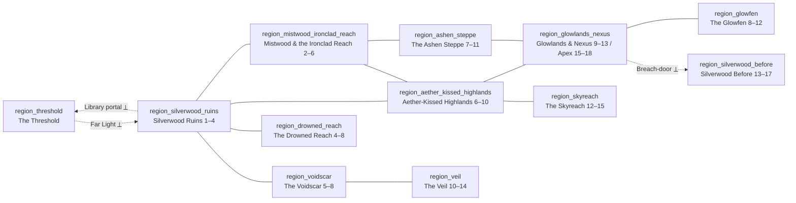

# WORLD.md — Echoes of Aethelgard: The Unraveling

**World bible: regions, locations, creatures, items, crafting, merchants, encounters, map data.**

This document is the implementable source for `src/content/` world data. It elaborates on
`docs/DECISIONS.md` (canon) and never contradicts it. Where it adds a fact, that fact is new
canon unless the lead overrules it (see §13). Legacy content from `aethelgard_data.py` is
preserved verbatim: every legacy location, creature, and item keeps its exact name and
description. Legacy descriptions may be extended by one appended sentence (marked with `+`),
never replaced. Legacy exits are never removed; new exits are added.

### Conventions

- **Ids** are stable snake_case: `loc_*` locations, `region_*` regions, `cr_*` creatures,
  `item_*` items, `mat_*` new materials, `recipe_*` recipes, `npc_*` NPCs, `ev_*` events,
  `echo_*` Echoes, `flag_*` flags, `q_*` quests. Legacy ids derive from names with a leading
  "The" dropped and punctuation removed (`The Chronos Nexus` → `loc_chronos_nexus`,
  `The Wayfarer's Respite` → `loc_wayfarers_respite`, `Chronos Lens` → `item_chronos_lens`).
  The one exception is the Tyrant, which D-051 splits into two creature ids:
  `cr_chronos_tyrant_contained` (Loop 1) and `cr_chronos_tyrant_unveiled` (Loop 2+).
- **Conditions** use the D-033 language: `{echo:"echo_litany_verse_1"}`,
  `{quest:"q_clear_path",stage:"accepted"}`, `{all:[...]}`, `{any:[...]}`, `{not:...}`,
  `{item:"id",count:n}`, `{rep:{faction,min,max}}`, `{loop:{min,max}}`, `{flag:"id"}`,
  `{killed:"cr_id",count:n}`. Faction ids: `remnants`, `shadow_weavers`, `ironclad`.
- **Numbers.** Creatures follow the band formulas: fodder HP ≈ 10×level + 20, elite ×2,
  boss ×6–8; Attack ≈ level + 6 at band start; Defense ≈ level/2. Legacy numbers are listed
  beside the rebalanced ones. Damage types: Physical, Fire, Storm, Ley, Void, Chrono.
  Resistance tiers: weak (−50% to the creature, i.e. it takes +50%), resist (+50%, takes
  −50%), immune. Status names follow D-009.
- **Telegraphs** are ≤12 words, second person, present tense. The UI shows them before the
  enemy acts.
- **Time.** Each walkable edge costs one watch (quarter-day). Portal edges (marked ⟂) cost
  nothing but have their own rules. Resting at a rest point advances to the next dawn.
- **Voice.** Concrete nouns. Short sentences. Strange and grave. No gore.

---

## 1. Geography overview

Aethelgard is a shattered plate of land tilted toward the east. The west is the ruin of
Silverwood, the old capital, where the Wayfinder arrives: a field of marble, crystal-lit
trees, and flooded vaults that go down a long way. One great ley line runs under all of it.
It rises at the Ley Line Conflux — the Heartstone Depths — beneath the ruin and runs due
east: through the Shimmering Pass, under the Aetherium Spires, across the Sky-Whisper
Plateau and the Veridian Glowlands, to the broken observatory of the Chronos Nexus and the
Temporal Breach Apex above it. The Remnants call this line the **Aether Road**. Everything
strange in Aethelgard is strange in proportion to its distance from the Aether Road.

North and east of the ruin lies the Mistwood, a fog forest with glowing bark, and beyond it
the Ironclad Reach: the Nomads' camp, the Barren Peaks, the Blighted Outpost, the warm
canyon of the Emberforge. East of the Outpost the land flattens and greys into the **Ashen
Steppe**, the Nomads' true range, burned white during the Sundering and never recovered.

North-east of Silverwood Plaza the earth is split by the Chasm of Whispers. Beyond it is
the Voidscar Hollow and, beyond that, **the Veil**: the deeps of the scar where the Shadow
Weavers keep their sanctum and where a woman fell out of time forty years ago.

Beneath the Sunken Archives, under the water, is the **Drowned Reach**: the undercity of
Silverwood, flooded on purpose on the last day of the old world. South of the Veridian
Glowlands the swamp thickens into the **Glowfen**, lit from below, where the village of
Lanternreed stands on stilts. Above the Sky-Whisper Plateau, reached by a stair cut into
the wind, is the **Skyreach**: the roosts of the Sentinels and the eyrie of the mage who
built the Spires.

Two places are not on the land at all. **Silverwood Before** is the capital in its last
three days, reached through the Breach. **The Threshold** is a shore inside the Breach,
where the Wayfinder stands between loops.

### Region graph



Solid lines are walkable borders (one watch per edge). Dotted lines are **portal edges**:
the Far Light returns the Wayfinder to Day 1 at the Whispering Ruins; the Breach-door in
the Chronos Nexus and the tear at the Apex lead into Silverwood Before; the Shattered
Library portal (and death or the Breach Clock from Loop 2) lead to the Threshold.

### Travel logic

- Every walkable exit costs **one watch**. Four watches make a day: dawn, day, dusk, night.
  The Breach Clock (D-005) counts days; it is subtle in Loop 1 and explicit from Loop 2.
- **Rest points** (camps, settlements, sheltered hollows) let the player rest: HP/MP restore,
  companions swap, the day advances to the next dawn. Resting consumes whatever watches
  remain in the day. At least one rest point exists per region (§3, §10).
- **Portal edges** cost no watches. Inside Silverwood Before the Breach Clock does not run
  (it is a time-locked echo, D-016); the Before has its own three-day clock. Inside the
  Threshold there is no time at all.
- **Gated exits** are drawn on the map as locked (`x` in the minimap convention) once the
  destination is known. Every gate has a Loop 1 condition and, where D-010 allows, a Loop 2+
  Echo alternative (§3.9).
- A thorough Loop 1 that crosses all five legacy regions uses roughly 22–26 days. Crossing
  times per region are in §10.

---

## 2. Regions

Twelve region ids. The Threshold is the twelfth and counts in the 73-location budget (D-015).
Level bands are fixed; creatures do not scale (D-009).

### 2.1 `region_silverwood_ruins` — Silverwood Ruins

**Theme.** The capital, five hundred years dead. Marble under moss. Crystals growing where
lanterns hung. Everything here is a little louder than it should be: the stones hum, pages
turn themselves, the fountains breathe mist. The whole ruin-field is "the Whispering Ruins"
to everyone but the Remnants, who use the old street names (D-023).

| Field | Value |
|---|---|
| Level band | 1–4 |
| Locations (7) | loc_whispering_ruins, loc_crumbling_archway, loc_darkened_corridor, loc_shattered_library, loc_silverwood_plaza, loc_sunken_archives, loc_heartstone_depths |
| Factions | Remnants of Aethelgard (dominant; Ilyra's camp at the Ruins, Scribe Tamsin's stall at the Plaza). Weavers watch the Plaza's east edge. Nomads avoid it. |
| Palette | sky `#2B2140` · horizon `#4A3B6B` · mid `#6E5A8E` · near `#1C1526` · accent `#7FE3FF` |
| Ambient audio | 48 Hz sine drone −18 dB + band-passed pink noise "wind" (300–900 Hz, slow LFO) + random glass-chime pings (C6/E6/G6) every 7–14 s + whispered-consonant granular bursts at −30 dB every 20–40 s |
| Weather / time | Permanent twilight; the sky never fully brightens. Night brings the crystal glow up and the whispers with it. Light rain at dusk one day in three (Soaked on arrival, cosmetic only). |
| Hazards | Wild-magic surges at the Plaza (random Shock, 1 damage, cosmetic). Flooded floors in the Archives (Soaked). The Heartstone's tremor (no damage). |
| Companion anchor | **Ilyra** (Whispering Ruins; moves to the Shattered Library during the Horde). |
| Changes | Loop 2+: Ilyra believes you at once with `echo_ilyra_watchword`; the Shattered Library shows the portal scar. Heartstone choice re-skins the Depths (§12). Horde: infected node by node from the east; the Library becomes the escape. Loop 4+: a Redundant Wayfinder may stand where you last died. |
| Story role | The beginning of every loop and the end of Loop 1. Holds the Amulet of Echoes (why you loop, D-003), the Echo Crystal (first Litany verse), the Heartstone (the choice that gates endings B, C, D, E), and the portal (the twist). The Remnants' home ground: Sworn Remnants and a stabilized Heartstone lead to ending E here. |

### 2.2 `region_mistwood_ironclad_reach` — Mistwood & the Ironclad Reach

**Theme.** Fog, glowing bark, crushed herbs; then iron. The Mistwood is where the ruin's
magic thins into ordinary wildness and the Nomads have drawn a line with scrap-metal
barricades. The Reach climbs north into razor ridges and a palisade that failed, and ends in
a canyon that is warm all year because of what runs under it.

| Field | Value |
|---|---|
| Level band | 2–6 |
| Locations (6) | loc_mistwood_path, loc_wayfarers_respite, loc_ironclad_camp, loc_barren_peaks, loc_blighted_outpost, loc_emberforge |
| Factions | Ironclad Nomads (Camp, Outpost, Emberforge). The Wayfarer's Respite is neutral ground (D-014). Remnants send scribes to the Respite to trade ink for salt. |
| Palette | sky `#3A4A44` · horizon `#6C8A7A` · mid `#41594E` · near `#1E2A24` · accent `#E07A2F` |
| Ambient audio | Low brown noise "fog bed" −24 dB + wood-knock percussion samples (synth, 2 random hits per 10 s) + at the Camp/Emberforge a metronomic anvil (synth metal transient every 1.6 s, −12 dB) + bellows noise swell |
| Weather / time | Fog morning and dusk (Blind for the first turn of ambushes). Clear cold nights. Wind on the Peaks (ranged attacks −10% accuracy for everyone). |
| Hazards | Rockfall on the Barren Peaks (random 3 Physical on entry at night). Drag-marks at the Outpost mark Golem patrol lanes (telegraphed ambush). |
| Companion anchor | **Brak** (Ironclad Camp). |
| Changes | After `q_clear_path` + `q_blighted_outpost`: the Camp doubles its tents, Tessaly's caravan may arrive (if the Scorched Gate is open), and Brak is absent from Loop 1's Horde (he is at the Apex) unless kept away with `echo_brak_death` (D-017). Heartstone destroyed: Nomad patrols appear on the Mistwood Path (friendly). Horde: infected late (it must pass Mistwood Path → Silverwood Plaza, the slow edge). |
| Story role | The Nomads' quests and Brak's death/survival. The Emberforge forges the Breach-anchor (endings B and D) and the void-forged line. Kaelen and Brak's estrangement (D-022) is resolved here. Ending D (The Iron Silence) is the Reach's ending. |

### 2.3 `region_voidscar` — The Voidscar

**Theme.** A split in the earth that breathes cold. Below the Plaza the ground simply
stops; past the chasm it comes back as obsidian scree and bruised crystal, and the things
that live there fray at the edges like smoke. Nyx waits at the lip, where the Weavers meet
outsiders.

| Field | Value |
|---|---|
| Level band | 5–8 |
| Locations (2) | loc_chasm_of_whispers, loc_voidscar_hollow |
| Factions | Shadow Weavers (Nyx at the Chasm; Weaver sentries in the Hollow from Loop 2 if Wary). |
| Palette | sky `#1A0F24` · horizon `#3E1F4F` · mid `#2A1636` · near `#0B060F` · accent `#C9B8FF` |
| Ambient audio | 32 Hz sub drone with slow 0.1 Hz amplitude wobble + reversed-reverb whisper tails every 12–20 s + occasional "glass crack" transient −20 dB + high 9 kHz hiss filtered by wind LFO |
| Weather / time | No weather. Starlight visible even by day. The chasm exhales on the hour (cosmetic frost). |
| Hazards | Void-chill: standing in the Hollow more than two watches without moving applies Weaken (1 turn) at next combat. Falling scree (cosmetic). |
| Companion anchor | **Nyx** (Chasm of Whispers). |
| Changes | Loop 2+ with `echo_nyx_true_name`: Nyx's dialogue changes entirely. Void Shards refused: Nyx Wary; sentries in the Hollow are hostile. Weavers Trusted: the Veil opens east. Heartstone exploited: the Hollow's crystal glows brighter (Void-touched +1 level variant encounters). |
| Story role | Where the Void Shards come from (D-017) and the door to the Veil. Nyx's recruitment. The first place a player can side against the Remnants. |

### 2.4 `region_aether_kissed_highlands` — Aether-Kissed Highlands

**Theme.** The Aether Road rises above ground. Crystal-laced rock bends distance; spires
hum in a basin; a windswept shelf looks over the whole fractured land. Time is thin here.
Dask can exist here (D-013). The Skyreach above belongs to the same region in name (D-024)
but is budgeted separately (D-015).

| Field | Value |
|---|---|
| Level band | 6–10 |
| Locations (3) | loc_shimmering_pass, loc_aetherium_spires, loc_sky_whisper_plateau |
| Factions | None hold it. Remnant survey cairns. Nomad hunters cross the Plateau to the Outpost. |
| Palette | sky `#C9C3E6` · horizon `#8E86C2` · mid `#5E5A96` · near `#2E2B52` · accent `#FFD27A` |
| Ambient audio | Shepard-tone pad (slow, rising, 90 s cycle) −20 dB + crystalline FM "hum" at 220 Hz with 3 Hz beating + wind gusts (white noise with resonant 1.2 kHz peak) that swell every 15–25 s |
| Weather / time | Light bends: distant nodes flicker on the map (cosmetic). Aurora at night over the Spires. Gales on the Plateau at dusk (Haste to Skyborn creatures). |
| Hazards | Mirage paths in the Pass (first visit: 25% chance the chosen exit costs an extra watch — "you walked a path that was not there"; negated by `echo_pass_true_path`). Static discharge at the Spires (Shock 1 turn on entering combat, cosmetic in Loop 1). |
| Companion anchor | **Dask** (Shimmering Pass). |
| Changes | Loop 2+: Dask is visible from the first visit. Loop 3+: Tyrant's Reach anomalies may appear at the Spires. Heartstone destroyed: the Spires dim; Aetherial Weavers −25% HP (Breach-born rule applies to Constructs of ley make too). |
| Story role | Dask's exposition about Wayfinders and the Tyrant's innocence. The Aetherium Shards for the Breach-anchor. The approach to the Skyreach and Seraphine Aulde's trace. |

### 2.5 `region_glowlands_nexus` — Glowlands & Nexus

**Theme.** The Aether Road ends in a swamp that glows and an observatory whose dome fell
inward. Time buckles. Past and future flicker on cracked stone. Above the observatory, the
Apex: reality in violent seams.

| Field | Value |
|---|---|
| Level band | 9–13; the Apex 15–18 |
| Locations (3) | loc_veridian_glowlands, loc_chronos_nexus, loc_temporal_breach_apex |
| Factions | None. Glowfen folk forage the Glowlands' edge. Remnant astronomers once kept the Nexus. |
| Palette | sky `#0F2E2A` · horizon `#1F5A4A` · mid `#2E7A5A` · near `#0A1A16` · accent `#8CFF6B` (Nexus/Apex add chrono gold `#F2C14E`) |
| Ambient audio | Frog-like filtered pulses (random 200–400 Hz blips, 1–3 per s) + wet reed noise; at the Nexus replace with ticking (two unsynchronized clocks, 0.9 s and 1.1 s) + reversed piano-like decays; at the Apex a chorus of detuned saw drones with a 7 s "stutter" gate and distant pitched screams (formant-filtered noise) −26 dB |
| Weather / time | Glow waves every 40 s (cosmetic). At the Nexus the time-of-day indicator flickers between watches. At the Apex there is no sky. |
| Hazards | Glowlands sinkholes (Slow 1 turn on ambush). Nexus temporal shear: 10% per watch to lose or gain one watch (net zero over time; a visible stutter). The Apex cannot be rested in. |
| Companion anchor | **Dask** (Nexus, Apex) and **Mireya** (Glowlands edge, when recruited). |
| Changes | 6 completed quests (Loop 1) or `echo_apex_resonance` open the Apex. Loop 2+ with Chronos Lens + `echo_litany_verse_1`: the Breach-door in the Nexus opens into Silverwood Before. Tyrant spared: the Apex becomes a place you can speak in, and a second door into the Before. Tyrant killed: the Horde begins here. |
| Story role | The finale of every loop. The Tyrant's three phases or his communion. Endings A, B, C, D, and F resolve at the Apex; ending E resolves in the Ruins but requires the Tyrant soothed. |

### 2.6 `region_silverwood_before` — Silverwood Before

**Theme.** Dawn light on silver roofs. Bells. A city that does not know it has three days
left. Everything the ruin only remembers is here in colour: the Grand Library with its roof
on, the Plaza fountains running, the gate guarded by people in uniform. The Nine are in
their Hall. Oriel Danthe is alive in her Archives. The echo repeats the same three days each
time the Wayfinder enters (D-016).

| Field | Value |
|---|---|
| Level band | 13–17 |
| Locations (10) | loc_silver_gate, loc_outer_walks, loc_scholars_corridor, loc_grand_library, loc_plaza_of_bells, loc_ninefold_hall, loc_apprentices_garret, loc_cistern_gardens, loc_archives_of_danthe, loc_conflux_chamber |
| Factions | None of the three exist yet. The **City Watch** (hostile if you break the law, neutral otherwise) and the **Ninefold Circle** (its adepts and wardens are hostile on Day 3). |
| Palette | sky `#F3DFC1` · horizon `#E0A96D` · mid `#8C6A4E` · near `#3E2E24` · accent `#DDE6F0` |
| Ambient audio | Warm major-key pad (Dmaj, slow) −22 dB + crowd murmur (granular vowels) + bell samples (synth FM bells, Day 1 festive peals every 30 s; Day 2 single tolls every 60 s; Day 3 none, replaced by a 60 Hz hum that grows) + birds (chirp synth, Days 1–2 only) |
| Weather / time | Three days: **First Bell** (festival; clear), **Second Bell** (overcast; the Circle seals the Archives), **Last Bell** (still air; no birds; the ritual at dusk). The echo ends at Last Bell's dusk; the Sundering throws you back through the door you came by. Resting at the Garret advances a day. |
| Hazards | The Watch arrests you for drawn weapons in the Plaza (combat with Halberdiers; non-lethal; you wake in the Garret and lose a day). Ley-flare on Day 3 in the Corridor (Burn 1 turn). The Conflux Chamber on Day 3 is a forced fight. |
| Companion anchor | **Caelum Vesper** (Apprentices' Garret). Dask can remain here. |
| Changes | Day 1/2/3 states (§12). Anchors: objects placed on the Conflux altar before the ritual appear in the present Heartstone Depths. `echo_anchor_rule` after the first failed attempt. Caelum can be brought forward once `item_caelums_anchor_token` has been anchored. |
| Story role | The Mending (ending B) is anchored here with Caelum. The Litany's third page is Oriel's gift. Trying to stop the ritual fails and yields `echo_ritual_inevitable`. Nyxaria Vell can be met young; the Tyrant's core, Veyran Thal, can be met whole. Ending C's witness sequence reuses this region. |

### 2.7 `region_drowned_reach` — The Drowned Reach

**Theme.** The undercity of Silverwood, under black water. Stairs that go down into
lamplight. Shelves that go down further. On the last day of the old world the Master of
Waters, Ilsabet Rhune of the Nine, opened the cisterns to drown the Conflux's fire. The
water never left. Lamps still burn where a few Remnant divers keep them. The dead keep
filing.

| Field | Value |
|---|---|
| Level band | 4–8 |
| Locations (8) | loc_drowned_stair, loc_tidewell_hall, loc_cistern_of_names, loc_lamplighters_rest, loc_sunken_scriptorium, loc_black_sluice, loc_bellmouth, loc_bell_wardens_deep |
| Factions | Remnants (divers and lamplighters at Lamplighters' Rest). Weavers buy drowned vellum from Sedge. |
| Palette | sky `#0A1420` · horizon `#16314A` · mid `#1F4A66` · near `#061018` · accent `#FFB347` |
| Ambient audio | Water drip (random short sine pings with long reverb, 1 per 2–5 s) + low cistern resonance (80 Hz, Q high) + muffled bell (low FM bell, −30 dB, every 45–90 s, louder nearer the Bellmouth) + paper-rustle granular at the Scriptorium |
| Weather / time | No sky. Lamplight. The water rises at night (Black Sluice impassable at night unless `item_cistern_key`). |
| Hazards | **Dark:** without `item_glyphbound_lantern` the player cannot leave the Drowned Stair (the dark below "is not ordinary dark"). Soaked on every entry (Storm +50% both ways; Fire −50%). Lamprey ambushes in the Sluice. |
| Companion anchor | **Ilyra** (her lineage: the Scriptorium holds Oriel's hand). |
| Changes | Heartstone destroyed: the Cistern crack to the Depths opens from both sides and the Reach goes lamp-dark (Lanterns only). Heartstone stabilized: the water calms, Bell-Warden phase 1 is skipped (it does not toll). Loop 3+: the Unmade appear in the Scriptorium. |
| Story role | Oriel Danthe's records: the first Litany page in physical form, `echo_oriel_lineage` (Ilyra's descent), and Ilsabet's cistern key. The Bell-Warden guards the bell Ilsabet rang to drown the city. Sedge is the Remnants' crafter for diver gear. |

### 2.8 `region_ashen_steppe` — The Ashen Steppe

**Theme.** The sky is white with ash that never finishes falling. Grass grows grey. The
Sundering's fire — Corvin Dreyl's pyre-ward, meant to shield the city, turned outward —
burned the plains in a day, and the herds with them. The Nomads came after and made it
theirs: hearths in rings of stone, cairns that catch lightning, a hall that burned and was
never rebuilt. This is where the Ironclad are a people and not a camp.

| Field | Value |
|---|---|
| Level band | 7–11 |
| Locations (9) | loc_scorched_gate, loc_ash_wind_flats, loc_hearthring, loc_bone_orchard, loc_grey_salt_pan, loc_stormgate_cairns, loc_watchfire_ridge, loc_reedmarch_descent, loc_herd_grave |
| Factions | Ironclad Nomads (dominant: Hearthring, Scorched Gate, Watchfire). Glowfen traders at the Reedmarch. |
| Palette | sky `#D9D3CB` · horizon `#A69B8F` · mid `#6B5F56` · near `#2F2924` · accent `#D9482B` |
| Ambient audio | Broad wind (filtered white noise, slow 0.05 Hz LFO) + ash-hiss (high shelf noise −28 dB) + distant herd lowing (formant bass drone, random) + at Hearthring a frame drum (synth, 72 bpm) and a bowed-string drone; at the Cairns, intermittent thunder (low noise burst with 2 s decay) |
| Weather / time | Ashfall (Blind 1 turn at ambush onset, Days 1–2 of any 3-day cycle). Dry lightning at the Cairns at night (random Shock on Soaked characters). Cold clear nights. |
| Hazards | Cinderback stampede lanes on the Flats (telegraphed; Guard to avoid). Salt glare at midday on the Pan (−10% accuracy). Lightning at the Cairns (Soaked characters take 5 Storm per watch). |
| Companion anchor | **Brak** (he is from Hearthring; his arc's second and third quests are here). |
| Changes | Heartstone destroyed: Ironclad +20 and the Steppe's ash settles (ashfall stops; Nomad patrols friendly across the region). Brak's quests complete: Hearthring sends a caravan to the Ironclad Camp. Loop 2+: the Herd-Grave can be entered before Ashmaw wakes if you know the Nomad signs. Horde: infected via Reedmarch from the Glowlands. |
| Story role | The Nomads' faction chain and Brak's lineage (Oma Varr knows the Stonehand brothers). Ending D requires Ironclad Sworn, earned here. Corvin Dreyl's trace: the pyre-ward's brand, the Ashbrand recipe, Ashmaw. |

### 2.9 `region_veil` — The Veil

**Theme.** Past the Hollow the scar goes down and the dark goes up. Here the Void is not a
threat but a medium: the Weavers walk in it, weave in it, build in it. Glass that is not
glass. Trees that are the absence of trees. At the end of the Veil, a crater of starlight
where Nyxaria Vell struck the present forty years ago.

| Field | Value |
|---|---|
| Level band | 10–14 |
| Locations (8) | loc_veil_mouth, loc_stair_of_unmaking, loc_sanctum_of_threads, loc_scar_shelf, loc_voidglass_gallery, loc_null_orchard, loc_eye_of_the_scar, loc_where_she_fell |
| Factions | Shadow Weavers (dominant; the Sanctum). Hostile to Wary/Hostile players; the Sanctum is closed to them. |
| Palette | sky `#05030A` · horizon `#1B0F2B` · mid `#2D1A45` · near `#000000` · accent `#8A5CFF` |
| Ambient audio | Near-silence bed (−40 dB noise) so footsteps are loud + 25 Hz sub pulse every 4 s + glass harmonics (bowed-glass synth, random 2–6 s notes, −26 dB) + at the Sanctum a women's-choir pad (formant synth) in a whole-tone cluster −24 dB; at Where She Fell, a single held high sine (3 kHz, −34 dB) |
| Weather / time | No day or night. The sky shows stars that are not Aethelgard's. |
| Hazards | **Unmaking:** each watch spent in the Null Orchard or the Eye without a Weaver's thread (`item_weavers_thread_ring`) costs 5% max HP (restored on leaving). Blind on entering the Gallery (first turn of any ambush) unless `item_hollow_lantern_focus`. |
| Companion anchor | **Nyx** (her sanctum; her past). |
| Changes | Weavers Trusted: Veil Sentries are neutral; Sworn: the Sanctum sells the void-forged thread. Heartstone exploited: Where She Fell glows; `echo_void_resonance` can be learned here only if Trusted in some loop (D-018). Loop 2+: Vell's Umbra remembers you (phase 1 skipped if `killed:cr_vells_umbra`). |
| Story role | Nyx's identity (`echo_nyx_true_name` is learnable at Where She Fell). The second Litany page (Nyxaria's own annotated copy). Ending C (The Weaver's Dawn) requires Weavers Sworn — earned here with the Thread-Mother. `echo_void_resonance` for ending B. |

### 2.10 `region_glowfen` — The Glowfen

**Theme.** South of the Glowlands the water deepens and the light comes up from under it.
Lanternreed stands on stilts over a pool that breathes. The light is Breach-leak — the
Aether Road's end bleeding into the swamp — and it is changing the people who live in it.
They are kind. They are becoming something.

| Field | Value |
|---|---|
| Level band | 8–12 |
| Locations (8) | loc_lantern_causeway, loc_lanternreed, loc_sporelight_shallows, loc_elder_mangrove, loc_breathing_pool, loc_firefly_barrows, loc_pale_gullet, loc_matrons_hall |
| Factions | Glowfen folk (unaligned villagers; the Remnants court their elders; the Weavers buy spores). Lanternreed is neutral ground for all three factions. |
| Palette | sky `#10231F` · horizon `#1E4A3A` · mid `#2F6E4F` · near `#0B1A15` · accent `#B9FF8C` |
| Ambient audio | Insect chorus (many detuned high square pulses, density by time of day) + bubbling (random low-passed pops) + lantern creak (wood-knock sample with slow random) + at Lanternreed a kalimba-like plucked loop (pentatonic, random order, 60 bpm) −22 dB; at the Breathing Pool a slow inhale/exhale filter sweep on noise, 12 s cycle |
| Weather / time | Humid; glow brightens at night. Spore-fog in the Shallows at dawn (Poison 1 turn at ambush onset). Rain every second day (Soaked region-wide for the day). |
| Hazards | Poison from spores and Mirelings. Sinking in the Shallows (Slow). The Pale Gullet's draw: the current pulls toward the Matron's Hall (leaving the Gullet north costs two watches). |
| Companion anchor | **Mireya of Lanternreed** (Lanternreed). |
| Changes | Corruption ≥ 6 can be cleansed at the Breathing Pool with Elder Wren (D-017). Heartstone stabilized: the Breathing Pool steadies (cleansing is free). Loop 3+: the Barrow-Lights speak the names of past Wayfinders. Horde: infected from the Glowlands by the Causeway. |
| Story role | Mireya's arc: what to preserve of a people being changed. The Lantern Matron is what an elder became. Cleansing Corruption keeps ending E open. The Glowfen elders know the Breach-leak and give `echo_breach_leak` (the Apex is failing on its own, D-005). |

### 2.11 `region_skyreach` — The Skyreach

**Theme.** Above the Plateau the wind has edges. A stair cut into the rock climbs to the
crown of the tallest Spire and the roosts of the Sentinels, and to an eyrie of glass and
brass where Seraphine Aulde, spire-builder of the Nine, tuned the Spires to feed the
ritual. Her looms still run. Nothing up here has forgotten its orders.

| Field | Value |
|---|---|
| Level band | 12–15 |
| Locations (5) | loc_windward_stair, loc_spire_crown, loc_roost_of_sentinels, loc_aldours_eyrie, loc_stormcrowns_perch |
| Factions | None. Nomad sky-burials on the Roost. Remnants want Aulde's notes. |
| Palette | sky `#7FB7E6` · horizon `#CFE6F5` · mid `#5E7FA3` · near `#2C3B52` · accent `#F7FBFF` |
| Ambient audio | Howling wind (resonant band-pass sweeps 400–2 kHz on white noise, fast LFO) + aeolian tones (sines at 330/495/660 Hz that fade in with gusts) + at the Eyrie a loom-click (regular 0.5 s tick with occasional double) and brass resonance; at the Perch, thunder and a hawk-like FM cry every 20–40 s |
| Weather / time | Gale by default (ranged −10%; Skyborn Haste). Storm at dusk (Storm damage +25% for everyone; lightning strikes Soaked characters). Dawn is still: the only calm hour. |
| Hazards | **Thin air:** without `item_sky_whisper_talisman` or `echo_breath_of_heights` the stair cannot be climbed. Falls: fleeing on the Stair costs 10% HP. Storm on Soaked (see weather). |
| Companion anchor | **Dask** (temporal instability extends up the Spire). |
| Changes | Heartstone destroyed: the Spire-Crown goes dark; Spire Looms inactive (free Aulde's notes). Loop 2+: Stormcrown can be bargained with (`echo_sky_oath`), skipping its fight for the Talisman-bearer. |
| Story role | Seraphine Aulde's trace and the Aetherial Weavers' origin (D-006). Her notes hold the Breach-anchor schematic's first half (the second is Tobrin's, in the Before). Stormcrown is the Sentinel that has watched the Apex longest and knows the Tyrant does not attack. |

### 2.12 `region_threshold` — The Threshold

**Theme.** A shore of black sand under no sky, inside the Breach. The water is still and
shows loops instead of reflections. There is no hunger, no clock, no wind. The Wayfinder
arrives here when a loop ends and leaves by the Far Light (D-012).

| Field | Value |
|---|---|
| Level band | none (no combat) |
| Locations (4) | loc_still_shore, loc_gallery_of_loops, loc_loom, loc_far_light |
| Factions | None. |
| Palette | sky `#0D0D12` · horizon `#26262E` · mid `#4C4C5A` · near `#090909` · accent `#FFF4D6` |
| Ambient audio | Single low drone (41 Hz) + very slow wave wash (noise, 20 s swell) + a heartbeat-like double thump every 6 s at −30 dB (the Tyrant's) + at the Loom a sparse music-box melody (Echo count determines how many notes play) |
| Weather / time | None. The Far Light is the only bright thing. |
| Hazards | None. |
| Companion anchor | **Dask** (from Loop 3 he stands on the Shore). |
| Changes | Grows with loops (§12): Loop 2 bare; Loop 3 Dask; Loop 5 the Tyrant's silhouette in the water; Loop 7 the Nine's shards visible; after any true ending the Gallery shows the epilogue slides as paintings. |
| Story role | Run summary, Echoes, Resonance and Attunements, class change (D-011, D-012). Glimpses of the Tyrant that pay off at the Apex. New Game+ and challenge modifiers (D-021) are set here. |

---
## 3. Locations (73)

Stage semantics in exit conditions: `stage:"accepted"` means the quest is in the journal
(accepted or later); `stage:"completed"` means done. Legacy event ids are kept verbatim;
new events use the `ev_` prefix. Encounter notation: `first:` groups roll on the first
visit of a loop; `return:` groups roll on every later visit; `pool(region)` is the region's
wandering pool (§10) at the legacy return chance of 20% when the location is clear.
Map positions are grid coordinates (x spacing 8, y spacing 2) extending the legacy
`MINIMAP_LAYOUT`; the full table and adjacency list are in §11. Portal edges are marked ⟂.

### 3.1 Silverwood Ruins (`region_silverwood_ruins`, 7 locations)

#### `loc_whispering_ruins` — Whispering Ruins
- **Region / band / map:** region_silverwood_ruins · 1–2 · (0, 6) · **Rest point: yes** (Ilyra's camp under the arch-stump) · Merchant: no
- **Description.** The air smells of ozone and decay, and a chill wind carries faint whispers. Twisted trees reach into a twilight sky, their branches dotted with glowing crystals. Broken stone tablets litter the ground, etched with worn sigils. `+` A cold fire burns in a ring of tablets where a woman in faded robes keeps watch.
- **Exits**

| Direction | Destination | Condition |
|---|---|---|
| north | loc_crumbling_archway | — |
| east | loc_mistwood_path | — |
| south | loc_sunken_archives | — |
| (arrival ⟂) | from loc_far_light | Loop start only; not a usable exit |

- **Items:** item_amulet_of_echoes (always present on Day 1 of every loop; the Breach returns it to the ground — the Wayfinder's memory rides on it, D-003).
- **Encounters:** first: none. return: pool(silverwood_ruins) 20%. Loop 4+: `ev_redundant_stand` may replace the pool roll with cr_redundant_wayfinder ×1 (10%) if the player died here in a previous loop.
- **NPCs:** npc_ilyra (until the Horde moves her to the Library).
- **Events:** `ruins_echo` — "A low, resonant hum vibrates under your skin, as if the stones are breathing." — once. `ev_ruins_return` — "You know this smell. You have stood here before, and the stones know it too." — once per loop, Loop 2+ only. `ev_ruins_thirtieth` — "The crystals in the trees go dark one by one. Somewhere east, something lets go." — fires on Day 29 at dusk.
- **Art spec:** horizon 0.62; silhouettes: twisted trees with crystal nodes, broken tablet row, a half arch; particles: slow cyan motes drifting up.

#### `loc_crumbling_archway` — Crumbling Archway
- **Region / band / map:** region_silverwood_ruins · 1–2 · (0, 4) · Rest: no · Merchant: no
- **Description.** A monumental arch of cracked marble towers over you. The stone is warm, as if it remembers a brighter age. Vines twitch with borrowed life. `+` The keystone bears nine small carved faces, eight of them worn smooth.
- **Exits**

| Direction | Destination | Condition |
|---|---|---|
| south | loc_whispering_ruins | — |
| north | loc_darkened_corridor | — |

- **Items:** none (Loop 2+: item_remnant_wax_seal 30% on first visit, under the ninth face, if `echo_nine_voices`).
- **Encounters:** first: cr_mistwood_prowler ×1 (40%). return: pool 20%.
- **NPCs:** none.
- **Events:** `archway_whisper` — "A whisper slips through the archway: 'Wayfinder... follow.'" — once. `ev_archway_faces` — "You count the faces on the keystone. Nine. The ninth is unworn, as if cut yesterday." — once, requires `echo_nine_voices`.
- **Art spec:** horizon 0.55; silhouettes: great arch filling frame, vine curtains, fallen capital; particles: pollen-gold drift.

#### `loc_darkened_corridor` — Darkened Corridor
- **Region / band / map:** region_silverwood_ruins · 2–3 · (0, 2) · Rest: no · Merchant: no
- **Description.** The corridor is slick with moisture, and faint fungi cling to the ceiling. Every footstep sends ripples of pale light across the stones. A growl echoes ahead. `+` Scorch marks climb one wall in the shape of a hand.
- **Exits**

| Direction | Destination | Condition |
|---|---|---|
| south | loc_crumbling_archway | — |
| north | loc_shattered_library | — |

- **Items:** none. (Horde state: item_ley_touched_tonic ×1 appears, dropped by a fleeing scribe.)
- **Encounters:** first: cr_corrupted_shade ×1 (100%; legacy). return: pool 20%. Horde state: cr_horde_husk ×2 (100%) then cr_unraveling_tide blocks if the player has spent more than 14 moves since the Tyrant fell (see §6, Tide).
- **NPCs:** none.
- **Events:** `ev_corridor_hand` — "The scorch-hand on the wall is at the height of your own. You do not put yours in it." — once. `ev_corridor_growl` — "The growl ahead stops when you stop. It starts when you start." — once per loop.
- **Art spec:** horizon 0.70 (interior); silhouettes: converging walls, fungal ceiling clusters, a far doorway of light; particles: pale ripple rings at the floor.

#### `loc_shattered_library` — Shattered Library
- **Region / band / map:** region_silverwood_ruins · 2–3 · (0, 0) · Rest: no (Loop 2+ with Ilyra Trusted: yes, her reading-nook) · Merchant: no
- **Description.** Collapsed shelves form jagged ridges of splintered wood and stone. Dust motes swirl in a dim glow, and you can almost hear pages turning on their own. `+` In an alcove behind the fallen stacks, something small and bright waits in a cradle of stone.
- **Portal state (Horde, Ilyra present):** "The Shattered Library. The air here crackles with raw magic, and at its heart, a shimmering, unstable portal tears at the air. Ilyra stands before it, her hands glowing with an intense, straining light, her face etched with fierce concentration as she pours her energy into keeping the portal open. The whispers of the horde grow closer, echoing through the crumbling shelves." (legacy, verbatim)
- **Portal state (Horde, Ilyra not yet arrived):** base description + "A swirling, unstable portal now pulses between the shelves, casting long shadows across the fractured stacks." (legacy, verbatim)
- **Portal scar (Loop 2+, no Horde):** base description + "Between two fallen stacks the air is thin and cold, a seam the eye slides off. You came through here once."
- **Exits**

| Direction | Destination | Condition |
|---|---|---|
| south | loc_darkened_corridor | — |
| east | loc_silverwood_plaza | — |
| portal ⟂ | loc_still_shore | `{flag:"flag_library_portal_open"}` — ends the loop (Escape, D-002). Also opened deliberately by Ilyra in Loop 2+ with `{all:[{rep:{faction:"remnants",min:20}},{echo:"echo_portal_tear"}]}` |

- **Items:** item_echo_crystal (alcove; with `echo_crystal_location` the pickup skips the search sub-step). Loop 2+: item_korrs_marginalia 100% on first visit if `corruption ≥ 1`.
- **Encounters:** first: cr_arcane_wisp ×1 (100%; legacy). return: pool 20%. Horde: none (Ilyra holds the stacks).
- **NPCs:** npc_ilyra (Horde state only; she relocates here, legacy). npc_tamsin_reed visits here Loop 2+ when the Plaza is infected.
- **Events:** `library_shiver` — "A cold gust rattles the shelves, and you smell old ink and rain." — once. `ev_library_pages` — "A page turns itself on a shelf that no longer exists. You read one word before it is gone: 'Conflux.'" — once. `ev_library_seam` — "The seam in the air widens a hair when you look at it. It knows you." — once, Loop 2+.
- **Art spec:** horizon 0.66 (interior); silhouettes: toppled shelf ridges, a leaning ladder, the alcove's arch; particles: dust motes in a single light shaft (portal state: a vertical violet tear replaces the shaft).

#### `loc_silverwood_plaza` — Silverwood Plaza
- **Region / band / map:** region_silverwood_ruins · 2–4 · (8, 0) · Rest: no · **Merchant: yes** (npc_tamsin_reed, Remnant stall)
- **Description.** Once the heart of Silverwood, this plaza is now a cratered ring of marble. Broken fountains seep shimmering mist, and the air tastes of copper. `+` A Remnant scribe has set a table on the fountain's rim and weighs ink against salt.
- **Exits**

| Direction | Destination | Condition |
|---|---|---|
| west | loc_shattered_library | — |
| south | loc_mistwood_path | — |
| east | loc_chasm_of_whispers | — |

- **Items:** none fixed. Loop 2+: item_bell_shard (10% per first visit; a fragment of the Plaza's bells).
- **Encounters:** first: cr_arcane_wisp ×1 (100%; legacy). return: pool 20%; Loop 2+ pool may roll cr_paradox_wisp instead (25% of pool rolls).
- **NPCs:** npc_tamsin_reed (merchant, flavor; absent during the Horde).
- **Events:** `plaza_surge` — "Wild magic surges. A chorus of distant bells rings out, then fades." — once. `ev_plaza_bells_before` — "You have heard these bells with their roofs on. The memory is not yours yet. Then it is." — once, requires `{flag:"flag_visited_before"}`.
- **Art spec:** horizon 0.58; silhouettes: ring of fountain stumps, cratered marble rim, one standing column; particles: shimmering mist low to the ground.

#### `loc_sunken_archives` — Sunken Archives
- **Region / band / map:** region_silverwood_ruins · 2–4 · (0, 8) · Rest: no · Merchant: no
- **Description.** Half-buried vaults dip beneath brackish water, with shelves sagging under soaked tomes. A slow drip marks time, and the ley lines glow through the flood. `+` A stair descends into the water to the west, its lower steps lit by something that is not the ley.
- **Exits**

| Direction | Destination | Condition |
|---|---|---|
| north | loc_whispering_ruins | — |
| south | loc_heartstone_depths | `{any:[{quest:"q_echoing_heartbeat",stage:"accepted"},{echo:"echo_heartstone_path"}]}` (legacy: the quest unlocks the Depths; Loop 2+: you know the way down) |
| west | loc_drowned_stair | — (open; the dark gate is one node further) |

- **Items:** item_scholars_lost_scroll (present only while `{quest:"q_lost_scroll",stage:"accepted"}` and not completed; legacy). item_glyphbound_lantern (appears with the scroll quest: Ilyra's lamp, left on the top step; legacy item newly placed).
- **Encounters:** first/return: cr_drowned_archivist ×1 (100%) while `q_lost_scroll` is accepted and not completed (legacy rule). Otherwise return: pool 20%.
- **NPCs:** none.
- **Events:** `archives_murmur` — "A submerged page unfurls, whispering of the Ley Line Conflux." — once. `ev_archives_lamp` — "On the top step of the drowned stair sits a lantern etched with glyphs. The water below it is black, not dark." — once, when item_glyphbound_lantern is present.
- **Art spec:** horizon 0.60 (interior); silhouettes: half-submerged shelf rows, a vault arch, the stair-head; particles: slow rising bubbles with ley-green light under the waterline.

#### `loc_heartstone_depths` — Heartstone Depths
- **Region / band / map:** region_silverwood_ruins · 3–4 (Loop 2+ exploited state 6–8) · (0, 10) · Rest: no · Merchant: no
- **Description.** The ground opens into a chamber of raw, pulsing magic. A massive Heartstone sits at the center, each beat sending ripples through the air. `+` Nine plinths stand around it, eight of them empty.
- **State texts** (appended after the choice, this loop; see §12): *stabilized* — "The beat is slow and even now. The plinths are warm."; *exploited* — "The Heartstone is a socket of dark glass. Things flicker in and out of the cavity."; *destroyed* — "There is no light here but your own. The stone does not beat."
- **Exits**

| Direction | Destination | Condition |
|---|---|---|
| north | loc_sunken_archives | — |
| east | loc_shimmering_pass | — |
| west | loc_cistern_of_names | `{any:[{item:"item_cistern_key"},{flag:"flag_heartstone_destroyed"},{echo:"echo_cistern_crack"}]}` — a flooded crack behind the ninth plinth |

- **Items:** none fixed. **Anchors** (D-016): any item placed on the Conflux altar in loc_conflux_chamber before the ritual appears here on the ninth plinth, every loop thereafter (`item_caelums_anchor_token`, `item_litany_page_3`, etc.).
- **Encounters:** first: none (legacy). return: pool 20%. *Exploited state:* return: cr_hourglass_crawler ×2 (50%) or cr_unmade ×1 (25%, Loop 3+). *Destroyed state:* return: cr_corrupted_shade ×2 + cr_hollow_lantern ×1 (40%).
- **NPCs:** none (Caelum appears here when brought forward).
- **Events:** `heartstone_thrum` — "The Heartstone answers your presence with a tremor that shakes dust from the ceiling." — once. `ev_depths_plinths` — "Eight plinths, empty. The ninth holds something that should not have survived five hundred years." — once, when an Anchor is present. `ev_depths_choice` — "The relic throbs with unstable power. You sense three paths: soothe it, seize it, or shatter it." — the legacy choice prompt; fires while `q_echoing_heartbeat` is accepted and not completed.
- **Art spec:** horizon 0.50 (cavern); silhouettes: the Heartstone as a faceted ovoid, nine plinths in a ring, stalactite fringe; particles: concentric pulse rings from the center (state variants: calm slow rings / jittering sparks / no particles).

### 3.2 Mistwood & the Ironclad Reach (`region_mistwood_ironclad_reach`, 6 locations)

#### `loc_mistwood_path` — Mistwood Path
- **Region / band / map:** region_mistwood_ironclad_reach · 2–3 · (8, 6) · Rest: no · Merchant: no
- **Description.** A winding trail threads through fog-laden trees. The bark glows faintly, and the air smells of crushed herbs. Shadows drift between the trunks. `+` Cairns of scrap iron mark the Nomads' side of the path.
- **Exits**

| Direction | Destination | Condition |
|---|---|---|
| west | loc_whispering_ruins | — |
| east | loc_ironclad_camp | — |
| north | loc_silverwood_plaza | — |
| south | loc_wayfarers_respite | — |

- **Items:** item_ley_touched_tonic (legacy).
- **Encounters:** first: cr_mistwood_prowler ×2 (50%) or cr_rootling ×3 (30%). return: pool 20%. Heartstone destroyed: no encounters (Nomad patrol present).
- **NPCs:** none (Heartstone destroyed: a Nomad patrol, flavor only).
- **Events:** `ev_mistwood_herbs` — "You crush a leaf without meaning to. The smell is clean. Nothing here has been clean in a long time." — once. `ev_mistwood_shapes` — "A shape between the trunks keeps your pace for ten steps, then is a tree." — once per loop.
- **Art spec:** horizon 0.64; silhouettes: tall trunks with glowing bark seams, low fog band, scrap-iron cairn; particles: fog drift (horizontal, slow).

#### `loc_wayfarers_respite` — The Wayfarer's Respite
- **Region / band / map:** region_mistwood_ironclad_reach · 2–3 · (8, 8) · **Rest point: yes** · **Merchant: yes** (npc_kaelen_stonehand)
- **Description.** A rare pocket of calm between mana-scarred cliffs. A silver-tinged stream winds through smooth stones, and a distant hum never quite fades. `+` A trader's wagon with its wheels chocked has become a shop and, by the look of the bedroll, a home.
- **Exits**

| Direction | Destination | Condition |
|---|---|---|
| north | loc_mistwood_path | — |

- **Items:** none.
- **Encounters:** none, ever (neutral ground, D-014). Horde: infected like any node, but no fights spawn here; the Respite simply "goes quiet".
- **NPCs:** npc_kaelen_stonehand.
- **Events:** `respite_breath` — "The stream's soft rush quiets the chaos in your thoughts." — once. `ev_respite_brother` — "Kaelen looks east toward the camp for a long moment, then does not." — once, requires `{quest:"q_clear_path",stage:"completed"}`.
- **Art spec:** horizon 0.60; silhouettes: cliff walls framing, a wagon with awning, stream curve; particles: silver sparkle on water.

#### `loc_ironclad_camp` — Ironclad Camp
- **Region / band / map:** region_mistwood_ironclad_reach · 3–4 · (16, 6) · **Rest point: yes** · Merchant: no (Tessaly's caravan sells here after `flag_hearthring_caravan`)
- **Description.** Canvas tents and scrap-metal barricades form a rough circle. Smoke and hot iron fill the air, punctuated by the clatter of tools. `+` A gap in the barricade faces north, watched by two scouts who do not blink.
- **State (after Brak's two quests):** `+` "The circle has doubled. New tents. A second fire. Someone has painted a bull on the barricade in ash."
- **Exits**

| Direction | Destination | Condition |
|---|---|---|
| west | loc_mistwood_path | — |
| north | loc_barren_peaks | `{any:[{quest:"q_clear_path",stage:"accepted"},{echo:"echo_ironclad_passwords"}]}` (legacy: Brak's job opens the pass; Loop 2+: you know the scouts' challenge words) |

- **Items:** none.
- **Encounters:** none (settlement). Horde: cr_horde_husk ×2 if infected and Brak is absent.
- **NPCs:** npc_brak (absent after the Tyrant falls in a loop where his quests were done — he is at the Apex; absent entirely if kept away via `echo_brak_death` choice), npc_tessaly_varr (caravan state only).
- **Events:** `camp_clamor` — "Hammer strikes ring out like a steady heartbeat." — once. `ev_camp_bull` — "The ash bull on the barricade is Hearthring's sign. Someone here is homesick." — once, requires `flag_hearthring_caravan`.
- **Art spec:** horizon 0.60; silhouettes: tent peaks, barricade spikes, a smoke column; particles: ember sparks rising.

#### `loc_barren_peaks` — Barren Peaks
- **Region / band / map:** region_mistwood_ironclad_reach · 3–5 · (16, 4) · Rest: no · Merchant: no
- **Description.** Razor-edged ridges scrape the sky as the wind howls through broken stone. Higher up, the air tastes of dust and iron. `+` Something large has worn a path through the scree, back and forth, for years.
- **Exits**

| Direction | Destination | Condition |
|---|---|---|
| south | loc_ironclad_camp | — |
| east | loc_blighted_outpost | — |

- **Items:** none fixed. mat_wildling_hide ×1 (60% after the Brute is slain, in its den).
- **Encounters:** first: cr_wildling_brute ×1 (100%; legacy; quest target). return: pool 20%; Loop 2+ 15% cr_stutter_hound ×1.
- **NPCs:** none.
- **Events:** `peaks_gale` — "A cutting gale whips through the peaks, carrying flecks of stone." — once. `ev_peaks_den` — "The Brute's den is a nest of roots and old steel. Nomad steel. It has been eating patrols." — once, after killing cr_wildling_brute.
- **Art spec:** horizon 0.45; silhouettes: three blade-ridges, a worn switchback path, a lone standing stone; particles: wind-blown grit streaks.

#### `loc_blighted_outpost` — Blighted Outpost
- **Region / band / map:** region_mistwood_ironclad_reach · 4–6 · (24, 4) · Rest: no · Merchant: no
- **Description.** Splintered palisades jut from the rock like broken teeth. The ground is scarred with drag marks and heavy footprints. `+` A burned gate in the east wall still bears an iron bull, and beyond it the land goes grey.
- **Exits**

| Direction | Destination | Condition |
|---|---|---|
| west | loc_barren_peaks | — |
| south | loc_sky_whisper_plateau | — |
| north | loc_emberforge | — |
| east | loc_scorched_gate | `{any:[{quest:"q_blighted_outpost",stage:"completed"},{echo:"echo_nomad_signs"}]}` — the Nomad watch at the Scorched Gate admits those Brak vouches for, or those who know the trail-signs |

- **Items:** mat_slate_core ×1 (100% after both Golems fall).
- **Encounters:** first: cr_stone_hide_golem ×2 (100%; legacy; quest target; one group of two). return: cr_warding_pillar ×1 (30%, it was always there, dormant) or pool 20%.
- **NPCs:** none.
- **Events:** `outpost_ash` — "Stone scrapes stone as something massive shifts in the dark." — once. `ev_outpost_seal` — "Each golem bears the same mark on its brow: a square inside a circle. A warder's seal." — once, after killing cr_stone_hide_golem. Grants `echo_vask_seal`.
- **Art spec:** horizon 0.58; silhouettes: broken palisade teeth, a burned gate with bull emblem, drag furrows; particles: grey dust falling.

#### `loc_emberforge` — The Emberforge
- **Region / band / map:** region_mistwood_ironclad_reach · 4–6 · (24, 2) · **Rest point: yes** (the forge hearth) · **Merchant/crafter: yes** (npc_borin_stonefist)
- **Description.** A sheltered canyon opens into a warm cavern, its walls veined with ember-bright stone. Heat breathes up from below, and a hammer rings through the glow. `+` The veins in the wall pulse in time with something far to the south-west.
- **Exits**

| Direction | Destination | Condition |
|---|---|---|
| south | loc_blighted_outpost | — |

- **Items:** none fixed. item_tobrins_warding_primer (Loop 2+, 100% once, if `echo_vask_seal`; Borin "found it in the slag").
- **Encounters:** none. Horde: none (the heat holds them off one extra move).
- **NPCs:** npc_borin_stonefist.
- **Events:** `emberforge_heat` — "The forge heat wraps around you like a heavy cloak." — once. `ev_forge_pulse` — "Borin rests his hammer and listens. 'Heartstone's beating fast tonight,' he says, to no one." — once; text varies by Heartstone state (stabilized: "slow and sure"; exploited: "wrong"; destroyed: "The veins are cold. Borin does not look up.").
- **Art spec:** horizon 0.52 (cavern); silhouettes: anvil and bellows, ember-veined walls, a canyon mouth of daylight; particles: rising embers, heat shimmer.

### 3.3 The Voidscar (`region_voidscar`, 2 locations)

#### `loc_chasm_of_whispers` — Chasm of Whispers
- **Region / band / map:** region_voidscar · 4–5 · (16, 0) · **Rest point: yes** (a cold camp on the lip; Nyx permits it) · Merchant: no
- **Description.** A jagged rift splits the earth, breathing air as cold as the void. Murmurs rise from below, promising power to those who listen. `+` A single rope bridge crosses to the far lip, where the ground turns to glass.
- **Exits**

| Direction | Destination | Condition |
|---|---|---|
| west | loc_silverwood_plaza | — |
| east | loc_voidscar_hollow | `{any:[{quest:"q_void_shards",stage:"accepted"},{echo:"echo_hollow_path"}]}` (legacy: Nyx's pact opens the bridge; Loop 2+: you know the way across) |

- **Items:** none.
- **Encounters:** none at the lip. return: pool 20% only if Weavers ≤ Wary (Nyx withdraws her protection).
- **NPCs:** npc_nyx.
- **Events:** `chasm_hum` — "A low hum rises from the abyss, vibrating with hungry intent." — once. `ev_chasm_name` — "The murmurs below say a name. Not yours. Hers." — once, Loop 2+, requires `echo_nine_voices`.
- **Art spec:** horizon 0.48; silhouettes: two cliff lips, a rope bridge, a glass plain beyond; particles: frost glitter falling upward.

#### `loc_voidscar_hollow` — Voidscar Hollow
- **Region / band / map:** region_voidscar · 5–7 · (24, 0) · Rest: no · Merchant: no
- **Description.** Beyond the chasm, the land collapses into a hollow of obsidian scree and bruised crystal. Corrupted creatures stalk the dim glow, their outlines fraying into smoke. `+` At the hollow's far edge the scree stops at a curtain of dark that moves when nothing moves it.
- **Exits**

| Direction | Destination | Condition |
|---|---|---|
| west | loc_chasm_of_whispers | — |
| east | loc_veil_mouth | `{any:[{rep:{faction:"shadow_weavers",min:20}},{echo:"echo_veil_watchword"}]}` — the Weaver sentries part the curtain for the Trusted or for those who speak the watchword |
| north | loc_scar_shelf | same condition as east |

- **Items:** item_void_shard ×1 lies loose in the crystal (first visit; the other shards drop from Stalkers).
- **Encounters:** first: group A cr_void_touched_stalker ×2 (100%), then group B cr_void_touched_stalker ×1 (100%) — the legacy three. return: cr_void_touched_stalker ×1 (35%) or pool 20%. Weavers Wary/Hostile, Loop 2+: cr_veil_sentry ×1 joins group B.
- **NPCs:** none.
- **Events:** `voidscar_thrum` — "The air tastes of ash and frost. Something in the hollow hisses your name." — once. `ev_hollow_curtain` — "The curtain of dark at the hollow's edge has a seam. Two figures in grey thread stand either side of it and do not look at you." — once.
- **Art spec:** horizon 0.50; silhouettes: obsidian scree slope, crystal clusters leaning one way, the dark curtain; particles: smoke wisps peeling off edges.

### 3.4 Aether-Kissed Highlands (`region_aether_kissed_highlands`, 3 locations)

#### `loc_shimmering_pass` — Shimmering Pass
- **Region / band / map:** region_aether_kissed_highlands · 6–7 · (8, 10) · **Rest point: yes** (Dask's hollow, a cleft that is always the same temperature) · Merchant: no
- **Description.** A narrow, winding path cuts between jagged, crystal-laced rock. Residual magic shimmers in the air, bending distance and tricking the eye. `+` A man stands in a cleft of the rock and is not there, and is there again.
- **Exits**

| Direction | Destination | Condition |
|---|---|---|
| west | loc_heartstone_depths | — |
| east | loc_aetherium_spires | — |

- **Items:** item_chronal_dust (legacy). mat_frayed_moment ×1 (50% after killing cr_shimmering_phantom).
- **Encounters:** first: cr_shimmering_phantom ×1 (100%; legacy). return: cr_moment_moth ×3 (30%) or pool 20%. Mirage hazard: first visit, 25% chance the chosen exit costs an extra watch (negated by `echo_pass_true_path`).
- **NPCs:** npc_dask (companion anchor; in Loop 1 he is a flicker the player can speak to only after `ev_pass_flicker`).
- **Events:** `pass_shimmer` — "Light fractures into false paths, then snaps back into focus." — once. `ev_pass_flicker` — "In the cleft a man in a Wayfinder's coat raises a hand. He is gone before it finishes rising." — once per loop. `ev_pass_true_path` — "You remember which path is real. The others fold away ashamed." — once, grants `echo_pass_true_path` after the second visit in any loop.
- **Art spec:** horizon 0.50; silhouettes: crystal-laced rock walls, a path that doubles, Dask's cleft; particles: refracted light shards that duplicate and snap.

#### `loc_aetherium_spires` — Aetherium Spires
- **Region / band / map:** region_aether_kissed_highlands · 7–8 · (16, 10) · Rest: no · Merchant: no
- **Description.** Colossal crystalline spires rise in a wide basin and hum with raw energy. Ethereal creatures drift between them, trailing pale light. `+` The tallest spire has steps cut into its flank, spiralling up out of sight.
- **Exits**

| Direction | Destination | Condition |
|---|---|---|
| west | loc_shimmering_pass | — |
| east | loc_sky_whisper_plateau | — |
| south | loc_spire_crown | `{any:[{item:"item_sky_whisper_talisman"},{echo:"echo_breath_of_heights"}]}` — the climb; without the Talisman the air at the top would tear the breath from you |

- **Items:** item_aetherium_shard (legacy; respawns each loop; a second shard appears here with `flag_heartstone_stabilized`).
- **Encounters:** first: cr_aetherial_weaver ×1 (100%; legacy). return: cr_glass_mote ×2 (30%) or pool 20%. Loop 3+: cr_tyrants_reach ×1 (10%, once per loop).
- **NPCs:** none.
- **Events:** `spires_hum` — "The spires throb in unison, a slow heartbeat of raw arcana." — once. `ev_spires_tuned` — "The hum is not random. It is a chord, held for five hundred years, and it is a little flat." — once, requires `echo_litany_verse_1`.
- **Art spec:** horizon 0.40; silhouettes: five tapering spires, a basin rim, one spiral stair; particles: pale light trails arcing between spires.

#### `loc_sky_whisper_plateau` — Sky-Whisper Plateau
- **Region / band / map:** region_aether_kissed_highlands · 8–10 · (24, 10) · **Rest point: yes** (a wind-shelter among the markers) · Merchant: no
- **Description.** A windswept, high shelf opens to wide views of the fractured land. Weathered stone markers stand like sentries, and a hard climb leads north to the Blighted Outpost. `+` On the shelf's southern lip a stair has been cut into the wind itself, its steps visible only when a gust crosses them.
- **Exits**

| Direction | Destination | Condition |
|---|---|---|
| west | loc_aetherium_spires | — |
| east | loc_veridian_glowlands | — |
| north | loc_blighted_outpost | — |
| south | loc_windward_stair | `{any:[{item:"item_sky_whisper_talisman"},{echo:"echo_breath_of_heights"}]}` |

- **Items:** item_sky_whisper_talisman (legacy; also guaranteed drop from the Sentinel — the second copy is a Trinket upgrade material at Borin's).
- **Encounters:** first: cr_sky_whisper_sentinel ×1 (100%; legacy). return: cr_steppe_harrier ×2 (25%) or pool 20%.
- **NPCs:** none.
- **Events:** `plateau_gale` — "The wind murmurs in broken syllables, as if the sky itself is speaking." — once. `ev_plateau_view` — "From here you can see the Apex. It is not where it was yesterday." — once, Loop 2+.
- **Art spec:** horizon 0.35 (high); silhouettes: standing markers in a row, the shelf edge, distant seams of the Apex; particles: fast horizontal wind streaks.

### 3.5 Glowlands & Nexus (`region_glowlands_nexus`, 3 locations)

#### `loc_veridian_glowlands` — Veridian Glowlands
- **Region / band / map:** region_glowlands_nexus · 9–10 · (32, 10) · Rest: no · Merchant: no
- **Description.** A swampy basin packed with bioluminescent flora. The soil glows green, and humid air clings as amphibious shapes slip through the reeds. `+` A causeway of lashed reeds runs south into deeper water, lit by lanterns no one is tending.
- **Exits**

| Direction | Destination | Condition |
|---|---|---|
| west | loc_sky_whisper_plateau | — |
| east | loc_chronos_nexus | — |
| north | loc_reedmarch_descent | — |
| south | loc_lantern_causeway | — |

- **Items:** item_glow_moss (legacy). mat_glow_spore ×1 (50%).
- **Encounters:** first: cr_glowfen_mireling ×1 (100%; legacy). return: cr_lantern_toad ×1 + cr_spore_drift ×1 (30%) or pool 20%.
- **NPCs:** npc_mireya (flavor only here, gathering; recruit at Lanternreed).
- **Events:** `glowlands_pulse` — "The glow brightens in waves, like the basin is breathing." — once. `ev_glowlands_leak` — "The light under the water is the same colour as the Apex's seams. You had not noticed before." — once, Loop 2+.
- **Art spec:** horizon 0.60; silhouettes: reed clumps, bent lantern-trees, the causeway line; particles: green glow pulses rising from the ground.

#### `loc_chronos_nexus` — The Chronos Nexus
- **Region / band / map:** region_glowlands_nexus · 11–13 · (40, 10) · **Rest point: yes** (the astronomers' cell, where time is honest) · Merchant: no
- **Description.** A ruined observatory sits beneath a shattered dome. Time buckles here, and echoes of past and future flicker across cracked stone. `+` Set into the east wall is a door with no handle, and the stone around it is new.
- **Exits**

| Direction | Destination | Condition |
|---|---|---|
| west | loc_veridian_glowlands | — |
| north | loc_temporal_breach_apex | Loop 1: six completed quests — `{counter:{name:"quests_completed",min:6}}` (D-048 data form). Loop 2+: `{any:[{counter:{name:"quests_completed",min:6}},{echo:"echo_apex_resonance"}]}` |
| east ⟂ (Breach-door) | loc_silver_gate | `{all:[{loop:{min:2}},{item:"item_chronos_lens"},{echo:"echo_litany_verse_1"}]}` (D-016) |

- **Items:** item_chronos_lens (legacy). item_orrery_key (Loop 2+, 100% first visit, in the orrery's base).
- **Encounters:** first: cr_temporal_aberration ×1 (100%; legacy). return: cr_hourglass_crawler ×2 (35%) or cr_orrery_knight ×1 (20%, only if `item_orrery_key` not yet taken) or pool 20%. Loop 4+: cr_hour_leech ×1 (15%).
- **NPCs:** npc_dask (can remain here).
- **Events:** `nexus_echo` — "A future voice overlaps your own, warning of a choice already made." — once. `ev_nexus_door` — "The door with no handle warms when the Lens is near it. Through the stone you hear bells." — once, requires `item_chronos_lens`. `ev_nexus_moor` — "A brass plate on the orrery reads: H. MOOR, CLOCKWRIGHT TO THE CIRCLE. It has been polished recently." — once.
- **Art spec:** horizon 0.55 (interior); silhouettes: broken dome ribs, an orrery of rings, the handleless door; particles: slow clock-tick flashes (afterimages of the scene offset in time).

#### `loc_temporal_breach_apex` — The Temporal Breach Apex
- **Region / band / map:** region_glowlands_nexus · 15–18 · (40, 8) · Rest: **no** (cannot rest) · Merchant: no
- **Description.** Reality tears here in violent seams. Impossible angles fold into one another, and the air hums with distant, unsettling screams. `+` At the center, something holds very still, the way a hand holds a wound closed.
- **Horde state (legacy, verbatim):** "The Apex is collapsing into violent rifts. The air screams with tearing time, and every breath tastes of ash and panic. You must get out now."
- **Exits**

| Direction | Destination | Condition |
|---|---|---|
| south | loc_chronos_nexus | — |
| through the tear ⟂ | loc_conflux_chamber | `{all:[{loop:{min:2}},{flag:"flag_tyrant_spared"}]}` — the Tyrant opens a way through itself |
| beyond ⟂ | ending F | `{all:[{loop:{min:2}},{flag:"flag_tyrant_spared"},{flag:"flag_refused_all_paths"}]}` (The Unbound, D-018) |

- **Items:** none. (After the Tyrant falls: mat_frayed_moment ×3, mat_tyrant_shard ×1.)
- **Encounters:** cr_chronos_tyrant_contained ×1 (Loop 1) or cr_chronos_tyrant_unveiled ×1 (Loop 2+; D-051), present until defeated this loop (legacy rule). Loop 2+ with `echo_tyrant_true_name` or `echo_litany_verse_1`: the fight begins only if the player attacks; the communion path is available (§6). Horde: none (the Apex is the source).
- **NPCs:** npc_brak (arrives when the Tyrant falls, if his quests were done and he was not kept away; legacy sequence). npc_dask (can remain).
- **Events:** `apex_rend` — "The breach flashes, and the world stutters as if deciding what to become." — once. `ev_apex_watched` — "Something at the center turns toward you. It has done this seven times before." — once, Loop 2+. `ev_apex_names` — "In the mass, for an instant, a face you know from a painting in a hall that no longer exists." — once, requires `flag_visited_before`.
- **Art spec:** horizon none (abstract); silhouettes: folded planes, the Tyrant's mass as a vertical cleft of shards and limbs, stair fragments; particles: seams of white that stutter open and shut.

### 3.6 The Drowned Reach (`region_drowned_reach`, 8 locations)

Entered from loc_sunken_archives (west). **Dark gate:** every exit out of loc_drowned_stair
except back east requires `{item:"item_glyphbound_lantern"}` in all loops (no Echo
alternative; the Lantern is placed in the Archives and sold by Kaelen from Loop 2). Soaked
is applied on entering any Drowned Reach location.

#### `loc_drowned_stair` — The Drowned Stair
- **Band / map / rest / merchant:** 4 · (−8, 8) · no · no
- **Description.** The stair goes down under the water and keeps going. Lamps burn on every ninth step, under the surface, without wavering. The dark below the lamps is not the dark of a cellar. It looks back.
- **Exits**

| Direction | Destination | Condition |
|---|---|---|
| east | loc_sunken_archives | — |
| west | loc_tidewell_hall | `{item:"item_glyphbound_lantern"}` |
| south | loc_cistern_of_names | `{item:"item_glyphbound_lantern"}` |

- **Items:** item_brine_draught ×1. **Encounters:** first: cr_brine_lamprey ×2 (60%). return: pool(drowned) 20%. **NPCs:** none.
- **Events:** `ev_stair_lamps` — "The lamps under the water do not flicker. Someone tends them." — once.
- **Art spec:** horizon 0.70 (interior); silhouettes: descending stair, lamp posts under waterline, a vaulted ceiling; particles: lamp-amber motes under water.

#### `loc_tidewell_hall` — Tidewell Hall
- **Band / map / rest / merchant:** 4–5 · (−16, 8) · no · no
- **Description.** A guildhall with the water at chest height. Long tables stand in rows, their benches tucked in. Ledgers float open at the same page. A clerk in a drowned coat walks the rows, checking names.
- **Exits**

| Direction | Destination | Condition |
|---|---|---|
| east | loc_drowned_stair | — |
| south | loc_lamplighters_rest | — |

- **Items:** mat_sodden_vellum ×2. **Encounters:** first: cr_tide_clerk ×1 + cr_drowned_archivist ×1 (100%). return: cr_tide_clerk ×1 (30%) or pool 20%. **NPCs:** none.
- **Events:** `ev_tidewell_ledger` — "A ledger lists the drowned by street. The last entry is in a different hand: 'and the Master of Waters, by her own choice.'" — once; grants `echo_rhune_choice`.
- **Art spec:** horizon 0.62 (interior); silhouettes: table rows at waterline, hanging guild banners, a clerk's desk on a dais; particles: floating pages.

#### `loc_cistern_of_names` — The Cistern of Names
- **Band / map / rest / merchant:** 5 · (−8, 10) · no · no
- **Description.** A round cistern with a walkway at its rim. Every stone of the wall bears a name cut deep. Water pours in from a crack in the east wall and the names nearest it have been worn away to nothing.
- **Exits**

| Direction | Destination | Condition |
|---|---|---|
| north | loc_drowned_stair | — |
| east | loc_heartstone_depths | `{any:[{item:"item_cistern_key"},{flag:"flag_heartstone_destroyed"},{echo:"echo_cistern_crack"}]}` |
| south | loc_black_sluice | — |
| west | loc_lamplighters_rest | — |

- **Items:** mat_drowned_pearl ×1 (40%). **Encounters:** first: cr_pale_diver ×2 (70%). return: pool 20%. **NPCs:** none.
- **Events:** `ev_cistern_names` — "You find a name you know on the wall. DANTHE. Below it, smaller: and her daughter." — once; grants `echo_oriel_lineage` with `{rep:{faction:"remnants",min:20}}`.
- **Art spec:** horizon 0.55 (interior); silhouettes: round wall of names, rim walkway, the crack with pouring water; particles: spray mist.

#### `loc_lamplighters_rest` — Lamplighters' Rest
- **Band / map / rest / merchant:** 5 · (−16, 10) · **Rest point: yes** · **Merchant: yes** (npc_sedge_marrow)
- **Description.** A dry room above the waterline, reached by a ladder. Lamps hang from every hook. Oil in jars, nets drying, a kettle. Two Remnants live here and keep the lamps below lit, because the dead do not like the dark either.
- **Exits**

| Direction | Destination | Condition |
|---|---|---|
| north | loc_tidewell_hall | — |
| east | loc_cistern_of_names | — |
| west | loc_sunken_scriptorium | — |
| south | loc_bellmouth | — |

- **Items:** item_lantern_oil ×2. **Encounters:** none (settlement). **NPCs:** npc_sedge_marrow (merchant/crafter), npc_pellam (rest keeper; Remnant Archive voice).
- **Events:** `ev_rest_kettle` — "Pellam pours you something hot without asking. 'The bell rang twice last night,' he says. 'It never rings twice.'" — once per loop.
- **Art spec:** horizon 0.66 (interior); silhouettes: hanging lamps in a row, ladder down, drying nets; particles: steam from a kettle.

#### `loc_sunken_scriptorium` — The Sunken Scriptorium
- **Band / map / rest / merchant:** 6–7 · (−24, 10) · no · no
- **Description.** Desks in tiers, like a theatre, all facing one lectern. The water here is clear as glass and the ink in the open books has not run. At the lectern a stack of pages bound in Remnant wax is still being written, by no one.
- **Exits**

| Direction | Destination | Condition |
|---|---|---|
| east | loc_lamplighters_rest | — |
| south | loc_bell_wardens_deep | — |

- **Items:** item_litany_page_1 (lectern; 100%), item_oriels_ledger (100%, Loop 2+ or `echo_oriel_lineage`), mat_sodden_vellum ×2. **Encounters:** first: cr_ledger_choir ×1 + cr_drowned_archivist ×2 (100%; elite guard). return: cr_drowned_archivist ×2 (30%) or pool 20%. Loop 3+: cr_unmade ×1 (20%).
- **NPCs:** none. **Events:** `ev_scriptorium_hand` — "The hand on the pages is Oriel Danthe's. You know it from a scroll you carried to a woman with the same hand." — once; grants `echo_oriel_hand`.
- **Art spec:** horizon 0.60 (interior); silhouettes: tiered desks, a lectern with a pool of light, tall shelves; particles: suspended ink threads.

#### `loc_black_sluice` — The Black Sluice
- **Band / map / rest / merchant:** 6 · (−8, 12) · no · no
- **Description.** A channel of fast black water between iron grates. The current pulls toward the west. Pale shapes with too many mouths wait in the eddies where the grates have rusted through.
- **Exits**

| Direction | Destination | Condition |
|---|---|---|
| north | loc_cistern_of_names | — |
| west | loc_bellmouth | `{any:[{item:"item_cistern_key"},{not:{day:{watch:"night"}}}]}` — at night the water rises over the walkway |

- **Items:** mat_bell_bronze ×1 (30%, caught in a grate). **Encounters:** first: cr_brine_lamprey ×3 (100%). return: cr_brine_lamprey ×2 (40%). **NPCs:** none.
- **Events:** `ev_sluice_pull` — "The current wants you west. Something in the west wants you too." — once.
- **Art spec:** horizon 0.64 (interior); silhouettes: iron grates, channel walls, a far gate; particles: fast black-water streaks.

#### `loc_bellmouth` — The Bellmouth
- **Band / map / rest / merchant:** 7 · (−16, 12) · no · no
- **Description.** The channel opens into a flooded bell tower lying on its side. The great bell fills the far end like a shell. Something lives inside it. When the water moves, the bell speaks one low note and the drowned stand up.
- **Exits**

| Direction | Destination | Condition |
|---|---|---|
| east | loc_black_sluice | — |
| north | loc_lamplighters_rest | — |
| west | loc_bell_wardens_deep | — |

- **Items:** mat_bell_bronze ×2. **Encounters:** first: cr_bell_ringer ×1 + cr_drowned_archivist ×1 (100%). return: cr_pale_diver ×2 (35%). **NPCs:** none.
- **Events:** `ev_bellmouth_note` — "The bell speaks. The note is the first note of the Litany. You did not know the Litany had notes." — once, requires `echo_litany_verse_1`.
- **Art spec:** horizon 0.52 (interior); silhouettes: fallen tower ribs, the great bell on its side, standing drowned figures; particles: ripples radiating from the bell.

#### `loc_bell_wardens_deep` — The Bell-Warden's Deep
- **Band / map / rest / merchant:** 8 (boss) · (−24, 12) · no · no
- **Description.** Under the bell the floor drops into a well of black water lit from far below. The Warden sits in it with the bell's clapper across its knees, a drowned giant in a Master's chain of office, and waits for the hour it was told to ring.
- **Exits**

| Direction | Destination | Condition |
|---|---|---|
| east | loc_bellmouth | — |
| north | loc_sunken_scriptorium | — |

- **Items:** item_cistern_key (100% after the boss or after `echo_rhune_choice` + choosing not to fight — the Warden surrenders the key to one who says the Master's name), item_bell_clapper (100% after the boss), item_rhunes_hydromancy (100%, first clear). **Encounters:** **forced boss:** cr_bell_warden ×1 (adds cr_brine_lamprey). Pacifist bypass exists (see §10). **NPCs:** none.
- **Events:** `ev_deep_hour` — "The Warden lifts its head. 'Is it the hour?' it asks, in the voice of a city." — once per loop.
- **Art spec:** horizon 0.45 (interior); silhouettes: the well, the seated giant with clapper, chains hanging; particles: slow rising light from below.

### 3.7 The Ashen Steppe (`region_ashen_steppe`, 9 locations)

Entered from loc_blighted_outpost (east) or from loc_veridian_glowlands (north, via the
Reedmarch). Ashfall applies Blind for one turn at the start of any ambush on Days 1–2 of
each three-day cycle.

#### `loc_scorched_gate` — The Scorched Gate
- **Band / map / rest / merchant:** 7 · (32, 4) · no · no
- **Description.** The Outpost's east gate burned and was never rebuilt, so the Nomads built a smaller one inside its frame. Two scouts, a brazier, a horn. Beyond the gate the grass is grey to the horizon and the sky is white with falling ash.
- **Exits**

| Direction | Destination | Condition |
|---|---|---|
| west | loc_blighted_outpost | — |
| east | loc_ash_wind_flats | — |
| north | loc_bone_orchard | — |
| south | loc_watchfire_ridge | — |

- **Items:** item_nomad_hardtack ×2. **Encounters:** none (watched). Horde: cr_horde_husk ×2. **NPCs:** npc_scout_ferrin (teaches the trail-signs → `echo_nomad_signs` once Ironclad ≥ Neutral).
- **Events:** `ev_gate_horn` — "Ferrin blows two notes on the horn. Far off, two notes answer. 'Hearthring knows you're coming,' he says." — once per loop.
- **Art spec:** horizon 0.58; silhouettes: a gate within a gate, brazier, two leaning scouts; particles: ash falling.

#### `loc_ash_wind_flats` — Ash-Wind Flats
- **Band / map / rest / merchant:** 7–8 · (40, 4) · no · no
- **Description.** Flat grey land under a flat white sky. The wind comes from the east and never stops. Herd-paths cross the ash in straight lines. When the ground shakes, you are on one.
- **Exits**

| Direction | Destination | Condition |
|---|---|---|
| west | loc_scorched_gate | — |
| east | loc_hearthring | — |
| north | loc_grey_salt_pan | — |

- **Items:** mat_cinder_horn ×1 (50%). **Encounters:** first: cr_cinderback ×1 (60%, telegraphed stampede — Guard on the first turn avoids the opening charge) or cr_salt_jackal ×3 (40%). return: cr_steppe_harrier ×2 (30%) or pool(steppe) 20%. **NPCs:** none.
- **Events:** `ev_flats_shake` — "The ground shakes. You step off the herd-path. Something the size of a house passes where you stood, burning." — once.
- **Art spec:** horizon 0.50; silhouettes: flat horizon line, a lone dead tree, a distant burning shape; particles: ash streaks horizontal.

#### `loc_hearthring` — Hearthring
- **Band / map / rest / merchant:** 8 · (48, 4) · **Rest point: yes** · **Merchant: yes** (npc_tessaly_varr)
- **Description.** A ring of standing stones with a fire in the middle that has not gone out in four hundred years. Hide tents lean on the stones. Children, dogs, a forge-wagon, a bull's skull on a pole. The clan-mother sits with her back to the fire and her eyes on the gate.
- **Exits**

| Direction | Destination | Condition |
|---|---|---|
| west | loc_ash_wind_flats | — |
| north | loc_stormgate_cairns | — |
| south | loc_herd_grave | `{any:[{quest:"q_herd_of_one",stage:"accepted"},{echo:"echo_nomad_signs"}]}` — the clan does not let strangers wake the Herd |

- **Items:** item_hearth_broth ×2. **Encounters:** none (settlement). **NPCs:** npc_oma_varr (clan-mother, quest giver), npc_tessaly_varr (quartermaster/merchant), npc_ketch (skald; Ironclad Telling codex).
- **Events:** `ev_hearthring_fire` — "Oma Varr does not look up. 'That fire was lit from the last ember of the Burned Hall,' she says. 'Sit. You smell of the Breach.'" — once per loop. `ev_hearthring_brothers` — "Ketch sings a verse about two brothers and a name laid down. He stops when he sees your face." — once, requires `{quest:"q_clear_path",stage:"completed"}`.
- **Art spec:** horizon 0.56; silhouettes: ring of stones, central fire, tents, skull-pole; particles: embers rising into ash falling.

#### `loc_bone_orchard` — The Bone Orchard
- **Band / map / rest / merchant:** 8–9 · (32, 2) · no · no
- **Description.** The herds died standing. Five hundred years of ash have made them stone: rows of bison in mid-stride, calcined white, mouths open. Grey grass grows between the legs. Some of the shapes are warm.
- **Exits**

| Direction | Destination | Condition |
|---|---|---|
| south | loc_scorched_gate | — |
| east | loc_grey_salt_pan | — |

- **Items:** mat_cinder_horn ×2, mat_iron_rivet ×1. **Encounters:** first: cr_cinderback ×1 (50%; one of the warm shapes). return: cr_salt_jackal ×2 (35%) or pool 20%. **NPCs:** none.
- **Events:** `ev_orchard_brand` — "Each stone beast carries the same scorch on its flank: a flame inside a ring. Dreyl's brand. He warded them, and the ward burned." — once; grants `echo_dreyl_brand`.
- **Art spec:** horizon 0.52; silhouettes: rows of petrified bison, grey grass tufts, a single warm red glow; particles: ash.

#### `loc_grey_salt_pan` — Grey Salt Pan
- **Band / map / rest / merchant:** 9 · (40, 2) · no · no
- **Description.** A dry lake of salt, perfectly flat, perfectly white under the grey. At midday the glare erases the horizon. Jackals the colour of the salt run in packs and are not seen until they are heard.
- **Exits**

| Direction | Destination | Condition |
|---|---|---|
| west | loc_bone_orchard | — |
| east | loc_stormgate_cairns | — |
| south | loc_ash_wind_flats | — |

- **Items:** item_salt_charm ×1 (first visit, in a jackal den, 100% after clearing). **Encounters:** first: cr_salt_jackal ×3 (100%). return: cr_salt_jackal ×2 (40%). **NPCs:** none.
- **Events:** `ev_pan_glare` — "At noon the Pan has no edges. You walk toward a shape for an hour. It is a man-high cairn, and it is behind you." — once.
- **Art spec:** horizon 0.50 (white-out); silhouettes: salt cracks, a lone cairn, jackal shapes; particles: heat shimmer.

#### `loc_stormgate_cairns` — Stormgate Cairns
- **Band / map / rest / merchant:** 9–10 · (48, 2) · no · no
- **Description.** A field of cairns built of iron-dark stone, each taller than a man, each capped with a spike. Dry lightning walks between them at night. The Nomads built them to pull the storms down out of the sky and away from the herds. It works.
- **Exits**

| Direction | Destination | Condition |
|---|---|---|
| west | loc_grey_salt_pan | — |
| south | loc_hearthring | — |

- **Items:** mat_storm_glass ×2, item_storm_jar ×1. **Encounters:** first: cr_steppe_harrier ×2 (60%). return: pool 20%. Night: Soaked characters take 5 Storm per watch here. **NPCs:** none.
- **Events:** `ev_cairns_strike` — "Lightning takes a cairn two paces from you. The spike glows. The stone beneath it is glass now, and in the glass a face you half know." — once; grants `echo_sky_oath` (Stormcrown's bargain, §6) with `{item:"item_sky_whisper_talisman"}`.
- **Art spec:** horizon 0.48; silhouettes: cairns with spikes, a lightning fork, low cloud; particles: sparks and glass glitter.

#### `loc_watchfire_ridge` — Watchfire Ridge
- **Band / map / rest / merchant:** 7–8 · (32, 6) · **Rest point: yes** (the watchfire; Nomad sentries) · no
- **Description.** A spine of black rock above the Flats with a fire on it that the Nomads keep for signalling. From here the Glowlands are a green stain to the south and the Apex is a white one to the east. The sentries take turns not looking at it.
- **Exits**

| Direction | Destination | Condition |
|---|---|---|
| north | loc_scorched_gate | — |
| south | loc_reedmarch_descent | — |

- **Items:** item_whetstone_strip ×1. **Encounters:** first: cr_steppe_harrier ×2 (40%). return: pool 20%. **NPCs:** none (sentries are set-dressing).
- **Events:** `ev_ridge_apex` — "A sentry hands you a glass. Through it the Apex seams move like breathing. 'Faster than last season,' she says." — once; grants `echo_breach_failing`.
- **Art spec:** horizon 0.40 (high); silhouettes: ridge spine, watchfire, distant green and white smears; particles: embers.

#### `loc_reedmarch_descent` — Reedmarch Descent
- **Band / map / rest / merchant:** 8 · (32, 8) · no · no
- **Description.** The ridge breaks into terraces that go down into reeds. Grey gives way to green in three steps. Glowfen traders leave baskets of moss here for Nomad salt and never meet them.
- **Exits**

| Direction | Destination | Condition |
|---|---|---|
| north | loc_watchfire_ridge | — |
| south | loc_veridian_glowlands | — |

- **Items:** item_glow_moss ×2 (the trade baskets). **Encounters:** first: cr_reed_stalker ×1 (40%). return: pool(steppe) 10% / pool(glowfen) 10%. **NPCs:** none.
- **Events:** `ev_reedmarch_baskets` — "Moss in one basket, salt in the other. Two peoples who have never spoken, keeping a bargain for a hundred years." — once.
- **Art spec:** horizon 0.55; silhouettes: terraced steps, reed line, two baskets; particles: ash above, green motes below.

#### `loc_herd_grave` — The Herd-Grave
- **Band / map / rest / merchant:** 11 (boss) · (48, 6) · no · no
- **Description.** A bowl in the Steppe where the ash lies deepest. Under it, the herd that did not turn to stone. It burned, and kept burning, and learned to move as one. The Nomads call it Ashmaw and leave it the first calf of every spring. The bowl is warm to stand in.
- **Exits**

| Direction | Destination | Condition |
|---|---|---|
| north | loc_hearthring | — |

- **Items:** item_dreyls_pyre_ledger (100% first clear), mat_cinder_horn ×3 (after boss), item_cinder_heart (100% after boss). **Encounters:** **forced boss:** cr_ashmaw ×1 (adds cr_salt_jackal). Pacifist bypass: with `echo_dreyl_brand` the player may break the brand-stone at the bowl's rim (Oma's quest) and Ashmaw lies down — no fight, reduced loot. **NPCs:** none.
- **Events:** `ev_grave_breath` — "The ash in the bowl rises and falls. Slowly. It is breathing." — once per loop.
- **Art spec:** horizon 0.50; silhouettes: ash bowl rim, half-buried horns, a vast dark shape under ash; particles: heat shimmer and ember drift.

### 3.8 The Veil (`region_veil`, 8 locations)

Entered from loc_voidscar_hollow (east and north). **Unmaking:** each watch spent in
loc_null_orchard or loc_eye_of_the_scar without `item_weavers_thread_ring` costs 5% max HP
(restored on leaving the Veil).

#### `loc_veil_mouth` — The Veil Mouth
- **Band / map / rest / merchant:** 10 · (32, 0) · no · no
- **Description.** The curtain of dark parts and closes behind you. There is ground, and it is black glass. There is a sky, and the stars in it are wrong. Two Weavers in grey thread stand at the mouth and count you in.
- **Exits**

| Direction | Destination | Condition |
|---|---|---|
| west | loc_voidscar_hollow | — |
| east | loc_stair_of_unmaking | — |
| north | loc_voidglass_gallery | — |

- **Items:** none. **Encounters:** first: cr_hollow_lantern ×2 (50%). return: pool(veil) 20%. Weavers Wary/Hostile: cr_veil_sentry ×2 (100%, every visit). **NPCs:** none (sentries are set-dressing when neutral).
- **Events:** `ev_mouth_count` — "'Eight,' says one sentry to the other as you pass. You do not ask eight of what." — once; Loop 2+ the line is "'Eight again.'"
- **Art spec:** horizon 0.50; silhouettes: a parted curtain of dark, two thread-wrapped figures, glass ground; particles: wrong stars, slow.

#### `loc_stair_of_unmaking` — Stair of Unmaking
- **Band / map / rest / merchant:** 10–11 · (40, 0) · no · no
- **Description.** Steps cut down into the scar. Each step is a little less there than the one above. Halfway down you cannot see your feet. The Weavers run a thread along the wall for the hand to follow.
- **Exits**

| Direction | Destination | Condition |
|---|---|---|
| west | loc_veil_mouth | — |
| east | loc_sanctum_of_threads | `{rep:{faction:"shadow_weavers",min:-9}}` — the Sanctum door is barred to the Wary and Hostile |
| north | loc_null_orchard | — |

- **Items:** mat_umbral_thread ×2. **Encounters:** first: cr_null_mouth ×1 (60%). return: pool 20%. **NPCs:** none.
- **Events:** `ev_stair_thread` — "The thread along the wall is warm. Someone is holding the other end." — once.
- **Art spec:** horizon 0.60 (interior); silhouettes: descending steps fading to nothing, a wall thread; particles: pixel-dissolve of the lowest steps.

#### `loc_sanctum_of_threads` — Sanctum of Threads
- **Band / map / rest / merchant:** 11 · (48, 0) · **Rest point: yes** · **Merchant: yes** (npc_hollis_vane)
- **Description.** A hall woven, not built. Threads of grey and violet run from wall to wall in thousands and the walls themselves are more thread. Weavers sit in the web and work. At the center an old woman with no eyes holds the one thread that all the others are tied to.
- **Exits**

| Direction | Destination | Condition |
|---|---|---|
| west | loc_stair_of_unmaking | — |

- **Items:** item_weavers_thread_ring (gift at Trusted). **Encounters:** none. **NPCs:** npc_ysmay (Thread-Mother; quest giver), npc_hollis_vane (quartermaster/merchant), npc_nyx (when not at the Chasm, Loop 2+ scenes).
- **Events:** `ev_sanctum_thread` — "The Thread-Mother turns her face to you. 'You are knotted,' she says. 'Someone has tied you to the same day eight times.'" — once per loop, Loop 2+.
- **Art spec:** horizon 0.55 (interior); silhouettes: radial threads converging, seated weavers, a central figure; particles: violet thread-glints.

#### `loc_scar_shelf` — The Scar Shelf
- **Band / map / rest / merchant:** 10 · (24, −2) · no · no
- **Description.** A ledge above the Hollow where the obsidian has flowed and frozen in sheets. From here you can see down into the Hollow and up into the Veil at once, and they do not meet where they should.
- **Exits**

| Direction | Destination | Condition |
|---|---|---|
| south | loc_voidscar_hollow | — |
| east | loc_voidglass_gallery | — |

- **Items:** item_void_shard ×1 (first visit), mat_breach_glass ×1. **Encounters:** first: cr_void_touched_stalker ×2 (60%). return: pool 20%. **NPCs:** none.
- **Events:** `ev_shelf_seam` — "The Hollow below and the Veil above overlap like two pages held to the light. The seam between them is a woman's height." — once.
- **Art spec:** horizon 0.45; silhouettes: frozen obsidian sheets, a ledge edge, overlapping skylines; particles: smoke wisps.

#### `loc_voidglass_gallery` — Voidglass Gallery
- **Band / map / rest / merchant:** 11–12 · (32, −2) · no · no
- **Description.** A long hall of black glass that shows nothing. Not darkness: nothing. Walk along it and your reflection does not walk with you. The Weavers come here to practise being unseen.
- **Exits**

| Direction | Destination | Condition |
|---|---|---|
| west | loc_scar_shelf | — |
| south | loc_veil_mouth | — |
| east | loc_null_orchard | — |
| north | loc_eye_of_the_scar | — |

- **Items:** mat_breach_glass ×2, mat_shadow_ash ×2. **Encounters:** first: cr_starved_shadow ×1 (70%). return: cr_hollow_lantern ×2 (30%) or pool 20%. Blind on the first turn of any ambush here unless `item_hollow_lantern_focus`. **NPCs:** none.
- **Events:** `ev_gallery_reflection` — "At the far end of the gallery your reflection is waiting for you. It arrived first." — once; Loop 4+ this spawns cr_redundant_wayfinder ×1.
- **Art spec:** horizon 0.60 (interior); silhouettes: a long hall, no reflections, a far door; particles: none (deliberate).

#### `loc_null_orchard` — The Null Orchard
- **Band / map / rest / merchant:** 12 · (40, −2) · no · no
- **Description.** Trees grew here once. What stands now is the shape of each tree cut out of the world: trunk-shaped, branch-shaped absences you can walk around but not through. Fruit-shaped holes hang from them. The Weavers harvest the holes.
- **Exits**

| Direction | Destination | Condition |
|---|---|---|
| west | loc_voidglass_gallery | — |
| south | loc_stair_of_unmaking | — |
| north | loc_where_she_fell | — |

- **Items:** mat_breach_glass ×1, item_void_shard ×1. **Encounters:** first: cr_null_mouth ×2 (100%). return: cr_null_mouth ×1 (35%). Unmaking hazard applies. **NPCs:** none.
- **Events:** `ev_orchard_fruit` — "A Weaver picks a hole from a branch and eats it. Afterward there is slightly less of her, and she looks pleased." — once.
- **Art spec:** horizon 0.55; silhouettes: tree-shaped cut-outs showing the wrong stars through them; particles: falling absence (inverted motes).

#### `loc_eye_of_the_scar` — Eye of the Scar
- **Band / map / rest / merchant:** 13 (boss) · (32, −4) · no · no
- **Description.** The scar's deepest point. A round floor of glass and a round sky of nothing and, between them, a shadow that no one casts. It has her shape. It has been waiting forty years for her to come back for it, and it has stopped being patient.
- **Exits**

| Direction | Destination | Condition |
|---|---|---|
| south | loc_voidglass_gallery | — |
| east | loc_where_she_fell | — |

- **Items:** item_umbral_mirror (100% after boss), mat_umbral_thread ×3 (after boss). **Encounters:** **forced boss:** cr_vells_umbra ×1 (adds cr_hollow_lantern). Pacifist bypass: with Nyx as active companion and `echo_nyx_true_name`, she calls it back — it goes into her; Nyx gains a permanent stance bonus and the fight is skipped. **NPCs:** none.
- **Events:** `ev_eye_shape` — "The shadow stands up. It is a woman's. You know the woman." — once per loop.
- **Art spec:** horizon 0.50; silhouettes: circular glass floor, a single tall shadow with no caster; particles: inverted light (dark motes on a faint glow).

#### `loc_where_she_fell` — Where She Fell
- **Band / map / rest / merchant:** 12–13 · (40, −4) · no · no
- **Description.** A crater of fused starlight glass, forty paces across, forty years old. In the center, the print of a body that landed from very far away and very long ago, and got up. Around the rim, in a hand you have seen in a Dark Spellbook's margins, notes.
- **Exits**

| Direction | Destination | Condition |
|---|---|---|
| west | loc_eye_of_the_scar | — |
| south | loc_null_orchard | — |

- **Items:** item_litany_page_2 (100%, in a glass case Nyxaria made; opens with `{any:[{rep:{faction:"shadow_weavers",min:20}},{echo:"echo_nyx_true_name"}]}`), item_nyxarias_quiet (void_focus; Weavers Sworn only). **Encounters:** none (she warded it). **NPCs:** npc_nyx (Loop 2+ confrontation scene, STORY.md).
- **Events:** `ev_fell_notes` — "The notes on the rim are dated. The first says: 'Year 460 of the Sundering. It worked. It worked and I am alone.'" — once; grants `echo_nyx_true_name`. `ev_fell_resonance` — "You put your hand in the print. For a moment you fall for five hundred years. You understand what a Void Shard is." — once, requires `{rep:{faction:"shadow_weavers",min:20}}`; grants `echo_void_resonance`.
- **Art spec:** horizon 0.50; silhouettes: crater rim with notes, central body-print, glass glint; particles: a single held starlight sparkle.

### 3.9 The Glowfen (`region_glowfen`, 8 locations)

Entered from loc_veridian_glowlands (south). No gate. Rain every second day applies Soaked
region-wide.

#### `loc_lantern_causeway` — The Lantern Causeway
- **Band / map / rest / merchant:** 8 · (32, 12) · no · no
- **Description.** A road of lashed reeds a hand above the water, lit by lanterns on poles. The lanterns have no oil. The light comes up from the water and the glass only shapes it. Frogs the size of dogs watch from the reeds.
- **Exits**

| Direction | Destination | Condition |
|---|---|---|
| north | loc_veridian_glowlands | — |
| south | loc_lanternreed | — |
| east | loc_sporelight_shallows | — |

- **Items:** item_glow_moss ×1. **Encounters:** first: cr_lantern_toad ×2 (50%). return: pool(glowfen) 20%. **NPCs:** none.
- **Events:** `ev_causeway_light` — "You lift a lantern. It is empty. The light stays where the lantern was." — once.
- **Art spec:** horizon 0.60; silhouettes: reed road, lantern poles in perspective, frog shapes; particles: green motes rising from water.

#### `loc_lanternreed` — Lanternreed
- **Band / map / rest / merchant:** 8–9 · (32, 14) · **Rest point: yes** · **Merchant: yes** (npc_old_fennick)
- **Description.** A village on stilts over a pool that rises and falls like a chest. Houses of reed and lantern-glass. Everyone here has a little light under the skin at the wrists and throat. They are kind to strangers and they do not go out at night any more.
- **Exits**

| Direction | Destination | Condition |
|---|---|---|
| north | loc_lantern_causeway | — |
| east | loc_elder_mangrove | — |
| south | loc_breathing_pool | — |

- **Items:** item_antidote_root ×2. **Encounters:** none (settlement). **NPCs:** npc_elder_tam, npc_elder_wren, npc_old_fennick, npc_mireya (companion anchor).
- **Events:** `ev_lanternreed_wrists` — "A child shows you her wrists. The light under the skin pulses with the pool. 'Mam says it means we're chosen,' she says. Mireya, behind her, says nothing." — once per loop.
- **Art spec:** horizon 0.58; silhouettes: stilt houses, walkways, the breathing pool's rim; particles: soft glow pulsing in time (12 s).

#### `loc_sporelight_shallows` — Sporelight Shallows
- **Band / map / rest / merchant:** 9 · (40, 12) · no · no
- **Description.** Knee-deep water over soft mud. Fungal shelves grow on every stump and shed light-dust when the wind moves. Breathing it is sweet, then it is not.
- **Exits**

| Direction | Destination | Condition |
|---|---|---|
| west | loc_lantern_causeway | — |
| south | loc_elder_mangrove | — |

- **Items:** mat_glow_spore ×3. **Encounters:** first: cr_spore_drift ×2 (70%). return: cr_glowfen_mireling ×2 (30%) or pool 20%. Dawn: Poison 1 turn at ambush onset. **NPCs:** none.
- **Events:** `ev_shallows_sweet` — "The air is sweet. You hold your breath too late and the shallows tilt." — once.
- **Art spec:** horizon 0.62; silhouettes: stumps with fungal shelves, mist layer; particles: glowing spore dust.

#### `loc_elder_mangrove` — The Elder Mangrove
- **Band / map / rest / merchant:** 10 · (40, 14) · no · no
- **Description.** One tree, old as the Sundering, its roots a hall. Light pools in the hollows of the roots like water. The elders used to meet here. They stopped when the tree began to answer.
- **Exits**

| Direction | Destination | Condition |
|---|---|---|
| north | loc_sporelight_shallows | — |
| west | loc_lanternreed | — |
| south | loc_firefly_barrows | — |
| east | loc_pale_gullet | — |

- **Items:** mat_lantern_resin ×2, item_lanternwood_bow (Loop 2+, 100% once, in a root-hollow, if Mireya is active). **Encounters:** first: cr_reed_stalker ×1 + cr_glowfen_mireling ×1 (60%). return: cr_barrow_light ×1 (20%) or pool 20%. **NPCs:** none.
- **Events:** `ev_mangrove_answer` — "You ask the tree nothing. It answers anyway, in Elder Tam's voice: 'Not yet.'" — once; grants `echo_breach_leak` with Mireya active.
- **Art spec:** horizon 0.50; silhouettes: a vast root-hall, hanging moss, light pools; particles: slow drifting fireflies.

#### `loc_breathing_pool` — The Breathing Pool
- **Band / map / rest / merchant:** 9–10 · (32, 16) · no · no
- **Description.** Below Lanternreed the pool's source: a well of light that inhales for six heartbeats and exhales for six. Elder Wren keeps a reed mat at the edge. People who sit there come away lighter, or less.
- **Exits**

| Direction | Destination | Condition |
|---|---|---|
| north | loc_lanternreed | — |
| east | loc_firefly_barrows | — |

- **Items:** item_stillwater_phial ×1. **Encounters:** none while Wren lives. **NPCs:** npc_elder_wren (cleansing of Corruption, D-017; free with `flag_heartstone_stabilized`).
- **Events:** `ev_pool_cleanse` — "Wren puts your hands in the light. Something in you lets go of a book. It takes six breaths." — fires on cleansing.
- **Art spec:** horizon 0.60; silhouettes: a round well of light, reed mat, a seated elder; particles: in/out pulse of motes, 12 s cycle.

#### `loc_firefly_barrows` — Firefly Barrows
- **Band / map / rest / merchant:** 11 · (40, 16) · no · no
- **Description.** Low mounds in the water where the Glowfen bury their dead. The dead do not stay dark. Each barrow leaks a slow light that gathers at dusk into a shape and walks the mound's edge, keeping watch over itself.
- **Exits**

| Direction | Destination | Condition |
|---|---|---|
| west | loc_breathing_pool | — |
| north | loc_elder_mangrove | — |
| east | loc_matrons_hall | — |

- **Items:** item_barrow_light_vial ×1 (100% after cr_barrow_light), mat_lantern_resin ×1. **Encounters:** first: cr_barrow_light ×1 (100%, dusk/night; 40% by day). return: cr_barrow_light ×1 (30%). **NPCs:** none.
- **Events:** `ev_barrows_names` — "The lights speak names as they walk. Seven of them are Wayfinders'. The eighth is yours, and it has not been spoken yet." — once, Loop 3+; grants `echo_wayfinder_lineage` if not already held.
- **Art spec:** horizon 0.58; silhouettes: low mounds, walking light-figures; particles: firefly swarm.

#### `loc_pale_gullet` — The Pale Gullet
- **Band / map / rest / merchant:** 11–12 · (48, 14) · no · no
- **Description.** The swamp narrows into a throat of pale roots and the water runs fast and downhill. The light here is white, not green. The current wants you to go on. Leaving the Gullet north costs two watches of hauling against it.
- **Exits**

| Direction | Destination | Condition |
|---|---|---|
| west | loc_elder_mangrove | — (costs 2 watches) |
| south | loc_matrons_hall | — |

- **Items:** mat_glow_gland ×2. **Encounters:** first: cr_glowfen_mireling ×3 (100%). return: cr_reed_stalker ×2 (40%). **NPCs:** none.
- **Events:** `ev_gullet_white` — "The light turns white. Lantern-glass would not shape this. Nothing would." — once.
- **Art spec:** horizon 0.55; silhouettes: converging pale roots, fast water; particles: white motes streaming downhill.

#### `loc_matrons_hall` — Hall of the Lantern Matron
- **Band / map / rest / merchant:** 12 (boss) · (48, 16) · no · no
- **Description.** A cavern under the swamp where the Breach-light pools thickest. On an island of roots sits what was Elder Mother Sulis of Lanternreed: vast, patient, her back a hill of lanterns that were once her children's names. She remembers all of them. She wants more.
- **Exits**

| Direction | Destination | Condition |
|---|---|---|
| north | loc_pale_gullet | — |
| west | loc_firefly_barrows | — |

- **Items:** item_mireyas_lantern (Mireya's quest), item_lantern_moth_brooch (100% after boss), mat_lantern_resin ×4 (after boss). **Encounters:** **forced boss:** cr_lantern_matron ×1 (adds cr_lantern_toad). Pacifist bypass: with Mireya active and `item_mireyas_lantern` lit, Sulis is lulled and the lanterns can be taken from her back — Mireya's arc branch "preserve". **NPCs:** none.
- **Events:** `ev_hall_names` — "The lanterns on her back have names scratched in the glass. Mireya reads one and stops reading." — once per loop.
- **Art spec:** horizon 0.45 (cavern); silhouettes: root island, a mountainous seated figure hung with lanterns; particles: dense lantern-glow haze.

### 3.10 The Skyreach (`region_skyreach`, 5 locations)

Entered from loc_sky_whisper_plateau (south) or loc_aetherium_spires (south). **Thin air
gate:** both entrances require `{any:[{item:"item_sky_whisper_talisman"},{echo:"echo_breath_of_heights"}]}`.
Gale by default; storm at dusk (Storm +25%, lightning on Soaked).

#### `loc_windward_stair` — The Windward Stair
- **Band / map / rest / merchant:** 12 · (24, 12) · no · no
- **Description.** Steps cut into moving air. They hold your weight when a gust crosses them and not otherwise. The Talisman at your throat tells you when to step. Below, the Plateau's markers look like teeth.
- **Exits**

| Direction | Destination | Condition |
|---|---|---|
| north | loc_sky_whisper_plateau | — |
| west | loc_spire_crown | — |
| south | loc_aldours_eyrie | — |

- **Items:** mat_gale_feather ×1. **Encounters:** first: cr_gale_kite ×2 (60%). return: pool(skyreach) 20%. Fleeing here costs 10% HP. **NPCs:** none.
- **Events:** `ev_stair_breath` — "You breathe when the Talisman says. You step when the wind says. For eleven steps you are not falling." — once; grants `echo_breath_of_heights`.
- **Art spec:** horizon 0.30 (high); silhouettes: faint stair outline in wind streaks, plateau far below; particles: fast wind lines.

#### `loc_spire_crown` — The Spire-Crown
- **Band / map / rest / merchant:** 13 · (16, 12) · no · no
- **Description.** The top of the tallest Spire is a flat crystal disc you could land a ship on. The hum here is a note you can lean against. Threads of pale light leave the disc in nine directions. Eight go dark before the horizon.
- **Exits**

| Direction | Destination | Condition |
|---|---|---|
| north | loc_aetherium_spires | — |
| east | loc_windward_stair | — |
| south | loc_roost_of_sentinels | — |

- **Items:** item_aetherium_shard ×2, item_aetherium_prism (100%, Loop 2+). **Encounters:** first: cr_aetherial_weaver ×2 + cr_glass_mote ×1 (100%). return: cr_glass_mote ×3 (35%). Heartstone destroyed: no encounters (the Crown is dark). **NPCs:** none.
- **Events:** `ev_crown_threads` — "Nine threads of light. One for each of them. The one that still runs goes east, to the Apex, and it is taut." — once; grants `echo_nine_threads`.
- **Art spec:** horizon 0.35; silhouettes: a crystal disc, nine light rays, cloud floor; particles: light threads with slow pulse.

#### `loc_roost_of_sentinels` — Roost of the Sentinels
- **Band / map / rest / merchant:** 13–14 · (16, 14) · no · no
- **Description.** A cliff face honeycombed with ledges where the Sentinels wait between watches. Nomad bones lie on the high ledges, placed carefully, with their steel. The Sentinels do not touch the bones. They were asked not to.
- **Exits**

| Direction | Destination | Condition |
|---|---|---|
| north | loc_spire_crown | — |
| east | loc_aldours_eyrie | — |
| west | loc_stormcrowns_perch | — |

- **Items:** item_hearth_iron_greataxe (on a sky-burial ledge; taking it costs Ironclad −10 unless `echo_sky_oath`), mat_gale_feather ×2. **Encounters:** first: cr_sky_whisper_sentinel ×1 + cr_gale_kite ×1 (100%). return: cr_cloud_ray ×2 (35%). **NPCs:** none.
- **Events:** `ev_roost_bones` — "The bones on the ledges wear Nomad steel. The Sentinels guard them as if they were eggs." — once.
- **Art spec:** horizon 0.40; silhouettes: honeycombed cliff, perched sentinel shapes, laid-out bones; particles: feathers and grit.

#### `loc_aldours_eyrie` — Aulde's Eyrie
- **Band / map / rest / merchant:** 14 · (24, 14) · **Rest point: yes** (the workshop's inner room is windless) · no
- **Description.** A workshop of glass and brass set into the cliff. Looms run on their own, weaving light into cord. Drawings cover every wall: the Spires as a harp; the Apex as a knot; a device with two halves. The hand is a woman's, and sure.
- **Exits**

| Direction | Destination | Condition |
|---|---|---|
| north | loc_windward_stair | — |
| west | loc_roost_of_sentinels | — |

- **Items:** item_aldours_spire_notes (100%), item_breach_anchor_schematic_a (100%; half the schematic), item_spire_builders_staff (locked case; opens with `item_aetherium_prism`). **Encounters:** first: cr_spire_loom ×1 + cr_aetherial_weaver ×1 (100%). return: cr_spire_loom ×1 (25%). Heartstone destroyed: looms inactive, no encounters. **NPCs:** npc_dask (can remain).
- **Events:** `ev_eyrie_weavers` — "A loom finishes a cord of light and lets it go. It drifts out the window toward the Spires, spinning, and you know what an Aetherial Weaver is." — once; grants `echo_aldour_weavers`.
- **Art spec:** horizon 0.55 (interior); silhouettes: looms, wall drawings, a cliff window; particles: light-cord filaments.

#### `loc_stormcrowns_perch` — The Stormcrown's Perch
- **Band / map / rest / merchant:** 15 (boss) · (8, 14) · no · no
- **Description.** A single pinnacle above everything, ringed with lightning that never grounds. On it the first Sentinel, made before the others, with a crown of storm-glass and five hundred years of watching the Apex. It knows the thing in the Apex has never once struck first.
- **Exits**

| Direction | Destination | Condition |
|---|---|---|
| east | loc_roost_of_sentinels | — |

- **Items:** item_stormcrown_talon (100% after boss or bargain), item_gale_feather (100% after boss), mat_storm_glass ×3. **Encounters:** **forced boss:** cr_stormcrown ×1 (adds cr_gale_kite) unless bargain. Pacifist bypass: `echo_sky_oath` + `item_sky_whisper_talisman` → Stormcrown yields the Talon and `echo_tyrant_never_struck`. **NPCs:** none.
- **Events:** `ev_perch_watch` — "The Stormcrown does not look at you. It looks east. 'It has never struck first,' it says. 'Seven came. Seven struck.'" — once per loop; grants `echo_tyrant_never_struck`.
- **Art spec:** horizon 0.25; silhouettes: a pinnacle, a crowned sentinel, ring of lightning; particles: lightning arcs.

### 3.11 Silverwood Before (`region_silverwood_before`, 10 locations)

Entered by the Breach-door (loc_chronos_nexus → loc_silver_gate) or through the spared
Tyrant (loc_temporal_breach_apex → loc_conflux_chamber). The echo runs three days: First
Bell, Second Bell, Last Bell (`flag_before_day_1/2/3`). Resting at the Garret advances one
day. At Last Bell's dusk the Sundering fires and the player is returned through the door
they came by, with everything they carry. Objects placed on the Conflux altar before that
moment become **Anchors** (D-016). The Breach Clock does not run here.

#### `loc_silver_gate` — The Silver Gate
- **Band / map / rest / merchant:** 13 · (64, 4) · no · no
- **Description.** The arch, whole. Silver leaf on the keystone, nine faces newly cut. Guards in blue and white check papers. Beyond the gate the city rises in roofs you have only seen as rubble. Behind you the air shimmers where you came through, and no one looks at it.
- **Exits**

| Direction | Destination | Condition |
|---|---|---|
| north | loc_scholars_corridor | — |
| south | loc_outer_walks | — |
| west ⟂ (Breach-door) | loc_chronos_nexus | `{flag:"flag_entered_before_via_nexus"}` — the way back |

- **Items:** none. **Encounters:** none (Watch present); on Day 3, cr_city_watch_halberdier ×2 if `flag_wanted_in_silverwood`. **NPCs:** npc_hesper_dunn (Watch-Captain; quest giver).
- **Events:** `ev_gate_whole` — "The arch is whole. You put a hand on it. It is cool, and it does not remember anything yet." — once per entry.
- **Art spec:** horizon 0.55; silhouettes: the whole arch with silver keystone, uniformed guards, a roofed skyline; particles: dawn dust-gold.

#### `loc_outer_walks` — The Outer Walks
- **Band / map / rest / merchant:** 13 · (64, 6) · no · no
- **Description.** Gardens outside the gate where the Ruins will be. The trees are straight and bear no crystals. Stone tablets stand at intervals, newly carved with the names of the Circle's benefactors. One is blank, waiting.
- **Exits**

| Direction | Destination | Condition |
|---|---|---|
| north | loc_silver_gate | — |
| east | loc_apprentices_garret | — |
| south | loc_archives_of_danthe | — |

- **Items:** item_silverwood_honeycake ×2. **Encounters:** first: cr_ley_hound ×2 (Day 2–3 only, 40%; the Circle's hounds roam when the Archives are sealed). **NPCs:** none.
- **Events:** `ev_walks_tablet` — "The blank tablet stands where you will wake in five hundred years. You do not carve anything on it. You think about it." — once per loop.
- **Art spec:** horizon 0.60; silhouettes: straight trees, tablet row, garden wall; particles: leaves.

#### `loc_scholars_corridor` — The Scholars' Corridor
- **Band / map / rest / merchant:** 13–14 · (64, 2) · no · no
- **Description.** A covered walk between the gate and the Library, lamps every ten paces, scholars in grey passing with armfuls of books. The wall where a scorch-hand will be is clean plaster. On Day 3 the lamps flare blue and the plaster begins to warm.
- **Exits**

| Direction | Destination | Condition |
|---|---|---|
| south | loc_silver_gate | — |
| north | loc_grand_library | — |

- **Items:** none. **Encounters:** Day 3: ley-flare hazard (Burn 1 turn on entry); cr_circle_adept ×1 (50%) if `flag_wanted_in_silverwood`. **NPCs:** none.
- **Events:** `ev_corridor_plaster` — "A scholar leans on the clean wall, hand flat, to shift his books. You see where the scorch will be." — once.
- **Art spec:** horizon 0.68 (interior); silhouettes: colonnade, lamps, passing grey figures; particles: lamplight motes (Day 3: blue flare).

#### `loc_grand_library` — The Grand Library of Silverwood
- **Band / band / map / rest / merchant:** 14 · (64, 0) · no · no
- **Description.** Shelves to the ceiling and a ceiling you cannot see. Ladders on rails. Light through a glass roof. In an alcove behind the eastern stacks a crystal waits in a cradle of stone, unlit, with a card in Oriel Danthe's hand: *Do not sing to it.*
- **Exits**

| Direction | Destination | Condition |
|---|---|---|
| south | loc_scholars_corridor | — |
| east | loc_plaza_of_bells | — |

- **Items:** item_korrs_marginalia (Day 1–2, in the restricted stacks; requires `item_ward_seal` or `rep remnants ≥ 20` via Oriel's letter), item_remnant_ink ×2. **Encounters:** none Days 1–2; Day 3: cr_circle_adept ×2 (60%). **NPCs:** none (Oriel is in her Archives).
- **Events:** `ev_library_cradle` — "The Echo Crystal sits in its cradle, dark. It has not heard the nine voices yet. You could tell it what it will hear." — once; Loop 3+ option grants `echo_crystal_seeded` (STORY.md).
- **Art spec:** horizon 0.70 (interior); silhouettes: shelf walls, rail ladders, glass roof grid; particles: dust in sunlight.

#### `loc_plaza_of_bells` — The Plaza of Bells
- **Band / map / rest / merchant:** 13–14 · (72, 0) · no · **Merchant: yes** (npc_bellwright_anso)
- **Description.** The fountains run. Nine bells hang in a frame above them and ring the hours, and on First Bell they ring all day for the Circle's Conflux and the city dances. A bellwright sells charms from a stall. The air tastes of water and bread, not copper.
- **Exits**

| Direction | Destination | Condition |
|---|---|---|
| west | loc_grand_library | — |
| south | loc_apprentices_garret | — |
| east | loc_ninefold_hall | `{any:[{flag:"flag_before_day_3"},{item:"item_ward_seal"},{companion:"caelum",state:"active"}]}` — the Hall admits apprentices and the sealed; on Last Bell its doors stand open |

- **Items:** item_bell_shard (Day 3, after the first toll cracks a bell; 100%). **Encounters:** none; drawing a weapon here summons cr_city_watch_halberdier ×2 (non-lethal arrest). **NPCs:** npc_bellwright_anso (merchant), npc_caelum (Day 1, buying bread; recruit scene).
- **Events:** `ev_plaza_dance` — "They are dancing. Someone pulls you into it. For a moment you are a person in a city, and nothing else." — once, Day 1. `ev_plaza_crack` — "The ninth bell cracks on the first toll of Last Bell. No one dances." — once, Day 3.
- **Art spec:** horizon 0.58; silhouettes: running fountains, the bell-frame, dancers; particles: water spray (Day 3: none).

#### `loc_ninefold_hall` — The Ninefold Hall
- **Band / map / rest / merchant:** 15 · (80, 0) · no · no
- **Description.** The Circle's chapterhouse: a round hall with nine chairs and a floor-map of the ley lines inlaid in silver. The chairs are occupied on First Bell. On Last Bell they are empty, and the Chasm of Whispers will open exactly here.
- **Exits**

| Direction | Destination | Condition |
|---|---|---|
| west | loc_plaza_of_bells | — |

- **Items:** item_litany_page_3 is **not** here (see Archives); item_orrery_key duplicate (Hadrek's chair, Day 1, 100% if `echo_hadrek_clockwright`). **Encounters:** Day 3: cr_ninefold_knight ×1 (100%) guards the empty hall. **NPCs:** npc_veyran_thal (Days 1–2), npc_nyxaria_vell_before (Days 1–2), npc_tobrin_vask (Day 2).
- **Events:** `ev_hall_veyran` — "Veyran Thal looks at you the way a man looks at a letter he has not opened. 'You are not from the city,' he says. 'You are not from the year.'" — once, Day 1; grants `echo_tyrant_true_name`.
- **Art spec:** horizon 0.60 (interior); silhouettes: nine chairs in a ring, silver floor-map, domed roof; particles: silver glints along the floor lines.

#### `loc_apprentices_garret` — The Apprentices' Garret
- **Band / map / rest / merchant:** 13 · (72, 6) · **Rest point: yes** (resting here advances the Before's day) · no
- **Description.** A long attic over the eastern road where the Circle's apprentices sleep. Cots, slates, a window onto the Plaza. One cot has a book under the pillow and a boy on it who should be asleep and is reading the Litany instead.
- **Exits**

| Direction | Destination | Condition |
|---|---|---|
| west | loc_outer_walks | — |
| north | loc_plaza_of_bells | — |
| south | loc_cistern_gardens | — |

- **Items:** item_caelums_anchor_token (Caelum gives it; his quest), item_silverwood_honeycake ×1. **Encounters:** none. **NPCs:** npc_caelum (companion anchor).
- **Events:** `ev_garret_litany` — "Caelum reads aloud without knowing it: 'Hold the moment as a hand holds water.' He stops. 'That is not in the copy they gave us.'" — once; grants `echo_litany_verse_2` if not held.
- **Art spec:** horizon 0.66 (interior); silhouettes: cot rows, a window onto bells, a reading boy; particles: candle motes.

#### `loc_cistern_gardens` — The Cistern Gardens
- **Band / map / rest / merchant:** 14 · (72, 8) · no · no
- **Description.** Terraced pools above the undercity's cisterns, green with lilies. Sluice-wheels at each pool. The Master of Waters walks the terraces on Second Bell with a key on a chain, checking each wheel twice, and does not sleep.
- **Exits**

| Direction | Destination | Condition |
|---|---|---|
| north | loc_apprentices_garret | — |

- **Items:** item_cistern_key (Day 2, if `echo_rhune_choice`: Ilsabet gives it — "You will need this where you are going. I will not."), item_mana_bloom ×2 (the lilies). **Encounters:** none. **NPCs:** none (Ilsabet Rhune appears as an event figure only; see §13).
- **Events:** `ev_gardens_wheels` — "The Master of Waters checks a wheel, then checks it again. 'If it fails,' she says to you, or to the wheel, 'I will drown the fire. The city will forgive me or it will not be there to.'" — once, Day 2.
- **Art spec:** horizon 0.58; silhouettes: terraced pools, sluice-wheels, a walking figure with a key; particles: lily-pollen.

#### `loc_archives_of_danthe` — The Archives of Danthe
- **Band / map / rest / merchant:** 14–15 · (64, 8) · no · no
- **Description.** The vaults, dry. Shelves straight, tomes bound, a brass rail along every aisle. At a desk by the stair down, a woman with Ilyra's hands writes the Litany of the Conflux in fair copy, because someone should, in case.
- **Exits**

| Direction | Destination | Condition |
|---|---|---|
| north | loc_outer_walks | — |
| south | loc_conflux_chamber | `{any:[{flag:"flag_before_day_3"},{item:"item_ward_seal"}]}` — the stair is warded until Last Bell |

- **Items:** item_litany_page_3 (Oriel gives it: `{any:[{echo:"echo_oriel_lineage"},{rep:{faction:"remnants",min:20}}]}`), item_oriels_quill (Day 3, left on the desk). **Encounters:** Day 2: cr_warding_pillar ×1 (the Circle seals the Archives; 100% if entering without `item_ward_seal`). **NPCs:** npc_oriel_danthe.
- **Events:** `ev_archives_oriel` — "She looks up. 'You have my hands,' she says. 'No. Someone with my hands sent you.' She goes back to writing, faster." — once per loop; grants `echo_oriel_lineage`.
- **Art spec:** horizon 0.64 (interior); silhouettes: straight shelves, brass rails, a desk with lamp, a stair down; particles: lamp motes.

#### `loc_conflux_chamber` — The Conflux Chamber
- **Band / map / rest / merchant:** 16–17 (boss) · (64, 10) · no · no
- **Description.** The chamber of raw, pulsing magic, before it was a wound. Nine plinths around a well of light with no stone in it yet. An altar. On Last Bell the Circle stands at the plinths and the warder's masterwork stands at the stair, and it does not let anyone through who is not Nine.
- **Exits**

| Direction | Destination | Condition |
|---|---|---|
| north | loc_archives_of_danthe | — |
| through the tear ⟂ | loc_temporal_breach_apex | `{flag:"flag_entered_before_via_apex"}` — the way back |

- **Items:** **Altar (Anchor slot):** any item placed here before the ritual survives into loc_heartstone_depths. item_ward_seal (Day 2, from Tobrin Vask if `echo_vask_seal`), item_breach_anchor_schematic_b (Day 3, on Tobrin's body-plinth after the Warden fight — the Nine's own failsafe), mat_conflux_dust ×3. **Encounters:** **forced boss (Day 3):** cr_unbroken_warden ×1 (adds cr_warding_pillar). Days 1–2: cr_warding_pillar ×2 (100%) unless `item_ward_seal`. Pacifist bypass: `item_ward_seal` + Caelum active — the Warden recognizes the seal and kneels; you may place Anchors but cannot touch the Nine (the ritual proceeds regardless).
- **NPCs:** the Nine (Day 3, non-interactive; attempting to interrupt starts `q_stop_the_ritual`, which fails and grants `echo_ritual_inevitable`).
- **Events:** `ev_conflux_well` — "The well has no stone in it. It is only light, and nine people about to reach into it." — once per loop. `ev_conflux_sundering` — "Veyran Thal steps forward into the light and does not step back. The bells stop. The floor is the sky. You are falling toward a door." — fires at Last Bell dusk; returns the player.
- **Art spec:** horizon 0.50 (cavern); silhouettes: nine plinths with figures, an altar, a well of white light, a towering warder at the stair; particles: rising light streams (Day 3: strobe to white).

### 3.12 The Threshold (`region_threshold`, 4 locations)

Reached only by a loop ending. No combat, no time, no items to take except Attunements.

#### `loc_still_shore` — The Still Shore
- **Band / map / rest / merchant:** none · (72, 14) · no · no
- **Description.** Black sand. Still water that shows no reflection, only what happened. No sky, but a light far out across the water. You arrive here standing, with nothing in your hands, and you remember everything.
- **Exits**

| Direction | Destination | Condition |
|---|---|---|
| west | loc_gallery_of_loops | — |
| east | loc_loom | — |
| south | loc_far_light | — |
| (arrival ⟂) | from loc_shattered_library (portal), death (Loop 2+), the Breach Clock | not a usable exit |

- **Items:** none. **Encounters:** none. **NPCs:** npc_dask (from Loop 3; conversation partner, D-012).
- **Events:** `ev_shore_first` — "You are standing on a shore. You were in a library. You were falling. You are standing on a shore." — once, Loop 1→2 only. `ev_shore_silhouette` — "Far out, under the water, something very large holds very still." — once, Loop 5+. `ev_shore_shards` — "Nearer now. Around the stillness, eight smaller stillnesses. One of them has her eyes." — once, Loop 7+.
- **Art spec:** horizon 0.50; silhouettes: a flat shore, a figure's own shadow, a far point of light; particles: none; the water shows a slow replay of the last loop's map as faint light.

#### `loc_gallery_of_loops` — The Gallery of Loops
- **Band / map / rest / merchant:** none · (64, 14) · no · no
- **Description.** A colonnade on the sand with one painting per loop. The paintings are of you. They are not flattering. Beneath each, a plaque with a number of days and a cause. The gallery is as long as it needs to be.
- **Exits**

| Direction | Destination | Condition |
|---|---|---|
| east | loc_still_shore | — |

- **Items / Encounters:** none. **NPCs:** none. **Function:** run history, achievements, codex, bestiary (D-011).
- **Events:** `ev_gallery_ending` — "A new painting, larger than the others. It is not of you. It is of everyone." — once, after any true ending.
- **Art spec:** horizon 0.60; silhouettes: colonnade receding, framed panels; particles: none.

#### `loc_loom` — The Loom
- **Band / map / rest / merchant:** none · (80, 14) · no · **Attunement vendor** (not a merchant; spends Resonance, D-011)
- **Description.** A loom of driftwood strung with threads of light. Each thread is something you learned. Pull them taut and they stay taut when you wake. There is a chair in front of it and five coats on hooks behind.
- **Exits**

| Direction | Destination | Condition |
|---|---|---|
| west | loc_still_shore | — |

- **Function:** Attunements (Resonance → small permanent bonuses, capped), class change (five coats = five classes, D-008), challenge modifiers (D-021), New Game+.
- **Events:** `ev_loom_first_thread` — "You pull a thread. It hums the first note of the Litany." — once.
- **Art spec:** horizon 0.60; silhouettes: a loom frame, taut light threads, five hanging coats; particles: thread-glints.

#### `loc_far_light` — The Far Light
- **Band / map / rest / merchant:** none · (72, 16) · no · no
- **Description.** You walk toward the light across the water and the water holds you. The light is a door, and the door is a morning, and the morning smells of ozone and decay.
- **Exits**

| Direction | Destination | Condition |
|---|---|---|
| north | loc_still_shore | — |
| step into the light ⟂ | loc_whispering_ruins | always; begins the next loop on Day 1, dawn |

- **Events:** `ev_far_light_step` — "You step. Somewhere a woman in faded robes looks up from a cold fire and sees a stranger, again." — every loop.
- **Art spec:** horizon 0.50; silhouettes: a path of light on water, a doorway shape; particles: light motes converging.

### 3.13 Reachability from `loc_whispering_ruins`

Every location is reachable under some sequence of conditions. Ungated paths need no
conditions. Gated regions:

| Target | Path (watches) | Conditions along the way |
|---|---|---|
| loc_heartstone_depths | WR → Sunken Archives → Depths (2) | `q_echoing_heartbeat` accepted (Loop 1: two completed quests trigger it) or `echo_heartstone_path` |
| loc_barren_peaks and east | WR → Mistwood Path → Ironclad Camp → Peaks (3) | `q_clear_path` accepted or `echo_ironclad_passwords`. Alternative with no Nomad gate: WR → Archives → Depths → Pass → Spires → Plateau → Blighted Outpost (6, needs the Depths gate) |
| loc_voidscar_hollow | WR → Mistwood Path → Plaza → Chasm → Hollow (4) | `q_void_shards` accepted or `echo_hollow_path` |
| The Veil | … Hollow → Veil Mouth (5) | Weavers Trusted (rep ≥ 20) or `echo_veil_watchword`; the Sanctum additionally needs rep ≥ −9 |
| The Drowned Reach | WR → Archives → Drowned Stair (2); beyond the Stair (3+) | `item_glyphbound_lantern` (Archives, with the scroll quest; or Kaelen, Loop 2+) |
| The Ashen Steppe | WR → Mistwood → Camp → Peaks → Outpost → Scorched Gate (5) | Peaks gate; `q_blighted_outpost` completed or `echo_nomad_signs`. Ungated alternative from the south: Depths → Pass → Spires → Plateau → Glowlands → Reedmarch → Watchfire → Scorched Gate (8 from WR) |
| The Glowfen | WR → Archives → Depths → Pass → Spires → Plateau → Glowlands → Causeway (7) | Depths gate only (or the Nomad route via the Outpost → Plateau, 7) |
| The Skyreach | … Plateau → Windward Stair (7) or … Spires → Spire-Crown (6) | `item_sky_whisper_talisman` (lies on the Plateau) or `echo_breath_of_heights` |
| loc_temporal_breach_apex | … Glowlands → Nexus → Apex (9) | six completed quests (Loop 1) or `echo_apex_resonance` |
| Silverwood Before | … Nexus ⟂ Silver Gate | Loop ≥ 2 + `item_chronos_lens` + `echo_litany_verse_1`; or Apex ⟂ Conflux with the Tyrant spared |
| The Threshold | Shattered Library portal (Horde), death (Loop 2+), Day 30 | loop end only; returns via loc_far_light to WR |

The Plateau is the keystone junction: it joins the Highlands, the Reach (north), the
Glowlands (east), and the Skyreach (south), so a player who cannot or will not take Nomad
quests still reaches every present-day region through the Depths gate.

---

### Conventions for §4–6

- **Ids** per D-044. Companions are plain (`ilyra`, `brak`, `nyx`, `dask`, `mireya`, `caelum`);
  factions are `remnants`, `weavers`, `ironclad`; damage types are `physical`, `fire`, `storm`, `ley`,
  `void`, `chrono`. Statuses are written by suffix in creature blocks: `bleed` means `status_bleed`
  (all 18 D-009 ids: bleed burn shock soaked slow haste stun weaken armor_break mark curse shield
  regen taunt phase rewind poison blind).
- **Silverwood Before days.** Day 1 / 2 / 3 = First / Second / Last Bell (WORLD §2.6) = STORY's
  Day −3 / −2 / −1.
- **Stat line.** `HP · ATK · DEF armor/ward · AGI · primary type`. ATK doubles as SP for creatures
  unless an SP is given (only the Tyrants have one). Levels are fixed (D-009, no scaling); the loop
  nudge of DESIGN §6.6 applies on top.
- **Intent line.** `move_id` · "telegraph" · effect · status chance% duration · condition.
  Effect `1.2× you` = 1.2 × ATK to one target by DESIGN's `player` rule (Taunt and Phase apply);
  `all` = player and companion; `self`; `ally` = the lowest-HP ally. Type is the primary type unless
  named. Shield and heal amounts are × ATK; `regen 0.3×/3` heals 0.3 × ATK per tick for 3 turns.
- **Pattern.** Unconditioned moves cycle top to bottom. A conditioned move replaces the next cycled
  move when its condition holds at intent generation (first match wins, top to bottom). This maps
  directly to DESIGN §4.2 `pattern` steps. Conditions: `first` (opening intent), `ifHpBelow:n`,
  `everyNthTurn:n` (the creature's own turns n, 2n …), `ifAllyDown` (an ally died this fight),
  `ifAllyPresent`, `ifTargetHas:<status>`, `ifSelfHas:<status>`, `round:n`, `onDeath` (resolves when
  it dies, before loot). `hidden` follows DESIGN §4.2 (a "?" chip until the player's preceding turn).
- **Loot.** Gold range; guaranteed drops (100%); chance drops with %. `†` marks a material that WORLD
  §3/§7 defines and DESIGN §8.2 does not (see Appendix A).
- **XP** (DESIGN §6.2): fodder `round(20 + 8L + 1.2L²)`, elite ×1.8, anomaly ×1.3 of its base,
  bosses hand-set (400–1,200 regional; Tyrants 900 / 1,600).
- **Number rules** (DESIGN §6.5): fodder HP ≈ 10L + 20 (±20% by silhouette), elite ×2; ATK ≈ 5 + 1.5L;
  DEF total ≈ L/2 split between armor and ward by silhouette; gold `[3+2L, 6+3L]`, elite ×2, boss ×5.
  Boss HP is set for DESIGN §19's 10–14 turns, which lands at ×3.5–4.5 fodder HP at the boss's level,
  the same ratio as DESIGN's two Tyrants (×3.6 and ×4.5). See open question Q1.
- **Tags.** `breach-born`: Poison immune; −25% HP for the loop if the Heartstone was destroyed
  (D-017). `construct`: Poison and Bleed immune; WORLD §2.4 extends the −25% to ley-made constructs.
  `skyborn`: gains Haste in gales (WORLD §2.4, §2.11). `drowned`: re-applies Soaked to itself at the
  start of each of its turns (so Storm hits it ×1.5 and spreads Shock; Fire is halved and never Burns).
- **Legacy creatures** keep their exact names and descriptions from `aethelgard_data.py`; legacy
  numbers are shown in italics beside the new ones.
- **Voice.** Bestiary entries are in Wayfinder's Notes (first person, terse) or Remnant Archive
  (dated, measured) voice, 40–90 words.

---

## 4. Non-companion NPCs (and companion anchors)

38 NPC ids. Every `npc_*` used in WORLD §3 is defined here, with the D-064 renames applied
(`npc_hollis_vane` → `npc_hollis_cade`; `npc_elder_wren` merged into `npc_elder_wen`). Faction `—`
means no reputation faction. Roles: **merchant** (stall location in bold; W-B writes stock against
these ids), **crafter**, **quest giver**, **flavor**, **companion anchor** (companion id given).

| id | Name | Faction | Location | Role | Description | Sample lines |
|---|---|---|---|---|---|---|
| `npc_ilyra` | Ilyra | remnants | loc_whispering_ruins (Horde: loc_shattered_library) | companion anchor `ilyra`; quest giver (q_echo_crystal, q_lost_scroll, Ilyra arc) | Remnant scholar, ~30, in faded robes by a cold fire. Oriel Danthe's descendant; she does not know it. | "The whispers are louder each day, Wayfinder. You hear them too, I think?" / "Ink remembers what hands forget. That is the whole of my faith." |
| `npc_brak` | Brak | ironclad | loc_ironclad_camp (arc: loc_hearthring) | companion anchor `brak`; quest giver (q_clear_path, q_blighted_outpost, Brak arc) | Ironclad scout, ~40; laid down the name Stonehand at the oath. Kaelen's brother. | "Peaks first. Then the Outpost. Then we talk." / "Two golems. One of you. I like the odds less than you do." |
| `npc_nyx` | Nyx (Nyxaria Vell) | weavers | loc_chasm_of_whispers (Loop 2+ scenes: loc_sanctum_of_threads, loc_where_she_fell) | companion anchor `nyx`; quest giver (q_void_shards, Nyx arc, q_weavers_dawn) | Leader of the Shadow Weavers for thirty years; eyes of quiet starlight. Of the Nine, flung forward. | "Three shards. The void remembers where it was torn." / "He is still holding it. Ask what he is holding it against." |
| `npc_dask` | Dask, the Flickering Man | — | loc_shimmering_pass (may remain in any `temporallyUnstable` location, D-059) | companion anchor `dask`; quest giver (Dask arc, q_high_mark, q_wardens_vigil) | The seventh Wayfinder, Year 430, scattered across moments by a chrono-strike. | "Hells of a road, this. I walked it seventy years ago. Or — tomorrow." / "Don't strike it first. It never strikes first." |
| `npc_mireya` | Mireya of Lanternreed | — (Glowfen folk) | loc_lanternreed (gathering, flavor only: loc_veridian_glowlands) | companion anchor `mireya`; quest giver (Mireya arc) | Herbalist with light under the skin of her own wrists. | "Sit *down*. Feverfew, then water, then you tell me where you've been." / "Rain by dusk. Bring the moss in before it drinks the light." |
| `npc_caelum` | Caelum Vesper | — (Circle apprentice) | loc_apprentices_garret (Day 1: loc_plaza_of_bells; Day 3 dusk: the Archive stair) | companion anchor `caelum`; quest giver (Caelum arc) | Veyran's errand-boy, ~16, unanchored by the Breach's first breath. The only one in the Before who remembers you. | "Master Thal says the Holding is a kindness to the hour. Is it?" / "You were here yesterday. No one else remembers. Why do I?" |
| `npc_kaelen_stonehand` | Kaelen Stonehand | — (neutral ground) | **stall: loc_wayfarers_respite** | merchant (DESIGN `npc_kaelen`); quest giver (q_blood_and_salt, with Brak) | Trader, ~44; left the Nomads and kept the name. Has not spoken to Brak in years. | "Tonic's three. Fair weight. The road east is not." / "My brother? I sell salt, Wayfinder, not news." |
| `npc_borin_stonefist` | Borin Stonefist | ironclad | **stall: loc_emberforge** | crafter (the only one, DESIGN §8) and merchant (forge goods); quest giver (q_the_mending stage) | Ironclad smith, ~55, keeping a fire he suspects is older than the Nomads. | "Speak plain. What do you want tempered?" / "The fire's older than us. She doesn't like being asked how old." |
| `npc_tamsin_reed` | Scribe Tamsin Reed | remnants | **stall: loc_silverwood_plaza** (Loop 2+, Plaza infected: loc_shattered_library) | merchant (DESIGN `npc_remnant_archivist`); flavor | Remnant scribe who weighs ink against salt on the fountain's rim. | "Ink by the dram, salt by the cup. The Keeper sets the rate, not me." / "Year 500. I write it at the top of every page so I don't forget." |
| `npc_ansel_dray` | Keeper Ansel Dray | remnants | loc_shattered_library (reading-room camp; Loop 1+) | quest giver (q_keepers_ledger, q_bell_vault, q_the_keepers_price, q_the_thirtieth_dawn, q_long_archive) | Remnant Keeper, ~70; keeps the Ledger of Wayfinders and has read Pell Ashcombe's notes. | "Seven names. Years 44, 110, 178, 243, 309, 371, 430. I keep a line ruled for the eighth." / "Ashcombe counted to thirty. I have checked his arithmetic every year since I was twelve." |
| `npc_sedge_marrow` | Sedge Marrow | remnants | **stall: loc_lamplighters_rest** | merchant (diver gear, lamp oil, brine draughts; buys drowned vellum) | Remnant diver who outfits the lamplighters, and sells to Weavers too, and says so. | "Vellum from the Hall? Dry it slow or it curls. Four for it." / "The dead don't like the dark either. Buy oil." |
| `npc_pellam` | Pellam | remnants | loc_lamplighters_rest | flavor (rest keeper; Remnant Archive voice) | Lamplighter; keeps the lamps on every ninth step lit and counts the bell. | "The bell rang twice last night. It never rings twice." / "Ninth-step lamp went out at the third watch. Relit. Note the hour." |
| `npc_scout_ferrin` | Scout Ferrin | ironclad | loc_scorched_gate | flavor; teaches the trail-signs (`echo_nomad_signs`, Ironclad ≥ Neutral) | Gate scout: a brazier, a horn, a smaller gate inside a burned one. | "Two notes means friend. One means run. Learn it." / "Grass is grey to the edge of the world. Mind the herd-paths." |
| `npc_hadda_ironvow` | Hadda Ironvow | ironclad | loc_hearthring (STORY's Ring of Wagons) | quest giver (q_bone_road, q_day_of_teeth, q_iron_silence) | Clan-mother and warchief of the Steppe, ~50. Wants the Day of Teeth avenged. | "Steel sings louder than fear. Sing, then." / "Twenty held it a day. I have two hundred. Tell me why I wait." |
| `npc_oma_varr` | Oma Varr | ironclad | loc_hearthring | flavor; teller (`ev_hearthring_fire`, Brak's lineage) | The Steppe's old teller; knew the Stonehand brothers as boys. | "That fire was lit from the last ember of the Burned Hall. Sit. You smell of the Breach." / "Two boys. One kept the name, one kept the road. Both kept the sulk." |
| `npc_tessaly_varr` | Tessaly Varr | ironclad | **stall: loc_hearthring**; caravan stall at loc_ironclad_camp after `flag_hearthring_caravan` | merchant (DESIGN `npc_ironclad_quartermaster`) | Caravan master and quartermaster; Oma's granddaughter. | "Rivets by the fist, salt by the sack. Coin first." / "The wagons roll at the salt-wind. You're on them or you're not." |
| `npc_ketch` | Ketch | ironclad | loc_hearthring | flavor (skald; Ironclad Telling codex) | Skald with a frame drum; sings the Day of Teeth. | "Twenty stood where the floor was the sky. Count them home with me." / "I know a verse about two brothers. You won't like the end." |
| `npc_sethe_unlidded` | Sethe the Unlidded | weavers | loc_sanctum_of_threads (STORY's Hollow Choir) | quest giver (q_hollow_choir, q_unlidded_eye) | Weaver lieutenant who cut away her eyelids to keep watch between moments. Wants to see what Nyx has seen. | "Bring one thing torn from a moment. Bring it, bring it torn." / "Nyx looks at the seam. I want to look where she looks." |
| `npc_ysmay` | Ysmay, the Thread-Mother | weavers | loc_sanctum_of_threads | quest giver (Veil regional errands); flavor; gives `item_weavers_thread_ring` at Trusted | Ritual elder of the Hollow Choir; no eyes; holds the thread all the others are tied to. | "You are knotted. Someone has tied you to the same day eight times." / "Hold the thread. If it pulls, you are still here." |
| `npc_hollis_cade` | Hollis Cade | weavers | **stall: loc_sanctum_of_threads** | merchant (DESIGN `npc_veil_vendor`; Weavers ≥ Neutral or Corruption ≥ 3) | Weaver quartermaster in grey thread. Renamed from Hollis Vane (D-064). | "A Spellbook, uncharred. Fifteen of your blood to read it, more of your gold to own it." / "We sell the thread. The dark is free." |
| `npc_elder_wen` | Elder Wen Thistlecourt | — (Glowfen folk) | loc_breathing_pool (sits with the elders at loc_lanternreed) | quest giver (q_the_drowned_lantern); cleanses Corruption (D-017). Absorbs `npc_elder_wren` | Glowfen elder at the reed mat by the Pool. Would keep the glow, whatever it costs. | "No." / "Hands in the light. Six breaths. Then go." |
| `npc_elder_tam` | Elder Tam | — (Glowfen folk) | loc_lanternreed | flavor (the Mangrove speaks in his voice, `ev_mangrove_answer`) | Eldest of Lanternreed, so far into the glow that the tree answers for him. | "Not yet." / "The pool breathes. We breathe with it. Lately it breathes for us." |
| `npc_old_fennick` | Old Fennick | — (Glowfen folk) | **stall: loc_lanternreed** | merchant (DESIGN `npc_mireya_stall`) | Stall-keeper on the stilts; trades moss for Nomad salt through the Reedmarch baskets. | "Moss is three a bundle. The salts are dear; the light goes into them." / "Never met a Nomad. Good salt, though." |
| `npc_hesper_dunn` | Gate-Captain Hesper Dunn | — (Silverwood Watch) | loc_silver_gate (Days 1–3) | flavor; gatekeeper (issues the visitor's pass that keeps `flag_wanted_in_silverwood` off); quest giver pending (Q8) | Gate-captain under Captain Corvin Dreyl. Takes the Wayfinder for a foreign scholar. | "Papers. Scholar? From where? No — don't tell me. I'd have to write it down." / "Blades sheathed in the Plaza. Captain Dreyl's order, not mine." |
| `npc_bellwright_anso` | Anso the Bellwright | — (Silverwood) | **stall: loc_plaza_of_bells** | merchant (charms, bell-bronze, honeycake) | Casts the Plaza's nine bells and sells charms beneath them. | "Bell-charm, scholar? Rung once on First Bell, it keeps the luck all year." / "The ninth bell is flat. I told them. Nobody listens to a bellwright." |
| `npc_veyran_thal` | Archmagus Veyran Thal | — (Ninefold Circle) | loc_ninefold_hall (Days 1–2); loc_conflux_chamber (Day 3, non-interactive) | flavor; q_stop_the_ritual attempt 1; `ev_hall_veyran` grants `echo_tyrant_name` | Leader of the Nine, whole. Kind to apprentices, certain a mind large enough can hold anything. | "You are not from the city. You are not from the year." / "The Holding is a kindness to the hour. We keep it still and look at it. That is all." |
| `npc_nyxaria_vell_before` | Nyxaria Vell (young) | — (Ninefold Circle) | loc_ninefold_hall (Days 1–2); loc_plaza_of_bells (nights) | flavor; Nyx-arc scenes | Youngest of the Nine, ~30, eyes still ordinary. The only one who looks at you twice. | "You're from the far side of something. I can see the seam on you." / "There is a dark between one moment and the next. Nobody else wants to talk about it." |
| `npc_oriel_danthe` | Oriel Danthe | — (Ninefold Circle) | loc_archives_of_danthe (Days 1–3) | flavor; gives `item_litany_page_3`; `ev_archives_oriel` grants `echo_oriel_lineage` | The Circle's archivist, writing the Litany in fair copy in case. Ilyra's hands. | "You have my hands. No. Someone with my hands sent you." / "Let it be written as it is done. Pass me the blotter." |
| `npc_maelis_korr` | Maelis Korr | — (Ninefold Circle) | loc_scholars_corridor (Days 1–2, lecturing at the clean wall) | flavor (Corruption beats; `echo_korr_marginalia`) | Author of the Dark Spellbooks; annotates an uncharred workbook while his students listen. | "What is read is owed. Read it twice and you owe it twice." / "Margins are where the honest work is. Mind the ink." |
| `npc_haldric_vane` | Haldric Vane | — (Ninefold Circle) | loc_ninefold_hall (Days 1–2, golem sigils on the floor-map) | flavor (`echo_stone_hide_origin` beat) | The Warder. Trusts stone over people. | "Stone does not tire of an order. That is the whole of its virtue." / "Keep the line and hold the gate. I wrote that for them, not for us." |
| `npc_durn_hallow` | Durn Hallow | — (Ninefold Circle) | loc_conflux_chamber (Days 1–2, at a field-forge by the stair) | flavor; q_stop_the_ritual attempt 2 (`echo_hallow_said_stop`) | The Circle's smith, fitting the iron cradle. The one who will say "Stop." | "Iron that does not wish. That's what I made. Don't ask it to want things." / "Held is not the same as holding. Nobody hears the difference but me." |
| `npc_seraphine_aulde` | Seraphine Aulde | — (Ninefold Circle) | loc_outer_walks (Days 1–2, tuning the Spires from the east terrace) | flavor (`echo_spire_note` beat) | The Spire-builder. Loves one note above all others. | "Listen. East. That is the note. Everything else is tuning." / "Rise, lines. Not yet. Tomorrow." |
| `npc_imre_sallow` | Imre Sallow | — (Ninefold Circle) | loc_cistern_gardens (Days 1–2, the Green Court beds) | flavor (`echo_breathing_pool` beat) | Life-mage and gardener; agreed only if the overflow went to living things. | "Green takes what stone cannot. I made them promise." / "Seedlings, not soldiers. Hold this one by the root." |
| `npc_tovren_masque` | Tovren Masque | — (Ninefold Circle) | loc_grand_library (on the glass roof, Days 1–3) | flavor; q_stop_the_ritual final beat (`echo_ritual_inevitable`) | Astronomer. Has read the sky twice, and it said no. | "It fails. I have read it twice. I will read it again because he asked." / "You see it too now. From the far side." |
| `npc_tobrin_vask` | Tobrin Vask | — (Silverwood; not of the Nine, D-063) | loc_ninefold_hall (Day 2); loc_conflux_chamber (Day 2: gives `item_ward_seal` with `echo_vask_seal`) | flavor; Breach-anchor schematic B | Haldric Vane's apprentice ward-engineer; keeps the failsafe's second half. | "Master Vane says a ward is a promise stone makes for you. I check the promises." / "Take the seal. If it goes wrong, someone should be able to open the door." |
| `npc_corvin_dreyl` | Captain Corvin Dreyl | — (Silverwood Watch; not of the Nine, D-063) | loc_plaza_of_bells (Days 1–3, the Watch post) | flavor; arrests (`flag_wanted_in_silverwood`); trace of `echo_dreyl_brand` | Captain of the Silverwood Watch. His pyre-ward, built to Vane's design, will turn outward and burn the Steppe. | "Blades sheathed in the Plaza. I will not ask twice. I will have you carried." / "The ward rings the city. Nothing crosses it that it doesn't burn." |
| `npc_ilsabet_rhune` | Ilsabet Rhune, Warden of Waters | — (Silverwood civic office; not of the Nine, D-063) | loc_cistern_gardens (Day 2) | flavor; gives `item_cistern_key` (with `echo_rhune_choice`) | Checks every sluice-wheel twice and does not sleep. Will open the cisterns to drown the Conflux's fire. | "If it fails, I will drown the fire. The city will forgive me or it will not be there to." / "You will need this where you are going. I will not." |
| `npc_hadrek` | Hadrek the Clockwright | — (Silverwood; not of the Nine, D-063) | loc_ninefold_hall (Day 1, servicing the floor-map from Masque's empty chair) | flavor; `item_orrery_key` duplicate (with `echo_hadrek_clockwright`) | Tovren Masque's orrery-maker. | "Every gear in the Nexus orrery is mine. The sky is his. I only make it turn." / "His chair. He's on the roof again. Sit if you like. He won't." |

**Merchants (8) and stalls.** Kaelen Stonehand (loc_wayfarers_respite), Borin Stonefist
(loc_emberforge; also the crafter), Tamsin Reed (loc_silverwood_plaza), Sedge Marrow
(loc_lamplighters_rest), Tessaly Varr (loc_hearthring; caravan at loc_ironclad_camp after
`flag_hearthring_caravan`), Hollis Cade (loc_sanctum_of_threads), Old Fennick (loc_lanternreed),
Anso the Bellwright (loc_plaza_of_bells). DESIGN §9.4 placeholders map: `npc_kaelen` →
`npc_kaelen_stonehand`; `npc_ironclad_quartermaster` → `npc_tessaly_varr`; `npc_remnant_archivist` →
`npc_tamsin_reed`; `npc_veil_vendor` → `npc_hollis_cade`; `npc_mireya_stall` → `npc_old_fennick`;
`npc_skyreach_trader` → no WORLD merchant exists (Q7).

**STORY §11 givers → ids.** Ilyra `npc_ilyra`; Keeper Ansel Dray `npc_ansel_dray`; Brak `npc_brak`;
Hadda Ironvow `npc_hadda_ironvow`; Nyx `npc_nyx`; Sethe `npc_sethe_unlidded`; Elder Wen
`npc_elder_wen`; Dask `npc_dask`; Kaelen `npc_kaelen_stonehand`; Mireya `npc_mireya`; Caelum
`npc_caelum`; Borin `npc_borin_stonefist`; "the Tyrant" (q_unbound) is `cr_chronos_tyrant_unveiled`
in communion, not an NPC. "auto", "discovery" and "self (Amulet)" need no NPC.

---

## 5. Creature families

Eight families, plus Mortals (people, not a family). Each family has one origin in the Ninefold
Circle or the Sundering (STORY §2.2), one silhouette rule (matching DESIGN §17's sigil shapes), and
one lesson for the player. DESIGN §8.2's material "families" are kin inside these: `shade`,
`void_touched` → Hollowed; `wildling` → Wilds; `drowned` → Drowned; `golem` → Wards; `wisp`,
`aetherial`, `sentinel` → Spireborn; `mireling` → Green; `phantom`, `aberration` → Watch-wardens;
`chronos_tyrant_*` → Unravelled.

| Family id | Name | Origin | Silhouette | Deals | Weak / resist tendency | Materials | Lesson |
|---|---|---|---|---|---|---|---|
| `fam_hollowed` | The Hollowed | **Maelis Korr** (the Lesson: his students paid the debt and are still paying — Shades) and **Nyxaria Vell** (the dark between she named, which the Stalkers, Mouths and her Umbra came out of) | Teardrop sigil; smeared outlines; pieces missing, as if erased | void; curse, weaken, blind | weak **ley** (Ley lifts Curse ×1.25), Shades also weak fire; resist void, wraiths resist physical; tag breach-born | `mat_shadow_ash`, `item_void_shard`, `mat_breach_glass`, `mat_umbral_thread`† | Clean the Curse and the big hit never comes. |
| `fam_wilds` | The Wilds | No maker. Beasts and growths bent by the ley-wash; on the Steppe, what **Corvin Dreyl's** pyre-ward burned and branded; in the Before, the Circle's bred hounds | Triangle sigil; four legs or none, heads low | physical; bleed, slow; Steppe kin fire | Mistwood kin weak **fire**; Steppe (ash-born) kin resist fire, weak **storm**; living (Poison works) | `mat_wildling_hide`, `mat_rootbone`, `mat_steppe_salt`, `mat_ember_ore`, `mat_cinder_horn`† | Watch the wind-up; Guard the heavy. |
| `fam_drowned` | The Drowned | **Ilsabet Rhune** opening the cisterns on the last day; the scholars who stayed with the shelves; **Oriel Danthe**, the First Drowned (D-046) | Circle sigil cut by a waterline; hunched, robed, dripping | physical, storm, ley; soaked, slow, mark | tag drowned (always Soaked: **storm** ×1.5 and spreads Shock, fire ×0.5); weak **ley** (the clean current loosens the binding); resist fire; breach-born | `mat_sodden_vellum`, `mat_drowned_pearl`, `mat_bell_bronze`† | Bring Storm. Kill the reader first, or it reads them back. |
| `fam_wards` | Wards | **Haldric Vane** ("Stone, stand where flesh would fall") | Hexagon sigil; slate and iron, ring-and-bar sigil on the chest | physical; armor break, stun | resist **fire, ley, void, chrono** ("magic skitters off"); neutral physical and storm; tag construct; Harden re-arms | `mat_slate_core`, `mat_iron_rivet`, `mat_silverwood_heartwood`, `mat_conflux_dust`† | Break the armor, then hit it with something plain. |
| `fam_spireborn` | Spireborn | **Seraphine Aulde** (loom-strands carrying her one note; her Sentinels and their spotters) | Rhombus sigil; threads of light, vanes, glass | ley; skyborn kin storm; shock, slow, mark | resist **ley**; skyborn kin resist storm; weak **void** (unspins them), glass kin weak physical, skyborn kin weak chrono (strips Haste); tag construct; skyborn | `mat_ley_spark`, `item_aetherium_shard`, `mat_spire_thread`, `mat_gale_feather`, `mat_skyreach_crystal`, `mat_storm_glass`† | Kill the loom, not the cord; cut the tether before the dive. |
| `fam_green` | The Green | **Imre Sallow** (the Breath: "Let what lives carry what does not" — the overflow leaking into the Glowlands and Glowfen) | Circle sigil lit from inside; soft, swollen, glowing at throat and wrist | ley, physical; poison, blind, regen | weak **fire**, weak **void** (Void strips Regen); resist ley; Poison immune (they carry it) | `mat_glow_gland`, `item_glow_moss`, `mat_glow_spore`†, `mat_lantern_resin`† | Take the Regen away first. |
| `fam_watch_wardens` | Watch-wardens | **Tovren Masque** (the Eye: wardens set to keep the observatory's hours; the hours broke and they keep all of them, out of order) | Spiral sigil; doubled outlines, after-images | chrono; slow, rewind, haste, phase; hidden intents | resist **chrono**; weak **void** (Void consumes Rewind ×1.25); breach-born | `item_chronal_dust`, `mat_frayed_moment` | Guard the "?"; Void after it rewinds. |
| `fam_unravelled` | The Unravelled | **Veyran Thal's** Holding failing: the Tyrant itself (with Korr, Vane, Aulde, Sallow and Masque surfacing in it) and what spills when the hold slips — the Horde, the Day of Teeth | Broken circle with a spiral through it; parts of every other family, flickering | chrono, void | resist **chrono, void**; weak **ley** (DESIGN §4.10); many intents hidden ("no next moment"); breach-born | `mat_frayed_moment`, `mat_tyrant_shard` (Unveiled only), `mat_breach_glass` | Ley gives them an order to fall apart in. |
| *(Mortals)* | People | Silverwood's Watch and the Circle's adepts (the Before); Weaver sentries (the Veil) | No sigil; a portrait | physical, ley, fire, void | neutral; can be Stunned, Bled and Poisoned; often yield or call help | none (coin, kit) | They can be avoided. Often they should be. |

**Family counts (57).** Hollowed 6 · Wilds 8 · Drowned 7 · Wards 4 · Spireborn 9 · Green 6 ·
Watch-wardens 7 · Unravelled 7 · Mortals 3.

---

## 6. Creatures (57)

Exactly the 57 ids WORLD §3 uses. STORY §11 needs no others: its "Unravelled" (q_day_of_teeth) are
`cr_horde_husk`, its "Aberrant Eye" comes from `cr_temporal_aberration`, and DESIGN §4.10's
`nine_shard` adds are `cr_tyrants_reach`. Roles: 33 fodder · 9 elite · 6 anomaly · 9 boss.

| id | Name | Family | Role | L | Regions | XP |
|---|---|---|---|---|---|---|
| `cr_aetherial_weaver` | Aetherial Weaver | Spireborn | fodder | 8 | Highlands, Skyreach | 161 |
| `cr_arcane_wisp` | Arcane Wisp | Spireborn | fodder | 2 | Silverwood Ruins | 41 |
| `cr_ashmaw` | Ashmaw | Wilds | **boss** | 12 | Ashen Steppe | 650 |
| `cr_barrow_light` | Barrow-Light | Green | fodder | 11 | Glowfen | 253 |
| `cr_bell_ringer` | Bell-Ringer | Drowned | elite | 7 | Drowned Reach | 243 |
| `cr_bell_warden` | The Bell-Warden | Drowned | **boss** | 9 | Drowned Reach | 450 |
| `cr_brine_lamprey` | Brine Lamprey | Drowned | fodder | 5 | Drowned Reach | 90 |
| `cr_chronos_tyrant_contained` | The Chronos Tyrant (Contained) | Unravelled | **boss** | 14 | Apex, Loop 1 | 900 |
| `cr_chronos_tyrant_unveiled` | The Chronos Tyrant (Unveiled) | Unravelled | **boss** | 18 | Apex, Loop 2+ | 1,600 |
| `cr_cinderback` | Cinderback | Wilds | elite | 8 | Ashen Steppe | 290 |
| `cr_circle_adept` | Circle Adept | Mortal | fodder | 14 | Silverwood Before | 367 |
| `cr_city_watch_halberdier` | City Watch Halberdier | Mortal | fodder | 13 | Silverwood Before | 327 |
| `cr_cloud_ray` | Cloud Ray | Spireborn | fodder | 13 | Skyreach | 327 |
| `cr_corrupted_shade` | Corrupted Shade | Hollowed | fodder | 2 | Silverwood Ruins | 41 |
| `cr_drowned_archivist` | Drowned Archivist | Drowned | fodder | 4 | Silverwood Ruins, Drowned Reach | 71 |
| `cr_gale_kite` | Gale Kite | Spireborn | fodder | 12 | Skyreach | 289 |
| `cr_glass_mote` | Glass Mote | Spireborn | fodder | 8 | Highlands, Skyreach | 161 |
| `cr_glowfen_mireling` | Glowfen Mireling | Green | fodder | 9 | Glowlands, Glowfen | 189 |
| `cr_hollow_lantern` | Hollow Lantern | Hollowed | fodder | 10 | Veil | 220 |
| `cr_horde_husk` | Horde Husk | Unravelled | fodder | 12 | Horde (any infected node) | 289 |
| `cr_hour_leech` | Hour Leech | Watch-wardens | anomaly (Loop 4+) | 12 | Chronos Nexus | 376 |
| `cr_hourglass_crawler` | Hourglass Crawler | Watch-wardens | fodder | 11 | Nexus, Depths (exploited) | 253 |
| `cr_lantern_matron` | The Lantern Matron | Green | **boss** | 13 | Glowfen | 700 |
| `cr_lantern_toad` | Lantern Toad | Green | fodder | 8 | Glowlands, Glowfen | 161 |
| `cr_ledger_choir` | Ledger Choir | Drowned | elite | 7 | Drowned Reach | 243 |
| `cr_ley_hound` | Ley Hound | Wilds | fodder | 13 | Silverwood Before | 327 |
| `cr_mistwood_prowler` | Mistwood Prowler | Wilds | fodder | 2 | Silverwood Ruins, Mistwood | 41 |
| `cr_moment_moth` | Moment Moth | Watch-wardens | fodder | 6 | Highlands | 111 |
| `cr_ninefold_knight` | Ninefold Knight | Wards | elite | 15 | Silverwood Before | 738 |
| `cr_null_mouth` | Null Mouth | Hollowed | fodder | 12 | Veil | 289 |
| `cr_orrery_knight` | Orrery Knight | Watch-wardens | elite | 13 | Chronos Nexus | 588 |
| `cr_pale_diver` | Pale Diver | Drowned | fodder | 6 | Drowned Reach | 111 |
| `cr_paradox_wisp` | Paradox Wisp | Spireborn | anomaly (Loop 2+) | 4 | Silverwood Ruins | 92 |
| `cr_redundant_wayfinder` | Redundant Wayfinder | Unravelled | anomaly (Loop 4+) | 12 | Silverwood Ruins, Veil | 676 |
| `cr_reed_stalker` | Reed Stalker | Green | fodder | 9 | Ashen Steppe, Glowfen | 189 |
| `cr_rootling` | Rootling | Wilds | fodder | 2 | Mistwood | 41 |
| `cr_salt_jackal` | Salt Jackal | Wilds | fodder | 7 | Ashen Steppe | 135 |
| `cr_shimmering_phantom` | Shimmering Phantom | Watch-wardens | fodder | 6 | Highlands | 111 |
| `cr_sky_whisper_sentinel` | Sky-Whisper Sentinel | Spireborn | fodder | 9 | Highlands, Skyreach | 189 |
| `cr_spire_loom` | Spire Loom | Spireborn | elite | 14 | Skyreach | 661 |
| `cr_spore_drift` | Spore Drift | Green | fodder | 9 | Glowlands, Glowfen | 189 |
| `cr_starved_shadow` | Starved Shadow | Hollowed | elite | 12 | Veil | 520 |
| `cr_steppe_harrier` | Steppe Harrier | Wilds | fodder | 8 | Highlands, Ashen Steppe | 161 |
| `cr_stone_hide_golem` | Stone-Hide Golem | Wards | elite | 6 | Mistwood & Reach | 200 |
| `cr_stormcrown` | The Stormcrown | Spireborn | **boss** | 16 | Skyreach | 950 |
| `cr_stutter_hound` | Stutter Hound | Watch-wardens | anomaly (Loop 2+) | 5 | Mistwood & Reach | 117 |
| `cr_temporal_aberration` | Temporal Aberration | Watch-wardens | elite | 12 | Nexus; Contained Tyrant add | 520 |
| `cr_tide_clerk` | Tide Clerk | Drowned | fodder | 5 | Drowned Reach | 90 |
| `cr_tyrants_reach` | Tyrant's Reach | Unravelled | anomaly (Loop 3+) | 9 | Highlands; Unveiled Tyrant add | 246 |
| `cr_unbroken_warden` | The Unbroken Warden | Wards | **boss** | 18 | Silverwood Before | 1,100 |
| `cr_unmade` | The Unmade | Unravelled | anomaly (Loop 3+) | 13 | Depths (exploited), Drowned Reach | 425 |
| `cr_unraveling_tide` | The Unraveling Tide | Unravelled | **boss** (Horde) | 14 | Horde: loc_darkened_corridor | 500 |
| `cr_veil_sentry` | Veil Sentry | Mortal | fodder | 10 | Voidscar, Veil | 220 |
| `cr_vells_umbra` | Vell's Umbra | Hollowed | **boss** | 15 | Veil | 800 |
| `cr_void_touched_stalker` | Void-Touched Stalker | Hollowed | fodder | 6 | Voidscar, Veil | 111 |
| `cr_warding_pillar` | Warding Pillar | Wards | fodder | 6 | Mistwood & Reach, Silverwood Before | 111 |
| `cr_wildling_brute` | Wildling Brute | Wilds | fodder | 4 | Mistwood & Reach | 71 |

### 6.1 The Hollowed

#### `cr_corrupted_shade` — Corrupted Shade
**Hollowed (Shade) · L2 fodder · XP 41** · loc_darkened_corridor; Depths (destroyed state); pools ·
*legacy: HP 30 · dmg 8 · def 2 · agi 4 · XP 35*
- **Stats:** HP 36 · ATK 7 · DEF 1/2 · AGI 5 · void · breach-born (DESIGN §4.12 numbers)
- **Resist:** weak ley, fire · resist void · immune poison
- **Intents:**
  - `shade_rake` · "It drags long fingers through the air toward you." · 1.0× physical you
  - `shade_wail` · "Its mouth opens wider than its face." · 0.9× you · weaken 50% 2
  - `shade_fade` · "It thins until the wall shows through." · phase self 1 · ifHpBelow:70
- **Loot:** 7–12 g · `item_dark_spellbook`: the first Corrupted Shade killed each loop 100%, every later
  Shade 50% (D-055) · `mat_shadow_ash` 80%
- **Legacy description:** "A smeared silhouette of a once-noble mage, warped by wild magic."
- **Bestiary** (Remnant Archive): Year 212. Shades keep to corridors and stairs, the places students
  walked between lectures. Each carries a Dark Spellbook, or the memory of one. Maelis Korr taught
  that knowledge is a debt; these are the students who paid in full and are still being billed. Do
  not read what one drops in the room where it fell.
- **Tactics:** Hit hard before 70%; when it Fades, use an area or Chrono hit (Phase stops neither)
  or spend the turn Guarding. Ley or fire ends it fastest.

#### `cr_starved_shadow` — Starved Shadow
**Hollowed (Shade) · L12 elite · XP 520** · loc_voidglass_gallery
- **Stats:** HP 280 · ATK 23 · DEF 2/6 · AGI 9 · void · breach-born
- **Resist:** weak fire, ley · resist void, physical · immune poison
- **Intents:**
  - `starved_snuff` · "It leans over the light you carry and inhales." · 0.6× all · blind 60% 2 · first
  - `starved_gnaw` · "It folds around your arm, mouth first." · 1.3× you · curse 50% 3
  - `starved_feed` · "It swallows the dark it made and swells." · heal self 1.5× · ifTargetHas:blind
  - `starved_hunger` · "It goes thin and fast toward the brightest thing here." · 1.8× highest-MAG target · everyNthTurn:4
- **Loot:** 54–84 g · `mat_shadow_ash` ×2 100% · `mat_breach_glass` 30% · `item_dark_spellbook` 25%
- **Bestiary** (Wayfinder's Notes): Blind on the first turn, every time, unless I carry the Hollow
  Lantern focus. It does not want me. It wants my light. While I'm blind it eats, and grows. Fire
  makes it flinch. Ley makes it remember it was a student. I don't know which is crueller.
- **Tactics:** Bring `item_hollow_lantern_focus` or a Blind cleanse so Feed never triggers; burst it
  with fire or ley; Guard on its fourth turn, especially as a caster.

#### `cr_hollow_lantern` — Hollow Lantern
**Hollowed (Void) · L10 fodder · XP 220** · loc_veil_mouth, loc_voidglass_gallery; Vell's Umbra add;
Depths (destroyed state, see Errata E12)
- **Stats:** HP 110 · ATK 20 · DEF 0/5 · AGI 8 · void · breach-born
- **Resist:** weak physical, ley · resist void, fire · immune poison
- **Intents:**
  - `lantern_gutter` · "Its glass goes black. Your light bends toward it." · 0.8× you · blind 40% 2
  - `lantern_drink` · "It drinks the light out of your wounds." · 1.0× you · heals self for 50% of damage dealt
  - `lantern_shelter` · "It draws its dark around another." · shield ally 1.2× · ifAllyPresent
- **Loot:** 23–36 g · `mat_shadow_ash` 60% · `mat_breach_glass` 25% · `item_hollow_lantern_focus` 10%
  (as W-B §7; it is also craftable)
- **Bestiary** (Wayfinder's Notes): The Weavers carry lanterns that hold dark the way ours hold flame.
  A few got loose. They float at the Veil Mouth and wait for anything bright. Break the glass and the
  dark goes back where it came from, which is everywhere.
- **Tactics:** Plain steel breaks the glass. Kill it before it Shelters something bigger.

#### `cr_null_mouth` — Null Mouth
**Hollowed (Void) · L12 fodder · XP 289** · loc_stair_of_unmaking, loc_null_orchard
- **Stats:** HP 140 · ATK 23 · DEF 3/4 · AGI 4 · void · breach-born
- **Resist:** weak ley, chrono · resist void, physical · immune poison
- **Intents:**
  - `null_bite` · "Its edge opens toward your shield arm." · 1.2× you (Void: destroys Shield)
  - `null_unmake` · "It swallows something of yours you were relying on." · 0.5× you · strips your shield, regen, haste, rewind
  - `null_gape` · "It opens wide enough to step into." · 1.6× you · weaken 50% 2 · everyNthTurn:3
  - `null_fill` · "It closes on nothing and is briefly less hungry." · regen self 0.4×/3 · ifHpBelow:40
- **Loot:** 27–42 g · `mat_breach_glass` 40% · `item_void_shard` 25% · `mat_umbral_thread`† 30%
- **Bestiary** (Remnant Archive): Year 488, the Null Orchard. A mouth with no head attached, roughly
  round, roughly a man's height. It eats what holds you together for the length of a fight: wards,
  regrowth, borrowed speed. It does not eat flesh. The Weavers call it the orchard's gardener. We did
  not ask what it prunes.
- **Tactics:** Do not pre-buff. Cast shields and regen after Unmake, not before. Chrono hits it hard.

#### `cr_void_touched_stalker` — Void-Touched Stalker
**Hollowed (Void) · L6 fodder · XP 111** · loc_voidscar_hollow (the legacy three), loc_scar_shelf;
q_bone_road ambushes · *legacy: HP 40 · dmg 9 · def 2 · agi 6 · XP 55*
- **Stats:** HP 76 · ATK 14 · DEF 2/2 · AGI 8 · void · breach-born
- **Resist:** weak ley · resist void · immune poison
- **Intents:**
  - `stalker_circle` · "It slips out of sight between two moments." · phase self 1 · first
  - `stalker_lunge` · "Cold starlight narrows on your throat." · 1.1× physical you · bleed 40% 3
  - `stalker_starbite` · "Its eyes flare; the cold reaches you first." · 0.9× you · curse 40% 3
  - `stalker_pounce` · "It crouches low, all its weight on the back legs." · 1.5× physical you · ifTargetHas:curse
- **Loot:** 15–24 g · `item_void_shard` 100% (legacy; DESIGN §8.2) · `item_warriors_sword` 25% (legacy bonus) ·
  `item_chasmglass_focus` 10% (W-B §7)
- **Legacy description:** "A predator born of corrupted ley echoes, eyes like cold stars."
- **Bestiary** (Wayfinder's Notes): Three in the Hollow, always three. They open by vanishing, so my
  first swing hits air. Wait it out. The pounce only comes after the cold gets into me. Clean the
  Curse with Ley and the pounce never comes. Each one carries a shard behind the eyes. Nyx wants them.
  So does Borin.
- **Tactics:** Guard or buff on turn one; answer every Curse with a Ley hit (removes it, ×1.25).

#### `cr_vells_umbra` — Vell's Umbra (boss)
**Hollowed (Void) · L15 boss · XP 800** · loc_eye_of_the_scar (forced; adds `cr_hollow_lantern`)
- **Stats:** HP 600 · ATK 27 · DEF 2/8 · AGI 9 · void · breach-born · cannot be fled
- **Resist:** weak ley, fire · resist physical · immune void · status immune: poison, blind, curse;
  Stagger allowed
- **Phase 1 — Her Shape** (100–60%; skipped, fight opens in Phase 2, if `{killed:"cr_vells_umbra"}` in
  any earlier loop, WORLD §2.9):
  - `umbra_her_hand` · "A woman's hand of shadow reaches for your face." · 1.0× you · curse 50% 3
  - `umbra_name_the_dark` · "It says a word you almost hear. The room dims." · blind 60% 2 all · everyNthTurn:3
  - `umbra_open` · "'Open,' it mouths, 'and be entered.'" · hidden · 1.6× you · ifTargetHas:blind
  - *Transition (<60%):* "The shadow lets go of the floor. It is the whole room now, and it has stopped waiting."
- **Phase 2 — The Dark Between** (<60%; onEnter: 2× `cr_hollow_lantern` at full HP):
  - `umbra_between` · "It steps into the gap between your heartbeats." · 0.8× all · phase self 1
  - `umbra_unname` · "It takes back something it never gave you." · 0.6× you · weaken 100% 2 · strips your shield
  - `umbra_her_hand` (as Phase 1)
  - *Transition (<25%):* "'Forty years,' says a voice that is almost Nyx's. 'I have been patient forty years.'"
- **Phase 3 — Forty Years** (<25%; Haste self every turn):
  - `umbra_fall` · "It falls toward you from very far away." · hidden · 2.2× all · everyNthTurn:3
  - `umbra_cling` · "It pulls a lantern into itself and darkens." · heal self 2.0× · ifAllyPresent (consumes one lantern)
  - `umbra_her_hand` (as Phase 1)
- **Pacifist:** with Nyx active and `echo_nyx_is_of_the_nine` (WORLD's `echo_nyx_true_name`, Errata E9)
  she calls it back into herself (WORLD §3.8).
- **Loot:** 165–255 g · `item_umbral_mirror` 100% · `mat_umbral_thread`† ×3 100% · `mat_breach_glass` ×2
  100% · `item_void_shard` ×2 60%
- **Bestiary** (Wayfinder's Notes): A shadow no one casts, with Nyx's shoulders and her way of
  standing. When Nyxaria Vell fell out of the year, her shadow stayed behind at the Eye. For forty
  years it has learned her shape from memory and got it slightly wrong. It wants her back. It will
  settle for something warm. When Nyx stands beside me and says her own name, it goes to her like a dog.
- **Tactics:** Ley twice per Curse. Keep a Blind cleanse for the Open combo. Kill the lanterns before
  25% or it eats them. In Phase 3, Guard every third turn; Chrono strips its Haste for a turn.

### 6.2 The Wilds

#### `cr_wildling_brute` — Wildling Brute
**Wilds · L4 fodder · XP 71** · loc_barren_peaks (q_clear_path target); q_bone_road ambushes ·
*legacy: HP 45 · dmg 10 · def 3 · agi 3 · XP 40*
- **Stats:** HP 64 · ATK 11 · DEF 3/0 · AGI 3 · physical (DESIGN §4.12 numbers and pattern)
- **Resist:** weak fire · resist — · immune —
- **Intents:**
  - `brute_strike` · "It lifts a root-knotted arm over you." · 1.0× you
  - `brute_maul` · "Bone grinds as it winds back both arms." · 1.6× you · everyNthTurn:3
  - `brute_root_knit` · "Roots crawl back over its wounds." · regen self 3/turn, 2 turns · ifHpBelow:50
- **Loot:** 11–18 g · `item_ley_touched_tonic` 60% · `item_wildling_hide_armor` 25% (legacy 50%) ·
  `mat_wildling_hide` 80% · `mat_rootbone` 40%
- **Legacy description:** "A hulking creature grown from twisted roots and bone."
- **Bestiary** (Wayfinder's Notes): Roots and bone, grown into a shape that walks. It swings twice and
  then winds up; the third one is the one to Guard. Below half it lets roots crawl over its wounds.
  Brak says the Peaks were quiet before the Brute. Brak says a lot of things were quiet before.
- **Tactics:** Guard the Maul. Fire is weak; Void strips the knit-Regen; Bleed and Poison both work.

#### `cr_rootling` — Rootling
**Wilds · L2 fodder · XP 41** · loc_mistwood_path (×3)
- **Stats:** HP 30 · ATK 7 · DEF 2/0 · AGI 4 · physical
- **Resist:** weak fire · resist — · immune —
- **Intents:**
  - `rootling_trip` · "Roots slide toward your ankles." · 0.7× you · slow 40% 2
  - `rootling_jab` · "It whips a sharpened root at your shin." · 1.0× you · bleed 25% 2
  - `rootling_burrow` · "It sinks into the loam, leaving a twitching mound." · shield self 1.0× · ifAllyDown
- **Loot:** 7–12 g · `mat_rootbone` 50% · `mat_ley_resin` 20%
- **Bestiary** (Wayfinder's Notes): Knee-high. They come in threes. Ilyra thinks a Rootling is what a
  Wildling Brute is before it gets its bones. When one dies the others dig in, so kill them evenly,
  or burn them all at once.
- **Tactics:** Area damage; fire.

#### `cr_mistwood_prowler` — Mistwood Prowler
**Wilds · L2 fodder · XP 41** · loc_crumbling_archway, loc_mistwood_path
- **Stats:** HP 38 · ATK 9 · DEF 1/1 · AGI 8 · physical
- **Resist:** weak fire · resist — · immune —
- **Intents:**
  - `prowler_from_fog` · "The fog thickens on your left. It is not fog." · 1.3× you · first
  - `prowler_rake` · "Bark-patterned flanks ripple as it circles you." · 0.9× you · bleed 30% 3
  - `prowler_fade` · "It steps back into the fog and is gone." · phase self 1 · everyNthTurn:3
- **Loot:** 7–12 g · `mat_wildling_hide` 40% · `mat_ley_resin` 30% · `item_travelers_sword` 10% (W-B §7)
- **Bestiary** (Remnant Archive): Year 471. A lean grey cat with bark-light patterning along the
  flanks. It hunts the Archway at dusk and will follow a scholar a mile without closing. Lanterns do
  not deter it. Noise does. Remnants who walk the Archway walk in pairs, and talk.
- **Tactics:** Guard the opening; hold your heavy hit for the turn after it Fades.

#### `cr_salt_jackal` — Salt Jackal
**Wilds (Steppe) · L7 fodder · XP 135** · loc_ash_wind_flats, loc_grey_salt_pan, loc_bone_orchard (×2–3);
Ashmaw add
- **Stats:** HP 74 · ATK 15 · DEF 2/1 · AGI 10 · physical
- **Resist:** weak storm · resist fire · immune —
- **Intents:**
  - `jackal_harry` · "The pack laughs together and spreads around you." · 0.6× you · mark 100% 2 · first
  - `jackal_snap` · "A salt-white shape darts in low at your heel." · 0.9× you · bleed 30% 3
  - `jackal_pull_down` · "They all look at the same leg." · 1.4× you · ifTargetHas:mark
  - `jackal_scatter` · "It yelps and runs for the glare." · leaves combat (no loot) · ifHpBelow:25
- **Loot:** 17–27 g · `mat_steppe_salt` 60% · `mat_wildling_hide` 40%
- **Bestiary** (Wayfinder's Notes): I hear them before I see them, and at noon on the Pan I don't
  see them at all. One marks me; the rest go for whatever is marked. Kill the first one that laughs.
  Hurt one badly and it runs into the white, which is fine, because I wasn't going to find it.
- **Tactics:** Clear Mark or Guard when the pack converges; Storm across the pack.

#### `cr_steppe_harrier` — Steppe Harrier
**Wilds (Steppe) · L8 fodder · XP 161** · loc_sky_whisper_plateau, loc_ash_wind_flats,
loc_stormgate_cairns, loc_watchfire_ridge (×2) · skyborn
- **Stats:** HP 88 · ATK 17 · DEF 1/2 · AGI 12 · physical
- **Resist:** weak chrono · resist fire · immune —
- **Intents:**
  - `harrier_stoop` · "A shadow drops out of the white sky at you." · 1.3× you · first
  - `harrier_rake` · "Talons open as it skims past your eyes." · 0.8× you · blind 30% 1
  - `harrier_climb` · "It beats upward into the wind and hangs there." · haste self 2 · everyNthTurn:3
  - `harrier_dive` · "It folds its wings above you." · 1.5× you · ifSelfHas:haste
- **Loot:** 19–30 g · `mat_gale_feather` 50% · `mat_steppe_salt` 20%
- **Bestiary** (Remnant Archive): Year 497. The grey hawk of the Steppe, wingspan of a tall man,
  hunting in pairs along the ash-paths and up onto the Plateau when the gales come. It climbs, it
  hangs, it drops. The Nomads shout "up" and raise shields. Its feathers fetch good salt.
- **Tactics:** A Chrono hit strips the Haste and cancels the dive; otherwise Guard after it climbs.

#### `cr_cinderback` — Cinderback
**Wilds (Steppe) · L8 elite · XP 290** · loc_ash_wind_flats (60%), loc_bone_orchard (50%)
- **Stats:** HP 200 · ATK 17 · DEF 5/2 · AGI 3 · physical (fire on Stampede and Shake)
- **Resist:** weak storm · resist fire · immune burn
- **Intents:**
  - `cinder_stampede` · "The ground shakes. It lowers a burning head at you." · 2.0× fire you · burn 60% 3 · first · misses entirely if you Guard (WORLD §3.7)
  - `cinder_hook` · "It swings a horn wreathed in coals." · 1.1× you · armor_break 30% 2
  - `cinder_shake` · "It shakes, and ash pours off its back." · 0.5× fire all · blind 40% 1
  - `cinder_rekindle` · "The coals along its spine flare white." · shield self 1.0× · ifHpBelow:50
  - `cinder_paw` · "It backs off, pawing the ash, eyes on you." · 1.8× fire you · burn 60% 3 · everyNthTurn:4
- **Loot:** 38–60 g · `mat_cinder_horn`† 100% · `mat_ember_ore` 40% · `mat_wildling_hide` 60%
- **Bestiary** (Wayfinder's Notes): The herds died standing, most of them. Some of the stone bison in
  the Orchard are warm. A Cinderback is a bull of the old herds that never finished burning: ash for
  a hide, coals along the spine. It charges once to say hello. Guard, and it goes past. Lightning
  makes it shy. Fire feeds it.
- **Tactics:** Guard turn one, and every fourth turn; Storm Jars from the Cairns.

#### `cr_ashmaw` — Ashmaw (boss)
**Wilds (Steppe) · L12 boss · XP 650** · loc_herd_grave (forced; adds `cr_salt_jackal`)
- **Stats:** HP 520 · ATK 23 · DEF 6/3 · AGI 4 · fire (physical on Shoulder and Gore) · cannot be fled
- **Resist:** weak storm · immune fire · status immune: burn, stun; Stagger allowed
- **Phase 1 — The Herd Sleeps** (100–70%; onEnter: 2× `cr_salt_jackal`, "They come for the leavings."):
  - `ashmaw_breathe` · "The ash in the bowl rises and falls toward you." · 0.7× all · blind 40% 1
  - `ashmaw_shoulder` · "A hill of ash turns over. A shoulder comes at you." · 1.3× physical you · slow 40% 2
  - `ashmaw_low` · "Something under the ash lows with a hundred throats." · weaken 60% 2 all · everyNthTurn:3
  - *Transition (<70%):* "The ash slides off. Under it, a hundred backs, burning, turn the same way at once."
- **Phase 2 — The Herd Wakes** (<70%):
  - `ashmaw_paw` · "The bowl shakes. Every burning head lowers at you." · hidden wind-up, then `ashmaw_stampede` 2.2× you · burn 80% 3 · everyNthTurn:3
  - `ashmaw_gore` · "Horns in a row, like a fence, coming." · 1.2× physical all
  - `ashmaw_breathe` (as Phase 1)
  - *Transition (<35%):* "The brand on its flank, a flame inside a ring, burns brighter than the rest. Dreyl's mark."
- **Phase 3 — One Animal** (<35%; its armor is 0 for the rest of the fight):
  - `ashmaw_brand_flare` · "The ring-brand flares. The air between you catches." · 1.0× all · burn 100% 3
  - `ashmaw_stampede` · everyNthTurn:2 (no wind-up)
  - `ashmaw_grief` · "It stops. It lows for the calves that were not left." · no action · once, ifHpBelow:15
- **Pacifist:** `echo_dreyl_brand` + breaking the brand-stone (Oma's errand): Ashmaw lies down (WORLD §3.7).
- **Loot:** 135–210 g · `item_cinder_heart` 100% · `mat_cinder_horn`† ×3 100% · `mat_ember_ore` ×3 100%
- **Bestiary** (Remnant Archive): Year 9, a Nomad report, copied. The herd in the deep bowl did not
  turn to stone. Corvin Dreyl's pyre-ward was built to shield the city; in the Sundering it faced
  outward, burned the plains in a day, and branded what it burned. This herd burned and kept burning,
  and learned to move as one. The Nomads call it Ashmaw and leave it the first calf of every spring.
- **Tactics:** Kill the jackals first. Storm Jars and Storm abilities. Guard every Stampede. In Phase 3
  its armor is gone: spend everything physical.

#### `cr_ley_hound` — Ley Hound
**Wilds · L13 fodder · XP 327** · loc_outer_walks (×2, Days 2–3)
- **Stats:** HP 150 · ATK 24 · DEF 3/4 · AGI 11 · physical (ley on Snap)
- **Resist:** weak chrono · resist ley · immune —
- **Intents:**
  - `hound_bay` · "It lifts its head and bays. The other one answers." · haste self and ally 2 · first
  - `hound_bite` · "Jaws lit faintly blue close on your forearm." · 1.1× you · bleed 40% 3
  - `hound_ley_snap` · "Blue light runs down its spine into its teeth." · 1.2× ley you · shock 30% 2
  - `hound_track` · "It puts its nose to your shadow and stays there." · mark 100% 3 · ifAllyPresent
- **Loot:** 29–45 g · `mat_ley_spark` 50% · `mat_wildling_hide` 40%
- **Bestiary** (Wayfinder's Notes): Silverwood's hounds, bred on the ley and handled by the Circle's
  adepts, let loose on the Walks once the Archives are sealed. They hunt in pairs and bay to speed each
  other. Strip the speed with a Chrono hit and they are only dogs. Large, blue-toothed dogs.
- **Tactics:** Open with Chrono on the hasted one; split them with a Taunt.

### 6.3 The Drowned

All Drowned carry the `drowned` tag: Soaked re-applied at the start of each of their turns.

#### `cr_drowned_archivist` — Drowned Archivist
**Drowned · L4 fodder · XP 71** · loc_sunken_archives (q_lost_scroll), loc_tidewell_hall,
loc_sunken_scriptorium (×2), loc_bellmouth · *legacy: HP 35 · dmg 7 · def 2 · agi 4 · XP 45*
- **Stats:** HP 58 · ATK 11 · DEF 1/3 · AGI 4 · ley · breach-born, drowned
- **Resist:** weak ley · resist fire · immune poison
- **Intents:**
  - `first_drowned_turns` · "She clutches the scroll and turns her back to you." · no action · first; **only** the Archivist at loc_sunken_archives during q_lost_scroll (Oriel's echo, the First Drowned, D-046)
  - `archivist_page_cut` · "A sodden page lifts from its book, edge first." · 1.0× physical you · bleed 30% 2
  - `archivist_recite` · "It reads aloud. The water around you listens." · 0.9× you · soaked 100% 3
  - `archivist_bind` · "It closes its book on your shadow." · 0.6× you · slow 50% 2 · everyNthTurn:3
- **Loot:** 11–18 g · `item_mana_bloom` 60% (legacy) · `mat_sodden_vellum` 80% · `item_necromancer_staff` 5% (W-B §7) ·
  at loc_sunken_archives
  the quest drop is `item_scholars_lost_scroll` (WORLD §3.1)
- **Legacy description:** "A sodden scholar bound to drowned pages, still guarding secrets."
- **Bestiary** (Remnant Archive): Year 61. The scholars who stayed with the shelves when the ley-water
  rose are still with them. They read to the water and guard what they were last carrying. One, in the
  carrel under the east stair, guards a scroll sealed in Danthe wax and turns her back before she
  fights. The Keeper asks that no one record her name until we are sure.
- **Tactics:** Storm (always Soaked) or Ley; never fire. From Loop 2, `q_the_first_drowned` avoids the fight.

#### `cr_tide_clerk` — Tide Clerk
**Drowned · L5 fodder · XP 90** · loc_tidewell_hall
- **Stats:** HP 70 · ATK 12 · DEF 2/2 · AGI 5 · physical · breach-born, drowned
- **Resist:** weak ley · resist fire · immune poison
- **Intents:**
  - `clerk_check_name` · "It runs a wet finger down the ledger to your name." · mark 100% 3 · first
  - `clerk_stamp` · "It brings the ledger down like a seal." · 1.2× you · stun 15% 1 · ifTargetHas:mark
  - `clerk_strike_out` · "It draws a line through something with its pen." · 0.9× you · weaken 40% 2
- **Loot:** 13–21 g · `mat_sodden_vellum` 70% · `item_remnant_ink` 20%
- **Bestiary** (Wayfinder's Notes): A clerk in a coat that has been underwater five hundred years,
  walking the benches of Tidewell Hall, checking the drowned against the ledger. When it finds my name
  it marks it, and then it stamps. The ledger's last line is in a different hand. I read it later.
- **Tactics:** Clear the Mark and it never Stamps; Storm.

#### `cr_pale_diver` — Pale Diver
**Drowned · L6 fodder · XP 111** · loc_cistern_of_names (×2), loc_bellmouth (×2, return)
- **Stats:** HP 80 · ATK 14 · DEF 1/3 · AGI 7 · physical · breach-born, drowned
- **Resist:** weak ley · resist fire · immune poison
- **Intents:**
  - `diver_grapple` · "Pale hands close on your belt and pull downward." · 0.9× you · slow 60% 2
  - `diver_hold_under` · "It wraps around you and the water closes over." · 1.4× you · soaked 100% 3 · ifTargetHas:slow
  - `diver_rise` · "It sinks out of reach and rises behind you." · phase self 1 · everyNthTurn:3
- **Loot:** 15–24 g · `mat_drowned_pearl` 30% · `item_lantern_oil` 25% · `mat_sodden_vellum` 30%
- **Bestiary** (Remnant Archive): Year 140 to the present. Remnant divers lost in the Cistern of
  Names: eleven, by the Lamplighters' count. Pellam believes the pale ones at the rim are ours, not the
  city's. They still carry their lamps. They still dive. They want company on the way down.
- **Tactics:** Cleanse Slow at once and Hold Under never fires.

#### `cr_brine_lamprey` — Brine Lamprey
**Drowned · L5 fodder · XP 90** · loc_drowned_stair (×2), loc_black_sluice (×2–3); Bell-Warden add
- **Stats:** HP 56 · ATK 12 · DEF 0/1 · AGI 9 · physical · breach-born, drowned
- **Resist:** weak — (Soaked does the work) · resist fire · immune poison
- **Intents:**
  - `lamprey_latch` · "A pale shape with too many mouths finds your calf." · 0.8× you · bleed 50% 3
  - `lamprey_drink` · "It pulses as it drinks." · 0.6× you · heals self for 100% of damage dealt · ifTargetHas:bleed
  - `lamprey_eddy` · "It vanishes into an eddy by the rusted grate." · phase self 1 · ifHpBelow:50
- **Loot:** 13–21 g · `mat_drowned_pearl` 10% · `item_brine_draught` 15%
- **Bestiary** (Wayfinder's Notes): Pale, eel-long, too many mouths, all of them round. They wait
  where the grates have rusted and come in threes. They don't hit hard. They hold on. One Storm through
  the water and every one of them jumps at once.
- **Tactics:** Storm on one Shocks the rest (interplay 1); cleanse Bleed to stop the Drink.

#### `cr_ledger_choir` — Ledger Choir
**Drowned · L7 elite · XP 243** · loc_sunken_scriptorium (with 2× `cr_drowned_archivist`)
- **Stats:** HP 180 · ATK 15 · DEF 2/4 · AGI 4 · ley · breach-born, drowned
- **Resist:** weak ley · resist fire · immune poison
- **Intents:**
  - `choir_intone` · "Many wet voices read one name together." · 0.8× all · weaken 40% 2
  - `choir_amend` · "The pages turn back. An ally's wound closes." · heal ally 1.5× · ifAllyPresent
  - `choir_reinscribe` · "They read a fallen name back into the book." · revives one fallen Drowned ally at 40% HP · ifAllyDown · once per fight
  - `choir_verse` · "The voices find a note under the water." · 1.4× you · soaked 100% 3 · everyNthTurn:3
- **Loot:** 34–54 g · `mat_sodden_vellum` ×2 100% · `mat_drowned_pearl` 40% · `item_remnant_ink` 50%
- **Bestiary** (Remnant Archive): Year 302. In the Scriptorium the desks face one lectern, and around
  it the drowned stand in a ring and read: the names of the drowned, by street, written as they are
  read. Kill a reader and the Choir reads it back in. Silence the Choir first. In the margin, in
  Ashcombe's hand: "Ley breaks the binding."
- **Tactics:** Focus the Choir (or Stagger the Reinscribe); Storm area damage hits all three ×1.5.

#### `cr_bell_ringer` — Bell-Ringer
**Drowned · L7 elite · XP 243** · loc_bellmouth (with `cr_drowned_archivist`)
- **Stats:** HP 180 · ATK 15 · DEF 4/2 · AGI 3 · storm (physical on Rope) · breach-born, drowned
- **Resist:** weak ley, void · resist fire · immune poison
- **Intents:**
  - `ringer_low_note` · "The great bell speaks one low note. The water shivers." · 0.7× all · shock 40% 2
  - `ringer_stand_them_up` · "The note goes on. Something drowned stands up again." · revives one fallen ally at 50% HP · ifAllyDown · once per fight
  - `ringer_rope` · "A rope of drowned hair swings out of the bell's mouth." · 1.2× physical you · stun 20% 1
  - `ringer_shell` · "It draws back into the bell. Bronze closes." · shield self 1.5× · ifHpBelow:50
- **Loot:** 34–54 g · `mat_bell_bronze`† ×2 100% · `mat_drowned_pearl` 30% · `item_bell_shard` 20%
- **Bestiary** (Wayfinder's Notes): A bell lies on its side in a flooded tower and something lives in
  it. I never saw it whole: a rope, a pale hand, a shape that rings. When it rings, the drowned stand
  up. Void cracks the bronze it hides behind. Kill the archivist first, or it rises on the next note.
- **Tactics:** Its Low Note is Storm, and you are Soaked down here: Guard it. Void breaks the Shell.

#### `cr_bell_warden` — The Bell-Warden (boss)
**Drowned · L9 boss · XP 450** · loc_bell_wardens_deep (forced; adds `cr_brine_lamprey`) · the Drowned
Reach's regional boss
- **Stats:** HP 420 · ATK 18 · DEF 5/4 · AGI 3 · physical (storm on the tolls) · breach-born, drowned ·
  cannot be fled
- **Resist:** weak ley · resist fire · status immune: poison, stun; Stagger allowed
- **Phase 1 — Is It the Hour?** (100–65%; skipped if `flag_heartstone_stabilized`: "it does not toll"):
  - `warden_ask` · "It lifts its head. 'Is it the hour?'" · no action · first (with `echo_rhune_choice`, answering with the Warden of Waters' name ends the fight peacefully, WORLD §3.6)
  - `warden_toll` · "It strikes the clapper on its knee. The water jumps." · 0.8× storm all · soaked 100% 3
  - `warden_clapper` · "The clapper rises from its knees toward you." · 1.4× you · armor_break 40% 2
  - `warden_call` · "It hums. Something in the black water answers." · summons 1 `cr_brine_lamprey` (max 2) · everyNthTurn:3
  - *Transition (<65%):* "The Warden stands. The chain of office swings. The water in the well begins to rise."
- **Phase 2 — The Water Rises** (<65%; every combatant is Soaked at the start of each round):
  - `warden_undertow` · "The well pulls at your legs like a tide." · 1.0× all · slow 50% 2
  - `warden_lift` · "It lifts the clapper high. The water goes still." · hidden wind-up, then `warden_great_toll` 1.8× storm all · everyNthTurn:3
  - `warden_clapper` (as Phase 1)
  - *Transition (<25%):* "'It is the hour,' it says, in the voice of a city. 'She said I would know.'"
- **Phase 3 — The Hour** (<25%):
  - `warden_ring_the_city` · "It rings for everyone who drowned, all at once." · 1.2× storm all · everyNthTurn:2
  - `warden_clapper` (as Phase 1)
- **Loot:** 105–165 g · `item_cistern_key` 100% · `item_bell_clapper` 100% · `item_rhunes_hydromancy`
  100% (first clear) · `mat_drowned_pearl` ×2 100% · `mat_bell_bronze`† ×3 100%
- **Bestiary** (Remnant Archive): Year 500, from the Tidewell ledger. On the last day the Warden of
  Waters, Ilsabet Rhune, sent the bell-ringers' guild to the great bell under the cisterns, to ring
  when she opened them. They rang. The water came. They did not leave the ropes. What sits in the Deep
  is the guild, grown together around the clapper, wearing the chain she hung on it. It waits to be
  told the hour. It will take her name instead.
- **Tactics:** Guard every Great Toll (you are Soaked: Storm ×1.5). Ley is its weakness; Storm hits it
  ×1.5 too, and Shocks the lampreys. Kill lampreys as they come.

### 6.4 Wards

#### `cr_stone_hide_golem` — Stone-Hide Golem
**Wards · L6 elite · XP 200** · loc_blighted_outpost (×2; q_blighted_outpost target) ·
*legacy: HP 50 · dmg 12 · def 5 · agi 2 · XP 85 · magic resistance 80%*
- **Stats:** HP 130 (DESIGN §6.5 Mistwood elite) · ATK 14 · DEF 6/4 · AGI 2 · physical · construct
- **Resist:** weak — · resist fire, ley, void, chrono · immune poison, bleed
- **Intents:**
  - `golem_slam` · "Slate fists rise together over your head." · 1.2× you · stun 20% 1
  - `golem_grind` · "It leans its weight into you, iron on bone." · 0.9× you · armor_break 40% 2
  - `golem_harden` · "Grit rains from its seams as the slate locks shut." · removes its Armor Break; shield self 1.0× · ifSelfHas:armor_break
  - `golem_cover` · "It steps in front of the other one." · shield ally 1.0× · ifAllyPresent and the ally is below 50%
- **Loot:** 30–48 g · `mat_slate_core` 100% · `mat_iron_rivet` 60%
- **Legacy description:** "A hulking construct of slate and iron. Magic skitters off its hide."
- **Bestiary** (Remnant Archive): Year 30. The golems at the northern ley-knot, once Vane's Watch,
  turned outward at the third verse on the night of the Sundering and have faced outward since.
  Haldric Vane built them to shrug off the ritual's backlash, which is why magic skitters off them.
  Their sigil is a ring with a bar through it. They guard. No one told them what from.
- **Tactics:** Armor Break, then plain steel; it Hardens the turn after, so break it again on the
  following turn. Storm on Soaked is the caster's road. Poison does nothing.

#### `cr_warding_pillar` — Warding Pillar
**Wards · L6 fodder · XP 111** · loc_blighted_outpost (return 30%); loc_archives_of_danthe (Day 2),
loc_conflux_chamber (×2, Days 1–2); Unbroken Warden add
- **Stats:** HP 90 · ATK 14 · DEF 6/6 · AGI 1 · ley · construct
- **Resist:** weak storm · resist fire, ley, void, chrono · immune poison, bleed, stun
- **Intents:**
  - `pillar_hum` · "The pillar hums. Your feet grow heavy on the stone." · slow 60% 2 all
  - `pillar_ward` · "Sigils climb the pillar and leap to its ally." · shield ally = 10% of that ally's max HP · ifAllyPresent
  - `pillar_discharge` · "Light gathers at the pillar's iron cap." · 0.8× all · everyNthTurn:3
  - `pillar_seal` · "The sigils close. The pillar goes still." · ends the fight, no loot · round:6, only if it is the last enemy
- **Loot:** 15–24 g · `mat_slate_core` 30% · `mat_conflux_dust`† 30% (Silverwood Before only)
- **Bestiary** (Wayfinder's Notes): A standing stone cut with Vane's ring-and-bar. At the Outpost it
  was there all along, dormant, and woke when the golems fell. In the Before they guard the Archives'
  door and the Conflux stair. Alone, it slows me and waits. Beside something bigger, it shields it.
  Lightning likes its cap.
- **Tactics:** Its threat is the Ward it gives a boss, which scales with the boss; break pillars first.
  `item_ward_seal` makes the Before's pillars stand aside (WORLD §3.11).

#### `cr_ninefold_knight` — Ninefold Knight
**Wards · L15 elite · XP 738** · loc_ninefold_hall (Day 3)
- **Stats:** HP 340 · ATK 27 · DEF 8/5 · AGI 5 · physical · construct
- **Resist:** weak storm · resist fire, ley, void, chrono · immune poison, bleed
- **Intents:**
  - `knight_shield_up` · "Its nine-sided shield comes up. The floor-map glows." · shield self 1.5× · first
  - `knight_cleave` · "The blade comes level with your ribs." · 1.3× you · bleed 40% 3
  - `knight_bash` · "It drives the shield's rim at your jaw." · 0.9× you · stun 30% 1 · ifSelfHas:shield
  - `knight_verse` · "It speaks one line of a verse it does not understand." · weaken 60% 2, armor_break 40% 2 on you · everyNthTurn:3
- **Loot:** 66–102 g · `mat_slate_core` ×2 100% · `mat_silverwood_heartwood` 40% · `mat_iron_rivet` 60% ·
  `item_pattern_breachsteel_blade` 100% on the first kill (W-B §7)
- **Bestiary** (Wayfinder's Notes): On Last Bell the Ninefold Hall is empty except for this: plate on
  no one, a shield with nine sides, Vane's sigil on the breast. It bashes only from behind the shield.
  One Void hit takes the shield away. Then strike where the sigil is.
- **Tactics:** Void destroys its Shield outright (interplay 4); without a Shield it cannot Bash.

#### `cr_unbroken_warden` — The Unbroken Warden (boss)
**Wards · L18 boss · XP 1,100** · loc_conflux_chamber (Day 3, forced; adds `cr_warding_pillar`) ·
Silverwood Before's regional boss
- **Stats:** HP 720 · ATK 32 · DEF 10/6 · AGI 4 · physical · construct · cannot be fled
- **Resist:** weak storm · resist fire, ley, void, chrono · status immune: poison, bleed, stun, slow;
  Stagger allowed
- **Phase 1 — Keep the Line** (100–65%; onEnter: 2× `cr_warding_pillar`):
  - `uw_hold_the_gate` · "It plants itself on the stair. The pillars brighten." · shield self 1.5× · first
  - `uw_stone_stand` · "A fist of slate and silver drops toward you." · 1.2× you · armor_break 40% 3
  - `uw_sweep` · "Its arm sweeps the full width of the stair." · 0.9× all
  - *Transition (<65%):* "The sigil turns from blue to white. Vane's voice, out of the stone: 'Meet what comes without fear.'"
- **Phase 2 — Without Fear** (<65%):
  - `uw_meet_what_comes` · "It sets its feet and waits for you to strike." · riposte: 1.0× you if you deal Physical damage to it before its next turn, else nothing · everyNthTurn:2
  - `uw_raise` · "It raises both arms. The stair darkens beneath them." · hidden wind-up, then `uw_gate_slam` 1.8× you · stun 50% 1 · everyNthTurn:3
  - `uw_stone_stand` (as Phase 1)
  - *Transition (<30%):* "Stone sheds from it like bark. Under the slate, silver. It moves fast now."
- **Phase 3 — The Last Order** (<30%; armor 0; Haste self every turn):
  - `uw_break` · "Silver and stone come down together." · 1.5× you
  - `uw_last_order` · "'Not Nine,' it says. 'Not Nine. Not Nine.'" · 1.0× all · weaken 50% 2 · everyNthTurn:3
  - `uw_sweep` (as Phase 1)
- **Pacifist:** `item_ward_seal` + Caelum active: it kneels; Anchors may be placed (WORLD §3.11).
- **Loot:** 195–300 g · `mat_silverwood_heartwood` ×2 100% · `mat_slate_core` ×3 100% · `mat_conflux_dust`†
  ×2 100% · `item_pattern_breachwarden_mail` 100% (W-B §7) · (`item_breach_anchor_schematic_b` lies on
  Tobrin's plinth afterward, WORLD §3.11)
- **Bestiary** (Wayfinder's Notes): Haldric Vane's masterwork at the Conflux stair. It lets the Nine
  through and no one else. The third verse is cut into its chest: Stone, stand where flesh would fall.
  The golems at the Outpost are its rough drafts. Tobrin Vask kept a seal it kneels to. With the seal
  and Caelum, it kneels. Without them, it doesn't.
- **Tactics:** Break the pillars before its Shield cycles. In Phase 2 cast or Guard on Meet What Comes
  turns; Guard every Gate Slam. Storm throughout; Chrono strips the Phase 3 Haste for a turn.

### 6.5 Spireborn

#### `cr_arcane_wisp` — Arcane Wisp
**Spireborn (Wisp) · L2 fodder · XP 41** · loc_shattered_library, loc_silverwood_plaza ·
*legacy: HP 25 · dmg 6 · def 1 · agi 6 · XP 30*
- **Stats:** HP 34 · ATK 8 · DEF 0/2 · AGI 7 · ley · construct
- **Resist:** weak void · resist ley · immune poison
- **Intents:**
  - `wisp_crackle` · "It knots tighter, spitting blue sparks at you." · 1.0× you
  - `wisp_arc` · "A thread of light jumps from it to you and holds." · 0.7× storm you · shock 40% 2
  - `wisp_flare` · "It swells, bright enough to show your bones." · 0.5× all · blind 30% 1 · everyNthTurn:3
- **Loot:** 7–12 g · `item_ley_touched_tonic` 60% (legacy) · `mat_ley_spark` 80%
- **Legacy description:** "A floating knot of feral magic crackling with unstable energy."
- **Bestiary** (Remnant Archive): Year 9. Wisps are loose ends. When Seraphine Aulde's Spires cracked,
  the strands they spun came unwound and drifted west along the Aether Road to where the line rises
  under the ruin. They knot around ley-light: lanterns, crystals, the Plaza fountains. They are not
  malicious. They burn the hand that grasps them and come apart for a sharp blade.
- **Tactics:** Steel or Void. Echo Bolt is Ley and it resists: a lesson the first room teaches.

#### `cr_paradox_wisp` — Paradox Wisp (anomaly)
**Spireborn (Wisp) · L4 anomaly, Loop 2+ · XP 92** · loc_silverwood_plaza (25% of pool rolls, WORLD §3.1)
- **Stats:** HP 50 · ATK 11 · DEF 0/3 · AGI 9 · ley · construct
- **Resist:** weak void · resist ley, chrono · immune poison
- **Intents:**
  - `paradox_before` · "It is already where you are aiming." · phase self 1 · first
  - `paradox_mirror` · "It flickers into the shape of your last spell." · 1.0× you, using the damage type of the ability you used last
  - `paradox_knot` · "Two of it, briefly. Then one." · 0.8× chrono you · rewind self 2 · ifHpBelow:50
- **Loot:** 11–18 g · `mat_ley_spark` 100% (anomaly guaranteed material) · `mat_frayed_moment` 30%
- **Bestiary** (Wayfinder's Notes): Loop 2. A wisp at the Plaza that was there before I arrived, in
  both senses. It throws back the last spell I cast. So I cast the cheap one last. Void it while it is
  rewinding. It is the first thing I have killed that I think remembered me.
- **Tactics:** End your turn on a weak or Void ability; Void consumes its Rewind ×1.25.

#### `cr_glass_mote` — Glass Mote
**Spireborn · L8 fodder · XP 161** · loc_aetherium_spires (×2 return), loc_spire_crown
- **Stats:** HP 84 · ATK 17 · DEF 3/3 · AGI 9 · physical (ley on Refract) · construct
- **Resist:** weak physical, void · resist ley · immune poison, bleed
- **Intents:**
  - `mote_spin` · "It spins, edges out, toward your face." · 1.0× you · bleed 40% 3
  - `mote_refract` · "Light enters it and leaves it pointed at you." · 1.1× ley you
  - `mote_shatter` · "Cracks race through it. It is going to burst." · 1.2× all · onDeath
- **Loot:** 19–30 g · `item_aetherium_shard` 30% · `mat_skyreach_crystal` 15%
- **Bestiary** (Remnant Archive): Year 455. Chips of the Spires' crystal, hand-sized, spinning on the
  hum. They gather where a Weaver works and cut whatever comes near the loom. Struck hard, they burst.
  Survey teams carry shields for the motes and nothing for the Weavers, which tells you which they fear.
- **Tactics:** Guard the turn after you bring one low, or kill it while your companion is out of range.

#### `cr_aetherial_weaver` — Aetherial Weaver
**Spireborn (Aetherial) · L8 fodder · XP 161** · loc_aetherium_spires (100% first), loc_spire_crown
(×2), loc_aldours_eyrie · *legacy: HP 38 · dmg 8 · def 3 · agi 5 · XP 55*
- **Stats:** HP 96 · ATK 17 · DEF 2/4 · AGI 7 · ley · construct (−25% HP if the Heartstone was destroyed)
- **Resist:** weak void · resist ley · immune poison
- **Intents:**
  - `weaver_strand` · "It draws a strand of light out of the air at you." · 1.0× you · slow 30% 2
  - `weaver_bind` · "Strands loop your wrists and pull tight." · 0.8× you · weaken 50% 2
  - `weaver_web` · "It spreads strands between the spires and plucks one." · 0.7× all · shock 30% 2 · everyNthTurn:3
  - `weaver_mend` · "It spins light over its own torn edges." · shield self 1.2× · ifHpBelow:50
- **Loot:** 19–30 g · `item_aetherium_shard` 100% (legacy) · `mat_spire_thread` 70%
- **Legacy description:** "A luminous entity spinning strands of raw magic between the spires."
- **Bestiary** (Wayfinder's Notes): A loom in the Eyrie finished a cord of light and let it go, and it
  drifted out of the window toward the Spires, spinning. That is an Aetherial Weaver. Seraphine Aulde
  made them to carry her note from spire to spire. They still do. They bind before they hurt. Void
  unspins them; their own light doesn't.
- **Tactics:** Void, or steel; cleanse Weaken before your big turn.

#### `cr_spire_loom` — Spire Loom
**Spireborn (Aetherial) · L14 elite · XP 661** · loc_aldours_eyrie (with a Weaver; return 25%)
- **Stats:** HP 320 · ATK 26 · DEF 6/6 · AGI 2 · ley (physical on Shuttle) · construct
- **Resist:** weak void · resist ley, storm · immune poison, bleed, stun
- **Intents:**
  - `loom_weave` · "The shuttles fly. A cord of light lengthens toward the window." · summons 1 `cr_aetherial_weaver` (max 2) · everyNthTurn:3
  - `loom_shuttle` · "A shuttle leaves the frame at the height of your head." · 1.3× physical you · stun 20% 1
  - `loom_warp` · "The warp threads tighten across the room." · 0.8× all · slow 50% 2
  - `loom_rethread` · "It rethreads itself. The broken threads take up again." · shield self 1.5× · ifHpBelow:50
- **Loot:** 62–96 g · `mat_spire_thread` ×3 100% · `item_aetherium_shard` ×2 100% · `mat_skyreach_crystal` 40%
- **Bestiary** (Wayfinder's Notes): Aulde's looms still run. Brass frames, glass shuttles, no weaver.
  They make Aetherial Weavers the way a spider makes thread, one every few breaths if I let them. Kill
  the loom, not the cord. With the Heartstone dark they stop, and her notes are just lying there.
- **Tactics:** Ignore the Weavers it makes; Void the loom. Heartstone destroyed: no fight (WORLD §3.10).

#### `cr_sky_whisper_sentinel` — Sky-Whisper Sentinel
**Spireborn (Sentinel) · L9 fodder · XP 189** · loc_sky_whisper_plateau (100% first),
loc_roost_of_sentinels · skyborn · *legacy: HP 42 · dmg 9 · def 3 · agi 5 · XP 60*
- **Stats:** HP 110 · ATK 18 · DEF 3/3 · AGI 8 · storm · construct
- **Resist:** weak chrono, void · resist storm · immune poison
- **Intents:**
  - `sentinel_cutting_gust` · "The wind around it sharpens and turns toward you." · 1.0× you · bleed 30% 2
  - `sentinel_gale_wall` · "It spreads its vanes. The gale doubles." · 0.6× all · blind 30% 1
  - `sentinel_ride_the_wind` · "It lifts on a gust and hangs above you." · haste self 2 · everyNthTurn:3
  - `sentinel_dive` · "It folds its vanes and drops." · 1.5× physical you · ifSelfHas:haste
- **Loot:** 21–33 g · `item_sky_whisper_talisman` 100% (legacy; a second copy is a trinket upgrade
  material, WORLD §3.4) · `mat_gale_feather` 80%
- **Legacy description:** "A wind-hardened guardian that strikes with cutting gusts."
- **Bestiary** (Remnant Archive): Year 120. The Sentinels of the Plateau keep watch to the east.
  Seraphine Aulde set them to guard the Spires' outer markers; they have extended the order to
  everything in sight. The Nomads leave their dead on the Roost because the Sentinels let no bird near.
  Each carries a talisman of wind-cut stone. Wearing one, you can breathe above the Plateau.
- **Tactics:** A Chrono hit on its rise strips the Haste and cancels the Dive.

#### `cr_gale_kite` — Gale Kite
**Spireborn (Sentinel) · L12 fodder · XP 289** · loc_windward_stair (×2), loc_roost_of_sentinels;
Stormcrown add · skyborn
- **Stats:** HP 128 · ATK 23 · DEF 2/3 · AGI 13 · physical (storm on Tether) · construct
- **Resist:** weak physical, chrono · resist storm · immune poison
- **Intents:**
  - `kite_tether` · "It hooks a line of wind to you and pulls." · 0.8× storm you · mark 100% 2 · first
  - `kite_slice` · "It turns edge-on and comes at you like a thrown blade." · 1.1× you · bleed 40% 3
  - `kite_swoop` · "It drops out of the sun down its line." · 1.4× you · ifTargetHas:mark
  - `kite_updraft` · "It catches a gust, and the gust catches you." · 0.6× storm you · slow 50% 2 · everyNthTurn:3
- **Loot:** 27–42 g · `mat_gale_feather` 70% · `mat_storm_glass`† 20%
- **Bestiary** (Wayfinder's Notes): Diamond-shaped, wide as my arms, with a tail of wind. Aulde built
  them as spotters for the Sentinels. They tether me with a line of air and swoop down it. Clear the
  Mark and they swoop at nothing. On the Stair, running costs a tenth of my blood. I don't run.
- **Tactics:** Clear Mark; plain steel through the paper-thin frame.

#### `cr_cloud_ray` — Cloud Ray
**Spireborn (Sentinel) · L13 fodder · XP 327** · loc_roost_of_sentinels (×2, return) · skyborn
- **Stats:** HP 160 · ATK 24 · DEF 3/4 · AGI 7 · storm · construct
- **Resist:** weak void · resist storm · immune poison
- **Intents:**
  - `ray_mist_over` · "It glides over you, trailing cloud." · soaked 100% 3 all
  - `ray_discharge` · "Its underside flickers white." · 1.1× you · shock 40% 2 (×1.5 if you are Soaked)
  - `ray_wingbeat` · "One slow wingbeat, wide as the ledge." · 0.8× physical all · slow 30% 2
- **Loot:** 29–45 g · `mat_skyreach_crystal` 30% · `mat_storm_glass`† 40%
- **Bestiary** (Remnant Archive): Year 497, from a Nomad sky-burial report. Flat gliders the width of
  a wagon, drifting along the Roost's ledges. They carry their own cloud, lay it on you, then light
  it. The Nomads watch the underside: when it goes white, they crouch behind their shields.
- **Tactics:** Its pattern is fixed: Mist, Discharge, Wingbeat. Guard every Discharge.

#### `cr_stormcrown` — The Stormcrown (boss)
**Spireborn (Sentinel) · L16 boss · XP 950** · loc_stormcrowns_perch (forced unless bargained; adds
`cr_gale_kite`) · the Skyreach's regional boss · skyborn
- **Stats:** HP 640 · ATK 29 · DEF 6/8 · AGI 9 · storm (physical on Talon) · construct · cannot be fled
- **Resist:** weak chrono · resist storm, ley · status immune: shock, blind, poison; Stagger allowed
- **Phase 1 — The Watch** (100–70%; onEnter: 1× `cr_gale_kite`):
  - `crown_regard` · "It turns from the east and looks at you, once." · mark 100% 3 · first
  - `crown_gale` · "The ring of lightning tightens around the pinnacle." · 0.9× all
  - `crown_talon` · "A talon of storm-glass opens over you." · 1.3× physical you · bleed 50% 3
  - *Transition (<70%):* "'Seven came,' it says. 'Seven struck.' The sky over the Perch goes black."
- **Phase 2 — The Storm Comes Down** (<70%):
  - `crown_rain` · "Cloud pours off its crown and over you." · soaked 100% 3 all · everyNthTurn:3
  - `crown_call_lightning` · "The crown goes white. Everything on the Perch holds still." · hidden · 2.0× you · shock 100% 2 · the turn after `crown_rain`
  - `crown_call_kite` · "It cries once. A kite peels off the ledges." · summons 1 `cr_gale_kite` · ifAllyDown (max 1 alive)
  - `crown_gale` (as Phase 1)
  - *Transition (<30%):* "It spreads its vanes across the whole sky. 'You are the eighth,' it says. 'Strike, then.'"
- **Phase 3 — Seven Struck** (<30%; Haste self every turn):
  - `crown_seven` · "It names seven Wayfinders, one strike for each." · 7 hits × 0.3× you · everyNthTurn:2
  - `crown_talon` (as Phase 1)
- **Pacifist:** `echo_sky_oath` + `item_sky_whisper_talisman`: it yields the Talon and
  `echo_tyrant_never_struck` (WORLD §3.10).
- **Loot:** 175–270 g · `item_stormcrown_talon` 100% · `item_gale_feather` 100% · `mat_storm_glass`† ×3
  100% · `mat_skyreach_crystal` ×2 100%
- **Bestiary** (Remnant Archive): Year 500. The first Sentinel, made by Seraphine Aulde before the
  others, with a crown of storm-glass. It has watched the Apex for five hundred years and keeps one
  fact the Remnants never recorded: the thing in the Apex has never once struck first. Seven Wayfinders
  came. Seven struck. It will fight the eighth if the eighth insists.
- **Tactics:** Guard every Call Lightning (you will be Soaked). Physical and Chrono; it resists Storm
  and Ley. Kill the kite to keep Mark off you. Chrono strips its Phase 3 Haste.

### 6.6 The Green

#### `cr_glowfen_mireling` — Glowfen Mireling
**Green (Mireling) · L9 fodder · XP 189** · loc_veridian_glowlands (100% first), loc_sporelight_shallows,
loc_elder_mangrove, loc_pale_gullet (×3) · *legacy: HP 36 · dmg 7 · def 2 · agi 4 · XP 50*
- **Stats:** HP 110 · ATK 18 · DEF 2/3 · AGI 6 · ley (physical on Drag)
- **Resist:** weak fire, void · resist ley · immune poison
- **Intents:**
  - `mireling_breathe_in` · "The Mireling breathes in." · regen self 0.3×/3 · first
  - `mireling_spit` · "Its throat glows. It spits light at you." · 0.9× you · poison 50% 4
  - `mireling_drag` · "Webbed hands close on your ankle under the water." · 1.1× physical you · slow 40% 2
  - `mireling_glow_burst` · "Green light swells under its skin until it hurts to look." · 0.6× all · blind 30% 1 · everyNthTurn:3
- **Loot:** 21–33 g · `item_glow_moss` 60% (legacy) · `mat_glow_gland` 70%
- **Legacy description:** "An amphibious creature wreathed in eerie green light."
- **Bestiary** (Wayfinder's Notes): Frog-backed, man-high, glowing from the throat down. It breathes
  in before it fights: that is its Regen. Void takes the Regen away; fire takes the rest. Mireya won't
  say what they were. She says "not yet," the way Elder Tam does. They follow lit boats and never touch them.
- **Tactics:** Void first (strips Regen, interplay 14), then fire. A lit party passes them in the Reed
  Maze (q_the_drowned_lantern).

#### `cr_lantern_toad` — Lantern Toad
**Green · L8 fodder · XP 161** · loc_veridian_glowlands, loc_lantern_causeway (×2); Lantern Matron add
- **Stats:** HP 96 · ATK 17 · DEF 3/2 · AGI 4 · physical
- **Resist:** weak fire, void · resist ley · immune poison
- **Intents:**
  - `toad_lure` · "Its throat-sac lights like a lantern on a pole." · blind 50% 2 · first
  - `toad_tongue` · "A tongue the length of a reed snaps out." · 1.0× you · slow 30% 2
  - `toad_swallow_light` · "It gulps, and the light goes into it." · shield self 1.0× · ifTargetHas:blind
  - `toad_flop` · "It gathers itself, heavy, over your feet." · 1.3× you · everyNthTurn:3
- **Loot:** 19–30 g · `mat_glow_gland` 50% · `mat_glow_spore`† 30%
- **Bestiary** (Remnant Archive): Year 488. The lantern-toad of the Causeway: dog-sized, its
  throat-sac lit by Breach-leak. It lures with the light and strikes whatever comes to look.
  Lanternreed children call them night-lamps and are taught not to follow them. The Matron in the Hall
  keeps them the way a village keeps geese.
- **Tactics:** Cleanse Blind and it never Shields; fire.

#### `cr_spore_drift` — Spore Drift
**Green · L9 fodder · XP 189** · loc_veridian_glowlands, loc_sporelight_shallows (×2)
- **Stats:** HP 96 · ATK 18 · DEF 0/4 · AGI 5 · ley
- **Resist:** weak fire, storm · resist physical · immune poison, bleed
- **Intents:**
  - `spore_sweet_air` · "The air around it turns sweet." · 0.3× all · poison 70% 4
  - `spore_settle` · "It settles on you like warm dust." · 0.8× you · weaken 40% 2
  - `spore_bloom` · "Light-dust blooms from it in a slow ring." · blind 40% 1 all · everyNthTurn:3
  - `spore_burst` · "It bursts, sweetly." · 0.8× all · poison 100% 4 · onDeath
- **Loot:** 21–33 g · `mat_glow_spore`† 70% · `item_antidote_root` 20%
- **Bestiary** (Wayfinder's Notes): A cloud that drifts against the wind. Breathing it is sweet, then
  it is not. A blade mostly hits air. Fire takes it in one breath. If I must kill it close, I kill it
  last, and I have the antidote root out first: it bursts when it dies.
- **Tactics:** Fire or Storm from range; carry antidote root; kill it after its neighbours.

#### `cr_reed_stalker` — Reed Stalker
**Green · L9 fodder · XP 189** · loc_reedmarch_descent, loc_elder_mangrove, loc_pale_gullet (×2)
- **Stats:** HP 112 · ATK 18 · DEF 3/2 · AGI 10 · physical
- **Resist:** weak fire · resist ley · immune poison
- **Intents:**
  - `reed_still` · "The reeds stop moving. One of them is watching you." · phase self 1 · first
  - `reed_spear` · "A beak like a reed-knife darts at your eye." · 1.2× you · blind 30% 1
  - `reed_twice` · "It cocks its head twice." · 2 hits × 0.7× you · bleed 30% 2 · everyNthTurn:3
  - `reed_wade` · "It steps back into the reeds, slow and patient." · regen self 0.3×/3 · ifHpBelow:50
- **Loot:** 21–33 g · `mat_lantern_resin`† 40% · `mat_glow_gland` 30%
- **Bestiary** (Remnant Archive): Year 490. A grey-green wader twice a man's height, all neck and
  patience. It stands in the reeds at the Reedmarch where Glowfen baskets meet Nomad salt, and has
  never taken either. It takes the people who come for them. The Glowfen say it was a fisherman's
  heron once. It still fishes.
- **Tactics:** Hold the opener until its Phase drops; fire; Guard the double strike.

#### `cr_barrow_light` — Barrow-Light
**Green · L11 fodder · XP 253** · loc_firefly_barrows (dusk and night 100%, day 40%), loc_elder_mangrove
- **Stats:** HP 120 · ATK 21 · DEF 0/6 · AGI 8 · ley
- **Resist:** weak void · resist ley, physical · immune poison, bleed
- **Intents:**
  - `barrow_keep_watch` · "The light paces the mound's edge and turns to you." · mark 100% 3 · first
  - `barrow_cold_glow` · "It brightens, and the warmth leaves your hands." · 1.1× you · weaken 40% 2
  - `barrow_say_a_name` · "It speaks a name. You turn before you can stop." · 0.5× you · stun 30% 1 · everyNthTurn:3
  - `barrow_gather` · "More light leaks out of the mound into it." · heal self 1.0× · ifHpBelow:40
- **Loot:** 25–39 g · `item_barrow_light_vial` (the first one killed at loc_firefly_barrows, 100%, WORLD
  §3.9) · `mat_lantern_resin`† 40% · `mat_glow_gland` 30%
- **Bestiary** (Wayfinder's Notes): The Glowfen bury their dead in the water and the dead do not stay
  dark. At dusk the light leaks out and walks the edge of its own barrow, keeping watch over itself.
  It is not angry. It is on watch. In the third loop they began to say names. Seven were Wayfinders'.
  I waited for the eighth.
- **Tactics:** Void; from Loop 3 the named turn is the Stun turn, so Guard it.

#### `cr_lantern_matron` — The Lantern Matron (boss)
**Green · L13 boss · XP 700** · loc_matrons_hall (forced; adds `cr_lantern_toad`) · the Glowfen's
regional boss · Elder Mother Sulis of Lanternreed
- **Stats:** HP 560 · ATK 24 · DEF 4/6 · AGI 2 · ley (physical on Reach and Embrace) · cannot be fled
- **Resist:** weak void, fire · resist ley · status immune: poison, blind, stun; Stagger allowed
- **Phase 1 — Lullaby** (100–65%):
  - `matron_hum` · "She hums the tune every Lanternreed mother hums." · 0.4× all · slow 60% 2
  - `matron_lantern_light` · "The lanterns on her back brighten one by one." · shield self 1.2× and regen self 0.3×/3
  - `matron_call` · "She clicks her tongue. Something wet climbs onto the roots." · summons 1 `cr_lantern_toad` (max 2) · everyNthTurn:3
  - `matron_reach` · "An arm as long as a boat reaches for you, gently." · 1.2× physical you · slow 40% 2
  - *Transition (<65%):* "She looks at you properly for the first time. 'You have a name,' she says. 'Let me keep it.'"
- **Phase 2 — Counting the Names** (<65%):
  - `matron_name_you` · "She says a name. It is almost yours." · 0.5× you · curse 100% 3, mark 100% 3
  - `matron_embrace` · "Both arms open around you, warm, and close." · 1.6× physical you · poison 60% 4
  - `matron_drink` · "She lifts a toad to her mouth. Its light goes out." · heal self 1.5× · ifAllyPresent (consumes the toad)
  - *Transition (<30%):* "The lanterns on her back crack. The names scratched in the glass go dark. She stops humming."
- **Phase 3 — She Wants More** (<30%; her Regen and Shield end and cannot be reapplied):
  - `matron_flood` · "The Breach-light under the Hall rises through her and out." · 1.1× all · blind 50% 1 · everyNthTurn:2
  - `matron_embrace` (as Phase 2)
- **Pacifist:** Mireya active and `item_mireyas_lantern` lit: Sulis is lulled (WORLD §3.9, Mireya's "preserve" branch).
- **Loot:** 145–225 g · `item_lantern_moth_brooch` 100% · `mat_lantern_resin`† ×4 100% · `mat_glow_gland` ×3 100%
- **Bestiary** (Remnant Archive): Year 431. Elder Mother Sulis of Lanternreed went down into the cavern
  under the swamp, where the light pools thickest, to bring back the children who had followed it.
  She brought none back. She stayed, and the light grew her. Her back is a hill of lanterns, each
  scratched with a name. She remembers all of them. Lanternreed does not speak of her. Mireya does, once.
- **Tactics:** Kill the toads before she drinks them. Void strips her Shield and Regen. A Ley hit lifts
  her Curse from you. Guard the Flood.

### 6.7 Watch-wardens

#### `cr_temporal_aberration` — Temporal Aberration
**Watch-wardens (Aberration) · L12 elite · XP 520** · loc_chronos_nexus (100% first; q_unlidded_eye
target); Contained Tyrant Phase 2 add (at 60% HP) · *legacy: HP 55 · dmg 12 · def 4 · agi 6 · XP 85*
- **Stats:** HP 280 · ATK 23 · DEF 4/4 · AGI 8 · chrono · breach-born
- **Resist:** weak void · resist chrono · immune poison
- **Intents:**
  - `aberration_flicker_strike` · "It flickers. The blow is already on its way." · hidden · 1.3× you
  - `aberration_past_blow` · "Something it did a moment ago arrives now." · 1.0× you · slow 40% 2
  - `aberration_future_blow` · "It strikes at a moment that has not happened." · hidden · 0.8× all · everyNthTurn:3
  - `aberration_rewind` · "Its wounds run backward into it." · rewind self 2 · ifHpBelow:50 · once per fight
- **Loot:** 54–84 g · `item_chronal_dust` 100% (legacy) · `mat_frayed_moment` 80% · `item_aberrant_eye`
  100% while `q_unlidded_eye` is active (Appendix A)
- **Legacy description:** "A warped being that flickers between past and future strikes."
- **Bestiary** (Remnant Archive): Year 302. Tovren Masque built watch-wardens to keep the observatory's
  hours while he read the sky. When the dome fell the hours broke, and the wardens kept them anyway,
  all of them, out of order. An Aberration strikes from a moment that has not arrived, or one already
  gone. Its eye sees between moments. The Weavers pay well for one.
- **Tactics:** Guard the "?" turns. Hit it with Void while Rewind is on it (consumes it, ×1.25).

#### `cr_shimmering_phantom` — Shimmering Phantom
**Watch-wardens (Phantom) · L6 fodder · XP 111** · loc_shimmering_pass (100% first) ·
*legacy: HP 32 · dmg 7 · def 2 · agi 7 · XP 45*
- **Stats:** HP 72 · ATK 14 · DEF 1/3 · AGI 10 · chrono · breach-born
- **Resist:** weak void · resist chrono · immune poison
- **Intents:**
  - `phantom_flicker` · "The Phantom flickers; it will strike where you were." · 1.1× you
  - `phantom_mirage` · "Two of it stand on the path. One is lying." · phase self 1 · everyNthTurn:3
  - `phantom_teeth` · "The mirage opens a mouth with real teeth in it." · 1.3× physical you · bleed 40% 2 · ifSelfHas:phase
- **Loot:** 15–24 g · `item_chronal_dust` 100% (legacy) · `mat_frayed_moment` 30%
- **Legacy description:** "A mirage given teeth, flickering between moments."
- **Bestiary** (Wayfinder's Notes): The Pass bends distance and the Phantom bends with it. It strikes
  where I was a breath ago, so stepping aside does nothing; Guarding does. When there are two of it,
  the one with teeth is the one that is Phased. Dask says it was the same Phantom seventy years ago.
  He says it like a compliment.
- **Tactics:** Chrono ignores Phase; otherwise Guard the Teeth turn.

#### `cr_moment_moth` — Moment Moth
**Watch-wardens · L6 fodder · XP 111** · loc_shimmering_pass (×3, return)
- **Stats:** HP 54 · ATK 14 · DEF 0/2 · AGI 11 · chrono · breach-born
- **Resist:** weak fire, void · resist chrono · immune poison
- **Intents:**
  - `moth_flutter` · "Grey wings blur the air between you and the path." · 0.6× you · slow 40% 2
  - `moth_eat_a_second` · "It lands on your wrist. Something is missing." · 0.8× you · strips your haste · stun 10% 1
  - `moth_swarm` · "The others turn toward you all at once." · 0.5× all · ifAllyPresent, everyNthTurn:3
- **Loot:** 15–24 g · `item_chronal_dust` 30% · `mat_frayed_moment` 20%
- **Bestiary** (Remnant Archive): Year 460. Grey moths of the Pass, in threes, that settle on bare skin
  and take a second or two. Surveyors return reporting watches shorter than their count. Lantern-light
  does not draw them. A ticking watch does. Burn them.
- **Tactics:** Area fire; do not spend a Haste before they are down.

#### `cr_hourglass_crawler` — Hourglass Crawler
**Watch-wardens · L11 fodder · XP 253** · loc_chronos_nexus (×2), loc_heartstone_depths (exploited, ×2)
- **Stats:** HP 130 · ATK 21 · DEF 5/3 · AGI 3 · chrono (physical on Pincer) · breach-born
- **Resist:** weak void, storm · resist chrono · immune poison
- **Intents:**
  - `crawler_sand` · "Sand runs from its body across your boots." · 0.7× you · slow 60% 2
  - `crawler_pincer` · "Glass pincers close at the back of your knee." · 1.2× physical you · armor_break 30% 2
  - `crawler_turn_over` · "It rolls onto its back. The sand runs the other way." · rewind self 2 · ifHpBelow:50
  - `crawler_dig_in` · "It digs into its own sand." · shield self 1.0× · everyNthTurn:4
- **Loot:** 25–39 g · `item_chronal_dust` 50% · `mat_frayed_moment` 40%
- **Bestiary** (Wayfinder's Notes): Hand-long, glass in the middle, sand inside. It slows me with the
  sand and then pinches. Hurt, it rolls over and the sand runs back up, and so does its health. Void it
  then and the rewind breaks. In the Depths, with the Heartstone torn out, they crawl from the socket in pairs.
- **Tactics:** Void during Rewind; Storm cracks the glass.

#### `cr_orrery_knight` — Orrery Knight
**Watch-wardens · L13 elite · XP 588** · loc_chronos_nexus (20%, only while `item_orrery_key` is untaken)
- **Stats:** HP 300 · ATK 24 · DEF 6/5 · AGI 5 · chrono (physical on Epicycle) · construct
- **Resist:** weak void, storm · resist chrono, fire · immune poison, bleed
- **Intents:**
  - `orrery_align` · "The rings in its chest turn into a line pointing at you." · mark 100% 3 · first
  - `orrery_epicycle` · "A brass ring swings out on its arm and around." · 1.1× physical all
  - `orrery_conjunction` · "Every ring stops. The line is complete." · 1.8× you · ifTargetHas:mark, everyNthTurn:3
  - `orrery_retrograde` · "The rings run backward. So does the dent you made." · rewind self 2 · ifHpBelow:50
- **Loot:** 58–90 g · `item_chronal_dust` ×2 100% · `mat_frayed_moment` 80% · `mat_iron_rivet` 40% ·
  `item_pattern_hour_spindle` 100% (W-B §7)
- **Bestiary** (Remnant Archive): Year 377. A brass knight with an orrery for a chest, standing over
  the observatory's great orrery like a nurse. Hadrek the Clockwright's mark is on its heel. It aligns
  its rings on one target and strikes when the line is complete. It guards the key in the orrery's foot
  and nothing else.
- **Tactics:** Clear Mark and the Conjunction has no target; Void during Retrograde; Storm on the brass.

#### `cr_stutter_hound` — Stutter Hound (anomaly)
**Watch-wardens · L5 anomaly, Loop 2+ · XP 117** · loc_barren_peaks (15%)
- **Stats:** HP 70 · ATK 12 · DEF 2/2 · AGI 12 · chrono · breach-born
- **Resist:** weak void · resist chrono · immune poison
- **Intents:**
  - `stutter_bite` · "It bites. It bites again, the same bite." · 2 hits × 0.6× you · bleed 30% 2
  - `stutter_skip` · "It is behind you. It was never in between." · phase self 1 · everyNthTurn:3
  - `stutter_echo` · "It does the last thing again, exactly." · repeats its previous move · ifHpBelow:50
- **Loot:** 13–21 g · `mat_frayed_moment` 100% (anomaly guaranteed material) · `item_chronal_dust` 40%
- **Bestiary** (Wayfinder's Notes): Loop 2, the Barren Peaks. A grey hound that does everything twice:
  one bite and the same bite a heartbeat late, like a word caught in a throat. It was not here in
  Loop 1. I think it came in with me. Void hits it where the second bite comes from.
- **Tactics:** Guard the turn after a Bite (the Echo repeats it); Void.

#### `cr_hour_leech` — Hour Leech (anomaly)
**Watch-wardens · L12 anomaly, Loop 4+ · XP 376** · loc_chronos_nexus (15%)
- **Stats:** HP 150 · ATK 23 · DEF 2/5 · AGI 6 · chrono · breach-born
- **Resist:** weak void · resist chrono · immune poison
- **Intents:**
  - `leech_attach` · "It fastens to the end of your shadow that touches tomorrow." · 0.8× you · slow 50% 2 · first
  - `leech_drink_hour` · "It swells. Somewhere, a watch goes missing." · 1.0× you · heals self for 50% of damage · Breach Clock −1 watch (once per fight) · everyNthTurn:3
  - `leech_coil` · "It coils back into the moment it came from." · rewind self 2 · ifHpBelow:50
- **Loot:** 27–42 g · `mat_frayed_moment` ×2 100% · `item_chronal_dust` 60%
- **Bestiary** (Wayfinder's Notes): Loop 4. A leech as long as my arm, grey, ringed like a clock-face.
  It does not drink blood. It drinks the hour. If it lives to its third turn, the Breach Clock is a
  watch lighter. Kill it in two turns or pay later. Pell Ashcombe counted the days. I wonder if one of
  these ever counted him.
- **Tactics:** Burst it before its third turn; Void through the Coil.

### 6.8 The Unravelled

#### `cr_horde_husk` — Horde Husk
**Unravelled · L12 fodder · XP 289** · any Horde-infected node (loc_darkened_corridor ×2,
loc_ironclad_camp ×2, loc_scorched_gate ×2); `cr_unraveling_tide` add; q_day_of_teeth's "Unravelled"
(three waves of one husk each at the Nexus)
- **Stats:** HP 140 · ATK 23 · DEF 3/3 · AGI 6 · chrono (physical on Claw, void on Come Apart) · breach-born
- **Resist:** weak ley · resist chrono, void · immune poison
- **Intents** (all hidden: "it has no next moment", STORY §8.6):
  - `husk_claw` · "Its next moment is not there. Neither is its face." · hidden · 1.1× physical you
  - `husk_flicker` · "It is three creatures for a moment, then one." · hidden · 0.8× all
  - `husk_come_apart` · "It comes apart toward you." · hidden · 1.4× void you · ifHpBelow:30
- **Loot:** 27–42 g · `mat_frayed_moment` 50%
- **Bestiary** (Wayfinder's Notes): Brak calls it the Horde; the Remnants say the unraveling. A husk is
  what is left of anything, from any family, once the hold slips: a golem's shoulder, a Shade's mouth,
  a Mireling's light, flickering, with no next moment, so nothing tells me what it will do. Ley gives
  it an order to fall apart in.
- **Tactics:** Ley; Guard when one drops below a third (Come Apart).

#### `cr_unraveling_tide` — The Unraveling Tide (Horde boss)
**Unravelled · L14 boss · XP 500 (kill only)** · loc_darkened_corridor, Horde state, when more than 14
moves have passed since the Tyrant fell (WORLD §3.1); the Escape/Fall sequence's boss
- **Stats:** HP 480 · ATK 26 · DEF 2/6 · AGI 1 · chrono · breach-born · cannot be fled
- **Resist:** weak ley · resist chrono, void · status immune: stun, slow, poison, bleed, burn; Stagger allowed
- **Win condition:** kill it, **or** be standing at the end of round 10: "The Tide passes. It had
  somewhere else to be." The fight ends, the way to the Library opens, no loot and no XP.
- **Phase 1 — The Edge** (rounds 1–3):
  - `tide_wash` · "Moments wash over your boots, cold and out of order." · 0.8× all · slow 50% 2
  - `tide_take` · "Something in the wave takes what you were holding onto." · 0.6× void you · strips your shield, regen, haste, rewind
  - `tide_shape` · "A shape climbs out of the wave." · summons 1 `cr_horde_husk` (max 2) · everyNthTurn:3
  - *Transition (round 4 or <66%):* "The Tide pulls back to gather. The corridor walls go with it, then return."
- **Phase 2 — The Undertow** (round 4 or <66%):
  - `tide_pull` · "The floor tilts toward the wave." · 1.2× you · slow 60% 2
  - `tide_rise` · "The wave rises to the ceiling and hangs there." · hidden wind-up, then `tide_crest` 1.8× all · everyNthTurn:3
  - `tide_wash` (as Phase 1)
  - *Transition (round 8 or <33%):* "The Tide is thinner here. Through it: the Library, and a violet light."
- **Phase 3 — It Passes** (round 8 or <33%):
  - `tide_crest` · "It breaks over you on its way somewhere else." · 1.6× all · everyNthTurn:2 (no wind-up)
  - `tide_wash` (as Phase 1)
- **Loot (kill only):** 155–240 g · `mat_frayed_moment` ×4 100% · `item_chronal_dust` ×2 100%
- **Bestiary** (Wayfinder's Notes): When the Tyrant falls, this comes down the ley lines ahead of
  everything else. Not a creature: the edge of the unraveling, a wave of loose moments with husks in it.
  If I dawdle after the Apex it fills the Corridor between me and the Library. I don't have to kill
  it. I have to still be standing when it moves on.
- **Tactics:** Guard every Crest; Ley throughout; kill the husks it lifts. Survival is a win.

#### `cr_unmade` — The Unmade (anomaly)
**Unravelled · L13 anomaly, Loop 3+ · XP 425** · loc_heartstone_depths (exploited, 25%),
loc_sunken_scriptorium (20%)
- **Stats:** HP 160 · ATK 24 · DEF 0/6 · AGI 7 · void (chrono on Absence) · breach-born
- **Resist:** weak ley · resist chrono, void · immune poison
- **Intents:**
  - `unmade_undo` · "Your last wound on it was never made." · rewind self 2 · everyNthTurn:2, skipped while it is Marked
  - `unmade_erase` · "It touches your shadow. Part of the outline is gone." · 1.0× you · weaken 50% 2
  - `unmade_absence` · "Where it stands, the room is missing." · 0.8× chrono all · blind 30% 1
- **Loot:** 29–45 g · `mat_frayed_moment` 100% (anomaly guaranteed) · `mat_breach_glass` 50% · `mat_shadow_ash` 30%
- **Bestiary** (Wayfinder's Notes): Loop 3, the Scriptorium, in a carrel no one sat at: a shape cut out
  of the room. Not a shadow; there is no light down there to cast one. Something the unraveling began
  to remove and did not finish. It undoes the wounds I give it. Marked, it can't. The Remnants have no
  entry for it. This is the entry.
- **Tactics:** Mark it first; Void consumes the Undo; Ley is weak.

#### `cr_redundant_wayfinder` — Redundant Wayfinder (anomaly)
**Unravelled · L12 anomaly (elite stats), Loop 4+ · XP 676** · loc_whispering_ruins (10%, replacing
the pool roll, only where the player died in an earlier loop; `ev_redundant_stand`), loc_voidglass_gallery
(`ev_gallery_reflection`)
- **Stats:** HP 260 · ATK 23 · DEF 4/4 · AGI 9 · the player's class type (Ranger physical, Wizard fire,
  Elf physical, Warden physical, Weaver void) · breach-born
- **Resist:** weak ley · resist the player's class type · immune poison
- **Intents:**
  - `redundant_recognize` · "It looks at you the way you look at a mirror." · no action · first
  - `redundant_your_move` · "It lifts its weapon the way you lift yours." · 1.2× you · the class's status (Ranger bleed 40% 3 · Wizard burn 40% 3 · Elf phase self 1 · Warden armor_break 40% 2 · Weaver curse 40% 3)
  - `redundant_your_guard` · "It braces exactly as you would." · Guards (halves damage until its next turn) · ifHpBelow:50
  - `redundant_leave` · "It turns and walks to where you died." · leaves combat, no loot · round:3, only if it has taken no damage
- **Loot:** 54–84 g · `mat_frayed_moment` ×2 100% · the player's class starter weapon 30%
- **Bestiary** (Wayfinder's Notes): Loop 4. Standing where I died in Loop 2, wearing what I wore. Not a
  ghost: a Wayfinder the Breach made twice and only needed once. It waited for me to strike. When I
  didn't, it walked to the place I fell and lay down there. The time I did strike, it fought exactly as
  I do. Badly, at first.
- **Tactics:** Leave it be (it goes on round 3), or fight it with the type your class does *not* use; Ley.

#### `cr_tyrants_reach` — Tyrant's Reach (anomaly)
**Unravelled · L9 anomaly, Loop 3+ · XP 246** · loc_aetherium_spires (10%, once per loop);
`cr_chronos_tyrant_unveiled` Phase 2 add (DESIGN §4.10's `nine_shard`, 90 HP kept)
- **Stats:** HP 90 · ATK 18 · DEF 3/5 · AGI 5 · chrono · breach-born
- **Resist:** weak ley · resist chrono, void · immune poison
- **Bound mage** (rolled on spawn; at the Apex no repeats among the five): Korr · Vane · Aulde · Sallow · Masque.
- **Intents:**
  - `reach_grasp` · "A skeletal limb surfaces out of the air, reaching." · 1.0× you · slow 40% 2
  - `reach_dead_spell` · everyNthTurn:2 · by bound mage: **Korr** "Something that was a scholar burns." 1.2× fire you, burn 60% 3 · **Vane** "Stone-grey hands close on your left." 1.2× physical you, armor_break 50% 2 · **Aulde** "A single note rises; the mass brightens." shield ally (the Tyrant) or self 1.5× · **Sallow** "Green breath leaks from the limb toward you." regen ally 0.4×/3, poison 50% 4 on you · **Masque** "An eye opens in the limb and reads you." rewind ally 2, mark 100% 2 on you
  - `reach_withdraw` · "The limb sinks back toward the east." · leaves combat · round:4, Spires only
- **Loot:** 21–33 g · `mat_frayed_moment` 100% (anomaly guaranteed) · `mat_breach_glass` 40% ·
  `item_aetherium_shard` 50% (Spires only)
- **Bestiary** (Wayfinder's Notes): Loop 3, the Spires. An arm came out of the air, bone and crystal,
  and reached for the Spires' note like a man reaching for a rail in the dark. It struck me once with
  something not its own: Korr's fire. At the Apex the Tyrant puts out two at a time. Each is one of the
  five who stood with him. They are not attacking. They are what he is made of, coming loose.
- **Tactics:** At the Apex kill Aulde and Sallow reaches first (they heal and shield the Tyrant); Ley.

#### `cr_chronos_tyrant_contained` — The Chronos Tyrant, Contained (boss, Loop 1)
**Unravelled · L14 boss (hand-tuned for a level 12–13 party, D-051) · XP 900** ·
loc_temporal_breach_apex, Loop 1 · *legacy "The Chronos Tyrant": HP 126 · dmg 14 · def 5 · agi 4 ·
XP 180 · magic resistance 30% · scaled to player level +1*
- **Stats** (DESIGN §4.10): HP 540 · ATK 24 · SP 26 · DEF 6/8 · AGI 4 · chrono · breach-born ·
  cannot be fled · cannot speak (D-004; Loop 1 voices are "a chorus of countless dying moments")
- **Resist:** weak ley · resist chrono, void · status immune: stun, slow, poison, bleed; Taunt ignored;
  Stagger allowed
- **Legacy description:** "A towering, amorphous figure of rippling time. Skeletal limbs and crystalline
  shards surface and vanish within its shifting mass."
- **Phase 1 — The Holding** (100–66%; STORY §8.4: it does not want to fight you):
  - `tyr_brace` · "The Tyrant braces the hour against you." · shield self 1.0× SP · every second turn (alternates with the moves below)
  - `tyr_grasp` · "A skeletal limb surfaces, reaching." · 1.2× ATK physical you · slow 100% 2
  - `tyr_shear` · "Time thickens around your feet." · 1.0× SP all
  - `tyr_time_lash` · "The hour draws tight, then lashes at you." · 1.3× SP you
  - *Transition (<66%):* "The mass splits along old seams. Things that were people surface and do not sink back." onEnter: 2× `cr_temporal_aberration` at 60% HP.
- **Phase 2 — The Fracture** (<66%; the five strike once per rotation, STORY §8.4):
  - `tyr_korr_burns` · "Something that was a scholar burns." · 1.0× SP fire you · burn 60% 3
  - `tyr_vane_closes` · "Stone-grey hands close on your left." · 1.1× ATK physical you · armor_break 60% 3
  - `tyr_gather` · "The hour draws back like an arm. It will fall." · hidden 2-turn wind-up, then `tyr_chrono_strike` 2.0× SP you · stun 100% 1 unless you Guarded ("the strike that scattered Dask")
  - `tyr_aulde_sings` · "One clear note rises. Light settles over the mass." · shield self 1.5× SP
  - `tyr_sallow_breathes` · "Green breath leaks from the mass toward you." · 0.6× SP ley you · poison 70% 4; regen self 0.4× SP/3
  - `tyr_remember` · "An eye opens in the mass and looks back a moment." · rewind self 2 (Masque) · everyNthTurn:3
  - *Transition (<33% or round 14):* "It stops guarding itself. Every wound you give it is answered by a voice."
- **Phase 3 — The Nine Speak** (<33% or round 14; takes ×1.5 damage, STORY §8.4; no more Brace):
  - `tyr_unraveling` · "The Tyrant stops guarding itself. Everything here comes loose." · 1.1× SP all · armor_break 100% 2
  - `tyr_remember` · everyNthTurn:3
- **Loot:** none (legacy); `mat_frayed_moment` ×3 lie at the Apex afterwards (WORLD §3.5). The Horde
  begins (D-060).
- **Bestiary** (Remnant Archive): Year 44. The Remnants named it the Chronos Tyrant after the first
  Wayfinder, Sael Orrin, died before it: a towering mass of rippling time at the Apex, limbs and crystal
  surfacing and sinking. It has never left the Apex. Scholars reasoned that whatever stands at the
  heart of the Breach must be its cause. A later hand adds: it braces before it strikes, like something
  that would rather not.
- **Tactics:** Ley throughout. Guard every Chrono-Strike wind-up. Void after Remember (consumes Rewind).
  The Aberrations can be ignored if your damage is high; their Slow cannot.

#### `cr_chronos_tyrant_unveiled` — The Chronos Tyrant, Unveiled (boss, Loop 2+)
**Unravelled · L18 boss · XP 1,600** · loc_temporal_breach_apex, Loop 2+ · Veyran Thal, holding
- **Stats** (DESIGN §4.10): HP 900 · ATK 32 · SP 36 · DEF 8/10 · AGI 4 · chrono · breach-born · cannot be fled
- **Resist:** weak ley · resist chrono, void · status immune: stun, slow, poison, bleed; Taunt ignored;
  Stagger allowed
- **Opening:** it does not attack first. With `echo_tyrant_speaks` (WORLD §3.5's condition, Errata E9) the
  fight begins only when the player attacks; communion is open from the first turn.
- **Phase 1 — Lament** (100–75%; ↔ Movement I):
  - `tyr_speak` · "It speaks: 'You have crossed. So.'" · no action · first (later loops: STORY §8.2 lines)
  - `tyr_time_lash`, `tyr_grasp`, `tyr_shear` (as Contained, with these stats)
  - *Transition (<75%):* "'Then you came to finish it.' The mass opens. Two of the five reach out."
- **Phase 2 — The Nine Surface** (<75%; ↔ Movement II; onEnter: 2× `cr_tyrants_reach`, mages rolled
  without repeat; one more each time one dies, max 2 alive and 5 in total):
  - `tyr_remember` · everyNthTurn:3 · otherwise the Phase 1 moves
  - *Transition (<50%):* "'I hold,' it says. 'If I do not hold, you have seen what comes.'"
- **Phase 3 — Chrono-Strike** (<50%; ↔ Movement III):
  - `tyr_gather` → `tyr_chrono_strike` · everyNthTurn:3 · otherwise the Phase 1 moves
  - *Transition (<25% or round 20):* "The hold fails. The chorus stops pretending to be one voice."
- **Phase 4 — The Hold Fails** (<25% or round 20):
  - `tyr_unraveling` · every turn · its outgoing damage +10% per round in this phase (uncapped, DESIGN)
  - at 10% HP, once: "'If you finish this, run,' says the voice under the chorus. 'I mean that kindly.'"
- **Communion** (STORY §8.3 beats, D-054 Resolve 0–8). Opens with `echo_tyrant_speaks` or the first
  *Listen*; from Loop 2 the player may also switch at any phase transition and start at Movement II
  (STORY §8.4). The Commune toggle swaps the bar for Speak / Listen / Offer / Resist (DESIGN §4.11).
  While communing, the Tyrant's intent alternates a question (pseudo-intent, no damage) with
  `tyr_hour_presses` · "The hour leans on you while it waits." · 0.6× SP you × (1 − Resolve/16).

| Movement | Pseudo-intents (question chip) | Answers |
|---|---|---|
| `tyr_movement_1` · I — The Holding | `tyr_q_why` "It asks why you have come." · `tyr_q_hour` "It asks what day this is, for you." · `tyr_q_before` "It asks who came before you." | `echo_tyrant_jailer` +1; the honest "to kill you" +1; a lie −2 · `echo_thirtieth_dawn` +1 · `echo_seven_wayfinders` +1 |
| `tyr_movement_2` · II — The Fracture | `tyr_q_korr` "'What is read is owed. What have you read?'" · `tyr_q_vane` "'Who guards the gate now?'" · `tyr_q_aulde` "'What note does the sky hold?'" · `tyr_q_sallow` "'What lives, that carries what does not?'" · `tyr_q_masque` "'Tell me what you saw from the far side.'" · `tyr_q_hallow` "The chorus leaves a gap where a sixth voice should be." | verse 2 or `echo_korr_marginalia` +1 (Corruption ≥ 3 also +1 here, −1 at the next asker) · verse 3 or `echo_stone_hide_origin` +1 · verse 5 or `echo_spire_note` +1 · verse 6 or `echo_breathing_pool` +1 (automatic with Mireya active) · verse 7 or `echo_eye_of_masque` +1, `echo_ritual_inevitable` +2 · `echo_hallow_said_stop` +2 |
| `tyr_movement_3` · III — The Nine Speak | `tyr_q_choice` "The chorus stops. One voice asks what you will do." | Resolve ≥ 3: let you pass (Silverwood Before, or ending F) · ≥ 6 with `echo_litany_complete`: take its place (A) · 8 with `echo_void_resonance`, `echo_heartstone_resonance` and `item_breach_anchor` (STORY adds `echo_anchor_mechanic` and Caelum's cradle-pin): the Mending (B, `echo_tyrant_consent`) |

  Resolve caps at 8. Other actions (proposed conversion of DESIGN §4.11's 0–100 values; DESIGN to
  confirm, Q4): **Listen** +1 once per Movement, and its next intent becomes a full-strength
  `tyr_time_lash`; **Offer** `item_chronos_lens` +1, `item_stabilized_heartstone` +1,
  `item_breach_anchor` +2 (sets `flag_anchor_offered`), `item_heartstone_core` −2; **Resist** = Guard,
  +0; a companion in Support stance, Dask or Caelum only, +1 once per Movement. Below 30% Tyrant HP or
  in Phase 4, every gain is +1 more ("it is tired"). **Rejection** (STORY §8.5): Resolve < 3 at a
  Movement's end, or two lies: "Then you are the fifth to come for me with a blade in your mouth. Go and
  get a real one." Combat resumes at Phase 2; leaving instead is `closer_fall` (reason `rejected`) and
  grants `echo_tyrant_rejected`. Attacking during communion is allowed; a kill ends in the Horde.
- **Loot:** `mat_tyrant_shard` 1 per phase cleared (DESIGN §8.2; max 4) · `mat_frayed_moment` ×3. A kill
  triggers the Horde and the Escape (D-060), never a true ending.
- **Bestiary** (Wayfinder's Notes): Loop 2. It spoke. "You have crossed. So." A chorus, with one voice
  under it like a bass line. Veyran Thal stepped into the tear to hold it, and he is still holding it:
  five of the Nine surface through him, the hour does not move, and he cannot ask for help. Kill it
  and the unraveling comes. Talk to it and it listens, verse by verse. It falls silent where I am missing words.
- **Tactics:** Fight: Ley, kill Aulde and Sallow reaches first, Guard every Chrono-Strike, finish
  before Phase 4's ramp. Commune: bring the verses and the trace Echoes, Dask or Caelum in Support.

### 6.9 Mortals

#### `cr_city_watch_halberdier` — City Watch Halberdier
**Mortal · L13 fodder · XP 327** · loc_silver_gate (Day 3, ×2, if `flag_wanted_in_silverwood`),
loc_plaza_of_bells (×2 when a weapon is drawn)
- **Stats:** HP 150 · ATK 24 · DEF 6/2 · AGI 6 · physical · **non-lethal**: its damage cannot take you
  below 1 HP; at 1 HP you are arrested (wake in the Garret, lose a day, WORLD §2.6)
- **Resist:** neutral to all · statuses work normally
- **Intents:**
  - `watch_halt` · "'Halt.' The halberd comes level with your chest." · 0.6× you · slow 60% 2 · first
  - `watch_hook` · "The hook of the halberd reaches for your knee." · 1.0× you · stun 25% 1
  - `watch_haft` · "It reverses the halberd and drives the haft." · 1.2× you
  - `watch_whistle` · "A whistle. Boots on stone, coming." · summons 1 `cr_city_watch_halberdier` · ifAllyDown · once
- **Loot:** 29–45 g · `item_silverwood_honeycake` 30% · beating them sets `flag_wanted_in_silverwood`
- **Bestiary** (Wayfinder's Notes): Blue and white, halberds, whistles. They do not want to kill me.
  They want me carried to a cell, and in the end they manage it. Losing costs a day in the Garret, not
  a loop. Winning makes the Before notice me. Sheathe the blade in the Plaza.
- **Tactics:** Don't draw in the Plaza. If it starts, Stun one and flee before the whistle.

#### `cr_circle_adept` — Circle Adept
**Mortal · L14 fodder · XP 367** · loc_scholars_corridor (50% if wanted), loc_grand_library (×2, Day 3)
- **Stats:** HP 150 · ATK 26 · DEF 2/6 · AGI 7 · ley (fire on Pyre)
- **Resist:** weak physical · resist ley · statuses work normally
- **Intents:**
  - `adept_ley_dart` · "An adept in grey draws a line of blue in the air." · 1.0× you
  - `adept_ward` · "They speak a phrase from the Warding. Light hardens over them." · shield self or ally 1.2× · ifAllyPresent
  - `adept_pyre` · "A scholar's hand lights at the fingertips." · 1.2× fire you · burn 50% 3 · everyNthTurn:3
  - `adept_seal` · "'The Archives are sealed,' they say, and mean you." · 0.5× you · stun 30% 1 · everyNthTurn:4
- **Loot:** 31–48 g · `item_remnant_ink` 40% · `item_mana_bloom` 30% · `mat_silverwood_heartwood` 15%
- **Bestiary** (Wayfinder's Notes): Grey robes, ink on the cuffs: the Circle's students. On Last Bell
  the Circle closes the Library and sets them on the stacks. They are not soldiers. They are frightened
  scholars with a great deal of training. One of them will be a Shade in a corridor in a few hours. I
  try not to think about which.
- **Tactics:** Steel through the robes; Stagger the Pyre.

#### `cr_veil_sentry` — Veil Sentry
**Mortal (Weaver) · L10 fodder · XP 220** · loc_voidscar_hollow (joins group B, Loop 2+, Weavers Wary or
Hostile), loc_veil_mouth (×2, every visit, Weavers Wary or Hostile)
- **Stats:** HP 120 · ATK 20 · DEF 2/5 · AGI 9 · void
- **Resist:** resist void · statuses work normally
- **Intents:**
  - `sentry_count` · "'One,' she says. The thread at your wrist tightens." · 0.6× you · slow 50% 2 · first
  - `sentry_thread_cut` · "A grey thread snaps taut across your path." · 1.1× you · bleed 40% 3
  - `sentry_unsee` · "She steps sideways out of being seen." · phase self 1 · everyNthTurn:3
  - `sentry_call_the_choir` · "She hums one note. The dark answers." · 0.4× all · curse 60% 3 · ifAllyDown
  - `sentry_withdraw` · "She cuts her own thread and is gone." · leaves combat · ifHpBelow:25
- **Loot:** 23–36 g · `mat_umbral_thread`† 40% · `item_void_shard` 15%
- **Bestiary** (Wayfinder's Notes): Two Weavers in grey thread at the Veil Mouth, counting. When the
  Weavers trust me they count me in. When they don't, they count me out, with thread. They fight like
  people who would rather be elsewhere: careful, quick, gone when hurt.
- **Tactics:** Ley after the Choir's Curse; let the wounded one go. Better: be Neutral with the Weavers.

---

### Conventions for §7–9

- **Ids** (D-044): `item_` for every item type (weapon, armor, trinket, consumable, quest, key,
  recipe, tome); DESIGN §8.2 materials keep `mat_` (plus the legacy `item_void_shard`,
  `item_aetherium_shard`, `item_chronal_dust`). Recipes are `recipe_`. Damage types are the plain ids
  `physical`, `fire`, `storm`, `ley`, `void`, `chrono`. Factions: `remnants`, `weavers`, `ironclad`.
- **Fields** (DESIGN §3.2, §5.1, §7): `power`, `spell_power`, `accuracy`, `crit`, `evasion`,
  `initiative`, `armor`, `ward`, `strength`/`magic`/`agility` (flat bonus), `max_hp`, `max_mp`,
  `mp_regen`, `mp_cost_reduction` (%, legacy `mana_cost_reduction_percent`), `life_steal` (%, legacy
  `life_steal_percent`), `on_hit` (status id, chance, duration), `resist <type>` (one resistance step,
  DESIGN §4.4), `dmg_bonus <type>` (% damage dealt), `immune` (status id), `self_cost_hp`,
  `grants_ability`. Consumables: `heal` (HP), `mp`, `cleanse`, thrown `damage <type>`.
- **Rarity rule.** `roll` = rarity rolled by band weights (DESIGN §7.2) with affixes (§7.3).
  `fixed U/R/E` = always that rarity; listed affixes are fixed, otherwise the tier's affix count is
  rolled. Crafted output is Common (`craft`) and upgrades at the Emberforge (DESIGN §8.3).
  Consumables, materials, quest, key, recipe and tome items have no rarity.
- **Value** (g) is base `gold_value` at Common. Sell = `floor(0.75 × gold_value)`; buy per §9.1.
  Quest items cannot be sold (value shown for reference only).
- **Sources** use `loc_`, `cr_`, `npc_`, `recipe_`, `q_` ids. "pool" = a merchant's theme pool (§9).
  Creature drop chances are this file's proposal unless marked DESIGN or legacy.
- **Class weapon fit** (any class may wield anything, DESIGN §5.7): Ranger — `melee`, `ranged_bow`;
  Wizard — `magic_staff`; Elf — `ranged_bow`, `melee`; Ironclad Warden — `shield_heavy`;
  Shadow Weaver — `void_focus`. Every weapon type has gear at T1–T5.

#### Tiers

T1–T4 are DESIGN §7.4. **T5 is proposed here** (OQ-1): capstone gear, band 16–18, crafted from a read
pattern or taken from a Before/Apex boss; reachable from Loop 2 only.

| Tier | Band | Weapon power | Staff/focus power / spell_power | Armor / ward | Trinket stat | Value |
|---|---|---|---|---|---|---|
| T1 | 1–4 | 4–6 | 2 / 1–2 | 2–3 / 0–1 | +1 | 8–40 |
| T2 | 5–8 | 7–10 | 3–4 / 3–4 | 4–6 / 1–2 | +1–2 | 40–110 |
| T3 | 9–13 | 11–14 | 5–6 / 5–7 | 7–9 / 2–3 | +2 | 110–220 |
| T4 | 14–18 | 15–20 | 7–8 / 8–10 | 10–12 / 3–4 | +2–3 | 220–400 |
| T5 *(proposed)* | 16–18 | 21–24 | 9 / 11–13 | 13–15 / 4–5 | +3 | 400–650 |

#### Count (budget DESIGN §7.6)

| Type | Here | Budget | Note |
|---|---|---|---|
| weapon | 32 | 30 | 8 melee (4 legacy force two extra), 6 each other type |
| armor | 18 | 18 | |
| trinket | 20 | 20 | |
| consumable | 20 | 16 | +4 from WORLD §3 placements and STORY rewards |
| material | 25 | 21 | DESIGN's 21 + 4 WORLD regional materials (3 WORLD ids aliased) |
| quest | 18 | 14 | STORY §11 reward/required items |
| key | 6 | 6 | |
| recipe | 10 | 10 | 8 patterns + 2 Breach-anchor schematic halves |
| tome | 8 | 4 | WORLD's readable records counted as codex tomes |
| **Total** | **157** | **139** | 26 legacy kept; trim candidates in OQ-6 |

---

## 7. Items

### 7.1 Weapons — `melee` (8)

| id | Name | Tier | Rarity | Stats and effects | g | Sources | Description |
|---|---|---|---|---|---|---|---|
| `item_rusty_dagger` | Rusty Dagger | T1 | roll | power 4 | 8 | Ranger start kit; pool `npc_kaelen_stonehand` | A pitted blade with a faint echo of old magic. *(legacy: damage 4, 8 g)* |
| `item_travelers_sword` | Traveler's Sword | T1 | roll | power 5 | 20 | pool `npc_kaelen_stonehand`; `cr_mistwood_prowler` 10% | A serviceable blade for long roads and sudden fights. *(legacy: damage 5, 20 g)* |
| `item_warriors_sword` | Warrior's Sword | T2 | roll | power 7 | 40 | `cr_void_touched_stalker` 25% (legacy); pool `npc_borin_stonefist` (never Kaelen, legacy) | A balanced blade favored by veteran fighters. *(legacy: damage 7, 40 g)* |
| `item_shadow_kissed_dagger` | Shadow-Kissed Dagger | T2 | fixed U | power 7; on_hit `status_curse` 20% (3); self_cost_hp 2 per hit | 75 | `q_void_shards` (give the Shards to Nyx); never sold | A dagger forged in voidlight. Each strike hungers for its wielder. *(legacy: damage 7, curse 20%/3, 75 g)* |
| `item_nomad_sabre` | Nomad Sabre | T3 | roll | power 12; crit +3 | 150 | `npc_tessaly_varr` stock; `recipe_nomad_sabre` | A curved Steppe blade, salt-pitted, sharpened every night by habit. |
| `item_voidforged_edge` | Void-forged Edge | T3 | craft | power 12; on_hit `status_curse` 20% (3); no self-cost | 180 | `recipe_voidforged_edge` only | The Shards Nyx did not get, beaten flat. It is quiet in the hand. |
| `item_emberwrought_blade` | Emberwrought Blade | T4 | craft | power 17; basic attacks add 15% as `fire`; on_hit `status_burn` 15% (2) | 320 | `recipe_emberwrought_blade` | The Emberforge's own vein runs in the steel. It never quite cools. |
| `item_breachsteel_blade` | Breachsteel Blade | T5 | craft | power 22; crit +5; on_hit `status_slow` 10% (2) | 560 | `recipe_breachsteel_blade` (read `item_pattern_breachsteel_blade`) | Steel quenched in breach glass. Its edge arrives a moment early. |

### 7.2 Weapons — `ranged_bow` (6)

| id | Name | Tier | Rarity | Stats and effects | g | Sources | Description |
|---|---|---|---|---|---|---|---|
| `item_primitive_bow` | Primitive Bow | T1 | roll | power 4 | 15 | Elf start kit; pool `npc_kaelen_stonehand` | A simple hunting bow, crudely fashioned but effective for a quick shot. *(legacy: damage 4, 15 g)* |
| `item_elven_bow` | Elven Bow | T2 | roll | power 8; agility +1 | 70 | pool `npc_kaelen_stonehand`, `npc_old_fennick` | An elegantly carved bow, light as a feather and perfectly balanced, whispering ancient forest secrets. *(legacy: damage 8, +1 AGI, 70 g)* |
| `item_harrier_bow` | Harrier Bow | T3 | roll | power 11; accuracy +5; crit +3 | 140 | `npc_tessaly_varr`, `npc_old_fennick` stock; `recipe_harrier_bow` | Horn and sinew, strung for shooting at birds that dive. |
| `item_lanternwood_bow` | Lanternwood Bow | T3 | fixed R (`affix_of_ley`) | power 13; accuracy +5; basic attacks add 15% as `ley` | 200 | `loc_elder_mangrove` (Loop 2+, once, Mireya active) | Cut from a mangrove that glows. The arrows leave a green line in the air. |
| `item_galefeather_bow` | Galefeather Bow | T4 | craft | power 17; agility +2; initiative +2 | 320 | `recipe_galefeather_bow` | Fletched with Sentinel feathers. It draws easier in a high wind. |
| `item_heartwood_bow` | Heartwood Bow | T5 | craft | power 21; agility +2; dmg_bonus `ley` +10% | 540 | `recipe_heartwood_bow` (read `item_pattern_heartwood_bow`) | Silverwood heartwood from before the Sundering. It remembers being a tree in a city. |

### 7.3 Weapons — `magic_staff` (6)

| id | Name | Tier | Rarity | Stats and effects | g | Sources | Description |
|---|---|---|---|---|---|---|---|
| `item_apprentice_staff` | Apprentice Staff | T1 | roll | power 2; spell_power 1; mp_cost_reduction 10 | 30 | Wizard start kit; pool `npc_tamsin_reed` | A basic wooden staff, suitable for channeling nascent magical energies. *(legacy: damage 2, magic 1, mana_cost_reduction_percent 10, 30 g)* |
| `item_necromancer_staff` | Necromancer Staff | T2 | roll | power 4; spell_power 3; mp_cost_reduction 20; life_steal 5 | 100 | pool `npc_tamsin_reed`, `npc_kaelen_stonehand`; `cr_drowned_archivist` 5% | A staff of dark, polished bone, pulsating with forbidden power and a faint, chilling aura. *(legacy: damage 4, magic 3, 20%, life_steal_percent 5, 100 g)* |
| `item_scriptorium_staff` | Scriptorium Staff | T3 | roll | power 5; spell_power 6; mp_cost_reduction 10; max_mp +5 | 150 | `npc_sedge_marrow`, `npc_tamsin_reed` stock; `recipe_scriptorium_staff` | A Remnant reading-rod, wrapped in drowned vellum. The ink still moves under the wax. |
| `item_ley_tuned_staff` | Ley-tuned Staff | T3 | craft | power 6; spell_power 7; mp_cost_reduction 15; dmg_bonus `ley` +10% | 200 | `recipe_ley_tuned_staff` (Heartstone stabilized this loop) | Tuned to the calm Heartstone. It hums one note and holds it. |
| `item_spire_builders_staff` | Spire-Builder's Staff | T4 | fixed R | power 8; spell_power 10; mp_cost_reduction 15; dmg_bonus `storm` +10% | 380 | `loc_aldours_eyrie` (locked case; opens with `item_aetherium_prism`) | Seraphine Aulde's tuning staff. Strike it and the spires answer. |
| `item_hour_spindle` | Hour Spindle | T5 | craft | power 9; spell_power 13; mp_cost_reduction 20; on_hit `status_slow` 10% (2) | 580 | `recipe_hour_spindle` (read `item_pattern_hour_spindle`) | A spindle wound with frayed moments. Time catches on it like wool. |

### 7.4 Weapons — `shield_heavy` (6)

| id | Name | Tier | Rarity | Stats and effects | g | Sources | Description |
|---|---|---|---|---|---|---|---|
| `item_nomads_maul` | Nomad's Maul | T1 | roll | power 5; accuracy −5 | 18 | Ironclad Warden start kit (DESIGN §5.5); pool `npc_borin_stonefist` | A Nomad training maul. The haft is older than the head. |
| `item_ironclad_hammer` | Ironclad Hammer | T2 | roll | power 8; accuracy −5 | 55 | `npc_borin_stonefist`, `npc_tessaly_varr` stock | Riveted iron on ash. Borin makes ten a season and sells nine. |
| `item_bell_clapper` | Bell-Warden's Clapper | T3 | fixed R (`affix_of_moments`) | power 12; accuracy −5; heavy Stun chance 20% (base 10%) | 170 | `cr_bell_warden` 100% (`loc_bell_wardens_deep`); `recipe_bell_clapper` (Common) | The tongue of the bell that drowned a city. It still wants to ring. |
| `item_blackreeds_axe` | Blackreed's Axe | T3 | fixed R (`affix_of_iron`) | power 14; accuracy −5; on_hit `status_armor_break` 30% (3) | 220 | `q_day_of_teeth` (Loop 2+) | Corwen Blackreed held the Nexus a day with this. The notches are a count. |
| `item_hearth_iron_greataxe` | Hearth-Iron Greataxe | T4 | fixed R | power 19; accuracy −5; on_hit `status_armor_break` 15% (3) | 360 | `loc_roost_of_sentinels` (sky-burial ledge; Ironclad −10 unless `echo_sky_oath`) | Left on a sky-burial ledge with its owner. Taking it is a theft, or an inheritance. |
| `item_hallows_hammer` | Hallow's Hammer | T5 | craft | power 23; accuracy −5; strength +2; on_hit `status_armor_break` 25% (3); resist `chrono` | 600 | `recipe_hallows_hammer` (read `item_pattern_hallows_hammer`) | Forged to Durn Hallow's pattern. Iron that does not wish, struck into a head. |

### 7.5 Weapons — `void_focus` (6)

| id | Name | Tier | Rarity | Stats and effects | g | Sources | Description |
|---|---|---|---|---|---|---|---|
| `item_cracked_void_focus` | Cracked Void Focus | T1 | roll | power 2; spell_power 2 | 20 | Shadow Weaver start kit (DESIGN §5.6); pool `npc_kaelen_stonehand` | A palm of black glass with a split down it. Light goes in and does not come back. |
| `item_chasmglass_focus` | Chasmglass Focus | T2 | roll | power 3; spell_power 4 | 60 | pool `npc_kaelen_stonehand`; `cr_void_touched_stalker` 10% | Glass from the Chasm's lip, ground to a lens. It is always cold. |
| `item_hollow_lantern_focus` | Hollow Lantern Focus | T3 | roll | power 5; spell_power 6; immune `status_blind` on the first turn of an ambush (Voidglass Gallery rule, WORLD §2.9) | 160 | `npc_hollis_cade` stock; `cr_hollow_lantern` 10%; `recipe_hollow_lantern_focus` | A Hollow Lantern's empty cage. You see by what it does not show. |
| `item_umbral_mirror` | Umbral Mirror | T4 | fixed R (`affix_of_the_void`) | power 7; spell_power 9; on_hit `status_curse` 15% (3) | 340 | `cr_vells_umbra` 100% (`loc_eye_of_the_scar`) | Vell's Umbra wore this face. The mirror keeps it. |
| `item_nyxs_shardglass` | Nyx's Shardglass | T4 | fixed E (`affix_of_the_void`, `affix_of_the_wellspring`) | power 7; spell_power 10; life_steal 5; dmg_bonus `void` +10% | 400 | Weavers Sworn: `loc_where_she_fell` glass case (WORLD's `item_nyxarias_quiet`); `npc_hollis_cade` Sworn stock | Nyxaria Vell ground this from her own first Shard. She calls it her quiet. |
| `item_breachglass_focus` | Breachglass Focus | T5 | craft | power 9; spell_power 12; life_steal 5; dmg_bonus `void` +15% | 570 | `recipe_breachglass_focus` (read `item_pattern_breachglass_focus`) | A lens cut from the Breach itself. Look through it and the wrong stars line up. |

### 7.6 Armor (18)

Weights: **light** (ward-leaning, evasion), **medium** (balanced), **heavy** (armor-leaning, low ward).
Slot `armor` for all.

| id | Name | Weight | Tier | Rarity | Stats and effects | g | Sources | Description |
|---|---|---|---|---|---|---|---|---|
| `item_wildling_hide_armor` | Wildling Hide Armor | light | T1 | roll | armor 2; ward 1 | 25 | `cr_wildling_brute` 50% (legacy); pool `npc_kaelen_stonehand` | Crude but tough armor made from Mistwood hides. Smells faintly of damp earth. *(legacy: defense 2, 25 g)* |
| `item_scribes_robe` | Scribe's Robe | light | T1 | roll | armor 2; ward 1; max_mp +5 | 22 | pool `npc_tamsin_reed`, `npc_kaelen_stonehand` | Remnant grey, ink at the cuffs. It was made for sitting still. |
| `item_ironclad_mail` | Ironclad Mail | medium | T1–2 | roll | armor 4; ward 1 | 40 | `q_clear_path` reward (legacy); pool `npc_borin_stonefist` | Patchwork armor of riveted plates, worn by the nomads. Provides solid protection. *(legacy: defense 4, 40 g)* |
| `item_scrap_harness` | Scrap Harness | heavy | T1 | roll | armor 2; ward 0 | 12 | Ironclad Warden start kit (DESIGN §5.5); pool `npc_borin_stonefist` | Offcuts from Borin's floor, buckled together. It will do until it won't. |
| `item_salt_wind_cloak` | Salt-Wind Cloak | light | T2 | fixed U | armor 4; ward 2; evasion +5; resist `fire` | 95 | `q_bone_road` reward | A Nomad rider's cloak, stiff with salt. Ash slides off it. |
| `item_divers_coat` | Diver's Coat | light | T2 | roll | armor 4; ward 2; max_hp +10; `status_soaked` lasts 1 turn less | 85 | `npc_sedge_marrow` stock | Oilskin over fine rings, made by Sedge for the Remnants who go down. |
| `item_steppe_lamellar` | Steppe Lamellar | medium | T2 | roll | armor 5; ward 1 | 80 | `npc_tessaly_varr`, `npc_borin_stonefist` stock | Horn scales laced in rows. It rattles like dry reeds. |
| `item_ironclad_plate_armor` | Ironclad Plate Armor | heavy | T2 | fixed U | armor 6; ward −2 | 65 | `q_blighted_outpost` reward (legacy) | A heavy cuirass of layered steel. Strong against blades, weak to magic. *(legacy: defense 6, 65 g)* |
| `item_sky_whisper_cloak` | Sky-Whisper Cloak | light | T3 | fixed R (`affix_of_the_gale`) | armor 7; ward 3; agility +1; resist `storm` | 190 | `q_high_mark` reward | Woven from the plateau's marker-cloth. The wind goes around you. |
| `item_ley_tuned_vestment` | Ley-tuned Vestment | light | T3 | craft | armor 7; ward 3; max_mp +10; mp_regen +2 | 210 | `recipe_ley_tuned_vestment` (Heartstone stabilized this loop) | Thread soaked in the calm core's light. It is warm in the dark. |
| `item_veil_threadmail` | Veil Threadmail | medium | T3 | roll | armor 8; ward 2; evasion +5 | 180 | `npc_hollis_cade` stock (Weavers Trusted) | Grey thread over black links. The Weavers' sentries wear it to stand still unseen. |
| `item_voidforged_mail` | Void-forged Mail | medium | T3 | craft | armor 8; ward 3; resist `void` | 210 | `recipe_voidforged_mail` only | Shard-black rings. Void strikes slide off it like water off slate. |
| `item_cinderhorn_plate` | Cinderhorn Plate | heavy | T3 | craft | armor 9; ward 1; Guard reduces 55% | 200 | `recipe_cinderhorn_plate`; pool `npc_tessaly_varr` | Cinderback horn riveted over iron. It smells of a fire that went out. |
| `item_spireweave_mantle` | Spireweave Mantle | light | T4 | craft | armor 10; ward 4; max_mp +10; initiative +1 | 320 | `recipe_spireweave_mantle` | Spire thread and gale feathers. It lifts at the hem when no wind blows. |
| `item_oathplate` | Oathplate | heavy | T4 | fixed E (`affix_of_the_warden`, `affix_of_vigor`) | armor 12; ward 2; max_hp +10% | 380 | Ironclad Sworn: `npc_tessaly_varr` (gift, DESIGN §11.4) | Plate given to the sworn. Each rivet is a name the wearer promised to keep. |
| `item_conflux_robe` | Conflux Robe | light | T5 | craft | armor 13; ward 5; max_mp +20; resist `ley` | 560 | `recipe_conflux_robe` (read `item_pattern_conflux_robe`) | Cut to the pattern the Nine wore on the ritual night. Without the stains. |
| `item_breachwarden_mail` | Breachwarden Mail | medium | T5 | craft | armor 14; ward 4; initiative +1; resist `chrono` | 580 | `recipe_breachwarden_mail` (read `item_pattern_breachwarden_mail`) | Mail for standing where the hours fall apart. Each ring is a little out of step. |
| `item_sunderforged_plate` | Sunderforged Plate | heavy | T5 | craft | armor 15; ward 3; max_hp +10%; resist `void` | 620 | `recipe_sunderforged_plate` (read `item_pattern_sunderforged_plate`) | Plate forged with breach glass in the quench. It has already survived the end once. |

### 7.7 Trinkets (20)

Slots `trinket_1`/`trinket_2`. "bound" = cannot be sold, dropped or salvaged. Trinkets tagged `key`
also satisfy exit conditions while carried (equipped or not).

| id | Name | Tier | Rarity | Stats and effects | g | Sources | Description |
|---|---|---|---|---|---|---|---|
| `item_glyphbound_lantern` | Glyphbound Lantern | T1 | roll | magic +1; tag `key`: Drowned Reach dark gate (WORLD §3.6) | 30 | `loc_sunken_archives` (appears with `q_lost_scroll`); `q_bell_vault` reward; `npc_kaelen_stonehand` Loop 2+ stock; `recipe_glyphbound_lantern` | A lantern etched with warding glyphs that sharpen focus. *(legacy: magic 1, 30 g)* |
| `item_sky_whisper_talisman` | Sky-Whisper Talisman | T2 | roll | agility +1; tag `key`: Spire-Crown climb, `q_high_mark` pass, Stormcrown bargain | 32 | `loc_sky_whisper_plateau`; `cr_sky_whisper_sentinel` 100% (legacy) | A weathered charm that steadies breath in high winds. *(legacy: agility 1, 32 g)* |
| `item_chronos_lens` | Chronos Lens | T3 | roll | magic +2; max_mp +10; tag `key`: Nexus Breach-door with `echo_litany_verse_1` (Loop 2+) | 120 | `loc_chronos_nexus` | A cracked lens that focuses time's echo. *(legacy: magic 2, mana 10, 120 g)* |
| `item_stabilized_heartstone` | Stabilized Heartstone | — | bound | magic +1; max_mp +15 | 90 | `q_echoing_heartbeat` (Stabilize) | A calm core that hums with the ley lines. *(legacy: passive once, magic 1, mana 15, 90 g)* |
| `item_heartstone_core` | Heartstone Core | — | bound | magic +2; max_mp +25; max_hp −15 | 100 | `q_echoing_heartbeat` (Exploit) | A stolen heartbeat of the world. Power surges, but each pulse hurts. *(legacy: magic 2, mana 25, health −15, 100 g)* |
| `item_bell_shard` | Bell Shard | T2 | roll | agility +1; initiative +2 | 50 | `loc_silverwood_plaza` (Loop 2+, 10% first visit); `loc_plaza_of_bells` (Before Day 3, 100%) | A curved piece of bell-bronze. Tap it and it rings the hour, any hour. |
| `item_oriels_ring` | Oriel's Ring | T2 | fixed U | magic +1; dmg_bonus `ley` +10% | 90 | `q_the_danthe_line` (if taken) | Oriel Danthe's seal-ring. The Door of Pages knew it before it knew Ilyra. |
| `item_choir_mask` | Choir Mask | T3 | fixed R | magic +1; resist `void` | 160 | `q_hollow_choir` reward | A mask of grey thread with no mouth. The Choir sings through it anyway. |
| `item_dasks_scout_badge` | Dask's Scout Badge | T3 | fixed R | agility +1; resist `chrono` | 150 | `q_the_flickering_man` reward | A Wayfinder's tin badge, seventy years tarnished. It flickers when Dask is near. |
| `item_weavers_thread_ring` | Weaver's Thread Ring | T3 | fixed U | max_mp +5; immune to the Unmaking hazard (WORLD §2.9) | 120 | `loc_sanctum_of_threads` (gift at Weavers Trusted) | A loop of grey thread tied by the Thread-Mother. It holds you to yourself. |
| `item_salt_charm` | Salt Charm | T3 | roll | strength +1; `status_poison` and `status_bleed` last 1 turn less | 110 | `loc_grey_salt_pan` (first clear) | A knot of salt crystals in jackal hair. Nomad children wear them to the pans. |
| `item_cinder_heart` | Cinder Heart | T3 | fixed R (`affix_of_embers`) | strength +2; resist `fire` | 200 | `cr_ashmaw` 100% (`loc_herd_grave`) | The coal at the centre of Ashmaw. It beats once a minute. |
| `item_stiltwalkers_boots` | Stilt-walker's Boots | T3 | fixed R | agility +2; immune `status_soaked` | 170 | `q_the_drowned_lantern` reward | Lanternreed boots on cork stilts. You walk over the water, not through it. |
| `item_voidforged_band` | Void-forged Band | T3 | craft | magic +2; dmg_bonus `void` +10% | 150 | `recipe_voidforged_band` only | A ring of Shard-glass set in breach glass. It is heavier than it looks. |
| `item_ley_tuned_charm` | Ley-tuned Charm | T3 | craft | magic +2; mp_regen +2 | 160 | `recipe_ley_tuned_charm` (Heartstone stabilized this loop) | Aetherium in a cage of ley spark. It pulses with the calm core's beat. |
| `item_unlidded_eye` | Unlidded Eye | T4 | fixed R | enemy intents shown one turn early (as `att_foresight`; does not stack with it) | 260 | `q_unlidded_eye` reward | An Aberrant Eye set in silver. It does not close, and neither, after a while, do you. |
| `item_lantern_moth_brooch` | Lantern-Moth Brooch | T4 | fixed R | agility +2; first time each fight HP drops below 30%: `status_regen` (3) | 280 | `cr_lantern_matron` 100% (`loc_matrons_hall`) | A moth of glowing chitin. It wakes when you are close to going out. |
| `item_stormcrown_talon` | Stormcrown Talon | T4 | fixed R (`affix_of_the_gale`) | agility +3; crit +3; dmg_bonus `storm` +10% | 340 | `cr_stormcrown` 100% or bargain (`loc_stormcrowns_perch`) | The oldest Sentinel's talon, given or taken. Static crawls along it. |
| `item_oriels_quill` | Oriel's Quill | T4 | fixed R (`affix_of_ley`) | magic +2; max_mp +10; Ley abilities mp_cost_reduction 10 | 300 | `loc_archives_of_danthe` (Before Day 3, on the desk) | The quill that wrote the Litany. The nib is still wet. |
| `item_archivists_circlet` | Archivist's Circlet | T4 | fixed E (`affix_of_ley`, `affix_of_echoes`) | magic +3; max_mp +10 | 380 | Remnants Sworn: `npc_tamsin_reed` (gift, DESIGN §11.4) | The Keeper's circlet of office. Five hundred years of names press on the brow. |

### 7.8 Consumables (20)

Stack 10. In combat a use is the turn's action (DESIGN §7.9). Thrown items target one enemy unless
noted. Tier = the band where the item is first common.

| id | Name | Tier | Effect | g | Sources | Description |
|---|---|---|---|---|---|---|
| `item_ley_touched_tonic` | Ley-Touched Tonic | T1 | heal 25; mp 15 | 12 | Ranger/Wizard/Warden/Weaver start kits; `npc_kaelen_stonehand` core; `loc_mistwood_path`; `loc_darkened_corridor` (Horde); `cr_wildling_brute` 60%, `cr_arcane_wisp` (legacy) | A swirling vial that smells like rain on stone. Restores health and mana. *(legacy: health 25, mana 15, 12 g)* |
| `item_glow_moss` | Glow Moss | T1 | heal 20; mp 5 | 10 | Elf start kit; every merchant core (§9); `loc_veridian_glowlands`, `loc_lantern_causeway`, `loc_reedmarch_descent` ×2; `cr_glowfen_mireling` (legacy) | Bioluminescent moss steeped in swamp magic. It soothes wounds. *(legacy: health 20, mana 5, 10 g)* |
| `item_mana_bloom` | Mana Bloom | T1 | heal 10; mp 30 | 25 | Wizard start kit; `npc_kaelen_stonehand` core; `loc_cistern_gardens` ×2; `cr_drowned_archivist` (legacy) | A rare blossom steeped in ley mist. It brings cool clarity. *(legacy: health 10, mana 30, 25 g)* |
| `item_antidote_root` | Antidote Root | T1 | cleanse `status_poison`, `status_bleed` | 8 | `npc_kaelen_stonehand`, `npc_old_fennick`, `npc_sedge_marrow` core; `loc_lanternreed` ×2; `recipe_antidote_root` | A bitter knuckle of root. Chew, spit, keep walking. |
| `item_chronal_dust` | Chronal Dust | T2 | mp 25 (also a material, §8.1) | 18 | `cr_shimmering_phantom`, `cr_temporal_aberration` 100% (DESIGN); `loc_shimmering_pass`; `loc_conflux_chamber` ×3 (WORLD's `mat_conflux_dust`); `npc_tamsin_reed` core | Fine grains that glitter with frozen time. It sharpens the mind. *(legacy: mana 25, 18 g)* |
| `item_ward_salts` | Ward Salts | T2 | self or ally: `status_shield` 20 | 20 | `npc_borin_stonefist`, `npc_tessaly_varr` core; `recipe_ward_salts` | Steppe salt and shade ash in a twist of paper. Scatter it and the air hardens. |
| `item_ember_flask` | Ember Flask | T2 | thrown: `fire` 25; `status_burn` 100% (2) | 22 | `npc_borin_stonefist` stock; `recipe_ember_flask` | Ember ore ground into resin. Don't hold it long. |
| `item_storm_jar` | Storm Jar | T2 | thrown: `storm` 20; `status_shock` 100% (2) | 22 | `loc_stormgate_cairns`; `npc_tessaly_varr` stock; `recipe_stormjar` | A sealed jar with a captured spark inside. It ticks against the glass. |
| `item_brine_draught` | Brine Draught | T2 | heal 35; cleanse `status_soaked` | 18 | `loc_drowned_stair`; `npc_sedge_marrow` core | Salt water boiled with kelp. It tastes like drowning and works anyway. |
| `item_lantern_oil` | Lantern Oil | T2 | thrown: `fire` 15; `status_burn` 100% (2). Out of combat: no Blind on ambush until next dawn | 12 | `loc_lamplighters_rest` ×2; `npc_sedge_marrow` core | Lamplighters' oil, rendered from something that lived in the dark. It burns clean. |
| `item_hearth_broth` | Hearth Broth | T2 | heal 30; mp 20; cleanse `status_weaken` | 16 | `loc_hearthring` ×2; `npc_tessaly_varr` core | Bone broth from the Hearthring pot, which has not gone out in a hundred years. |
| `item_nomad_hardtack` | Nomad Hardtack | T2 | out of combat only: heal 40 | 10 | `loc_scorched_gate` ×2; `npc_tessaly_varr` core | Salted biscuit hard enough to drive a tent peg. Soak it first. |
| `item_whetstone_strip` | Whetstone Strip | T3 | out of combat: next 3 basic attacks power +3 (this fight) | 15 | `loc_watchfire_ridge`; `npc_tessaly_varr`, `npc_borin_stonefist` stock | A strip of Nomad grit-stone. Ten strokes a side. |
| `item_lanternreed_salts` | Lanternreed Salts | T3 | revive a KO'd companion at 30% HP (in or out of combat) | 35 | `npc_old_fennick` core | Smelling-salts of crushed reed and glow gland. They wake what should be sleeping. |
| `item_fenlight_salve` | Fenlight Salve | T3 | heal 50; `status_regen` (3) | 28 | `q_lantern_in_the_reeds` reward ×3; `npc_old_fennick` stock | Green salve that glows faintly on the skin. The wound closes from the edges in. |
| `item_barrow_light_vial` | Barrow-Light Vial | T3 | thrown: `ley` 30; `status_blind` 50% (2) | 30 | `cr_barrow_light` 100% (`loc_firefly_barrows`) | A barrow-light caught in glass. Uncork it at something you dislike. |
| `item_stillwater_phial` | Stillwater Phial | T3 | cleanse all negative statuses; mp 30 | 40 | `loc_breathing_pool`; `npc_old_fennick` stock | Water from the Breathing Pool, perfectly still even when shaken. |
| `item_ley_tuned_tonic` | Ley-tuned Tonic | T3 | heal 50; mp 40 | 40 | `recipe_ley_tuned_tonic` (Heartstone stabilized this loop) | The old tonic, brewed against the calm core. It smells like rain on warm stone. |
| `item_silverwood_honeycake` | Silverwood Honeycake | T4 | heal 80; mp 20 | 30 | `loc_outer_walks` ×2, `loc_apprentices_garret` ×1; `npc_bellwright_anso` core | First Bell honeycake from a city that is about to end. It is very good. |
| `item_remnant_ink` | Remnant Ink | T4 | out of combat: `status_shield` 30 at the start of the next fight | 25 | `loc_grand_library` ×2 (Before); `npc_tamsin_reed` stock (Loop 2+) | Archive ink, five hundred years fresh. A ward written on the skin holds once. |

### 7.9 Materials

Materials are tabulated once, in §8.1 (25 entries: DESIGN §8.2's 21 plus four WORLD regional
materials; `item_chronal_dust` is counted as a consumable above).

### 7.10 Quest items (18)

Bound, unsellable, live in the Satchel (DESIGN §7.1). Story role per STORY; this table gives the
mechanical hook.

| id | Name | Use and effects | g (ref) | Sources | Description |
|---|---|---|---|---|---|
| `item_amulet_of_echoes` | Amulet of Echoes | slotless passive magic +1; grants_ability `itm_echo_bolt` (D-047); enables *Listen* (Loop 2+); exempt from the reset (D-047) | 60 | `loc_whispering_ruins` (Day 1, every loop) | A faintly glowing amulet tied to the Great Sundering. Enhances magical affinity. *(legacy: quest_item, magic 1, 60 g)* |
| `item_echo_crystal` | Echo Crystal | `q_echo_crystal` objective; give to Ilyra or keep (D-017) | 70 | `loc_shattered_library` alcove | A crystal that seems to hold voices from the past. *(legacy: quest_item, 70 g)* |
| `item_scholars_lost_scroll` | Scholar's Lost Scroll | `q_lost_scroll` objective; deliver to Ilyra | 45 | `loc_sunken_archives` (while `q_lost_scroll` is accepted) | A waterlogged scroll sealed with Remnant wax. The ink still holds secrets. *(legacy: quest_item, 45 g)* |
| `item_heartstone_fragment_stable` | Heartstone Fragment (stable) | `recipe_breach_anchor` input (seals: ending B route); `q_preserve_or_heal` dam | — | `q_echoing_heartbeat` Stabilize ×2 (count proposed, OQ-4) | A warm chip of the calm core. It beats in time with the ley. |
| `item_heartstone_fragment_dead` | Heartstone Fragment (dead) | `recipe_breach_anchor` input (cuts: ending D route); `q_preserve_or_heal` dam ("permanently and darkly", D-052) | — | `q_echoing_heartbeat` Destroy ×2 (OQ-4) | Grey stone that was a heartbeat. It is cold in a way stone is not. |
| `item_breach_anchor` | Breach-anchor | driven at the Apex: a stable-fragment anchor seals (ending B), a dead-fragment anchor cuts (ending D) (DESIGN §8.5); counts toward communion Resolve 8 (D-054) | — | `recipe_breach_anchor` | Iron, Aetherium and a Shard that remembers closing. It is heavier on one end than the other, and the heavy end changes. |
| `item_caelums_anchor_token` | Hallow's Cradle-Pin | placed on the Conflux altar (`loc_conflux_chamber`): sets `cradle_pin_anchored`; then lies in `loc_heartstone_depths` every loop (Anchor, D-016) | — | `npc_caelum` gives it (`loc_apprentices_garret`, his errand); `q_the_mending` stage 3 | A forge-pin from the cradle's rim, Hallow's mark on the head. Caelum has carried it for three days that never end. |
| `item_litany_page_1` | Litany Page (the Witness) | read: grants `echo_litany_verse_1` if not held (ruling, Errata E-9) | — | `loc_sunken_scriptorium` lectern | A leaf of Oriel's record, swollen with water. The first verse is legible. |
| `item_litany_page_2` | Litany Page (the Dark Between) | read: grants `echo_litany_verse_8` if not held | — | `loc_where_she_fell` glass case (Weavers ≥ 20 or `echo_nyx_true_name`) | A page Nyxaria kept under glass. Her own verse, in another woman's hand. |
| `item_litany_page_3` | Litany Page (the Warding) | read: grants `echo_litany_verse_3` if not held; can be anchored (then in `loc_heartstone_depths` every loop) | — | `npc_oriel_danthe` gives it (`loc_archives_of_danthe`, `echo_oriel_lineage` or Remnants ≥ 20) | A clean page, ink still drying, from the night before. Oriel hands it over without asking why. |
| `item_keepers_copy` | Keeper's Copy | out of combat: re-read any verse Echo held (codex replay; refreshes communion answers) | — | `q_keepers_ledger` reward | The Remnants' copy of the Litany you gave them, bound in grey. |
| `item_scouts_whistle` | Scout's Whistle | at any camp: call Brak to the active slot | — | `q_the_scouts_oath` reward | A bone whistle cut with an Ironclad mark. One note, and Brak comes. |
| `item_aberrant_eye` | Aberrant Eye | `q_unlidded_eye` stage 2 objective | — | `cr_temporal_aberration` 100% while `q_unlidded_eye` is active (`loc_chronos_nexus`) | It looks between moments, and it is still looking. |
| `item_pells_day_count` | Pell Ashcombe's Day-Count | `q_keepers_ledger` stage 2 objective | — | `loc_cistern_of_names` while `q_keepers_ledger` is active | Thirty strokes in a waterproof case. The last one is pressed hard. |
| `item_fathers_whetstone` | Father's Whetstone | `q_blood_and_salt` outcome A: carry from Kaelen to Brak (Brak gains *Named*, STORY §7.2) | — | `npc_kaelen_stonehand` (outcome A) | An old whetstone, never oiled. Both brothers learned on it. |
| `item_borins_forge_mark` | Borin's Forge-Mark | carried at Hallow's Cairn during `q_bone_road`: grants `echo_iron_that_does_not_wish` (STORY §12) | — | `npc_borin_stonefist` (dialogue; proposed: given when `q_bone_road` is accepted, OQ-10) | An iron tag stamped with Borin's mark. Hallow's mark is under it, worn almost flat. |
| `item_mireyas_lantern` | Mireya's Lantern | lit, with Mireya active: pacifist bypass of `cr_lantern_matron` (WORLD §3.9) | — | `loc_matrons_hall` (Mireya's arc, STORY §7.5) | A reed lantern with a moth-shaped flame. It burns the colour her people used to be. |
| `item_remnant_wax_seal` | Remnant Wax Seal | while carried: `npc_tamsin_reed` and `npc_sedge_marrow` offer stock as if Remnants were one tier higher (stock only, not prices) | — | `loc_crumbling_archway` (Loop 2+, 30% first visit, `echo_nine_voices`) | Remnant wax pressed with nine faces. One has been scratched out. |

### 7.11 Keys (6)

Keys live in the Satchel and satisfy `{item:…}` exit conditions. Never sold, never required gold
(§9.6 rule 5). Trinkets with a `key` tag (Glyphbound Lantern, Sky-Whisper Talisman, Chronos Lens) are
counted under trinkets.

| id | Name | Opens | Sources | Description |
|---|---|---|---|---|
| `item_cistern_key` | Cistern Key | `loc_black_sluice` → `loc_bellmouth` at night; the flooded crack `loc_heartstone_depths` ↔ `loc_cistern_of_names` (DESIGN's `key_sluice`) | `cr_bell_warden` 100% or surrender with `echo_rhune_choice` (`loc_bell_wardens_deep`); `loc_cistern_gardens` (Before Day 2, `echo_rhune_choice`) | The Master of Waters' key on a green chain. It turns every sluice in the city. |
| `item_bell_vault_key` | Bell-Vault Key | the Bell Vault; satisfies `q_the_danthe_line`'s prerequisite (Door of Pages) | `q_bell_vault` reward | A bronze key shaped like a bell's tongue. It hums when the hour turns. |
| `item_orrery_key` | Orrery Key | the orrery housing in `loc_chronos_nexus` (contents for WORLD §10, OQ-9); while untaken, `cr_orrery_knight` can spawn | `loc_chronos_nexus` (Loop 2+, first visit); `loc_ninefold_hall` (Before Day 1, `echo_hadrek_clockwright`) | Hadrek's winding key, nine teeth on the bit. Each tooth is a different length of hour. |
| `item_aetherium_prism` | Aetherium Prism | Aulde's locked case in `loc_aldours_eyrie` (`item_spire_builders_staff`) | `loc_spire_crown` (Loop 2+, 100%) | A spire-tip cut into a prism. Light through it comes out as a note. |
| `item_ward_seal` | Ward Seal | `loc_plaza_of_bells` → `loc_ninefold_hall` and `loc_archives_of_danthe` → `loc_conflux_chamber` before Day 3; no `cr_warding_pillar`; Korr's stacks; pacifist bypass of `cr_unbroken_warden` with Caelum | `npc_tobrin_vask` (`loc_conflux_chamber`, Before Day 2, `echo_vask_seal`) | A warder's seal: a square inside a circle. The golems in the Outpost bear the same mark. |
| `item_veil_sigil` | Veil Sigil | while carried, `cr_veil_sentry` encounters at `loc_veil_mouth` are skipped when Weavers are Wary (not Hostile); never required | `npc_hollis_cade` (30 g — DESIGN §9.1's "Veil tithe"; Weavers ≥ Neutral); `npc_sethe_unlidded` free at Weavers Trusted | A disc of black glass threaded on grey cord. The sentries count it instead of you. |

### 7.12 Recipe items (10)

Read (consumed) to unlock a Borin recipe for the loop (`requiresItemRead`, DESIGN §8.1). Sellable
except the two schematic halves (bound).

| id | Name | Unlocks | g | Sources |
|---|---|---|---|---|
| `item_breach_anchor_schematic_a` | Breach-anchor Schematic (first half) | with half B read in the same loop: `echo_anchor_schema` → `recipe_breach_anchor` (Errata E-14) | — | `loc_aldours_eyrie` 100% (Aulde's notes) |
| `item_breach_anchor_schematic_b` | Breach-anchor Schematic (second half) | as above | — | `loc_conflux_chamber` (Before Day 3, Tobrin's plinth, after or bypassing `cr_unbroken_warden`) |
| `item_pattern_breachsteel_blade` | Borin's Pattern: Breachsteel Blade | `recipe_breachsteel_blade` | 90 | `cr_ninefold_knight` 100% first kill (`loc_ninefold_hall`, Day 3) |
| `item_pattern_heartwood_bow` | Borin's Pattern: Heartwood Bow | `recipe_heartwood_bow` | 90 | `cr_stormcrown` 100% or bargain; `npc_old_fennick` stock (Loop 2+) |
| `item_pattern_hour_spindle` | Borin's Pattern: Hour Spindle | `recipe_hour_spindle` | 90 | `cr_orrery_knight` 100% (`loc_chronos_nexus`) |
| `item_pattern_hallows_hammer` | Borin's Pattern: Hallow's Hammer | `recipe_hallows_hammer` | 90 | `npc_borin_stonefist` gives it with `echo_hallows_ember` |
| `item_pattern_breachglass_focus` | Borin's Pattern: Breachglass Focus | `recipe_breachglass_focus` | 90 | `npc_hollis_cade` stock (Weavers Trusted) |
| `item_pattern_conflux_robe` | Borin's Pattern: Conflux Robe | `recipe_conflux_robe` | 90 | `npc_tamsin_reed` stock (Remnants Trusted) |
| `item_pattern_sunderforged_plate` | Borin's Pattern: Sunderforged Plate | `recipe_sunderforged_plate` | 90 | `npc_tessaly_varr` stock (Ironclad Trusted) |
| `item_pattern_breachwarden_mail` | Borin's Pattern: Breachwarden Mail | `recipe_breachwarden_mail` | 90 | `cr_unbroken_warden` 100%; `npc_bellwright_anso` stock (Before Days 1–2; pacifist route) |

### 7.13 Tomes (8)

Read out of combat (consumed); stack 5. Dark Spellbooks add Corruption (DESIGN §6.7); the others
unlock their codex entry (ids per STORY §14) and any Echo listed.

| id | Name | Read effect | g | Sources | Description |
|---|---|---|---|---|---|
| `item_dark_spellbook` | Dark Spellbook | −15 HP (current); +1 Corruption; 3 in one loop → `echo_litany_verse_2`; with the Amulet (Loop 2+) → `echo_korr_marginalia` | 8 | `cr_corrupted_shade` first kill per loop 100%, later 50% (D-055); Shadow Weaver start kit; `npc_hollis_cade` core | A charred tome of corrupted secrets. Reading its forbidden pages unlocks new magical abilities, but at a cost to your vitality. *(legacy: consumable, health −15, 8 g)* |
| `item_korrs_marginalia` | Korr's Marginalia | codex (Maelis Korr); counts as one Dark Spellbook toward `echo_litany_verse_2`, with no HP or Corruption cost | 30 | `loc_shattered_library` (Loop 2+, Corruption ≥ 1); `loc_grand_library` (Before Days 1–2, `item_ward_seal` or Remnants ≥ 20) | Maelis Korr's notes to himself, in the margins of a book he had not yet burned. |
| `item_warder_plate` | Warder Plate | grants `echo_golem_warder` (DESIGN §10.5; needs `q_blighted_outpost` complete) | 20 | `loc_blighted_outpost` (after both `cr_stone_hide_golem` fall) | A slate plate from a golem's brow, cut with a square inside a circle. |
| `item_tobrins_warding_primer` | Tobrin's Warding Primer | codex (Tobrin Vask) | 30 | `loc_emberforge` (Loop 2+, once, `echo_vask_seal`; Borin found it in the slag) | An apprentice's primer of ward-sigils. Someone corrected every page in red. |
| `item_oriels_ledger` | Oriel's Ledger | codex (Oriel Danthe) | 30 | `loc_sunken_scriptorium` (Loop 2+ or `echo_oriel_lineage`) | The Circle's archivist's own accounts. The last entry is a list of nine names. |
| `item_rhunes_hydromancy` | Rhune's Hydromancy | codex (Ilsabet Rhune) | 30 | `loc_bell_wardens_deep` (first clear) | The Warden of Waters' sluice tables. One page is a drowning, worked out to the hour. |
| `item_dreyls_pyre_ledger` | Dreyl's Pyre Ledger | codex (Corvin Dreyl) | 30 | `loc_herd_grave` (first clear) | The Watch-Captain's record of the pyre-ward. The last column is headed "outward". |
| `item_aldours_spire_notes` | Aulde's Spire Notes | codex (Seraphine Aulde) | 30 | `loc_aldours_eyrie` 100% | Tuning notes for nine spires, and one line in a different ink: *begin*. |

---

## 8. Crafting at the Emberforge

Borin Stonefist (`npc_borin_stonefist`, `loc_emberforge`) is the only crafter (DESIGN §8). Recipe
format, time cost (first craft per visit 1 watch, later 0), upgrades (§8.3) and salvage (§8.4) are
DESIGN's and are not restated here. Fees take `att_borins_favor` (−15%). The only rep gate is
the Ironclad tier (DESIGN §8.1 `repTier`).

### 8.1 Materials (25 + Chronal Dust)

DESIGN §8.2's ids, stacks and family sources, plus four WORLD regional materials (marked **W**).
Values and tiers are proposals (DESIGN gives values only for legacy items). "Gathering" = 1–2 per
visit per day, reset at dawn (DESIGN §8.2); nodes marked *(proposed)* need WORLD placement.

| id | Name | Tier | Stack | g | Sources (family → creatures; locations; vendors) | Used in |
|---|---|---|---|---|---|---|
| `mat_shadow_ash` | Shadow Ash | T1 | 99 | 4 | `shade` 80%: `cr_corrupted_shade`, `cr_starved_shadow`; `loc_voidglass_gallery` ×2 | ward salts, hollow lantern focus |
| `mat_wildling_hide` | Wildling Hide | T1 | 99 | 5 | `wildling` 80%: `cr_wildling_brute`; `loc_barren_peaks` 60% | T1 Rare→Epic upgrades |
| `mat_rootbone` | Rootbone | T1 | 99 | 4 | `wildling` 40%, `cr_rootling`; gathering `loc_mistwood_path` *(proposed)* | antidote root, harrier bow, scriptorium staff |
| `mat_ley_spark` | Ley Spark | T1 | 99 | 6 | `wisp` 80%: `cr_arcane_wisp`, `cr_paradox_wisp` | Ley-tuned line, storm jar, glyphbound lantern, scriptorium staff; T1 upgrades |
| `mat_ley_resin` | Ley Resin | T1 | 99 | 5 | gathering `loc_mistwood_path` *(proposed)*; `loc_elder_mangrove` ×2, `loc_firefly_barrows` ×1, `loc_matrons_hall` ×4 (WORLD's `mat_lantern_resin`); `npc_kaelen_stonehand` | Ley-tuned line, ember flask, antidote root, spireweave mantle |
| `mat_iron_rivet` | Iron Rivet | T1 | 99 | 3 | `golem` 60%: `cr_stone_hide_golem`; `loc_bone_orchard`; `npc_borin_stonefist`, `npc_tessaly_varr` | void-forged edge, many T3–T5 recipes |
| `mat_steppe_salt` | Steppe Salt | T2 | 99 | 4 | gathering `loc_grey_salt_pan` *(proposed)*; `npc_tessaly_varr`, `npc_borin_stonefist`, `npc_kaelen_stonehand` (STORY's "Respite salt") | ward salts |
| `mat_sodden_vellum` | Sodden Vellum | T2 | 99 | 8 | `drowned` 80%: `cr_drowned_archivist`, `cr_tide_clerk`; `loc_tidewell_hall` ×2, `loc_sunken_scriptorium` ×2 | scriptorium staff |
| `item_void_shard` | Void Shard | T2 | 99 | 20 | `void_touched` 100%: `cr_void_touched_stalker`; `loc_voidscar_hollow`, `loc_scar_shelf`, `loc_null_orchard`; `q_tears_of_the_breach`; `npc_hollis_cade` | void-forged line, Breach-anchor, breachglass focus; `q_void_shards` objective. *(legacy desc: "A shard of condensed shadow that promises power." 20 g)* |
| `mat_slate_core` | Slate Core | T2 | 99 | 12 | `golem` 100%: `cr_stone_hide_golem`; `loc_blighted_outpost` | void-forged mail, cinderhorn plate, emberwrought blade, sunderforged plate; T2 upgrades |
| `mat_ember_ore` | Ember Ore | T2 | 99 | 15 | Emberforge vein 3/loop (8 with `echo_emberforge_vein`); Ashen Steppe gathering `loc_scorched_gate` *(proposed)*; `npc_tessaly_varr` ×3 (proposed) | every upgrade from Uncommon; Breach-anchor; Ironclad recipes |
| `mat_bell_bronze` **W** | Bell Bronze | T2 | 99 | 12 | `cr_bell_ringer`; `loc_black_sluice` 30%, `loc_bellmouth` ×2 | bell clapper, breachwarden mail |
| `mat_cinder_horn` **W** | Cinder Horn | T3 | 99 | 14 | `cr_cinderback`; `loc_ash_wind_flats` 50%, `loc_bone_orchard` ×2, `loc_herd_grave` ×3 | nomad sabre, cinderhorn plate, emberwrought blade, hallow's hammer |
| `mat_frayed_moment` | Frayed Moment | T3 | 99 | 18 | `aberration` 80%, `phantom` 30%: `cr_temporal_aberration`, `cr_shimmering_phantom`, `cr_hourglass_crawler`; `loc_shimmering_pass` 50%; `loc_temporal_breach_apex` ×3 (after the Tyrant falls) | T5 recipes; Epic→Legendary upgrades |
| `item_aetherium_shard` | Aetherium Shard | T3 | 99 | 28 | `aetherial` 100%: `cr_aetherial_weaver`; `loc_aetherium_spires` (+1 with `flag_heartstone_stabilized`), `loc_spire_crown` ×2 | Breach-anchor, Ley-tuned line, hour spindle, conflux robe. *(legacy desc: "A sliver from a humming spire, warm with raw energy." 28 g)* |
| `mat_spire_thread` | Spire Thread | T3 | 99 | 15 | `aetherial` 70%: `cr_aetherial_weaver`, `cr_spire_loom` | Ley-tuned vestment, spireweave mantle, conflux robe; T3 upgrades |
| `mat_gale_feather` | Gale Feather | T3 | 99 | 12 | `sentinel` 80%: `cr_sky_whisper_sentinel`, `cr_gale_kite`; `loc_windward_stair`, `loc_roost_of_sentinels` ×2, `loc_stormcrowns_perch` (WORLD's `item_gale_feather`) | harrier bow, galefeather bow, spireweave mantle, heartwood bow |
| `mat_glow_gland` | Glow Gland | T3 | 99 | 10 | `mireling` 70%: `cr_glowfen_mireling`, `cr_spore_drift`; `loc_pale_gullet` ×2; `loc_veridian_glowlands` 50%, `loc_sporelight_shallows` ×3 (WORLD's `mat_glow_spore`) | hollow lantern focus; T3 upgrades |
| `mat_storm_glass` **W** | Storm Glass | T3 | 99 | 16 | `cr_steppe_harrier` 30%; `loc_stormgate_cairns` ×2, `loc_stormcrowns_perch` ×3 | harrier bow, galefeather bow |
| `mat_drowned_pearl` | Drowned Pearl | T3 | 99 | 25 | `loc_cistern_of_names` 40%; `npc_sedge_marrow` ×1 | conflux robe; Legendary upgrades |
| `mat_breach_glass` | Breach Glass | T4 | 99 | 30 | `loc_scar_shelf` ×1, `loc_voidglass_gallery` ×2, `loc_null_orchard` ×1; `nine_shard` adds (DESIGN) | void-forged band, T5 recipes; Legendary upgrades |
| `mat_umbral_thread` **W** | Umbral Thread | T4 | 99 | 22 | `cr_vells_umbra`, `cr_null_mouth` 30%; `loc_stair_of_unmaking` ×2, `loc_eye_of_the_scar` ×3; `npc_hollis_cade` (Weavers Sworn: WORLD's "void-forged thread") | hollow lantern focus, breachglass focus |
| `mat_skyreach_crystal` | Skyreach Crystal | T4 | 99 | 30 | Skyreach gathering `loc_windward_stair`, `loc_spire_crown` *(proposed)* | galefeather bow; T4 upgrades |
| `mat_silverwood_heartwood` | Silverwood Heartwood | T5 | 99 | 40 | Silverwood Before gathering `loc_cistern_gardens`, `loc_outer_walks` *(proposed)* | Breach-anchor, T5 recipes; Legendary upgrades; proposed T5 Rare→Epic material (OQ-1) |
| `mat_tyrant_shard` | Tyrant Shard | T5 | 9 | 120 | `cr_chronos_tyrant_unveiled` on kill (Loop 2+), 1 per phase; `loc_temporal_breach_apex` ×1 after the fall | Legendary upgrades only (OQ-5) |
| `item_chronal_dust` | Chronal Dust | T2 | 10 | 18 | see §7.8 | hour spindle |

### 8.2 Recipes (30)

Inputs are exact counts. Rep = Ironclad tier (DESIGN §8.1). Output is Common unless noted. Fee before
`att_borins_favor`. Recipes that need a read pattern name it in `Requires` (`requiresItemRead`).

| id | Output | Inputs | Gold | Rep | Requires |
|---|---|---|---|---|---|
| `recipe_breach_anchor` | `item_breach_anchor` | `item_aetherium_shard` ×3; **one of** `item_heartstone_fragment_stable` ×1 **or** `item_heartstone_fragment_dead` ×1; `item_void_shard` ×3; `mat_ember_ore` ×5; `mat_silverwood_heartwood` ×1 | 300 (OQ-2) | trusted (OQ-2) | `echo_anchor_schema`, `echo_void_resonance` (DESIGN §8.5 exact); STORY's `q_the_mending`/`q_iron_silence` also gate Borin's offer on `echo_iron_that_does_not_wish` (OQ-3) |
| `recipe_voidforged_edge` | `item_voidforged_edge` | `item_void_shard` ×3, `mat_ember_ore` ×3, `mat_iron_rivet` ×2 | 120 | trusted (or `echo_borin_oath`) | `flag_shards_refused` this loop |
| `recipe_voidforged_mail` | `item_voidforged_mail` | `item_void_shard` ×4, `mat_slate_core` ×2, `mat_ember_ore` ×3 | 150 | trusted (or `echo_borin_oath`) | `flag_shards_refused` |
| `recipe_voidforged_band` | `item_voidforged_band` | `item_void_shard` ×2, `mat_breach_glass` ×1 | 90 | trusted (or `echo_borin_oath`) | `flag_shards_refused` |
| `recipe_ley_tuned_staff` | `item_ley_tuned_staff` | `mat_ley_spark` ×3, `item_aetherium_shard` ×1, `mat_ley_resin` ×2 | 140 | neutral | `flag_heartstone_stabilized` this loop (D-017) |
| `recipe_ley_tuned_vestment` | `item_ley_tuned_vestment` | `mat_ley_spark` ×2, `item_aetherium_shard` ×1, `mat_ley_resin` ×3, `mat_spire_thread` ×1 | 160 | neutral | `flag_heartstone_stabilized` |
| `recipe_ley_tuned_charm` | `item_ley_tuned_charm` | `mat_ley_spark` ×2, `item_aetherium_shard` ×2 | 120 | neutral | `flag_heartstone_stabilized` |
| `recipe_ley_tuned_tonic` | `item_ley_tuned_tonic` ×3 | `mat_ley_spark` ×1, `mat_ley_resin` ×1, `item_glow_moss` ×1 | 80 | neutral | `flag_heartstone_stabilized` |
| `recipe_stormjar` | `item_storm_jar` ×2 | `mat_ley_spark` ×2, `mat_iron_rivet` ×1 | 25 | neutral | — |
| `recipe_ember_flask` | `item_ember_flask` ×2 | `mat_ember_ore` ×1, `mat_ley_resin` ×1 | 20 | neutral | — |
| `recipe_antidote_root` | `item_antidote_root` ×3 | `mat_rootbone` ×1, `mat_ley_resin` ×1 | 15 | neutral | — |
| `recipe_ward_salts` | `item_ward_salts` ×2 | `mat_steppe_salt` ×2, `mat_shadow_ash` ×1 | 30 | neutral | — |
| `recipe_glyphbound_lantern` | `item_glyphbound_lantern` | `mat_ley_spark` ×2, `mat_iron_rivet` ×1 | 0 (gate item, §9.6) | neutral | — |
| `recipe_nomad_sabre` | `item_nomad_sabre` | `mat_ember_ore` ×2, `mat_cinder_horn` ×2, `mat_iron_rivet` ×2 | 70 | neutral | — |
| `recipe_harrier_bow` | `item_harrier_bow` | `mat_gale_feather` ×2, `mat_rootbone` ×2, `mat_storm_glass` ×1 | 70 | neutral | — |
| `recipe_scriptorium_staff` | `item_scriptorium_staff` | `mat_sodden_vellum` ×3, `mat_ley_spark` ×2, `mat_rootbone` ×1 | 70 | neutral | — |
| `recipe_bell_clapper` | `item_bell_clapper` (Common; the boss copy is Rare) | `mat_bell_bronze` ×3, `mat_iron_rivet` ×2, `mat_ember_ore` ×2 | 80 | neutral | — |
| `recipe_hollow_lantern_focus` | `item_hollow_lantern_focus` | `mat_umbral_thread` ×1, `mat_glow_gland` ×2, `mat_shadow_ash` ×2 | 80 | neutral | — |
| `recipe_cinderhorn_plate` | `item_cinderhorn_plate` | `mat_cinder_horn` ×3, `mat_iron_rivet` ×3, `mat_slate_core` ×1 | 100 | neutral | — |
| `recipe_emberwrought_blade` | `item_emberwrought_blade` | `mat_ember_ore` ×4, `mat_cinder_horn` ×2, `mat_slate_core` ×2 | 160 | trusted | — |
| `recipe_galefeather_bow` | `item_galefeather_bow` | `mat_gale_feather` ×4, `mat_skyreach_crystal` ×1, `mat_storm_glass` ×2 | 160 | neutral | — |
| `recipe_spireweave_mantle` | `item_spireweave_mantle` | `mat_spire_thread` ×3, `mat_gale_feather` ×2, `mat_ley_resin` ×2 | 160 | neutral | — |
| `recipe_breachsteel_blade` | `item_breachsteel_blade` | `mat_ember_ore` ×5, `mat_breach_glass` ×2, `mat_frayed_moment` ×2, `mat_silverwood_heartwood` ×1 | 280 | neutral | read `item_pattern_breachsteel_blade` |
| `recipe_heartwood_bow` | `item_heartwood_bow` | `mat_silverwood_heartwood` ×2, `mat_gale_feather` ×3, `mat_frayed_moment` ×1 | 260 | neutral | read `item_pattern_heartwood_bow` |
| `recipe_hour_spindle` | `item_hour_spindle` | `mat_silverwood_heartwood` ×1, `mat_frayed_moment` ×3, `item_chronal_dust` ×2, `item_aetherium_shard` ×1 | 280 | neutral | read `item_pattern_hour_spindle` |
| `recipe_hallows_hammer` | `item_hallows_hammer` | `mat_ember_ore` ×6, `mat_iron_rivet` ×4, `mat_cinder_horn` ×2, `mat_silverwood_heartwood` ×1 | 300 | trusted | read `item_pattern_hallows_hammer`; `echo_hallows_ember` |
| `recipe_breachglass_focus` | `item_breachglass_focus` | `mat_breach_glass` ×3, `mat_umbral_thread` ×2, `item_void_shard` ×2 | 280 | neutral | read `item_pattern_breachglass_focus` |
| `recipe_conflux_robe` | `item_conflux_robe` | `mat_silverwood_heartwood` ×1, `mat_spire_thread` ×3, `mat_drowned_pearl` ×2, `item_aetherium_shard` ×1 | 260 | neutral | read `item_pattern_conflux_robe` |
| `recipe_sunderforged_plate` | `item_sunderforged_plate` | `mat_ember_ore` ×6, `mat_slate_core` ×3, `mat_breach_glass` ×2, `mat_silverwood_heartwood` ×1 | 300 | trusted | read `item_pattern_sunderforged_plate` |
| `recipe_breachwarden_mail` | `item_breachwarden_mail` | `mat_iron_rivet` ×4, `mat_breach_glass` ×2, `mat_frayed_moment` ×2, `mat_bell_bronze` ×2 | 280 | neutral | read `item_pattern_breachwarden_mail` |

**Coverage.** Each weapon type has a Loop-1 craft path at T3 (sabre, harrier bow, scriptorium staff,
bell clapper, hollow lantern focus) and a T5 capstone; melee and bow add a T4 craft. Ley-tuned crafting
(D-017) is the four `recipe_ley_tuned_*`. The void-forged line is the three `recipe_voidforged_*`, open
only in a loop where the Shards were refused. The Breach-anchor is DESIGN §8.5 verbatim; the Apex
behaviour depends on the fragment used (stable seals → B; dead cuts → D; Exploit yields no fragment).

### 8.3 Upgrades and salvage

Use DESIGN §8.3 (fees 0.5/1.0/1.5/2.0 × `gold_value`; Ember Ore and tier materials from Rare) and
§8.4 (salvage yields) unchanged. Two additions, both proposals: **T5 Rare→Epic tier material** =
`mat_silverwood_heartwood` ×2 (OQ-1); a **second Sky-Whisper Talisman** may stand in for the tier
material in any trinket's Rare→Epic upgrade (WORLD §3.4's "Trinket upgrade material").

---

## 9. Merchants

### 9.1 Pricing, tiers, restock

- **Buy** = `round(gold_value × region_markup × tier_mod × (1 − ledger_discount))` (DESIGN §9.2).
  **Sell** = `floor(0.75 × gold_value)` at any merchant that buys that category.
- **tier_mod** by the merchant's faction tier (D-014, DESIGN §9.2/§11.4): Hostile refuses to trade ·
  Wary ×1.15, core stock only · Neutral ×1.0, core + theme pool · Trusted ×0.90, + faction Rare gear ·
  Sworn ×0.80, + signature item. Kaelen uses the player's best tier and never refuses. Fennick and Anso
  belong to no faction: ×1.0, never refuse.
- **ledger_discount**: `att_kaelens_ledger` 5% everywhere; `echo_kaelen_ledger` +5% at Kaelen (max 10%).
- **Restock at dawn** (D-057, DESIGN §9.3): core quantities refill to the listed count; 3–4 theme-pool
  picks re-roll (rarity by band weights). Items the player sold stay for buy-back until dawn.
  Anso's "dawn" is each Before day (and each Before reset).

| Merchant | Location | Band | Faction | region_markup | Inn | Buys |
|---|---|---|---|---|---|---|
| `npc_kaelen_stonehand` | `loc_wayfarers_respite` | 2–3 | none (best of three) | 1.0 (DESIGN) | 10 g | anything non-quest |
| `npc_tamsin_reed` | `loc_silverwood_plaza` | 2–4 | `remnants` | 1.0 (DESIGN "archive stall") | — | tomes, recipes, trinkets, staves, consumables |
| `npc_borin_stonefist` | `loc_emberforge` | 4–6 | `ironclad` | 1.0 *(proposed)* | — (free forge hearth) | weapons, armor, materials |
| `npc_sedge_marrow` | `loc_lamplighters_rest` | 5 | `remnants` | 1.1 *(proposed)* | — | materials, consumables, armor |
| `npc_tessaly_varr` | `loc_hearthring`; caravan at `loc_ironclad_camp` after `flag_hearthring_caravan` | 8 (3–4) | `ironclad` | 1.0 (DESIGN Ironclad Camp; Hearthring proposed) | 10 g | weapons, armor, materials, consumables |
| `npc_old_fennick` | `loc_lanternreed` | 8–9 | none | 1.1 (DESIGN Lanternreed) | 10 g | consumables, materials, light armor, bows |
| `npc_hollis_cade` | `loc_sanctum_of_threads` | 11 | `weavers` | 1.2 (DESIGN Veil sanctum) | 10 g | weapons, trinkets, tomes, materials |
| `npc_bellwright_anso` | `loc_plaza_of_bells` (Before) | 13–14 | none | 1.2 *(proposed)* | — | trinkets, consumables |

### 9.2 Stock

Quantities are core counts per dawn. "Pool" lists the theme pool the 3–4 daily picks are drawn from.

**`npc_kaelen_stonehand` — The Wayfarer's Respite** (neutral ground; DESIGN `npc_kaelen`)

| Section | Stock |
|---|---|
| Core | `item_ley_touched_tonic` ×3, `item_mana_bloom` ×1, `item_antidote_root` ×2 (DESIGN); `item_glow_moss` ×3; `mat_steppe_salt` ×2 ("Respite salt", 4 g; free for `q_blood_and_salt` outcome A); `mat_ley_resin` ×3; Loop 2+: `item_glyphbound_lantern` ×1 (WORLD §3.6) |
| Pool | any T1–T2 weapon or armor that is not quest-locked, **except** `item_warriors_sword` and `item_shadow_kissed_dagger` (legacy exclusion): `item_rusty_dagger`, `item_travelers_sword`, `item_primitive_bow`, `item_elven_bow`, `item_apprentice_staff`, `item_necromancer_staff`, `item_nomads_maul`, `item_ironclad_hammer`, `item_cracked_void_focus`, `item_chasmglass_focus`, `item_wildling_hide_armor`, `item_scribes_robe`, `item_ironclad_mail`, `item_steppe_lamellar` |
| Rep-gated | none (never refuses) |

**`npc_tamsin_reed` — Silverwood Plaza** (Remnant stall; DESIGN `npc_remnant_archivist`; absent while the
Plaza is Horde-infected, at the Library instead from Loop 2)

| Section | Stock |
|---|---|
| Core | `item_glow_moss` ×3, `item_ley_touched_tonic` ×2, `item_chronal_dust` ×2 (DESIGN); Loop 2+: `item_remnant_ink` ×2 |
| Pool | staves T1–T3 (`item_apprentice_staff`, `item_necromancer_staff`, `item_scriptorium_staff`), `item_scribes_robe`, rolled trinkets with `affix_of_ley`/`affix_of_echoes` bias |
| Trusted | `item_scriptorium_staff` at fixed Rare (`affix_of_ley`) — the Remnant Ley gear of DESIGN §11.4; `item_pattern_conflux_robe` |
| Sworn | `item_archivists_circlet` (gift, once per loop) |
| Note | `item_remnant_wax_seal` carried: stock as if one tier higher (prices unchanged) |

**`npc_borin_stonefist` — The Emberforge** (crafter, §8; with Tessaly covers DESIGN's
`npc_ironclad_quartermaster`)

| Section | Stock |
|---|---|
| Core | `mat_iron_rivet` ×5, `item_ward_salts` ×2 (DESIGN quartermaster); `mat_steppe_salt` ×2; `item_glow_moss` ×3; `item_ley_touched_tonic` ×2; `item_ember_flask` ×2 |
| Pool | heavy weapons and medium/heavy armor T1–T3 with `affix_of_iron`/`affix_of_the_warden` bias: `item_nomads_maul`, `item_ironclad_hammer`, `item_warriors_sword`, `item_scrap_harness`, `item_ironclad_mail`, `item_steppe_lamellar`, `item_whetstone_strip` |
| Trusted | `item_ironclad_hammer` at fixed Rare (`affix_of_iron`); Ironclad-trusted recipes (§8.2) |
| Free | Ember vein: `mat_ember_ore` 3 per loop (8 with `echo_emberforge_vein`); `item_borins_forge_mark` (OQ-10); `item_pattern_hallows_hammer` with `echo_hallows_ember`; Loop 2+ `item_tobrins_warding_primer` |

**`npc_sedge_marrow` — Lamplighters' Rest** (Drowned Reach; diver gear made off-screen, no crafting UI)

| Section | Stock |
|---|---|
| Core | `item_glow_moss` ×3, `item_brine_draught` ×3, `item_lantern_oil` ×3, `item_antidote_root` ×2, `item_ley_touched_tonic` ×2 |
| Pool | `item_divers_coat`, `item_scriptorium_staff`, `item_scribes_robe`, `item_wildling_hide_armor`, `mat_drowned_pearl` ×1, `mat_sodden_vellum` ×2 |
| Trusted | `item_divers_coat` at fixed Rare (`affix_of_vigor`) |

**`npc_tessaly_varr` — Hearthring** (and the caravan at Ironclad Camp: core only)

| Section | Stock |
|---|---|
| Core | `item_glow_moss` ×3, `item_nomad_hardtack` ×3, `item_hearth_broth` ×2, `item_ward_salts` ×2, `item_storm_jar` ×2, `mat_steppe_salt` ×3 (DESIGN), `mat_iron_rivet` ×3, `mat_ember_ore` ×3 *(proposed)* |
| Pool | T2–T3: `item_nomad_sabre`, `item_harrier_bow`, `item_ironclad_hammer`, `item_steppe_lamellar`, `item_cinderhorn_plate`, `item_whetstone_strip` |
| Trusted | `item_cinderhorn_plate` at fixed Rare (`affix_of_the_warden`) — DESIGN §11.4's Ironclad plate; `item_pattern_sunderforged_plate` |
| Sworn | `item_oathplate` (gift, once per loop) |

**`npc_old_fennick` — Lanternreed** (DESIGN `npc_mireya_stall`)

| Section | Stock |
|---|---|
| Core | `item_glow_moss` ×5, `item_antidote_root` ×3, `item_lanternreed_salts` ×1 (DESIGN); `item_fenlight_salve` ×2 |
| Pool | light armor and bows T2–T3: `item_elven_bow`, `item_harrier_bow`, `item_scribes_robe`, `item_divers_coat`; herbs: `item_stillwater_phial`, `item_fenlight_salve`; Loop 2+: `item_pattern_heartwood_bow` |

**`npc_hollis_cade` — Sanctum of Threads** (DESIGN `npc_veil_vendor`; WORLD's `npc_hollis_vane`, D-064).
Trades only if Weavers ≥ Neutral **or** Corruption ≥ 3 (DESIGN §9.4).

| Section | Stock |
|---|---|
| Core | `item_dark_spellbook` ×1, `item_void_shard` ×2 (DESIGN "expensive": priced at 2× `gold_value`, proposed), `item_glow_moss` ×3, `item_ley_touched_tonic` ×3, `item_chronal_dust` ×2, `item_veil_sigil` ×1 (30 g flat, the Veil tithe) |
| Pool | void focuses and `affix_of_the_void` gear: `item_chasmglass_focus`, `item_hollow_lantern_focus`, `item_cracked_void_focus`, rolled armor/trinkets with `affix_of_the_void` |
| Trusted | `item_veil_threadmail`; `item_hollow_lantern_focus` at fixed Rare (`affix_of_the_void`) — DESIGN §11.4's Weaver focus; `item_pattern_breachglass_focus` |
| Sworn | `item_nyxs_shardglass` (if not taken from `loc_where_she_fell` this loop); `mat_umbral_thread` ×3 |

**`npc_bellwright_anso` — Plaza of Bells** (Silverwood Before)

| Section | Stock |
|---|---|
| Core | `item_silverwood_honeycake` ×3, `item_mana_bloom` ×2, `item_ley_touched_tonic` ×3, `item_glow_moss` ×3 |
| Pool | charms: `item_bell_shard` (Days 1–2), rolled T3–T4 trinkets (`affix_of_moments`, `affix_of_echoes` bias); Days 1–2: `item_pattern_breachwarden_mail` |

### 9.3 Coverage by band

| Band (region) | Affordable healing (cheapest) | Nearest merchants | Rest |
|---|---|---|---|
| 1–4 Silverwood Ruins | Glow Moss 10 g, Tonic 12 g | Kaelen, Tamsin | Ilyra's fire, free |
| 2–6 Mistwood & Reach | Glow Moss 10 g | Kaelen, Borin, Tessaly caravan | Respite inn, camp, forge hearth |
| 4–8 Drowned Reach | Glow Moss 10 g, Brine 18 g | Sedge | Lamplighters' Rest |
| 5–8 Voidscar | Glow Moss 10 g (Borin/Kaelen, one region west) | Borin, Kaelen | Chasm camp |
| 6–10 Highlands | none on site; Chronal Dust drops | Kaelen (via Shimmering Pass) | Dask's hollow, Plateau shelter |
| 7–11 Ashen Steppe | Hardtack 10 g, Glow Moss 10 g | Tessaly | Hearthring, Watchfire Ridge |
| 8–12 Glowfen | Glow Moss 10 g, Fenlight Salve 31 g | Fennick | Lanternreed |
| 9–13 Glowlands & Nexus | Glow Moss 10 g (Fennick, adjacent) | Fennick | astronomers' cell |
| 10–14 Veil | Glow Moss 12 g (Hollis ×1.2) | Hollis (gated); Fennick/Kaelen fallback | Sanctum |
| 12–15 Skyreach | none on site (OQ-8) | Hollis, Fennick, Anso | Aulde's Eyrie |
| 13–17 Silverwood Before | Glow Moss 12 g, Honeycake 36 g | Anso | Apprentices' Garret |
| 15–18 Apex | none (prepare in the Nexus/Before) | — | cannot rest |

**Weapon path per class** (best non-gated source per tier; L2 = Loop 2+):

| Class | T1 | T2 | T3 | T4 | T5 |
|---|---|---|---|---|---|
| Ranger (melee/bow) | Rusty Dagger (start) | Warrior's Sword (Borin) / Elven Bow (Kaelen) | Nomad Sabre, Harrier Bow (Tessaly; recipes) | Emberwrought Blade, Galefeather Bow (recipes) | Breachsteel Blade, Heartwood Bow (L2 patterns) |
| Wizard (staff) | Apprentice Staff (start) | Necromancer Staff (Tamsin/Kaelen) | Scriptorium Staff (Tamsin/Sedge; recipe) | Spire-Builder's Staff (L2, prism) | Hour Spindle (L2 pattern) |
| Elf (bow/melee) | Primitive Bow (start) | Elven Bow (Kaelen/Fennick) | Harrier Bow (Tessaly/Fennick; recipe) | Galefeather Bow (recipe) | Heartwood Bow (L2 pattern) |
| Ironclad Warden (heavy) | Nomad's Maul (start) | Ironclad Hammer (Borin/Tessaly) | Bell-Warden's Clapper (boss; recipe) | Hearth-Iron Greataxe (Roost) | Hallow's Hammer (L2 pattern) |
| Shadow Weaver (focus) | Cracked Void Focus (start) | Chasmglass Focus (Kaelen) | Hollow Lantern Focus (Hollis; recipe) | Umbral Mirror (Veil boss) | Breachglass Focus (L2 pattern) |

Between tiers, Borin's Common→Uncommon upgrade is gold-only (DESIGN §8.3), so every class has an
upgrade step affordable from kill gold alone.

### 9.4 Never soft-locked by poverty (DESIGN §9.6)

1. Glow Moss (10 g base) is core stock at every merchant; fodder gold `3 + 2L` makes it affordable
   within two kills at every band (12 g at ×1.2 markups is still two kills from L2).
2. Kaelen buys anything non-quest at 75% and never refuses; Fennick and Anso never refuse.
3. Gate items cost nothing: the Glyphbound Lantern is placed, a `q_bell_vault` reward, Kaelen stock
   from Loop 2 and a 0-fee recipe; every key comes from a place, drop or quest; the Veil Sigil is
   optional.
4. `q_blood_and_salt`'s salt is 4 g or free (STORY). The Breach-anchor's 300 g fee is the one conflict
   with rule 5 (OQ-2).

---

## 10. Encounter design per region

### 10.0 Rules used in this section

- **Expected fights.** A `first:` group at p% counts p/100 on the loop's first visit. A `return:`
  line "X (p%) or pool 20%" counts `p + (1 − p)·0.2`. Loop 2+ adds DESIGN §6.6 anomalies
  (`10% + 5%·(loop−1)`, cap 30%) on nodes with no fixed encounter; the tables below are Loop 1.
- **Watches.** One per edge (WORLD §1). Exceptions, as edge data in §11.2: the Pale Gullet → Elder
  Mangrove haul costs 2 (§3.9), and the two Skyreach ascents (Spires → Spire-Crown, Plateau →
  Windward Stair) cost 2 going up (DESIGN §10.1 "Skyreach ascent 2 watches per climb"). Combat costs
  0, a flee 1 (DESIGN §4.7), the Heartstone ritual 1, the first forge action of a visit 1. Silverwood
  Before and the Threshold cost no Breach Clock time.
- **R10-1 · `onFlee` encounter field.** DESIGN §4.7 leaves a fled encounter at the node until it is
  beaten, which turns every 100% fixed group into a wall for anyone who will not kill. WORLD encounter
  data gets one field: `onFlee: "hold" | "scatter"`.
  - `hold` (DESIGN's default behaviour): bosses, Horde encounters, and **story gates**, meaning a
    legacy kill quest's target while that quest is active (`cr_wildling_brute` under `q_clear_path`,
    `cr_stone_hide_golem` ×2 under `q_blighted_outpost`, `cr_drowned_archivist` at the Sunken Archives
    under `q_lost_scroll`) and the Before's day-scripted guards (Archives Day 2, Hall Day 3, Conflux).
  - `scatter`: every other fixed group, wandering roll and anomaly. A successful flee places the party
    at the previous node (DESIGN unchanged); the group is gone for this loop, with no XP and no loot,
    and the node behaves as visited. Passing a scattered node costs **+2 watches** (the flee and the
    re-entry) plus failed-flee turns.
- **R10-2 · Forced combat.** A node is forced when entering and passing it needs a won fight: a `hold`
  encounter with no non-combat bypass satisfied. Only bosses and story gates may be forced (§10.5).
- **R10-3 · Expiry Horde delay.** The Tyrant-kill Horde keeps the legacy one-move delay. The
  clock-expiry Horde (D-060) starts with a **three-move** delay. With the legacy delay, a player in
  the deep Glowfen at expiry (Firefly Barrows, Pale Gullet, Matron's Hall) must cross 6–7 infected
  nodes, which kills them (each costs ⌈maxHP/3⌉); in Loop 1 that is a FALLEN game-over. With three
  moves, every one of the 61 present-day nodes has a damage-free route to the Library (§10.7).

### 10.1 Wandering pools (`pool(region)` in §3)

Size per DESIGN §4.8: 1 creature (70%) or 2 (30%); `mod_horde_rising` adds 1. Only fodder whose level
sits in the band. Weights are relative.

| pool | entries (weight) | conditions |
|---|---|---|
| `pool_silverwood_ruins` | cr_corrupted_shade 35 · cr_arcane_wisp 35 · cr_mistwood_prowler 20 · cr_drowned_archivist 10 | loc_silverwood_plaza Loop 2+: 25% of rolls become cr_paradox_wisp (§3.1) |
| `pool_mistwood_ironclad_reach` | cr_mistwood_prowler 45 · cr_rootling 40 · cr_wildling_brute 15 | loc_barren_peaks Loop 2+: 15% cr_stutter_hound (§3.2) |
| `pool_voidscar` | cr_void_touched_stalker 100 | Weavers ≤ Wary: cr_veil_sentry 40 · stalker 60 |
| `pool_aether_kissed_highlands` | cr_moment_moth 30 · cr_shimmering_phantom 25 · cr_glass_mote 20 · cr_steppe_harrier 15 · cr_aetherial_weaver 10 | — |
| `pool_glowlands_nexus` | cr_glowfen_mireling 30 · cr_lantern_toad 25 · cr_spore_drift 20 · cr_hourglass_crawler 25 | crawler at loc_chronos_nexus only (its weight goes to mireling elsewhere) |
| `pool_drowned_reach` | cr_brine_lamprey 35 · cr_pale_diver 30 · cr_tide_clerk 20 · cr_drowned_archivist 15 | — |
| `pool_ashen_steppe` | cr_salt_jackal 40 · cr_steppe_harrier 35 · cr_reed_stalker 25 | reed stalker at loc_watchfire_ridge / loc_reedmarch_descent only |
| `pool_veil` | cr_hollow_lantern 40 · cr_null_mouth 35 · cr_veil_sentry 25 | Weavers ≤ Wary: sentry 50 |
| `pool_glowfen` | cr_glowfen_mireling 30 · cr_lantern_toad 25 · cr_spore_drift 20 · cr_reed_stalker 15 · cr_barrow_light 10 | barrow light at dusk/night only |
| `pool_skyreach` | cr_gale_kite 50 · cr_cloud_ray 40 · cr_sky_whisper_sentinel 10 | — |
| (Silverwood Before, Threshold) | none | the Before is day-scripted (§12); the Threshold has no combat |

### 10.2 Anomaly variants (DESIGN §6.6: two per legacy region, one per new region)

Each one twists an existing creature (bestiary shows the twist). XP ×1.3 and a guaranteed material
drop (DESIGN). They spawn only in regions where the base creature lives.

| id | region | base | twist (telegraph-length) | loop ≥ |
|---|---|---|---|---|
| `anomaly_echoed_shade` | silverwood_ruins | cr_corrupted_shade | Repeats its previous intent; both are shown. | 2 |
| `anomaly_split_wisp` | silverwood_ruins | cr_arcane_wisp | At half HP it splits into two wisps at 40%. | 2 |
| `anomaly_frayed_brute` | mistwood_ironclad_reach | cr_wildling_brute | Permanent Haste; telegraphs two intents. | 2 |
| `anomaly_rootbound_pack` | mistwood_ironclad_reach | cr_rootling ×3 | Three rootlings share one HP pool. | 2 |
| `anomaly_phase_stalker` | voidscar | cr_void_touched_stalker | Phased on even turns; Void damage still lands. | 2 |
| `anomaly_tethered_stalkers` | voidscar | cr_void_touched_stalker ×2 | Damage to one is split between both. | 3 |
| `anomaly_doubled_phantom` | aether_kissed_highlands | cr_shimmering_phantom | Fights beside its past self (a 50% HP copy). | 2 |
| `anomaly_flat_chord_weaver` | aether_kissed_highlands | cr_aetherial_weaver | Its Shock chains to you and your companion. | 2 |
| `anomaly_aberration_pair` | glowlands_nexus | cr_temporal_aberration ×2 | Two Aberrations share one Rewind (Nexus only). | 3 |
| `anomaly_late_mireling` | glowlands_nexus | cr_glowfen_mireling | Acts every other turn; each act hits twice. | 2 |
| `anomaly_unfiled_archivist` | drowned_reach | cr_drowned_archivist | Rewinds a wounded ally instead of attacking. | 2 |
| `anomaly_one_herd` | ashen_steppe | cr_salt_jackal ×3 | Three jackals act on one initiative. | 2 |
| `anomaly_unlit_lantern` | veil | cr_hollow_lantern | Intent hidden until it takes damage. | 2 |
| `anomaly_seeding_toad` | glowfen | cr_lantern_toad | Adds one Spore Drift each turn (max 2). | 2 |
| `anomaly_still_kite` | skyreach | cr_gale_kite | Ignores the gale; strikes twice at dawn. | 2 |
| `anomaly_early_hound` | silverwood_before | cr_ley_hound | Roams on First Bell, out of its day. | 2 |

### 10.3 Traversal per region (Loop 1 numbers)

"Through-route" is the path a player walks to use the region; "sweep" is the shortest walk from the
gateway that visits every node of the region. Fights are expected values (§10.0). "To rest" is the
worst node's distance to any rest point.

| region | band | nodes | through-route | watches | fights first / return | sweep watches | sweep fights first / return | to rest | rest points |
|---|---|---|---|---|---|---|---|---|---|
| silverwood_ruins | 1–4 | 7 | WR→SA→HD (Apex road) · WR→CA→DC→SL | 2 · 3 | 0 / 0.4 · 2.4 / 0.6 | 8 | 3.4 / 1.4 (+1 at SA under `q_lost_scroll`) | 2 | WR camp; SL Loop 2+ (Ilyra Trusted) |
| mistwood_ironclad_reach | 2–6 | 6 | WR→MP→IC→BP→BO (→EF) | 4 (5) | 2.8 / 0.8 | 6 | 2.8 / 0.8 | 1 | WY inn, IC inn, EF camp |
| voidscar | 5–8 | 2 | SP→CW→VH | 2 | 2.0 / 0.5 | 1 | 2.0 / 0.5 | 1 | CW camp |
| aether_kissed_highlands | 6–10 | 3 | HD→SM→AS→SW | 3 | 3.0 / 1.3 | 2 | 3.0 / 1.3 | 1 | SM camp, SW camp |
| glowlands_nexus | 9–13 (Apex 15–18) | 3 | SW→VG→CN→TA | 3 | 3.0 incl. Tyrant / 1.0 | 2 | 3.0 / 1.0 | 1 | CN camp (none at the Apex) |
| drowned_reach | 4–8 | 8 | SA→DS→TW→LR · LR→SY→BW | 3 · +2 | 1.6 / 0.6 · +2.0 / +0.5 | 7 | 6.3 / 2.0 | 2 | LR camp |
| ashen_steppe | 7–11 | 9 | BO→SG→AF→HR · SG→WF→RD→VG | 3 · 3 | 1.0 / 0.4 · 1.8 / 0.8 | 10 | 4.9 / 1.9 | 2 | HR camp, WF camp |
| veil | 10–14 | 8 | VH→VM→SU→ST · SU→NO→WS | 3 · +2 | 1.1 / 0.4 · +1.0 / +0.4 | 8 | 4.4 / 1.4 | 4 | ST inn (Weavers ≥ −9) |
| glowfen | 8–12 | 8 | VG→LC→LN · LN→BR→FB→MH | 2 · +3 | 0.5 / 0.2 · +1.6 / +0.3 | 7 | 4.4 / 1.7 | 3 | LN inn |
| skyreach | 12–15 | 5 | SW→WW→AE · AS→CR→RS→PE | 3 · 4 | 1.6 / 0.5 · 3.0 / 0.7 | 5 | 4.6 / 1.1 | 2 | AE inn |
| silverwood_before | 13–17 | 10 | GT→OW→AG · OW→AD→CX · GT→CO→GL→PB→NH | 0 (moves: 2 · +2 · 4; the Before has no watches) | Day 1: 0 to the Garret; see §12 by day | 11 | day-scripted | 3 (Before days, no clock) | AG camp |
| threshold | — | 4 | TS→FL | 0 (no time) | none | — | none | — | none needed |

### 10.4 Elites, forced nodes, pacifist path and Horde entry per region

Elites are §6's `elite` role. Placement rules applied: no elites in band ≤ 4; at most one guaranteed
elite on any through-route; an elite on a settlement's approach must be `scatter`. "Scatter nodes"
are 100% fixed groups that a non-killer passes at +2 watches (R10-1). Horde moves are counted from
the Tyrant's death (legacy one-move delay; add 2 for the expiry Horde, R10-3).

| region | elites (node, chance) | forced nodes (§10.5) | scatter nodes | pacifist path to its settlement / exit | Horde entry → order (move infected) |
|---|---|---|---|---|---|
| silverwood_ruins | none | SA while `q_lost_scroll` is active | DC, SL, SP | WR→SA→HD open without the scroll quest; SL via MP→SP (Wisp scatters) | from the Highlands at HD 7 → SA 8 → WR 9 → CA 10 → DC, SL, SP 11 (the Plaza is held by the MP→SP 2-move delay) |
| mistwood_ironclad_reach | cr_stone_hide_golem ×2 (BO, 100%) | BP while `q_clear_path`; BO while `q_blighted_outpost` | BO when its quest is not active | WY, IC open from WR; EF via the Plateau: SW→BO (scatter)→EF | from the Plateau at BO 5 → BP 6 → IC, EF 7 (forge heat +1) → MP 8 → WY 9 |
| voidscar | none | none | VH (two groups; R10-1 rules the Stalkers `scatter`: `q_void_shards` asks for shards, not kills) | `q_void_shards` accepted opens the bridge; scatter both groups | from the Plaza: CW 11 → VH 12 |
| aether_kissed_highlands | none | none | SM, AS, SW | HD→SM→AS→SW, +6 watches | from the Glowlands at SW 4 → AS 5 → SM 6 |
| glowlands_nexus | cr_temporal_aberration (CN, 100%); cr_orrery_knight (CN return 20%) | TA in Loop 1 (Contained Tyrant) | VG, CN | SW→VG→CN, +4 watches; the Apex itself is the pacifist's limit in Loop 1 | source: TA 0 → CN 2 → VG 3 |
| drowned_reach | cr_ledger_choir (SY, 100%); cr_bell_ringer (BM, 100%) | BW without `echo_rhune_choice` | TW, SY, BS, BM | SA→DS→CI→LR (DS 60%, CI 70%; avoid TW) | through the Depths crack: CI 8 → DS, LR, BS 9 → TW, SY, BM 10 → BW 11 |
| ashen_steppe | cr_cinderback (AF 60%, BN 50%) | HG without `echo_dreyl_brand` | AF, GP | from the south (ungated): VG→RD→WF→SG→AF→HR (AF scatters) | from the Glowlands at RD 4 → WF 5 → SG 6 → AF, BN 7 → GP, HR 8 → SC, HG 9 |
| veil | cr_starved_shadow (VY 70%) | EY without Nyx + `echo_nyx_is_of_the_nine` | NO | VH→VM→SU→ST (no 100% group); WS via SU→NO (scatter) | last region hit: VM, SH 13 → SU, VY 14 → EY, NO, ST 15 → WS 16 |
| glowfen | none | MH without Mireya + lit `item_mireyas_lantern` | PG, FB (dusk/night) | VG→LC→LN (LC 50%) | from the Glowlands at LC 4 → LN, LS 5 → EM, BR 6 → FB, PG 7 → MH 8 |
| skyreach | cr_spire_loom (AE, 100%, at the region's only rest) | PE without `echo_sky_oath` + Talisman | CR, RS, AE | SW→WW→AE (AE scatters; then rest) | from the Plateau at WW 5 → AE, CR 6 → RS 7 → PE 8 |
| silverwood_before | cr_ninefold_knight (NH, Day 3) | CX (Day 3 boss; Days 1–2 pillars from the stair), NH Day 3, AD Day 2 | none | GT→OW→AG→PB on Day 1 (no encounters) | never infected (outside the Breach Clock) |
| threshold | none | none | none | all four places, always | never infected |

**Per-region notes.**
- *Silverwood Ruins* is the tutorial ring: three guaranteed single-fodder fights (Shade, Wisp, Wisp),
  no elites, one camp. The Apex road (WR→SA→HD) is fight-free on first visit, so a returning Loop 3+
  player can leave the Ruins in 2 watches.
- *Mistwood & the Reach* holds the only Loop 1 elite pair (the Golems), behind a quest. The Plateau →
  Outpost edge lets a player reach the Emberforge without Brak.
- *Voidscar* is two nodes and three fights. It is the Veil's only door.
- *Highlands* and *Glowlands & Nexus* are the Apex road: six guaranteed fights in 6 watches, two
  camps, and one elite (the Aberration) one step from the finale. This is the legacy pacing, kept.
- *Drowned Reach* is the densest region (6.3 expected first-visit fights). Its elites sit off the
  Lamplighters' route, and the boss can be reached from either the Bellmouth or the Scriptorium.
- *Ashen Steppe*: every road to Hearthring has an elite chance (Cinderback, telegraphed charge; Guard
  avoids it). Two camps, so no node is more than 2 watches from rest.
- *The Veil* is the only region with a 4-watch rest gap (Eye of the Scar). Its only inn is barred to
  the Wary. Unmaking (5% max HP per watch in NO/EY) makes the gap matter; it is intended.
- *The Glowfen* is a cul-de-sac off the Glowlands (one exit), hence R10-3.
- *Skyreach*: the Spire Loom guards the Eyrie, the region's only rest. A player who cannot win or
  scatter it rests at the Plateau camp, 2 watches down. Accepted, because the Eyrie also holds
  schematic A (ending B).

### 10.5 Forced-combat nodes (complete list)

| node | encounter | kind | forced when | non-combat bypass | justification |
|---|---|---|---|---|---|
| loc_temporal_breach_apex | cr_chronos_tyrant_contained | boss | Loop 1, always | none in Loop 1. Loop 2+ is never forced: the Tyrant speaks first (STORY §5.4; errata W5) | the legacy finale |
| loc_bell_wardens_deep | cr_bell_warden | boss | without `echo_rhune_choice` | say the Master's name (Echo from loc_tidewell_hall, no kill needed) | regional boss, dead end |
| loc_herd_grave | cr_ashmaw | boss | without `echo_dreyl_brand` | break the brand-stone (Echo from loc_bone_orchard) | regional boss, dead end |
| loc_eye_of_the_scar | cr_vells_umbra | boss | without Nyx active + `echo_nyx_is_of_the_nine` | Nyx calls it back | regional boss; WS stays reachable via NO |
| loc_matrons_hall | cr_lantern_matron | boss | without Mireya active + lit `item_mireyas_lantern` | Sulis is lulled | regional boss, cul-de-sac |
| loc_stormcrowns_perch | cr_stormcrown | boss | without `echo_sky_oath` + `item_sky_whisper_talisman` | the bargain | regional boss, dead end |
| loc_conflux_chamber | cr_unbroken_warden (Day 3); cr_warding_pillar ×2 (Days 1–2, entering from the Archives stair only, W8) | boss / story gate | no `item_ward_seal` | seal (Days 1–2); seal + Caelum active (Day 3); arrival through the Apex tear wakes no pillars | the Mending's anchor point |
| loc_ninefold_hall | cr_ninefold_knight | story gate | Day 3 | enter on Days 1–2 with the seal or Caelum | Last Bell's empty hall |
| loc_archives_of_danthe | cr_warding_pillar | story gate | Day 2 without the seal | visit on Day 1 or 3 | the Circle seals the Archives on Second Bell |
| loc_sunken_archives | cr_drowned_archivist | story gate | while `q_lost_scroll` is active | Loop 2+ `q_the_first_drowned`; or decline the quest | the legacy scroll guard |
| loc_barren_peaks | cr_wildling_brute | story gate | while `q_clear_path` is active | (Loop 2+ passwords without the quest: `scatter`) | legacy kill quest |
| loc_blighted_outpost | cr_stone_hide_golem ×2 | story gate | while `q_blighted_outpost` is active | (from the Plateau without the quest: `scatter`) | legacy kill quest |
| loc_darkened_corridor (Horde) | cr_horde_husk ×2; cr_unraveling_tide after move 14 | Horde | node infected | take the Plaza route (9 moves; the Corridor is never entered); the Tide is won by surviving 10 rounds (§6) | escape set piece |
| loc_ironclad_camp, loc_scorched_gate (Horde) | cr_horde_husk ×2 | Horde | infected (Camp: and Brak absent) | route around (the Plaza route crosses the Camp at move 6, before it is infected at 7) | escape set piece |

No other node is forced. In particular the legacy Apex-road fights (Phantom, Weaver, Sentinel,
Mireling, Aberration) are `scatter`: they were never story gates.

### 10.6 Pacifist reachability (settlements and the Apex approach)

Settlements: the seven present-day inhabited nodes, plus the Before's Plaza of Bells and Garret.
"Pacifist" = no kills (D-021 Pacifist's Vow); fleeing is allowed.

| target | Loop 1 pacifist | Loop 2+ pacifist |
|---|---|---|
| loc_wayfarers_respite | WR→MP→WY | same |
| loc_ironclad_camp | WR→MP→IC | same |
| loc_emberforge | Depths gate after 2 quests (`q_echo_crystal` + `q_blood_and_salt`) → HD→SM→AS→SW→BO→EF, 5 scatters | + `echo_ironclad_passwords`: IC→BP→BO→EF, 2 scatters |
| loc_lamplighters_rest | **blocked**: the lantern only appears with `q_lost_scroll`, whose Archivist is a story gate. Fixed by W7 (lantern on the top step from Day 1) → SA→DS→CI→LR | Kaelen sells the lantern → SA→DS→CI→LR |
| loc_hearthring | ungated from the south: VG→RD→WF→SG→AF→HR (AF scatters) | + `echo_nomad_signs`: BO→SG→AF→HR |
| loc_sanctum_of_threads | Weavers 25 without kills (keep the Crystal +10, Exploit +15) + `q_void_shards` accepted → CW→VH (scatter)→VM→SU→ST | `echo_hollow_path` + `echo_veil_watchword` |
| loc_lanternreed | VG (scatter)→LC→LN | same |
| loc_plaza_of_bells, loc_apprentices_garret | — (the Before is Loop 2+) | Nexus ⟂ GT→OW→AG→PB on First Bell |
| loc_chronos_nexus (Apex approach) | SW→VG→CN, 2 scatters; the Apex gate opens with 6 pacifist-completable quests (`q_echo_crystal`, `q_blood_and_salt`, `q_echoing_heartbeat`, `q_high_mark`, `q_the_drowned_lantern`, `q_lantern_in_the_reeds`) | + `echo_apex_resonance`; the Apex is never forced |

The pacifist's Loop 1 ends by expiry (D-005's second closer). Timing in §10.8.

### 10.7 The Horde through the map

- **Spread** (legacy `spread_horde`, unchanged): once per player move; the first move after the
  Horde starts is skipped (`delay`); pending edges resolve first, then every infected node infects all
  its neighbours. It runs over every present-day walkable edge, **ignoring gates** (legacy spread
  ignored locks); never across portal edges, so it never reaches Silverwood Before or the Threshold.
- **Edge delays:** loc_mistwood_path → loc_silverwood_plaza 2 (legacy); loc_blighted_outpost →
  loc_emberforge 1 (WORLD §3.2 "the heat holds them off one extra move").
- **Entering** an infected node costs ⌈maxHP/3⌉ and skips that move's spread (legacy). Three entries
  kill.
- **Result (Tyrant kill):** infection order is in the table in §10.4; all 61 present-day nodes are
  reached by move 16 (Where She Fell). The Library is infected at move 11, the same move as in the
  legacy 21-node map, so the new regions add no shortcut toward the portal. Best escape: TA→CN→VG→SW
  →BO→BP→IC→MP→SP→SL, **9 moves, 0 infected entries**, 2 moves to spare. The Depths route (11
  moves) also arrives clean and stays under the Tide's 14-move threshold.
- **Result (expiry, R10-3 delay 3):** every node has a damage-free route to the Library. The longest
  is Matron's Hall at 12 moves. With the legacy delay, FB, PG and MH would need 6–7 infected entries.

### 10.8 Loop 1 timing

Route T1 is a plausible thorough Loop 1: all six legacy quests, the Heartstone (made 6th), the Apex,
and three optional side trips into new regions. Simulated with the §10.0 rules (rests at camps or
inns; full rest = to next dawn). Clock = position after the leg.

| leg | path | moves | watches | rests | clock after |
|---|---|---|---|---|---|
| A Crystal (`q_echo_crystal`) | WR→CA→DC→SL→SP→MP→WR, rest | 6 | 8 | 1 | D3 Dawn |
| B Scroll (`q_lost_scroll`; lantern; heartbeat starts) | →SA→WR, rest | 2 | 4 | 1 | D4 Dawn |
| C `q_clear_path` | →MP→IC→BP→IC | 4 | 4 | 0 | D5 Dawn |
| D `q_blighted_outpost` + Emberforge | →BP→BO→EF, rest, forge | 3 | 5 | 1 | D6 Day |
| E Turn in to Brak; the Respite | →BO→BP→IC→MP→WY, rest | 5 | 7 | 1 | D8 Dawn |
| F Nyx (`q_void_shards`) | →MP→SP→CW, rest | 3 | 4 | 1 | D9 Dawn |
| G Hollow, shards given | →VH→CW, rest | 2 | 4 | 1 | D10 Dawn |
| H Back to the Ruins | →SP→MP→WR, rest | 3 | 4 | 1 | D11 Dawn |
| I Drowned Reach (side) | →SA→DS→TW→LR→SY→LR, rest | 6 | 8 | 1 | D13 Dawn |
| J Heartstone (6th quest; clock changes now) | →CI→DS→SA→HD, ritual | 4 | 5 | 0 | D14 Day |
| K Highlands | →SM, rest, →AS→SW, rest | 3 | 7 | 2 | D16 Dawn |
| L Ashen Steppe (side) | →BO→SG→AF→HR, rest, →AF→SG→WF, rest, →RD→VG | 9 | 14 | 2 | D19 Dusk |
| M Glowfen (side) | →LC→LN→BR→LN, rest | 4 | 6 | 1 | D21 Dawn |
| N Nexus | →LC→VG→CN, rest | 3 | 4 | 1 | D22 Dawn |
| O Apex | →TA | 1 | 1 | 0 | **D22 Day** |
| P Horde escape | TA→CN→VG→SW→BO→BP→IC→MP→SP→SL | 9 | 9 | 0 | D24 Dusk |
| **total** | | **67** | **94** | **14** | loop closes D24 Dusk |

Result: 67 travels and 14 rests, closing on Day 24. That matches D-005 (22–26 days) and DESIGN §10.1
(~60 travels + ~15 rests). Slack at the Apex (D22 Day, tick 85) by Heartstone choice:

| choice | limit | slack at the Apex | verdict |
|---|---|---|---|
| base, for reference (no Heartstone modifier) | D30 Dawn | 7.75 days | fine |
| Stabilize (+6) | D36 Dawn | 13.75 days | fine |
| Exploit (−5) | D25 Dawn | 2.75 days | fine, tight |
| Destroy (−10) | D20 Dawn | **−2.25 days** | **fails**: expiry fires at Lanternreed during leg M. Skipping L and M after a Destroy reaches the Apex D17 Day (2.75 days slack) |

Comparison runs: the **speedrunner** (legacy quests only, 4 rests) reaches the Apex D12 Night and
closes D15 Dawn, inside DESIGN §19's 12–16. The **pacifist** (six pacifist quests, Exploit, 9
scatters) reaches the Nexus D18 Dawn and ends by expiry on D25, inside the clock.

### 10.9 Loop 3+ focused routes (key locations per ending)

These assume the Echoes a Loop 3+ player holds (`echo_heartstone_path`, `echo_apex_resonance`,
`echo_hollow_path`, the faction-start Echoes) and nothing in hand. The Before costs no clock.

| ending | key locations, in order | moves | rests | at the Apex / goal | limit | slack |
|---|---|---|---|---|---|---|
| A Warden's Vigil | WR→SA→HD→SM→AS→SW→VG→CN→TA | 8 | 2 | D4 Day | D30 | 25.75 d |
| B Mending | VH (shard) → HD (Stabilize) → AS (Aetherium) → EF (forge) → CN ⟂ Before (Caelum anchors at CX) ⟂ CN → TA | 20 | 3 | D8 Day | D36; D39 once anchored (+3, DESIGN §10.1) | 27.75 d (30.75) |
| C Weaver's Dawn | SL (keep Crystal) → CW → VH/SH shards → ST (Nyx's rite) → HD (Exploit) → TA with the Core | 26 | 5 | D11 Day | D25 | 13.75 d |
| D Iron Silence | VH (shard) → IC/BP/BO (Brak, quests, the truth) → HD (Destroy, late) → AS → EF (forge) → TA with Brak | 28 | 4 | D11 Day | D20 | 8.75 d |
| E Long Archive | Remnant chain + SY → HD (Stabilize) → wait → HD **on Day 29** | 20 | 24 | D29 | D36 | the goal is a date, not a race |
| F Unbound | as A | 8 | 2 | D4 Day | D30 | 25.75 d |

### 10.10 Clock-math flags

1. **Loop 1 + Destroy fails for a thorough player** (§10.8). It is legitimate pressure, but nothing
   tells the Loop 1 player (the clock is subtle). Proposal: after a Destroy in Loop 1, Brak or Borin
   says the dawn count aloud ("Twenty dawns, Wayfinder. Not thirty.") as STORY §4.1 beat 9 already
   does for the choice itself. DESIGN §19 target 15 (explorer expiry 10–20%) should be measured with
   the bot's Heartstone choice logged.
2. **Ending E fails under `mod_frayed_clock`**: base 20, Stabilize halved to +3 gives D23, but
   `q_long_archive` needs the Depths on "Day 29". Fix: express the stage relative to the limit (the
   last dawn before collapse), e.g. a D-033 extension `{clock:{daysLeft:{max:1}}}`.
3. **The deep Glowfen at expiry** (FB, PG, MH) is a death trap with the legacy one-move delay. Fixed
   by R10-3.
4. **DESIGN's flat "Ashen Steppe crossing 4 watches"** is now graph distance (Outpost→Glowlands by the
   south road: 4 edges). `echo_steppe_waystones` ("2 watches") has no edge to act on. See Open
   question X3.
5. No other region fails. The tightest Loop 3+ case is D under Frayed Clock (limit D15, Apex D11).

---

## 11. Map data

### 11.0 Conventions

- Coordinates are grid units: x spacing 8, y spacing 2, origin at loc_shattered_library (legacy
  `MINIMAP_LAYOUT`). All 21 legacy positions and two-letter abbreviations are kept exactly (checked by
  script against `echoes_of_aethelgard.py` lines 146–168); the 22 legacy `MINIMAP_EDGES` are all in
  §11.2. The 52 new positions are §3's, unchanged: no two nodes share a cell, every walkable edge is
  symmetric with opposite direction labels, and every edge's direction matches the geometry. Three
  long vertical edges span 6 y-units: SP–MP and BO–SW (legacy) and PB–AG. No node lies on them.
- The data range is x −24..80, y −4..16. Renderers translate by (+24, +4) for a non-negative grid.
- `abbr` is the 2-letter minimap code (legacy codes kept; new ones are unique).
- `rest`: `camp` (free), `inn` (DESIGN §9.5 fee), `cond` (Library: Loop 2+ with Ilyra Trusted), `—`.
- `merchant`: the NPC id, `cond:` when conditional, `attunements` for the Loom (not a shop).
- `settlement`: an inhabited node with no hostile encounters. These are the pacifist targets in §10.6.
- `temporallyUnstable` is the static D-059 flag. Infected nodes are added at runtime (§12.3).
- Costs are Breach Clock watches. Before and Threshold edges cost 0: the Before has only its
  three-day clock, advanced by resting at the Garret, and the Threshold has no time.
- `gate_*` = `open`, a gate id from §11.3, or `none` (that direction does not exist).
- `kind`: `walk`, `portal` (both ways, own conditions), `portal_oneway`.

### 11.1 Nodes (73)

| id | abbr | name | region | x | y | band | temporallyUnstable | rest | merchant | settlement |
|---|---|---|---|---|---|---|---|---|---|---|
| loc_whispering_ruins | WR | Whispering Ruins | region_silverwood_ruins | 0 | 6 | 1–2 | false | camp | — | false |
| loc_crumbling_archway | CA | Crumbling Archway | region_silverwood_ruins | 0 | 4 | 1–2 | false | — | — | false |
| loc_darkened_corridor | DC | Darkened Corridor | region_silverwood_ruins | 0 | 2 | 2–3 | false | — | — | false |
| loc_shattered_library | SL | Shattered Library | region_silverwood_ruins | 0 | 0 | 2–3 | false | cond | — | false |
| loc_silverwood_plaza | SP | Silverwood Plaza | region_silverwood_ruins | 8 | 0 | 2–4 | false | — | npc_tamsin_reed | false |
| loc_sunken_archives | SA | Sunken Archives | region_silverwood_ruins | 0 | 8 | 2–4 | false | — | — | false |
| loc_heartstone_depths | HD | Heartstone Depths | region_silverwood_ruins | 0 | 10 | 3–4 | false | — | — | false |
| loc_mistwood_path | MP | Mistwood Path | region_mistwood_ironclad_reach | 8 | 6 | 2–3 | false | — | — | false |
| loc_wayfarers_respite | WY | The Wayfarer's Respite | region_mistwood_ironclad_reach | 8 | 8 | 2–3 | false | inn | npc_kaelen_stonehand | true |
| loc_ironclad_camp | IC | Ironclad Camp | region_mistwood_ironclad_reach | 16 | 6 | 3–4 | false | inn | cond:npc_tessaly_varr | true |
| loc_barren_peaks | BP | Barren Peaks | region_mistwood_ironclad_reach | 16 | 4 | 3–5 | false | — | — | false |
| loc_blighted_outpost | BO | Blighted Outpost | region_mistwood_ironclad_reach | 24 | 4 | 4–6 | false | — | — | false |
| loc_emberforge | EF | The Emberforge | region_mistwood_ironclad_reach | 24 | 2 | 4–6 | false | camp | npc_borin_stonefist | true |
| loc_chasm_of_whispers | CW | Chasm of Whispers | region_voidscar | 16 | 0 | 4–5 | false | camp | — | false |
| loc_voidscar_hollow | VH | Voidscar Hollow | region_voidscar | 24 | 0 | 5–7 | false | — | — | false |
| loc_shimmering_pass | SM | Shimmering Pass | region_aether_kissed_highlands | 8 | 10 | 6–7 | true | camp | — | false |
| loc_aetherium_spires | AS | Aetherium Spires | region_aether_kissed_highlands | 16 | 10 | 7–8 | true | — | — | false |
| loc_sky_whisper_plateau | SW | Sky-Whisper Plateau | region_aether_kissed_highlands | 24 | 10 | 8–10 | true | camp | — | false |
| loc_veridian_glowlands | VG | Veridian Glowlands | region_glowlands_nexus | 32 | 10 | 9–10 | false | — | — | false |
| loc_chronos_nexus | CN | The Chronos Nexus | region_glowlands_nexus | 40 | 10 | 11–13 | true | camp | — | false |
| loc_temporal_breach_apex | TA | The Temporal Breach Apex | region_glowlands_nexus | 40 | 8 | 15–18 | true | — | — | false |
| loc_drowned_stair | DS | The Drowned Stair | region_drowned_reach | -8 | 8 | 4 | false | — | — | false |
| loc_tidewell_hall | TW | Tidewell Hall | region_drowned_reach | -16 | 8 | 4–5 | false | — | — | false |
| loc_cistern_of_names | CI | The Cistern of Names | region_drowned_reach | -8 | 10 | 5 | false | — | — | false |
| loc_lamplighters_rest | LR | Lamplighters' Rest | region_drowned_reach | -16 | 10 | 5 | false | camp | npc_sedge_marrow | true |
| loc_sunken_scriptorium | SY | The Sunken Scriptorium | region_drowned_reach | -24 | 10 | 6–7 | false | — | — | false |
| loc_black_sluice | BS | The Black Sluice | region_drowned_reach | -8 | 12 | 6 | false | — | — | false |
| loc_bellmouth | BM | The Bellmouth | region_drowned_reach | -16 | 12 | 7 | false | — | — | false |
| loc_bell_wardens_deep | BW | The Bell-Warden's Deep | region_drowned_reach | -24 | 12 | 8 | false | — | — | false |
| loc_scorched_gate | SG | The Scorched Gate | region_ashen_steppe | 32 | 4 | 7 | false | — | — | false |
| loc_ash_wind_flats | AF | Ash-Wind Flats | region_ashen_steppe | 40 | 4 | 7–8 | false | — | — | false |
| loc_hearthring | HR | Hearthring | region_ashen_steppe | 48 | 4 | 8 | false | camp | npc_tessaly_varr | true |
| loc_bone_orchard | BN | The Bone Orchard | region_ashen_steppe | 32 | 2 | 8–9 | false | — | — | false |
| loc_grey_salt_pan | GP | Grey Salt Pan | region_ashen_steppe | 40 | 2 | 9 | false | — | — | false |
| loc_stormgate_cairns | SC | Stormgate Cairns | region_ashen_steppe | 48 | 2 | 9–10 | false | — | — | false |
| loc_watchfire_ridge | WF | Watchfire Ridge | region_ashen_steppe | 32 | 6 | 7–8 | false | camp | — | false |
| loc_reedmarch_descent | RD | Reedmarch Descent | region_ashen_steppe | 32 | 8 | 8 | false | — | — | false |
| loc_herd_grave | HG | The Herd-Grave | region_ashen_steppe | 48 | 6 | 11 | false | — | — | false |
| loc_veil_mouth | VM | The Veil Mouth | region_veil | 32 | 0 | 10 | false | — | — | false |
| loc_stair_of_unmaking | SU | Stair of Unmaking | region_veil | 40 | 0 | 10–11 | false | — | — | false |
| loc_sanctum_of_threads | ST | Sanctum of Threads | region_veil | 48 | 0 | 11 | false | inn | npc_hollis_cade | true |
| loc_scar_shelf | SH | The Scar Shelf | region_veil | 24 | -2 | 10 | false | — | — | false |
| loc_voidglass_gallery | VY | Voidglass Gallery | region_veil | 32 | -2 | 11–12 | false | — | — | false |
| loc_null_orchard | NO | The Null Orchard | region_veil | 40 | -2 | 12 | false | — | — | false |
| loc_eye_of_the_scar | EY | Eye of the Scar | region_veil | 32 | -4 | 13 | false | — | — | false |
| loc_where_she_fell | WS | Where She Fell | region_veil | 40 | -4 | 12–13 | false | — | — | false |
| loc_lantern_causeway | LC | The Lantern Causeway | region_glowfen | 32 | 12 | 8 | false | — | — | false |
| loc_lanternreed | LN | Lanternreed | region_glowfen | 32 | 14 | 8–9 | false | inn | npc_old_fennick | true |
| loc_sporelight_shallows | LS | Sporelight Shallows | region_glowfen | 40 | 12 | 9 | false | — | — | false |
| loc_elder_mangrove | EM | The Elder Mangrove | region_glowfen | 40 | 14 | 10 | false | — | — | false |
| loc_breathing_pool | BR | The Breathing Pool | region_glowfen | 32 | 16 | 9–10 | false | — | — | false |
| loc_firefly_barrows | FB | Firefly Barrows | region_glowfen | 40 | 16 | 11 | false | — | — | false |
| loc_pale_gullet | PG | The Pale Gullet | region_glowfen | 48 | 14 | 11–12 | false | — | — | false |
| loc_matrons_hall | MH | Hall of the Lantern Matron | region_glowfen | 48 | 16 | 12 | false | — | — | false |
| loc_windward_stair | WW | The Windward Stair | region_skyreach | 24 | 12 | 12 | true | — | — | false |
| loc_spire_crown | CR | The Spire-Crown | region_skyreach | 16 | 12 | 13 | true | — | — | false |
| loc_roost_of_sentinels | RS | Roost of the Sentinels | region_skyreach | 16 | 14 | 13–14 | true | — | — | false |
| loc_aldours_eyrie | AE | Aulde's Eyrie | region_skyreach | 24 | 14 | 14 | true | inn | — | false |
| loc_stormcrowns_perch | PE | The Stormcrown's Perch | region_skyreach | 8 | 14 | 15 | true | — | — | false |
| loc_silver_gate | GT | The Silver Gate | region_silverwood_before | 64 | 4 | 13 | true | — | — | false |
| loc_outer_walks | OW | The Outer Walks | region_silverwood_before | 64 | 6 | 13 | true | — | — | false |
| loc_scholars_corridor | CO | The Scholars' Corridor | region_silverwood_before | 64 | 2 | 13–14 | true | — | — | false |
| loc_grand_library | GL | The Grand Library of Silverwood | region_silverwood_before | 64 | 0 | 14 | true | — | — | false |
| loc_plaza_of_bells | PB | The Plaza of Bells | region_silverwood_before | 72 | 0 | 13–14 | true | — | npc_bellwright_anso | true |
| loc_ninefold_hall | NH | The Ninefold Hall | region_silverwood_before | 80 | 0 | 15 | true | — | — | false |
| loc_apprentices_garret | AG | The Apprentices' Garret | region_silverwood_before | 72 | 6 | 13 | true | camp | — | true |
| loc_cistern_gardens | CG | The Cistern Gardens | region_silverwood_before | 72 | 8 | 14 | true | — | — | false |
| loc_archives_of_danthe | AD | The Archives of Danthe | region_silverwood_before | 64 | 8 | 14–15 | true | — | — | false |
| loc_conflux_chamber | CX | The Conflux Chamber | region_silverwood_before | 64 | 10 | 16–17 | true | — | — | false |
| loc_still_shore | TS | The Still Shore | region_threshold | 72 | 14 | — | true | — | — | false |
| loc_gallery_of_loops | LG | The Gallery of Loops | region_threshold | 64 | 14 | — | true | — | — | false |
| loc_loom | LM | The Loom | region_threshold | 80 | 14 | — | true | — | attunements | false |
| loc_far_light | FL | The Far Light | region_threshold | 72 | 16 | — | true | — | — | false |
### 11.2 Edges (92 = 88 walk + 2 portal + 2 one-way portal)

Undirected; `a` precedes `b` in §11.1 order. The Apex's "beyond ⟂ ending F" is an ending exit, not an
edge (`g_unbound_exit`, §11.3).

| a | b | dir_ab | dir_ba | cost_ab | cost_ba | gate_ab | gate_ba | kind |
|---|---|---|---|---|---|---|---|---|
| loc_whispering_ruins | loc_crumbling_archway | north | south | 1 | 1 | open | open | walk |
| loc_whispering_ruins | loc_sunken_archives | south | north | 1 | 1 | open | open | walk |
| loc_whispering_ruins | loc_mistwood_path | east | west | 1 | 1 | open | open | walk |
| loc_crumbling_archway | loc_darkened_corridor | north | south | 1 | 1 | open | open | walk |
| loc_darkened_corridor | loc_shattered_library | north | south | 1 | 1 | open | open | walk |
| loc_shattered_library | loc_silverwood_plaza | east | west | 1 | 1 | open | open | walk |
| loc_silverwood_plaza | loc_mistwood_path | south | north | 1 | 1 | open | open | walk |
| loc_silverwood_plaza | loc_chasm_of_whispers | east | west | 1 | 1 | open | open | walk |
| loc_sunken_archives | loc_heartstone_depths | south | north | 1 | 1 | g_depths_descent | open | walk |
| loc_sunken_archives | loc_drowned_stair | west | east | 1 | 1 | open | open | walk |
| loc_heartstone_depths | loc_shimmering_pass | east | west | 1 | 1 | open | open | walk |
| loc_heartstone_depths | loc_cistern_of_names | west | east | 1 | 1 | g_cistern_crack_in | g_cistern_crack | walk |
| loc_mistwood_path | loc_wayfarers_respite | south | north | 1 | 1 | open | open | walk |
| loc_mistwood_path | loc_ironclad_camp | east | west | 1 | 1 | open | open | walk |
| loc_ironclad_camp | loc_barren_peaks | north | south | 1 | 1 | g_peaks_pass | open | walk |
| loc_barren_peaks | loc_blighted_outpost | east | west | 1 | 1 | open | open | walk |
| loc_blighted_outpost | loc_emberforge | north | south | 1 | 1 | open | open | walk |
| loc_blighted_outpost | loc_sky_whisper_plateau | south | north | 1 | 1 | open | open | walk |
| loc_blighted_outpost | loc_scorched_gate | east | west | 1 | 1 | g_scorched_gate | open | walk |
| loc_chasm_of_whispers | loc_voidscar_hollow | east | west | 1 | 1 | g_chasm_bridge | open | walk |
| loc_voidscar_hollow | loc_veil_mouth | east | west | 1 | 1 | g_veil_curtain | open | walk |
| loc_voidscar_hollow | loc_scar_shelf | north | south | 1 | 1 | g_veil_curtain | open | walk |
| loc_shimmering_pass | loc_aetherium_spires | east | west | 1 | 1 | open | open | walk |
| loc_aetherium_spires | loc_sky_whisper_plateau | east | west | 1 | 1 | open | open | walk |
| loc_aetherium_spires | loc_spire_crown | south | north | 2 | 1 | g_thin_air | open | walk |
| loc_sky_whisper_plateau | loc_veridian_glowlands | east | west | 1 | 1 | open | open | walk |
| loc_sky_whisper_plateau | loc_windward_stair | south | north | 2 | 1 | g_thin_air | open | walk |
| loc_veridian_glowlands | loc_chronos_nexus | east | west | 1 | 1 | open | open | walk |
| loc_veridian_glowlands | loc_reedmarch_descent | north | south | 1 | 1 | open | open | walk |
| loc_veridian_glowlands | loc_lantern_causeway | south | north | 1 | 1 | open | open | walk |
| loc_chronos_nexus | loc_temporal_breach_apex | north | south | 1 | 1 | g_apex | open | walk |
| loc_drowned_stair | loc_tidewell_hall | west | east | 1 | 1 | g_drowned_dark | open | walk |
| loc_drowned_stair | loc_cistern_of_names | south | north | 1 | 1 | g_drowned_dark | open | walk |
| loc_tidewell_hall | loc_lamplighters_rest | south | north | 1 | 1 | open | open | walk |
| loc_cistern_of_names | loc_lamplighters_rest | west | east | 1 | 1 | open | open | walk |
| loc_cistern_of_names | loc_black_sluice | south | north | 1 | 1 | open | open | walk |
| loc_lamplighters_rest | loc_sunken_scriptorium | west | east | 1 | 1 | open | open | walk |
| loc_lamplighters_rest | loc_bellmouth | south | north | 1 | 1 | open | open | walk |
| loc_sunken_scriptorium | loc_bell_wardens_deep | south | north | 1 | 1 | open | open | walk |
| loc_black_sluice | loc_bellmouth | west | east | 1 | 1 | g_sluice_walkway | g_sluice_walkway | walk |
| loc_bellmouth | loc_bell_wardens_deep | west | east | 1 | 1 | open | open | walk |
| loc_scorched_gate | loc_ash_wind_flats | east | west | 1 | 1 | open | open | walk |
| loc_scorched_gate | loc_bone_orchard | north | south | 1 | 1 | open | open | walk |
| loc_scorched_gate | loc_watchfire_ridge | south | north | 1 | 1 | open | open | walk |
| loc_ash_wind_flats | loc_hearthring | east | west | 1 | 1 | open | open | walk |
| loc_ash_wind_flats | loc_grey_salt_pan | north | south | 1 | 1 | open | open | walk |
| loc_hearthring | loc_stormgate_cairns | north | south | 1 | 1 | open | open | walk |
| loc_hearthring | loc_herd_grave | south | north | 1 | 1 | g_herd_grave | open | walk |
| loc_bone_orchard | loc_grey_salt_pan | east | west | 1 | 1 | open | open | walk |
| loc_grey_salt_pan | loc_stormgate_cairns | east | west | 1 | 1 | open | open | walk |
| loc_watchfire_ridge | loc_reedmarch_descent | south | north | 1 | 1 | open | open | walk |
| loc_veil_mouth | loc_stair_of_unmaking | east | west | 1 | 1 | open | open | walk |
| loc_veil_mouth | loc_voidglass_gallery | north | south | 1 | 1 | open | open | walk |
| loc_stair_of_unmaking | loc_sanctum_of_threads | east | west | 1 | 1 | g_sanctum_door | open | walk |
| loc_stair_of_unmaking | loc_null_orchard | north | south | 1 | 1 | open | open | walk |
| loc_scar_shelf | loc_voidglass_gallery | east | west | 1 | 1 | open | open | walk |
| loc_voidglass_gallery | loc_null_orchard | east | west | 1 | 1 | open | open | walk |
| loc_voidglass_gallery | loc_eye_of_the_scar | north | south | 1 | 1 | open | open | walk |
| loc_null_orchard | loc_where_she_fell | north | south | 1 | 1 | open | open | walk |
| loc_eye_of_the_scar | loc_where_she_fell | east | west | 1 | 1 | open | open | walk |
| loc_lantern_causeway | loc_lanternreed | south | north | 1 | 1 | open | open | walk |
| loc_lantern_causeway | loc_sporelight_shallows | east | west | 1 | 1 | open | open | walk |
| loc_lanternreed | loc_elder_mangrove | east | west | 1 | 1 | open | open | walk |
| loc_lanternreed | loc_breathing_pool | south | north | 1 | 1 | open | open | walk |
| loc_sporelight_shallows | loc_elder_mangrove | south | north | 1 | 1 | open | open | walk |
| loc_elder_mangrove | loc_firefly_barrows | south | north | 1 | 1 | open | open | walk |
| loc_elder_mangrove | loc_pale_gullet | east | west | 1 | 2 | open | open | walk |
| loc_breathing_pool | loc_firefly_barrows | east | west | 1 | 1 | open | open | walk |
| loc_firefly_barrows | loc_matrons_hall | east | west | 1 | 1 | open | open | walk |
| loc_pale_gullet | loc_matrons_hall | south | north | 1 | 1 | open | open | walk |
| loc_windward_stair | loc_spire_crown | west | east | 1 | 1 | open | open | walk |
| loc_windward_stair | loc_aldours_eyrie | south | north | 1 | 1 | open | open | walk |
| loc_spire_crown | loc_roost_of_sentinels | south | north | 1 | 1 | open | open | walk |
| loc_roost_of_sentinels | loc_aldours_eyrie | east | west | 1 | 1 | open | open | walk |
| loc_roost_of_sentinels | loc_stormcrowns_perch | west | east | 1 | 1 | open | open | walk |
| loc_silver_gate | loc_outer_walks | south | north | 0 | 0 | open | open | walk |
| loc_silver_gate | loc_scholars_corridor | north | south | 0 | 0 | open | open | walk |
| loc_outer_walks | loc_apprentices_garret | east | west | 0 | 0 | open | open | walk |
| loc_outer_walks | loc_archives_of_danthe | south | north | 0 | 0 | open | open | walk |
| loc_scholars_corridor | loc_grand_library | north | south | 0 | 0 | open | open | walk |
| loc_grand_library | loc_plaza_of_bells | east | west | 0 | 0 | open | open | walk |
| loc_plaza_of_bells | loc_ninefold_hall | east | west | 0 | 0 | g_hall_doors | open | walk |
| loc_plaza_of_bells | loc_apprentices_garret | south | north | 0 | 0 | open | open | walk |
| loc_apprentices_garret | loc_cistern_gardens | south | north | 0 | 0 | open | open | walk |
| loc_archives_of_danthe | loc_conflux_chamber | south | north | 0 | 0 | g_conflux_stair | open | walk |
| loc_still_shore | loc_gallery_of_loops | west | east | 0 | 0 | open | open | walk |
| loc_still_shore | loc_loom | east | west | 0 | 0 | open | open | walk |
| loc_still_shore | loc_far_light | south | north | 0 | 0 | open | open | walk |
| loc_whispering_ruins | loc_far_light | none | step into the light | none | 0 | none | g_far_light | portal_oneway |
| loc_shattered_library | loc_still_shore | portal | none | 0 | none | g_library_portal | none | portal_oneway |
| loc_chronos_nexus | loc_silver_gate | east | west | 0 | 0 | g_breach_door | g_breach_door_back | portal |
| loc_temporal_breach_apex | loc_conflux_chamber | through the tear | through the tear | 0 | 0 | g_tyrant_tear | g_tyrant_tear_back | portal |
### 11.3 Gate conditions

D-033 JSON, canonical ids. A dagger (†) marks a change from §3; each is listed in the errata appendix.

| gate | edges (from → to) | condition | notes |
|---|---|---|---|
| `g_depths_descent` | sunken_archives → heartstone_depths | `{any:[{quest:"q_echoing_heartbeat",stage:"accepted"},{echo:"echo_heartstone_path"}]}` | heartbeat after 2 completed quests (STORY §4.1); return is open |
| `g_cistern_crack_in` † | heartstone_depths → cistern_of_names | `{all:[{item:"item_glyphbound_lantern"},{any:[{item:"item_cistern_key"},{flag:"flag_heartstone_destroyed"},{echo:"echo_cistern_crack"}]}]}` | lantern added so the crack cannot bypass the dark (W6) |
| `g_cistern_crack` | cistern_of_names → heartstone_depths | `{any:[{item:"item_cistern_key"},{flag:"flag_heartstone_destroyed"},{echo:"echo_cistern_crack"}]}` | — |
| `g_peaks_pass` | ironclad_camp → barren_peaks | `{any:[{quest:"q_clear_path",stage:"accepted"},{echo:"echo_ironclad_passwords"}]}` | legacy line on lock: "I should talk to Brak before going this way." |
| `g_scorched_gate` | blighted_outpost → scorched_gate | `{any:[{quest:"q_blighted_outpost",stage:"completed"},{echo:"echo_nomad_signs"}]}` | eastbound only; the Steppe is open from the south |
| `g_chasm_bridge` | chasm_of_whispers → voidscar_hollow | `{any:[{quest:"q_void_shards",stage:"accepted"},{echo:"echo_hollow_path"}]}` | — |
| `g_veil_curtain` † | voidscar_hollow → veil_mouth, voidscar_hollow → scar_shelf | `{any:[{rep:{faction:"weavers",min:20}},{echo:"echo_veil_watchword"},{quest:"q_lightless_stair",stage:"accepted"}]}` | faction id per 04-06 E10; `q_lightless_stair` added (W12) |
| `g_sanctum_door` | stair_of_unmaking → sanctum_of_threads | `{rep:{faction:"weavers",min:-9}}` | — |
| `g_drowned_dark` | drowned_stair → tidewell_hall, drowned_stair → cistern_of_names | `{item:"item_glyphbound_lantern"}` | no Echo alternative (WORLD §3.6) |
| `g_sluice_walkway` † | black_sluice ↔ bellmouth (both ways) | `{any:[{item:"item_cistern_key"},{not:{watch:"night"}}]}` | `{watch}` is a proposed D-033 atom (W1); reverse direction added |
| `g_herd_grave` † | hearthring → herd_grave | `{any:[{quest:"q_bone_road",stage:"accepted"},{echo:"echo_nomad_signs"}]}` | `q_herd_of_one` is not a STORY quest (W2) |
| `g_thin_air` | aetherium_spires → spire_crown, sky_whisper_plateau → windward_stair | `{any:[{item:"item_sky_whisper_talisman"},{echo:"echo_breath_of_heights"}]}` | ascent costs 2 watches; descent is open and costs 1 |
| `g_apex` | chronos_nexus → temporal_breach_apex | `{any:[{counter:{name:"quests_completed",min:6}},{echo:"echo_apex_resonance"}]}` | D-048, one form for all loops (the Echo cannot exist in Loop 1) |
| `g_breach_door` | chronos_nexus ⟂ silver_gate | `{all:[{loop:{min:2}},{item:"item_chronos_lens"},{echo:"echo_litany_verse_1"}]}` | D-016; sets `flag_entered_before_via_nexus` |
| `g_breach_door_back` | silver_gate ⟂ chronos_nexus | `{flag:"flag_entered_before_via_nexus"}` | also forced at Last Bell's dusk |
| `g_tyrant_tear` | temporal_breach_apex ⟂ conflux_chamber | `{all:[{loop:{min:2}},{flag:"flag_tyrant_spared"}]}` | sets `flag_entered_before_via_apex` |
| `g_tyrant_tear_back` | conflux_chamber ⟂ temporal_breach_apex | `{flag:"flag_entered_before_via_apex"}` | — |
| `g_hall_doors` | plaza_of_bells → ninefold_hall | `{any:[{flag:"flag_before_day_3"},{item:"item_ward_seal"},{companion:"caelum",state:"active"}]}` | — |
| `g_conflux_stair` | archives_of_danthe → conflux_chamber | `{any:[{flag:"flag_before_day_3"},{item:"item_ward_seal"}]}` | — |
| `g_library_portal` | shattered_library ⟂ still_shore (one-way) | `{any:[{flag:"flag_library_portal_open"},{all:[{loop:{min:2}},{rep:{faction:"remnants",min:20}},{echo:"echo_portal_tear"}]}]}` | ends the loop (`closer_escape`); Loop 1 → Loop 2 skips the Threshold (D-049) |
| `g_far_light` | far_light ⟂ whispering_ruins (one-way) | always | begins the next loop, Day 1 Dawn |
| `g_unbound_exit` | temporal_breach_apex → ending F | `{all:[{loop:{min:2}},{flag:"flag_tyrant_spared"},{flag:"flag_refused_all_paths"}]}` | not a map edge; drawn as the tear's glow |

**Reachability check (script).** From loc_whispering_ruins, with no gate satisfied, 11 nodes are
reachable (WR, CA, DC, SL, SP, SA, MP, WY, IC, CW, DS). With every gate satisfiable, all 73 are. Each
gated region's minimal path is in §3.13; two of its counts are wrong (W10).

### 11.4 Region extents, label anchors, insets

A region is drawn as the union of its rects in node coordinates, padded ±4 in x and ±1 in y. The
rects contain only the region's own nodes. With that padding no two regions overlap, though they may
touch. Plain bounding boxes do overlap: the Apex (40,8) falls inside the Steppe's box, and
Mistwood Path inside the Ruins' box. Use the rects. Label anchors sit on odd rows at x ≡ 4 (mod 8),
where no node or edge can lie.

| region | node bbox x0,y0,x1,y1 | rects (x0,y0,x1,y1; union) | label anchor x,y |
|---|---|---|---|
| region_silverwood_ruins | 0,0,8,10 | 0,0,8,0 ; 0,2,0,10 | 4,-1 |
| region_mistwood_ironclad_reach | 8,2,24,8 | 24,2,24,2 ; 16,4,24,4 ; 8,6,16,6 ; 8,8,8,8 | 20,1 |
| region_voidscar | 16,0,24,0 | 16,0,24,0 | 20,-1 |
| region_aether_kissed_highlands | 8,10,24,10 | 8,10,24,10 | 20,9 |
| region_glowlands_nexus | 32,8,40,10 | 40,8,40,8 ; 32,10,40,10 | 36,7 |
| region_drowned_reach | -24,8,-8,12 | -16,8,-8,8 ; -24,10,-8,12 | -12,7 |
| region_ashen_steppe | 32,2,48,8 | 32,2,48,4 ; 32,6,32,8 ; 48,6,48,6 | 36,1 |
| region_veil | 24,-4,48,0 | 32,-4,40,-4 ; 24,-2,40,-2 ; 32,0,48,0 | 36,-5 |
| region_glowfen | 32,12,48,16 | 32,12,40,12 ; 32,14,48,16 | 36,11 |
| region_skyreach | 8,12,24,14 | 16,12,24,12 ; 8,14,24,14 | 20,11 |
| region_silverwood_before | 64,0,80,10 | 64,0,80,0 ; 64,2,64,4 ; 64,6,72,8 ; 64,10,64,10 | 68,-1 |
| region_threshold | 64,14,80,16 | 64,14,80,14 ; 72,16,72,16 | 76,13 |
- **The Threshold is an inset**, not part of the main map: a separate framed panel (bottom-right of
  the map view on desktop; its own tab on mobile) in local coordinates = world − (64, 14): Gallery
  (0,0), Still Shore (8,0), Loom (16,0), Far Light (8,2). Its two one-way portals are drawn as stubs
  at the inset frame: an arrow in from the Library icon, an arrow out to the Whispering Ruins icon.
- **Silverwood Before** stays on the main map east of the Apex (x 64–80), with a gap column at x = 56.
  Its two portal edges (Nexus ⟂ Silver Gate, Apex ⟂ Conflux) are dotted arcs routed through the gap.
  On narrow screens it may become a second inset with the same rule as the Threshold.

### 11.5 STORY place names → locations

| STORY name | location | note |
|---|---|---|
| the Ring of Wagons | loc_hearthring | 04-06 E8 |
| the Hollow Choir | loc_sanctum_of_threads | 04-06 E8 |
| Vane's Watch | loc_blighted_outpost | codex name |
| Hallow's Cairn | loc_stormgate_cairns | proposed: a named cairn there (`ev_hallows_cairn`) for `q_bone_road` stage 3 |
| the Reed Maze | loc_sporelight_shallows | `q_the_drowned_lantern`, `q_lantern_in_the_reeds` |
| the Door of Pages | loc_sunken_scriptorium | the Scriptorium's door; `q_the_danthe_line` |
| the Wind Stair / the High Mark | loc_windward_stair | `q_high_mark` |
| the Lightless Stair | loc_stair_of_unmaking | begins at the Hollow's curtain, not "the bottom of the Chasm" (W12) |
| the Conflux | loc_heartstone_depths (present) / loc_conflux_chamber (Before) | D-023 |

### 11.6 Rendering notes (node and edge states)

Legacy minimap conventions are kept and mapped to the illustrated map (DESIGN §16.6). Colour is never
the only signal: each state has a glyph.

| state | rule | legacy form | illustrated map |
|---|---|---|---|
| fog | not visited this loop, not remembered, not adjacent | blank | not drawn, nor its edges |
| adjacent | neighbour of a node visited this loop | `[??]` dim | "?" ghost sigil in the region tint at 40%; the edge is dotted (legacy `.`/`:`) |
| visited | visited this loop | `[AB]` | full colour sigil with name; a check when its fixed encounter is cleared or scattered; a danger pip with the band for an uncleared fixed group; a crown pip for a boss |
| current | the player is here | `<AB>` blue (red if infected) | pulsing ring (static with reduced motion) |
| remembered | in `profile.mapMemory`, not visited this loop (D-011) | — | desaturated grey sigil with name, known rest/merchant glyphs and known gates; edges known from memory drawn grey. Remembered beats adjacent: no "?" for a known place |
| npc | an NPC is present | `[AB]` yellow | small speech glyph |
| quest-ready | an NPC here can complete a quest | `[AB]` green | green ring + "!" glyph |
| infected | Horde has reached it (§10.7) | `[AB]` red, drawn even if unvisited | violet-black hatch over the sigil and its edges; red label; travel tooltip "⚠ −33% HP" (DESIGN §16.6) |
| escape | the Library while the Horde runs | `[SL]` green overrides red | green door glyph, always drawn, even under fog |
| forecast | Fall forecast hatch from Day 25 (Loop 2+) or Day 28 (Loop 1), one node per day from the Apex | — | hatch outline only, no fill; nothing changes mechanically |
| unstable | `temporallyUnstable` and Dask in the party | — | hourglass glyph |

Priority when several apply: current > escape > infected > quest-ready > npc > visited > remembered >
adjacent.

| edge state | rule | illustrated map |
|---|---|---|
| known | both ends visible | solid curved stroke |
| toward the unknown | one end adjacent | dotted |
| locked | the gate is unmet and the destination is visible | dashed stroke with a lock glyph at the source end (legacy: red `x` in the first cell beside the source); tooltip gives the reason text |
| costed | cost 2 | "2" pip on the stroke (Pale Gullet haul, Skyreach ascents) |
| portal | `portal` kind | dotted arc with a ⟂ glyph; drawn only once the portal is known (Echo or visit) |
| one-way | `portal_oneway` | dotted arrow (Threshold inset stubs) |
| infected | either end infected | hatch creeps along the stroke from the infected end; a pending delay (MP→SP 2, BO→EF 1) shows as a half-hatched stroke |

---

## 12. World-state variants

### 12.1 State table

Conditions are D-033 (`{watch}` and the `flag_*` names marked † are proposed; see Appendix X).
"Ends" says when the state stops: `loop` = at the loop's end (D-011 reset), `permanent` = profile.

| state | scope | trigger | text | encounters | exits / other | ends |
|---|---|---|---|---|---|---|
| `ws_horde` | global | `{any:[{killed:"cr_chronos_tyrant_contained"},{killed:"cr_chronos_tyrant_unveiled"},{flag:"flag_clock_expired"}]}` → sets `flag_horde_active`, `flag_library_portal_open` | kill: legacy Brak lines (if he is present); expiry: STORY §4.3 | the spread starts (§12.2): delay 1 after a kill, 3 after expiry (R10-3) | Brak leaves loc_ironclad_camp (legacy); Ilyra goes to the Library; merchants close; no resting | loop |
| `ws_infected` | each node, as reached | in the infected set | loc_temporal_breach_apex: legacy Horde text; elsewhere `+` "The air here is coming apart at the seams." | DC: cr_horde_husk ×2, then cr_unraveling_tide after move 14; IC: husk ×2 if Brak is absent; SG: husk ×2; WY "goes quiet" with no fights; SL: none (Ilyra holds the stacks). Other nodes: no new fights, the entry damage is the threat | entry costs ⌈maxHP/3⌉ and skips that move's spread; `temporallyUnstable` true; drawn hatched | loop |
| `ws_portal_ilyra` | loc_shattered_library | `{all:[{flag:"flag_library_portal_open"},{not:{companion:"ilyra",state:"active"}}]}` | legacy "…Ilyra stands before it…" | none | `g_library_portal` open; Ilyra's speech (STORY §4.1 beat 15) | loop |
| `ws_portal_alone` | loc_shattered_library | `{all:[{flag:"flag_library_portal_open"},{companion:"ilyra",state:"active"}]}` | legacy "A swirling, unstable portal now pulses…"; becomes `ws_portal_ilyra` when she arrives with you | none | portal open | loop |
| `ws_portal_scar` | loc_shattered_library | `{all:[{loop:{min:2}},{not:{flag:"flag_horde_active"}}]}` | §3.1 scar line; `ev_library_seam` | — | Ilyra's deliberate tear (`g_library_portal`, Remnants ≥ 20 + `echo_portal_tear`) | loop |
| `ws_heartstone_stabilized` | HD, BW, AS, BR, EF | `{flag:"flag_heartstone_stabilized"}` | HD "The beat is slow and even now…"; Borin "slow and sure" | BW: the Bell-Warden skips phase 1 | Clock +6; a second Aetherium Shard at AS; cleansing at BR is free; the Drowned water calms; Ley-tuned recipes | loop |
| `ws_heartstone_exploited` | HD, VH, WS, EF | `{flag:"flag_heartstone_exploited"}` † | HD "…a socket of dark glass…"; WS glows; Borin "wrong" | HD becomes band 6–8: return cr_hourglass_crawler ×2 50% or cr_unmade ×1 25% (Loop 3+); VH: Void-touched +1 level variants | Clock −5; Heartstone Core | loop |
| `ws_heartstone_destroyed` | HD, MP, CR, AE, Steppe, Drowned, EF | `{flag:"flag_heartstone_destroyed"}` | HD "There is no light here but your own…"; Borin's veins cold | HD return cr_corrupted_shade ×3 40% (04-06 E12); MP none (a Nomad patrol, friendly); CR, AE none (dark; looms idle); all breach-born −25% HP | Clock −10; `g_cistern_crack` open both ways; the Reach goes lamp-dark; Steppe ashfall stops; Ley abilities +25% MP | loop |
| `ws_camp_doubled` | loc_ironclad_camp | `{all:[{quest:"q_clear_path",stage:"completed"},{quest:"q_blighted_outpost",stage:"completed"}]}` | §3.2 state line ("The circle has doubled…") | — | — | loop |
| `ws_caravan` | loc_ironclad_camp | `{flag:"flag_hearthring_caravan"}`, set at the dawn after `{all:[{quest:"q_blighted_outpost",stage:"completed"},{quest:"q_the_scouts_oath",stage:"completed"}]}` | `ev_camp_bull` | — | npc_tessaly_varr sells at IC | loop |
| `ws_brak_at_apex` | IC → TA | the Tyrant dies with `{all:[{quest:"q_clear_path",stage:"completed"},{quest:"q_blighted_outpost",stage:"completed"},{not:{flag:"flag_brak_kept_away"}}]}` † | legacy defeat sequence | — | Brak dies holding the line (D-017; `echo_brak_death`) | loop |
| `ws_brak_kept_away` | IC → loc_hearthring | `{flag:"flag_brak_kept_away"}` † (set by `q_the_line_he_holds`) | — | IC infected → husk ×2 | Brak waits at Hearthring (STORY §7.2) and lives | loop |
| `ws_loop_2` | global | `{loop:{min:2}}` | `ev_ruins_return`, `ev_mouth_count` "Eight again", `ev_plateau_view`, `ev_glowlands_leak`, `ev_apex_watched`; Dask visible at SM | anomalies (§10.2) on nodes with no fixed group: 10% + 5%·(loop−1), cap 30%; cr_paradox_wisp at SP; cr_stutter_hound at BP; all creatures +3%/loop, cap +15% (DESIGN §6.6) | the Tyrant speaks, so the Apex is not forced; Loop 2+ items (CA wax seal, SP bell shard, CN orrery key, CR prism, SL marginalia, EF primer, EM bow) | permanent |
| `ws_loop_3` | global | `{loop:{min:3}}` | `ev_barrows_names` (FB); Dask on the Still Shore | cr_tyrants_reach at AS (10%, once a loop); cr_unmade at HD (exploited) and SY (20%) | — | permanent |
| `ws_loop_4` | global | `{loop:{min:4}}` | `ev_gallery_reflection` spawns at VY | cr_redundant_wayfinder: WR 10% if the last death was there (needs profile `lastDeathLocation` †), VY on reflection; cr_hour_leech at CN 15% | — | permanent |
| `ws_before_day_1` | Silverwood Before | `{flag:"flag_before_day_1"}` | First Bell: festival peals; `ev_plaza_dance`; NH chairs full (`ev_hall_veyran`) | none, except CX pillars ×2 when entering from the Archives stair without the seal | NH only with the seal or Caelum; Caelum at PB; marginalia at GL (seal or Remnants ≥ 20) | Before day |
| `ws_before_day_2` | Silverwood Before | `{flag:"flag_before_day_2"}` | Second Bell: overcast, single tolls; Ilsabet at CG (`ev_gardens_wheels`) | OW cr_ley_hound ×2 40%; AD cr_warding_pillar 100% without the seal; CX pillars as Day 1 | CG gives the cistern key (`echo_rhune_choice`); CX: Tobrin's ward seal (`echo_vask_seal`) | Before day |
| `ws_before_day_3` | Silverwood Before | `{flag:"flag_before_day_3"}` | Last Bell: no birds, 60 Hz hum; `ev_plaza_crack`; NH empty | CO ley-flare (Burn), adept 50% if wanted; GL adepts 60%; OW hounds 40%; NH cr_ninefold_knight 100%; CX boss cr_unbroken_warden | `g_hall_doors`, `g_conflux_stair` open; at dusk `ev_conflux_sundering` returns the player through the door they came by; altar items become Anchors (permanent) | Before day |
| `ws_wanted` | Silverwood Before | `{flag:"flag_wanted_in_silverwood"}` (weapon drawn at PB → arrest, wake at AG, lose a day) | — | GT halberdiers ×2 (Day 3); CO adept 50% | — | Before visit |
| `ws_tyrant_spared` | TA | `{all:[{loop:{min:2}},{flag:"flag_tyrant_spared"}]}` | "a place you can speak in" | no fight | `g_tyrant_tear`, `g_unbound_exit` | loop |
| `ws_weavers_wary` | CW, VH, VM, ST | `{rep:{faction:"weavers",max:-10}}` | Nyx curt | CW pool 20%; VH: cr_veil_sentry joins group B (Loop 2+); VM: sentries ×2 every visit | `g_sanctum_door` fails | loop |
| `ws_weavers_trusted` | VH, VM, ST | `{rep:{faction:"weavers",min:20}}` | — | VM sentries neutral | `g_veil_curtain` open; at Sworn (≥ 60) the Sanctum sells void-forged thread | loop |
| `ws_marked` | BR | `{corruption:{min:6}}` | `ev_pool_cleanse` on cleansing | — | Clock −1; ending E locked until cleansed at BR (free when stabilized) | loop |
| `ws_forecast` | map | Loop 1 `{day:{min:28}}`; Loop 2+ `{day:{min:25}}` | DESIGN §10.1 warnings; `ev_ruins_thirtieth` at Day 29 dusk | — | forecast hatch only (§11.6) | loop |
| `ws_night` | various | `{watch:"night"}` † | Lanternreed folk indoors | FB cr_barrow_light 100% (dusk/night); SC lightning on Soaked | `g_sluice_walkway` closes; Kaelen and the Camp trade close (Borin works) | each night |
| `ws_threshold_n` | Threshold | `{loop:{min:N}}` | Loop 2 bare; 3 Dask on the Shore; 5 `ev_shore_silhouette`; 7 `ev_shore_shards` | none | — | permanent |
| `ws_threshold_ended` | loc_gallery_of_loops | any true ending recorded in the profile | `ev_gallery_ending`; epilogue paintings | none | New Game+ at the Loom | permanent |
| `ws_ending_a` | TA | `ending_wardens_vigil` sequence | the Apex sigil becomes the Wayfinder's | no Horde (D-060) | the clock chip reads "held" | ending |
| `ws_ending_b` | TA, CX, HD | `ending_mending` | both portal edges close; the Depths' ninth plinth lit | no Horde | every `temporallyUnstable` flag clears on the epilogue map | ending |
| `ws_ending_c` | all present-day nodes | `ending_weavers_dawn` | scripted unravelling in §10.7 order (a visual only: no damage, not the infection system, D-060) | — | the sequence ends at the Before's Conflux | ending |
| `ws_ending_d` | the Aether Road (HD, SM, AS, SW, VG, CN, TA) | `ending_iron_silence` | the ley line goes dark; those nodes desaturate | no Horde | every `temporallyUnstable` flag clears (magic dies) | ending |
| `ws_ending_e` | HD, WR | `ending_long_archive` | the Depths glow steadily; Ilyra at the Heartstone | no Horde | the clock chip reads "kept" | ending |
| `ws_ending_f` | TA | `ending_unbound` | the tear opens off-map | — | every other node greys to "remembered" | ending |

### 12.2 Horde spread (data form)

```
horde: {
  source: "loc_temporal_breach_apex",
  delay:  { tyrantKilled: 1, clockExpired: 3 },            // moves before the first spread (R10-3)
  graph:  "present-day walk edges, gates ignored, no portals",
  edgeDelay: [ { from: "loc_mistwood_path",   to: "loc_silverwood_plaza", moves: 2 },   // legacy
               { from: "loc_blighted_outpost", to: "loc_emberforge",      moves: 1 } ], // forge heat
  perMove: "resolve pending, then every infected node infects all neighbours",
  entryDamage: "ceil(maxHP / 3)", entrySkipsSpread: true,                  // legacy
  tide: { at: "loc_darkened_corridor", afterMoves: 14 },
  escape: "loc_shattered_library"                                          // always drawn green
}
```

Infection order (Tyrant kill): §10.4 last column. The expiry Horde is the same order, 2 moves later.

### 12.3 `temporallyUnstable` (D-059)

**Static (24):** loc_shimmering_pass, loc_aetherium_spires, loc_sky_whisper_plateau (Highlands);
loc_windward_stair, loc_spire_crown, loc_roost_of_sentinels, loc_aldours_eyrie, loc_stormcrowns_perch
(Skyreach); loc_chronos_nexus; loc_temporal_breach_apex; loc_silver_gate, loc_outer_walks,
loc_scholars_corridor, loc_grand_library, loc_plaza_of_bells, loc_ninefold_hall,
loc_apprentices_garret, loc_cistern_gardens, loc_archives_of_danthe, loc_conflux_chamber (Silverwood
Before); loc_still_shore, loc_gallery_of_loops, loc_loom, loc_far_light (Threshold).
**Dynamic:** every node while it is infected (`ws_infected`). The Heartstone's exploited state does
not set the flag (D-059's list is exhaustive).
**Gap:** loc_veridian_glowlands is not flagged, but it sits between the Plateau and the Nexus, so
under D-059 Dask drops out on the Apex road and returns at the Nexus. DESIGN §12.8's region list
(which includes all of Glowlands & Nexus) disagrees. See X8.

---

## 13. Open questions, errata, and merge notes

Sections 4–12 were written by three parallel authors (briefs `docs/briefs/world-4-6.md`, `world-7-9.md`,
`world-10-13.md`) and merged by the lead without content changes. Their errata against §1–3 and their open
questions are collected here for the review/revision units (STATUS.md U7/U9). Rulings go in DECISIONS.md.

> **Merge note (§4–6).** Brief W-A. The lead merges this file into `docs/WORLD.md` after §3. It follows DECISIONS (canon), STORY for people, names, roles, quests and Echoes, and DESIGN for numbers (D-062). Where it adds a fact, the fact is new WORLD canon unless the lead overrules it (open questions at the end).

> **Merge note (§7–9).** Draft for WORLD.md §7 (items), §8 (crafting), §9 (merchants). Precedence per D-062: DESIGN owns item mechanics, materials, affixes and economy numbers; WORLD owns placement; STORY owns quest items' story role. Where this file proposes a number DESIGN lacks, it says so and lists it under Open questions.

> **Merge note (§10–12).** Deliverable of brief W-C, for the lead to merge into WORLD.md. Owners per D-062: WORLD owns places, map, encounters and placement; DESIGN owns systems and numbers; STORY owns quests and Echoes. Canonical ids follow the sibling errata already filed: faction `weavers` (04-06 E10), STORY Echo ids (04-06 E9), `npc_elder_wen`, `npc_hollis_cade`. Every number below was computed from WORLD §3 exits and encounters by a script (graph distances, expected fights, Horde spread, clock); the inputs are §3 as committed plus the rulings marked **R10-n**, which are proposals until the lead accepts them.

### 13.1 Items and materials introduced or sourced in §6

| id | Name | Type | Tier | Note |
|---|---|---|---|---|
| `item_aberrant_eye` | Aberrant Eye | quest | — (band 9–13) | A Temporal Aberration's eye, still looking a moment ahead. Drops 100% from `cr_temporal_aberration` while `q_unlidded_eye` is active (STORY names it; W-B's §7 also defines it under the same id). |

Drop sources this file shares with W-B's §7 (same rates): `item_hollow_lantern_focus` 10%,
`item_chasmglass_focus` 10%, `item_travelers_sword` 10%, `item_necromancer_staff` 5%, the three Borin
patterns on the Ninefold Knight, Orrery Knight and Unbroken Warden. Sources assigned here:
`item_dark_spellbook` (D-055 rule on `cr_corrupted_shade`; 25% on `cr_starved_shadow`),
`item_wildling_hide_armor` 25% on `cr_wildling_brute` (DESIGN §4.12; W-B lists the legacy 50%).

Materials used as drops that DESIGN §8.2 does not list (marked †; WORLD §3 places them, W-B defines
them): `mat_cinder_horn`, `mat_bell_bronze`, `mat_umbral_thread`, `mat_storm_glass`, `mat_conflux_dust`,
`mat_glow_spore`, `mat_lantern_resin`. DESIGN owns `mat_*` (D-062) and should add them to §8.2.


### 13.2 Errata for §1–3 (from the §4–6 author)

- **E1** `npc_hollis_vane` → `npc_hollis_cade` (§3.8 loc_sanctum_of_threads band line and NPCs) (D-064).
- **E2** `npc_elder_wren` → `npc_elder_wen`, "Elder Wren"/"Wren" → "Elder Wen"/"Wen" (§2.10 Changes;
  §3.9 loc_lanternreed NPCs; loc_breathing_pool description, encounters "while Wren lives", NPCs, and
  `ev_pool_cleanse`) (D-064).
- **E3** Ilsabet Rhune is Silverwood's **Warden of Waters**, not of the Nine (D-063): §2.7 "the Master
  of Waters, Ilsabet Rhune of the Nine" → "the Warden of Waters, Ilsabet Rhune"; §3.6 `ev_tidewell_ledger`
  "the Master of Waters" → "the Warden of Waters"; loc_bell_wardens_deep "a Master's chain of office" →
  "the Warden of Waters' chain of office", "the Master's name" → "the Warden's name"; §3.11
  loc_cistern_gardens description and `ev_gardens_wheels` "The Master of Waters" → "The Warden of
  Waters"; its NPCs "none (event figure only)" → `npc_ilsabet_rhune` (Day 2).
- **E4** Aulde ids (D-063 spirit): `loc_aldours_eyrie` → `loc_auldes_eyrie`, `item_aldours_spire_notes`
  → `item_auldes_spire_notes` while ids are still unshipped (recommendation; the lead decides).
- **E5** §3.11 loc_silver_gate: Hesper Dunn "Watch-Captain; quest giver" → "Gate-Captain under Captain
  Corvin Dreyl; gatekeeper". loc_plaza_of_bells NPCs add `npc_corvin_dreyl` (Days 1–3). §2.8 may add
  "Corvin Dreyl, Captain of the Silverwood Watch" at first mention (D-063).
- **E6** §3.11 loc_ninefold_hall: "Hadrek's chair" → "Masque's chair, where Hadrek works"; NPCs add
  `npc_hadrek` (Day 1) and `npc_haldric_vane` (Days 1–2) (D-063).
- **E7** The Nine on stage (STORY §9.2): `npc_maelis_korr` → loc_scholars_corridor; `npc_durn_hallow` →
  loc_conflux_chamber (Days 1–2); `npc_seraphine_aulde` → loc_outer_walks; `npc_imre_sallow` →
  loc_cistern_gardens; `npc_tovren_masque` → loc_grand_library (replaces "none (Oriel is in her
  Archives)"). loc_conflux_chamber Day 3 "the Nine" → all nine ids, non-interactive (`npc_durn_hallow`
  leaves at the sixth verse, D-050).
- **E8** D-064 placements: add `npc_ansel_dray` to loc_shattered_library (reading-room camp, Loop 1+);
  loc_hearthring "npc_oma_varr (clan-mother, quest giver)" → `npc_hadda_ironvow` (clan-mother, quest
  giver) + `npc_oma_varr` (teller); add `npc_sethe_unlidded` to loc_sanctum_of_threads. STORY's "Ring of
  Wagons" is loc_hearthring and "the Hollow Choir" is loc_sanctum_of_threads (STORY Q11 ratification).
- **E9** Echo ids to STORY §12 (D-062): `echo_nyx_true_name` → `echo_nyx_is_of_the_nine` (§2.3, §2.9,
  §3.8 ×3); `echo_tyrant_true_name` → `echo_tyrant_name` (§3.11 `ev_hall_veyran`) and, in §3.5's Apex
  encounter line, "with `echo_tyrant_true_name` or `echo_litany_verse_1`" → "with `echo_tyrant_speaks`"
  (STORY §8.3); `echo_anchor_rule` → `echo_anchor_mechanic` (§2.6); `echo_aldour_weavers` →
  `echo_aulde_weavers` (D-063). WORLD-only Echoes this file relies on and STORY §12 must add:
  `echo_rhune_choice`, `echo_dreyl_brand`, `echo_sky_oath`, `echo_tyrant_never_struck`, `echo_vask_seal`,
  `echo_hadrek_clockwright`, `echo_nomad_signs`.
- **E10** Faction id `shadow_weavers` → `weavers` (D-044): §0 Conventions and every `rep` condition in
  §3 (loc_voidscar_hollow east exit, loc_stair_of_unmaking east exit, loc_where_she_fell ×2).
- **E11** §3.5 Apex items: "(After the Tyrant falls: mat_frayed_moment ×3, mat_tyrant_shard ×1.)" →
  `mat_frayed_moment` ×3 after either Tyrant; `mat_tyrant_shard` only from the Unveiled Tyrant, one per
  phase cleared (DESIGN §8.2); none in Loop 1.
- **E12** §3.1 loc_heartstone_depths, destroyed state: `cr_hollow_lantern` (L10) in a band 3–4 node →
  `cr_corrupted_shade` ×3, or give the destroyed state its own band 8–10 as the exploited state has 6–8.
- **E13** §0 Conventions "boss ×6–8" and "Attack ≈ level + 6" → DESIGN §6.5's "ATK ≈ 5 + 1.5L" and
  boss ×3.5–4.5 (Q1, Q2).
- **E14** Name mapping for other docs: STORY q_day_of_teeth "Unravelled" = `cr_horde_husk`; DESIGN §4.10
  `nine_shard` = `cr_tyrants_reach`; DESIGN §4.10 `temporal_aberration` = `cr_temporal_aberration`;
  DESIGN's unprefixed creature ids (`wildling_brute`, `corrupted_shade`, `chronos_tyrant_*`) take `cr_`.


### 13.3 Aliases and errata (from the §7–9 author)

#### A.1 Aliases (doc → canonical id)

| Alias (where) | Canonical | Why |
|---|---|---|
| `item_gale_feather` (WORLD `loc_stormcrowns_perch`) | `mat_gale_feather` | DESIGN §8.2 owns materials |
| `mat_glow_spore` (WORLD `loc_veridian_glowlands`, `loc_sporelight_shallows`) | `mat_glow_gland` | same glowing swamp matter; DESIGN id |
| `mat_lantern_resin` (WORLD Glowfen ×3 locations) | `mat_ley_resin` | same resin; DESIGN id |
| `mat_conflux_dust` (WORLD `loc_conflux_chamber`) | `item_chronal_dust` | frozen-time grains; legacy id |
| `item_nyxarias_quiet` (WORLD `loc_where_she_fell`) | `item_nyxs_shardglass` | DESIGN's Weavers Sworn signature focus; WORLD placement kept |
| `key_sluice` (DESIGN §10.5 `echo_drowned_sluice`) | `item_cistern_key` | WORLD's key already opens the Black Sluice; D-044 prefix |
| "Hallow's Cradle-Pin" (STORY §9.3, §11 `q_the_mending`) | `item_caelums_anchor_token` | one object; WORLD id, STORY name |
| "Stabilized Heartstone" as forge input (STORY `q_the_mending` stage 2) | `item_heartstone_fragment_stable` | D-052; the trinket stays equipped |
| "Respite salt" (STORY `q_blood_and_salt`) | `mat_steppe_salt` | Kaelen's salt is Steppe salt |
| STORY reward names | `item_keepers_copy`, `item_blackreeds_axe`, `item_choir_mask`, `item_unlidded_eye`, `item_bell_vault_key`, `item_salt_wind_cloak`, `item_stiltwalkers_boots`, `item_sky_whisper_cloak`, `item_oriels_ring`, `item_scouts_whistle`, `item_dasks_scout_badge`, `item_fenlight_salve`, `item_aberrant_eye`, `item_pells_day_count`, `item_fathers_whetstone`, `item_borins_forge_mark` | ids assigned here |
| STORY quest objectives `{item:"echo_crystal"}`, `{item:"void_shard"}` | `item_echo_crystal`, `item_void_shard` | D-044 full ids |
| DESIGN merchant placeholders `npc_kaelen`, `npc_ironclad_quartermaster`, `npc_remnant_archivist`, `npc_veil_vendor`, `npc_mireya_stall`, `npc_skyreach_trader` | `npc_kaelen_stonehand`; `npc_borin_stonefist` + `npc_tessaly_varr`; `npc_tamsin_reed`; `npc_hollis_cade`; `npc_old_fennick`; none (OQ-8) | D-064 |
| WORLD `npc_hollis_vane`, `npc_elder_wren` | `npc_hollis_cade`, `npc_elder_wen` | D-064 |
| WORLD faction id `shadow_weavers` (conditions in §3.8) | `weavers` | D-044 |
| DESIGN §10.5 `quest_blighted_outpost`, `quest_two_brothers`, `quest_anchor_the_conflux` | `q_blighted_outpost`, `q_blood_and_salt`, none (see E-14) | STORY §11 owns quest ids |
| DESIGN damage ids `dmg_*` (§4.4) | `physical`, `fire`, … | D-044 plain ids |

#### A.2 Errata

| # | Where | Finding | Ruling here |
|---|---|---|---|
| E-1 | WORLD §3.2 `loc_ironclad_camp` | Merchant: no, but DESIGN §9.4 puts the Ironclad quartermaster there | Borin carries the quartermaster core; Tessaly's caravan adds core stock at the Camp after `flag_hearthring_caravan` |
| E-2 | WORLD §3.6 `loc_lamplighters_rest` | Sedge is "merchant/crafter"; DESIGN §8: Borin is the only crafter | Sedge sells finished diver gear; no crafting UI |
| E-3 | WORLD §3.10 | No Skyreach merchant, yet DESIGN §9.2/§9.4/§9.5 price a Skyreach outpost and a 20 g inn | OQ-8 |
| E-4 | WORLD §3.1 `loc_shattered_library` | DESIGN's Remnant archivist stall is at the Library; WORLD's Remnant stall is Tamsin at the Plaza | Tamsin at the Plaza (WORLD placement wins); she visits the Library when the Plaza is infected |
| E-5 | WORLD §2.6 | "Caelum can be brought forward once `item_caelums_anchor_token` has been anchored" contradicts STORY §9.6 (he crosses by his own choice in `q_a_boy_from_a_doomed_city`) | STORY wins; anchoring the token sets `cradle_pin_anchored` for ending B only |
| E-6 | WORLD §3.8 | `item_hollow_lantern_focus` is referenced (Gallery Blind rule) but never placed | Sources defined in §7.5 |
| E-7 | WORLD §3.5 | `item_orrery_key` has a placement but no lock | OQ-9 |
| E-8 | WORLD §3.4 | Second Sky-Whisper Talisman "is a Trinket upgrade material" — not in DESIGN §8.3 | Accepted as a stand-in for the tier material (§8.3 here) |
| E-9 | WORLD §3.6/§3.8/§3.11 | Physical `item_litany_page_1..3` vs STORY §12 treating verses as Echoes | Kept as quest items that grant a verse Echo on reading (1 → verse 1, 2 → verse 8, 3 → verse 3); STORY §12 must list them as extra sources, or the pages are removed |
| E-10 | WORLD §3 Items (several) | Seven new `mat_*` ids not in DESIGN §8.2 | Three aliased (A.1); four kept as regional materials (`mat_bell_bronze`, `mat_cinder_horn`, `mat_storm_glass`, `mat_umbral_thread`) — DESIGN §8.2 to adopt |
| E-11 | WORLD §3.7 `loc_herd_grave`; §3.10 | Several gathering sources DESIGN names (Steppe ember ore, Skyreach crystal, Before heartwood, Mistwood rootbone/resin, Steppe salt) have no WORLD node | Nodes proposed in §8.1; WORLD to place |
| E-12 | WORLD §3.11 `loc_aldours_eyrie` | Id spells "aldour" after D-063's Aulde | Ids stay stable (`loc_aldours_eyrie`, `item_aldours_spire_notes`); display name "Aulde's" |
| E-13 | DESIGN §10.5 | `echo_anchor_schema`, `echo_borin_oath`, `echo_emberforge_vein`, `echo_kaelen_ledger` are not in STORY §12 | STORY §12 to add them (D-062) |
| E-14 | DESIGN §10.5 | `echo_anchor_schema`'s source `quest_anchor_the_conflux` does not exist | Proposed source: read both schematic halves (`item_breach_anchor_schematic_a`, Aulde's Eyrie; `_b`, Conflux chamber) in one loop |
| E-15 | DESIGN §7.4 | Tiers stop at T4; this file needs T5 | OQ-1 |

---


### 13.4 Errata for §1–3 — map, exits, gates (from the §10–12 author)

Script checks first: 73 nodes; 88 walkable edges, all symmetric with opposite direction labels and
directions consistent with coordinates; no shared coordinates; all 21 legacy positions and 22 legacy
edges intact; all 73 nodes reachable from loc_whispering_ruins. These are the defects found. Siblings'
errata (04-06 E1–E14, 07-09 E-1–E-15) are not repeated; the gate ids in §11.3 already adopt 04-06 E9
and E10.

| # | where | finding | fix |
|---|---|---|---|
| W1 | §3.6 loc_black_sluice west | `{not:{day:{watch:"night"}}}` is not D-033 (`day` takes min/max); and the reverse edge (Bellmouth → Sluice) is ungated though the walkway floods both ways | add a `{watch:"…"}` atom to D-033 (X4); gate both directions (`g_sluice_walkway`) |
| W2 | §3.7 loc_hearthring south | `q_herd_of_one` is not in STORY §11 (D-062) | `{quest:"q_bone_road",stage:"accepted"}` (Hadda's quest, at Hearthring) |
| W3 | §3 gates | 8 gate Echoes are not in STORY §12: `echo_heartstone_path`, `echo_ironclad_passwords`, `echo_hollow_path`, `echo_veil_watchword`, `echo_cistern_crack`, `echo_breath_of_heights`, `echo_portal_tear`, `echo_nomad_signs` | STORY §12 adds them (D-062). Proposed sources: reach the Depths once; complete `q_clear_path` once; cross the bridge once; Weavers Trusted at a loop's end (DESIGN's `echo_veil_password` = this); open the crack once; `ev_stair_breath` (DESIGN's `echo_skyreach_song` overlaps: alias it); Ilyra at Remnants Trusted after `q_the_keepers_price`; Ferrin at the Scorched Gate |
| W4 | §1 Travel logic | "Echo alternative (§3.9)" points at the Glowfen | → §3.13; also "every walkable exit costs one watch" → "…unless the edge says otherwise (§11.2)" |
| W5 | §3.5 Apex encounters | Loop 2+ fight avoided only "with `echo_tyrant_true_name` or `echo_litany_verse_1`"; STORY §5.4 has the Tyrant speak on every Loop 2+ visit | `{loop:{min:2}}`: the fight starts only if the player attacks |
| W6 | §3.1 loc_heartstone_depths west | the crack enters the Drowned Reach without the lantern, bypassing the dark gate | `g_cistern_crack_in` adds `item_glyphbound_lantern` |
| W7 | §3.1 loc_sunken_archives items | the lantern appears only with `q_lost_scroll`, whose Archivist is a story gate, so a Loop 1 pacifist can never reach Lamplighters' Rest | lantern on the top step from Day 1, every loop (Kaelen's Loop 2+ stock and the recipe stay) |
| W8 | §3.11 loc_conflux_chamber | Days 1–2 pillars "100% unless seal" also fire on arrival through the Apex tear | pillars guard the stair: trigger only on entry from loc_archives_of_danthe |
| W9 | §2.10 Hazards, §3.9 loc_pale_gullet | "leaving the Gullet north costs two watches", but its upstream exit is **west** (to the Elder Mangrove, (40,14)) | "west"; the 2-watch cost is edge data |
| W10 | §3.13 table | Apex path "(9)" is 8 moves; Steppe "ungated alternative … (8 from WR)" is 9 (WR→SA→HD→SM→AS→SW→VG→RD→WF→SG) | correct the counts; Skyreach "(7)/(6)" are right only with the 2-watch ascent |
| W11 | §2.2 Changes | "Horde: infected late (it must pass Mistwood Path → Silverwood Plaza, the slow edge)": the Reach is infected early (Outpost at move 5, via the Plateau); the slow edge delays the Plaza, in the Ruins | "Horde: reached from the Plateau at the Outpost (move 5); the Respite falls last (9)" |
| W12 | STORY `q_lightless_stair` vs §3.3/§3.8 | STORY starts the Veil descent "at the bottom of the Chasm" and lets `q_hollow_choir` follow without Weavers Trusted; WORLD has no Chasm→Veil edge and gates the curtain at Trusted | the quest starts at the Hollow's curtain (`ev_hollow_curtain`); `g_veil_curtain` also accepts `q_lightless_stair` accepted (§11.3); no new edge |
| W13 | §1 region graph | missing the Depths ↔ Cistern crack (SR–DR second link) and the Apex tear into the Before | add `SR -. crack .- DR` and `GN -. tear ⟂ .-> SB` |
| W14 | DESIGN §6.5 / §12.8 (for the lead) | region ids `region_mistwood_ironclad`, `region_highlands`, `region_the_veil`; WORLD owns region ids (D-062) | `region_mistwood_ironclad_reach`, `region_aether_kissed_highlands`, `region_veil` |


### 13.5 Open questions (§4–6)

- **Q1 Boss HP.** The brief and WORLD §0 say boss HP ×6–8 fodder. At ×6 the L9 Bell-Warden has 660 HP
  against roughly 31 party damage a turn at level 8: about 21 turns, past DESIGN §19's 10–14. DESIGN's
  own Tyrants sit at ×3.6 and ×4.5, so regional bosses here use ×3.5–4.5 (420–720 HP). Confirm.
- **Q2 Attack.** DESIGN §6.5's ATK ≈ 5 + 1.5L (it matches DESIGN's Brute, Shade and both Tyrants) is
  used instead of "level + 6", which gives 19 rather than 24 at L13. Confirm, and fix WORLD §0 (E13).
- **Q3 Drowned Reach boss.** The brief names "Oriel / the First Drowned". WORLD §3.6 makes
  `cr_bell_warden` the Reach's forced boss, and D-046 places Oriel as the Archivist in the Sunken
  Archives (Silverwood Ruins). Kept: Bell-Warden as the boss; the First Drowned as the unique Archivist
  (free first turn, `q_the_first_drowned` bypass). If Oriel should be a boss fight, add a two-phase
  Loop 2+ variant at loc_sunken_archives for players without `echo_oriel_drowned`.
- **Q4 Communion.** (a) Opening Echo: STORY says `echo_tyrant_speaks` (or Listen), DESIGN §4.11 says
  `echo_tyrant_jailer`; STORY used. (b) The 0–8 conversions (Listen +1, Offer ±1/+2, Support +1, damage ×
  (1 − Resolve/16)) are proposals for DESIGN under D-054. (c) STORY §8.5 rejects at "Resolve < 3 at any
  Movement's end", but Movement I can only reach 3 with a perfect run; suggest checking at the end of
  Movements II and III only.
- **Q5 Contained Tyrant.** Thresholds follow DESIGN (66% / 33% or round 14), not STORY's 65% / 30%.
  STORY's Phase 3 "damage taken ×1.5" is included; drop it if the sim shows fights under 12 turns.
- **Q6 Cross-band reuse.** One id, one level (D-009) makes some placements easy: `cr_aetherial_weaver`
  L8 at the Spire-Crown and Eyrie (13–14), `cr_void_touched_stalker` L6 on the Scar Shelf (10),
  `cr_drowned_archivist` L4 in the Scriptorium (6–7), `cr_warding_pillar` L6 in the Before, Brutes and
  Stalkers in STORY's q_bone_road on the Steppe (7–11). Accept them as escorts, or let §10 swap them.
  `cr_horde_husk` (L12) in q_day_of_teeth (band 8–11) is read as one husk per wave.
- **Q7 Skyreach merchant.** DESIGN §9.4's `npc_skyreach_trader` has no WORLD NPC; §3.10 has no merchant.
  Drop it, or add a Nomad sky-burial keeper at loc_windward_stair.
- **Q8 Hesper Dunn.** WORLD calls her a quest giver; STORY §11 gives her no quest, and her first name
  repeats Hesper Vayle, the second Wayfinder (STORY §2.8). She is a gatekeeper here; rename her if the
  echo is unwanted.
- **Q9 Sedge Marrow.** WORLD calls Sedge a crafter; DESIGN §8 makes Borin the only one. Sedge sells
  finished diver gear here.
- **Q10 Anomaly variants.** DESIGN §6.6 also wants ≥16 `anomaly_*` twists on existing creatures. This
  file defines six anomaly creatures; the `anomaly_*` modifiers belong to §10 or the lead.
- **Q11 Ironclad Camp vendor.** DESIGN §9.4 has a quartermaster at the Camp from Loop 1; WORLD has only
  Tessaly's caravan after `flag_hearthring_caravan`. Until it arrives the Camp sells nothing.
- **Q12 Engine effect kinds.** These blocks use effects beyond DESIGN §4.2's step list: summon, revive,
  leave combat, multi-hit, strip buffs, heal-on-damage, riposte, round-limited survival win, clock
  effect. DESIGN/PLAN should confirm each as a supported ability effect.


### 13.6 Open questions (§7–9)

1. **T5 tier.** Adopt the T5 row (band 16–18; power 21–24; staff/focus 9/11–13; armor 13–15/4–5;
   trinket +3; value 400–650) into DESIGN §7.4, and `mat_silverwood_heartwood` ×2 as the T5 Rare→Epic
   material in §8.3?
2. **Breach-anchor gates.** DESIGN §8.5's 300 g fee breaks §9.6 rule 5 ("no ending requires gold"),
   and its Ironclad `trusted` gate can block ending B for a player Trusted with Remnants and Weavers
   only. Recommend: fee 0 and rep `neutral` while `q_the_mending` or `q_iron_silence` is active.
3. **Anchor Echo gates.** DESIGN requires `echo_anchor_schema` + `echo_void_resonance`; STORY adds
   `echo_iron_that_does_not_wish` (Borin's dialogue). Keep both layers (recipe = DESIGN, quest stage =
   STORY), or fold STORY's Echo into `requiresEcho`?
4. **Fragment count.** Mireya's dam and the Breach-anchor each consume a fragment. Proposed: Stabilize
   and Destroy each yield ×2 so both are possible in one loop. STORY to confirm.
5. **Tyrant Shards** drop only when the Tyrant dies, which closes the loop (D-060); they are usable only
   during the Horde window. No recipe here needs them. DESIGN may drop them from §8.3.
6. **Budget.** 157 items vs 139. Trim candidates if the lead wants the budget exact: fold
   `item_pells_day_count`, `item_aberrant_eye`, `item_fathers_whetstone` into quest flags (−3); merge
   `item_nomad_hardtack` into `item_hearth_broth` and `item_lantern_oil` into `item_ember_flask` (−2);
   treat `item_tobrins_warding_primer`, `item_oriels_ledger`, `item_rhunes_hydromancy`,
   `item_dreyls_pyre_ledger` as codex events instead of tomes (−4); alias the four regional
   materials (−4).
7. **New markups.** Emberforge 1.0, Lamplighters' Rest 1.1, Hearthring 1.0, Plaza of Bells 1.2, and
   Void Shards at 2× at Hollis — DESIGN §9.2 to adopt or replace.
8. **Skyreach merchant.** WORLD places none. Either flag one (e.g. at `loc_windward_stair`, DESIGN's
   core: Storm Jar ×2, Skyreach Crystal ×1, Glow Moss ×3; pool T3–T4 `affix_of_the_gale` gear) or
   remove the Skyreach markup and 20 g inn from DESIGN §9.
9. **`item_orrery_key`.** What does the orrery housing hold? Suggest the Nexus-side source of
   `echo_eye_of_masque` or a Chrono trinket; WORLD §10 to decide.
10. **`item_borins_forge_mark`.** STORY needs it in inventory at Hallow's Cairn but names no source.
    Proposed: Borin hands it over when `q_bone_road` is accepted.
11. **Currency in Silverwood Before.** Does Anso take present-day gold? Proposed yes (coin is coin to
    a bellwright on First Bell); otherwise his stock becomes barter for materials.


### 13.7 Open questions (§10–12)

- **X1 `onFlee` (R10-1).** DESIGN §4.7 should accept the per-encounter `scatter`/`hold` field, or
  pacifist play is impossible past any 100% fixed group. Scatter forfeits XP and loot and costs 2
  watches, so it is no exploit.
- **X2 Expiry Horde delay 3 (R10-3).** Needed so that no node is a death trap at expiry. The
  alternative is accepting a Loop 1 FALLEN for deep-Glowfen players, which is harsh because the clock
  is hidden in Loop 1.
- **X3 Steppe waystones.** DESIGN's "Ashen Steppe crossing 4 / 2 watches" has no single edge. Proposed:
  `echo_steppe_waystones` opens a conditional 1-watch road loc_scorched_gate ↔ loc_reedmarch_descent
  (drawn along Watchfire Ridge's line), so Outpost → Glowlands by the Steppe is 3. Or drop the Echo.
- **X4 D-033 atoms.** Add `{watch:"dawn"|"day"|"dusk"|"night"}` (W1, `ws_night`) and
  `{clock:{daysLeft:{min,max}}}` (ending E under Frayed Clock, §10.10 #2). Add the flags
  `flag_heartstone_exploited`, `flag_brak_kept_away`, `flag_clock_expired` and profile
  `lastDeathLocation` (`ws_loop_4`).
- **X5 Loop 1 Destroy warning.** One spoken dawn-count line after a Loop 1 Destroy (§10.10 #1)? It is
  STORY's call.
- **X6 Skyreach rest under an elite.** The Spire Loom guards the only Skyreach rest. Keep it (the
  Plateau camp is 2 watches down), or move the Loom to the Spire-Crown?
- **X7 Hallow's Cairn.** Mapped to loc_stormgate_cairns (§11.5). STORY or the lead to confirm, or add
  a node (that would make 74 and break D-015's 73).
- **X8 Dask on the Glowlands.** D-059 leaves loc_veridian_glowlands unflagged, so Dask cannot walk the
  Apex road with you; DESIGN §12.8 implies he can. Either amend D-059 to add the Glowlands or accept
  the drop-and-return at the Nexus.
- **X9 Ascent cost.** The 2-watch Skyreach ascent edges reconcile DESIGN §10.1 with the graph. Confirm,
  or make every edge cost 1 and drop the DESIGN line.
- **X10 Infected Library.** Legacy infects the Library (entry damage applies, label stays green). Kept.
  The legacy "Ilyra not yet arrived" text is used when Ilyra is your active companion (§12.1). Confirm.
