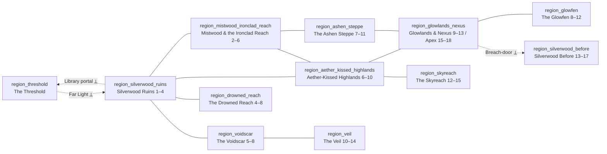

# WORLD.md — Echoes of Aethelgard: The Unraveling

**World bible: regions, locations, creatures, items, crafting, merchants, encounters, map data.**

This document is the implementable source for `src/content/` world data. It elaborates on
`docs/DECISIONS.md` (canon) and never contradicts it. Where it adds a fact, that fact is new
canon unless the lead overrules it (see §13). Legacy content from `aethelgard_data.py` is
preserved verbatim: every legacy location, creature, and item keeps its exact name and
description. Legacy descriptions may be extended by one appended sentence (marked with `+`),
never replaced. Legacy exits are never removed; new exits are added.

### Conventions

- **Ids** are stable snake_case: `loc_*` locations, `region_*` regions, `cr_*` creatures,
  `item_*` items, `mat_*` new materials, `recipe_*` recipes, `npc_*` NPCs, `ev_*` events,
  `echo_*` Echoes, `flag_*` flags, `q_*` quests. Legacy ids derive from names with a leading
  "The" dropped and punctuation removed (`The Chronos Nexus` → `loc_chronos_nexus`,
  `The Wayfarer's Respite` → `loc_wayfarers_respite`, `The Chronos Tyrant` →
  `cr_chronos_tyrant`, `Chronos Lens` → `item_chronos_lens`).
- **Conditions** use the D-033 language: `{echo:"echo_litany_verse_1"}`,
  `{quest:"q_clear_path",stage:"accepted"}`, `{all:[...]}`, `{any:[...]}`, `{not:...}`,
  `{item:"id",count:n}`, `{rep:{faction,min,max}}`, `{loop:{min,max}}`, `{flag:"id"}`,
  `{killed:"cr_id",count:n}`. Faction ids: `remnants`, `shadow_weavers`, `ironclad`.
- **Numbers.** Creatures follow the band formulas: fodder HP ≈ 10×level + 20, elite ×2,
  boss ×6–8; Attack ≈ level + 6 at band start; Defense ≈ level/2. Legacy numbers are listed
  beside the rebalanced ones. Damage types: Physical, Fire, Storm, Ley, Void, Chrono.
  Resistance tiers: weak (−50% to the creature, i.e. it takes +50%), resist (+50%, takes
  −50%), immune. Status names follow D-009.
- **Telegraphs** are ≤12 words, second person, present tense. The UI shows them before the
  enemy acts.
- **Time.** Each walkable edge costs one watch (quarter-day). Portal edges (marked ⟂) cost
  nothing but have their own rules. Resting at a rest point advances to the next dawn.
- **Voice.** Concrete nouns. Short sentences. Strange and grave. No gore.

---

## 1. Geography overview

Aethelgard is a shattered plate of land tilted toward the east. The west is the ruin of
Silverwood, the old capital, where the Wayfinder arrives: a field of marble, crystal-lit
trees, and flooded vaults that go down a long way. One great ley line runs under all of it.
It rises at the Ley Line Conflux — the Heartstone Depths — beneath the ruin and runs due
east: through the Shimmering Pass, under the Aetherium Spires, across the Sky-Whisper
Plateau and the Veridian Glowlands, to the broken observatory of the Chronos Nexus and the
Temporal Breach Apex above it. The Remnants call this line the **Aether Road**. Everything
strange in Aethelgard is strange in proportion to its distance from the Aether Road.

North and east of the ruin lies the Mistwood, a fog forest with glowing bark, and beyond it
the Ironclad Reach: the Nomads' camp, the Barren Peaks, the Blighted Outpost, the warm
canyon of the Emberforge. East of the Outpost the land flattens and greys into the **Ashen
Steppe**, the Nomads' true range, burned white during the Sundering and never recovered.

North-east of Silverwood Plaza the earth is split by the Chasm of Whispers. Beyond it is
the Voidscar Hollow and, beyond that, **the Veil**: the deeps of the scar where the Shadow
Weavers keep their sanctum and where a woman fell out of time forty years ago.

Beneath the Sunken Archives, under the water, is the **Drowned Reach**: the undercity of
Silverwood, flooded on purpose on the last day of the old world. South of the Veridian
Glowlands the swamp thickens into the **Glowfen**, lit from below, where the village of
Lanternreed stands on stilts. Above the Sky-Whisper Plateau, reached by a stair cut into
the wind, is the **Skyreach**: the roosts of the Sentinels and the eyrie of the mage who
built the Spires.

Two places are not on the land at all. **Silverwood Before** is the capital in its last
three days, reached through the Breach. **The Threshold** is a shore inside the Breach,
where the Wayfinder stands between loops.

### Region graph

Solid lines are walkable borders (one watch per edge). Dotted lines are **portal edges**:
the Far Light returns the Wayfinder to Day 1 at the Whispering Ruins; the Breach-door in
the Chronos Nexus and the tear at the Apex lead into Silverwood Before; the Shattered
Library portal (and death or the Breach Clock from Loop 2) lead to the Threshold.

### Travel logic

- Every walkable exit costs **one watch**. Four watches make a day: dawn, day, dusk, night.
  The Breach Clock (D-005) counts days; it is subtle in Loop 1 and explicit from Loop 2.
- **Rest points** (camps, settlements, sheltered hollows) let the player rest: HP/MP restore,
  companions swap, the day advances to the next dawn. Resting consumes whatever watches
  remain in the day. At least one rest point exists per region (§3, §10).
- **Portal edges** cost no watches. Inside Silverwood Before the Breach Clock does not run
  (it is a time-locked echo, D-016); the Before has its own three-day clock. Inside the
  Threshold there is no time at all.
- **Gated exits** are drawn on the map as locked (`x` in the minimap convention) once the
  destination is known. Every gate has a Loop 1 condition and, where D-010 allows, a Loop 2+
  Echo alternative (§3.9).
- A thorough Loop 1 that crosses all five legacy regions uses roughly 22–26 days. Crossing
  times per region are in §10.

---

## 2. Regions

Twelve region ids. The Threshold is the twelfth and counts in the 73-location budget (D-015).
Level bands are fixed; creatures do not scale (D-009).

### 2.1 `region_silverwood_ruins` — Silverwood Ruins

**Theme.** The capital, five hundred years dead. Marble under moss. Crystals growing where
lanterns hung. Everything here is a little louder than it should be: the stones hum, pages
turn themselves, the fountains breathe mist. The whole ruin-field is "the Whispering Ruins"
to everyone but the Remnants, who use the old street names (D-023).

| Field | Value |
|---|---|
| Level band | 1–4 |
| Locations (7) | loc_whispering_ruins, loc_crumbling_archway, loc_darkened_corridor, loc_shattered_library, loc_silverwood_plaza, loc_sunken_archives, loc_heartstone_depths |
| Factions | Remnants of Aethelgard (dominant; Ilyra's camp at the Ruins, Scribe Tamsin's stall at the Plaza). Weavers watch the Plaza's east edge. Nomads avoid it. |
| Palette | sky `#2B2140` · horizon `#4A3B6B` · mid `#6E5A8E` · near `#1C1526` · accent `#7FE3FF` |
| Ambient audio | 48 Hz sine drone −18 dB + band-passed pink noise "wind" (300–900 Hz, slow LFO) + random glass-chime pings (C6/E6/G6) every 7–14 s + whispered-consonant granular bursts at −30 dB every 20–40 s |
| Weather / time | Permanent twilight; the sky never fully brightens. Night brings the crystal glow up and the whispers with it. Light rain at dusk one day in three (Soaked on arrival, cosmetic only). |
| Hazards | Wild-magic surges at the Plaza (random Shock, 1 damage, cosmetic). Flooded floors in the Archives (Soaked). The Heartstone's tremor (no damage). |
| Companion anchor | **Ilyra** (Whispering Ruins; moves to the Shattered Library during the Horde). |
| Changes | Loop 2+: Ilyra believes you at once with `echo_ilyra_watchword`; the Shattered Library shows the portal scar. Heartstone choice re-skins the Depths (§12). Horde: infected node by node from the east; the Library becomes the escape. Loop 4+: a Redundant Wayfinder may stand where you last died. |
| Story role | The beginning of every loop and the end of Loop 1. Holds the Amulet of Echoes (why you loop, D-003), the Echo Crystal (first Litany verse), the Heartstone (the choice that gates endings B, C, D, E), and the portal (the twist). The Remnants' home ground: Sworn Remnants and a stabilized Heartstone lead to ending E here. |

### 2.2 `region_mistwood_ironclad_reach` — Mistwood & the Ironclad Reach

**Theme.** Fog, glowing bark, crushed herbs; then iron. The Mistwood is where the ruin's
magic thins into ordinary wildness and the Nomads have drawn a line with scrap-metal
barricades. The Reach climbs north into razor ridges and a palisade that failed, and ends in
a canyon that is warm all year because of what runs under it.

| Field | Value |
|---|---|
| Level band | 2–6 |
| Locations (6) | loc_mistwood_path, loc_wayfarers_respite, loc_ironclad_camp, loc_barren_peaks, loc_blighted_outpost, loc_emberforge |
| Factions | Ironclad Nomads (Camp, Outpost, Emberforge). The Wayfarer's Respite is neutral ground (D-014). Remnants send scribes to the Respite to trade ink for salt. |
| Palette | sky `#3A4A44` · horizon `#6C8A7A` · mid `#41594E` · near `#1E2A24` · accent `#E07A2F` |
| Ambient audio | Low brown noise "fog bed" −24 dB + wood-knock percussion samples (synth, 2 random hits per 10 s) + at the Camp/Emberforge a metronomic anvil (synth metal transient every 1.6 s, −12 dB) + bellows noise swell |
| Weather / time | Fog morning and dusk (Blind for the first turn of ambushes). Clear cold nights. Wind on the Peaks (ranged attacks −10% accuracy for everyone). |
| Hazards | Rockfall on the Barren Peaks (random 3 Physical on entry at night). Drag-marks at the Outpost mark Golem patrol lanes (telegraphed ambush). |
| Companion anchor | **Brak** (Ironclad Camp). |
| Changes | After `q_clear_path` + `q_blighted_outpost`: the Camp doubles its tents, Tessaly's caravan may arrive (if the Scorched Gate is open), and Brak is absent from Loop 1's Horde (he is at the Apex) unless kept away with `echo_brak_death` (D-017). Heartstone destroyed: Nomad patrols appear on the Mistwood Path (friendly). Horde: infected late (it must pass Mistwood Path → Silverwood Plaza, the slow edge). |
| Story role | The Nomads' quests and Brak's death/survival. The Emberforge forges the Breach-anchor (endings B and D) and the void-forged line. Kaelen and Brak's estrangement (D-022) is resolved here. Ending D (The Iron Silence) is the Reach's ending. |

### 2.3 `region_voidscar` — The Voidscar

**Theme.** A split in the earth that breathes cold. Below the Plaza the ground simply
stops; past the chasm it comes back as obsidian scree and bruised crystal, and the things
that live there fray at the edges like smoke. Nyx waits at the lip, where the Weavers meet
outsiders.

| Field | Value |
|---|---|
| Level band | 5–8 |
| Locations (2) | loc_chasm_of_whispers, loc_voidscar_hollow |
| Factions | Shadow Weavers (Nyx at the Chasm; Weaver sentries in the Hollow from Loop 2 if Wary). |
| Palette | sky `#1A0F24` · horizon `#3E1F4F` · mid `#2A1636` · near `#0B060F` · accent `#C9B8FF` |
| Ambient audio | 32 Hz sub drone with slow 0.1 Hz amplitude wobble + reversed-reverb whisper tails every 12–20 s + occasional "glass crack" transient −20 dB + high 9 kHz hiss filtered by wind LFO |
| Weather / time | No weather. Starlight visible even by day. The chasm exhales on the hour (cosmetic frost). |
| Hazards | Void-chill: standing in the Hollow more than two watches without moving applies Weaken (1 turn) at next combat. Falling scree (cosmetic). |
| Companion anchor | **Nyx** (Chasm of Whispers). |
| Changes | Loop 2+ with `echo_nyx_true_name`: Nyx's dialogue changes entirely. Void Shards refused: Nyx Wary; sentries in the Hollow are hostile. Weavers Trusted: the Veil opens east. Heartstone exploited: the Hollow's crystal glows brighter (Void-touched +1 level variant encounters). |
| Story role | Where the Void Shards come from (D-017) and the door to the Veil. Nyx's recruitment. The first place a player can side against the Remnants. |

### 2.4 `region_aether_kissed_highlands` — Aether-Kissed Highlands

**Theme.** The Aether Road rises above ground. Crystal-laced rock bends distance; spires
hum in a basin; a windswept shelf looks over the whole fractured land. Time is thin here.
Dask can exist here (D-013). The Skyreach above belongs to the same region in name (D-024)
but is budgeted separately (D-015).

| Field | Value |
|---|---|
| Level band | 6–10 |
| Locations (3) | loc_shimmering_pass, loc_aetherium_spires, loc_sky_whisper_plateau |
| Factions | None hold it. Remnant survey cairns. Nomad hunters cross the Plateau to the Outpost. |
| Palette | sky `#C9C3E6` · horizon `#8E86C2` · mid `#5E5A96` · near `#2E2B52` · accent `#FFD27A` |
| Ambient audio | Shepard-tone pad (slow, rising, 90 s cycle) −20 dB + crystalline FM "hum" at 220 Hz with 3 Hz beating + wind gusts (white noise with resonant 1.2 kHz peak) that swell every 15–25 s |
| Weather / time | Light bends: distant nodes flicker on the map (cosmetic). Aurora at night over the Spires. Gales on the Plateau at dusk (Haste to Skyborn creatures). |
| Hazards | Mirage paths in the Pass (first visit: 25% chance the chosen exit costs an extra watch — "you walked a path that was not there"; negated by `echo_pass_true_path`). Static discharge at the Spires (Shock 1 turn on entering combat, cosmetic in Loop 1). |
| Companion anchor | **Dask** (Shimmering Pass). |
| Changes | Loop 2+: Dask is visible from the first visit. Loop 3+: Tyrant's Reach anomalies may appear at the Spires. Heartstone destroyed: the Spires dim; Aetherial Weavers −25% HP (Breach-born rule applies to Constructs of ley make too). |
| Story role | Dask's exposition about Wayfinders and the Tyrant's innocence. The Aetherium Shards for the Breach-anchor. The approach to the Skyreach and Seraphine Aldour's trace. |

### 2.5 `region_glowlands_nexus` — Glowlands & Nexus

**Theme.** The Aether Road ends in a swamp that glows and an observatory whose dome fell
inward. Time buckles. Past and future flicker on cracked stone. Above the observatory, the
Apex: reality in violent seams.

| Field | Value |
|---|---|
| Level band | 9–13; the Apex 15–18 |
| Locations (3) | loc_veridian_glowlands, loc_chronos_nexus, loc_temporal_breach_apex |
| Factions | None. Glowfen folk forage the Glowlands' edge. Remnant astronomers once kept the Nexus. |
| Palette | sky `#0F2E2A` · horizon `#1F5A4A` · mid `#2E7A5A` · near `#0A1A16` · accent `#8CFF6B` (Nexus/Apex add chrono gold `#F2C14E`) |
| Ambient audio | Frog-like filtered pulses (random 200–400 Hz blips, 1–3 per s) + wet reed noise; at the Nexus replace with ticking (two unsynchronized clocks, 0.9 s and 1.1 s) + reversed piano-like decays; at the Apex a chorus of detuned saw drones with a 7 s "stutter" gate and distant pitched screams (formant-filtered noise) −26 dB |
| Weather / time | Glow waves every 40 s (cosmetic). At the Nexus the time-of-day indicator flickers between watches. At the Apex there is no sky. |
| Hazards | Glowlands sinkholes (Slow 1 turn on ambush). Nexus temporal shear: 10% per watch to lose or gain one watch (net zero over time; a visible stutter). The Apex cannot be rested in. |
| Companion anchor | **Dask** (Nexus, Apex) and **Mireya** (Glowlands edge, when recruited). |
| Changes | 6 completed quests (Loop 1) or `echo_apex_fold` open the Apex. Loop 2+ with Chronos Lens + `echo_litany_verse_1`: the Breach-door in the Nexus opens into Silverwood Before. Tyrant spared: the Apex becomes a place you can speak in, and a second door into the Before. Tyrant killed: the Horde begins here. |
| Story role | The finale of every loop. The Tyrant's three phases or his communion. Endings A, B, C, D, and F resolve at the Apex; ending E resolves in the Ruins but requires the Tyrant soothed. |

### 2.6 `region_silverwood_before` — Silverwood Before

**Theme.** Dawn light on silver roofs. Bells. A city that does not know it has three days
left. Everything the ruin only remembers is here in colour: the Grand Library with its roof
on, the Plaza fountains running, the gate guarded by people in uniform. The Nine are in
their Hall. Oriel Danthe is alive in her Archives. The echo repeats the same three days each
time the Wayfinder enters (D-016).

| Field | Value |
|---|---|
| Level band | 13–17 |
| Locations (10) | loc_silver_gate, loc_outer_walks, loc_scholars_corridor, loc_grand_library, loc_plaza_of_bells, loc_ninefold_hall, loc_apprentices_garret, loc_cistern_gardens, loc_archives_of_danthe, loc_conflux_chamber |
| Factions | None of the three exist yet. The **City Watch** (hostile if you break the law, neutral otherwise) and the **Ninefold Circle** (its adepts and wardens are hostile on Day 3). |
| Palette | sky `#F3DFC1` · horizon `#E0A96D` · mid `#8C6A4E` · near `#3E2E24` · accent `#DDE6F0` |
| Ambient audio | Warm major-key pad (Dmaj, slow) −22 dB + crowd murmur (granular vowels) + bell samples (synth FM bells, Day 1 festive peals every 30 s; Day 2 single tolls every 60 s; Day 3 none, replaced by a 60 Hz hum that grows) + birds (chirp synth, Days 1–2 only) |
| Weather / time | Three days: **First Bell** (festival; clear), **Second Bell** (overcast; the Circle seals the Archives), **Last Bell** (still air; no birds; the ritual at dusk). The echo ends at Last Bell's dusk; the Sundering throws you back through the door you came by. Resting at the Garret advances a day. |
| Hazards | The Watch arrests you for drawn weapons in the Plaza (combat with Halberdiers; non-lethal; you wake in the Garret and lose a day). Ley-flare on Day 3 in the Corridor (Burn 1 turn). The Conflux Chamber on Day 3 is a forced fight. |
| Companion anchor | **Caelum Vesper** (Apprentices' Garret). Dask can remain here. |
| Changes | Day 1/2/3 states (§12). Anchors: objects placed on the Conflux altar before the ritual appear in the present Heartstone Depths. `echo_anchor_rule` after the first failed attempt. Caelum can be brought forward once `item_caelums_anchor_token` has been anchored. |
| Story role | The Mending (ending B) is anchored here with Caelum. The Litany's third page is Oriel's gift. Trying to stop the ritual fails and yields `echo_ritual_inevitable`. Nyxaria Vell can be met young; the Tyrant's core, Veyran Thal, can be met whole. Ending C's witness sequence reuses this region. |

### 2.7 `region_drowned_reach` — The Drowned Reach

**Theme.** The undercity of Silverwood, under black water. Stairs that go down into
lamplight. Shelves that go down further. On the last day of the old world the Master of
Waters, Ilsabet Rhune of the Nine, opened the cisterns to drown the Conflux's fire. The
water never left. Lamps still burn where a few Remnant divers keep them. The dead keep
filing.

| Field | Value |
|---|---|
| Level band | 4–8 |
| Locations (8) | loc_drowned_stair, loc_tidewell_hall, loc_cistern_of_names, loc_lamplighters_rest, loc_sunken_scriptorium, loc_black_sluice, loc_bellmouth, loc_bell_wardens_deep |
| Factions | Remnants (divers and lamplighters at Lamplighters' Rest). Weavers buy drowned vellum from Sedge. |
| Palette | sky `#0A1420` · horizon `#16314A` · mid `#1F4A66` · near `#061018` · accent `#FFB347` |
| Ambient audio | Water drip (random short sine pings with long reverb, 1 per 2–5 s) + low cistern resonance (80 Hz, Q high) + muffled bell (low FM bell, −30 dB, every 45–90 s, louder nearer the Bellmouth) + paper-rustle granular at the Scriptorium |
| Weather / time | No sky. Lamplight. The water rises at night (Black Sluice impassable at night unless `item_cistern_key`). |
| Hazards | **Dark:** without `item_glyphbound_lantern` the player cannot leave the Drowned Stair (the dark below "is not ordinary dark"). Soaked on every entry (Storm +50% both ways; Fire −50%). Lamprey ambushes in the Sluice. |
| Companion anchor | **Ilyra** (her lineage: the Scriptorium holds Oriel's hand). |
| Changes | Heartstone destroyed: the Cistern crack to the Depths opens from both sides and the Reach goes lamp-dark (Lanterns only). Heartstone stabilized: the water calms, Bell-Warden phase 1 is skipped (it does not toll). Loop 3+: the Unmade appear in the Scriptorium. |
| Story role | Oriel Danthe's records: the first Litany page in physical form, `echo_oriel_lineage` (Ilyra's descent), and Ilsabet's cistern key. The Bell-Warden guards the bell Ilsabet rang to drown the city. Sedge is the Remnants' crafter for diver gear. |

### 2.8 `region_ashen_steppe` — The Ashen Steppe

**Theme.** The sky is white with ash that never finishes falling. Grass grows grey. The
Sundering's fire — Corvin Dreyl's pyre-ward, meant to shield the city, turned outward —
burned the plains in a day, and the herds with them. The Nomads came after and made it
theirs: hearths in rings of stone, cairns that catch lightning, a hall that burned and was
never rebuilt. This is where the Ironclad are a people and not a camp.

| Field | Value |
|---|---|
| Level band | 7–11 |
| Locations (9) | loc_scorched_gate, loc_ash_wind_flats, loc_hearthring, loc_bone_orchard, loc_grey_salt_pan, loc_stormgate_cairns, loc_watchfire_ridge, loc_reedmarch_descent, loc_herd_grave |
| Factions | Ironclad Nomads (dominant: Hearthring, Scorched Gate, Watchfire). Glowfen traders at the Reedmarch. |
| Palette | sky `#D9D3CB` · horizon `#A69B8F` · mid `#6B5F56` · near `#2F2924` · accent `#D9482B` |
| Ambient audio | Broad wind (filtered white noise, slow 0.05 Hz LFO) + ash-hiss (high shelf noise −28 dB) + distant herd lowing (formant bass drone, random) + at Hearthring a frame drum (synth, 72 bpm) and a bowed-string drone; at the Cairns, intermittent thunder (low noise burst with 2 s decay) |
| Weather / time | Ashfall (Blind 1 turn at ambush onset, Days 1–2 of any 3-day cycle). Dry lightning at the Cairns at night (random Shock on Soaked characters). Cold clear nights. |
| Hazards | Cinderback stampede lanes on the Flats (telegraphed; Guard to avoid). Salt glare at midday on the Pan (−10% accuracy). Lightning at the Cairns (Soaked characters take 5 Storm per watch). |
| Companion anchor | **Brak** (he is from Hearthring; his arc's second and third quests are here). |
| Changes | Heartstone destroyed: Ironclad +20 and the Steppe's ash settles (ashfall stops; Nomad patrols friendly across the region). Brak's quests complete: Hearthring sends a caravan to the Ironclad Camp. Loop 2+: the Herd-Grave can be entered before Ashmaw wakes if you know the Nomad signs. Horde: infected via Reedmarch from the Glowlands. |
| Story role | The Nomads' faction chain and Brak's lineage (Oma Varr knows the Stonehand brothers). Ending D requires Ironclad Sworn, earned here. Corvin Dreyl's trace: the pyre-ward's brand, the Ashbrand recipe, Ashmaw. |

### 2.9 `region_veil` — The Veil

**Theme.** Past the Hollow the scar goes down and the dark goes up. Here the Void is not a
threat but a medium: the Weavers walk in it, weave in it, build in it. Glass that is not
glass. Trees that are the absence of trees. At the end of the Veil, a crater of starlight
where Nyxaria Vell struck the present forty years ago.

| Field | Value |
|---|---|
| Level band | 10–14 |
| Locations (8) | loc_veil_mouth, loc_stair_of_unmaking, loc_sanctum_of_threads, loc_scar_shelf, loc_voidglass_gallery, loc_null_orchard, loc_eye_of_the_scar, loc_where_she_fell |
| Factions | Shadow Weavers (dominant; the Sanctum). Hostile to Wary/Hostile players; the Sanctum is closed to them. |
| Palette | sky `#05030A` · horizon `#1B0F2B` · mid `#2D1A45` · near `#000000` · accent `#8A5CFF` |
| Ambient audio | Near-silence bed (−40 dB noise) so footsteps are loud + 25 Hz sub pulse every 4 s + glass harmonics (bowed-glass synth, random 2–6 s notes, −26 dB) + at the Sanctum a women's-choir pad (formant synth) in a whole-tone cluster −24 dB; at Where She Fell, a single held high sine (3 kHz, −34 dB) |
| Weather / time | No day or night. The sky shows stars that are not Aethelgard's. |
| Hazards | **Unmaking:** each watch spent in the Null Orchard or the Eye without a Weaver's thread (`item_weavers_thread_ring`) costs 5% max HP (restored on leaving). Blind on entering the Gallery (first turn of any ambush) unless `item_hollow_lantern_focus`. |
| Companion anchor | **Nyx** (her sanctum; her past). |
| Changes | Weavers Trusted: Veil Sentries are neutral; Sworn: the Sanctum sells the void-forged thread. Heartstone exploited: Where She Fell glows; `echo_void_resonance` can be learned here only if Trusted in some loop (D-018). Loop 2+: Vell's Umbra remembers you (phase 1 skipped if `killed:cr_vells_umbra`). |
| Story role | Nyx's identity (`echo_nyx_true_name` is learnable at Where She Fell). The second Litany page (Nyxaria's own annotated copy). Ending C (The Weaver's Dawn) requires Weavers Sworn — earned here with the Thread-Mother. `echo_void_resonance` for ending B. |

### 2.10 `region_glowfen` — The Glowfen

**Theme.** South of the Glowlands the water deepens and the light comes up from under it.
Lanternreed stands on stilts over a pool that breathes. The light is Breach-leak — the
Aether Road's end bleeding into the swamp — and it is changing the people who live in it.
They are kind. They are becoming something.

| Field | Value |
|---|---|
| Level band | 8–12 |
| Locations (8) | loc_lantern_causeway, loc_lanternreed, loc_sporelight_shallows, loc_elder_mangrove, loc_breathing_pool, loc_firefly_barrows, loc_pale_gullet, loc_matrons_hall |
| Factions | Glowfen folk (unaligned villagers; the Remnants court their elders; the Weavers buy spores). Lanternreed is neutral ground for all three factions. |
| Palette | sky `#10231F` · horizon `#1E4A3A` · mid `#2F6E4F` · near `#0B1A15` · accent `#B9FF8C` |
| Ambient audio | Insect chorus (many detuned high square pulses, density by time of day) + bubbling (random low-passed pops) + lantern creak (wood-knock sample with slow random) + at Lanternreed a kalimba-like plucked loop (pentatonic, random order, 60 bpm) −22 dB; at the Breathing Pool a slow inhale/exhale filter sweep on noise, 12 s cycle |
| Weather / time | Humid; glow brightens at night. Spore-fog in the Shallows at dawn (Poison 1 turn at ambush onset). Rain every second day (Soaked region-wide for the day). |
| Hazards | Poison from spores and Mirelings. Sinking in the Shallows (Slow). The Pale Gullet's draw: the current pulls toward the Matron's Hall (leaving the Gullet north costs two watches). |
| Companion anchor | **Mireya of Lanternreed** (Lanternreed). |
| Changes | Corruption ≥ 6 can be cleansed at the Breathing Pool with Elder Wren (D-017). Heartstone stabilized: the Breathing Pool steadies (cleansing is free). Loop 3+: the Barrow-Lights speak the names of past Wayfinders. Horde: infected from the Glowlands by the Causeway. |
| Story role | Mireya's arc: what to preserve of a people being changed. The Lantern Matron is what an elder became. Cleansing Corruption keeps ending E open. The Glowfen elders know the Breach-leak and give `echo_breach_leak` (the Apex is failing on its own, D-005). |

### 2.11 `region_skyreach` — The Skyreach

**Theme.** Above the Plateau the wind has edges. A stair cut into the rock climbs to the
crown of the tallest Spire and the roosts of the Sentinels, and to an eyrie of glass and
brass where Seraphine Aldour, spire-builder of the Nine, tuned the Spires to feed the
ritual. Her looms still run. Nothing up here has forgotten its orders.

| Field | Value |
|---|---|
| Level band | 12–15 |
| Locations (5) | loc_windward_stair, loc_spire_crown, loc_roost_of_sentinels, loc_aldours_eyrie, loc_stormcrowns_perch |
| Factions | None. Nomad sky-burials on the Roost. Remnants want Aldour's notes. |
| Palette | sky `#7FB7E6` · horizon `#CFE6F5` · mid `#5E7FA3` · near `#2C3B52` · accent `#F7FBFF` |
| Ambient audio | Howling wind (resonant band-pass sweeps 400–2 kHz on white noise, fast LFO) + aeolian tones (sines at 330/495/660 Hz that fade in with gusts) + at the Eyrie a loom-click (regular 0.5 s tick with occasional double) and brass resonance; at the Perch, thunder and a hawk-like FM cry every 20–40 s |
| Weather / time | Gale by default (ranged −10%; Skyborn Haste). Storm at dusk (Storm damage +25% for everyone; lightning strikes Soaked characters). Dawn is still: the only calm hour. |
| Hazards | **Thin air:** without `item_sky_whisper_talisman` or `echo_breath_of_heights` the stair cannot be climbed. Falls: fleeing on the Stair costs 10% HP. Storm on Soaked (see weather). |
| Companion anchor | **Dask** (temporal instability extends up the Spire). |
| Changes | Heartstone destroyed: the Spire-Crown goes dark; Spire Looms inactive (free Aldour's notes). Loop 2+: Stormcrown can be bargained with (`echo_sentinel_oath`), skipping its fight for the Talisman-bearer. |
| Story role | Seraphine Aldour's trace and the Aetherial Weavers' origin (D-006). Her notes hold the Breach-anchor schematic's first half (the second is Tobrin's, in the Before). Stormcrown is the Sentinel that has watched the Apex longest and knows the Tyrant does not attack. |

### 2.12 `region_threshold` — The Threshold

**Theme.** A shore of black sand under no sky, inside the Breach. The water is still and
shows loops instead of reflections. There is no hunger, no clock, no wind. The Wayfinder
arrives here when a loop ends and leaves by the Far Light (D-012).

| Field | Value |
|---|---|
| Level band | none (no combat) |
| Locations (4) | loc_still_shore, loc_gallery_of_loops, loc_loom, loc_far_light |
| Factions | None. |
| Palette | sky `#0D0D12` · horizon `#26262E` · mid `#4C4C5A` · near `#090909` · accent `#FFF4D6` |
| Ambient audio | Single low drone (41 Hz) + very slow wave wash (noise, 20 s swell) + a heartbeat-like double thump every 6 s at −30 dB (the Tyrant's) + at the Loom a sparse music-box melody (Echo count determines how many notes play) |
| Weather / time | None. The Far Light is the only bright thing. |
| Hazards | None. |
| Companion anchor | **Dask** (from Loop 3 he stands on the Shore). |
| Changes | Grows with loops (§12): Loop 2 bare; Loop 3 Dask; Loop 5 the Tyrant's silhouette in the water; Loop 7 the Nine's shards visible; after any true ending the Gallery shows the epilogue slides as paintings. |
| Story role | Run summary, Echoes, Resonance and Attunements, class change (D-011, D-012). Glimpses of the Tyrant that pay off at the Apex. New Game+ and challenge modifiers (D-021) are set here. |

---
## 3. Locations (73)

Stage semantics in exit conditions: `stage:"accepted"` means the quest is in the journal
(accepted or later); `stage:"completed"` means done. Legacy event ids are kept verbatim;
new events use the `ev_` prefix. Encounter notation: `first:` groups roll on the first
visit of a loop; `return:` groups roll on every later visit; `pool(region)` is the region's
wandering pool (§10) at the legacy return chance of 20% when the location is clear.
Map positions are grid coordinates (x spacing 8, y spacing 2) extending the legacy
`MINIMAP_LAYOUT`; the full table and adjacency list are in §11. Portal edges are marked ⟂.

### 3.1 Silverwood Ruins (`region_silverwood_ruins`, 7 locations)

#### `loc_whispering_ruins` — Whispering Ruins
- **Region / band / map:** region_silverwood_ruins · 1–2 · (0, 6) · **Rest point: yes** (Ilyra's camp under the arch-stump) · Merchant: no
- **Description.** The air smells of ozone and decay, and a chill wind carries faint whispers. Twisted trees reach into a twilight sky, their branches dotted with glowing crystals. Broken stone tablets litter the ground, etched with worn sigils. `+` A cold fire burns in a ring of tablets where a woman in faded robes keeps watch.
- **Exits**

| Direction | Destination | Condition |
|---|---|---|
| north | loc_crumbling_archway | — |
| east | loc_mistwood_path | — |
| south | loc_sunken_archives | — |
| (arrival ⟂) | from loc_far_light | Loop start only; not a usable exit |

- **Items:** item_amulet_of_echoes (always present on Day 1 of every loop; the Breach returns it to the ground — the Wayfinder's memory rides on it, D-003).
- **Encounters:** first: none. return: pool(silverwood_ruins) 20%. Loop 4+: `ev_redundant_stand` may replace the pool roll with cr_redundant_wayfinder ×1 (10%) if the player died here in a previous loop.
- **NPCs:** npc_ilyra (until the Horde moves her to the Library).
- **Events:** `ruins_echo` — "A low, resonant hum vibrates under your skin, as if the stones are breathing." — once. `ev_ruins_return` — "You know this smell. You have stood here before, and the stones know it too." — once per loop, Loop 2+ only. `ev_ruins_thirtieth` — "The crystals in the trees go dark one by one. Somewhere east, something lets go." — fires on Day 29 at dusk.
- **Art spec:** horizon 0.62; silhouettes: twisted trees with crystal nodes, broken tablet row, a half arch; particles: slow cyan motes drifting up.

#### `loc_crumbling_archway` — Crumbling Archway
- **Region / band / map:** region_silverwood_ruins · 1–2 · (0, 4) · Rest: no · Merchant: no
- **Description.** A monumental arch of cracked marble towers over you. The stone is warm, as if it remembers a brighter age. Vines twitch with borrowed life. `+` The keystone bears nine small carved faces, eight of them worn smooth.
- **Exits**

| Direction | Destination | Condition |
|---|---|---|
| south | loc_whispering_ruins | — |
| north | loc_darkened_corridor | — |

- **Items:** none (Loop 2+: item_remnant_wax_seal 30% on first visit, under the ninth face, if `echo_nine_voices`).
- **Encounters:** first: cr_mistwood_prowler ×1 (40%). return: pool 20%.
- **NPCs:** none.
- **Events:** `archway_whisper` — "A whisper slips through the archway: 'Wayfinder... follow.'" — once. `ev_archway_faces` — "You count the faces on the keystone. Nine. The ninth is unworn, as if cut yesterday." — once, requires `echo_nine_voices`.
- **Art spec:** horizon 0.55; silhouettes: great arch filling frame, vine curtains, fallen capital; particles: pollen-gold drift.

#### `loc_darkened_corridor` — Darkened Corridor
- **Region / band / map:** region_silverwood_ruins · 2–3 · (0, 2) · Rest: no · Merchant: no
- **Description.** The corridor is slick with moisture, and faint fungi cling to the ceiling. Every footstep sends ripples of pale light across the stones. A growl echoes ahead. `+` Scorch marks climb one wall in the shape of a hand.
- **Exits**

| Direction | Destination | Condition |
|---|---|---|
| south | loc_crumbling_archway | — |
| north | loc_shattered_library | — |

- **Items:** none. (Horde state: item_ley_touched_tonic ×1 appears, dropped by a fleeing scribe.)
- **Encounters:** first: cr_corrupted_shade ×1 (100%; legacy). return: pool 20%. Horde state: cr_horde_husk ×2 (100%) then cr_unraveling_tide blocks if the player has spent more than 14 moves since the Tyrant fell (see §6, Tide).
- **NPCs:** none.
- **Events:** `ev_corridor_hand` — "The scorch-hand on the wall is at the height of your own. You do not put yours in it." — once. `ev_corridor_growl` — "The growl ahead stops when you stop. It starts when you start." — once per loop.
- **Art spec:** horizon 0.70 (interior); silhouettes: converging walls, fungal ceiling clusters, a far doorway of light; particles: pale ripple rings at the floor.

#### `loc_shattered_library` — Shattered Library
- **Region / band / map:** region_silverwood_ruins · 2–3 · (0, 0) · Rest: no (Loop 2+ with Ilyra Trusted: yes, her reading-nook) · Merchant: no
- **Description.** Collapsed shelves form jagged ridges of splintered wood and stone. Dust motes swirl in a dim glow, and you can almost hear pages turning on their own. `+` In an alcove behind the fallen stacks, something small and bright waits in a cradle of stone.
- **Portal state (Horde, Ilyra present):** "The Shattered Library. The air here crackles with raw magic, and at its heart, a shimmering, unstable portal tears at the air. Ilyra stands before it, her hands glowing with an intense, straining light, her face etched with fierce concentration as she pours her energy into keeping the portal open. The whispers of the horde grow closer, echoing through the crumbling shelves." (legacy, verbatim)
- **Portal state (Horde, Ilyra not yet arrived):** base description + "A swirling, unstable portal now pulses between the shelves, casting long shadows across the fractured stacks." (legacy, verbatim)
- **Portal scar (Loop 2+, no Horde):** base description + "Between two fallen stacks the air is thin and cold, a seam the eye slides off. You came through here once."
- **Exits**

| Direction | Destination | Condition |
|---|---|---|
| south | loc_darkened_corridor | — |
| east | loc_silverwood_plaza | — |
| portal ⟂ | loc_still_shore | `{flag:"flag_library_portal_open"}` — ends the loop (Escape, D-002). Also opened deliberately by Ilyra in Loop 2+ with `{all:[{rep:{faction:"remnants",min:20}},{echo:"echo_portal_tear"}]}` |

- **Items:** item_echo_crystal (alcove; with `echo_crystal_location` the pickup skips the search sub-step). Loop 2+: item_korrs_marginalia 100% on first visit if `corruption ≥ 1`.
- **Encounters:** first: cr_arcane_wisp ×1 (100%; legacy). return: pool 20%. Horde: none (Ilyra holds the stacks).
- **NPCs:** npc_ilyra (Horde state only; she relocates here, legacy). npc_tamsin_reed visits here Loop 2+ when the Plaza is infected.
- **Events:** `library_shiver` — "A cold gust rattles the shelves, and you smell old ink and rain." — once. `ev_library_pages` — "A page turns itself on a shelf that no longer exists. You read one word before it is gone: 'Conflux.'" — once. `ev_library_seam` — "The seam in the air widens a hair when you look at it. It knows you." — once, Loop 2+.
- **Art spec:** horizon 0.66 (interior); silhouettes: toppled shelf ridges, a leaning ladder, the alcove's arch; particles: dust motes in a single light shaft (portal state: a vertical violet tear replaces the shaft).

#### `loc_silverwood_plaza` — Silverwood Plaza
- **Region / band / map:** region_silverwood_ruins · 2–4 · (8, 0) · Rest: no · **Merchant: yes** (npc_tamsin_reed, Remnant stall)
- **Description.** Once the heart of Silverwood, this plaza is now a cratered ring of marble. Broken fountains seep shimmering mist, and the air tastes of copper. `+` A Remnant scribe has set a table on the fountain's rim and weighs ink against salt.
- **Exits**

| Direction | Destination | Condition |
|---|---|---|
| west | loc_shattered_library | — |
| south | loc_mistwood_path | — |
| east | loc_chasm_of_whispers | — |

- **Items:** none fixed. Loop 2+: item_bell_shard (10% per first visit; a fragment of the Plaza's bells).
- **Encounters:** first: cr_arcane_wisp ×1 (100%; legacy). return: pool 20%; Loop 2+ pool may roll cr_paradox_wisp instead (25% of pool rolls).
- **NPCs:** npc_tamsin_reed (merchant, flavor; absent during the Horde).
- **Events:** `plaza_surge` — "Wild magic surges. A chorus of distant bells rings out, then fades." — once. `ev_plaza_bells_before` — "You have heard these bells with their roofs on. The memory is not yours yet. Then it is." — once, requires `{flag:"flag_visited_before"}`.
- **Art spec:** horizon 0.58; silhouettes: ring of fountain stumps, cratered marble rim, one standing column; particles: shimmering mist low to the ground.

#### `loc_sunken_archives` — Sunken Archives
- **Region / band / map:** region_silverwood_ruins · 2–4 · (0, 8) · Rest: no · Merchant: no
- **Description.** Half-buried vaults dip beneath brackish water, with shelves sagging under soaked tomes. A slow drip marks time, and the ley lines glow through the flood. `+` A stair descends into the water to the west, its lower steps lit by something that is not the ley.
- **Exits**

| Direction | Destination | Condition |
|---|---|---|
| north | loc_whispering_ruins | — |
| south | loc_heartstone_depths | `{any:[{quest:"q_echoing_heartbeat",stage:"accepted"},{echo:"echo_heartstone_path"}]}` (legacy: the quest unlocks the Depths; Loop 2+: you know the way down) |
| west | loc_drowned_stair | — (open; the dark gate is one node further) |

- **Items:** item_scholars_lost_scroll (present only while `{quest:"q_lost_scroll",stage:"accepted"}` and not completed; legacy). item_glyphbound_lantern (appears with the scroll quest: Ilyra's lamp, left on the top step; legacy item newly placed).
- **Encounters:** first/return: cr_drowned_archivist ×1 (100%) while `q_lost_scroll` is accepted and not completed (legacy rule). Otherwise return: pool 20%.
- **NPCs:** none.
- **Events:** `archives_murmur` — "A submerged page unfurls, whispering of the Ley Line Conflux." — once. `ev_archives_lamp` — "On the top step of the drowned stair sits a lantern etched with glyphs. The water below it is black, not dark." — once, when item_glyphbound_lantern is present.
- **Art spec:** horizon 0.60 (interior); silhouettes: half-submerged shelf rows, a vault arch, the stair-head; particles: slow rising bubbles with ley-green light under the waterline.

#### `loc_heartstone_depths` — Heartstone Depths
- **Region / band / map:** region_silverwood_ruins · 3–4 (Loop 2+ exploited state 6–8) · (0, 10) · Rest: no · Merchant: no
- **Description.** The ground opens into a chamber of raw, pulsing magic. A massive Heartstone sits at the center, each beat sending ripples through the air. `+` Nine plinths stand around it, eight of them empty.
- **State texts** (appended after the choice, this loop; see §12): *stabilized* — "The beat is slow and even now. The plinths are warm."; *exploited* — "The Heartstone is a socket of dark glass. Things flicker in and out of the cavity."; *destroyed* — "There is no light here but your own. The stone does not beat."
- **Exits**

| Direction | Destination | Condition |
|---|---|---|
| north | loc_sunken_archives | — |
| east | loc_shimmering_pass | — |
| west | loc_cistern_of_names | `{any:[{item:"item_cistern_key"},{flag:"flag_heartstone_destroyed"},{echo:"echo_cistern_crack"}]}` — a flooded crack behind the ninth plinth |

- **Items:** none fixed. **Anchors** (D-016): any item placed on the Conflux altar in loc_conflux_chamber before the ritual appears here on the ninth plinth, every loop thereafter (`item_caelums_anchor_token`, `item_litany_page_3`, etc.).
- **Encounters:** first: none (legacy). return: pool 20%. *Exploited state:* return: cr_hourglass_crawler ×2 (50%) or cr_unmade ×1 (25%, Loop 3+). *Destroyed state:* return: cr_corrupted_shade ×2 + cr_hollow_lantern ×1 (40%).
- **NPCs:** none (Caelum appears here when brought forward).
- **Events:** `heartstone_thrum` — "The Heartstone answers your presence with a tremor that shakes dust from the ceiling." — once. `ev_depths_plinths` — "Eight plinths, empty. The ninth holds something that should not have survived five hundred years." — once, when an Anchor is present. `ev_depths_choice` — "The relic throbs with unstable power. You sense three paths: soothe it, seize it, or shatter it." — the legacy choice prompt; fires while `q_echoing_heartbeat` is accepted and not completed.
- **Art spec:** horizon 0.50 (cavern); silhouettes: the Heartstone as a faceted ovoid, nine plinths in a ring, stalactite fringe; particles: concentric pulse rings from the center (state variants: calm slow rings / jittering sparks / no particles).

### 3.2 Mistwood & the Ironclad Reach (`region_mistwood_ironclad_reach`, 6 locations)

#### `loc_mistwood_path` — Mistwood Path
- **Region / band / map:** region_mistwood_ironclad_reach · 2–3 · (8, 6) · Rest: no · Merchant: no
- **Description.** A winding trail threads through fog-laden trees. The bark glows faintly, and the air smells of crushed herbs. Shadows drift between the trunks. `+` Cairns of scrap iron mark the Nomads' side of the path.
- **Exits**

| Direction | Destination | Condition |
|---|---|---|
| west | loc_whispering_ruins | — |
| east | loc_ironclad_camp | — |
| north | loc_silverwood_plaza | — |
| south | loc_wayfarers_respite | — |

- **Items:** item_ley_touched_tonic (legacy).
- **Encounters:** first: cr_mistwood_prowler ×2 (50%) or cr_rootling ×3 (30%). return: pool 20%. Heartstone destroyed: no encounters (Nomad patrol present).
- **NPCs:** none (Heartstone destroyed: a Nomad patrol, flavor only).
- **Events:** `ev_mistwood_herbs` — "You crush a leaf without meaning to. The smell is clean. Nothing here has been clean in a long time." — once. `ev_mistwood_shapes` — "A shape between the trunks keeps your pace for ten steps, then is a tree." — once per loop.
- **Art spec:** horizon 0.64; silhouettes: tall trunks with glowing bark seams, low fog band, scrap-iron cairn; particles: fog drift (horizontal, slow).

#### `loc_wayfarers_respite` — The Wayfarer's Respite
- **Region / band / map:** region_mistwood_ironclad_reach · 2–3 · (8, 8) · **Rest point: yes** · **Merchant: yes** (npc_kaelen_stonehand)
- **Description.** A rare pocket of calm between mana-scarred cliffs. A silver-tinged stream winds through smooth stones, and a distant hum never quite fades. `+` A trader's wagon with its wheels chocked has become a shop and, by the look of the bedroll, a home.
- **Exits**

| Direction | Destination | Condition |
|---|---|---|
| north | loc_mistwood_path | — |

- **Items:** none.
- **Encounters:** none, ever (neutral ground, D-014). Horde: infected like any node, but no fights spawn here; the Respite simply "goes quiet".
- **NPCs:** npc_kaelen_stonehand.
- **Events:** `respite_breath` — "The stream's soft rush quiets the chaos in your thoughts." — once. `ev_respite_brother` — "Kaelen looks east toward the camp for a long moment, then does not." — once, requires `{quest:"q_clear_path",stage:"completed"}`.
- **Art spec:** horizon 0.60; silhouettes: cliff walls framing, a wagon with awning, stream curve; particles: silver sparkle on water.

#### `loc_ironclad_camp` — Ironclad Camp
- **Region / band / map:** region_mistwood_ironclad_reach · 3–4 · (16, 6) · **Rest point: yes** · Merchant: no (Tessaly's caravan sells here after `flag_hearthring_caravan`)
- **Description.** Canvas tents and scrap-metal barricades form a rough circle. Smoke and hot iron fill the air, punctuated by the clatter of tools. `+` A gap in the barricade faces north, watched by two scouts who do not blink.
- **State (after Brak's two quests):** `+` "The circle has doubled. New tents. A second fire. Someone has painted a bull on the barricade in ash."
- **Exits**

| Direction | Destination | Condition |
|---|---|---|
| west | loc_mistwood_path | — |
| north | loc_barren_peaks | `{any:[{quest:"q_clear_path",stage:"accepted"},{echo:"echo_ironclad_passwords"}]}` (legacy: Brak's job opens the pass; Loop 2+: you know the scouts' challenge words) |

- **Items:** none.
- **Encounters:** none (settlement). Horde: cr_horde_husk ×2 if infected and Brak is absent.
- **NPCs:** npc_brak (absent after the Tyrant falls in a loop where his quests were done — he is at the Apex; absent entirely if kept away via `echo_brak_death` choice), npc_tessaly_varr (caravan state only).
- **Events:** `camp_clamor` — "Hammer strikes ring out like a steady heartbeat." — once. `ev_camp_bull` — "The ash bull on the barricade is Hearthring's sign. Someone here is homesick." — once, requires `flag_hearthring_caravan`.
- **Art spec:** horizon 0.60; silhouettes: tent peaks, barricade spikes, a smoke column; particles: ember sparks rising.

#### `loc_barren_peaks` — Barren Peaks
- **Region / band / map:** region_mistwood_ironclad_reach · 3–5 · (16, 4) · Rest: no · Merchant: no
- **Description.** Razor-edged ridges scrape the sky as the wind howls through broken stone. Higher up, the air tastes of dust and iron. `+` Something large has worn a path through the scree, back and forth, for years.
- **Exits**

| Direction | Destination | Condition |
|---|---|---|
| south | loc_ironclad_camp | — |
| east | loc_blighted_outpost | — |

- **Items:** none fixed. mat_wildling_sinew ×1 (60% after the Brute is slain, in its den).
- **Encounters:** first: cr_wildling_brute ×1 (100%; legacy; quest target). return: pool 20%; Loop 2+ 15% cr_stutter_hound ×1.
- **NPCs:** none.
- **Events:** `peaks_gale` — "A cutting gale whips through the peaks, carrying flecks of stone." — once. `ev_peaks_den` — "The Brute's den is a nest of roots and old steel. Nomad steel. It has been eating patrols." — once, after killing cr_wildling_brute.
- **Art spec:** horizon 0.45; silhouettes: three blade-ridges, a worn switchback path, a lone standing stone; particles: wind-blown grit streaks.

#### `loc_blighted_outpost` — Blighted Outpost
- **Region / band / map:** region_mistwood_ironclad_reach · 4–6 · (24, 4) · Rest: no · Merchant: no
- **Description.** Splintered palisades jut from the rock like broken teeth. The ground is scarred with drag marks and heavy footprints. `+` A burned gate in the east wall still bears an iron bull, and beyond it the land goes grey.
- **Exits**

| Direction | Destination | Condition |
|---|---|---|
| west | loc_barren_peaks | — |
| south | loc_sky_whisper_plateau | — |
| north | loc_emberforge | — |
| east | loc_scorched_gate | `{any:[{quest:"q_blighted_outpost",stage:"completed"},{echo:"echo_nomad_signs"}]}` — the Nomad watch at the Scorched Gate admits those Brak vouches for, or those who know the trail-signs |

- **Items:** mat_wardstone_slate ×1 (100% after both Golems fall).
- **Encounters:** first: cr_stone_hide_golem ×2 (100%; legacy; quest target; one group of two). return: cr_warding_pillar ×1 (30%, it was always there, dormant) or pool 20%.
- **NPCs:** none.
- **Events:** `outpost_ash` — "Stone scrapes stone as something massive shifts in the dark." — once. `ev_outpost_seal` — "Each golem bears the same mark on its brow: a square inside a circle. A warder's seal." — once, after killing cr_stone_hide_golem. Grants `echo_vask_seal`.
- **Art spec:** horizon 0.58; silhouettes: broken palisade teeth, a burned gate with bull emblem, drag furrows; particles: grey dust falling.

#### `loc_emberforge` — The Emberforge
- **Region / band / map:** region_mistwood_ironclad_reach · 4–6 · (24, 2) · **Rest point: yes** (the forge hearth) · **Merchant/crafter: yes** (npc_borin_stonefist)
- **Description.** A sheltered canyon opens into a warm cavern, its walls veined with ember-bright stone. Heat breathes up from below, and a hammer rings through the glow. `+` The veins in the wall pulse in time with something far to the south-west.
- **Exits**

| Direction | Destination | Condition |
|---|---|---|
| south | loc_blighted_outpost | — |

- **Items:** none fixed. item_tobrins_warding_primer (Loop 2+, 100% once, if `echo_vask_seal`; Borin "found it in the slag").
- **Encounters:** none. Horde: none (the heat holds them off one extra move).
- **NPCs:** npc_borin_stonefist.
- **Events:** `emberforge_heat` — "The forge heat wraps around you like a heavy cloak." — once. `ev_forge_pulse` — "Borin rests his hammer and listens. 'Heartstone's beating fast tonight,' he says, to no one." — once; text varies by Heartstone state (stabilized: "slow and sure"; exploited: "wrong"; destroyed: "The veins are cold. Borin does not look up.").
- **Art spec:** horizon 0.52 (cavern); silhouettes: anvil and bellows, ember-veined walls, a canyon mouth of daylight; particles: rising embers, heat shimmer.

### 3.3 The Voidscar (`region_voidscar`, 2 locations)

#### `loc_chasm_of_whispers` — Chasm of Whispers
- **Region / band / map:** region_voidscar · 4–5 · (16, 0) · **Rest point: yes** (a cold camp on the lip; Nyx permits it) · Merchant: no
- **Description.** A jagged rift splits the earth, breathing air as cold as the void. Murmurs rise from below, promising power to those who listen. `+` A single rope bridge crosses to the far lip, where the ground turns to glass.
- **Exits**

| Direction | Destination | Condition |
|---|---|---|
| west | loc_silverwood_plaza | — |
| east | loc_voidscar_hollow | `{any:[{quest:"q_void_shards",stage:"accepted"},{echo:"echo_hollow_path"}]}` (legacy: Nyx's pact opens the bridge; Loop 2+: you know the way across) |

- **Items:** none.
- **Encounters:** none at the lip. return: pool 20% only if Weavers ≤ Wary (Nyx withdraws her protection).
- **NPCs:** npc_nyx.
- **Events:** `chasm_hum` — "A low hum rises from the abyss, vibrating with hungry intent." — once. `ev_chasm_name` — "The murmurs below say a name. Not yours. Hers." — once, Loop 2+, requires `echo_nine_voices`.
- **Art spec:** horizon 0.48; silhouettes: two cliff lips, a rope bridge, a glass plain beyond; particles: frost glitter falling upward.

#### `loc_voidscar_hollow` — Voidscar Hollow
- **Region / band / map:** region_voidscar · 5–7 · (24, 0) · Rest: no · Merchant: no
- **Description.** Beyond the chasm, the land collapses into a hollow of obsidian scree and bruised crystal. Corrupted creatures stalk the dim glow, their outlines fraying into smoke. `+` At the hollow's far edge the scree stops at a curtain of dark that moves when nothing moves it.
- **Exits**

| Direction | Destination | Condition |
|---|---|---|
| west | loc_chasm_of_whispers | — |
| east | loc_veil_mouth | `{any:[{rep:{faction:"shadow_weavers",min:20}},{echo:"echo_veil_watchword"}]}` — the Weaver sentries part the curtain for the Trusted or for those who speak the watchword |
| north | loc_scar_shelf | same condition as east |

- **Items:** item_void_shard ×1 lies loose in the crystal (first visit; the other shards drop from Stalkers).
- **Encounters:** first: group A cr_void_touched_stalker ×2 (100%), then group B cr_void_touched_stalker ×1 (100%) — the legacy three. return: cr_void_touched_stalker ×1 (35%) or pool 20%. Weavers Wary/Hostile, Loop 2+: cr_veil_sentry ×1 joins group B.
- **NPCs:** none.
- **Events:** `voidscar_thrum` — "The air tastes of ash and frost. Something in the hollow hisses your name." — once. `ev_hollow_curtain` — "The curtain of dark at the hollow's edge has a seam. Two figures in grey thread stand either side of it and do not look at you." — once.
- **Art spec:** horizon 0.50; silhouettes: obsidian scree slope, crystal clusters leaning one way, the dark curtain; particles: smoke wisps peeling off edges.

### 3.4 Aether-Kissed Highlands (`region_aether_kissed_highlands`, 3 locations)

#### `loc_shimmering_pass` — Shimmering Pass
- **Region / band / map:** region_aether_kissed_highlands · 6–7 · (8, 10) · **Rest point: yes** (Dask's hollow, a cleft that is always the same temperature) · Merchant: no
- **Description.** A narrow, winding path cuts between jagged, crystal-laced rock. Residual magic shimmers in the air, bending distance and tricking the eye. `+` A man stands in a cleft of the rock and is not there, and is there again.
- **Exits**

| Direction | Destination | Condition |
|---|---|---|
| west | loc_heartstone_depths | — |
| east | loc_aetherium_spires | — |

- **Items:** item_chronal_dust (legacy). mat_phantom_shimmer ×1 (50% after killing cr_shimmering_phantom).
- **Encounters:** first: cr_shimmering_phantom ×1 (100%; legacy). return: cr_moment_moth ×3 (30%) or pool 20%. Mirage hazard: first visit, 25% chance the chosen exit costs an extra watch (negated by `echo_pass_true_path`).
- **NPCs:** npc_dask (companion anchor; in Loop 1 he is a flicker the player can speak to only after `ev_pass_flicker`).
- **Events:** `pass_shimmer` — "Light fractures into false paths, then snaps back into focus." — once. `ev_pass_flicker` — "In the cleft a man in a Wayfinder's coat raises a hand. He is gone before it finishes rising." — once per loop. `ev_pass_true_path` — "You remember which path is real. The others fold away ashamed." — once, grants `echo_pass_true_path` after the second visit in any loop.
- **Art spec:** horizon 0.50; silhouettes: crystal-laced rock walls, a path that doubles, Dask's cleft; particles: refracted light shards that duplicate and snap.

#### `loc_aetherium_spires` — Aetherium Spires
- **Region / band / map:** region_aether_kissed_highlands · 7–8 · (16, 10) · Rest: no · Merchant: no
- **Description.** Colossal crystalline spires rise in a wide basin and hum with raw energy. Ethereal creatures drift between them, trailing pale light. `+` The tallest spire has steps cut into its flank, spiralling up out of sight.
- **Exits**

| Direction | Destination | Condition |
|---|---|---|
| west | loc_shimmering_pass | — |
| east | loc_sky_whisper_plateau | — |
| south | loc_spire_crown | `{any:[{item:"item_sky_whisper_talisman"},{echo:"echo_breath_of_heights"}]}` — the climb; without the Talisman the air at the top would tear the breath from you |

- **Items:** item_aetherium_shard (legacy; respawns each loop; a second shard appears here with `flag_heartstone_stabilized`).
- **Encounters:** first: cr_aetherial_weaver ×1 (100%; legacy). return: cr_glass_mote ×2 (30%) or pool 20%. Loop 3+: cr_tyrants_reach ×1 (10%, once per loop).
- **NPCs:** none.
- **Events:** `spires_hum` — "The spires throb in unison, a slow heartbeat of raw arcana." — once. `ev_spires_tuned` — "The hum is not random. It is a chord, held for five hundred years, and it is a little flat." — once, requires `echo_litany_verse_1`.
- **Art spec:** horizon 0.40; silhouettes: five tapering spires, a basin rim, one spiral stair; particles: pale light trails arcing between spires.

#### `loc_sky_whisper_plateau` — Sky-Whisper Plateau
- **Region / band / map:** region_aether_kissed_highlands · 8–10 · (24, 10) · **Rest point: yes** (a wind-shelter among the markers) · Merchant: no
- **Description.** A windswept, high shelf opens to wide views of the fractured land. Weathered stone markers stand like sentries, and a hard climb leads north to the Blighted Outpost. `+` On the shelf's southern lip a stair has been cut into the wind itself, its steps visible only when a gust crosses them.
- **Exits**

| Direction | Destination | Condition |
|---|---|---|
| west | loc_aetherium_spires | — |
| east | loc_veridian_glowlands | — |
| north | loc_blighted_outpost | — |
| south | loc_windward_stair | `{any:[{item:"item_sky_whisper_talisman"},{echo:"echo_breath_of_heights"}]}` |

- **Items:** item_sky_whisper_talisman (legacy; also guaranteed drop from the Sentinel — the second copy is a Trinket upgrade material at Borin's).
- **Encounters:** first: cr_sky_whisper_sentinel ×1 (100%; legacy). return: cr_steppe_harrier ×2 (25%) or pool 20%.
- **NPCs:** none.
- **Events:** `plateau_gale` — "The wind murmurs in broken syllables, as if the sky itself is speaking." — once. `ev_plateau_view` — "From here you can see the Apex. It is not where it was yesterday." — once, Loop 2+.
- **Art spec:** horizon 0.35 (high); silhouettes: standing markers in a row, the shelf edge, distant seams of the Apex; particles: fast horizontal wind streaks.

### 3.5 Glowlands & Nexus (`region_glowlands_nexus`, 3 locations)

#### `loc_veridian_glowlands` — Veridian Glowlands
- **Region / band / map:** region_glowlands_nexus · 9–10 · (32, 10) · Rest: no · Merchant: no
- **Description.** A swampy basin packed with bioluminescent flora. The soil glows green, and humid air clings as amphibious shapes slip through the reeds. `+` A causeway of lashed reeds runs south into deeper water, lit by lanterns no one is tending.
- **Exits**

| Direction | Destination | Condition |
|---|---|---|
| west | loc_sky_whisper_plateau | — |
| east | loc_chronos_nexus | — |
| north | loc_reedmarch_descent | — |
| south | loc_lantern_causeway | — |

- **Items:** item_glow_moss (legacy). mat_glow_spore ×1 (50%).
- **Encounters:** first: cr_glowfen_mireling ×1 (100%; legacy). return: cr_lantern_toad ×1 + cr_spore_drift ×1 (30%) or pool 20%.
- **NPCs:** npc_mireya (flavor only here, gathering; recruit at Lanternreed).
- **Events:** `glowlands_pulse` — "The glow brightens in waves, like the basin is breathing." — once. `ev_glowlands_leak` — "The light under the water is the same colour as the Apex's seams. You had not noticed before." — once, Loop 2+.
- **Art spec:** horizon 0.60; silhouettes: reed clumps, bent lantern-trees, the causeway line; particles: green glow pulses rising from the ground.

#### `loc_chronos_nexus` — The Chronos Nexus
- **Region / band / map:** region_glowlands_nexus · 11–13 · (40, 10) · **Rest point: yes** (the astronomers' cell, where time is honest) · Merchant: no
- **Description.** A ruined observatory sits beneath a shattered dome. Time buckles here, and echoes of past and future flicker across cracked stone. `+` Set into the east wall is a door with no handle, and the stone around it is new.
- **Exits**

| Direction | Destination | Condition |
|---|---|---|
| west | loc_veridian_glowlands | — |
| north | loc_temporal_breach_apex | Loop 1: six completed quests — `{questsCompleted:{min:6}}` (proposed D-033 addition; fallback `{all:[six legacy quests completed]}`). Loop 2+: `{any:[{questsCompleted:{min:6}},{echo:"echo_apex_fold"}]}` |
| east ⟂ (Breach-door) | loc_silver_gate | `{all:[{loop:{min:2}},{item:"item_chronos_lens"},{echo:"echo_litany_verse_1"}]}` (D-016) |

- **Items:** item_chronos_lens (legacy). item_orrery_key (Loop 2+, 100% first visit, in the orrery's base).
- **Encounters:** first: cr_temporal_aberration ×1 (100%; legacy). return: cr_hourglass_crawler ×2 (35%) or cr_orrery_knight ×1 (20%, only if `item_orrery_key` not yet taken) or pool 20%. Loop 4+: cr_hour_leech ×1 (15%).
- **NPCs:** npc_dask (can remain here).
- **Events:** `nexus_echo` — "A future voice overlaps your own, warning of a choice already made." — once. `ev_nexus_door` — "The door with no handle warms when the Lens is near it. Through the stone you hear bells." — once, requires `item_chronos_lens`. `ev_nexus_moor` — "A brass plate on the orrery reads: H. MOOR, CLOCKWRIGHT TO THE CIRCLE. It has been polished recently." — once.
- **Art spec:** horizon 0.55 (interior); silhouettes: broken dome ribs, an orrery of rings, the handleless door; particles: slow clock-tick flashes (afterimages of the scene offset in time).

#### `loc_temporal_breach_apex` — The Temporal Breach Apex
- **Region / band / map:** region_glowlands_nexus · 15–18 · (40, 8) · Rest: **no** (cannot rest) · Merchant: no
- **Description.** Reality tears here in violent seams. Impossible angles fold into one another, and the air hums with distant, unsettling screams. `+` At the center, something holds very still, the way a hand holds a wound closed.
- **Horde state (legacy, verbatim):** "The Apex is collapsing into violent rifts. The air screams with tearing time, and every breath tastes of ash and panic. You must get out now."
- **Exits**

| Direction | Destination | Condition |
|---|---|---|
| south | loc_chronos_nexus | — |
| through the tear ⟂ | loc_conflux_chamber | `{all:[{loop:{min:2}},{flag:"flag_tyrant_spared"}]}` — the Tyrant opens a way through itself |
| beyond ⟂ | ending F | `{all:[{loop:{min:2}},{flag:"flag_tyrant_spared"},{flag:"flag_refused_all_paths"}]}` (The Unbound, D-018) |

- **Items:** none. (After the Tyrant falls: mat_chrono_filament ×3, item_tyrants_shard ×1.)
- **Encounters:** cr_chronos_tyrant ×1, present until defeated this loop (legacy rule). Loop 2+ with `echo_tyrant_true_name` or `echo_litany_verse_1`: the fight begins only if the player attacks; the communion path is available (§6). Horde: none (the Apex is the source).
- **NPCs:** npc_brak (arrives when the Tyrant falls, if his quests were done and he was not kept away; legacy sequence). npc_dask (can remain).
- **Events:** `apex_rend` — "The breach flashes, and the world stutters as if deciding what to become." — once. `ev_apex_watched` — "Something at the center turns toward you. It has done this seven times before." — once, Loop 2+. `ev_apex_names` — "In the mass, for an instant, a face you know from a painting in a hall that no longer exists." — once, requires `flag_visited_before`.
- **Art spec:** horizon none (abstract); silhouettes: folded planes, the Tyrant's mass as a vertical cleft of shards and limbs, stair fragments; particles: seams of white that stutter open and shut.

### 3.6 The Drowned Reach (`region_drowned_reach`, 8 locations)

Entered from loc_sunken_archives (west). **Dark gate:** every exit out of loc_drowned_stair
except back east requires `{item:"item_glyphbound_lantern"}` in all loops (no Echo
alternative; the Lantern is placed in the Archives and sold by Kaelen from Loop 2). Soaked
is applied on entering any Drowned Reach location.

#### `loc_drowned_stair` — The Drowned Stair
- **Band / map / rest / merchant:** 4 · (−8, 8) · no · no
- **Description.** The stair goes down under the water and keeps going. Lamps burn on every ninth step, under the surface, without wavering. The dark below the lamps is not the dark of a cellar. It looks back.
- **Exits**

| Direction | Destination | Condition |
|---|---|---|
| east | loc_sunken_archives | — |
| west | loc_tidewell_hall | `{item:"item_glyphbound_lantern"}` |
| south | loc_cistern_of_names | `{item:"item_glyphbound_lantern"}` |

- **Items:** item_brine_draught ×1. **Encounters:** first: cr_brine_lamprey ×2 (60%). return: pool(drowned) 20%. **NPCs:** none.
- **Events:** `ev_stair_lamps` — "The lamps under the water do not flicker. Someone tends them." — once.
- **Art spec:** horizon 0.70 (interior); silhouettes: descending stair, lamp posts under waterline, a vaulted ceiling; particles: lamp-amber motes under water.

#### `loc_tidewell_hall` — Tidewell Hall
- **Band / map / rest / merchant:** 4–5 · (−16, 8) · no · no
- **Description.** A guildhall with the water at chest height. Long tables stand in rows, their benches tucked in. Ledgers float open at the same page. A clerk in a drowned coat walks the rows, checking names.
- **Exits**

| Direction | Destination | Condition |
|---|---|---|
| east | loc_drowned_stair | — |
| south | loc_lamplighters_rest | — |

- **Items:** mat_drowned_vellum ×2. **Encounters:** first: cr_tide_clerk ×1 + cr_drowned_archivist ×1 (100%). return: cr_tide_clerk ×1 (30%) or pool 20%. **NPCs:** none.
- **Events:** `ev_tidewell_ledger` — "A ledger lists the drowned by street. The last entry is in a different hand: 'and the Master of Waters, by her own choice.'" — once; grants `echo_rhune_choice`.
- **Art spec:** horizon 0.62 (interior); silhouettes: table rows at waterline, hanging guild banners, a clerk's desk on a dais; particles: floating pages.

#### `loc_cistern_of_names` — The Cistern of Names
- **Band / map / rest / merchant:** 5 · (−8, 10) · no · no
- **Description.** A round cistern with a walkway at its rim. Every stone of the wall bears a name cut deep. Water pours in from a crack in the east wall and the names nearest it have been worn away to nothing.
- **Exits**

| Direction | Destination | Condition |
|---|---|---|
| north | loc_drowned_stair | — |
| east | loc_heartstone_depths | `{any:[{item:"item_cistern_key"},{flag:"flag_heartstone_destroyed"},{echo:"echo_cistern_crack"}]}` |
| south | loc_black_sluice | — |
| west | loc_lamplighters_rest | — |

- **Items:** mat_brine_pearl ×1 (40%). **Encounters:** first: cr_pale_diver ×2 (70%). return: pool 20%. **NPCs:** none.
- **Events:** `ev_cistern_names` — "You find a name you know on the wall. DANTHE. Below it, smaller: and her daughter." — once; grants `echo_oriel_lineage` with `{rep:{faction:"remnants",min:20}}`.
- **Art spec:** horizon 0.55 (interior); silhouettes: round wall of names, rim walkway, the crack with pouring water; particles: spray mist.

#### `loc_lamplighters_rest` — Lamplighters' Rest
- **Band / map / rest / merchant:** 5 · (−16, 10) · **Rest point: yes** · **Merchant: yes** (npc_sedge_marrow)
- **Description.** A dry room above the waterline, reached by a ladder. Lamps hang from every hook. Oil in jars, nets drying, a kettle. Two Remnants live here and keep the lamps below lit, because the dead do not like the dark either.
- **Exits**

| Direction | Destination | Condition |
|---|---|---|
| north | loc_tidewell_hall | — |
| east | loc_cistern_of_names | — |
| west | loc_sunken_scriptorium | — |
| south | loc_bellmouth | — |

- **Items:** item_lantern_oil ×2. **Encounters:** none (settlement). **NPCs:** npc_sedge_marrow (merchant/crafter), npc_pellam (rest keeper; Remnant Archive voice).
- **Events:** `ev_rest_kettle` — "Pellam pours you something hot without asking. 'The bell rang twice last night,' he says. 'It never rings twice.'" — once per loop.
- **Art spec:** horizon 0.66 (interior); silhouettes: hanging lamps in a row, ladder down, drying nets; particles: steam from a kettle.

#### `loc_sunken_scriptorium` — The Sunken Scriptorium
- **Band / map / rest / merchant:** 6–7 · (−24, 10) · no · no
- **Description.** Desks in tiers, like a theatre, all facing one lectern. The water here is clear as glass and the ink in the open books has not run. At the lectern a stack of pages bound in Remnant wax is still being written, by no one.
- **Exits**

| Direction | Destination | Condition |
|---|---|---|
| east | loc_lamplighters_rest | — |
| south | loc_bell_wardens_deep | — |

- **Items:** item_litany_page_1 (lectern; 100%), item_oriels_ledger (100%, Loop 2+ or `echo_oriel_lineage`), mat_drowned_vellum ×2. **Encounters:** first: cr_ledger_choir ×1 + cr_drowned_archivist ×2 (100%; elite guard). return: cr_drowned_archivist ×2 (30%) or pool 20%. Loop 3+: cr_unmade ×1 (20%).
- **NPCs:** none. **Events:** `ev_scriptorium_hand` — "The hand on the pages is Oriel Danthe's. You know it from a scroll you carried to a woman with the same hand." — once; grants `echo_oriel_hand`.
- **Art spec:** horizon 0.60 (interior); silhouettes: tiered desks, a lectern with a pool of light, tall shelves; particles: suspended ink threads.

#### `loc_black_sluice` — The Black Sluice
- **Band / map / rest / merchant:** 6 · (−8, 12) · no · no
- **Description.** A channel of fast black water between iron grates. The current pulls toward the west. Pale shapes with too many mouths wait in the eddies where the grates have rusted through.
- **Exits**

| Direction | Destination | Condition |
|---|---|---|
| north | loc_cistern_of_names | — |
| west | loc_bellmouth | `{any:[{item:"item_cistern_key"},{not:{day:{watch:"night"}}}]}` — at night the water rises over the walkway |

- **Items:** mat_bell_bronze ×1 (30%, caught in a grate). **Encounters:** first: cr_brine_lamprey ×3 (100%). return: cr_brine_lamprey ×2 (40%). **NPCs:** none.
- **Events:** `ev_sluice_pull` — "The current wants you west. Something in the west wants you too." — once.
- **Art spec:** horizon 0.64 (interior); silhouettes: iron grates, channel walls, a far gate; particles: fast black-water streaks.

#### `loc_bellmouth` — The Bellmouth
- **Band / map / rest / merchant:** 7 · (−16, 12) · no · no
- **Description.** The channel opens into a flooded bell tower lying on its side. The great bell fills the far end like a shell. Something lives inside it. When the water moves, the bell speaks one low note and the drowned stand up.
- **Exits**

| Direction | Destination | Condition |
|---|---|---|
| east | loc_black_sluice | — |
| north | loc_lamplighters_rest | — |
| west | loc_bell_wardens_deep | — |

- **Items:** mat_bell_bronze ×2. **Encounters:** first: cr_bell_ringer ×1 + cr_drowned_archivist ×1 (100%). return: cr_pale_diver ×2 (35%). **NPCs:** none.
- **Events:** `ev_bellmouth_note` — "The bell speaks. The note is the first note of the Litany. You did not know the Litany had notes." — once, requires `echo_litany_verse_1`.
- **Art spec:** horizon 0.52 (interior); silhouettes: fallen tower ribs, the great bell on its side, standing drowned figures; particles: ripples radiating from the bell.

#### `loc_bell_wardens_deep` — The Bell-Warden's Deep
- **Band / map / rest / merchant:** 8 (boss) · (−24, 12) · no · no
- **Description.** Under the bell the floor drops into a well of black water lit from far below. The Warden sits in it with the bell's clapper across its knees, a drowned giant in a Master's chain of office, and waits for the hour it was told to ring.
- **Exits**

| Direction | Destination | Condition |
|---|---|---|
| east | loc_bellmouth | — |
| north | loc_sunken_scriptorium | — |

- **Items:** item_cistern_key (100% after the boss or after `echo_rhune_choice` + choosing not to fight — the Warden surrenders the key to one who says the Master's name), item_bell_clapper (100% after the boss), item_rhunes_hydromancy (100%, first clear). **Encounters:** **forced boss:** cr_bell_warden ×1 (adds cr_brine_lamprey). Pacifist bypass exists (see §10). **NPCs:** none.
- **Events:** `ev_deep_hour` — "The Warden lifts its head. 'Is it the hour?' it asks, in the voice of a city." — once per loop.
- **Art spec:** horizon 0.45 (interior); silhouettes: the well, the seated giant with clapper, chains hanging; particles: slow rising light from below.

### 3.7 The Ashen Steppe (`region_ashen_steppe`, 9 locations)

Entered from loc_blighted_outpost (east) or from loc_veridian_glowlands (north, via the
Reedmarch). Ashfall applies Blind for one turn at the start of any ambush on Days 1–2 of
each three-day cycle.

#### `loc_scorched_gate` — The Scorched Gate
- **Band / map / rest / merchant:** 7 · (32, 4) · no · no
- **Description.** The Outpost's east gate burned and was never rebuilt, so the Nomads built a smaller one inside its frame. Two scouts, a brazier, a horn. Beyond the gate the grass is grey to the horizon and the sky is white with falling ash.
- **Exits**

| Direction | Destination | Condition |
|---|---|---|
| west | loc_blighted_outpost | — |
| east | loc_ash_wind_flats | — |
| north | loc_bone_orchard | — |
| south | loc_watchfire_ridge | — |

- **Items:** item_nomad_hardtack ×2. **Encounters:** none (watched). Horde: cr_horde_husk ×2. **NPCs:** npc_scout_ferrin (teaches the trail-signs → `echo_nomad_signs` once Ironclad ≥ Neutral).
- **Events:** `ev_gate_horn` — "Ferrin blows two notes on the horn. Far off, two notes answer. 'Hearthring knows you're coming,' he says." — once per loop.
- **Art spec:** horizon 0.58; silhouettes: a gate within a gate, brazier, two leaning scouts; particles: ash falling.

#### `loc_ash_wind_flats` — Ash-Wind Flats
- **Band / map / rest / merchant:** 7–8 · (40, 4) · no · no
- **Description.** Flat grey land under a flat white sky. The wind comes from the east and never stops. Herd-paths cross the ash in straight lines. When the ground shakes, you are on one.
- **Exits**

| Direction | Destination | Condition |
|---|---|---|
| west | loc_scorched_gate | — |
| east | loc_hearthring | — |
| north | loc_grey_salt_pan | — |

- **Items:** mat_cinder_horn ×1 (50%). **Encounters:** first: cr_cinderback ×1 (60%, telegraphed stampede — Guard on the first turn avoids the opening charge) or cr_salt_jackal ×3 (40%). return: cr_steppe_harrier ×2 (30%) or pool(steppe) 20%. **NPCs:** none.
- **Events:** `ev_flats_shake` — "The ground shakes. You step off the herd-path. Something the size of a house passes where you stood, burning." — once.
- **Art spec:** horizon 0.50; silhouettes: flat horizon line, a lone dead tree, a distant burning shape; particles: ash streaks horizontal.

#### `loc_hearthring` — Hearthring
- **Band / map / rest / merchant:** 8 · (48, 4) · **Rest point: yes** · **Merchant: yes** (npc_tessaly_varr)
- **Description.** A ring of standing stones with a fire in the middle that has not gone out in four hundred years. Hide tents lean on the stones. Children, dogs, a forge-wagon, a bull's skull on a pole. The clan-mother sits with her back to the fire and her eyes on the gate.
- **Exits**

| Direction | Destination | Condition |
|---|---|---|
| west | loc_ash_wind_flats | — |
| north | loc_stormgate_cairns | — |
| south | loc_herd_grave | `{any:[{quest:"q_herd_of_one",stage:"accepted"},{echo:"echo_nomad_signs"}]}` — the clan does not let strangers wake the Herd |

- **Items:** item_hearth_broth ×2. **Encounters:** none (settlement). **NPCs:** npc_oma_varr (clan-mother, quest giver), npc_tessaly_varr (quartermaster/merchant), npc_ketch (skald; Ironclad Telling codex).
- **Events:** `ev_hearthring_fire` — "Oma Varr does not look up. 'That fire was lit from the last ember of the Burned Hall,' she says. 'Sit. You smell of the Breach.'" — once per loop. `ev_hearthring_brothers` — "Ketch sings a verse about two brothers and a name laid down. He stops when he sees your face." — once, requires `{quest:"q_clear_path",stage:"completed"}`.
- **Art spec:** horizon 0.56; silhouettes: ring of stones, central fire, tents, skull-pole; particles: embers rising into ash falling.

#### `loc_bone_orchard` — The Bone Orchard
- **Band / map / rest / merchant:** 8–9 · (32, 2) · no · no
- **Description.** The herds died standing. Five hundred years of ash have made them stone: rows of bison in mid-stride, calcined white, mouths open. Grey grass grows between the legs. Some of the shapes are warm.
- **Exits**

| Direction | Destination | Condition |
|---|---|---|
| south | loc_scorched_gate | — |
| east | loc_grey_salt_pan | — |

- **Items:** mat_cinder_horn ×2, mat_ash_iron ×1. **Encounters:** first: cr_cinderback ×1 (50%; one of the warm shapes). return: cr_salt_jackal ×2 (35%) or pool 20%. **NPCs:** none.
- **Events:** `ev_orchard_brand` — "Each stone beast carries the same scorch on its flank: a flame inside a ring. Dreyl's brand. He warded them, and the ward burned." — once; grants `echo_dreyl_brand`.
- **Art spec:** horizon 0.52; silhouettes: rows of petrified bison, grey grass tufts, a single warm red glow; particles: ash.

#### `loc_grey_salt_pan` — Grey Salt Pan
- **Band / map / rest / merchant:** 9 · (40, 2) · no · no
- **Description.** A dry lake of salt, perfectly flat, perfectly white under the grey. At midday the glare erases the horizon. Jackals the colour of the salt run in packs and are not seen until they are heard.
- **Exits**

| Direction | Destination | Condition |
|---|---|---|
| west | loc_bone_orchard | — |
| east | loc_stormgate_cairns | — |
| south | loc_ash_wind_flats | — |

- **Items:** item_salt_charm ×1 (first visit, in a jackal den, 100% after clearing). **Encounters:** first: cr_salt_jackal ×3 (100%). return: cr_salt_jackal ×2 (40%). **NPCs:** none.
- **Events:** `ev_pan_glare` — "At noon the Pan has no edges. You walk toward a shape for an hour. It is a man-high cairn, and it is behind you." — once.
- **Art spec:** horizon 0.50 (white-out); silhouettes: salt cracks, a lone cairn, jackal shapes; particles: heat shimmer.

#### `loc_stormgate_cairns` — Stormgate Cairns
- **Band / map / rest / merchant:** 9–10 · (48, 2) · no · no
- **Description.** A field of cairns built of iron-dark stone, each taller than a man, each capped with a spike. Dry lightning walks between them at night. The Nomads built them to pull the storms down out of the sky and away from the herds. It works.
- **Exits**

| Direction | Destination | Condition |
|---|---|---|
| west | loc_grey_salt_pan | — |
| south | loc_hearthring | — |

- **Items:** mat_storm_glass ×2, item_storm_jar ×1. **Encounters:** first: cr_steppe_harrier ×2 (60%). return: pool 20%. Night: Soaked characters take 5 Storm per watch here. **NPCs:** none.
- **Events:** `ev_cairns_strike` — "Lightning takes a cairn two paces from you. The spike glows. The stone beneath it is glass now, and in the glass a face you half know." — once; grants `echo_sky_oath` (Stormcrown's bargain, §6) with `{item:"item_sky_whisper_talisman"}`.
- **Art spec:** horizon 0.48; silhouettes: cairns with spikes, a lightning fork, low cloud; particles: sparks and glass glitter.

#### `loc_watchfire_ridge` — Watchfire Ridge
- **Band / map / rest / merchant:** 7–8 · (32, 6) · **Rest point: yes** (the watchfire; Nomad sentries) · no
- **Description.** A spine of black rock above the Flats with a fire on it that the Nomads keep for signalling. From here the Glowlands are a green stain to the south and the Apex is a white one to the east. The sentries take turns not looking at it.
- **Exits**

| Direction | Destination | Condition |
|---|---|---|
| north | loc_scorched_gate | — |
| south | loc_reedmarch_descent | — |

- **Items:** item_whetstone_strip ×1. **Encounters:** first: cr_steppe_harrier ×2 (40%). return: pool 20%. **NPCs:** none (sentries are set-dressing).
- **Events:** `ev_ridge_apex` — "A sentry hands you a glass. Through it the Apex seams move like breathing. 'Faster than last season,' she says." — once; grants `echo_breach_failing`.
- **Art spec:** horizon 0.40 (high); silhouettes: ridge spine, watchfire, distant green and white smears; particles: embers.

#### `loc_reedmarch_descent` — Reedmarch Descent
- **Band / map / rest / merchant:** 8 · (32, 8) · no · no
- **Description.** The ridge breaks into terraces that go down into reeds. Grey gives way to green in three steps. Glowfen traders leave baskets of moss here for Nomad salt and never meet them.
- **Exits**

| Direction | Destination | Condition |
|---|---|---|
| north | loc_watchfire_ridge | — |
| south | loc_veridian_glowlands | — |

- **Items:** item_glow_moss ×2 (the trade baskets). **Encounters:** first: cr_reed_stalker ×1 (40%). return: pool(steppe) 10% / pool(glowfen) 10%. **NPCs:** none.
- **Events:** `ev_reedmarch_baskets` — "Moss in one basket, salt in the other. Two peoples who have never spoken, keeping a bargain for a hundred years." — once.
- **Art spec:** horizon 0.55; silhouettes: terraced steps, reed line, two baskets; particles: ash above, green motes below.

#### `loc_herd_grave` — The Herd-Grave
- **Band / map / rest / merchant:** 11 (boss) · (48, 6) · no · no
- **Description.** A bowl in the Steppe where the ash lies deepest. Under it, the herd that did not turn to stone. It burned, and kept burning, and learned to move as one. The Nomads call it Ashmaw and leave it the first calf of every spring. The bowl is warm to stand in.
- **Exits**

| Direction | Destination | Condition |
|---|---|---|
| north | loc_hearthring | — |

- **Items:** item_dreyls_pyre_ledger (100% first clear), mat_cinder_horn ×3 (after boss), item_cinder_heart (100% after boss). **Encounters:** **forced boss:** cr_ashmaw ×1 (adds cr_salt_jackal). Pacifist bypass: with `echo_dreyl_brand` the player may break the brand-stone at the bowl's rim (Oma's quest) and Ashmaw lies down — no fight, reduced loot. **NPCs:** none.
- **Events:** `ev_grave_breath` — "The ash in the bowl rises and falls. Slowly. It is breathing." — once per loop.
- **Art spec:** horizon 0.50; silhouettes: ash bowl rim, half-buried horns, a vast dark shape under ash; particles: heat shimmer and ember drift.

### 3.8 The Veil (`region_veil`, 8 locations)

Entered from loc_voidscar_hollow (east and north). **Unmaking:** each watch spent in
loc_null_orchard or loc_eye_of_the_scar without `item_weavers_thread_ring` costs 5% max HP
(restored on leaving the Veil).

#### `loc_veil_mouth` — The Veil Mouth
- **Band / map / rest / merchant:** 10 · (32, 0) · no · no
- **Description.** The curtain of dark parts and closes behind you. There is ground, and it is black glass. There is a sky, and the stars in it are wrong. Two Weavers in grey thread stand at the mouth and count you in.
- **Exits**

| Direction | Destination | Condition |
|---|---|---|
| west | loc_voidscar_hollow | — |
| east | loc_stair_of_unmaking | — |
| north | loc_voidglass_gallery | — |

- **Items:** none. **Encounters:** first: cr_hollow_lantern ×2 (50%). return: pool(veil) 20%. Weavers Wary/Hostile: cr_veil_sentry ×2 (100%, every visit). **NPCs:** none (sentries are set-dressing when neutral).
- **Events:** `ev_mouth_count` — "'Eight,' says one sentry to the other as you pass. You do not ask eight of what." — once; Loop 2+ the line is "'Eight again.'"
- **Art spec:** horizon 0.50; silhouettes: a parted curtain of dark, two thread-wrapped figures, glass ground; particles: wrong stars, slow.

#### `loc_stair_of_unmaking` — Stair of Unmaking
- **Band / map / rest / merchant:** 10–11 · (40, 0) · no · no
- **Description.** Steps cut down into the scar. Each step is a little less there than the one above. Halfway down you cannot see your feet. The Weavers run a thread along the wall for the hand to follow.
- **Exits**

| Direction | Destination | Condition |
|---|---|---|
| west | loc_veil_mouth | — |
| east | loc_sanctum_of_threads | `{rep:{faction:"shadow_weavers",min:-9}}` — the Sanctum door is barred to the Wary and Hostile |
| north | loc_null_orchard | — |

- **Items:** mat_umbral_thread ×2. **Encounters:** first: cr_null_mouth ×1 (60%). return: pool 20%. **NPCs:** none.
- **Events:** `ev_stair_thread` — "The thread along the wall is warm. Someone is holding the other end." — once.
- **Art spec:** horizon 0.60 (interior); silhouettes: descending steps fading to nothing, a wall thread; particles: pixel-dissolve of the lowest steps.

#### `loc_sanctum_of_threads` — Sanctum of Threads
- **Band / map / rest / merchant:** 11 · (48, 0) · **Rest point: yes** · **Merchant: yes** (npc_hollis_vane)
- **Description.** A hall woven, not built. Threads of grey and violet run from wall to wall in thousands and the walls themselves are more thread. Weavers sit in the web and work. At the center an old woman with no eyes holds the one thread that all the others are tied to.
- **Exits**

| Direction | Destination | Condition |
|---|---|---|
| west | loc_stair_of_unmaking | — |

- **Items:** item_weavers_thread_ring (gift at Trusted). **Encounters:** none. **NPCs:** npc_ysmay (Thread-Mother; quest giver), npc_hollis_vane (quartermaster/merchant), npc_nyx (when not at the Chasm, Loop 2+ scenes).
- **Events:** `ev_sanctum_thread` — "The Thread-Mother turns her face to you. 'You are knotted,' she says. 'Someone has tied you to the same day eight times.'" — once per loop, Loop 2+.
- **Art spec:** horizon 0.55 (interior); silhouettes: radial threads converging, seated weavers, a central figure; particles: violet thread-glints.

#### `loc_scar_shelf` — The Scar Shelf
- **Band / map / rest / merchant:** 10 · (24, −2) · no · no
- **Description.** A ledge above the Hollow where the obsidian has flowed and frozen in sheets. From here you can see down into the Hollow and up into the Veil at once, and they do not meet where they should.
- **Exits**

| Direction | Destination | Condition |
|---|---|---|
| south | loc_voidscar_hollow | — |
| east | loc_voidglass_gallery | — |

- **Items:** item_void_shard ×1 (first visit), mat_null_glass ×1. **Encounters:** first: cr_void_touched_stalker ×2 (60%). return: pool 20%. **NPCs:** none.
- **Events:** `ev_shelf_seam` — "The Hollow below and the Veil above overlap like two pages held to the light. The seam between them is a woman's height." — once.
- **Art spec:** horizon 0.45; silhouettes: frozen obsidian sheets, a ledge edge, overlapping skylines; particles: smoke wisps.

#### `loc_voidglass_gallery` — Voidglass Gallery
- **Band / map / rest / merchant:** 11–12 · (32, −2) · no · no
- **Description.** A long hall of black glass that shows nothing. Not darkness: nothing. Walk along it and your reflection does not walk with you. The Weavers come here to practise being unseen.
- **Exits**

| Direction | Destination | Condition |
|---|---|---|
| west | loc_scar_shelf | — |
| south | loc_veil_mouth | — |
| east | loc_null_orchard | — |
| north | loc_eye_of_the_scar | — |

- **Items:** mat_null_glass ×2, item_shade_salt ×1. **Encounters:** first: cr_starved_shadow ×1 (70%). return: cr_hollow_lantern ×2 (30%) or pool 20%. Blind on the first turn of any ambush here unless `item_hollow_lantern_focus`. **NPCs:** none.
- **Events:** `ev_gallery_reflection` — "At the far end of the gallery your reflection is waiting for you. It arrived first." — once; Loop 4+ this spawns cr_redundant_wayfinder ×1.
- **Art spec:** horizon 0.60 (interior); silhouettes: a long hall, no reflections, a far door; particles: none (deliberate).

#### `loc_null_orchard` — The Null Orchard
- **Band / map / rest / merchant:** 12 · (40, −2) · no · no
- **Description.** Trees grew here once. What stands now is the shape of each tree cut out of the world: trunk-shaped, branch-shaped absences you can walk around but not through. Fruit-shaped holes hang from them. The Weavers harvest the holes.
- **Exits**

| Direction | Destination | Condition |
|---|---|---|
| west | loc_voidglass_gallery | — |
| south | loc_stair_of_unmaking | — |
| north | loc_where_she_fell | — |

- **Items:** mat_null_glass ×1, item_void_shard ×1. **Encounters:** first: cr_null_mouth ×2 (100%). return: cr_null_mouth ×1 (35%). Unmaking hazard applies. **NPCs:** none.
- **Events:** `ev_orchard_fruit` — "A Weaver picks a hole from a branch and eats it. Afterward there is slightly less of her, and she looks pleased." — once.
- **Art spec:** horizon 0.55; silhouettes: tree-shaped cut-outs showing the wrong stars through them; particles: falling absence (inverted motes).

#### `loc_eye_of_the_scar` — Eye of the Scar
- **Band / map / rest / merchant:** 13 (boss) · (32, −4) · no · no
- **Description.** The scar's deepest point. A round floor of glass and a round sky of nothing and, between them, a shadow that no one casts. It has her shape. It has been waiting forty years for her to come back for it, and it has stopped being patient.
- **Exits**

| Direction | Destination | Condition |
|---|---|---|
| south | loc_voidglass_gallery | — |
| east | loc_where_she_fell | — |

- **Items:** item_umbral_mirror (100% after boss), mat_umbral_thread ×3 (after boss). **Encounters:** **forced boss:** cr_vells_umbra ×1 (adds cr_hollow_lantern). Pacifist bypass: with Nyx as active companion and `echo_nyx_true_name`, she calls it back — it goes into her; Nyx gains a permanent stance bonus and the fight is skipped. **NPCs:** none.
- **Events:** `ev_eye_shape` — "The shadow stands up. It is a woman's. You know the woman." — once per loop.
- **Art spec:** horizon 0.50; silhouettes: circular glass floor, a single tall shadow with no caster; particles: inverted light (dark motes on a faint glow).

#### `loc_where_she_fell` — Where She Fell
- **Band / map / rest / merchant:** 12–13 · (40, −4) · no · no
- **Description.** A crater of fused starlight glass, forty paces across, forty years old. In the center, the print of a body that landed from very far away and very long ago, and got up. Around the rim, in a hand you have seen in a Dark Spellbook's margins, notes.
- **Exits**

| Direction | Destination | Condition |
|---|---|---|
| west | loc_eye_of_the_scar | — |
| south | loc_null_orchard | — |

- **Items:** item_litany_page_2 (100%, in a glass case Nyxaria made; opens with `{any:[{rep:{faction:"shadow_weavers",min:20}},{echo:"echo_nyx_true_name"}]}`), item_nyxarias_quiet (void_focus; Weavers Sworn only). **Encounters:** none (she warded it). **NPCs:** npc_nyx (Loop 2+ confrontation scene, STORY.md).
- **Events:** `ev_fell_notes` — "The notes on the rim are dated. The first says: 'Year 460 of the Sundering. It worked. It worked and I am alone.'" — once; grants `echo_nyx_true_name`. `ev_fell_resonance` — "You put your hand in the print. For a moment you fall for five hundred years. You understand what a Void Shard is." — once, requires `{rep:{faction:"shadow_weavers",min:20}}`; grants `echo_void_resonance`.
- **Art spec:** horizon 0.50; silhouettes: crater rim with notes, central body-print, glass glint; particles: a single held starlight sparkle.

### 3.9 The Glowfen (`region_glowfen`, 8 locations)

Entered from loc_veridian_glowlands (south). No gate. Rain every second day applies Soaked
region-wide.

#### `loc_lantern_causeway` — The Lantern Causeway
- **Band / map / rest / merchant:** 8 · (32, 12) · no · no
- **Description.** A road of lashed reeds a hand above the water, lit by lanterns on poles. The lanterns have no oil. The light comes up from the water and the glass only shapes it. Frogs the size of dogs watch from the reeds.
- **Exits**

| Direction | Destination | Condition |
|---|---|---|
| north | loc_veridian_glowlands | — |
| south | loc_lanternreed | — |
| east | loc_sporelight_shallows | — |

- **Items:** item_glow_moss ×1. **Encounters:** first: cr_lantern_toad ×2 (50%). return: pool(glowfen) 20%. **NPCs:** none.
- **Events:** `ev_causeway_light` — "You lift a lantern. It is empty. The light stays where the lantern was." — once.
- **Art spec:** horizon 0.60; silhouettes: reed road, lantern poles in perspective, frog shapes; particles: green motes rising from water.

#### `loc_lanternreed` — Lanternreed
- **Band / map / rest / merchant:** 8–9 · (32, 14) · **Rest point: yes** · **Merchant: yes** (npc_old_fennick)
- **Description.** A village on stilts over a pool that rises and falls like a chest. Houses of reed and lantern-glass. Everyone here has a little light under the skin at the wrists and throat. They are kind to strangers and they do not go out at night any more.
- **Exits**

| Direction | Destination | Condition |
|---|---|---|
| north | loc_lantern_causeway | — |
| east | loc_elder_mangrove | — |
| south | loc_breathing_pool | — |

- **Items:** item_antidote_reed ×2. **Encounters:** none (settlement). **NPCs:** npc_elder_tam, npc_elder_wren, npc_old_fennick, npc_mireya (companion anchor).
- **Events:** `ev_lanternreed_wrists` — "A child shows you her wrists. The light under the skin pulses with the pool. 'Mam says it means we're chosen,' she says. Mireya, behind her, says nothing." — once per loop.
- **Art spec:** horizon 0.58; silhouettes: stilt houses, walkways, the breathing pool's rim; particles: soft glow pulsing in time (12 s).

#### `loc_sporelight_shallows` — Sporelight Shallows
- **Band / map / rest / merchant:** 9 · (40, 12) · no · no
- **Description.** Knee-deep water over soft mud. Fungal shelves grow on every stump and shed light-dust when the wind moves. Breathing it is sweet, then it is not.
- **Exits**

| Direction | Destination | Condition |
|---|---|---|
| west | loc_lantern_causeway | — |
| south | loc_elder_mangrove | — |

- **Items:** mat_glow_spore ×3. **Encounters:** first: cr_spore_drift ×2 (70%). return: cr_glowfen_mireling ×2 (30%) or pool 20%. Dawn: Poison 1 turn at ambush onset. **NPCs:** none.
- **Events:** `ev_shallows_sweet` — "The air is sweet. You hold your breath too late and the shallows tilt." — once.
- **Art spec:** horizon 0.62; silhouettes: stumps with fungal shelves, mist layer; particles: glowing spore dust.

#### `loc_elder_mangrove` — The Elder Mangrove
- **Band / map / rest / merchant:** 10 · (40, 14) · no · no
- **Description.** One tree, old as the Sundering, its roots a hall. Light pools in the hollows of the roots like water. The elders used to meet here. They stopped when the tree began to answer.
- **Exits**

| Direction | Destination | Condition |
|---|---|---|
| north | loc_sporelight_shallows | — |
| west | loc_lanternreed | — |
| south | loc_firefly_barrows | — |
| east | loc_pale_gullet | — |

- **Items:** mat_lantern_resin ×2, item_lanternwood_bow (Loop 2+, 100% once, in a root-hollow, if Mireya is active). **Encounters:** first: cr_reed_stalker ×1 + cr_glowfen_mireling ×1 (60%). return: cr_barrow_light ×1 (20%) or pool 20%. **NPCs:** none.
- **Events:** `ev_mangrove_answer` — "You ask the tree nothing. It answers anyway, in Elder Tam's voice: 'Not yet.'" — once; grants `echo_breach_leak` with Mireya active.
- **Art spec:** horizon 0.50; silhouettes: a vast root-hall, hanging moss, light pools; particles: slow drifting fireflies.

#### `loc_breathing_pool` — The Breathing Pool
- **Band / map / rest / merchant:** 9–10 · (32, 16) · no · no
- **Description.** Below Lanternreed the pool's source: a well of light that inhales for six heartbeats and exhales for six. Elder Wren keeps a reed mat at the edge. People who sit there come away lighter, or less.
- **Exits**

| Direction | Destination | Condition |
|---|---|---|
| north | loc_lanternreed | — |
| east | loc_firefly_barrows | — |

- **Items:** item_stillwater_phial ×1. **Encounters:** none while Wren lives. **NPCs:** npc_elder_wren (cleansing of Corruption, D-017; free with `flag_heartstone_stabilized`).
- **Events:** `ev_pool_cleanse` — "Wren puts your hands in the light. Something in you lets go of a book. It takes six breaths." — fires on cleansing.
- **Art spec:** horizon 0.60; silhouettes: a round well of light, reed mat, a seated elder; particles: in/out pulse of motes, 12 s cycle.

#### `loc_firefly_barrows` — Firefly Barrows
- **Band / map / rest / merchant:** 11 · (40, 16) · no · no
- **Description.** Low mounds in the water where the Glowfen bury their dead. The dead do not stay dark. Each barrow leaks a slow light that gathers at dusk into a shape and walks the mound's edge, keeping watch over itself.
- **Exits**

| Direction | Destination | Condition |
|---|---|---|
| west | loc_breathing_pool | — |
| north | loc_elder_mangrove | — |
| east | loc_matrons_hall | — |

- **Items:** item_barrow_light_vial ×1 (100% after cr_barrow_light), mat_lantern_resin ×1. **Encounters:** first: cr_barrow_light ×1 (100%, dusk/night; 40% by day). return: cr_barrow_light ×1 (30%). **NPCs:** none.
- **Events:** `ev_barrows_names` — "The lights speak names as they walk. Seven of them are Wayfinders'. The eighth is yours, and it has not been spoken yet." — once, Loop 3+; grants `echo_wayfinder_lineage` if not already held.
- **Art spec:** horizon 0.58; silhouettes: low mounds, walking light-figures; particles: firefly swarm.

#### `loc_pale_gullet` — The Pale Gullet
- **Band / map / rest / merchant:** 11–12 · (48, 14) · no · no
- **Description.** The swamp narrows into a throat of pale roots and the water runs fast and downhill. The light here is white, not green. The current wants you to go on. Leaving the Gullet north costs two watches of hauling against it.
- **Exits**

| Direction | Destination | Condition |
|---|---|---|
| west | loc_elder_mangrove | — (costs 2 watches) |
| south | loc_matrons_hall | — |

- **Items:** mat_mireling_hide ×2. **Encounters:** first: cr_glowfen_mireling ×3 (100%). return: cr_reed_stalker ×2 (40%). **NPCs:** none.
- **Events:** `ev_gullet_white` — "The light turns white. Lantern-glass would not shape this. Nothing would." — once.
- **Art spec:** horizon 0.55; silhouettes: converging pale roots, fast water; particles: white motes streaming downhill.

#### `loc_matrons_hall` — Hall of the Lantern Matron
- **Band / map / rest / merchant:** 12 (boss) · (48, 16) · no · no
- **Description.** A cavern under the swamp where the Breach-light pools thickest. On an island of roots sits what was Elder Mother Sulis of Lanternreed: vast, patient, her back a hill of lanterns that were once her children's names. She remembers all of them. She wants more.
- **Exits**

| Direction | Destination | Condition |
|---|---|---|
| north | loc_pale_gullet | — |
| west | loc_firefly_barrows | — |

- **Items:** item_mireyas_lantern (Mireya's quest), item_lantern_moth_brooch (100% after boss), mat_lantern_resin ×4 (after boss). **Encounters:** **forced boss:** cr_lantern_matron ×1 (adds cr_lantern_toad). Pacifist bypass: with Mireya active and `item_mireyas_lantern` lit, Sulis is lulled and the lanterns can be taken from her back — Mireya's arc branch "preserve". **NPCs:** none.
- **Events:** `ev_hall_names` — "The lanterns on her back have names scratched in the glass. Mireya reads one and stops reading." — once per loop.
- **Art spec:** horizon 0.45 (cavern); silhouettes: root island, a mountainous seated figure hung with lanterns; particles: dense lantern-glow haze.

### 3.10 The Skyreach (`region_skyreach`, 5 locations)

Entered from loc_sky_whisper_plateau (south) or loc_aetherium_spires (south). **Thin air
gate:** both entrances require `{any:[{item:"item_sky_whisper_talisman"},{echo:"echo_breath_of_heights"}]}`.
Gale by default; storm at dusk (Storm +25%, lightning on Soaked).

#### `loc_windward_stair` — The Windward Stair
- **Band / map / rest / merchant:** 12 · (24, 12) · no · no
- **Description.** Steps cut into moving air. They hold your weight when a gust crosses them and not otherwise. The Talisman at your throat tells you when to step. Below, the Plateau's markers look like teeth.
- **Exits**

| Direction | Destination | Condition |
|---|---|---|
| north | loc_sky_whisper_plateau | — |
| west | loc_spire_crown | — |
| south | loc_aldours_eyrie | — |

- **Items:** mat_sentinel_plume ×1. **Encounters:** first: cr_gale_kite ×2 (60%). return: pool(skyreach) 20%. Fleeing here costs 10% HP. **NPCs:** none.
- **Events:** `ev_stair_breath` — "You breathe when the Talisman says. You step when the wind says. For eleven steps you are not falling." — once; grants `echo_breath_of_heights`.
- **Art spec:** horizon 0.30 (high); silhouettes: faint stair outline in wind streaks, plateau far below; particles: fast wind lines.

#### `loc_spire_crown` — The Spire-Crown
- **Band / map / rest / merchant:** 13 · (16, 12) · no · no
- **Description.** The top of the tallest Spire is a flat crystal disc you could land a ship on. The hum here is a note you can lean against. Threads of pale light leave the disc in nine directions. Eight go dark before the horizon.
- **Exits**

| Direction | Destination | Condition |
|---|---|---|
| north | loc_aetherium_spires | — |
| east | loc_windward_stair | — |
| south | loc_roost_of_sentinels | — |

- **Items:** item_aetherium_shard ×2, item_aetherium_prism (100%, Loop 2+). **Encounters:** first: cr_aetherial_weaver ×2 + cr_glass_mote ×1 (100%). return: cr_glass_mote ×3 (35%). Heartstone destroyed: no encounters (the Crown is dark). **NPCs:** none.
- **Events:** `ev_crown_threads` — "Nine threads of light. One for each of them. The one that still runs goes east, to the Apex, and it is taut." — once; grants `echo_nine_threads`.
- **Art spec:** horizon 0.35; silhouettes: a crystal disc, nine light rays, cloud floor; particles: light threads with slow pulse.

#### `loc_roost_of_sentinels` — Roost of the Sentinels
- **Band / map / rest / merchant:** 13–14 · (16, 14) · no · no
- **Description.** A cliff face honeycombed with ledges where the Sentinels wait between watches. Nomad bones lie on the high ledges, placed carefully, with their steel. The Sentinels do not touch the bones. They were asked not to.
- **Exits**

| Direction | Destination | Condition |
|---|---|---|
| north | loc_spire_crown | — |
| east | loc_aldours_eyrie | — |
| west | loc_stormcrowns_perch | — |

- **Items:** item_hearth_iron_greataxe (on a sky-burial ledge; taking it costs Ironclad −10 unless `echo_sky_oath`), mat_sentinel_plume ×2. **Encounters:** first: cr_sky_whisper_sentinel ×1 + cr_gale_kite ×1 (100%). return: cr_cloud_ray ×2 (35%). **NPCs:** none.
- **Events:** `ev_roost_bones` — "The bones on the ledges wear Nomad steel. The Sentinels guard them as if they were eggs." — once.
- **Art spec:** horizon 0.40; silhouettes: honeycombed cliff, perched sentinel shapes, laid-out bones; particles: feathers and grit.

#### `loc_aldours_eyrie` — Aldour's Eyrie
- **Band / map / rest / merchant:** 14 · (24, 14) · **Rest point: yes** (the workshop's inner room is windless) · no
- **Description.** A workshop of glass and brass set into the cliff. Looms run on their own, weaving light into cord. Drawings cover every wall: the Spires as a harp; the Apex as a knot; a device with two halves. The hand is a woman's, and sure.
- **Exits**

| Direction | Destination | Condition |
|---|---|---|
| north | loc_windward_stair | — |
| west | loc_roost_of_sentinels | — |

- **Items:** item_aldours_spire_notes (100%), item_breach_anchor_schematic_a (100%; half the schematic), item_spire_builders_staff (locked case; opens with `item_aetherium_prism`). **Encounters:** first: cr_spire_loom ×1 + cr_aetherial_weaver ×1 (100%). return: cr_spire_loom ×1 (25%). Heartstone destroyed: looms inactive, no encounters. **NPCs:** npc_dask (can remain).
- **Events:** `ev_eyrie_weavers` — "A loom finishes a cord of light and lets it go. It drifts out the window toward the Spires, spinning, and you know what an Aetherial Weaver is." — once; grants `echo_aldour_weavers`.
- **Art spec:** horizon 0.55 (interior); silhouettes: looms, wall drawings, a cliff window; particles: light-cord filaments.

#### `loc_stormcrowns_perch` — The Stormcrown's Perch
- **Band / map / rest / merchant:** 15 (boss) · (8, 14) · no · no
- **Description.** A single pinnacle above everything, ringed with lightning that never grounds. On it the first Sentinel, made before the others, with a crown of storm-glass and five hundred years of watching the Apex. It knows the thing in the Apex has never once struck first.
- **Exits**

| Direction | Destination | Condition |
|---|---|---|
| east | loc_roost_of_sentinels | — |

- **Items:** item_stormcrown_talon (100% after boss or bargain), item_gale_feather (100% after boss), mat_storm_glass ×3. **Encounters:** **forced boss:** cr_stormcrown ×1 (adds cr_gale_kite) unless bargain. Pacifist bypass: `echo_sky_oath` + `item_sky_whisper_talisman` → Stormcrown yields the Talon and `echo_tyrant_never_struck`. **NPCs:** none.
- **Events:** `ev_perch_watch` — "The Stormcrown does not look at you. It looks east. 'It has never struck first,' it says. 'Seven came. Seven struck.'" — once per loop; grants `echo_tyrant_never_struck`.
- **Art spec:** horizon 0.25; silhouettes: a pinnacle, a crowned sentinel, ring of lightning; particles: lightning arcs.

### 3.11 Silverwood Before (`region_silverwood_before`, 10 locations)

Entered by the Breach-door (loc_chronos_nexus → loc_silver_gate) or through the spared
Tyrant (loc_temporal_breach_apex → loc_conflux_chamber). The echo runs three days: First
Bell, Second Bell, Last Bell (`flag_before_day_1/2/3`). Resting at the Garret advances one
day. At Last Bell's dusk the Sundering fires and the player is returned through the door
they came by, with everything they carry. Objects placed on the Conflux altar before that
moment become **Anchors** (D-016). The Breach Clock does not run here.

#### `loc_silver_gate` — The Silver Gate
- **Band / map / rest / merchant:** 13 · (64, 4) · no · no
- **Description.** The arch, whole. Silver leaf on the keystone, nine faces newly cut. Guards in blue and white check papers. Beyond the gate the city rises in roofs you have only seen as rubble. Behind you the air shimmers where you came through, and no one looks at it.
- **Exits**

| Direction | Destination | Condition |
|---|---|---|
| north | loc_scholars_corridor | — |
| south | loc_outer_walks | — |
| west ⟂ (Breach-door) | loc_chronos_nexus | `{flag:"flag_entered_before_via_nexus"}` — the way back |

- **Items:** none. **Encounters:** none (Watch present); on Day 3, cr_city_watch_halberdier ×2 if `flag_wanted_in_silverwood`. **NPCs:** npc_hesper_dunn (Watch-Captain; quest giver).
- **Events:** `ev_gate_whole` — "The arch is whole. You put a hand on it. It is cool, and it does not remember anything yet." — once per entry.
- **Art spec:** horizon 0.55; silhouettes: the whole arch with silver keystone, uniformed guards, a roofed skyline; particles: dawn dust-gold.

#### `loc_outer_walks` — The Outer Walks
- **Band / map / rest / merchant:** 13 · (64, 6) · no · no
- **Description.** Gardens outside the gate where the Ruins will be. The trees are straight and bear no crystals. Stone tablets stand at intervals, newly carved with the names of the Circle's benefactors. One is blank, waiting.
- **Exits**

| Direction | Destination | Condition |
|---|---|---|
| north | loc_silver_gate | — |
| east | loc_apprentices_garret | — |
| south | loc_archives_of_danthe | — |

- **Items:** item_silverwood_honeycake ×2. **Encounters:** first: cr_ley_hound ×2 (Day 2–3 only, 40%; the Circle's hounds roam when the Archives are sealed). **NPCs:** none.
- **Events:** `ev_walks_tablet` — "The blank tablet stands where you will wake in five hundred years. You do not carve anything on it. You think about it." — once per loop.
- **Art spec:** horizon 0.60; silhouettes: straight trees, tablet row, garden wall; particles: leaves.

#### `loc_scholars_corridor` — The Scholars' Corridor
- **Band / map / rest / merchant:** 13–14 · (64, 2) · no · no
- **Description.** A covered walk between the gate and the Library, lamps every ten paces, scholars in grey passing with armfuls of books. The wall where a scorch-hand will be is clean plaster. On Day 3 the lamps flare blue and the plaster begins to warm.
- **Exits**

| Direction | Destination | Condition |
|---|---|---|
| south | loc_silver_gate | — |
| north | loc_grand_library | — |

- **Items:** none. **Encounters:** Day 3: ley-flare hazard (Burn 1 turn on entry); cr_circle_adept ×1 (50%) if `flag_wanted_in_silverwood`. **NPCs:** none.
- **Events:** `ev_corridor_plaster` — "A scholar leans on the clean wall, hand flat, to shift his books. You see where the scorch will be." — once.
- **Art spec:** horizon 0.68 (interior); silhouettes: colonnade, lamps, passing grey figures; particles: lamplight motes (Day 3: blue flare).

#### `loc_grand_library` — The Grand Library of Silverwood
- **Band / band / map / rest / merchant:** 14 · (64, 0) · no · no
- **Description.** Shelves to the ceiling and a ceiling you cannot see. Ladders on rails. Light through a glass roof. In an alcove behind the eastern stacks a crystal waits in a cradle of stone, unlit, with a card in Oriel Danthe's hand: *Do not sing to it.*
- **Exits**

| Direction | Destination | Condition |
|---|---|---|
| south | loc_scholars_corridor | — |
| east | loc_plaza_of_bells | — |

- **Items:** item_korrs_marginalia (Day 1–2, in the restricted stacks; requires `item_ward_seal` or `rep remnants ≥ 20` via Oriel's letter), item_remnant_ink ×2. **Encounters:** none Days 1–2; Day 3: cr_circle_adept ×2 (60%). **NPCs:** none (Oriel is in her Archives).
- **Events:** `ev_library_cradle` — "The Echo Crystal sits in its cradle, dark. It has not heard the nine voices yet. You could tell it what it will hear." — once; Loop 3+ option grants `echo_crystal_seeded` (STORY.md).
- **Art spec:** horizon 0.70 (interior); silhouettes: shelf walls, rail ladders, glass roof grid; particles: dust in sunlight.

#### `loc_plaza_of_bells` — The Plaza of Bells
- **Band / map / rest / merchant:** 13–14 · (72, 0) · no · **Merchant: yes** (npc_bellwright_anso)
- **Description.** The fountains run. Nine bells hang in a frame above them and ring the hours, and on First Bell they ring all day for the Circle's Conflux and the city dances. A bellwright sells charms from a stall. The air tastes of water and bread, not copper.
- **Exits**

| Direction | Destination | Condition |
|---|---|---|
| west | loc_grand_library | — |
| south | loc_apprentices_garret | — |
| east | loc_ninefold_hall | `{any:[{flag:"flag_before_day_3"},{item:"item_ward_seal"},{companion:"npc_caelum",state:"active"}]}` — the Hall admits apprentices and the sealed; on Last Bell its doors stand open |

- **Items:** item_bell_shard (Day 3, after the first toll cracks a bell; 100%). **Encounters:** none; drawing a weapon here summons cr_city_watch_halberdier ×2 (non-lethal arrest). **NPCs:** npc_bellwright_anso (merchant), npc_caelum (Day 1, buying bread; recruit scene).
- **Events:** `ev_plaza_dance` — "They are dancing. Someone pulls you into it. For a moment you are a person in a city, and nothing else." — once, Day 1. `ev_plaza_crack` — "The ninth bell cracks on the first toll of Last Bell. No one dances." — once, Day 3.
- **Art spec:** horizon 0.58; silhouettes: running fountains, the bell-frame, dancers; particles: water spray (Day 3: none).

#### `loc_ninefold_hall` — The Ninefold Hall
- **Band / map / rest / merchant:** 15 · (80, 0) · no · no
- **Description.** The Circle's chapterhouse: a round hall with nine chairs and a floor-map of the ley lines inlaid in silver. The chairs are occupied on First Bell. On Last Bell they are empty, and the Chasm of Whispers will open exactly here.
- **Exits**

| Direction | Destination | Condition |
|---|---|---|
| west | loc_plaza_of_bells | — |

- **Items:** item_litany_page_3 is **not** here (see Archives); item_orrery_key duplicate (Hadrek's chair, Day 1, 100% if `echo_hadrek_clockwright`). **Encounters:** Day 3: cr_ninefold_knight ×1 (100%) guards the empty hall. **NPCs:** npc_veyran_thal (Days 1–2), npc_nyxaria_vell_before (Days 1–2), npc_tobrin_vask (Day 2).
- **Events:** `ev_hall_veyran` — "Veyran Thal looks at you the way a man looks at a letter he has not opened. 'You are not from the city,' he says. 'You are not from the year.'" — once, Day 1; grants `echo_tyrant_true_name`.
- **Art spec:** horizon 0.60 (interior); silhouettes: nine chairs in a ring, silver floor-map, domed roof; particles: silver glints along the floor lines.

#### `loc_apprentices_garret` — The Apprentices' Garret
- **Band / map / rest / merchant:** 13 · (72, 6) · **Rest point: yes** (resting here advances the Before's day) · no
- **Description.** A long attic over the eastern road where the Circle's apprentices sleep. Cots, slates, a window onto the Plaza. One cot has a book under the pillow and a boy on it who should be asleep and is reading the Litany instead.
- **Exits**

| Direction | Destination | Condition |
|---|---|---|
| west | loc_outer_walks | — |
| north | loc_plaza_of_bells | — |
| south | loc_cistern_gardens | — |

- **Items:** item_caelums_anchor_token (Caelum gives it; his quest), item_silverwood_honeycake ×1. **Encounters:** none. **NPCs:** npc_caelum (companion anchor).
- **Events:** `ev_garret_litany` — "Caelum reads aloud without knowing it: 'Hold the moment as a hand holds water.' He stops. 'That is not in the copy they gave us.'" — once; grants `echo_litany_verse_2` if not held.
- **Art spec:** horizon 0.66 (interior); silhouettes: cot rows, a window onto bells, a reading boy; particles: candle motes.

#### `loc_cistern_gardens` — The Cistern Gardens
- **Band / map / rest / merchant:** 14 · (72, 8) · no · no
- **Description.** Terraced pools above the undercity's cisterns, green with lilies. Sluice-wheels at each pool. The Master of Waters walks the terraces on Second Bell with a key on a chain, checking each wheel twice, and does not sleep.
- **Exits**

| Direction | Destination | Condition |
|---|---|---|
| north | loc_apprentices_garret | — |

- **Items:** item_cistern_key (Day 2, if `echo_rhune_choice`: Ilsabet gives it — "You will need this where you are going. I will not."), item_mana_bloom ×2 (the lilies). **Encounters:** none. **NPCs:** none (Ilsabet Rhune appears as an event figure only; see §13).
- **Events:** `ev_gardens_wheels` — "The Master of Waters checks a wheel, then checks it again. 'If it fails,' she says to you, or to the wheel, 'I will drown the fire. The city will forgive me or it will not be there to.'" — once, Day 2.
- **Art spec:** horizon 0.58; silhouettes: terraced pools, sluice-wheels, a walking figure with a key; particles: lily-pollen.

#### `loc_archives_of_danthe` — The Archives of Danthe
- **Band / map / rest / merchant:** 14–15 · (64, 8) · no · no
- **Description.** The vaults, dry. Shelves straight, tomes bound, a brass rail along every aisle. At a desk by the stair down, a woman with Ilyra's hands writes the Litany of the Conflux in fair copy, because someone should, in case.
- **Exits**

| Direction | Destination | Condition |
|---|---|---|
| north | loc_outer_walks | — |
| south | loc_conflux_chamber | `{any:[{flag:"flag_before_day_3"},{item:"item_ward_seal"}]}` — the stair is warded until Last Bell |

- **Items:** item_litany_page_3 (Oriel gives it: `{any:[{echo:"echo_oriel_lineage"},{rep:{faction:"remnants",min:20}}]}`), item_oriels_quill (Day 3, left on the desk). **Encounters:** Day 2: cr_warding_pillar ×1 (the Circle seals the Archives; 100% if entering without `item_ward_seal`). **NPCs:** npc_oriel_danthe.
- **Events:** `ev_archives_oriel` — "She looks up. 'You have my hands,' she says. 'No. Someone with my hands sent you.' She goes back to writing, faster." — once per loop; grants `echo_oriel_lineage`.
- **Art spec:** horizon 0.64 (interior); silhouettes: straight shelves, brass rails, a desk with lamp, a stair down; particles: lamp motes.

#### `loc_conflux_chamber` — The Conflux Chamber
- **Band / map / rest / merchant:** 16–17 (boss) · (64, 10) · no · no
- **Description.** The chamber of raw, pulsing magic, before it was a wound. Nine plinths around a well of light with no stone in it yet. An altar. On Last Bell the Circle stands at the plinths and the warder's masterwork stands at the stair, and it does not let anyone through who is not Nine.
- **Exits**

| Direction | Destination | Condition |
|---|---|---|
| north | loc_archives_of_danthe | — |
| through the tear ⟂ | loc_temporal_breach_apex | `{flag:"flag_entered_before_via_apex"}` — the way back |

- **Items:** **Altar (Anchor slot):** any item placed here before the ritual survives into loc_heartstone_depths. item_ward_seal (Day 2, from Tobrin Vask if `echo_vask_seal`), item_breach_anchor_schematic_b (Day 3, on Tobrin's body-plinth after the Warden fight — the Nine's own failsafe), mat_conflux_dust ×3. **Encounters:** **forced boss (Day 3):** cr_unbroken_warden ×1 (adds cr_warding_pillar). Days 1–2: cr_warding_pillar ×2 (100%) unless `item_ward_seal`. Pacifist bypass: `item_ward_seal` + Caelum active — the Warden recognizes the seal and kneels; you may place Anchors but cannot touch the Nine (the ritual proceeds regardless).
- **NPCs:** the Nine (Day 3, non-interactive; attempting to interrupt starts `q_stop_the_ritual`, which fails and grants `echo_ritual_inevitable`).
- **Events:** `ev_conflux_well` — "The well has no stone in it. It is only light, and nine people about to reach into it." — once per loop. `ev_conflux_sundering` — "Veyran Thal steps forward into the light and does not step back. The bells stop. The floor is the sky. You are falling toward a door." — fires at Last Bell dusk; returns the player.
- **Art spec:** horizon 0.50 (cavern); silhouettes: nine plinths with figures, an altar, a well of white light, a towering warder at the stair; particles: rising light streams (Day 3: strobe to white).

### 3.12 The Threshold (`region_threshold`, 4 locations)

Reached only by a loop ending. No combat, no time, no items to take except Attunements.

#### `loc_still_shore` — The Still Shore
- **Band / map / rest / merchant:** none · (72, 14) · no · no
- **Description.** Black sand. Still water that shows no reflection, only what happened. No sky, but a light far out across the water. You arrive here standing, with nothing in your hands, and you remember everything.
- **Exits**

| Direction | Destination | Condition |
|---|---|---|
| west | loc_gallery_of_loops | — |
| east | loc_loom | — |
| south | loc_far_light | — |
| (arrival ⟂) | from loc_shattered_library (portal), death (Loop 2+), the Breach Clock | not a usable exit |

- **Items:** none. **Encounters:** none. **NPCs:** npc_dask (from Loop 3; conversation partner, D-012).
- **Events:** `ev_shore_first` — "You are standing on a shore. You were in a library. You were falling. You are standing on a shore." — once, Loop 1→2 only. `ev_shore_silhouette` — "Far out, under the water, something very large holds very still." — once, Loop 5+. `ev_shore_shards` — "Nearer now. Around the stillness, eight smaller stillnesses. One of them has her eyes." — once, Loop 7+.
- **Art spec:** horizon 0.50; silhouettes: a flat shore, a figure's own shadow, a far point of light; particles: none; the water shows a slow replay of the last loop's map as faint light.

#### `loc_gallery_of_loops` — The Gallery of Loops
- **Band / map / rest / merchant:** none · (64, 14) · no · no
- **Description.** A colonnade on the sand with one painting per loop. The paintings are of you. They are not flattering. Beneath each, a plaque with a number of days and a cause. The gallery is as long as it needs to be.
- **Exits**

| Direction | Destination | Condition |
|---|---|---|
| east | loc_still_shore | — |

- **Items / Encounters:** none. **NPCs:** none. **Function:** run history, achievements, codex, bestiary (D-011).
- **Events:** `ev_gallery_ending` — "A new painting, larger than the others. It is not of you. It is of everyone." — once, after any true ending.
- **Art spec:** horizon 0.60; silhouettes: colonnade receding, framed panels; particles: none.

#### `loc_loom` — The Loom
- **Band / map / rest / merchant:** none · (80, 14) · no · **Attunement vendor** (not a merchant; spends Resonance, D-011)
- **Description.** A loom of driftwood strung with threads of light. Each thread is something you learned. Pull them taut and they stay taut when you wake. There is a chair in front of it and five coats on hooks behind.
- **Exits**

| Direction | Destination | Condition |
|---|---|---|
| west | loc_still_shore | — |

- **Function:** Attunements (Resonance → small permanent bonuses, capped), class change (five coats = five classes, D-008), challenge modifiers (D-021), New Game+.
- **Events:** `ev_loom_first_thread` — "You pull a thread. It hums the first note of the Litany." — once.
- **Art spec:** horizon 0.60; silhouettes: a loom frame, taut light threads, five hanging coats; particles: thread-glints.

#### `loc_far_light` — The Far Light
- **Band / map / rest / merchant:** none · (72, 16) · no · no
- **Description.** You walk toward the light across the water and the water holds you. The light is a door, and the door is a morning, and the morning smells of ozone and decay.
- **Exits**

| Direction | Destination | Condition |
|---|---|---|
| north | loc_still_shore | — |
| step into the light ⟂ | loc_whispering_ruins | always; begins the next loop on Day 1, dawn |

- **Events:** `ev_far_light_step` — "You step. Somewhere a woman in faded robes looks up from a cold fire and sees a stranger, again." — every loop.
- **Art spec:** horizon 0.50; silhouettes: a path of light on water, a doorway shape; particles: light motes converging.

### 3.13 Reachability from `loc_whispering_ruins`

Every location is reachable under some sequence of conditions. Ungated paths need no
conditions. Gated regions:

| Target | Path (watches) | Conditions along the way |
|---|---|---|
| loc_heartstone_depths | WR → Sunken Archives → Depths (2) | `q_echoing_heartbeat` accepted (Loop 1: two completed quests trigger it) or `echo_heartstone_path` |
| loc_barren_peaks and east | WR → Mistwood Path → Ironclad Camp → Peaks (3) | `q_clear_path` accepted or `echo_ironclad_passwords`. Alternative with no Nomad gate: WR → Archives → Depths → Pass → Spires → Plateau → Blighted Outpost (6, needs the Depths gate) |
| loc_voidscar_hollow | WR → Mistwood Path → Plaza → Chasm → Hollow (4) | `q_void_shards` accepted or `echo_hollow_path` |
| The Veil | … Hollow → Veil Mouth (5) | Weavers Trusted (rep ≥ 20) or `echo_veil_watchword`; the Sanctum additionally needs rep ≥ −9 |
| The Drowned Reach | WR → Archives → Drowned Stair (2); beyond the Stair (3+) | `item_glyphbound_lantern` (Archives, with the scroll quest; or Kaelen, Loop 2+) |
| The Ashen Steppe | WR → Mistwood → Camp → Peaks → Outpost → Scorched Gate (5) | Peaks gate; `q_blighted_outpost` completed or `echo_nomad_signs`. Ungated alternative from the south: Depths → Pass → Spires → Plateau → Glowlands → Reedmarch → Watchfire → Scorched Gate (8 from WR) |
| The Glowfen | WR → Archives → Depths → Pass → Spires → Plateau → Glowlands → Causeway (7) | Depths gate only (or the Nomad route via the Outpost → Plateau, 7) |
| The Skyreach | … Plateau → Windward Stair (7) or … Spires → Spire-Crown (6) | `item_sky_whisper_talisman` (lies on the Plateau) or `echo_breath_of_heights` |
| loc_temporal_breach_apex | … Glowlands → Nexus → Apex (9) | six completed quests (Loop 1) or `echo_apex_fold` |
| Silverwood Before | … Nexus ⟂ Silver Gate | Loop ≥ 2 + `item_chronos_lens` + `echo_litany_verse_1`; or Apex ⟂ Conflux with the Tyrant spared |
| The Threshold | Shattered Library portal (Horde), death (Loop 2+), Day 30 | loop end only; returns via loc_far_light to WR |

The Plateau is the keystone junction: it joins the Highlands, the Reach (north), the
Glowlands (east), and the Skyreach (south), so a player who cannot or will not take Nomad
quests still reaches every present-day region through the Depths gate.

---
